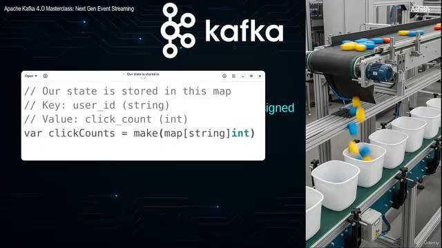
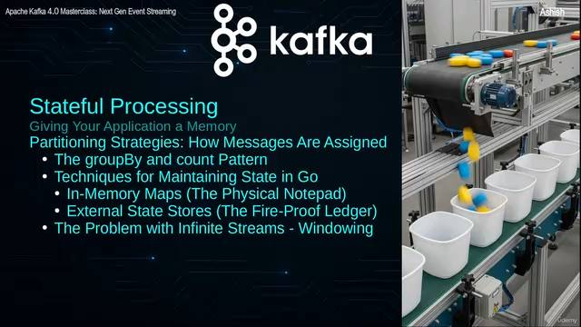
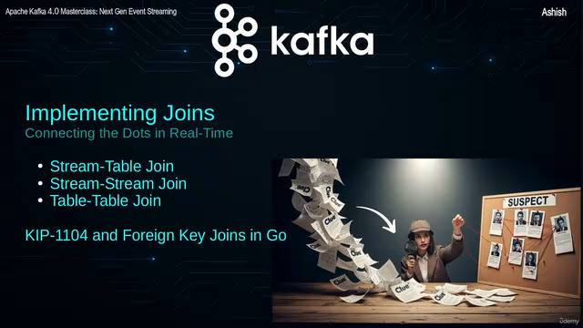
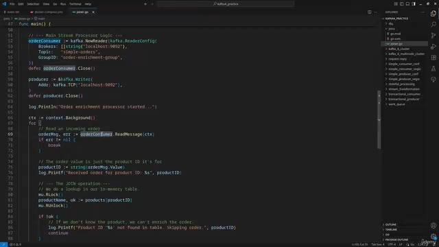
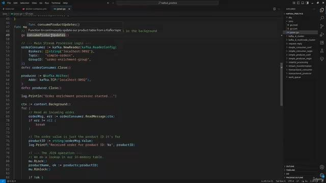
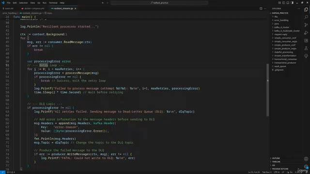
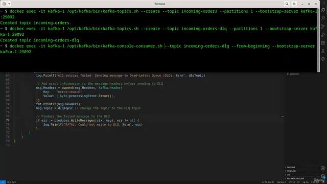

# Apache Kafka 4.0 实战：有状态窗口聚合、流表连接与容错处理（P065–P067）

> 本文覆盖 P065–P067 三节。三节是递进关系：先让流处理器「有记忆」（状态 + 窗口），再让两条流「对上号」（stream-table join），最后让整条链路「打不死」（重试 + 死信队列）。三份代码都是独立的 `package main`，放在同一个目录里，用 `go run <文件名>` 分别启动。
>
> **关于代码来源的说明**：逐字稿是讲师边写边讲的录音转写，屏幕上没有完整文件。下面第四节的代码是**按讲师口述逐句重建**的，能直接保存运行；凡是逐字稿没提到的部分（`import` 块、`context` 的传递方式、错误分支的具体写法），我在第五节逐行解释里标了「课里没讲，这里补全」。Kafka 客户端库用的是讲师明确说出的 `github.com/segmentio/kafka-go`（原话是 "导入 segment IO 包"）。

---

## 一、这一节做什么

三节课解决三个不同层次的问题，但共用同一套骨架：**一个 Reader 读、一个 Writer 写、一个 `for` 死循环**。差别只在循环体里做什么。

**P065 —— 有状态聚合 + 滚动窗口。**
上一节的无状态处理器像邮局分拣员，看一封信、判一次、扔出去，从不记得上一封。但「这个用户今天登录了几次」「这张卡 5 分钟内刷了超过 3 次就告警」这类问题，必须要有记忆。讲师用咖啡店店员的记事本打比方：`group by` 是「按客户名分组」，`count` 是「画正字」，记事本就是**状态存储（state store）**。这节课用 Go 的 `map[string]int` 当记事本，用 `time.NewTicker(10 * time.Second)` 当「每 10 秒换一页新纸」，做出一个 10 秒**滚动窗口（tumbling window）**的点击计数器：读 `user-clicks`，窗口关闭时把每个用户的计数打包成 JSON 写到 `clicks-per-window`，然后清空 map。

**P066 —— 流表连接（stream-table join）。**
订单流里只有 `product_id`，没有商品名和价格；商品流里才有。要给用户看订单确认页，就得把两条流接起来。讲师给了侦探的比喻：电传打字机吐出来的线索是**流**，墙上钉着嫌疑人资料的软木板是**表**。实现方式是：开一个 goroutine 在后台不停消费 `product-updates`，把 `product_id -> product_name` 灌进内存 map；主循环消费 `simple-orders`，拿 `product_id` 去 map 里查名字，查到就把「订单 + 商品名」拼成新消息写到 `enriched-orders`，查不到就跳过。因为 map 会被两个 goroutine 同时读写，所以必须加 `sync.RWMutex`。

**P067 —— 重试与死信队列。**
真实世界会出两种错：**瞬时错误**（网络抖一下、broker 滚动重启、数据库死锁）和**持久错误**（JSON 格式坏了、价格是负数、下游永远拒收）。前者重试就好，后者如果一直重试，整条流水线会被这一条「毒药消息」堵死。所以策略是：**先重试 N 次，还不行就扔进死信队列（DLQ）**，主流程继续往下走。这节课的代码里，`processMessage` 只要发现消息内容含 `fail` 就返回错误，主循环重试 3 次，全失败后给消息加一个 header 说明失败原因，改投到 `incoming-orders-dlq`。

三节课一共要建 6 个 topic：

| 课 | topic | 作用 |
|---|---|---|
| P065 | `user-clicks` | 输入：原始点击事件，key 是 user id |
| P065 | `clicks-per-window` | 输出：每个窗口每个用户的计数 |
| P066 | `simple-orders` | 输入：订单流，value 是 product id |
| P066 | `product-updates` | 输入：商品表变更流，key 是 product id |
| P066 | `enriched-orders` | 输出：拼好的订单 |
| P067 | `incoming-orders` | 输入：待处理订单 |
| P067 | `incoming-orders-dlq` | 输出：处理失败的毒药消息 |

（P067 严格说是 2 个，上表 7 行是因为 P065/P066 各 2 个、P067 2 个，共 6 个 topic 名 + 1 个 DLQ，按行数算是 7 条。）

---

## 二、讲师原话

> "上一讲我们构建了一个无状态的流处理器。它就像一个邮件分拣员，一封一封地单独查看每封信……但数据中最有价值的问题往往与趋势和历史有关。"
> —— p065 [00:00]

> "你的记事本就是你的状态存储。它是应用程序的记忆。"
> —— p065 [01:52]

> "它是易失的。如果应用崩溃或重启，map 就会被清空，你所有的计数都会丢失。这对学习和非关键应用来说很好，但不适合生产环境。"
> —— p065 [02:43]

> "要做到这一点，我们需要把无限的时间流切分成有限的块。这叫做窗口化。"
> —— p065 [04:03]

> "窗口大小固定，且永不重叠。这非常适合生成规律的周期性报告。"
> —— p065 [04:56]

> "所以为了创建窗口化逻辑，我们用到了在 Go 训练营中学过的东西。还记得 ticker 吗？"
> —— p065 [08:39]

> "在这个示例中我们将使用 ticker……我们创建一个每 10 秒触发一次的 ticker，因为 10 秒就是我们的窗口。"
> —— p065 [09:09]

> "遍历完 map 之后，我们要为下一个窗口重置状态。这一点非常非常重要。"
> —— p065 [14:53]

> "但不知为何它没有遵循 10 秒的规则。我不清楚原因，因为我们的代码里确实有 10 秒的 ticker……如果你那边也出现类似情况，请在评论区告诉我你的发现。"
> —— p065 [21:59]

> "连接就是从流中获取一条新线索，并立即查看你的嫌疑人墙，看它是否与任何人匹配。"
> —— p066 [01:27]

> "接下来是流与流的连接。你需要关联两个同时发生的不同实时事件流。"
> —— p066 [02:48]

> "Kafka Streams 库有一个专门用于连接的特性，叫做外键连接。KIP1104 对此做了改进，允许从消息的值中提取键，而不仅仅是从键本身。虽然 Go 中没有这个现成的预构建函数，但我们可以实现完全相同的概念。"
> —— p066 [05:31]

> "接下来是互斥锁，它代表互斥。可以把它想象成我们产品 map 的发言权杖。"
> —— p066 [11:00]

> "go 关键字告诉程序在一个 goroutine 中运行这个函数，goroutine 就像是一个轻量级的并行线程。"
> —— p066 [12:20]

> "如果我们的应用每次遇到一条坏消息就崩溃，那它就不太有用。现在我们要学习如何构建有弹性且健壮的流处理器。"
> —— p067 [00:00]

> "对于瞬时错误，解决方案是重试。我们的 Go 应用可以实现一个简单的重试循环。通过重试，我们将用 Go 实现 KIP 1065 的逻辑。"
> —— p067 [02:49]

> "死信队列只是另一个独立的 Kafka topic。例如，orders topic DLQ。"
> —— p067 [03:17]

> "管道从未停止。这就是我们观察到的结果。即使中间有一条失败的消息，失败消息旁边的那条消息也确实被成功处理了。"
> —— p067 [10:52]

---

## 三、从零复现

### 3.1 前置环境

| 组件 | 版本 / 说明 |
|---|---|
| Kafka | 4.0（课程标题即 4.0，KRaft 模式，不再需要 ZooKeeper） |
| Go | 1.21+（`go mod init` 与 `go run` 需要） |
| Kafka 客户端库 | `github.com/segmentio/kafka-go`（讲师原话 "segment IO 包"；**具体版本号课里没讲**，用 `@latest` 拉最新即可） |
| broker 地址 | 全文统一用 `localhost:9092` |

> **课里没讲 Kafka 怎么启动。** 讲师开场时 broker 已经在跑了。如果你本地还没有，Kafka 4.0 官方 quickstart 的写法是（路径以你解压出来的包为准）：
>
> ```bash
> # 1. 生成一个集群 ID
> KAFKA_CLUSTER_ID="$(bin/kafka-storage.sh random-uuid)"
> # 2. 格式化存储目录（KRaft 模式必须做一次）
> bin/kafka-storage.sh format --standalone -t $KAFKA_CLUSTER_ID -c config/server.properties
> # 3. 启动 broker
> bin/kafka-server-start.sh config/server.properties
> ```
>
> 这三条命令**不是逐字稿里的内容**，是 Kafka 4.0 的标准启动方式，写在这里只是让你能跑起来。

### 3.2 目录结构与初始化

```bash
mkdir kafka-4-streams
cd kafka-4-streams
go mod init kafka-streams
go get github.com/segmentio/kafka-go
```

最终目录长这样：

```
kafka-4-streams/
├── go.mod
├── go.sum
├── stateful_counter.go      # P065
├── stream_table_join.go     # P066
└── resilient_streams.go     # P067
```

> ⚠️ 三个文件都是 `package main` 且各自有 `main()` 函数，**不能 `go run .`**，必须 `go run stateful_counter.go` 这样按文件名跑。讲师在 P067 [09:18] 用的就是 `go run resilient_streams.go`。

### 3.3 建 topic

讲师在 P065 [05:21] 说 "那么，我们来创建主题吧"，在 P066 [07:24] 又建了三个，在 P067 [08:31] 建了最后两个。**具体命令课里没给全**，下面是 Kafka 4.0 的标准写法：

```bash
# P065
bin/kafka-topics.sh --bootstrap-server localhost:9092 \
  --create --topic user-clicks --partitions 1 --replication-factor 1

bin/kafka-topics.sh --bootstrap-server localhost:9092 \
  --create --topic clicks-per-window --partitions 1 --replication-factor 1

# P066
bin/kafka-topics.sh --bootstrap-server localhost:9092 \
  --create --topic simple-orders --partitions 1 --replication-factor 1

bin/kafka-topics.sh --bootstrap-server localhost:9092 \
  --create --topic product-updates --partitions 1 --replication-factor 1

bin/kafka-topics.sh --bootstrap-server localhost:9092 \
  --create --topic enriched-orders --partitions 1 --replication-factor 1

# P067
bin/kafka-topics.sh --bootstrap-server localhost:9092 \
  --create --topic incoming-orders --partitions 1 --replication-factor 1

bin/kafka-topics.sh --bootstrap-server localhost:9092 \
  --create --topic incoming-orders-dlq --partitions 1 --replication-factor 1
```

> 单机练习用 `--partitions 1 --replication-factor 1` 就够了。**注意**：如果分区数大于 1，P065 的 `map` 状态是进程内的，同一个 user 的消息可能落到不同分区、被不同实例消费，计数就会错——这是「内存 map 方案」的天然限制，课里没展开讲，但你在生产上一定会撞到。

### 3.4 跑 P065：有状态窗口计数器

**终端 A** —— 先起一个 CLI 消费者盯住输出 topic（讲师在 P065 [19:09] 就是这么做的）：

```bash
bin/kafka-console-consumer.sh --bootstrap-server localhost:9092 \
  --topic clicks-per-window \
  --property print.key=true \
  --property key.separator=" => "
```

**终端 B** —— 跑 Go 程序：

```bash
go run stateful_counter.go
```

**终端 C** —— 灌数据。讲师在 P065 [18:13] 说他准备了一个脚本：「send 30 messages with a gap of half a second between each message... messages are going to have user A and user C as the key alternately」。**脚本源码课里没贴**，按这个描述重写一个：

```bash
#!/usr/bin/env bash
# send_clicks.sh —— 30 条消息，间隔 0.5 秒，key 在 userA / userC 之间交替
for i in $(seq 1 30); do
  if [ $((i % 2)) -eq 0 ]; then
    KEY="userA"
  else
    KEY="userC"
  fi
  echo "$KEY:click-$i"
  sleep 0.5
done | bin/kafka-console-producer.sh \
  --bootstrap-server localhost:9092 \
  --topic user-clicks \
  --property parse.key=true \
  --property key.separator=:
```

```bash
chmod +x send_clicks.sh
./send_clicks.sh
```

你会看到终端 B 每 10 秒打印一次 `window closed, processing and emitting results`，然后逐条打印 `emitting the result for user ... and the count is ...`，最后打印 `state reset for new window`；终端 A 同步收到 JSON。





### 3.5 跑 P066：流表连接

**终端 A** —— 盯住输出：

```bash
bin/kafka-console-consumer.sh --bootstrap-server localhost:9092 \
  --topic enriched-orders
```

**终端 B** —— 跑 joiner：

```bash
go run stream_table_join.go
```

**终端 C** —— 先灌商品表（讲师在 P066 [14:13] 演示的格式是 `key:value`）：

```bash
bin/kafka-console-producer.sh --bootstrap-server localhost:9092 \
  --topic product-updates \
  --property parse.key=true \
  --property key.separator=:
```

然后逐行输入（每行回车一次）：

```
prod123:laptop
prod456:luxury product
prod999:car
```

`Ctrl+C` 退出，再开一个 producer 灌订单：

```bash
bin/kafka-console-producer.sh --bootstrap-server localhost:9092 \
  --topic simple-orders \
  --property parse.key=true \
  --property key.separator=:
```

输入：

```
orderABC:prod123
```

终端 A 立刻收到：

```json
{"order_id":"orderABC","product_id":"prod123","product_name":"laptop"}
```

> 讲师在 P066 [15:10] 特别强调：「make sure that you mention the product ID exactly as it appears over here」——`prod123` 必须和商品表里的 key 一字不差，否则查不到，程序会走「跳过」分支。







### 3.6 跑 P067：重试 + 死信队列

**终端 A** —— 盯住 DLQ：

```bash
bin/kafka-console-consumer.sh --bootstrap-server localhost:9092 \
  --topic incoming-orders-dlq \
  --property print.headers=true
```

**终端 B** —— 跑处理器：

```bash
go run resilient_streams.go
```

**终端 C** —— 灌消息：

```bash
bin/kafka-console-producer.sh --bootstrap-server localhost:9092 \
  --topic incoming-orders
```

依次输入三条：

```
this is a good message
this message will fail
this is another good one
```

终端 B 的预期输出（讲师在 P067 [10:23] 复盘的正是这个序列）：

```
resilient processor has started
message processed successfully: this is a good message
attempt 1/3 failed: poison pill: message contains the word fail
attempt 2/3 failed: poison pill: message contains the word fail
attempt 3/3 failed: poison pill: message contains the word fail
message forwarded to dead letter queue: this message will fail
message processed successfully: this is another good one
```

终端 A 会收到那条失败消息，并带上 `error-reason` header。**关键观察点**：第三条好消息没有被第二条坏消息堵住，流水线没有停——这就是讲师说的 "这条流水线从未停止运行"。





---

## 四、完整代码

### 4.1 `stateful_counter.go`（P065）

```go
package main

import (
	"context"
	"encoding/json"
	"log"
	"time"

	"github.com/segmentio/kafka-go"
)

// 应用状态：user_id -> 当前窗口内的点击次数
// 课里没讲并发保护，因为这里只有主 goroutine 读写它
var clickCounts = make(map[string]int)

func main() {
	// ---------- 1. 消费者：读 user-clicks ----------
	reader := kafka.NewReader(kafka.ReaderConfig{
		Brokers: []string{"localhost:9092"},
		Topic:   "user-clicks",
		GroupID: "click-counter-group",
	})
	defer reader.Close()

	// ---------- 2. 生产者：写 clicks-per-window ----------
	writer := &kafka.Writer{
		Addr:  kafka.TCP("localhost:9092"),
		Topic: "clicks-per-window",
	}
	defer writer.Close()

	log.Println("starting stateful click counter")

	// ---------- 3. 窗口逻辑：10 秒滚动窗口 ----------
	// 讲师在 p065 [22:27] 建议：想精确知道窗口何时开始，就在 ticker 之前打一行日志
	log.Println("windowing logic starts at:", time.Now().UTC().Format(time.RFC3339))
	ticker := time.NewTicker(10 * time.Second)
	defer ticker.Stop()

	ctx := context.Background()

	// ---------- 4. 主循环 ----------
	for {
		select {
		case <-ticker.C:
			// 10 秒窗口已关闭，处理并输出结果
			log.Println("window closed, processing and emitting results")

			for userID, count := range clickCounts {
				result := map[string]interface{}{
					"user_id":     userID,
					"click_count": count,
					"window_end":  time.Now().UTC().Format(time.RFC3339),
				}

				resultBytes, err := json.Marshal(result)
				if err != nil {
					log.Println("failed to marshal result:", err)
					continue
				}

				msg := kafka.Message{
					Topic: "clicks-per-window",
					Key:   []byte(userID),
					Value: resultBytes,
				}

				if err := writer.WriteMessages(ctx, msg); err != nil {
					log.Println("failed to write result:", err)
					continue
				}

				log.Printf("emitting the result for user %s and the count is %d", userID, count)
			}

			// 重置状态，为下一个窗口做准备
			clickCounts = make(map[string]int)
			log.Println("state reset for new window")

		default:
			// 窗口还没关，继续读消息
			msg, err := reader.ReadMessage(ctx)
			if err != nil {
				log.Println("could not read the message:", err)
				return
			}

			// 聚合逻辑：按 key 累加
			userID := string(msg.Key)
			clickCounts[userID]++
			log.Printf("incremented count for user %s to %d", userID, clickCounts[userID])
		}
	}
}
```

### 4.2 `stream_table_join.go`（P066）

```go
package main

import (
	"context"
	"encoding/json"
	"log"
	"sync"

	"github.com/segmentio/kafka-go"
)

const brokerAddr = "localhost:9092"

// 内存中的商品表：product_id -> product_name
var (
	products = make(map[string]string)
	mu       sync.RWMutex
)

// 后台 worker：持续消费 product-updates，把商品表建起来
func consumeProductUpdates() {
	reader := kafka.NewReader(kafka.ReaderConfig{
		Brokers: []string{brokerAddr},
		Topic:   "product-updates",
		GroupID: "product-table-builder",
	})
	defer reader.Close()

	for {
		msg, err := reader.ReadMessage(context.Background())
		if err != nil {
			log.Println("failed to read product update:", err)
			continue
		}

		mu.Lock()
		products[string(msg.Key)] = string(msg.Value)
		mu.Unlock()

		log.Printf("product table updated: %s = %s", string(msg.Key), string(msg.Value))
	}
}

func main() {
	// 1. 后台建表
	go consumeProductUpdates()

	// 2. 读订单流
	reader := kafka.NewReader(kafka.ReaderConfig{
		Brokers: []string{brokerAddr},
		Topic:   "simple-orders",
		GroupID: "order-enricher",
	})
	defer reader.Close()

	// 3. 写富化后的订单
	writer := &kafka.Writer{
		Addr:  kafka.TCP(brokerAddr),
		Topic: "enriched-orders",
	}
	defer writer.Close()

	log.Println("stream-table joiner started")

	// 4. 主循环：两条流在这里汇合
	for {
		msg, err := reader.ReadMessage(context.Background())
		if err != nil {
			log.Println("failed to read order:", err)
			continue
		}

		orderID := string(msg.Key)
		productID := string(msg.Value)

		// 读锁：多个读者可以同时拿，写者必须独占
		mu.RLock()
		productName, ok := products[productID]
		mu.RUnlock()

		if !ok {
			log.Printf("no product found for product ID %s, skipping order %s", productID, orderID)
			continue
		}

		enriched := map[string]interface{}{
			"order_id":     orderID,
			"product_id":   productID,
			"product_name": productName,
		}

		payload, err := json.Marshal(enriched)
		if err != nil {
			log.Println("failed to marshal enriched order:", err)
			continue
		}

		if err := writer.WriteMessages(context.Background(), kafka.Message{
			Key:   []byte(orderID),
			Value: payload,
		}); err != nil {
			log.Println("failed to write enriched order:", err)
			continue
		}

		log.Printf("enriched order %s with product %s", orderID, productName)
	}
}
```

### 4.3 `resilient_streams.go`（P067）

```go
package main

import (
	"context"
	"errors"
	"log"
	"strings"
	"time"

	"github.com/segmentio/kafka-go"
)

const (
	brokerAddr = "localhost:9092"
	dlqTopic   = "incoming-orders-dlq"
	maxRetries = 3
)

// 业务逻辑：消息里含 "fail" 就当成毒药消息
func processMessage(msg kafka.Message) error {
	if strings.Contains(string(msg.Value), "fail") {
		return errors.New("poison pill: message contains the word fail")
	}
	return nil
}

func main() {
	// ---------- 1. consumer setup ----------
	reader := kafka.NewReader(kafka.ReaderConfig{
		Brokers: []string{brokerAddr},
		Topic:   "incoming-orders",
		GroupID: "resilient-processor",
	})
	defer reader.Close()

	writer := &kafka.Writer{
		Addr:  kafka.TCP(brokerAddr),
		Topic: dlqTopic,
	}
	defer writer.Close()

	log.Println("resilient processor has started")

	ctx := context.Background()

	// ---------- 2. 主处理循环 ----------
	for {
		msg, err := reader.ReadMessage(ctx)
		if err != nil {
			log.Println("failed to read message:", err)
			continue
		}

		// ---------- 3. 重试循环（第一道防线） ----------
		var processingErr error
		for attempt := 1; attempt <= maxRetries; attempt++ {
			processingErr = processMessage(msg)
			if processingErr == nil {
				log.Printf("message processed successfully: %s", string(msg.Value))
				break
			}
			log.Printf("attempt %d/%d failed: %v", attempt, maxRetries, processingErr)
			time.Sleep(2 * time.Second)
		}

		// ---------- 4. 死信队列（第二道防线） ----------
		if processingErr != nil {
			msg.Headers = append(msg.Headers, kafka.Header{
				Key:   "error-reason",
				Value: []byte(processingErr.Error()),
			})
			msg.Topic = dlqTopic

			if err := writer.WriteMessages(ctx, msg); err != nil {
				log.Println("failed to forward message to DLQ:", err)
				continue
			}
			log.Printf("message forwarded to dead letter queue: %s", string(msg.Value))
		}
	}
}
```

---

## 五、逐行解释

### 5.1 `stateful_counter.go`

**`var clickCounts = make(map[string]int)`**
这就是讲师说的「记事本」。key 是 `user_id`（字符串），value 是点击次数（int）。放在包级变量而不是 `main()` 里，是为了让「窗口关闭时遍历」和「窗口内累加」两处都能访问到。**课里没讲并发保护**——因为整个程序只有主 goroutine 读写这个 map，不存在竞态。这一点和 P066 形成对比，P066 里有两个 goroutine，所以必须加锁。

**`kafka.NewReader(kafka.ReaderConfig{...})`**
`GroupID: "click-counter-group"` 是讲师在 P065 [08:11] 明确说的「the group is going to be different now」。换 group 意味着这个消费者有自己独立的 offset，不会和别的消费者抢消息。

**`ticker := time.NewTicker(10 * time.Second)`**
讲师在 P065 [09:09] 说「we are creating a ticker that fires every 10 seconds because 10 seconds is our window」。`time.Ticker` 是 Go 标准库里「每隔固定时间往 channel 里塞一个时间值」的机制，**在 JS/Node 里对应 `setInterval`**。`defer ticker.Stop()` 是必须的，否则 ticker 会一直活着（虽然 `main` 退出后进程结束也就没了，但这是好习惯）。

**`select { case <-ticker.C: ... default: ... }`**
这是整个程序的心脏。`select` 在 Go 里就是「多路等待」：哪个 channel 先有数据就走哪个分支。这里只有两个分支：
- `<-ticker.C`：10 秒到了，窗口该关了；
- `default`：ticker 还没响，那就去读消息。

**注意一个坑**：`default` 分支里的 `reader.ReadMessage(ctx)` 是**阻塞**的。如果 10 秒到了但 `ReadMessage` 正卡在那里等消息，`select` 是没法切到 `ticker.C` 分支的——必须等 `ReadMessage` 返回。这就是讲师在 P065 [21:59] 观察到的「it's not following the 10 second rule」的直接原因之一。**课里没讲怎么修**，第七节会展开。

**`for userID, count := range clickCounts`**
遍历 map 是**无序**的，所以每次窗口关闭时，输出的用户顺序不保证一致。如果你需要稳定顺序，得自己排序（课里没讲）。

**`result := map[string]interface{}{...}`**
讲师在 P065 [11:32] 说「the result is map with key string and value could be anything. So I'm going to use interface」。三个字段：`user_id`、`click_count`、`window_end`。`window_end` 用的是 `time.Now().UTC().Format(time.RFC3339)`，讲师在 P065 [12:30] 明确说了「format this as per time dot rfc 339」（口误，实际是 RFC3339）。

**`clickCounts = make(map[string]int)`**
讲师在 P065 [14:53] 强调「this is very, very important」。**必须重新 `make` 一个新 map，不能 `for k := range clickCounts { delete(clickCounts, k) }` 之外还保留旧引用**——这里直接赋新值最干净。如果忘了这一步，计数会一直累加，窗口就失去意义了。

### 5.2 `stream_table_join.go`

**`var (products = make(...); mu sync.RWMutex)`**
讲师在 P066 [11:00] 用「说话棒」比喻：`mu.Lock()` 是「我要写，所有人等着」，`mu.RLock()` 是「我只是看，其他看的人可以一起看」。**为什么用 `RWMutex` 而不是普通 `Mutex`？** 因为读远多于写——每来一条订单都要读一次商品表，但商品表可能几分钟才更新一次。`RWMutex` 允许多个读并发，吞吐更高。**在 JS/Node 里**，单线程模型下普通对象读写天然不会撕裂，所以通常不需要锁；但如果你用 `worker_threads` + `SharedArrayBuffer`，就得用 `Atomics` 自己做同步，思路和这里一样。

**`go consumeProductUpdates()`**
讲师在 P066 [12:20] 说「the go keyword tells the program to run this function in a go routine which is like a lightweight parallel thread」。**在 JS 里对应 `setInterval` 里跑异步任务，或者 `worker_threads` 起一个 worker**。注意：`go` 关键字启动后立刻返回，主 goroutine 继续往下走，两边是并发的。

**`mu.Lock(); products[string(msg.Key)] = string(msg.Value); mu.Unlock()`**
写锁必须成对出现。**课里没讲**如果 `WriteMessages` 或 `json.Marshal` 在锁内 panic 会怎样——实际生产代码里应该用 `defer mu.Unlock()` 包一层，或者把锁的粒度缩到最小（这里已经很小了）。

**`mu.RLock(); productName, ok := products[productID]; mu.RUnlock()`**
`ok` 是 Go 的「逗号 ok」惯用法，用来区分「key 存在但 value 是空字符串」和「key 不存在」。讲师在 P066 [13:17] 说「If it finds a matching product name, it creates a new, more detailed message... If not, it just skips the order」——`ok == false` 时走 `continue`，跳过这条订单。

**`enriched := map[string]interface{}{...}`**
三个字段：`order_id`（来自消息 key）、`product_id`（来自消息 value）、`product_name`（来自内存表）。这就是「富化」的全部内容。

**`writer.WriteMessages(ctx, kafka.Message{Key: []byte(orderID), Value: payload})`**
注意这里**没有设 `Topic` 字段**，因为 `writer` 初始化时已经设了 `Topic: "enriched-orders"`，`WriteMessages` 会自动用它。

### 5.3 `resilient_streams.go`

**`func processMessage(msg kafka.Message) error`**
讲师在 P067 [06:09] 说「This function represents your core business task. It checks if the message contains the word fail」。真实业务里这里可能是「解析 JSON」「校验价格为正」「调下游 API」，这里用 `strings.Contains` 模拟。**返回 `nil` 表示成功，返回 `error` 表示失败**——这是 Go 的错误处理惯例，**在 JS 里对应 `throw` / `try...catch`**。

**`for attempt := 1; attempt <= maxRetries; attempt++`**
讲师在 P067 [07:34] 说「It's a small for loop that will run up to the max retries times」。`maxRetries = 3` 是常量，改起来方便。

**`if processingErr == nil { ...; break }`**
成功就 `break` 跳出重试循环，**不再执行后面的 DLQ 逻辑**（因为 `processingErr` 是 `nil`，`if processingErr != nil` 不成立）。

**`time.Sleep(2 * time.Second)`**
讲师在 P067 [07:34] 说「it waits for a couple of seconds before the loop runs again」。**这是最朴素的退避**。生产上一般用**指数退避**（1s、2s、4s...）加**抖动（jitter）**，避免所有实例同时重试打爆下游。**课里没讲指数退避**，第七节会提。

**`msg.Headers = append(msg.Headers, kafka.Header{Key: "error-reason", Value: ...})`**
讲师在 P067 [08:03] 说「The code then prepares the failed message for the dead letter queue by adding the error reason to its headers」。Kafka 消息的 header 是 `[]kafka.Header`，每个 header 是 key-value 对，value 是 `[]byte`。**注意**：`append` 可能复用底层数组，如果 `msg` 是从 reader 拿到的、底层数组被复用，可能会有意外——但这里 `msg` 是值拷贝，`Headers` 切片是新分配的，问题不大。

**`msg.Topic = dlqTopic`**
讲师在 P067 [08:03] 说「changing its topic to the dlq topic name」。**这一行是关键**：`writer` 初始化时 `Topic: dlqTopic`，但 `WriteMessages` 会优先用 `msg.Topic`（如果非空）。所以这里显式设成 `dlqTopic` 是双保险，也让你一眼看出「这条消息要去 DLQ 了」。

**`if processingErr != nil { ... }`**
重试循环结束后，如果 `processingErr` 还是非 `nil`，说明 3 次都失败了，走 DLQ 分支。**注意 `continue`**：DLQ 写失败时 `continue` 跳过本轮，继续读下一条消息——**这其实是个隐患**，如果 DLQ 也挂了，这条消息就丢了。生产上一般要「DLQ 写失败就阻塞重试」或者「落本地磁盘」，课里没讲。

---

## 六、复现检查清单

跑完三节，逐条对照：

**环境**
- [ ] `go version` ≥ 1.21
- [ ] `go.mod` 里有 `github.com/segmentio/kafka-go` 依赖
- [ ] broker 在 `localhost:9092` 可连（`bin/kafka-topics.sh --bootstrap-server localhost:9092 --list` 能列出 topic）
- [ ] 7 个 topic 都建好了（`user-clicks`、`clicks-per-window`、`simple-orders`、`product-updates`、`enriched-orders`、`incoming-orders`、`incoming-orders-dlq`）

**P065**
- [ ] `go run stateful_counter.go` 启动后打印 `starting stateful click counter`
- [ ] 灌数据后，每 10 秒左右打印一次 `window closed, processing and emitting results`
- [ ] 每个窗口内，`userA` 和 `userC` 的计数加起来等于该窗口内发出的消息数
- [ ] 窗口关闭后打印 `state reset for new window`
- [ ] `clicks-per-window` 的 CLI 消费者能收到 JSON，字段是 `user_id` / `click_count` / `window_end`
- [ ] **观察**：窗口间隔是不是严格 10 秒？如果不是，正常，讲师自己也遇到了（P065 [21:59]）

**P066**
- [ ] `go run stream_table_join.go` 启动后打印 `stream-table joiner started`
- [ ] 灌 `prod123:laptop` 后，joiner 打印 `product table updated: prod123 = laptop`
- [ ] 灌 `orderABC:prod123` 后，`enriched-orders` 消费者收到 `{"order_id":"orderABC","product_id":"prod123","product_name":"laptop"}`
- [ ] 灌一个不存在的 product id（比如 `orderXYZ:prod000`），joiner 打印 `no product found...skipping order`，`enriched-orders` 没有新消息
- [ ] **并发验证**：一边灌商品更新、一边灌订单，程序不 panic（`RWMutex` 生效）

**P067**
- [ ] `go run resilient_streams.go` 启动后打印 `resilient processor has started`
- [ ] 灌 `this is a good message`，打印 `message processed successfully`
- [ ] 灌 `this message will fail`，连续打印 3 次 `attempt N/3 failed`，然后打印 `message forwarded to dead letter queue`
- [ ] DLQ 消费者收到这条消息，header 里有 `error-reason`
- [ ] 再灌 `this is another good one`，**能正常处理**（流水线没被堵死）
- [ ] **时间验证**：从第一条 `attempt 1/3` 到最后一条 `attempt 3/3`，间隔约 4 秒（2 秒 × 2 次 sleep）

---

## 七、课里没讲但你会撞上的

**1. 窗口为什么不是严格 10 秒？**
讲师在 P065 [21:59] 自己也困惑。原因在 `select` 的 `default` 分支：`reader.ReadMessage(ctx)` 是阻塞调用，如果它正卡着等消息，`ticker.C` 就算响了也切不过去，必须等 `ReadMessage` 返回。**修法**：给 `ReadMessage` 加超时（`context.WithTimeout`），或者用 `reader.SetReadDeadline`，或者干脆把 ticker 检查放到消息处理完之后。**课里没给修法**，这是你自己要补的。

**2. 内存 map 会无限增长**
P065 的 `clickCounts` 每个窗口重置，没问题；但 P066 的 `products` 是**只增不减**的。商品下架了，map 里还留着。生产上要么给 map 加 TTL，要么用带淘汰的缓存（比如 `ristretto`、`bigcache`）。**课里没讲**。

**3. 多分区下状态会错**
P065 的 `clickCounts` 是进程内的。如果 `user-clicks` 有 3 个分区、你起了 3 个实例，同一个 user 的消息可能落到不同实例，每个实例各算各的，结果就错了。**解法**：要么单分区，要么用 Kafka Streams 那种「按 key 分区 + 状态存储」的模型，要么把状态外置到 Redis。**课里没讲**，但这是「内存 map 方案」的硬伤。

**4. `msg.Topic` 覆盖 writer topic 的行为**
P067 里 `writer.Topic = dlqTopic` 且 `msg.Topic = dlqTopic`，两者一致所以没事。但如果你哪天想让一个 writer 写多个 topic，就得靠 `msg.Topic` 覆盖——**具体行为以你用的 kafka-go 版本为准**，不同版本对「writer topic 和 msg topic 冲突」的处理不一样。

**5. DLQ 写失败会丢消息**
P067 的 `if err := writer.WriteMessages(...); err != nil { continue }`——DLQ 写失败就 `continue` 了，这条消息**既没进 DLQ 也没被重试**，等于丢了。生产上要么阻塞重试，要么落本地文件，要么至少打一条 error 级别的日志告警。**课里没讲**。

**6. 没有 graceful shutdown**
三个程序都是 `for {}` 死循环，`Ctrl+C` 直接杀进程。生产上要监听 `os.Signal`，收到 `SIGTERM` 后先 `reader.Close()`、`writer.Close()`、把内存里的状态 flush 出去。**课里没讲**。

**7. 重试没有退避策略**
P067 是固定 `time.Sleep(2 * time.Second)`。如果下游是「限流」导致的失败，固定间隔重试只会加重限流。生产上要用**指数退避 + 抖动**。**课里没讲**。

**8. 在 JS/Node 里的对应关系**
- `goroutine` ≈ `worker_threads` 的 worker，或者一个独立的 `async` 任务；
- `sync.RWMutex` ≈ 单线程下不需要；`worker_threads` + `SharedArrayBuffer` 下用 `Atomics.wait` / `Atomics.notify`；
- `time.Ticker` ≈ `setInterval`；
- `select` ≈ `Promise.race`（但语义不完全一样，Go 的 `select` 是「哪个 channel 先就绪走哪个」，`Promise.race` 是「哪个先 resolve 走哪个」）；
- `kafka-go` 的 `Reader` / `Writer` ≈ `kafkajs` 的 `consumer` / `producer`，API 形状不同但概念一一对应。

**9. KIP 编号只是背景**
讲师在 P066 [05:31] 提到 KIP-1104（foreign key join），在 P067 [02:49] 提到 KIP-1065（retry）。这两个是 **Java 版 Kafka Streams 的提案**，Go 里没有对应实现，讲师是「用 Go 手写同样的逻辑」。**不要去找 Go 的 KIP-1104 库，不存在**。

**10. `time.RFC3339` 的口误**
讲师在 P065 [12:30] 说「time dot rfc 339」，实际常量名是 `time.RFC3339`（少一个 3）。代码里写 `time.RFC3339` 才能编译。

---

**最后一句**：三节课的代码加起来不到 300 行，但覆盖了流处理最核心的三个模式——**有状态聚合、流表连接、容错**。把这三份代码跑通、改坏、再修好，比看十篇概念文章有用。