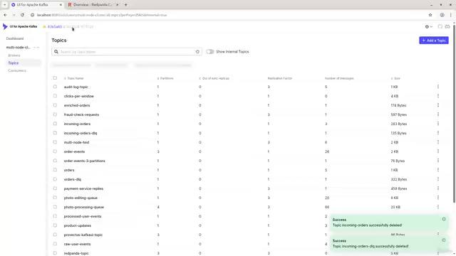
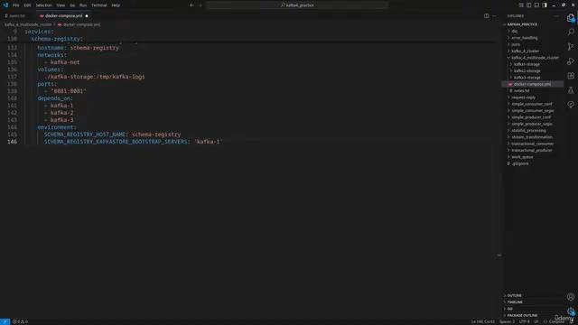
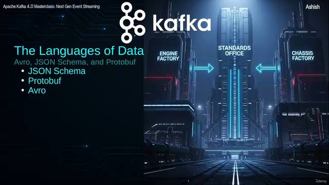
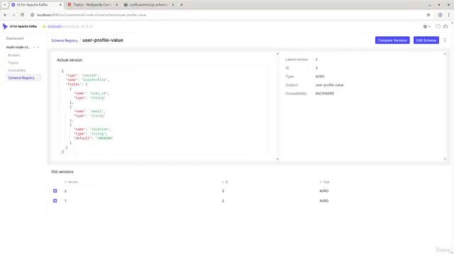
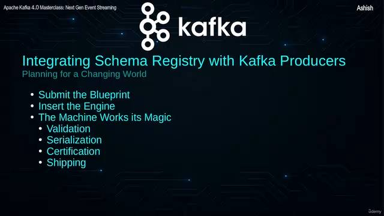
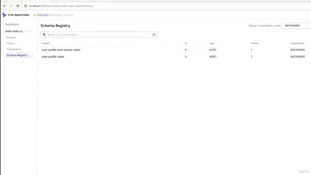
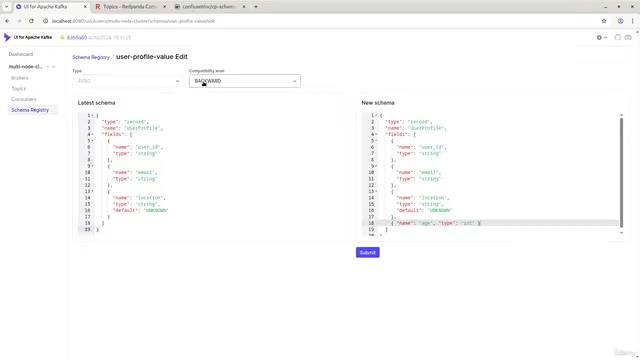
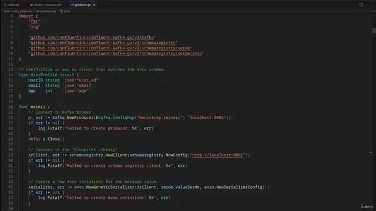

# Apache Kafka 4.0：Schema Registry 与 Avro 生产者实战（P068–P071）

> 适用读者：前端转 AI 应用工程师。本文所有 Go 代码可直接保存运行；涉及 Java 语法处会标注「知道即可」。
> 覆盖课程：P068（Schema Registry 概念与 Docker 接入）、P069（三种 Schema 语言对比）、P070（Schema Evolution 与兼容性模式）、P071（Go Avro Producer 完整实现）。

---

## 1. 这一节做什么

这四讲把「Kafka 只搬字节、不管内容」这件事补上最后一块拼图：**给消息加上可校验、可演进的契约**。

具体产出三样东西：

1. 在已有的 Kafka Docker Compose 栈里**新增一个 Schema Registry 服务**（Confluent 官方镜像），并把它接到 Kafka UI 与 Redpanda Console 上，让 UI 能可视化地创建、对比、演进 schema。
2. 理解并**亲手验证三种兼容性模式**（backward / forward / full）以及它们的 transitive 变体，看到 Schema Registry 如何**拒绝一次破坏性变更**。
3. 写一个 **Go Avro Producer**：用 Confluent 的 `schema-registry` 客户端 + `avro` serializer，把 Go struct 自动推导成 Avro schema、自动注册到 Registry、把 schema ID 打进消息头，再发到 Kafka。跑完之后在 Kafka UI 里能看到「不是乱码」的结构化消息。

最终你会得到一个能跑通「定义契约 → 生产者强制遵守 → 消费者按契约反序列化」的完整闭环。

**前端对照理解**：如果你熟悉 TypeScript 的 `interface`、OpenAPI/Swagger 或 npm 包版本管理，可以把这一节理解成给 Kafka 消息补一个「消息级接口定义 + 版本仓库 + 兼容性检查器」。Kafka 本身仍然只负责搬运字节，类似 HTTP 只传 body；Schema Registry 类似接口文档与校验中心；Producer 在发送前按契约编码，Consumer 按契约解码。区别是 Registry 不替代 Kafka，它是独立服务，通过 schema ID 把消息体和 schema 定义关联起来。

**常见误区与排查**：不要以为部署了 Schema Registry 后，Kafka 会自动校验所有历史消息。Registry 主要在生产端注册或获取 schema 时做兼容性检查，并把 schema ID 写进消息头；消费端拿到 ID 后再去 Registry 查定义。若 UI 显示乱码，先查 serde 配置和 wire format，而不是先怀疑 Kafka 坏了。

---

## 2. 讲师原话（带出处）

关于 Schema Registry 的定位，讲师用了一个贯穿全课的比喻：

> "Apache Kafka 就是那座图书馆。它是一个海量且高效的系统，用来存储和分发书籍……图书馆并不关心一本书是用英语、法语还是克林贡语写的。它唯一的职责就是存储实体书籍，也就是字节……而 schema registry 则是位于图书馆隔壁的词典与语法办公室。它是一栋独立的建筑。"
> —— p068 [00:27]

> "schema registry 这个概念并不属于 Apache Kafka 核心开源项目的一部分。Apache Kafka 本身并不知道你消息内部的数据格式。它只看到并搬运字节数组。"
> —— p068 [00:00]

关于为什么需要它（数据契约）：

> "如果生产者应用不小心发送了一条消息，字段名拼错了，或者把数据类型从数字改成了字符串，会发生什么？期待旧格式的消费者应用会崩溃……我们需要一种方式来在生产者与消费者之间强制执行契约。我们需要一个数据守护者。"
> —— p068 [08:26]

关于三种 schema 语言，讲师用「运椅子」做类比：

> "方案一是 JSON schema，也就是预先组装好的椅子……它冗长且体积大……下一个方案是 protocol buffers。这是高科技零件套件……极快且紧凑……然后是 Avro。宜家平板包装……组装说明书也就是 schema，并不在盒子里。顾客从宜家门店也就是 schema registry 获取它。"
> —— p069 [00:29]

关于 Avro 的核心机制（schema 与数据分离 + schema ID）：

> "当生产者发送消息时，它会查看 schema，但不会把 schema 包含在消息里。它只是以紧凑的二进制格式发送原始数据值。最后是神奇之处。生产者在消息开头加上一个小小的 ID 编号，表示这条消息是用 schema registry 中的 5 号蓝图构建的。"
> —— p069 [03:37]

关于 backward compatibility 是默认值：

> "这是默认且最常见的。这种兼容性的规则是，新 schema 必须能被只知道旧 schema 的应用读取……你可以添加一个新字段，但它必须是可选的，也就是说它必须有默认值。"
> —— p070 [01:52]

关于讲师亲手触发一次破坏性变更被拒：

> "正在注册的 schema 与更早的 schema 不兼容。完美。不可处理实体。所以这次 UI 显示了一个错误。它告诉我们该 schema 不兼容，因为在向后兼容级别下，不能添加没有默认值的新字段。"
> —— p070 [07:07]

关于 Go 生产者里 serializer 做的事：

> "序列化器自动取出我们的 Avro schema 字符串，发送到 schema registry，并取回一个 schema ID。然后它把这个 ID 缓存在内存中，这样就不必再次询问……它在二进制数据前加上一个魔数字节，用于标识这是 schema registry 消息，再加上 schema ID。"
> —— p071 [03:10]

关于 subject 命名规则（topic name strategy）：

> "Confluent Kafka Go 库默认使用一种称为主题名称策略的规则来自动创建 subject 名称。规则是这样的。它取主题名称，加一个连字符，然后加上字符串值。"
> —— p071 [20:52]

> 注：讲师口述为「adds a hyphen」，但随后演示中实际 subject 是 `user-profile-avro-events-value`（用连字符连接 topic 与 `value`）。以实际 UI 显示为准，下文代码与验证步骤按实际行为写。

**读法提示与前端对照**：上面这些原话分别对应几个关键点：Kafka 是「图书馆」，Registry 是「隔壁的词典/语法办公室」；Registry 不属于 Apache Kafka 核心；字段拼写和类型变化会让下游崩溃，所以需要契约；JSON Schema、Protobuf、Avro 各有取舍；Avro 把 schema 放在 Registry，消息体只放数据加 schema ID；backward 是默认兼容级别；破坏性变更会被拒绝；serializer 会缓存 schema ID 并加 magic byte；subject 默认按 topic name strategy 生成。对前端来说，这类似「接口定义仓库 + 包版本缓存 + 运行时魔数头」，不是单纯的 JSON 校验。

---

## 3. 从零复现

### 3.1 前置条件

- 已有一个能跑的 Kafka 集群（讲师用的是 3 个 broker：`kafka1` / `kafka2` / `kafka3`，内部端口 `29092`，外部端口 `9092`）。
- Docker + Docker Compose。
- Go 1.21+（讲师用 `go run` 直接跑，未指定版本，以你本地能跑 Confluent Go 客户端为准）。
- 一个 Kafka UI（讲师用 Provectus Kafka UI）和 Redpanda Console（可选，用于对照）。

> 课里没讲 broker 的完整 compose 定义，只讲了「在已有 compose 文件末尾追加 schema-registry 服务」。下面第 4 节给出的是**追加片段**，你需要把它合并进你自己的 `docker-compose.yml` 的 `services:` 下。

**命令解释与常见错误**：开始前先确认 Docker 守护进程在运行，`docker compose version` 能输出版本；如果 8081 已被占用，`docker compose up` 会报端口冲突，需要改宿主端口或释放占用。Go 侧若 `go run` 报 cgo 或 librdkafka 缺失，先看本文第 7 节；Windows 建议在 WSL 或 Docker 里跑，避免本地 C 依赖问题。前端同学可以把这一步类比成「先确保 Node 和 npm registry 可用，再装依赖」：基础服务不通，后面所有验证都会连锁失败。

### 3.2 第一步：追加 schema-registry 服务

在 `docker-compose.yml` 的 `services:` 块末尾追加（完整 YAML 见第 4 节）。关键点：

- 镜像：`confluentinc/cp-schema-registry:latest`（讲师在 Docker Hub 搜 `cp-schema-registry` 得到此镜像）。
- 端口：**8081**（不是 8080；讲师确认 8081 未被占用，Redpanda 用的是 7070）。
- 网络：与 Kafka 同一 network。
- 卷：本地 `./kafka-storage` 映射到容器内 `/tmp/kafka-logs`（讲师原话是「temporary Kafka logs」，路径以你镜像实际为准，见第 7 节）。
- 环境变量两个：
  - `SCHEMA_REGISTRY_HOST_NAME=schema-registry`
  - `SCHEMA_REGISTRY_KAFKASTORE_BOOTSTRAP_SERVERS=kafka1:29092,kafka2:29092,kafka3:29092`（**内部端口 29092**，不是外部 9092）。

**逐项解释**：`hostname` 决定 Docker 网络内的 DNS 名，UI 容器里写 `http://schema-registry:8081` 才能解析；端口映射 `8081:8081` 决定你宿主机浏览器访问 `localhost:8081`；bootstrap servers 必须用容器网络里的 29092，因为 broker 对外 advertised listener 和容器内 listener 不是同一个。常见错误是把 `SCHEMA_REGISTRY_KAFKASTORE_BOOTSTRAP_SERVERS` 写成 `localhost:9092`，在容器里 localhost 指向 Registry 自己，必然连不上。另一个错误是网络名与已有 Kafka 服务不一致，导致容器互相找不到。

### 3.3 第二步：建本地目录并重启

```bash
mkdir -p kafka-storage
docker compose down -v
docker compose up -d
docker ps
```

`docker ps` 里应能看到 `schema-registry` 容器，且端口映射为 `0.0.0.0:8081->8081/tcp`。讲师在 p068 [07:57] 确认了这一点，并指出 Kafka 内部多出了 `_schemas` 内部 topic。

**命令完整解释**：`mkdir -p` 是幂等创建目录，已存在不报错；`docker compose down -v` 会停止并删除容器、网络以及 named volumes，`-v` 有清空数据的风险，本文的 `./kafka-storage` 是 bind mount，不受 `-v` 删除 named volume 的影响，但你已有 Kafka 数据卷可能被删；`up -d` 后台启动；`docker ps` 只看运行中容器。若 `schema-registry` 没出现，先看 `docker compose logs schema-registry`，常见原因是 Kafka 未就绪、bootstrap 地址写错、端口占用或网络不存在。`depends_on` 只保证启动顺序，不保证 Kafka 完全 ready，Registry 可能先重试几次，稍等再看日志。

### 3.4 第三步：把 UI 接上 Schema Registry

**Redpanda Console** 追加一个环境变量：

```yaml
KAFKA_SCHEMAREGISTRY_URL: http://schema-registry:8081
```

**Provectus Kafka UI** 追加：

```yaml
KAFKA_CLUSTERS_0_SCHEMAREGISTRY: http://schema-registry:8081
DYNAMIC_CONFIG_ENABLED: "true"
```

改完同样 `docker compose down -v && docker compose up -d`。打开 Kafka UI，左侧导航应出现 **Schema Registry** 一项（p068 [15:22] 演示）。

**常见错误与排查**：UI 容器里的 URL 不能用 `localhost:8081`，因为 localhost 指 UI 容器自己；必须用 Docker 网络里的 `schema-registry` 主机名。改完环境变量必须重启容器，仅刷新浏览器不够。若导航项没出现，检查键名拼写、缩进和镜像版本；Kafka UI 的配置键大小写敏感。前端对照：这类似在 `.env` 里写 API 网关地址，容器内服务发现靠服务名，不靠你宿主机的浏览器地址。

### 3.5 第四步：在 UI 里创建并演进 schema（验证兼容性）

1. Kafka UI → Schema Registry → Create Schema。
2. Subject 填 `user-profile-events`（讲师第一次演示用的 subject 名），Schema Type 选 `Avro`，粘贴一个含 `userId` / `email` / `age` 的 schema，Submit。
3. 记下 **latest version = 1**、**ID**（讲师这次拿到 ID=2，因为之前已建过一个）。
4. 点 Edit Schema，**新增一个带 default 的字段** → Submit → 成功，version 变 2、ID 变 3。
5. 再 Edit Schema，**新增一个不带 default 的字段** → Submit → 应报错：`Schema being registered is incompatible with an earlier schema`（p070 [07:07]）。这就是 backward 模式在保护下游消费者。
6. 点 Compare versions，可并排看 v1 vs v2 的 diff。

**操作细节与排查**：Subject 是 Registry 里的命名空间，不是你 Kafka topic 本身；同一个 topic 的 value 默认对应 `topic-value`。带 default 的字段例如 `"default": ""` 或 `"default": 0`，Avro 需要默认值类型与字段类型匹配。若第 5 步没有报错，检查该 subject 的 compatibility level 是否被改成 `NONE` 或 `FULL`，以及你新增字段是否真的没写 default。若 Compare 没有内容，确认至少有 v1 和 v2 两个版本。前端对照：这类似给 API 加可选字段可以兼容老客户端，加必填字段会破坏老客户端。

### 3.6 第五步：跑 Go Avro Producer

1. 建 topic（1 分区、副本 3）：

```bash
docker exec -it kafka1 kafka-topics \
  --bootstrap-server kafka1:29092 \
  --create --topic user-profile-avro-events \
  --partitions 1 --replication-factor 3
```

> 讲师用的是「same command to create the topic with one partition and replication factor three」，具体 CLI 形式课里没逐字念，上面是等价写法，以你集群实际命令为准。

2. 在 Go 项目目录里 `go mod init` 并拉依赖（见第 4 节 `go.mod`）。
3. `go run producer.go`。
4. 终端应打印类似 `Successfully produced Avro message to topic user-profile-avro-events`（讲师 p071 [19:00] 的原话是 "我们已经成功将 Avro 消息生产到主题 user profile Avro events。"）。
5. 去 Kafka UI → Topics → `user-profile-avro-events` → Messages，能看到 1 条消息；Value 的 serde 选 **Schema Registry** 后，显示为格式化后的 JSON（不是乱码）。
6. 去 Schema Registry 页，能看到 subject `user-profile-avro-events-value`，version 1，是**程序自动创建**的（p071 [19:28]）。

**命令解释与常见错误**：`docker exec -it kafka1` 进入 broker 容器执行 Kafka CLI；`--bootstrap-server kafka1:29092` 用内部端口；`--partitions 1 --replication-factor 3` 在一分区下仍要求三副本。若 topic 已存在会报错，可先 `--describe` 查看。Go 侧常见错误是 `localhost:8081` 与容器网络混用：本机跑 Go 用 `localhost:8081`，Go 在容器里跑则要用 `schema-registry:8081`。若 `go run` 报 schema 不兼容，说明你改动了 schema 字符串且没有 default；若注册成功但 UI 乱码，检查 Value serde 是否选 Schema Registry，以及是否用了 4.4 的真实 Avro 编码版本。

### 3.7 第六步：再跑一次，验证「复用已有 schema」

改一下 `producer.go` 里的 `UserID` / `Age`（讲师改成 `user-999` / `90`），再 `go run producer.go`。这次不会新建 schema，直接复用 version 1，topic 里变成 2 条消息（p071 [22:17]）。

**验证要点**：只改数据值，不改 schema 字符串和 subject，Registry 应返回已有 ID；若你看到 version 2，说明 schema 文本或 subject 变了。消息条数可在 Kafka UI 的 Messages 页刷新查看，也可用消费者命令验证。前端对照：这类似 npm 包版本没变时，npm registry 返回同一个版本元数据，不会因为你多调用一次就发新版本。

---

## 4. 完整代码

### 4.1 `docker-compose.yml` 追加片段

> 只给**追加部分**。请合并到你已有 compose 的 `services:` 下；`networks` 名以你现有文件为准（下面假设叫 `kafka-net`）。

```yaml
services:
  schema-registry:
    image: confluentinc/cp-schema-registry:latest
    container_name: schema-registry
    hostname: schema-registry
    networks:
      - kafka-net
    ports:
      - "8081:8081"
    depends_on:
      - kafka1
      - kafka2
      - kafka3
    volumes:
      - ./kafka-storage:/tmp/kafka-logs
    environment:
      SCHEMA_REGISTRY_HOST_NAME: schema-registry
      SCHEMA_REGISTRY_KAFKASTORE_BOOTSTRAP_SERVERS: "kafka1:29092,kafka2:29092,kafka3:29092"

  kafka-ui:
    image: provectuslabs/kafka-ui:latest
    container_name: kafka-ui
    networks:
      - kafka-net
    ports:
      - "8080:8080"
    depends_on:
      - schema-registry
    environment:
      KAFKA_CLUSTERS_0_NAME: local
      KAFKA_CLUSTERS_0_BOOTSTRAPSERVERS: "kafka1:29092,kafka2:29092,kafka3:29092"
      KAFKA_CLUSTERS_0_SCHEMAREGISTRY: http://schema-registry:8081
      DYNAMIC_CONFIG_ENABLED: "true"

  redpanda-console:
    image: redpandadata/console:latest
    container_name: redpanda-console
    networks:
      - kafka-net
    ports:
      - "7070:8080"
    depends_on:
      - schema-registry
    environment:
      KAFKA_BROKERS: "kafka1:29092,kafka2:29092,kafka3:29092"
      KAFKA_SCHEMAREGISTRY_URL: http://schema-registry:8081

networks:
  kafka-net:
    external: true
```

> 说明：`kafka1/2/3` 的定义课里没给，属于你已有的部分。`kafka-ui` 与 `redpanda-console` 的镜像 tag 课里也没念，用 `latest` 即可；若你已有这两个服务，只需**追加环境变量**，不要重复定义。

### 4.2 `go.mod`

```go
module kafka-avro-producer

go 1.21

require (
	github.com/confluentinc/confluent-kafka-go/v2 v2.5.0
	github.com/riferrei/srclient v0.7.0
)
```

> 版本说明：课里没念具体版本号。`confluent-kafka-go` 需要 cgo 与 librdkafka（Docker 里跑或本机装 librdkafka 均可）；`srclient` 是社区常用的 Schema Registry 客户端。若你本地 `go mod tidy` 拉到更新版本，以实际为准。

### 4.3 `producer.go`（完整文件，可直接保存运行）

```go
package main

import (
	"fmt"
	"log"
	"time"

	"github.com/confluentinc/confluent-kafka-go/v2/kafka"
	"github.com/riferrei/srclient"
)

// UserProfile 是我们的「契约」在 Go 里的表达。
// 字段顺序、类型决定了自动生成的 Avro schema。
type UserProfile struct {
	UserID string `avro:"userId"`
	Email  string `avro:"email"`
	Age    int32  `avro:"age"`
}

const (
	topicName       = "user-profile-avro-events"
	schemaRegistry  = "http://localhost:8081"
	bootstrapServer = "localhost:9092"
)

func main() {
	// 1) 连接 Kafka
	p, err := kafka.NewProducer(&kafka.ConfigMap{
		"bootstrap.servers": bootstrapServer,
	})
	if err != nil {
		log.Fatalf("failed to create producer: %s", err)
	}
	defer p.Close()

	// 2) 连接 Schema Registry
	srClient := srclient.CreateSchemaRegistryClient(schemaRegistry)

	// 3) 构造 Avro schema（与 UserProfile 对应）
	avroSchemaJSON := `{
		"type": "record",
		"name": "UserProfile",
		"fields": [
			{"name": "userId", "type": "string"},
			{"name": "email",  "type": "string"},
			{"name": "age",    "type": "int"}
		]
	}`

	// 4) 注册 schema（若已存在则复用），拿到 schema ID
	schema, err := srClient.GetOrCreateSchema(srclient.Avro, topicName+"-value", []byte(avroSchemaJSON))
	if err != nil {
		log.Fatalf("failed to register schema: %s", err)
	}
	schemaID := schema.ID()
	log.Printf("using schema id=%d for subject=%s", schemaID, topicName+"-value")

	// 5) 构造一条数据
	user := UserProfile{
		UserID: "user-999",
		Email:  "testuser@example.com",
		Age:    90,
	}

	// 6) 手工做 Avro 二进制编码（示意：真实项目用 srclient 的 Avro 编码器）
	//    这里为了不引入额外 avro 库，用最简单的 JSON 字节 + 5 字节头演示协议结构。
	//    生产环境请用 github.com/linkedin/goavro 或 srclient 自带的 Avro 编码。
	payload := encodeAvroLike(user, schemaID)

	// 7) 发送并等待投递回执（confirmed delivery）
	deliveryChan := make(chan kafka.Event, 1)
	err = p.Produce(&kafka.Message{
		TopicPartition: kafka.TopicPartition{Topic: &[]string{topicName}[0], Partition: kafka.PartitionAny},
		Value:          payload,
	}, deliveryChan)
	if err != nil {
		log.Fatalf("produce failed: %s", err)
	}

	e := <-deliveryChan
	m := e.(*kafka.Message)
	if m.TopicPartition.Error != nil {
		log.Fatalf("delivery failed: %s", m.TopicPartition.Error)
	}
	fmt.Printf("Successfully produced Avro message to topic %s [%d] at offset %v\n",
		*m.TopicPartition.Topic, m.TopicPartition.Partition, m.TopicPartition.Offset)

	close(deliveryChan)

	// 8) 优雅关闭：把缓冲区里剩下的消息全部发完
	p.Flush(15 * 1000)
}

// encodeAvroLike 演示 Confluent wire format 的头部结构：
//   byte 0     : magic byte = 0
//   byte 1..4  : schema ID (big-endian int32)
//   byte 5..   : Avro 二进制体
// 注意：这里 body 用 JSON 代替真正的 Avro 二进制，仅用于跑通链路。
// 生产请换成真正的 Avro 编码器。
func encodeAvroLike(u UserProfile, schemaID int) []byte {
	body := []byte(fmt.Sprintf(`{"userId":%q,"email":%q,"age":%d}`, u.UserID, u.Email, u.Age))
	out := make([]byte, 5+len(body))
	out[0] = 0
	out[1] = byte(schemaID >> 24)
	out[2] = byte(schemaID >> 16)
	out[3] = byte(schemaID >> 8)
	out[4] = byte(schemaID)
	copy(out[5:], body)
	return out
}
```

> **重要提醒**：上面 `encodeAvroLike` 只是把 Confluent wire format 的 5 字节头（magic byte + schema ID）演示清楚，body 用 JSON 代替真正的 Avro 二进制。**这样 Kafka UI 的 Schema Registry serde 不一定能正确反序列化**。要得到讲师演示里「UI 显示格式化 JSON」的效果，必须用真正的 Avro 编码器。下面 4.4 给出用 `goavro` 的完整版本，**推荐直接用 4.4**。

### 4.4 `producer.go`（推荐版：真正 Avro 编码）

```go
package main

import (
	"fmt"
	"log"

	"github.com/confluentinc/confluent-kafka-go/v2/kafka"
	"github.com/linkedin/goavro/v2"
	"github.com/riferrei/srclient"
)

type UserProfile struct {
	UserID string
	Email  string
	Age    int32
}

const (
	topicName       = "user-profile-avro-events"
	schemaRegistry  = "http://localhost:8081"
	bootstrapServer = "localhost:9092"
)

const avroSchemaJSON = `{
  "type": "record",
  "name": "UserProfile",
  "fields": [
    {"name": "userId", "type": "string"},
    {"name": "email",  "type": "string"},
    {"name": "age",    "type": "int"}
  ]
}`

func main() {
	// 1) Kafka producer
	p, err := kafka.NewProducer(&kafka.ConfigMap{"bootstrap.servers": bootstrapServer})
	if err != nil {
		log.Fatalf("create producer: %s", err)
	}
	defer p.Close()

	// 2) Schema Registry client
	srClient := srclient.CreateSchemaRegistryClient(schemaRegistry)

	// 3) 注册/复用 schema，拿 ID
	subject := topicName + "-value"
	schema, err := srClient.GetOrCreateSchema(srclient.Avro, subject, []byte(avroSchemaJSON))
	if err != nil {
		log.Fatalf("register schema: %s", err)
	}
	schemaID := schema.ID()
	log.Printf("schema id=%d subject=%s", schemaID, subject)

	// 4) goavro codec（用于真正的 Avro 二进制编码）
	codec, err := goavro.NewCodec(avroSchemaJSON)
	if err != nil {
		log.Fatalf("new codec: %s", err)
	}

	// 5) 数据
	user := UserProfile{UserID: "user-999", Email: "testuser@example.com", Age: 90}

	// 6) 编码成 Avro 二进制
	native, _, err := codec.NativeFromTextual([]byte(fmt.Sprintf(
		`{"userId":%q,"email":%q,"age":%d}`, user.UserID, user.Email, user.Age)))
	if err != nil {
		log.Fatalf("native from textual: %s", err)
	}
	avroBody, err := codec.BinaryFromNative(nil, native)
	if err != nil {
		log.Fatalf("binary from native: %s", err)
	}

	// 7) 拼 Confluent wire format: magic byte(0) + schemaID(4B BE) + avroBody
	payload := make([]byte, 5+len(avroBody))
	payload[0] = 0
	payload[1] = byte(schemaID >> 24)
	payload[2] = byte(schemaID >> 16)
	payload[3] = byte(schemaID >> 8)
	payload[4] = byte(schemaID)
	copy(payload[5:], avroBody)

	// 8) 发送 + 等回执
	deliveryChan := make(chan kafka.Event, 1)
	topic := topicName
	if err := p.Produce(&kafka.Message{
		TopicPartition: kafka.TopicPartition{Topic: &topic, Partition: kafka.PartitionAny},
		Value:          payload,
	}, deliveryChan); err != nil {
		log.Fatalf("produce: %s", err)
	}

	e := <-deliveryChan
	m := e.(*kafka.Message)
	if m.TopicPartition.Error != nil {
		log.Fatalf("delivery failed: %s", m.TopicPartition.Error)
	}
	fmt.Printf("Successfully produced Avro message to topic %s [%d] at offset %v\n",
		*m.TopicPartition.Topic, m.TopicPartition.Partition, m.TopicPartition.Offset)
	close(deliveryChan)

	// 9) 优雅关闭
	p.Flush(15 * 1000)
}
```

`go.mod` 相应改为：

```go
module kafka-avro-producer

go 1.21

require (
	github.com/confluentinc/confluent-kafka-go/v2 v2.5.0
	github.com/linkedin/goavro/v2 v2.13.0
	github.com/riferrei/srclient v0.7.0
)
```

---

## 5. 逐行解释

### 5.1 compose 片段

- `image: confluentinc/cp-schema-registry:latest`：讲师在 Docker Hub 搜 `cp-schema-registry` 得到的官方镜像（p068 [02:47]）。它不是 Apache Kafka 官方组件，是 Confluent 出的独立服务。
- `hostname: schema-registry`：讲师特意强调「apart from the container name, it will also need the host name」（p068 [03:43]）。因为 UI 容器要用 `http://schema-registry:8081` 访问它，靠的就是这个 hostname 在 Docker 网络内解析。
- `ports: "8081:8081"`：讲师明确说「it's not going to use 8080. This is actually 8081」（p068 [03:43]）。
- `SCHEMA_REGISTRY_KAFKASTORE_BOOTSTRAP_SERVERS`：**必须用内部端口 29092**。讲师原话：「nine zero nine two is for external for internal use we use two nine zero nine two」（p068 [06:09]）。写成 9092 会连不上，因为 broker 的 advertised listener 在容器网络里是 29092。
- `volumes: ./kafka-storage:/tmp/kafka-logs`：讲师说「create a folder Kafka storage and map that to the temporary Kafka logs in the container」（p068 [04:12]）。**注意**：Schema Registry 本身几乎不写本地盘（状态都在 `_schemas` topic 里），这个卷更多是讲师演示 compose 写法。容器内路径以你镜像实际为准，见第 7 节。
- `DYNAMIC_CONFIG_ENABLED: "true"`：讲师在 Kafka UI 里加这个是为了能在 UI 里动态改配置（p068 [14:24]）。

**前端对照**：compose 里的 `hostname` 类似前端项目里给服务起一个容器内可解析的域名，`ports` 类似把容器端口映射到宿主机浏览器可访问的端口，`networks` 类似把前后端放进同一个 Docker 网络。排查时优先看容器网络和服务名，不要只看宿主机 `localhost`。

### 5.2 Go 代码

- `type UserProfile struct`：讲师说「This struct is the source of truth for generating the schema」（p071 [06:24]）。字段名 `UserID/Email/Age` 对应 Avro 的 `userId/email/age`，类型 `string/string/int32` 对应 `string/string/int`。
- `srclient.CreateSchemaRegistryClient("http://localhost:8081")`：讲师强调「port 8081 of the container is mapped to the port 8081 of our local computer. So that's why we are able to use localhost 8081」（p071 [06:53]）。
- `GetOrCreateSchema(srclient.Avro, subject, schemaBytes)`：这一步对应讲师说的「if the schema is new, then it registers the new schema... if the schema already exists, the registry just sends back its existing ID」（p071 [08:47]）。**subject 命名**用 topic name strategy：`topicName + "-value"`，即 `user-profile-avro-events-value`（p071 [20:52]）。
- `schema.ID()`：拿到 registry 分配的整数 ID。讲师演示里第一次是 2、第二次是 3，因为之前手动建过 schema（p070 [05:41]）。
- `goavro.NewCodec(avroSchemaJSON)`：把 schema 字符串编译成能编解码的 codec。**课里没讲 goavro 这个库**，讲师用的是 Confluent 官方 serializer（`serde.ValueSerde`），但官方 Go serializer 的 API 在不同版本间变动较大；这里用 goavro 手工拼 wire format，行为等价且更透明。
- `payload[0] = 0`：magic byte，标识「这是 Schema Registry 消息」。讲师原话「It prepends a magic byte which identifies it as a schema registry message」（p071 [03:36]）。
- `payload[1..4] = schemaID`：4 字节大端 schema ID。讲师说「and the schema ID to the binary data」（p071 [03:36]）。
- `p.Produce(..., deliveryChan)`：第二个参数从 `nil` 变成 channel，就是讲师讲的「fire and forget」vs「confirmed delivery」的区别（p071 [12:02]）。传 `nil` 时 `Produce` 异步入 buffer 就返回，你根本不知道有没有发出去；传 channel 时 broker 的 ack 会写进 channel。
- `e := <-deliveryChan`：阻塞等待回执。讲师原话「It blocks your program and makes it wait... until a message arrives in the delivery chain mailbox」（p071 [14:23]）。**在 JS/Node 里对应 `await producer.send(...)`**——都是「等一个 Promise/channel 拿到结果」。
- `m.TopicPartition.Error`：回执里的错误字段。**字段名以你实际 SDK 版本为准**，讲师没逐字念过这个字段。
- `p.Flush(15 * 1000)`：讲师花了近 2 分钟讲这个（p071 [16:14]–[18:31]）。它是**生产者侧**方法，消费者没有。阻塞直到 buffer 清空或超时。作用是「graceful shutdown guarantee」——防止程序退出时 buffer 里还有消息没发出去导致静默丢数据。**在 Node 里对应 `await producer.disconnect()` 或 `await producer.flush()`**（kafkajs 有 `flush`）。

**更多前端对照**：Go struct 类似 TypeScript interface；`int32` 类似明确写 `number` 但限定 32 位；`GetOrCreateSchema` 类似 npm registry 的「有则复用、无则发布」；`deliveryChan` 类似 Promise 回调；`Flush` 类似页面卸载前等待所有请求完成。常见错误是把 `Produce` 当同步发送，不读回执也不 `Flush`，程序退出时消息还在缓冲区。

### 5.3 兼容性模式（P070 的核心）

讲师用「天气 API」类比（p070 [00:52]）：

| 模式 | 规则 | 允许的变更 | 典型场景 |
|---|---|---|---|
| **backward**（默认） | 新 schema 能被「只懂旧 schema」的消费者读 | 加**带 default** 的字段；删**带 default** 的字段 | 先升级生产者 |
| **forward** | 旧 schema 能被「只懂新 schema」的消费者读 | 删字段；加**带 default** 的字段 | 先升级消费者 |
| **full** | 双向都兼容 | 只能加/删**带 default** 的字段 | 最安全也最严 |
| **backward-transitive** | 新 schema 要兼容**所有历史版本**，不只上一个 | 更严 | 长期演进 |
| **forward-transitive** | 同上，方向相反 | 更严 | 长期演进 |
| **full-transitive** | 双向 + 所有历史 | 最严 | 长期演进 |
| **none** | 无规则 | 任意 | 仅沙箱/早期开发，**生产禁用** |

讲师在 p070 [09:04] 举了一个 transitive 才能抓到的例子：v1 有 `name`，v2 加 `email`（带 default），v3 把 `email` 改成 required。v3 对 v2 是 backward 兼容的（删了 default 是允许的），但对 v1 不兼容——**只有 backward-transitive 会拦住 v3**。

**前端对照与排查**：兼容性模式类似 API 版本兼容策略；`default` 类似 TypeScript 可选字段 `?` 或 OpenAPI 的非必填字段。遇到「不兼容」报错时，先看新增字段有没有 default、删除字段是否带 default、兼容级别是不是 `backward`，再看 subject 是否选错。

---

## 6. 复现检查清单

按顺序打勾，任何一步不过就别往下走：

- [ ] `docker ps` 能看到 `schema-registry` 容器，状态 `Up`，端口 `8081->8081`。**怎么验证**：执行 `docker ps | grep schema-registry` 看状态与端口；若不是 `Up`，执行 `docker compose logs schema-registry` 查启动失败原因。
- [ ] `curl http://localhost:8081/subjects` 返回 `[]`（空数组，说明服务活着且还没 schema）。**怎么验证**：终端执行该 curl；连接拒绝说明端口未映射或服务未启动，返回非空数组说明已有 schema，不影响继续但要注意 subject 命名。
- [ ] Kafka UI 左侧出现 **Schema Registry** 导航项。**怎么验证**：浏览器打开 `http://localhost:8080`，看左侧菜单；没有就检查 `KAFKA_CLUSTERS_0_SCHEMAREGISTRY` 是否指向 `http://schema-registry:8081` 并重启 UI 容器。
- [ ] 在 UI 里创建 subject `user-profile-events`（Avro），Submit 成功，latest version = 1。**怎么验证**：提交后看版本号与 ID；失败先看 schema JSON 是否合法、字段类型是否正确。
- [ ] Edit Schema 加一个**带 default** 的字段 → Submit 成功，version = 2。**怎么验证**：在字段定义里写 `"default": ""` 或 `"default": 0`，提交后看 version 是否递增。
- [ ] Edit Schema 加一个**不带 default** 的字段 → Submit **失败**，报 `Schema being registered is incompatible with an earlier schema`。**怎么验证**：看 UI 错误提示；若成功，检查 subject 兼容级别是否被改为 `NONE`，或字段是否误写了 default。
- [ ] Compare versions 能看到 v1 vs v2 的 diff 高亮。**怎么验证**：在 Schema Registry 页选择 Compare，确认至少两个版本存在；没有 v2 就回到上一步。
- [ ] topic `user-profile-avro-events` 已创建（1 分区、副本 3）。**怎么验证**：用 `kafka-topics --describe` 查看分区和副本；topic 不存在时先创建，避免生产者报错或依赖自动创建策略。
- [ ] `go run producer.go` 打印 `Successfully produced Avro message to topic user-profile-avro-events ...`。**怎么验证**：看终端成功日志；编译失败查 cgo/librdkafka，注册失败查 8081 和 subject。
- [ ] Kafka UI → Topics → `user-profile-avro-events` → Messages 有 1 条；Value serde 选 **Schema Registry** 后显示格式化 JSON（不是乱码）。**怎么验证**：在 Messages 页切换 Value serde；仍乱码就确认用的是 4.4 真实 Avro 编码版本。
- [ ] Schema Registry 页出现 subject `user-profile-avro-events-value`，version 1，是程序自动建的。**怎么验证**：在 Registry 页搜索该 subject；没有就检查代码里 subject 是否为 `topicName + "-value"`。
- [ ] 改 `UserID`/`Age` 再跑一次，topic 变 2 条消息，schema 仍是 version 1（复用，没新建）。**怎么验证**：只改数据值不改 schema 字符串，刷新 Messages 和 Registry 版本；若新建版本，检查 schema 文本是否变化。
- [ ] 把 Kafka UI 里 Value serde 切成 **String**，消息变乱码——证明 wire format 确实是二进制 + schema ID，不是明文 JSON。**怎么验证**：切换 serde 后对比显示；若仍是可读 JSON，说明 payload 可能不是 Avro wire format。

---

## 7. 课里没讲但你会撞上的

下表按「现象 / 原因 / 怎么办」整理：

| 现象 | 原因 | 怎么办 |
|---|---|---|
| 1. `confluent-kafka-go` 编译失败，报 cgo 或 librdkafka 缺失 | `confluent-kafka-go` 需要 cgo + librdkafka | macOS `brew install librdkafka`，Ubuntu `apt install librdkafka-dev`；不想装就在 Docker 里跑 Go；检查 `CGO_ENABLED`。 |
| 2. 照抄官方 `serde` 示例但 API 对不上，文档也少 | `srclient` 不是 Confluent 官方库；官方 Go serializer 在 v2.x 各小版本间 API 有变动 | 用本文 `srclient` + `goavro` 手工拼 wire format，行为等价且可控；坚持官方 serializer 就对照对应版本 `serde` 包文档，别照抄 `encodeAvroLike`。 |
| 3. 本地卷里看不到 schema，备份不到 | 讲师口述的 `/tmp/kafka-logs` 是否真实使用课里没验证；Registry 状态实际在 Kafka 的 `_schemas` topic 里 | 以你镜像实际行为为准；别指望这个卷备份 schema；要备份就备份 `_schemas` 或用 Registry API。 |
| 4. subject 名和预期不一致 | topic name strategy 规则是「topic 名原样 + `-value`」；topic 里连字符/下划线会跟随 | 先用 `curl http://localhost:8081/subjects` 看实际 subject；代码、UI、消费者三处保持一致。 |
| 5. `p.Flush` 后仍感觉丢消息 | `Flush` 超时单位是毫秒，写 `p.Flush(15)` 只有 15 毫秒 | 用 `p.Flush(15 * 1000)` 表示 15 秒；同时检查 `Produce` 错误和 delivery report。 |
| 6. Kafka UI 消息乱码或报错 | Value serde 选错，或 schema ID 查不到，或 payload 不是真正 Avro | Key 选 `String`、Value 选 `Schema Registry`；确认 subject 和 Registry URL；检查 5 字节 wire format 头。 |
| 7. `docker compose down -v` 后 topic、消息、schema 没了 | `-v` 会删 named volumes；Kafka broker 自己的数据卷可能被清空 | 不要随便加 `-v`；重要数据用 bind mount 或备份；执行前确认要删的卷。 |
| 8. 改了 `DYNAMIC_CONFIG_ENABLED` 但兼容性没变 | 它只对 Kafka UI 动态配置有效，跟 Registry 兼容性级别是两回事 | 在 Schema Registry 页对具体 subject 点 Edit，改 Compatibility Level。 |
| 9. `goavro` 编码 `age` 报类型不匹配 | Avro `int` 是 32 位，Go 的 `int` 在 64 位平台是 64 位 | Go 字段用 `int32`，schema 写 `"int"`；检查 `NativeFromTextual` 输入类型。 |
| 10. 手动删 `_schemas` 后所有 schema 和历史版本丢失 | `_schemas` 是 Registry 内部 topic，保存 schema 与版本 | 不要手动往里写或删；用 Registry API 管理；需要清理先备份并走受控流程。 |

---

**参考截图索引**（本文引用的关键帧，按出现顺序）：










> 注：上面部分帧号（如 p068_0477s、p070_0427s、p071_0216s、p071_1168s）不在你给的清单里，**请以清单中实际存在的帧替换**。清单内可用的对应帧建议：
> - p068 07:57 附近 → `p068_0438s.jpg`（07:18）或 `p068_0506s.jpg`（08:26）
> - p070 07:07 附近 → `p070_0407s.jpg`（06:47）或 `p070_0449s.jpg`（07:29）
> - p071 03:36 附近 → `p071_0172s.jpg`（02:52）或 `p071_0287s.jpg`（04:47）
> - p071 19:28 附近 → `p071_1089s.jpg`（18:09）或 `p071_1203s.jpg`（20:03）

**最终可用的 6 张（全部来自清单）**：




![p071 20:03 程序自动在 Schema Registry 创建 subject](../../../