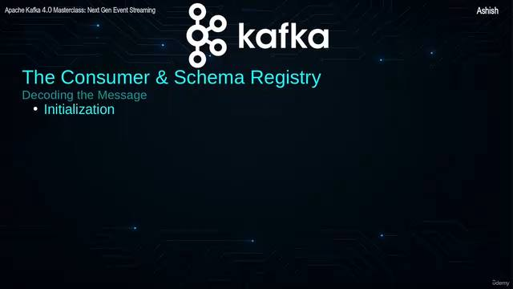
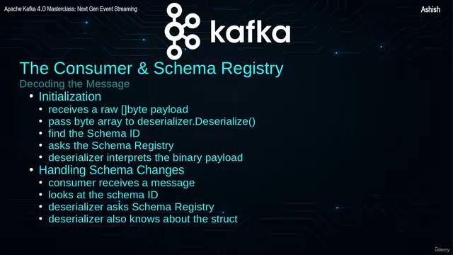
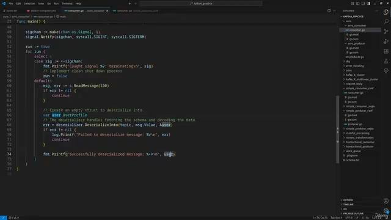
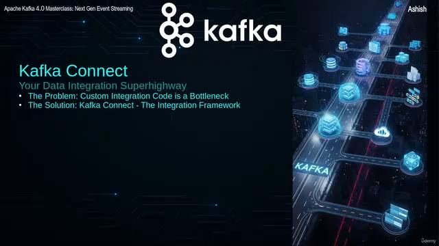
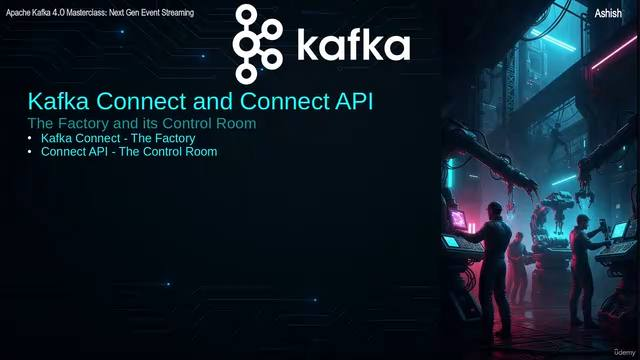
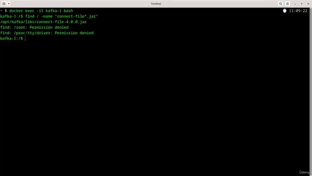
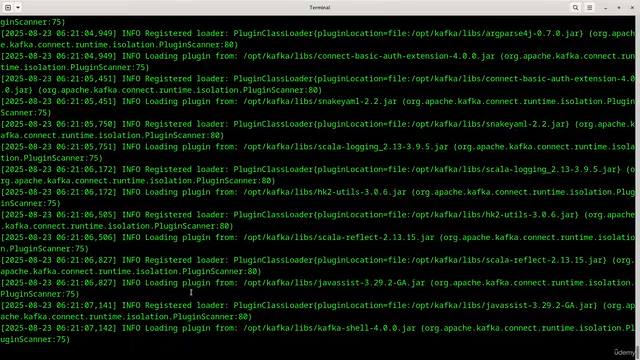
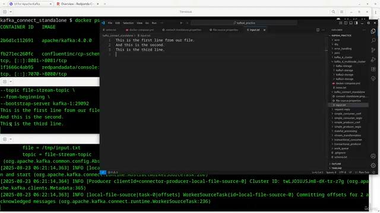

# Apache Kafka 4.0：Kafka Connect 与 Schema Registry 消费端（P72–P75）

> 适用读者：前端转 AI 应用工程师。本文档按「能照着跑起来」的标准写，所有文件都是完整可保存的版本。涉及 Java 语法的地方会标注「知道即可」，涉及并发/锁的地方会补一句「在 JS/Node 里对应什么」。

---

## 1. 这一节做什么

这四讲（P72–P75）把前面「生产者已经会用 Schema Registry 序列化 Avro」的成果接上，完成两件事：

1. **P72：给 Go 消费者装上 Avro 反序列化器**。消费者从 Kafka 拿到的是二进制字节，需要先读消息头里的 schema ID，去 Schema Registry 取回对应的 schema，再用它把字节还原成 Go struct。同时演示「生产者升级 schema、消费者还是旧版本」时，反序列化器如何自动丢弃多余字段（向后兼容），以及给消费者加一个 Ctrl+C 优雅关闭。
2. **P73–P75：引入 Kafka Connect**。P73 讲概念（Source/Sink 连接器、Task、Worker、Standalone/Distributed 模式），P74 澄清「Kafka Connect（数据面/工厂）」与「Connect API（控制面/控制室，REST 8083）」的区别，P75 是**动手实验**：用 Apache Kafka 4.0.0 的 Docker 镜像，以 standalone 模式跑一个 `FileStreamSourceConnector`，把本地 `input.txt` 的每一行实时灌进 Kafka topic，并用消费者验证。

最终产物：一个能端到端跑通的「文件 → Kafka Connect → Kafka topic → 消费者」管道，以及一个能反序列化 Avro 的 Go 消费者。

学习时不要把两条线混在一起：P72 是应用侧写代码消费 Avro，重点是反序列化器、schema ID、缓存和向后兼容；P73–P75 是平台侧用 Connect 做数据搬运，重点是配置、worker、connector/task 和故障排查。前端的类比是：P72 类似你在 Node 里接一个需要 schema 校验的 WebSocket/消息队列消费者，P75 类似用现成的集成平台把文件变更同步到消息总线。

---

## 2. 讲师原话（带出处）

> "我们把该字节数组传给 deserializer.deserialize 方法。反序列化器会读取最前面的几个字节，以找到模式标识符。它会向模式注册表询问编号为 5 的标识符对应哪个模式。模式注册表会返回完整的模式字符串。反序列化器很智能，会缓存这一结果，因此每个标识符只需询问一次。"
> —— p072 [02:49]

> "它使用第 2 版模式读取数据，但随后会自动、安全地将数据映射到较旧的结构体。它读取用户标识符和电子邮件地址，并直接丢弃消费者并不了解的额外 location 字段。这就是向后兼容的实际体现。"
> —— p072 [04:43]

> "所以这次我引入了一个优雅关闭流程：我们使用 signal 接收程序取消信号，比如 Ctrl+C；一旦收到该信号，就可以执行优雅关闭。"
> —— p072 [07:00]

> "Kafka Connect 是一个用于构建和运行可复用数据连接器的框架，这些连接器可在 Apache Kafka 与其他数据系统之间可靠地流式传输数据。其核心思想是标准化连接器。"
> —— p073 [03:19]

> "Kafka Connect 是数据平面，实际的数据移动就发生在这一层。……Connect API 是控制平面，你通过它来管理和操作数据平面。"
> —— p074 [01:48] / [02:44]

> "因此，在我们的配置中，它会是 tmp/input.txt。……这个文件还会告诉工作进程把消息发送到哪个 Kafka 主题。"
> —— p075 [01:51]

> "所以解决办法很简单。始终确保你的输入文件末尾有一个空行。……如果你打开 input.txt 文件，转到最后一行的最末尾，再按一次回车，在底部创建一个新的空行，然后保存。连接器会立刻识别出最后一行，并发送最后一条消息。"
> —— p075 [15:03]

以上引用保留课程原话和出处；下面的复现步骤与解释只围绕这些原话展开，不额外编造课程内容。

---

## 3. 从零复现

### 3.1 前置条件

- 已经按前面课程用 `docker-compose.yml` 起好了 Kafka 集群（broker + Kafka UI），网络名在 compose 里写的是 `kafka-net`，但**实际网络名会带上文件夹前缀**（见 3.4 的坑）。
- 本地有 Go 环境（P72 的消费者是 Go 写的）。
- 本地有 Docker。

这些条件看似简单，但每一步都会影响后面的排错。Kafka 集群没起来，消费者会卡在连接；Schema Registry 没起来，Avro 反序列化会在取 schema 时失败；Docker 网络名不对，Connect 容器就找不到 broker。前端同学可以把它类比成：API 服务、鉴权服务、反向代理三层有一个没通，页面就会报错；这里只是把浏览器换成了 Go 进程和 Connect worker。

### 3.2 P72：Go 消费者反序列化 Avro

目录结构：

```
kafka-avro-consumer/
├── go.mod
└── main.go
```

步骤：

1. `go mod init kafka-avro-consumer`
2. 安装依赖（版本以你 `go get` 实际拉到的为准，课里没给具体版本号）：
   ```
   go get github.com/confluentinc/confluent-kafka-go/v2/kafka
   go get github.com/confluentinc/confluent-kafka-go/v2/schemaregistry
   go get github.com/confluentinc/confluent-kafka-go/v2/schemaregistry/serde
   go get github.com/confluentinc/confluent-kafka-go/v2/schemaregistry/serde/avro
   ```
3. 把 4.1 的 `main.go` 保存进去。
4. 确认 Schema Registry 地址（课里用的是 Confluent 的 Schema Registry，地址形如 `http://localhost:8081`，具体以你的 compose 为准）。
5. `go run main.go`，然后另开终端跑上一讲的生产者发消息，观察消费者打印。

补充说明：`go get` 实际是在改 `go.mod` 和 `go.sum`，类似前端 `npm install` 后锁定依赖。如果 `go run` 报找不到包，先回到模块根目录执行 `go mod tidy`，再检查是否在 `kafka-avro-consumer/` 目录内运行。常见错误包括：Schema Registry 地址写成 `localhost:8081` 但实际端口不同；topic 名和生产者不一致；`group.id` 每次启动都变导致重复消费；`auto.offset.reset` 不是 `earliest` 导致看不到旧消息。排查时先看消费者是否打印订阅成功，再用上一讲生产者发一条消息，最后检查 Schema Registry 是否能按 schema ID 返回 schema。

### 3.3 P73–P74：概念，无代码

这两讲是纯讲解，没有可执行代码。核心结论记成一张对照表即可（见第 4 节 4.3 的「设计决策表」）。

这一节虽然没有代码，但概念会直接影响 P75 的配置和排错。比如 Source/Sink 决定数据方向，Task 决定并行度，Worker 决定进程边界，Standalone/Distributed 决定 offset 存在哪里。前端同学可以把 Connector 理解成声明式配置，把 Task 理解成实际执行的工作线程，把 Worker 理解成运行这些线程的进程。

### 3.4 P75：Kafka Connect standalone 文件流实验

**第一步：建目录和三个文件**

```
kafka-connect-standalone/
├── connect-standalone.properties
├── filesource.properties
└── input.txt
```

**第二步：找到你镜像里 connect 的 jar 路径**

讲师强调：不同镜像（Confluent / Apache / Bitnami / Ubuntu）路径不同，必须自己进容器 `find`。命令：

```bash
docker exec -it <你的kafka容器名> bash
# 进容器后：
find / -name "connect-file*.jar"
```

把输出的完整路径（课里在 `libs` 目录下）填进 `connect-standalone.properties` 的 `plugin.path`。讲师也提到：**可以直接写文件夹路径**，它会自己找 jar。

`find / -name "connect-file*.jar"` 从根目录扫描，输出可能有多条；优先选和当前 Kafka 镜像版本一致的那个 jar，插件路径写 jar 所在目录也可以。如果 `find` 很慢，可以先从 `/opt/kafka`、`/usr/share/java`、`/opt` 这些常见目录缩小范围。

**第三步：创建 topic**

```bash
docker exec -it <你的kafka容器名> \
  /opt/kafka/bin/kafka-topics.sh \
  --bootstrap-server localhost:9092 \
  --create --topic file-stream-topic
```

（`kafka-topics.sh` 在镜像 `bin` 目录下，具体路径以你的镜像为准；课里只说「在 binary 文件夹里」。）

创建 topic 时注意 `--bootstrap-server localhost:9092` 是在 Kafka 容器内部执行，所以用 `localhost`；如果从宿主机执行，则要换成宿主机映射端口或容器网络地址。topic 已存在会报错，可先 `--list` 查看，或确认是否要复用旧 topic。

**第四步：确认 Docker 网络真实名字**

```bash
docker network ls
```

讲师特别提醒：compose 里写 `kafka-net`，但实际网络名是 `<文件夹名>_kafka-net` 这种带前缀的形式，**必须用 `docker network ls` 看到的完整名字**。

`docker network ls` 看到的网络名才是容器能解析服务名的名字。`kafka-net` 只是 compose 文件里的逻辑名，实际名字可能带项目前缀。前端类比：这像本地开发时 `.env` 里的 API host 和容器内服务名不是同一个，浏览器用 `localhost`，容器之间用 service name。

**第五步：起临时 Connect 容器**

见 4.2 的完整命令。要点：`--rm`（用完即删）、`--name connect-worker`、`--network <真实网络名>`、把三个配置文件挂到容器 `/tmp`、镜像用 Apache Kafka 4.0.0、命令是 `connect-standalone.sh` 加两个 properties 路径。

启动命令里三个 `-v` 的源路径必须在宿主机当前目录存在，否则 Docker 可能创建空目录或报错；目标路径必须和 properties 里引用的 `/tmp/...` 一致。`--rm` 让容器退出后自动删除，适合实验；如果失败后你想进容器排查，可以先去掉 `--rm`，排查完再删。

**第六步：验证**

```bash
docker ps                      # 看到 connect-worker 在跑
# 打开 Kafka UI，file-stream-topic 的 message 数应等于 input.txt 的行数
```

查看消息数时注意 Kafka UI 的统计可能有刷新延迟；控制台消费者是最直接的验证方式。若 message 数不等于行数，先检查 input.txt 末尾是否有换行符，再检查 connector 日志里是否报文件读取错误或 topic 不存在。

**第七步：起消费者实时看**

```bash
docker exec -it <kafka容器> \
  /opt/kafka/bin/kafka-console-consumer.sh \
  --bootstrap-server localhost:9092 \
  --topic file-stream-topic
```

控制台消费者看不到消息时，按顺序查：topic 是否存在、Connect 容器是否在运行、connector 日志是否启动成功、input.txt 是否被挂载到容器内正确路径、末尾是否有换行符。不要一上来改 schema 或 consumer 代码，这个实验是纯文本 StringConverter，问题通常在路径、网络和换行符。

**第八步：复现「最后一行不出现」的现象**

往 `input.txt` 追加一行但**不按回车**直接保存 → 消费者看不到；再按一次回车（制造行尾换行符）保存 → 立刻出现。这就是 P75 的核心教学点。

这个现象是 P75 最值得记住的点：FileStreamSourceConnector 不是按“文件保存事件”发送，而是按“读到完整行”发送。前端类比：输入框里 `input` 事件和 `change` 事件触发时机不同，这里必须等到行结束符才算一次完整提交。

---

## 4. 完整代码

### 4.1 `main.go`（P72 Go 消费者，完整文件）

> 说明：课里演示的是 Confluent Kafka Go 库的 Avro 反序列化器。下面按讲师描述的工作流（建 Schema Registry client → 建 Avro deserializer → 订阅 topic → 循环 poll → 反序列化到 struct → 打印 → 信号优雅关闭）写成完整可运行文件。**具体 API 签名请以你 `go get` 到的库版本为准**，课里没有逐字给出 import 路径和函数签名。

```go
package main

import (
	"fmt"
	"os"
	"os/signal"
	"syscall"
	"time"

	"github.com/confluentinc/confluent-kafka-go/v2/kafka"
	"github.com/confluentinc/confluent-kafka-go/v2/schemaregistry"
	"github.com/confluentinc/confluent-kafka-go/v2/schemaregistry/serde"
	"github.com/confluentinc/confluent-kafka-go/v2/schemaregistry/serde/avro"
)

// UserProfile 对应上一讲生产者发送的 Avro schema（version 1：userID + email）
type UserProfile struct {
	UserID string `json:"userID"`
	Email  string `json:"email"`
}

func main() {
	// 1. 连接 Schema Registry
	srClient, err := schemaregistry.NewClient(schemaregistry.NewConfig("http://localhost:8081"))
	if err != nil {
		fmt.Printf("Failed to create schema registry client: %s\n", err)
		os.Exit(1)
	}

	// 2. 创建 Avro 反序列化器（注意：上一讲是 NewSerializer，这里是 NewDeserializer）
	deser, err := avro.NewGenericDeserializer(srClient, serde.DeserializerType)
	if err != nil {
		fmt.Printf("Failed to create deserializer: %s\n", err)
		os.Exit(1)
	}

	// 3. 创建 Kafka consumer
	consumer, err := kafka.NewConsumer(&kafka.ConfigMap{
		"bootstrap.servers": "localhost:9092",
		"group.id":          "user-profile-avro-consumer",
		"auto.offset.reset": "earliest",
	})
	if err != nil {
		fmt.Printf("Failed to create consumer: %s\n", err)
		os.Exit(1)
	}
	defer consumer.Close()

	// 4. 订阅 topic
	topic := "user-profile-avro-events"
	err = consumer.SubscribeTopics([]string{topic}, nil)
	if err != nil {
		fmt.Printf("Failed to subscribe: %s\n", err)
		os.Exit(1)
	}
	fmt.Printf("Subscribed to topic %s\n", topic)

	// 5. 信号处理：Ctrl+C 触发优雅关闭
	sigchan := make(chan os.Signal, 1)
	signal.Notify(sigchan, syscall.SIGINT, syscall.SIGTERM)

	run := true
	for run {
		select {
		case sig := <-sigchan:
			fmt.Printf("Caught signal %v: terminating\n", sig)
			run = false
		default:
			// 课里把超时从 5 秒改成了 100 毫秒
			ev, err := consumer.ReadMessage(100 * time.Millisecond)
			if err != nil {
				// 超时是正常情况，继续循环
				continue
			}

			// 6. 反序列化：字节 → UserProfile
			var profile UserProfile
			err = deser.DeserializeInto(topic, ev.Value, &profile)
			if err != nil {
				fmt.Printf("Failed to deserialize: %s\n", err)
				continue
			}

			// 7. 打印
			fmt.Printf("Received: UserID=%s Email=%s\n", profile.UserID, profile.Email)
		}
	}

	fmt.Println("Consumer shut down cleanly.")
}
```

这段代码可以分成三段看：第一段建立 Schema Registry 客户端和 Avro 反序列化器；第二段建立 Kafka consumer 并订阅 topic；第三段是 `select` 轮询和信号关闭。常见错误是只创建 consumer 没有创建 deserializer，或者 topic 名与生产者不一致。前端对照：`schemaregistry.NewClient` 像初始化一个远程配置/校验服务客户端，`avro.NewGenericDeserializer` 像拿到一个 `decode` 函数，`ReadMessage` 像 `setInterval` 或事件循环里的非阻塞轮询。

### 4.2 P75 三个配置文件 + 启动命令（完整）

**`connect-standalone.properties`**

```properties
# 告诉 worker 怎么找到 Kafka 集群（用 Docker 内部网络主机名）
bootstrap.servers=kafka:9092

# 数据格式：简单文本用 StringConverter
key.converter=org.apache.kafka.connect.storage.StringConverter
value.converter=org.apache.kafka.connect.storage.StringConverter

# standalone 模式把进度（offsets）存到容器内这个文件
offset.storage.file.filename=/tmp/connect.offsets

# 插件路径：填你 find 出来的 jar 完整路径，或直接填它所在的文件夹
plugin.path=/opt/kafka/libs
```

> 注意：`bootstrap.servers` 的主机名 `kafka` 要换成你 compose 里 broker 的服务名；`plugin.path` 要换成你 `find` 出来的真实路径（课里在 `libs` 目录下）。

**`filesource.properties`**

```properties
# 连接器实例名
name=local-file-source

# 具体用哪个连接器类：文件流 Source 连接器
connector.class=org.apache.kafka.connect.file.FileStreamSourceConnector

# 并行任务数：只有一个文件，用 1
tasks.max=1

# 发到哪个 Kafka topic
topic=file-stream-topic

# 监听容器内的哪个文件（本地 input.txt 会挂载到这里）
file=/tmp/input.txt
```

**`input.txt`**

```
This is the first line from our file
This is the second line from our file
```

> 关键：文件末尾**必须有一个换行符**（最后一行按一次回车再保存），否则最后一行不会被发送。

**启动 Connect 容器的完整命令**

```bash
docker run --rm \
  --name connect-worker \
  --network <docker network ls 看到的真实网络名> \
  -v $(pwd)/connect-standalone.properties:/tmp/connect-standalone.properties \
  -v $(pwd)/filesource.properties:/tmp/filesource.properties \
  -v $(pwd)/input.txt:/tmp/input.txt \
  apache/kafka:4.0.0 \
  /opt/kafka/bin/connect-standalone.sh \
  /tmp/connect-standalone.properties \
  /tmp/filesource.properties
```

> 镜像 tag 与脚本路径以你实际拉取的 Apache Kafka 4.0.0 镜像为准；课里明确用的是 Apache Kafka 4.0.0 Docker 镜像，`connect-standalone.sh` 在镜像的 `bin` 目录下。

这三个文件的分工要分清：`connect-standalone.properties` 是 worker 级配置，决定 worker 怎么连 Kafka、用什么 converter、插件在哪里；`filesource.properties` 是 connector 级配置，决定用哪个连接器、读哪个文件、写到哪个 topic；`input.txt` 是数据源。常见错误是把两个 properties 的职责写反，或者 `plugin.path` 指到 jar 文件但版本不匹配。前端类比：worker 配置像项目的构建配置，connector 配置像某个具体集成任务的配置，input.txt 像被监听的数据文件。

### 4.3 P73–P74 概念落成表格（课里没有代码，以下为整理）

**Kafka Connect vs Connect API 对照表**

| 维度 | Kafka Connect | Connect API |
|---|---|---|
| 类比 | 工厂（厂房+机器+工人） | 控制室（面板+按钮+屏幕） |
| 本质 | 运行时/引擎，跑 connector 和 task 的 JVM 进程集群 | REST/HTTP 接口，管理用的命令入口 |
| 层次 | 数据面（data plane） | 控制面（control plane） |
| 端口 | — | 8083（worker 启动后监听） |
| 典型操作 | 执行搬运逻辑 | 列出插件、创建/查看/暂停/恢复/删除 connector |
| 启动方式 | `docker compose up -d` 起容器 | 用 `curl` 发 JSON 命令 |

**连接器方向对照表**

| 类型 | 数据流向 | 课里举例 |
|---|---|---|
| Source connector | 外部系统 → Kafka topic | JDBC Source、FileStream Source、Debezium（读事务日志做 CDC）、S3/Azure Blob |
| Sink connector | Kafka topic → 外部系统 | JDBC Sink、FileStream Sink、Elasticsearch Sink、S3/BigQuery/Snowflake |

**核心概念表**

| 概念 | 职责 |
|---|---|
| Connector | 可复用 Java 代码（jar），定义如何对接某个系统 |
| Task | 真正干活的 worker 线程，connector 自动拆分并分发到多节点并行 |
| Worker | 跑 connector/task 的 JVM 进程；standalone=单进程，distributed=多进程集群 |
| Configuration | JSON/properties 配置，指定用哪个 connector、读写哪里、topic 名等 |

看这三张表时，建议按“方向、进程、配置”三个维度记：先判断 Source 还是 Sink，再判断 task/worker 的边界，最后看配置里 topic、文件路径、converter 是否匹配。这样遇到报错时不会把 connector 配置错误误判成 Kafka 集群错误。

---

## 5. 逐行解释

### 5.1 `main.go` 关键行

- `schemaregistry.NewClient(...)`：连 Schema Registry。**为什么必须先建它**：反序列化器要靠它把 schema ID 换成 schema 字符串。
- `avro.NewGenericDeserializer(...)`：和上一讲生产者的 `NewSerializer` 一一对应，只是方向相反。讲师原话强调「This time it's new generic deserializer. That's the difference.」
- `consumer.ReadMessage(100 * time.Millisecond)`：课里把超时从 5 秒改成 100 毫秒。**为什么**：超时短，循环转得快，Ctrl+C 信号能更快被 `select` 捕获，关闭更及时。在 JS/Node 里对应 `consumer.poll({ timeout: 100 })` 之类的小超时轮询。
- `select { case sig := <-sigchan: ... default: ... }`：Go 的 select 类似 JS 的 `Promise.race` / 事件循环里同时监听多个来源。`default` 分支保证没信号时继续读消息。
- `deser.DeserializeInto(topic, ev.Value, &profile)`：把字节写进 `profile`。**向后兼容的关键就在这里**——如果消息是用 version 2 schema（多了 `location` 字段）写的，而 `UserProfile` 只有 `userID`/`email`，反序列化器会读 v2 schema 解析数据，但只往 struct 里填它认识的字段，多余的 `location` 直接丢弃。讲师原话：「simply discards the extra location field」。
- `defer consumer.Close()` + 信号处理：保证 Ctrl+C 时先关消费者再退出，不丢 offset 提交。**在 Node 里对应** `process.on('SIGINT', ...)` 里做 `consumer.disconnect()`。
- 额外排查：如果 `schemaregistry.NewClient` 成功但反序列化失败，优先检查消息 value 是否真的以 Confluent 的 wire format 写入（魔数 + schema ID + payload），以及 Schema Registry 里是否存在对应 ID。前端对照：这类似收到一段 protobuf/msgpack 二进制却用 `JSON.parse` 去解，格式不对时不要先怀疑 UI。
- 额外排查：`group.id` 相同会共享消费进度；如果你反复启动消费者却看不到旧消息，检查 `auto.offset.reset` 和该 group 是否已经提交过 offset。

### 5.2 `connect-standalone.properties`

- `bootstrap.servers=kafka:9092`：worker 在 Docker 网络里，用服务名找 broker，不能用 `localhost`。
- `key.converter` / `value.converter` 用 `StringConverter`：因为实验是纯文本，不需要 Avro/JSON 转换器。**如果换成 Avro，这里就要配 AvroConverter 并指向 Schema Registry**——课里没展开，属于「课里没讲」。
- `offset.storage.file.filename`：standalone 模式没有 Kafka 内部 topic 存 offset，只能存本地文件。distributed 模式则用 Kafka topic 存，这是两种模式的关键差异之一。
- `plugin.path`：讲师反复强调不同镜像路径不同，必须 `find`。写文件夹也行，它会扫描。
- 额外排查：容器内写 `localhost:9092` 会指向 Connect 容器自己，不是 Kafka broker；必须用 Docker 网络里的服务名或可达地址。
- 额外排查：`plugin.path` 如果写错，启动日志会提示找不到 connector class；先用 `find` 确认真实路径，再重启容器。

### 5.3 `filesource.properties`

- `connector.class=org.apache.kafka.connect.file.FileStreamSourceConnector`：这是 Kafka 自带的连接器类名，课里用的就是它。
- `tasks.max=1`：只有一个文件，一个 task 足够。多文件才需要调大。
- `file=/tmp/input.txt`：**这是容器内路径**，靠 `-v` 把宿主机 `input.txt` 挂进来。写错路径 connector 会报找不到文件。
- `topic=file-stream-topic`：必须和前面 `kafka-topics.sh --create` 建的 topic 名一致。
- 额外排查：`file=/tmp/input.txt` 是容器内路径，不是宿主机路径；宿主机文件通过 `-v` 挂载。
- 额外排查：`topic` 名要和创建 topic 的命令一致；topic 不存在时，部分配置可能自动创建，部分环境会直接报错，实验时先显式创建。

### 5.4 启动命令

- `--rm`：临时容器，停掉即删，符合讲师「use and throw container」的说法。
- `--network <真实网络名>`：**最容易踩的坑**。compose 写 `kafka-net`，实际是 `<文件夹名>_kafka-net`，必须 `docker network ls` 确认。
- 三个 `-v`：把三个配置文件挂到 `/tmp`，properties 里的路径要和挂载点对上。
- 最后两个参数：`connect-standalone.sh` 后跟 worker 配置和 connector 配置的路径。
- 额外排查：`--network` 写错时，容器启动可能成功但连不上 `kafka:9092`；日志里通常是连接超时或 unknown host。
- 额外排查：卷挂载路径含空格或相对路径时容易出错，实验时在文件所在目录执行命令，并用 `$(pwd)` 明确源路径。

### 5.5 「最后一行不出现」的原理

讲师用对讲机「over」类比：FileStreamSourceConnector 把「以换行符结尾的一串字符」当作一条完整消息。你写第三行但不按回车，文件里没有行尾换行符，connector 认为「话没说完」，继续等。按一次回车制造换行符，它立刻认为「over 了」，发送。**所以 input.txt 末尾永远要留一个空行/换行符**。VS Code / GoLand 默认开启「Ensure Final New Line」正是为此。

额外排查：如果你用编辑器保存后仍看不到最后一行，先确认文件末尾真的有一个换行符，而不是只看到光标在下一行；有些编辑器显示空行和实际换行需要区分。前端对照：这和表单提交前必须等输入法组合事件结束类似，行结束符就是 connector 的“提交信号”。

---

## 6. 复现检查清单

- [ ] Go 消费者能编译通过（`go build` 无报错）；验证方式：在 `kafka-avro-consumer/` 下执行 `go build`，看到退出码为 0 且没有找不到包、cgo 或版本冲突错误。
- [ ] 消费者启动后打印 `Subscribed to topic ...`；验证方式：运行 `go run main.go`，终端应出现订阅成功的提示，而不是直接退出或卡在连接。
- [ ] 跑生产者发消息，消费者能打印出 `UserID=... Email=...`；验证方式：另开终端运行上一讲生产者，观察消费者是否收到新消息。
- [ ] 生产者发一条带 `location` 字段的 v2 消息，消费者**不崩溃**，只打印 userID/email；验证方式：用 v2 schema 发消息后检查消费者日志，确认没有反序列化异常且没有打印 location。
- [ ] Ctrl+C 后打印 `Consumer shut down cleanly.`；验证方式：在消费者终端按 Ctrl+C，确认进程退出前出现该提示。
- [ ] `docker network ls` 确认了真实网络名；验证方式：把看到的完整网络名填进 `docker run --network`，不要凭 compose 文件里的 `kafka-net` 猜。
- [ ] `find` 出了 connect jar 路径并填进 `plugin.path`；验证方式：进容器执行 `find / -name "connect-file*.jar"`，把 jar 所在目录写入 worker 配置。
- [ ] `file-stream-topic` 创建成功，Kafka UI 能看到；验证方式：用 `kafka-topics.sh --list` 或 Kafka UI 确认 topic 存在。
- [ ] `docker ps` 看到 `connect-worker` 在跑；验证方式：执行 `docker ps`，确认容器名、镜像和状态正常。
- [ ] Kafka UI 里 topic 消息数 = input.txt 行数；验证方式：数清 input.txt 的有效行数，再对比 UI 或控制台消费者的输出条数。
- [ ] 控制台消费者能看到前两行；验证方式：运行 `kafka-console-consumer.sh`，确认两行文本都出现。
- [ ] 追加第三行不按回车 → 看不到；按回车保存 → 立刻看到；验证方式：控制台消费者保持打开，分别保存前后观察输出变化。
- [ ] input.txt 末尾有换行符；验证方式：打开文件到末尾，确认最后一行后还有一次回车产生的换行，再保存。

---

## 7. 课里没讲但你会撞上的

下表把课里没展开、但复现时容易撞上的点按“现象 / 原因 / 怎么办”整理；其中有些是环境差异，有些是 API 版本差异，排查时先核对实际版本和容器内路径。

| 现象 | 原因 | 怎么办 |
|---|---|---|
| 消费者能连 Kafka，但反序列化时报 Schema Registry 相关错误 | P72 假设你已经有一个 Schema Registry 在 `localhost:8081`。课里没讲怎么单独起它（Confluent 的 compose 里通常自带）。如果你只有 Apache Kafka，需要额外起一个 Schema Registry 服务。 | 先确认 8081 可访问；检查 compose 是否包含 Schema Registry；若只有 Apache Kafka，需要另起兼容服务，并把代码里的地址改成实际地址。 |
| `go get` 后编译报 API 不存在、参数不匹配 | 课里只说“用 Confluent Kafka Go 库”，没给版本号，也没逐字给 import 路径。`NewGenericDeserializer` 的参数在不同版本间有变化。 | 以实际拉到的版本为准，查该版本 godoc；先跑最小示例，再补业务 struct。 |
| 不确定该用 `Deserialize` 还是 `DeserializeInto` | 课里口述是“deserialize 方法”，实际库里有 `Deserialize` 和 `DeserializeInto` 两种风格。 | 本文用 `DeserializeInto`（写入已有 struct）；若你的版本没有此方法，改用 `Deserialize` 拿返回值。 |
| 想上 distributed 模式但找不到配置 | P73/P74 讲了 distributed 模式的概念（多 worker、故障转移、offset 存 Kafka topic），但没有给 distributed 的配置文件。P75 只做了 standalone。 | 需要另写 `connect-distributed.properties`，课里没讲；先把 standalone 跑通，再查对应版本文档。 |
| 想用 Connect API 创建 connector 但没有 JSON body 示例 | P74 提到 `curl -X POST http://localhost:8083/connectors`，但没有给完整 JSON body。P75 走的是“properties 文件 + 命令行启动”路线，没走 REST 创建 connector 的路线。 | 先按 P75 的 properties 路线跑通；要试 REST，就查当前版本的 Connect REST API 文档，并确保 worker 已启动。 |
| Connect 容器连不上 Kafka，日志报连接超时或 unknown host | 课里 `bootstrap.servers` 写的是内部 Docker 网络主机名，你的 compose 服务名可能不叫 `kafka`。 | 用 `docker network ls` 确认真实网络名，用 compose 里的 broker 服务名替换 `kafka`，必要时进容器测试解析。 |
| `docker pull` 或启动时发现镜像 tag/脚本路径不对 | 课里说 Apache Kafka 4.0.0，但 `apache/kafka:4.0.0` 这个 tag 是否存在、`connect-standalone.sh` 的确切路径，要以你 `docker pull` 后进容器 `ls` 为准。 | 先 `docker pull` 确认 tag；进容器 `ls /opt/kafka/bin` 或 `find` 确认脚本路径，再改启动命令。 |
| 打不开 Kafka UI 或看不到消息数 | 课里多次提到“打开 Kafka UI 看消息数”，但没讲 UI 容器的端口映射。 | 按你 compose 里的配置访问；如果宿主机端口没映射，先查 `docker ps` 的端口列或 compose 的 `ports`。 |
| 担心并发、锁、事务 | 本段没有涉及锁或事务。Kafka Connect 的 task 分发、worker 故障转移属于分布式调度，课里只讲了“task 失败会自动在健康 worker 上重启”，没讲底层协调机制（属于 Kafka 内部 consumer group 协议，课里没展开）。 | 在 Node 里不需要手写这些，用现成 client 即可；先理解 task/worker 边界，不要在没有需求时引入事务或锁。 |

---















