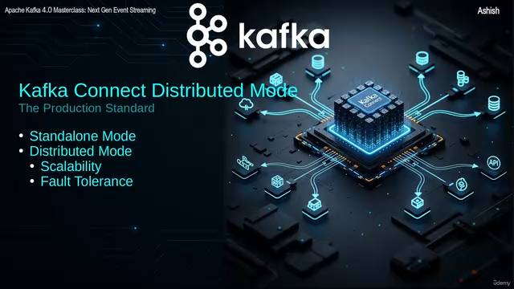
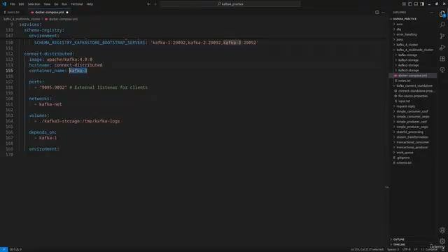
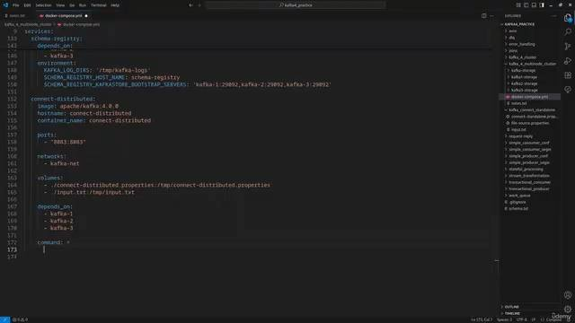
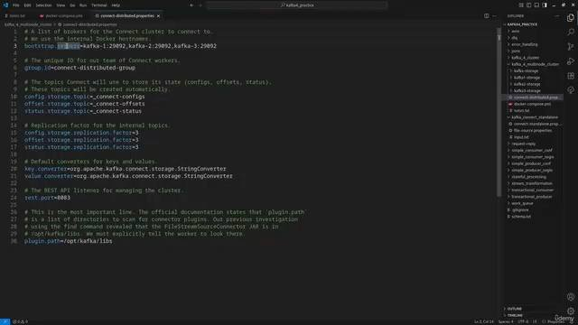
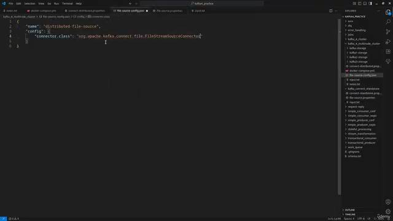
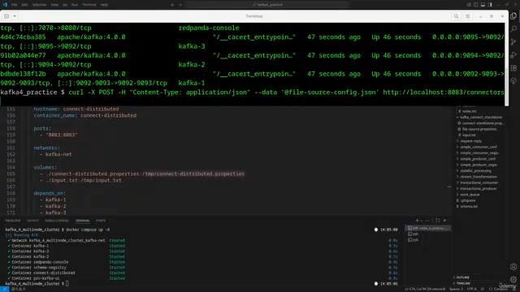
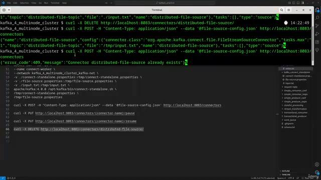
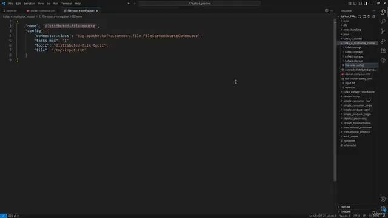
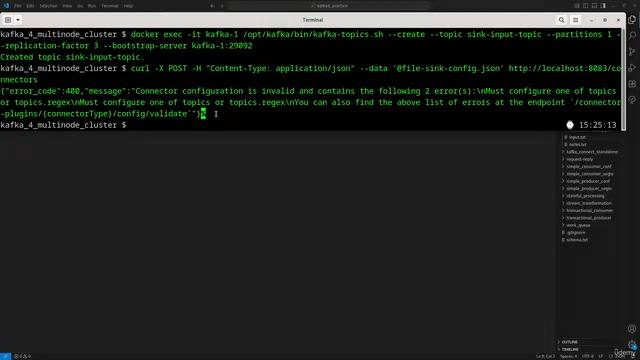

# Apache Kafka 4.0 · 分布式 Kafka Connect 与 Source/Sink 连接器实战

> 覆盖 P076–P077。目标：在上一节 standalone 模式的基础上，用官方 Apache Kafka 4.0 Docker 镜像把 Kafka Connect 跑成**分布式集群**，然后通过 REST API 动态提交 source 连接器（文件 → Kafka）和 sink 连接器（Kafka → 文件），全程不写一行代码。

---

## 1. 这一节做什么

上一节（P075 及之前）我们已经用 `connect-standalone.sh` 跑通了单机版 Kafka Connect：一个进程、一个配置文件、一个连接器，进程挂了任务就停。这一节要解决三件事：

1. **把 Connect 从「单机」升级成「分布式集群」**：多个 worker 组成一个 group，状态（配置、offset、status）存进 Kafka 内部 topic，而不是本地文件。这样 worker 挂了任务会被自动重新分配，集群本身和数据一样持久。这里的重点不是换一个连接器插件，而是把连接器的运行方式、状态保存位置和管理入口一起换掉：standalone 时你关心的是「这个进程带哪个配置文件启动」；distributed 时你关心的是「worker 有没有加入 group」以及「REST API 有没有把工单提交成功」。
2. **理解分布式模式的管理方式变了**：不再是「启动命令带配置文件」，而是「先起一个长期运行的服务，再用 REST API 提交/暂停/恢复/删除任务」。端口是 `8083`。也就是说，分布式模式把「连接器配置」从启动参数变成了运行时提交到服务端的动态任务；服务先活着，连接器后提交，提交后还能查询状态、暂停、恢复、删除。对复现来说，这一步最容易出错的地方不是 Kafka broker，而是把 standalone 的习惯带进来：以为 `connect-distributed.sh` 后面还要再跟一个连接器配置参数，或者以为改完 JSON 文件会自动生效。
3. **用两种连接器把数据双向搬一遍**：
   - **Source 连接器**（on-ramp，上匝道）：外部文件 → Kafka topic。复用上一节的 `FileStreamSourceConnector`，但这次用 JSON 蓝图 + REST 提交。
   - **Sink 连接器**（off-ramp，下匝道）：Kafka topic → 容器内文件。用 `FileStreamSinkConnector`，注意它的参数是复数 `topics` 而不是 `topic`。

最终产物：一个 `docker-compose` 里多出的 `connect-distributed` 服务 + 三个本地文件（`connect-distributed.properties`、`file-source-config.json`、`file-sink-config.json`）+ 几条 `curl` 命令。复现时要把「宿主机文件」和「容器内路径」分开看：`docker-compose.yml` 的 `volumes` 负责把宿主机文件挂进容器，连接器 JSON 里写的 `file` 必须是容器内路径，否则连接器会在容器里找一个不存在的文件，表面上 REST API 可能提交成功，但 Kafka 里看不到数据。

---

## 2. 讲师原话

> "独立模式就像一位单打独斗的自由职业者，把进度记在本地的一张纸上；一旦生病，业务就停摆。分布式模式则像公司里的办公室团队，由多个协同工作的 Kafka Connect 工作进程组成一个集群。"
> —— p076 [00:28]

> "它们的所有配置和进度——也就是偏移量——都会安全地存放在一个集中式、多副本的文件柜中，而这个文件柜实际上就是一组 Kafka 内部主题。"
> —— p076 [01:22]

> "在分布式模式下，不需要逐个配置每个工作进程。你先启动整个团队，然后通过向一个集中式 REST API 发送命令来管理它们。"
> —— p076 [01:48]

> "所以，`connect-distributed.properties` 会告诉我们的工作进程，如何在集群中做一名合格的员工……而这就是工单，也就是我们的工作进程接下来要做的工作。"
> —— p076 [14:17] / [15:46]

> "在独立模式下，连接器配置被当作启动参数……然而到了分布式模式，连接器配置则被视为提交给一个正在运行的服务的一项动态作业。我们先运行服务，然后再进行配置。"
> —— p076 [26:55] / [28:17]

> "`curl` 命令用于与这个工厂的控制面板通信，而控制面板就是 REST API。你并不是在运行配置文件，而是在向这个工厂提交一份作业描述。"
> —— p076 [28:45]

> "源连接器是入口匝道。源连接器的职责是从外部系统拉取数据，并将其写入 Kafka 主题。"
> —— p077 [00:56]

> "接收器连接器是数据高速公路上的一条出口匝道。它把从这条高速公路——也就是 Kafka——上快速流动的数据接过来，安全地送达最终目的地。"
> —— p077 [02:23]

> "根本不存在所谓的源工作进程或接收器工作进程，只有 Kafka Connect 工作进程。同一套人马既能修建入口匝道，也能修建出口匝道。"
> —— p077 [03:18]

> "我们收到的报错信息就是最好的解释，它提示：连接器配置无效，必须配置 `topics` 或 `topics.regex` 中的一项。"
> —— p077 [08:34]

这些原话对应的核心心智模型可以概括成：standalone 是「一个人带着本地纸笔干活」，distributed 是「一个团队把配置和进度集中存到 Kafka 内部 topic，再通过 REST API 接工单」。所以复现时不要只盯着连接器 JSON，还要确认 worker 有没有正常启动、REST API 能不能访问、内部 topic 有没有自动创建、提交后的连接器状态是否 `RUNNING`。讲师用「员工手册」和「工单」作比喻，本质上是在强调两个文件职责不同：`connect-distributed.properties` 是 worker 的启动配置，`file-source-config.json` / `file-sink-config.json` 是提交给运行中服务的连接器配置。

---

## 3. 从零复现

### 3.1 前置条件

- 已完成上一节的多节点 Kafka 集群（3 个 broker：`kafka1` / `kafka2` / `kafka3`），以及 Redpanda Console、Provectus Kafka UI、Schema Registry 这些服务。
- 项目目录（讲师用的是 `kafka-for-multi-node-cluster`，你叫什么无所谓）里已有 `docker-compose.yml`。
- 本机 `8080`、`8081` 已被占用，`8083` 空闲（讲师原话：*"8083 端口是空闲的，因为我们还没用过它。我们用过 8081 和 8080。"* —— p076 [04:05]）。

复现前先明确路径关系：`docker-compose.yml` 里会把宿主机的 `connect-distributed.properties` 挂到容器内 `/tmp/connect-distributed.properties`，把 `input.txt` 挂到容器内 `/tmp/input.txt`。因此 container 启动命令读的是 `/tmp/connect-distributed.properties`，source 连接器 JSON 里写的 `file` 也必须是 `/tmp/input.txt`。如果你在宿主机执行 `curl` 时写 `--data @file-source-config.json`，curl 读的是当前目录下的宿主机 JSON 文件；但 JSON 里面的 `file` 字段描述的是连接器运行容器里的路径。这两个「文件」不是同一个层面，混淆了就很容易出现「命令没报错但 Kafka 没消息」的情况。

### 3.2 步骤总览

| 步骤 | 动作 | 产物 |
|---|---|---|
| 1 | 在 `docker-compose.yml` 里新增 `connect-distributed` 服务 | 一个跑在 8083 的 Connect worker |
| 2 | 写 `connect-distributed.properties` | worker 的「员工手册」 |
| 3 | 准备 `input.txt` | source 连接器的数据源 |
| 4 | 写 `file-source-config.json` | source 连接器的「工单」 |
| 5 | `docker compose down -v` 然后 `up -d` | 新服务起来 |
| 6 | 创建 topic `distributed-file-topic` | 数据落点 |
| 7 | `curl POST /connectors` 提交 source 工单 | 文件内容进 Kafka |
| 8 | 写 `file-sink-config.json`，创建 topic `sink-input-topic` | sink 工单 |
| 9 | `curl POST /connectors` 提交 sink 工单 | Kafka 消息写进容器内 `output.txt` |
| 10 | `docker exec ... cat /tmp/output.txt` 验证 | 端到端闭环 |

执行顺序上，建议先确保 `connect-distributed` 容器和 REST API 正常，再去创建 topic、提交 source 工单，最后做 sink。原因很直接：如果 8083 都不通，后面所有 `curl` 都没意义；如果 source 工单没成功，`distributed-file-topic` 里不会有数据；如果 sink 的 `topics` 写错，REST API 会直接返回配置校验错误。每一步都可以通过 `docker ps`、`curl /connectors`、Kafka UI 或 `kafka-topics.sh --list` 做交叉验证，不要只看一个地方。

### 3.3 关键坑（讲师踩过，你也会踩）

- **文件路径必须是容器内路径**。讲师第一次提交 source 工单时写了 `./input.txt`，结果 Kafka 里没消息。原因：*"实际上应该是 `/tmp/input.txt`，因为它应该是容器内的路径，而不是我们电脑上的路径。"* —— p076 [20:48]。容器里 `input.txt` 被挂载到 `/tmp/input.txt`（见下面 compose 的 volumes）。排查时先检查 JSON 的 `file`，再检查 compose 的 `volumes` 映射，最后进容器 `ls /tmp/input.txt` 确认文件真实存在。
- **重复提交同名连接器会报错**。讲师演示：不删旧连接器直接再 POST，会得到 *"连接器 distributed-file-source 已经存在。"* —— p076 [23:09]。改配置前必须先 `DELETE`。这不是 Kafka 出错，而是 REST API 对连接器 `name` 的唯一性校验；改完 JSON 后如果直接 POST，旧连接器还在，服务端会认为你要创建重名实例。
- **sink 连接器用 `topics` 不是 `topic`**。讲师第一次写 `topic` 直接报错：*"连接器配置无效：必须配置 topics 或 topics.regex 之一。"* —— p077 [08:34]。这个错误信息已经把原因说清楚了：sink 需要配置一个或多个来源 topic，因此字段设计成复数；写成单数时，服务端找不到它认识的必填字段，就会返回配置无效。

---

## 4. 完整代码

### 4.1 `docker-compose.yml`（只展示新增的 `connect-distributed` 服务，其余服务保持你上一节的样子）

```yaml
services:
  # ... 你已有的 kafka1 / kafka2 / kafka3 / console / kafka-ui / schema-registry ...

  connect-distributed:
    image: apache/kafka:4.0.0
    hostname: connect-distributed
    container_name: connect-distributed
    ports:
      - "8083:8083"
    depends_on:
      - kafka1
      - kafka2
      - kafka3
    networks:
      - kafka-net
    volumes:
      - ./connect-distributed.properties:/tmp/connect-distributed.properties
      - ./input.txt:/tmp/input.txt
    command: >
      bash -c "
      /opt/kafka/bin/connect-distributed.sh
      /tmp/connect-distributed.properties
      "

networks:
  kafka-net:
    driver: bridge
```

> 说明：镜像 tag 请以你上一节实际用的为准（讲师说 *"这是我们为代理节点使用的官方 Apache Kafka 4.0 Docker 镜像。"* —— p076 [02:13]）。`networks` 名字也沿用你上一节的定义，讲师原话是 *"我们将保持网络名称不变。"* —— p076 [04:34]。

### 4.2 `connect-distributed.properties`

```properties
bootstrap.servers=kafka1:9092,kafka2:9092,kafka3:9092

group.id=connect-cluster

config.storage.topic=connect-configs
offset.storage.topic=connect-offsets
status.storage.topic=connect-status

config.storage.replication.factor=3
offset.storage.replication.factor=3
status.storage.replication.factor=3

key.converter=org.apache.kafka.connect.storage.StringConverter
value.converter=org.apache.kafka.connect.storage.StringConverter

rest.port=8083

plugin.path=/opt/kafka/plugins
```

> 逐项含义见第 5 节。`plugin.path` 讲师说和 standalone 一样（*"结果会是一样的，因为所有 jar 文件都在这个文件夹里。"* —— p076 [09:17]），具体路径以你上一节 `connect-standalone.properties` 里写的为准。

### 4.3 `input.txt`（初始内容，随便写）

```
This is the first line.
This is the second line.
```

### 4.4 `file-source-config.json`

```json
{
  "name": "distributed-file-source",
  "config": {
    "connector.class": "org.apache.kafka.connect.file.FileStreamSourceConnector",
    "tasks.max": "1",
    "topic": "distributed-file-topic",
    "file": "/tmp/input.txt"
  }
}
```

> `connector.class` 的完整包名以你上一节 `file-source.properties` 里写的为准；讲师原话是 *"让我从 filesource.properties 中复制所有内容。"* —— p076 [11:04]。`file` 字段必须是 `/tmp/input.txt`（容器内路径），不是 `./input.txt`。

### 4.5 `file-sink-config.json`

```json
{
  "name": "local-file-sink",
  "config": {
    "connector.class": "org.apache.kafka.connect.file.FileStreamSinkConnector",
    "tasks.max": "1",
    "topics": "sink-input-topic",
    "file": "/tmp/output.txt"
  }
}
```

> 注意 `topics`（复数）。`connector.class` 同理以你环境里实际类名为准。

### 4.6 启动与验证命令（按顺序执行）

```bash
# 1. 重建集群（讲师原话：docker compose down V 和 docker compose up D）
docker compose down -v
docker compose up -d

# 2. 创建 source 用的 topic
docker exec -it kafka1 /opt/kafka/bin/kafka-topics.sh \
  --bootstrap-server kafka1:9092 \
  --create --topic distributed-file-topic

# 3. 确认 connect-distributed 容器在跑
docker ps

# 4. 提交 source 工单（必须在 file-source-config.json 所在目录执行）
curl -X POST -H "Content-Type: application/json" \
  --data @file-source-config.json \
  http://localhost:8083/connectors

# 5. 查看所有连接器
curl http://localhost:8083/connectors

# 6. 查看某个连接器状态
curl http://localhost:8083/connectors/distributed-file-source/status

# 7. 删除连接器（改配置前必须先删）
curl -X DELETE http://localhost:8083/connectors/distributed-file-source

# 8. 创建 sink 用的 topic
docker exec -it kafka1 /opt/kafka/bin/kafka-topics.sh \
  --bootstrap-server kafka1:9092 \
  --create --topic sink-input-topic

# 9. 提交 sink 工单
curl -X POST -H "Content-Type: application/json" \
  --data @file-sink-config.json \
  http://localhost:8083/connectors

# 10. 往 sink-input-topic 发消息
docker exec -it kafka1 /opt/kafka/bin/kafka-console-producer.sh \
  --bootstrap-server kafka1:9092 \
  --topic sink-input-topic
# 然后逐行输入：
# hello from the highway
# this is a sink connector message

# 11. 看容器内 output.txt 是否被写入
docker exec -it connect-distributed cat /tmp/output.txt
```

> 命令 2/8/10 里 broker 地址和 topic 工具路径以你上一节实际用的为准；讲师在 p077 [04:16] 只说「create the topic」，没逐字念命令。`kafka-console-producer.sh` 的路径同理。

---

## 5. 逐行解释

### 5.1 `docker-compose.yml` 的 `connect-distributed` 服务

- `image: apache/kafka:4.0.0`：和 broker 用同一个官方镜像。讲师强调 *"仅使用官方 Apache Kafka 4.0 Docker 镜像。"* —— p076 [02:13]。好处是 `connect-distributed.sh` 和所有内置 connector 的 jar 都在镜像里，不用额外装。复现时如果镜像 tag 和上一节不一致，先回看上一节 compose，避免因为镜像不同导致脚本路径或内置插件路径对不上。
- `ports: "8083:8083"`：左边是宿主机、右边是容器。讲师原话 *"Kafka Connect 在其主机上运行于 8083 端口。"* —— p076 [03:36]。REST API 就挂在这个端口。`curl http://localhost:8083/connectors` 能通，说明宿主机到容器 8083 的映射没问题；如果连接被拒绝，先看容器是否 `Up`，再看端口是否被其他进程占用。
- `depends_on: kafka1/2/3`：讲师说 *"它确实依赖于这三者。"* —— p076 [04:05]。注意 `depends_on` 只保证启动顺序，不保证 broker 真的 ready；如果 Connect 起来时 broker 还没好，它会自己重试，不用慌。排查时不要因为刚 `up -d` 就立刻下结论，先等几秒再 `curl`，或者看容器日志里是否还在重试连接。
- `volumes` 两条：`connect-distributed.properties` 和 `input.txt` 都挂到容器 `/tmp/` 下。这就是为什么 source 配置里 `file` 必须写 `/tmp/input.txt`。如果 source 提交成功但 Kafka 没数据，第一反应应该是进容器确认 `/tmp/input.txt` 是否存在，而不是先怀疑 Kafka。
- `command`：`bash -c "/opt/kafka/bin/connect-distributed.sh /tmp/connect-distributed.properties"`。对比 standalone 是 `connect-standalone.sh /tmp/connect-standalone.properties /tmp/file-source.properties`——**两个参数**；distributed 只有**一个参数**（properties 文件），连接器配置不再从命令行进。讲师原话 *"我们运行 connect-distributed 命令时，只把 distributed.properties 作为参数传入。我们没有向它提供任何配置。"* —— p076 [12:52]。所以不要把 `file-source.properties` 再加到 command 后面；source 和 sink 都靠后面的 REST API 提交。

### 5.2 `connect-distributed.properties`

| 配置项 | 作用 | 讲师原话对应 |
|---|---|---|
| `bootstrap.servers` | worker 去哪找 Kafka 集群（「总部地址」） | p076 [14:46] |
| `group.id` | 这个 worker 属于哪个 team | p076 [15:16] |
| `config.storage.topic` | 连接器配置存哪个内部 topic | p076 [14:46] |
| `offset.storage.topic` | 进度（offset）存哪个内部 topic | p076 [15:16] |
| `status.storage.topic` | 连接器状态存哪个内部 topic | p076 [08:22] |
| `*.replication.factor=3` | 三个内部 topic 都 3 副本，和 3 broker 对齐 | p076 [08:22] |
| `key/value.converter` | 都用 StringConverter，和上一节一致 | p076 [08:49] |
| `rest.port=8083` | REST API 监听端口，管理入口 | p076 [08:49] |
| `plugin.path` | connector jar 所在目录 | p076 [09:17] |

> 这三个内部 topic（`connect-configs` / `connect-offsets` / `connect-status`）讲师说 *"一旦我们启动服务，它们就会被自动创建。"* —— p076 [08:22]，不用手动建。复现时如果 `curl /connectors` 能返回 `[]`，通常说明 worker 已经起来了；如果返回连接失败，先看 `rest.port` 和端口映射，再看容器日志。

### 5.3 `file-source-config.json`

- `name`：连接器实例名。讲师强调 *"这很重要。接下来我会解释原因。"* —— p076 [11:55]。原因：REST API 的 URL 里要用它（`/connectors/distributed-file-source/status`），而且重名会报错。改配置时要么先 `DELETE` 再重新 `POST`，要么换一个新的 `name`，不要直接覆盖提交。
- `config.connector.class`：指定用哪个 connector 实现。source 用 `FileStreamSourceConnector`。这个类名建议从上一节配置复制，避免手敲包名出错。
- `config.tasks.max`：并行任务数，这里 1。复现阶段先用 1，便于把问题收敛到单任务；任务数变化不是本节重点。
- `config.topic`：**单数**。source 是一对一（一个文件 → 一个 topic），所以参数单数。讲师原话 *"这种关系是一对一的……因此，这个参数用的是单数形式。"* —— p077 [06:38]。
- `config.file`：容器内路径 `/tmp/input.txt`。这个字段和 compose 的 `volumes` 必须成对理解：宿主机有 `input.txt`，容器里才有 `/tmp/input.txt`。

### 5.4 `file-sink-config.json`

- `name`：换成 `local-file-sink`，不能和 source 重名。REST API 的 `/connectors` 列表里应该同时能看到两个名字。
- `connector.class`：`FileStreamSinkConnector`。
- `topics`：**复数**。讲师解释：sink 可能从多个 topic 读，所以设计成复数，值可以是逗号分隔列表，或者用 `topics.regex` 正则匹配。原话 *"为了支持这种灵活性，这里的参数用的是复数形式。"* —— p077 [07:37]。如果你写成 `topic`，就会得到讲师演示的那个错误：必须配置 `topics` 或 `topics.regex`。
- `file`：`/tmp/output.txt`，容器内路径，sink 会往这里写。验证时用 `docker exec` 进容器 `cat`，不要只在宿主机项目目录里找 `output.txt`。

### 5.5 `curl` 命令拆解（讲师逐字讲过）

```bash
curl -X POST -H "Content-Type: application/json" \
  --data @file-source-config.json \
  http://localhost:8083/connectors
```

- `-X POST`：HTTP 方法，表示「提交新数据」，对应「下新工单」。讲师原话 *"POST 表示你正在提交新数据……也就是你在下新订单。"* —— p076 [18:05]。如果换成 `GET /connectors`，语义就变成「查看已有连接器列表」，不会创建新连接器。
- `-H "Content-Type: application/json"`：告诉服务端 body 是 JSON。少了或写错，服务端可能无法按 JSON 解析请求体。
- `--data @file-source-config.json`：`@` 是 curl 的特殊语法，表示「读这个文件的内容当 body」，而不是把文件名字符串发过去。讲师原话 *"@ 符号是一条特殊指令，它告诉 curl 不要发送 filesourceconfig.json 这段文本，而是读取该文件的内容。"* —— p076 [19:02]。所以命令必须在 JSON 文件所在目录执行，或者把 `@` 后面的路径写对。
- `http://localhost:8083/connectors`：`localhost:8083` 是宿主机端口（映射到容器 8083），`/connectors` 是「处理新连接器工单的部门」。讲师原话 *"`/connectors` 可以看作那个办公室中专门处理新连接器订单的部门。"* —— p076 [19:31]。前端视角看，这就是一个普通 HTTP 接口，用 `fetch` 也能做同样的 POST。

### 5.6 生命周期命令

| 命令 | 作用 | 讲师原话 |
|---|---|---|
| `GET /connectors` | 列出所有活跃连接器 | p076 [33:04] |
| `GET /connectors/{name}/status` | 查某个连接器状态 | p076 [34:03] |
| `DELETE /connectors/{name}` | 彻底删除连接器及配置 | p076 [36:12] |
| `PUT /connectors/{name}/pause` | 暂停（保留配置，可恢复） | p076 [35:44] |
| `PUT /connectors/{name}/resume` | 恢复暂停的连接器 | p076 [36:12] |

> 讲师在 p076 [35:44]–[36:39] 讲了 pause/resume/delete 三个端点，但**没有逐字念出完整 curl 命令**；上面表格里的方法是 REST 语义推断，实际以你 `curl` 时的返回为准。pause 和 resume 用的是 `PUT`，delete 用 `DELETE`，list/status 用 `GET`。前端开发者可以把这些端点理解为：GET 查列表/详情，POST 创建，PUT 改状态，DELETE 删除；区别只是这里的「资源」是连接器，不是普通业务表。

### 5.7 验证 sink 的命令

```bash
docker exec -it connect-distributed cat /tmp/output.txt
```

- `docker exec -it`：进容器执行命令。这里进的是 `connect-distributed` 容器，因为 sink 的 `file` 写的是容器内 `/tmp/output.txt`。
- `cat /tmp/output.txt`：打印文件内容。讲师原话 *"cat 会显示一个文本文件的内容。"* —— p077 [09:59]。
- 讲师演示时每发一条消息再跑一次这个命令，`output.txt` 就多一行，证明 sink 在实时写。复现时如果文件不存在，先确认 sink 连接器状态是否正常，再确认 `topics` 是否和 producer 发的 topic 一致。

---

## 6. 复现检查清单

按顺序打勾，任何一项不过就别往下走：

- [ ] `docker compose up -d` 后 `docker ps` 能看到 `connect-distributed` 容器，状态 `Up`。验证方式：运行 `docker ps`，确认容器名、端口 `8083`、状态列；如果状态不是 `Up`，先看 `docker logs connect-distributed`。
- [ ] `curl http://localhost:8083/connectors` 返回 `[]`（空数组，说明服务活着但还没连接器）。验证方式：在宿主机执行该命令；如果连接失败，先查 8083 端口映射和容器是否运行。
- [ ] `distributed-file-topic` 已创建（`kafka-topics.sh --list` 能看到）。验证方式：用 `kafka-topics.sh --list` 过滤 topic 名；如果没有，重新执行创建命令并检查 broker 地址。
- [ ] POST `file-source-config.json` 后返回体里有 `"name": "distributed-file-source"`，没有 `error_code`。验证方式：看 curl 输出；如果有 `error_code`，先读错误信息，再检查 JSON 字段和连接器名是否重复。
- [ ] Kafka UI 里 `distributed-file-topic` 的 message count ≥ 1，内容是 `input.txt` 第一行。验证方式：打开 Kafka UI 对应 topic，或查看连接器状态；如果为 0，检查 `file` 是否为 `/tmp/input.txt`、容器内文件是否存在。
- [ ] 往 `input.txt` 追加一行并保存，Kafka UI 刷新后 message count +1（讲师演示了实时追加 —— p076 [25:01]）。验证方式：追加后稍等片刻再刷新；如果没变化，检查连接器状态和文件挂载路径。
- [ ] 不删连接器直接再 POST 同名配置，**能复现** `already exists` 错误（这是预期行为，不是 bug）。验证方式：重复执行 POST，观察返回错误；确认后执行 DELETE 再继续。
- [ ] `DELETE` 后再 POST，成功。验证方式：先 `DELETE /connectors/distributed-file-source`，再 `GET /connectors` 确认列表里没有它，然后重新 POST。
- [ ] POST `file-sink-config.json` 成功（注意 `topics` 复数）。验证方式：检查返回体没有配置校验错误；如果报 `must configure one of topics or topics.regex`，就是把 `topics` 写成了 `topic`。
- [ ] 往 `sink-input-topic` 发 2 条消息后，`docker exec connect-distributed cat /tmp/output.txt` 能看到这 2 行。验证方式：producer 发完后进容器 `cat`；如果看不到，检查 sink 状态、topic 名和容器内文件路径。
- [ ] `curl http://localhost:8083/connectors` 同时列出 `distributed-file-source` 和 `local-file-sink` 两个连接器（证明一个 worker 能同时跑 source 和 sink —— p077 [03:46]）。验证方式：看返回数组里是否同时包含两个 `name`。

---

## 7. 课里没讲但你会撞上的

| 现象 | 原因 | 怎么办 |
|---|---|---|
| 刚 `docker compose up -d` 后立刻 `curl` 8083 失败，或者日志里出现连接 broker 失败 | `depends_on` 只保证启动顺序，不保证 broker 已经 ready；Connect 启动时 broker 可能还没监听 9092 | 等 10–20 秒再 `curl`；用 `docker ps`、`docker logs connect-distributed` 确认容器还在运行并观察是否重试；不要因为第一次失败就反复重建 |
| 想改 `connect-configs` / `connect-offsets` / `connect-status` 的清理策略，但课里没讲 | 课里只说这三个内部 topic 会自动创建，没说默认 `cleanup.policy` | 用 topic 查看命令确认实际配置；生产环境通常要结合官方文档评估是否用 `compact`，不要在课堂复现里凭感觉改 |
| 往 `input.txt` 追加内容后，Kafka 没有立刻多出消息 | `FileStreamSourceConnector` 靠轮询文件尾部实现，轮询间隔课里没讲 | 先等几秒再刷新 Kafka UI；确认 `file` 是 `/tmp/input.txt`、容器内文件确实被追加；再看连接器状态是否正常 |
| 不确定 sink 写 `output.txt` 是追加还是覆盖，重启后文件行为不清楚 | 课里没讲 `FileStreamSinkConnector` 的写文件细节 | 用隔离的测试文件先验证；重启连接器前后分别 `cat` 对比；以实际运行结果和官方文档为准，不要假设 |
| `plugin.path` 不知道填什么 | 讲师说「和 standalone 一样」，但没在 p076 里念出具体路径 | 回看上一节 `connect-standalone.properties`，把同样的 `plugin.path` 抄过来；确认容器内该目录存在 |
| 手敲 `connector.class` 后提交报类找不到或配置无效 | 完整包名容易敲错；讲师是从上一节 `filesource.properties` 复制的 | 不要手敲，从上一节 source/sink 配置里复制完整类名；提交前检查 JSON 字符串 |
| 想验证「worker 挂了任务自动转移」，但只有一个 `connect-distributed` 容器 | 这一节只起了一个 worker，多 worker 再均衡只是概念讲解，没有实际演示 | 如果要验证，再起第二个 `connect-distributed-2` 容器，使用同一个 `group.id`、不同 `rest.port`；这属于课后扩展，课里没做 |
| 想用 `topics.regex` 匹配多个 topic，但不知道怎么写 | 讲师只提到这个字段，没有给出可运行的正则示例 | 查 `FileStreamSinkConnector` 官方文档；先用一个简单正则在小范围 topic 上测试，再扩大范围 |
| 从前端视角以为要自己写分布式锁或调度逻辑 | Kafka Connect 的 REST API 只是普通 HTTP 接口；任务再均衡由 Connect/Kafka 的 group 协调机制在内部完成 | 用 `fetch` 调 `POST /connectors` 与 `curl` 语义一致；使用者只管提交工单和查询状态，不要在前端重复实现调度和锁 |

---

**附：本节涉及的截图**

















