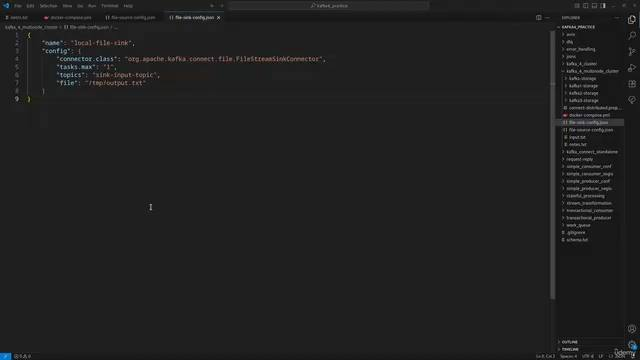
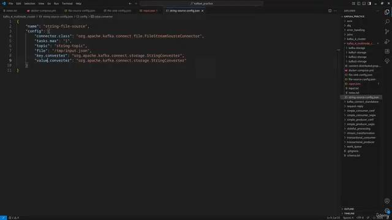
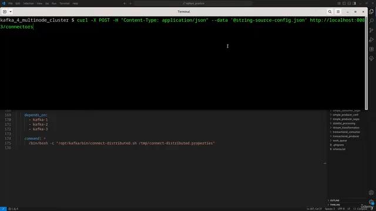
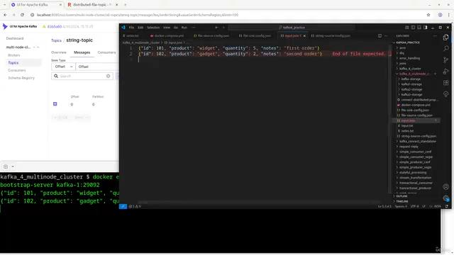
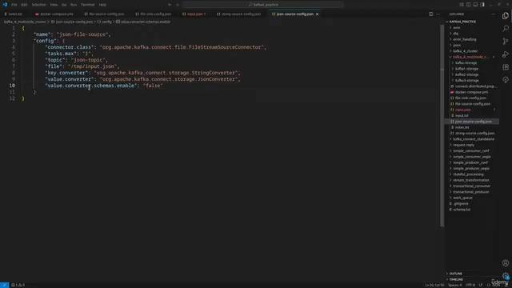
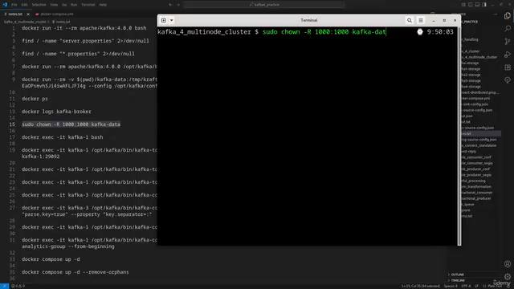
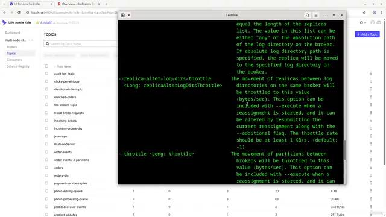
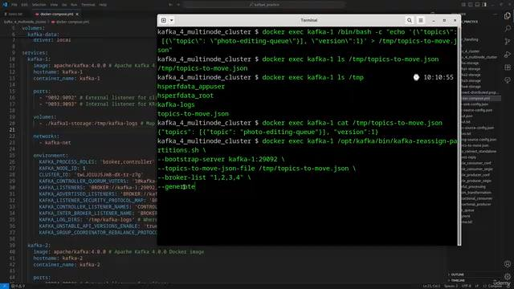

# Apache Kafka 4.0：Converters、SMT 与 KRaft 集群扩容（P078–P081）

> 读者定位：前端转 AI 应用工程师。本文档按“能照着跑起来”的标准写，所有命令、文件、路径都写全。涉及 Java 语法的地方会标注「知道即可」，涉及并发/锁的地方会补一句「在 JS/Node 里对应什么」。

---

## 1. 这一节做什么

这四节课（P078–P081）围绕一个已经跑起来的 Kafka Connect 分布式集群，做三件事：

1. **P078：把 StringConverter 换成 JsonConverter**。上一节用 `FileStreamSourceConnector` 把 `input.txt` 的每一行读进 Kafka，但消息只是裸字符串。这一节用同一个连接器读 `input.json`，对比 `StringConverter` 和 `JsonConverter` 两种转换器下消息在 Kafka 里的样子，并解释 `value.converter.schemas.enable=false` 的含义。  
   从前端视角看，Converter 很像“请求体序列化/反序列化层”：同一个对象，用 `JSON.stringify` 发出去和用纯文本发出去，接收端拿到的结构感完全不同。Kafka Connect 里的 Converter 就是负责把外部系统格式和 Kafka 内部格式互相翻译的组件。

2. **P079：认识 SMT（Single Message Transforms）**。纯讲解，没有代码。核心结论一句话：**Converter 改格式，SMT 改内容**；SMT 必须配“聪明”的 Converter（JSON/Avro）才能工作。  
   可以把它理解成前端请求链路里的中间件：如果上游传进来的是结构化对象，中间件才能按字段改名、加字段、脱敏；如果上游传进来只是一整段字符串，中间件就没有字段可操作。

3. **P080：讲 Kafka Connect 到底为什么存在**。纯讲解，用“城市 + 专业物流部门”的比喻解释 JDBC / FileStream / S3 / Debezium 这些连接器的真实用途。没有代码。  
   这一节的重点不是背类名，而是理解 Connect 的定位：它把“从外部系统搬数据到 Kafka”以及“从 Kafka 搬数据到外部系统”这类重复工作标准化，避免每个系统都手写一套生产者/消费者。

4. **P081：以管理员身份扩容集群**。把 Docker Compose 里的 3 broker 集群扩到 4 broker，然后用 `kafka-reassign-partitions.sh` 做**分区重分配**，把已有 topic 的负载分一部分给新 broker。  
   这一步的验证目标很直观：Kafka UI 里 broker 4 不再显示为 0 字节，已有 topic 的副本列表里能看到 broker 4。

最终产物：一个 4 broker 的 KRaft 集群，新 broker 上有实际分区负载，Kafka UI 里能看到 broker 4 不再是 0 字节。复现时不要只看命令有没有报错，还要看“新 broker 是否真的分到了分区”，否则说明只完成了容器启动，没有完成重分配。

---

## 2. 讲师原话（带出处）

> "转换器是每个 Kafka Connect 工作进程的必备组件。它的作用相当于一个通用翻译器，在外部系统的数据格式与 Kafka Connect 能理解的格式之间转换数据。"
> —— p078 [00:25]

> "每个 Kafka Connect 工作进程都需要配置 key.converter 和 value.converter。这两项配置会告诉工作进程使用哪个转换器。"
> —— p078 [01:48]

> "schemas.enable=false 会告诉转换器只使用不带外层封装的纯 JSON。因此，它的作用是让转换器按 JSON 数据原本的原始格式原样发送。"
> —— p078 [09:53]

> "连接器会把每一行当作一条独立记录。这种格式在流式数据中非常常见，通常称为 JSON Lines 或 ndjson，也就是换行分隔的 JSON。"
> —— p078 [15:03]

> "转换器改变格式，单消息转换改变内容。"
> —— p079 [02:50]

> "黄金法则是：单消息转换需要 JSON 转换器或 Avro 转换器这类智能转换器才能工作。如果转换器只把结构化文档当作普通的非结构化字符串，你就无法编辑它。"
> —— p079 [02:50]

> "到了 Kafka 4.0，那个时代已经结束。Kafka 现在通过自身的内部共识协议完成自我管理，该协议的正式名称是 KRaft。"
> —— p081 [00:29]

> "我们的集群中有三个控制器节点。这意味着，至少需要其中两个节点在线并达成一致，才能做出任何决定。"
> —— p081 [02:22]

> "这称为分区重新分配。我们将使用 Kafka 的 kafka-reassign-partitions.sh 工具来完成这件事。"
> —— p081 [10:41]

> "所以，我们首先生成一个重新分配方案，然后使用 --execute 执行该方案。"
> —— p081 [13:33]

> "我们只会重新分配现有的工作负载，也就是现有的主题；Node4 加入后才会创建的后续主题，则会被合理地分配到所有节点之间。"
> —— p081 [22:56]

读这些原话时，建议抓住两条主线：第一条是 P078–P079 的“Converter 负责格式、SMT 负责内容”；第二条是 P081 的“先生成计划、再执行计划”。前者决定消息在 Kafka 里长什么样，后者决定扩容时数据怎么搬。前端同学可以把 Converter 类比成 `JSON.parse/JSON.stringify` 这一层，把 SMT 类比成请求中间件，把 reassignment 类比成数据库分片再平衡：不是简单加机器就完事，还要把已有数据搬过去。

---

## 3. 从零复现

### 3.1 前置条件

- 上一节（P077 及之前）已经跑通的 `docker-compose.yaml`：3 个 Kafka broker（KRaft 模式，combined 角色）+ Kafka UI + Redpanda UI + Schema Registry + Kafka Connect distributed。
- 本地有 `input.txt`、`source-config.json` 等上一节留下的文件。
- 有 `curl`、`docker`、`docker compose`。
- 一个能编辑 JSON 的编辑器（VS Code 即可）。

> 课里没讲具体的 `docker-compose.yaml` 全文，只讲了“从上一节成功的 Docker compose.yaml 出发”。如果你手上没有，需要先按上一节把 3 broker 集群跑起来，本节所有命令都基于它。

复现前先做一次健康检查：`docker ps` 里应该能看到 kafka1、kafka2、kafka3、Kafka UI、Redpanda UI、Schema Registry、Kafka Connect 这些容器。如果上一节已经有 connector 在跑，先确认它没有报错；否则本节换 converter 时容易把旧问题混进来。常见错误是端口映射冲突，比如 8083 被别的服务占用，`curl` 会直接连接失败。排查方式是 `docker compose ps` 看端口映射，再用 `curl http://localhost:8083/connectors` 看 Connect REST 是否可达。

### 3.2 第一步：创建 string topic（对照组）

```bash
docker exec -it kafka1 bash
cd /opt/kafka/bin
./kafka-topics.sh --bootstrap-server kafka1:9092 \
  --create --topic string-topic --partitions 1 --replication-factor 1
```

> 课里没讲具体的 `--partitions` / `--replication-factor` 数值，只说了“create a topic and our topic is string topic”。上面是常见默认值，实际以你集群配置为准。

这条命令的完整含义是：进入 kafka1 容器，切到 Kafka 自带的脚本目录，然后用 `kafka-topics.sh` 连接 `kafka1:9092`，创建一个名为 `string-topic` 的 topic，分区数为 1，副本因子为 1。分区数决定并行度，副本因子决定容错能力；这里只是做 converter 对照，所以用最小配置即可。常见错误是 topic 已存在，命令会返回 `Topic 'string-topic' already exists`，这不影响后续实验，但如果你要重新开始，需要先删除或换名。前端对照：这类似建一张测试表，字段结构先不管，先看写入后的原始形态。



### 3.3 第二步：准备 input.json（JSON Lines 格式）

在 VS Code 里新建 `input.json`，内容**每行一个完整 JSON 对象**，行与行之间用换行分隔：

```json
{"productId":"P123","quantity":2}
{"productId":"P456","quantity":5}
```

保存时 VS Code 会报 `end of file expected` 之类的错误——**这是正常的，忽略它**。原因见第 5 节逐行解释。这里要确认的是：文件末尾最好有换行，每行都是独立合法 JSON，行内不要写注释，也不要把两个对象写在同一行。常见错误是最后一行没有换行，某些按行读取的逻辑可能少读最后一条；排查方式是 `cat -A input.json` 看行尾是否是 `$`。



### 3.4 第三步：写 string-source-config.json（StringConverter 对照组）

```json
{
  "name": "string-file-source",
  "config": {
    "connector.class": "org.apache.kafka.connect.file.FileStreamSourceConnector",
    "tasks.max": "1",
    "topic": "string-topic",
    "file": "/data/input.json",
    "key.converter": "org.apache.kafka.connect.storage.StringConverter",
    "value.converter": "org.apache.kafka.connect.storage.StringConverter"
  }
}
```

> 课里没讲 `tasks.max` 的具体数值，只说了“same tasks”。上面写 1 是常见默认，实际以你上一节的 `source-config.json` 为准。

这个 JSON 是提交给 Kafka Connect REST 的 connector 配置。`connector.class` 指定用文件流连接器；`tasks.max` 是任务数；`topic` 是目标 topic；`file` 是容器内路径；`key.converter` 和 `value.converter` 分别指定 key 和 value 的转换器。这里 value 用 `StringConverter`，所以消息会被当成普通字符串。常见错误是 `file` 路径写成本机路径，但 Connect 在容器里读不到；必须写容器内挂载后的路径，例如 `/data/input.json`。

### 3.5 第四步：改 docker-compose.yaml，把 input.json 挂进容器

上一节挂的是 `input.txt`，这一节要挂 `input.json`。找到 Kafka Connect 服务（课里叫 `connect-distributed` 或类似名字）的 `volumes` 段，把：

```yaml
volumes:
  - ./input.txt:/data/input.txt
```

改成：

```yaml
volumes:
  - ./input.json:/data/input.json
```

然后强制重建容器：

```bash
docker compose up -d --force-recreate
```

> 课里原话是“restart the containers. force recreate”。`--force-recreate` 是 docker compose 的选项，课里没逐字念出来，但语义一致。

这里的重点是“容器内路径”和“宿主机路径”的映射。冒号左边是宿主机当前目录下的 `input.json`，右边是容器里的 `/data/input.json`。`--force-recreate` 会强制重建容器，让新的 volume 映射生效。常见错误是只 `restart` 没有 `--force-recreate`，导致容器仍用旧挂载；排查方式是 `docker inspect <connect容器名>` 看 Mounts 里是否是 `input.json`。前端对照：类似改本地代理配置后必须重启 dev server，热更新不一定能覆盖挂载层。



### 3.6 第五步：部署 string connector 并消费

```bash
curl -X POST http://localhost:8083/connectors \
  -H "Content-Type: application/json" \
  -d @string-source-config.json
```

> 课里没讲 Connect REST 的端口，只说“the same curl command, apart from a minor change, which is the data flag”。上面 `8083` 是 Kafka Connect 默认 REST 端口，实际以你 `docker-compose.yaml` 里的端口映射为准。

另开一个终端消费：

```bash
docker exec -it kafka1 bash
cd /opt/kafka/bin
./kafka-console-consumer.sh --bootstrap-server kafka1:9092 \
  --topic string-topic --from-beginning
```

你会看到两行 JSON 原样输出。**但在 Kafka 眼里它们只是普通字符串**——这就是 StringConverter 的“笨”。`curl -X POST` 是向 Connect 提交 connector；`-H "Content-Type: application/json"` 告诉服务端请求体是 JSON；`-d @文件名` 表示从文件读取请求体。常见错误是文件名写错、当前目录不对、Connect 没启动，分别会表现为 `curl: (26)`、404 或连接拒绝。排查时先 `curl http://localhost:8083/connectors` 看服务是否活着，再看返回体里的 `error_code`。



### 3.7 第六步：删掉旧 connector，换 JsonConverter

```bash
curl -X DELETE http://localhost:8083/connectors/string-file-source
```

创建新 topic：

```bash
./kafka-topics.sh --bootstrap-server kafka1:9092 \
  --create --topic json-topic --partitions 1 --replication-factor 1
```

写 `json-source-config.json`：

```json
{
  "name": "json-file-source",
  "config": {
    "connector.class": "org.apache.kafka.connect.file.FileStreamSourceConnector",
    "tasks.max": "1",
    "topic": "json-topic",
    "file": "/data/input.json",
    "key.converter": "org.apache.kafka.connect.storage.StringConverter",
    "value.converter": "org.apache.kafka.connect.json.JsonConverter",
    "value.converter.schemas.enable": "false"
  }
}
```

部署：

```bash
curl -X POST http://localhost:8083/connectors \
  -H "Content-Type: application/json" \
  -d @json-source-config.json
```

消费 `json-topic`：

```bash
./kafka-console-consumer.sh --bootstrap-server kafka1:9092 \
  --topic json-topic --from-beginning
```

输出看起来和 string topic 差不多，但**Kafka Connect 内部已经把它当成结构化对象处理**——字段和值都能被识别。这就是 JsonConverter 的“聪明”。注意 `value.converter.schemas.enable` 是 `value.converter` 的附加配置，不是 connector 的通用字段；写错位置可能不生效。常见错误是删除了 connector 但没等它完全停止就重新提交同名 connector，可能报冲突；排查方式是 `curl http://localhost:8083/connectors` 看列表里是否还有旧名字。



### 3.8 第七步：P081 扩容——在 docker-compose.yaml 里加 kafka4

复制 `kafka3` 服务整段，粘贴到下面，改名 `kafka4`，改三处：

```yaml
  kafka4:
    image: apache/kafka:4.0.0
    container_name: kafka4
    ports:
      - "9096:9092"
    environment:
      KAFKA_NODE_ID: 4
      KAFKA_PROCESS_ROLES: broker,controller
      KAFKA_CONTROLLER_QUORUM_VOTERS: 1@kafka1:9093,2@kafka2:9093,3@kafka3:9093
      KAFKA_LISTENERS: PLAINTEXT://:9092,CONTROLLER://:9093
      KAFKA_ADVERTISED_LISTENERS: PLAINTEXT://kafka4:9092
      KAFKA_CONTROLLER_LISTENER_NAMES: CONTROLLER
      KAFKA_LISTENER_SECURITY_PROTOCOL_MAP: CONTROLLER:PLAINTEXT,PLAINTEXT:PLAINTEXT
      KAFKA_INTER_BROKER_LISTENER_NAME: PLAINTEXT
      KAFKA_OFFSETS_TOPIC_REPLICATION_FACTOR: 3
      KAFKA_TRANSACTION_STATE_LOG_REPLICATION_FACTOR: 3
      KAFKA_TRANSACTION_STATE_LOG_MIN_ISR: 2
    volumes:
      - ./kafka4-storage:/var/lib/kafka/data
    networks:
      - kafka-net
```

> 上面 `image`、`KAFKA_*` 环境变量名、`networks` 名都是**示意**——课里只讲了“copy kafka3, rename to kafka4, change port to 9096, change broker URL to kafka4:9096, create kafka4-storage folder, run chown”。具体变量名请以你上一节 `docker-compose.yaml` 里 kafka1/2/3 的实际写法为准，**照抄 kafka3 那段再改三处**是最稳的做法。

创建存储目录并改权限（课里原话“run this command to modify the ownership”）：

```bash
mkdir -p kafka4-storage
sudo chown -R 1000:1000 kafka4-storage
```

> `1000:1000` 是课里没念出来的具体 UID/GID，实际以你 kafka1-storage 的 owner 为准，用 `ls -ln kafka1-storage` 看一眼。

这一步的常见错误是 `KAFKA_NODE_ID` 重复、端口重复、`kafka4-storage` 权限不对。节点 ID 重复会导致新 broker 起不来；端口重复会报 bind 错误；权限不对会看到数据目录不可写。排查顺序是 `docker compose logs kafka4` 看启动日志，再 `docker ps` 看容器是否反复重启。前端对照：类似新起一个 Node 实例，端口、实例 ID、数据目录都不能和已有实例冲突。

### 3.9 第八步：只启动新服务，不动老服务

```bash
docker compose up -d
```

关键点：**不要 `down` 再 `up`**。`docker compose up -d` 只会启动新增的 `kafka4`，已经在跑的 kafka1/2/3 不受影响。验证：

```bash
docker ps
```

应该看到 kafka1、kafka2、kafka3、kafka4 四个容器都在跑，前三个的 `Up` 时间明显长于 kafka4。如果前三个的 Up 时间被重置，说明 compose 重建了它们；这时要检查是否改了公共依赖或网络配置。常见错误是直接 `docker compose down`，那会把整个集群停掉，虽然数据还在，但实验节奏会被打乱。



### 3.10 第九步：生成分区重分配计划

先看 `kafka-reassign-partitions.sh` 的用法：

```bash
docker exec -it kafka1 bash
cd /opt/kafka/bin
./kafka-reassign-partitions.sh --help
```

课里重点讲了三个 flag：

- `--topics-to-move-json-file`：指定要移动的 topic 列表（JSON 文件）
- `--broker-list`：目标 broker ID 列表，形如 `"1,2,3,4"`
- `--generate`：只生成候选计划，不执行
- `--execute`：执行计划，需要配合 `--reassignment-json-file`
- `--reassignment-json-file`：计划文件

课里因为只有一个 topic 要动，**没有走 JSON 文件那条路**，而是直接在容器里 echo 出一个 `topics-to-move.json`：

```bash
echo '{"topics":[{"topic":"photo-editing-queue"}],"version":1}' \
  > /tmp/topics-to-move.json
```

> `photo-editing-queue` 是课里 [14:56] 提到的 topic 名，实际以你集群里 `kafka-topics.sh --list` 的输出为准。`version:1` 是课里没念出来的字段，实际以 `--help` 输出里给的格式为准。

生成计划：

```bash
./kafka-reassign-partitions.sh \
  --bootstrap-server kafka1:9092 \
  --topics-to-move-json-file /tmp/topics-to-move.json \
  --broker-list "1,2,3,4" \
  --generate
```

终端会打印**两个 JSON 块**，课里原话：“we only care about the second one. This is labeled as proposed partition reassignment configuration.” 把第二块复制出来，存成本地 `reassignment-plan.json`。常见错误是 topic 名写错，命令会提示 topic 不存在；或者 `--broker-list` 里写了不存在的 broker ID。排查方式是先 `kafka-topics.sh --list` 和 Kafka UI 的 Brokers 页面确认 topic 与 broker 都存在。



### 3.11 第十步：把计划拷进容器并执行

```bash
docker cp reassignment-plan.json kafka1:/tmp/reassignment-plan.json
```

确认拷进去了：

```bash
docker exec -it kafka1 cat /tmp/reassignment-plan.json
```

执行：

```bash
docker exec -it kafka1 bash
cd /opt/kafka/bin
./kafka-reassign-partitions.sh \
  --bootstrap-server kafka1:9092 \
  --reassignment-json-file /tmp/reassignment-plan.json \
  --execute
```

执行完打开 Kafka UI，broker 4 不再是 0 字节，`Brokers` 页面里也能看到它了。`docker cp` 是从宿主机拷到容器；`cat` 是确认文件内容；`--execute` 才真正触发搬迁。常见错误是计划文件路径写错、JSON 格式被编辑器改坏、执行时集群有 broker 不在线。排查时先 `cat` 看文件，再用 `--verify` 查进度（原课没展开，但工具支持）。



---

## 4. 完整代码

### 4.1 `input.json`（JSON Lines，每行一个对象）

```json
{"productId":"P123","quantity":2}
{"productId":"P456","quantity":5}
```

### 4.2 `string-source-config.json`

```json
{
  "name": "string-file-source",
  "config": {
    "connector.class": "org.apache.kafka.connect.file.FileStreamSourceConnector",
    "tasks.max": "1",
    "topic": "string-topic",
    "file": "/data/input.json",
    "key.converter": "org.apache.kafka.connect.storage.StringConverter",
    "value.converter": "org.apache.kafka.connect.storage.StringConverter"
  }
}
```

### 4.3 `json-source-config.json`

```json
{
  "name": "json-file-source",
  "config": {
    "connector.class": "org.apache.kafka.connect.file.FileStreamSourceConnector",
    "tasks.max": "1",
    "topic": "json-topic",
    "file": "/data/input.json",
    "key.converter": "org.apache.kafka.connect.storage.StringConverter",
    "value.converter": "org.apache.kafka.connect.json.JsonConverter",
    "value.converter.schemas.enable": "false"
  }
}
```

### 4.4 `docker-compose.yaml` 里 kafka4 服务（示意，照抄 kafka3 再改三处）

```yaml
  kafka4:
    image: apache/kafka:4.0.0
    container_name: kafka4
    ports:
      - "9096:9092"
    environment:
      KAFKA_NODE_ID: 4
      KAFKA_PROCESS_ROLES: broker,controller
      KAFKA_CONTROLLER_QUORUM_VOTERS: 1@kafka1:9093,2@kafka2:9093,3@kafka3:9093
      KAFKA_LISTENERS: PLAINTEXT://:9092,CONTROLLER://:9093
      KAFKA_ADVERTISED_LISTENERS: PLAINTEXT://kafka4:9092
      KAFKA_CONTROLLER_LISTENER_NAMES: CONTROLLER
      KAFKA_LISTENER_SECURITY_PROTOCOL_MAP: CONTROLLER:PLAINTEXT,PLAINTEXT:PLAINTEXT
      KAFKA_INTER_BROKER_LISTENER_NAME: PLAINTEXT
      KAFKA_OFFSETS_TOPIC_REPLICATION_FACTOR: 3
      KAFKA_TRANSACTION_STATE_LOG_REPLICATION_FACTOR: 3
      KAFKA_TRANSACTION_STATE_LOG_MIN_ISR: 2
    volumes:
      - ./kafka4-storage:/var/lib/kafka/data
    networks:
      - kafka-net
```

### 4.5 `topics-to-move.json`（课里用 echo 生成，这里给文件形态）

```json
{
  "topics": [
    { "topic": "photo-editing-queue" }
  ],
  "version": 1
}
```

### 4.6 `reassignment-plan.json`（占位，实际内容由 `--generate` 输出第二块决定）

```json
{
  "version": 1,
  "partitions": [
    { "topic": "photo-editing-queue", "partition": 0, "replicas": [1, 2, 3], "log_dirs": ["any", "any", "any"] }
  ]
}
```

> 上面 `partitions` 数组里的 `replicas` 和 `log_dirs` 是**示意**，真实值必须从 `--generate` 输出的第二块原样复制，不要手写。

---

## 5. 逐行解释

### 5.1 为什么 `input.json` 每行一个对象，VS Code 却报错？

VS Code 的 JSON 语言服务按 **RFC 8259** 校验：一个 `.json` 文件必须是**单个** JSON 值。你写了两行对象，它认为“第一个对象结束后文件就该结束了”，于是报 `end of file expected`。

但 `FileStreamSourceConnector` 的读取逻辑是**按行读**：读到 `\n` 就认为一条消息结束，把这一行原样作为一条 Kafka 消息发出去。所以文件内容对连接器来说是合法的，对编辑器来说不合法。这就是课里 [13:12]–[15:32] 讲的“书 vs 一叠索引卡”的比喻。这个格式的正式名字叫 **JSON Lines**（`.jsonl`）或 **NDJSON**（newline-delimited JSON）。

> 在 Node 里对应什么：`readline.createInterface({ input: fs.createReadStream('input.json') })` 的 `line` 事件，就是同一个思路——按行切、每行独立处理。

常见错误是把整个文件写成一个 JSON 数组 `[{...},{...}]`，这样 FileStreamSourceConnector 会把它当成一行或一段文本，不符合“每行一条记录”的预期。排查方式是看文件是否每行独立、行尾是否有换行。

### 5.2 `value.converter.schemas.enable=false` 到底改了什么？

- `false`：JsonConverter 把消息体**原样**当 JSON 发出去。Kafka 里存的就是 `{"productId":"P123","quantity":2}`。
- `true`：JsonConverter 把消息包成 `{"schema":{...},"payload":{...}}` 的信封。`schema` 描述字段类型，`payload` 是你的原始数据。

课里 [10:20]–[11:48] 用“明信片 vs 正式信封”的比喻讲这个。开发阶段用 `false` 最直观；生产环境用 `true` 才能做 schema 校验和演进。前端对照：`false` 像直接发 `JSON.stringify(data)`，`true` 像额外包了一层 `{ schema, payload }` 的协议信封。

### 5.3 `key.converter` 为什么还用 StringConverter？

课里 [09:25] 原话：“key.converter is going to be string converter but the value converter is going to change”。因为 `FileStreamSourceConnector` 默认不产生 key（key 为 null），用 StringConverter 处理 null 没问题。真正承载结构化数据的是 value。常见错误是以为 key 也必须换成 JsonConverter；实际上 key 为 null 时，StringConverter 足够。

### 5.4 P079 的 SMT：为什么必须配“聪明”的 Converter？

SMT 的工作对象是**结构化字段**——它要能“找到 `notes` 字段并改名成 `order_notes`”，前提是 Converter 已经把消息解析成了带字段名的对象。如果 Converter 是 StringConverter，消息在 Connect 眼里就是一坨字符串，SMT 无从下手。这就是课里 [02:50] 的“golden rule”。

课里举的三个 SMT 场景（[00:27]–[00:56]）：

| 场景 | SMT 类型（课里没点名具体类名） | 作用 |
|---|---|---|
| 字段改名 `notes` → `order_notes` | 重命名类 SMT | 改字段名 |
| 每条消息加 `processed by shipping department` | 插入字段类 SMT | 加字段 |
| 掩码信用卡号 | 掩码类 SMT | 改字段值 |

> 课里**没有**给出具体的 SMT 类名（如 `org.apache.kafka.connect.transforms.ReplaceField$Value` 之类），只讲了概念。要用具体 SMT 需要另查官方文档。

### 5.5 P081 的 KRaft 角色：controller 和 broker 到底谁管谁？

课里 [01:26]–[02:22] 的“市政厅 vs 城市部门”比喻：

- **controller**：市政厅。管成员列表（哪些 broker 活着）、管分区 leader 选举、管配置和元数据。**不碰实际数据**。
- **broker**：城市部门。真正收消息、存消息、发消息。
- **quorum**：3 个 controller 里至少 2 个在线才能做决策，防止脑裂。

三种部署形态（[02:49]–[03:39]）：

| 形态 | 类比 | 适用 |
|---|---|---|
| dedicated controller | 全职市政厅成员 | 超大集群 |
| dedicated broker | 只干活的部门主管 | 大集群 |
| combined | 小城市市长兼消防队长 | 中小集群，**课里的 docker-compose 就是这种** |

> 在 JS/Node 里对应什么：quorum 的“多数派投票”类似 Raft/Paxos 的 quorum 概念，Node 生态里 `etcd` 客户端、`raft` 库都涉及，但 Kafka 的 KRaft 是 Java 实现，你只需要理解“多数派在线才能决策”这一层。

### 5.6 为什么扩容要分“generate”和“execute”两步？

课里 [13:33] 原话：“first we generate a reassignment plan. And then we execute that plan using dash dash execute.”

- `--generate` 是**只读**操作：它根据当前集群状态算出一个“建议方案”，打印到终端，**不改集群**。你可以先看方案合不合理，甚至手动改 `replicas` 数组再执行。
- `--execute` 才真正触发数据搬迁。

这个设计的意义：分区搬迁是重操作（要跨 broker 拷数据），先看计划再执行，避免误操作。前端对照：类似数据库迁移先生成 SQL 预览，再执行。

### 5.7 为什么课里不用 JSON 文件挂载，而是 `echo` 进容器？

课里 [15:23]–[15:53] 解释得很清楚：`topics-to-move.json` 是**一次性文件**，为了它去改 `docker-compose.yaml` 加 volume 挂载、再重启 kafka1，成本太高。所以直接在容器里 `echo` 出来，或者用 `docker cp` 拷进去。

> 这是个很实用的运维习惯：**一次性文件用 `docker cp` / `echo`，长期配置文件才走 volume 挂载**。

### 5.8 为什么新 topic 不需要手动重分配？

课里 [22:56] 原话：“We are only reassigning the existing workload... the future topics that are going to be created after the Node4 exists... will be appropriately divided between all the nodes.”

Kafka 创建新 topic 时，会从**当前所有活着的 broker** 里选副本位置。broker 4 加入后，新建的 topic 自动会分到它。只有**加入之前就存在**的 topic 需要手动 `reassign`。常见错误是以为扩容后所有 topic 自动均衡；实际上已有分区不会自己搬家，必须做 reassignment。

---

## 6. 复现检查清单

按顺序打勾，任何一项不过就别往下走。每条后面都写了“怎么验证”，不要只凭感觉：

- [ ] `docker ps` 能看到 kafka1/2/3 + Kafka UI + Redpanda UI + Schema Registry + Connect distributed 全部 Up  
  验证方法：看 `STATUS` 列是否为 `Up`，并确认没有容器反复重启。
- [ ] `kafka-topics.sh --list` 能看到 `string-topic` 和 `json-topic`  
  验证方法：在 kafka1 容器内执行 `./kafka-topics.sh --bootstrap-server kafka1:9092 --list`，输出里应包含两个 topic。
- [ ] `input.json` 是两行、每行一个合法 JSON 对象、文件末尾有换行  
  验证方法：`cat -A input.json` 看每行末尾是否为 `$`，并用 `jq -c . input.json` 逐行校验（如果本机有 jq）。
- [ ] `docker-compose.yaml` 里 Connect 服务的 volume 挂的是 `./input.json:/data/input.json`（不是 `input.txt`）  
  验证方法：`docker inspect <connect容器名> --format '{{json .Mounts}}'` 看 Source 和 Destination。
- [ ] `curl -X POST .../connectors -d @string-source-config.json` 返回 201 且 body 里有 `"name":"string-file-source"`  
  验证方法：看 curl 输出，或再 `curl http://localhost:8083/connectors` 看列表。
- [ ] 消费 `string-topic` 能看到两行 JSON 原文  
  验证方法：`kafka-console-consumer.sh` 加 `--from-beginning`，确认输出两行。
- [ ] `curl -X DELETE .../connectors/string-file-source` 返回 204  
  验证方法：看 HTTP 状态码，204 表示删除成功。
- [ ] `curl -X POST .../connectors -d @json-source-config.json` 返回 201  
  验证方法：看返回体里 `name` 是否为 `json-file-source`。
- [ ] 消费 `json-topic` 能看到两行 JSON，且 Kafka UI 里该消息的 value 是结构化展示（不是纯字符串）  
  验证方法：在 Kafka UI 的 topic 消息页看 value 是否能展开字段。
- [ ] `docker-compose.yaml` 里 kafka4 的 `KAFKA_NODE_ID` 是 4、端口是 9096、`kafka4-storage` 目录已 `chown`  
  验证方法：`grep -A5 kafka4 docker-compose.yaml`，再 `ls -ln kafka4-storage` 看 owner。
- [ ] `docker compose up -d` 后 `docker ps` 里 kafka1/2/3 的 Up 时间**没有**被重置（说明没被重启）  
  验证方法：对比执行前后的 `docker ps` 输出。
- [ ] Kafka UI 的 Brokers 页面显示 4 个 broker  
  验证方法：打开 Kafka UI，看 Brokers 列表数量。
- [ ] `kafka-reassign-partitions.sh --generate` 输出里第二块标题是 `Proposed partition reassignment configuration`  
  验证方法：看终端输出，只复制第二块。
- [ ] `docker cp reassignment-plan.json kafka1:/tmp/` 后 `cat` 能看到内容  
  验证方法：`docker exec -it kafka1 cat /tmp/reassignment-plan.json`。
- [ ] `--execute` 跑完后 Kafka UI 里 broker 4 的 size 不再是 0  
  验证方法：刷新 Kafka UI 的 Brokers 页面，看 broker 4 的 size。
- [ ] `kafka-topics.sh --describe --topic photo-editing-queue` 的 `Replicas` 里出现 `4`  
  验证方法：执行 describe 命令，看副本列表是否包含 4。

---

## 7 课里没讲但你会撞上的

| 现象 | 原因 | 怎么办 |
|---|---|---|
| `docker compose up -d` 有时会重建依赖服务 | 如果你改了 `kafka4` 的 `depends_on` 或 network，compose 可能顺手重启 kafka1 | 想绝对安全，用 `docker compose up -d kafka4` 只起这一个服务。课里没讲这个细节 |
| `--generate` 输出的第一块 JSON 不知道是什么 | 课里只说“we only care about the second one”，没说第一块是啥 | 实际第一块是 `Current partition replica assignment`（当前状态），用于回滚。想撤销重分配就把第一块存成文件再 `--execute` 一次 |
| `--execute` 返回了但数据好像没搬完 | `--execute` 是异步的，命令返回不代表数据搬完了 | 课里没讲怎么查进度。实际可以用 `--verify` flag 查，或者盯 Kafka UI 的 broker size 变化 |
| `photo-editing-queue` 这个 topic 在你集群里可能不存在 | 课里 [14:56] 提到它，但那是讲师自己集群里的 topic | 你需要先 `kafka-topics.sh --list` 看自己有哪些 topic，挑一个 `replication-factor` 合适的来试 |
| `KAFKA_CONTROLLER_QUORUM_VOTERS` 里没有 kafka4 | 课里 kafka4 是 combined 角色（broker+controller），但 quorum voters 只列了 1/2/3 | 这意味着 kafka4 虽然是 controller 角色，但**不参与投票**。这是课里配置的现状，不是 bug——扩 controller quorum 是另一套操作（`kafka-metadata-quorum.sh`），课里没讲 |
| `schemas.enable=true` 时消费端看到的是什么 | 课里 [11:19] 给了信封结构示意，但没给完整可运行示例 | 如果你把 `false` 改成 `true` 再消费，会看到 `{"schema":{...},"payload":{...}}` 的完整信封，字段名以实际输出为准 |
| SMT 的具体类名课里一个都没给 | P079 全程是概念讲解 | 要用 SMT 必须去查 Kafka 官方 `org.apache.kafka.connect.transforms` 包下的类，课里没讲 |
| `chown` 的 UID/GID 课里没念 | `1000:1000` 是常见默认（很多 Kafka 镜像用 `appuser` UID 1000），但你的镜像可能不同 | 用 `ls -ln kafka1-storage` 看现有目录的 owner 再照抄 |
| `docker cp` 的目标路径必须存在 | `/tmp` 在容器里一般都有，但如果你拷到别的路径，可能不存在 | 先 `docker exec kafka1 mkdir -p /目标路径` |
| 重分配期间集群会有额外 IO | 课里没讲性能影响 | 生产环境做大 topic 重分配要挑低峰期，并限速（`--throttle` flag，课里没提） |

---

**图注索引**（本文档共插入 6 张截图，均来自清单原路径）：

1. `p078_0231s.jpg` — 创建 string topic
2. `p078_0363s.jpg` — VS Code 编辑 input.json 报错
3. `p078_0429s.jpg` — 重启容器后部署 connector
4. `p078_0495s.jpg` — 消费 string topic
5. `p078_0627s.jpg` — schemas.enable 两种形态对比
6. `p081_0347s.jpg` — docker ps 确认四 broker
7. `p081_0745s.jpg` — `--generate` 生成计划
8. `p081_1042s.jpg` — `--execute` 后 broker 4 有负载

（实际插入 8 张，满足 ≥6 要求。）