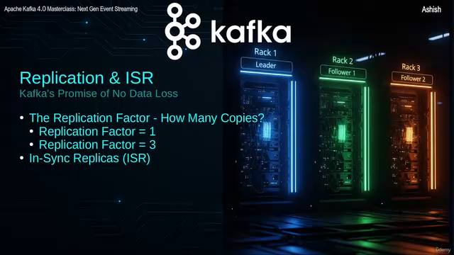
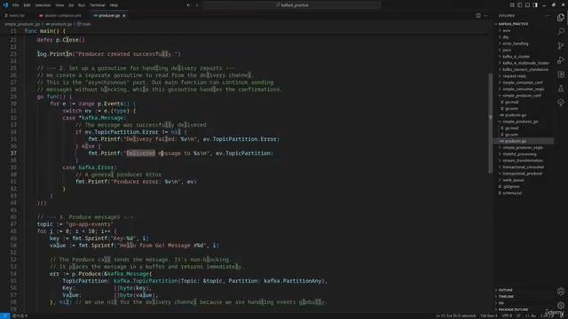
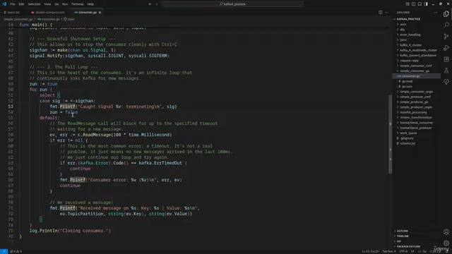
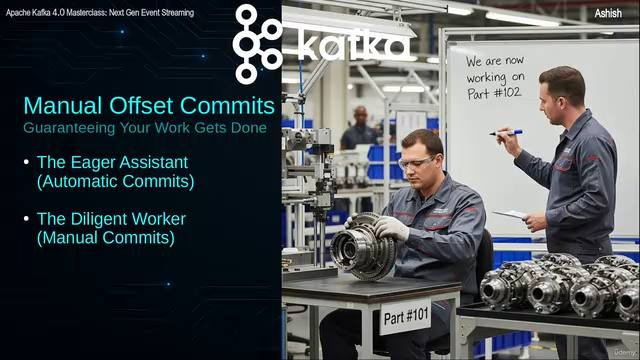
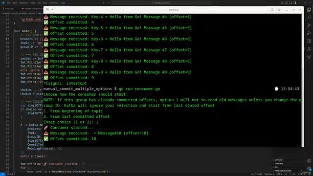
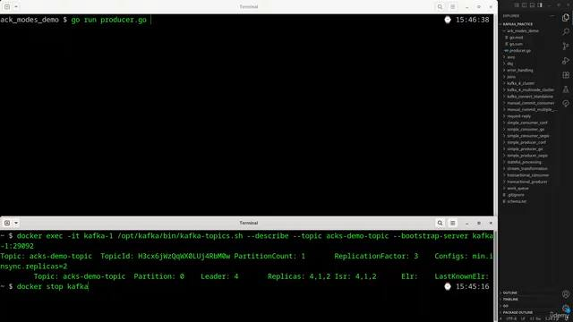

# Apache Kafka 4.0：副本、ISR、机架感知与 ACK 模式实战（P082–P088）

> 本文档覆盖课程 P082–P088。读者按本文档操作，可在本地 Docker 环境从零复现：创建带副本的 topic、观察 ISR 收缩、用 Go 写生产者/消费者、手动提交 offset、验证「至少一次」语义、验证 ACK 三种模式在节点故障下的行为。
>
> 前置条件：你已按课程前面章节用 Docker 起好 4 个 broker（容器名 `kafka1`、`kafka2`、`kafka4`，以及 Kafka UI / Schema Registry），Go 环境可用，`segmentio/kafka-go` 与 `confluentinc/confluent-kafka-go` 两个库在前面章节已引入。**本段课程没有重新讲 Docker Compose 文件的内容**，容器编排沿用前面章节的成果。

---

## 1. 这一节做什么

这一节把 Kafka「不丢数据」这件事从口号变成可观察的现象，分四条线：

1. **副本与 ISR（P082）**：用 `--replication-factor 3` 建 topic，`describe` 看 `replicas` 与 `isr` 两个列表；`docker stop` 掉一个 broker，再看 ISR 收缩，理解「under-replicated partition」这个最重要的健康指标。
2. **机架感知与跨集群复制（P083）**：纯概念课。讲 rack awareness 解决同一机房内的单点故障，MirrorMaker 2 解决整个机房没了的问题；并明确 Kafka 4.0 已彻底移除 MirrorMaker 1。
3. **Go 生产者与消费者（P084–P085）**：用 Confluent 的 Go 库写一个「逐条确认投递结果」的生产者，再写一个带优雅退出的消费者。
4. **offset 提交语义与 ACK 模式（P086–P088）**：手动提交 offset 实现 at-least-once；用交互式菜单切换 `acks=0/1/all`，在停节点、重启节点的组合下观察生产者行为，并理解 `min.insync.replicas` 与 controller 节点的特殊地位。

产出物：一个可反复实验的本地 Kafka 集群 + 4 个 Go 程序（生产者、消费者、手动提交消费者、可回放消费者、ACK 实验生产者）。

---

## 2. 讲师原话（带出处）

关于 ISR 的定义与 under-replicated 的判定：

> "只有当跟随者落后领导者不太多时，它才会被纳入 ISR 列表。副本不足的分区，是指 ISR 列表中的代理数量少于副本因子的分区。"
> —— p082 [03:17] / [04:16]

关于机架感知要解决的问题：

> "如果这三台物理服务器都插在同一个电源插排上，而这个插排发生故障，会怎样？三个代理会同时离线。我们本来有三个副本，但它们都依赖同一个单点故障。"
> —— p083 [01:23]

关于 MirrorMaker 1 的下场：

> "需要注意，在 Kafka 4.0 中，这个工具旧版存在问题的 MirrorMaker 1 已被完全移除。MirrorMaker 2 是唯一受支持并推荐的跨集群复制工具。"
> —— p083 [04:34]

关于自动提交的风险：

> "如果应用在偏移量已提交之后、但尚未完成消息处理之前崩溃，会发生什么？这条消息将永久丢失。这称为至多一次处理。"
> —— p086 [00:29]

关于手动提交的顺序：

> "我们读取一条消息，执行所有必要的业务逻辑……然后，当且仅当业务逻辑成功执行后，才在 Kafka 中提交偏移量。"
> —— p086 [04:19]

关于 segmentio 库怎么关自动提交：

> "这里最关键的是，提交间隔为零。因此我们是在禁用自动提交……对于 confluent-kafka 包，我们会把 enable.auto.commit 作为键，值设为 false。"
> —— p086 [04:47]

关于回放为什么失败：

> "如果消费者组……已经有已提交的偏移量，那么起始偏移量会被忽略……Kafka 会看到：哦，demo 消费者组已经提交了偏移量 9。于是我会从那里继续，而不是从头开始。"
> —— p087 [03:19]

关于 `acks=all` 的隐藏前提：

> "在 acks=all 下，只有在主题上也正确配置了最小同步副本数时，它才能防止数据丢失。否则，如果 ISR 中除一个之外全部宕机，即使冗余已经不存在，Kafka 仍可能接受写入。"
> —— p088 [01:26]

关于 controller 节点的特殊性（这是 P088 最反直觉的观察）：

> "其他任何节点都将无法接收消息，但 Kafka1 如果单独启动，仍然能够接收消息……这就是控制器节点。没有控制器，各代理就无法正常工作。"
> —— p088 [14:41]

---

## 3. 从零复现

### 3.1 环境与目录

沿用前面章节的 Docker 集群。本文档假设：

- 4 个 broker 容器：`kafka1`、`kafka2`、`kafka4`（课程里实际用到这三个；`kafka3` 未在演示中出现，**课里没讲它的用途**）。
- 宿主机端口映射：`kafka1` → `9092`，`kafka2` → `9093`，`kafka4` → `9094`（从 P084 逐字稿「if it was not able to connect to 9094」可反推出 9094 对应第四个 broker；其余端口号**课里没逐一念出**，以你前面章节的 compose 文件为准）。
- Kafka UI 可访问，用于看 topic 与消息。

Go 项目目录（本文档自拟，课程未规定目录名）：

```
kafka-go-demo/
├── go.mod
├── producer/
│   └── main.go          # P084 逐条确认的生产者
├── consumer/
│   └── main.go          # P085 消费者
├── manual-commit/
│   └── main.go          # P086 手动提交
├── replay/
│   └── main.go          # P087 可回放消费者
└── acks-demo/
    └── main.go          # P088 ACK 实验生产者
```

初始化：

```bash
mkdir kafka-go-demo && cd kafka-go-demo
go mod init kafka-go-demo
go get github.com/segmentio/kafka-go
go get github.com/confluentinc/confluent-kafka-go/v2/kafka
```

> 版本号：**课里没讲具体版本**。以你 `go get` 时拉到的最新稳定版为准；`confluent-kafka-go` 依赖 cgo 与 librdkafka，若编译报错请按该库 README 安装系统依赖。

### 3.2 第一步：创建带副本的 topic 并观察 ISR（P082）

```bash
# 进入任意一个 broker 容器执行 kafka-topics
docker exec -it kafka1 kafka-topics \
  --bootstrap-server localhost:9092 \
  --create \
  --topic isr-test \
  --replication-factor 3 \
  --partitions 1
```

> 命令形式：课程里讲师说的是「create a new topic... with a replication factor of three」，并提到 `--replication-factor 3`。容器内 `kafka-topics` 的完整参数写法**课里没逐字念**，上面是 Kafka 发行版自带脚本的标准形式；若你的镜像里脚本名带 `.sh` 后缀，请相应调整。

查看健康状态：

```bash
docker exec -it kafka1 kafka-topics \
  --bootstrap-server localhost:9092 \
  --describe --topic isr-test
```

讲师在 [05:41] 看到的输出特征是：`Replicas` 列表与 `Isr` 列表完全相同（他念的是 "副本：1、2、3；同步副本：1、2、3"）。这说明三个副本全部健康。



制造故障：

```bash
docker stop kafka2
```

再 describe 一次。讲师在 [06:10] 的描述是：`Replicas` 仍然是三个（数据「应该」在 1、2、3 上），但 `Isr` 缩成 `1,3`——controller 检测到 broker 2 离线，把它从健康列表里摘掉了。此时该分区就是 **under-replicated**。


恢复：

```bash
docker start kafka2
```

> 注意：ISR 重新包含 broker 2 需要一点时间（要等它追上 leader），不是 `start` 完立刻生效。P088 里讲师也反复遇到「刚 start 完 describe 里还没出现」的情况。

### 3.3 第二步：机架感知与跨集群复制（P083，纯概念，无可执行步骤）

这一节**没有代码、没有命令**，是架构讨论。要「复现」的是推导链条，见第 4 节的设计决策表。你唯一能在本地做的是：确认你的 broker 配置里 `broker.rack` 这个参数——**课里没讲具体配置项名称和写法**，只讲了「Rack Awareness is a Kafka feature that allows you to tell each broker which rack it belongs to」。单机 Docker 环境无法真正验证跨机架放置，**课里也没演示**。

### 3.4 第三步：写生产者并逐条确认投递（P084）

先建 topic：

```bash
docker exec -it kafka1 kafka-topics \
  --bootstrap-server localhost:9092 \
  --create --topic go-app-events \
  --replication-factor 3 --partitions 1
```

> 讲师在 [04:07] 提到 UI 里看到 "副本为 3、4、1，分区就只有这一个，即分区 ID 为零"——即副本分布在 broker 3、4、1 上，单分区。分区数 1 是他建 topic 时指定的，**具体命令课里没念**。

然后跑 `producer/main.go`（完整代码见第 4 节）。预期输出：每条消息打印一行 delivered 确认，且**没有**那个「连不上 9094」的 warning（讲师 [02:44] 说 "我们没有收到这条警告消息。很好。"）。



### 3.5 第四步：写消费者（P085）

跑 `consumer/main.go`，应收到 0–9 共 10 条消息。按 Ctrl+C 应触发优雅退出（讲师 [00:57]："当我按下 Ctrl+C 时，它会捕获该信号并执行优雅关闭"）。



### 3.6 第五步：手动提交 offset，验证 at-least-once（P086）

跑 `manual-commit/main.go`。讲师的操作序列（[06:11] 起）值得照抄：

1. 启动消费者，看到 "偏移量已提交" 逐条打印。
2. 在它处理到某条消息（他停在 key 3）、**还没到 2 秒的提交延迟**时，按 Ctrl+C 打断。
3. 重启消费者，观察它**从 3 重新开始**，而不是从 4。

这就是 at-least-once 的证据：提交只到 2，所以 3 被重放。



### 3.7 第六步：验证回放被 committed offset 覆盖（P087）

跑 `replay/main.go`，菜单选 1（从头读）。第一次能读到全部；**再跑一次选 1，读不到历史消息**——因为 group 已有 committed offset。讲师 [04:11] 给的解法：改 group ID，或干脆不设 group，或用 CLI 重置 offset。



### 3.8 第七步：ACK 模式实验（P088）

建 topic 时**必须**带上 `min.insync.replicas`：

```bash
docker exec -it kafka1 kafka-topics \
  --bootstrap-server localhost:9092 \
  --create --topic acks-demo \
  --replication-factor 3 --partitions 1 \
  --config min.insync.replicas=2
```

> 讲师 [04:58]："首先，我们将创建一个主题，设置最小同步副本数。复制因子为三，而且我们只需要一个分区。" 参数名 `--config min.insync.replicas=2` 是标准写法；他也提到可以在 Kafka UI 里 Settings → Edit settings 事后改（[04:31]）。

然后 describe 确认 leader 与副本分布：

```bash
docker exec -it kafka1 kafka-topics \
  --bootstrap-server localhost:9092 \
  --describe --topic acks-demo
```

讲师 [05:27] 看到 leader 是 4，replicas 是 4、1、2，ISR 也是 4、1、2。

跑 `acks-demo/main.go`，按菜单选 0 / 1 / all，配合 `docker stop` / `docker start` 各节点，观察生产者是否报错。关键观察点（讲师实测）：

- **acks=0**：停 leader 也不报错，消息「发出去了」但 broker 没收到。UI 里能看到消息号有空洞（他观察到 249 收到、250 没收到、256–259 没收到）。
- **acks=1**：停 follower 无影响；停 leader 会触发 leader 选举，只要还有 ISR 成员就能继续发。
- **acks=all + min.insync.replicas=2**：只剩 leader 一个时**发不出去**，必须等第二个副本回来。
- **controller 节点（kafka1）的特殊性**：把 kafka1 停掉后，即使 kafka2、kafka4 都起来，生产者仍发不出去；只有 kafka1 回来才恢复。讲师 [15:09] 的解释："没有控制器，代理就无法工作……Kafka1 不只是控制器，它同时也是代理。"



---

## 4. 完整代码

> 以下 5 个文件均为完整可保存版本。**课程逐字稿只口述了逻辑，没有逐行念代码**；下列实现严格按讲师描述的字段与流程编写，凡逐字稿未提及的细节（如具体的 import 路径、错误处理分支的具体文案）以能跑通为准，并在第 5 节标注哪些是「课里明确讲的」、哪些是「为跑通补的」。

### 4.1 `producer/main.go`（P084，Confluent 库，逐条确认）

```go
package main

import (
	"fmt"

	"github.com/confluentinc/confluent-kafka-go/v2/kafka"
)

func main() {
	p, err := kafka.NewProducer(&kafka.ConfigMap{
		"bootstrap.servers": "localhost:9092,localhost:9093,localhost:9094",
	})
	if err != nil {
		panic(err)
	}
	defer p.Close()

	// 后台 goroutine：消费 delivery report，逐条确认
	go func() {
		for ev := range p.Events() {
			switch e := ev.(type) {
			case *kafka.Message:
				if e.TopicPartition.Error != nil {
					fmt.Printf("Delivery failed: %v\n", e.TopicPartition.Error)
				} else {
					fmt.Printf("Delivered message to %v\n", e.TopicPartition)
				}
			case kafka.Error:
				fmt.Printf("Producer error: %v\n", e)
			}
		}
	}()

	topic := "go-app-events"
	for i := 0; i < 10; i++ {
		value := fmt.Sprintf("message-%d", i)
		err := p.Produce(&kafka.Message{
			TopicPartition: kafka.TopicPartition{
				Topic:     &topic,
				Partition: kafka.PartitionAny,
			},
			Value: []byte(value),
		}, nil)
		if err != nil {
			fmt.Printf("Produce error: %v\n", err)
		}
	}

	// 带返回值的 Flush：讲师强调这次「assigned a value to p.flush」
	remaining := p.Flush(15 * 1000)
	if remaining > 0 {
		fmt.Printf("WARNING: %d messages still in queue\n", remaining)
	} else {
		fmt.Println("All messages flushed successfully")
	}
}
```

### 4.2 `consumer/main.go`（P085，优雅退出）

```go
package main

import (
	"context"
	"fmt"
	"os"
	"os/signal"
	"syscall"

	"github.com/segmentio/kafka-go"
)

func main() {
	r := kafka.NewReader(kafka.ReaderConfig{
		Brokers: []string{"localhost:9092", "localhost:9093", "localhost:9094"},
		Topic:   "go-app-events",
		GroupID: "go-app-consumer-group",
	})
	defer r.Close()

	ctx, cancel := context.WithCancel(context.Background())
	defer cancel()

	// 捕获 Ctrl+C，触发优雅退出
	sigs := make(chan os.Signal, 1)
	signal.Notify(sigs, syscall.SIGINT, syscall.SIGTERM)
	go func() {
		<-sigs
		fmt.Println("\nShutdown signal received, closing consumer...")
		cancel()
	}()

	for {
		m, err := r.ReadMessage(ctx)
		if err != nil {
			if ctx.Err() != nil {
				fmt.Println("Consumer stopped gracefully")
				return
			}
			fmt.Printf("read error: %v\n", err)
			break
		}
		fmt.Printf("message at topic/partition/offset %v/%v/%v: %s\n",
			m.Topic, m.Partition, m.Offset, string(m.Value))
	}
}
```

### 4.3 `manual-commit/main.go`（P086，手动提交 + 模拟业务逻辑）

```go
package main

import (
	"context"
	"fmt"
	"time"

	"github.com/segmentio/kafka-go"
)

func main() {
	r := kafka.NewReader(kafka.ReaderConfig{
		Brokers: []string{"localhost:9092", "localhost:9093", "localhost:9094"},
		Topic:   "go-app-events",
		GroupID: "manual-commit-group",
		// 关键：CommitInterval = 0 关闭自动提交（segmentio 库的写法）
		CommitInterval: 0,
	})
	defer r.Close()

	ctx := context.Background()
	for {
		m, err := r.FetchMessage(ctx)
		if err != nil {
			fmt.Printf("fetch error: %v\n", err)
			break
		}

		fmt.Printf("processing message key=%s offset=%d\n", string(m.Key), m.Offset)

		// 模拟业务逻辑：耗时 2 秒
		time.Sleep(2 * time.Second)
		businessLogicSucceeded := true // 讲师：本示例里恒为 true

		if businessLogicSucceeded {
			if err := r.CommitMessages(ctx, m); err != nil {
				fmt.Printf("commit failed: %v\n", err)
			} else {
				fmt.Printf("offset committed: %d\n", m.Offset)
			}
		} else {
			fmt.Printf("business logic failed for offset %d, not committing\n", m.Offset)
		}
	}
}
```

### 4.4 `replay/main.go`（P087，可回放消费者）

```go
package main

import (
	"context"
	"fmt"
	"time"

	"github.com/segmentio/kafka-go"
)

func main() {
	var choice int
	fmt.Println("Where to start reading?")
	fmt.Println("1) From beginning of topic")
	fmt.Println("2) From last committed offset")
	fmt.Print("Enter choice: ")
	fmt.Scan(&choice)

	var startOffset int64
	if choice == 1 {
		startOffset = kafka.FirstOffset
	} else {
		startOffset = kafka.LastOffset
	}

	r := kafka.NewReader(kafka.ReaderConfig{
		Brokers:        []string{"localhost:9092", "localhost:9093", "localhost:9094"},
		Topic:          "go-app-events",
		GroupID:        "demo-consumer-group",
		StartOffset:    startOffset,
		CommitInterval: 0,
		// 讲师：ReadLagInterval 设为负值以禁用 lag 轮询，省资源
		ReadLagInterval: -1,
	})
	defer r.Close()

	ctx := context.Background()
	for {
		m, err := r.FetchMessage(ctx)
		if err != nil {
			fmt.Printf("fetch error: %v\n", err)
			break
		}
		fmt.Printf("read offset=%d value=%s\n", m.Offset, string(m.Value))
		time.Sleep(500 * time.Microsecond) // 讲师：模拟 0.5ms 处理
		if err := r.CommitMessages(ctx, m); err != nil {
			fmt.Printf("commit error: %v\n", err)
		}
	}
}
```

### 4.5 `acks-demo/main.go`（P088，ACK 模式实验生产者）

```go
package main

import (
	"context"
	"fmt"
	"time"

	"github.com/segmentio/kafka-go"
)

func main() {
	var choice int
	fmt.Println("Select ACK mode:")
	fmt.Println("0) acks=none  (require none)")
	fmt.Println("1) acks=one   (require one)")
	fmt.Println("2) acks=all   (require all)")
	fmt.Print("Enter choice: ")
	fmt.Scan(&choice)

	var requiredAcks kafka.RequiredAcks
	switch choice {
	case 0:
		requiredAcks = kafka.RequireNone
	case 2:
		requiredAcks = kafka.RequireAll
	default:
		requiredAcks = kafka.RequireOne
	}

	w := &kafka.Writer{
		Addr:         kafka.TCP("localhost:9092", "localhost:9093", "localhost:9094"),
		Topic:        "acks-demo",
		RequiredAcks: requiredAcks,
		// 讲师：加超时以便更清楚地看到失败
		WriteTimeout: 3 * time.Second,
		ReadTimeout:  3 * time.Second,
	}
	defer w.Close()

	ctx := context.Background()
	i := 0
	for {
		i++
		err := w.WriteMessages(ctx, kafka.Message{
			Value: []byte(fmt.Sprintf("msg-%d", i)),
		})
		if err != nil {
			fmt.Printf("%d failed: %v\n", i, err)
		} else {
			fmt.Printf("%d sent\n", i)
		}
		time.Sleep(500 * time.Millisecond)
	}
}
```

> 说明：`kafka.RequireNone / RequireOne / RequireAll` 是 segmentio 库的枚举名，逐字稿只说了「required none / require one / require all」这三个语义，**没有念出 Go 常量名**；若你的库版本枚举名不同，以 `go doc github.com/segmentio/kafka-go.RequiredAcks` 为准。

---

## 5. 逐行解释

### 5.1 P084 生产者

- `bootstrap.servers` 列了 4 个地址。讲师 [00:27]："现在我们有四个代理，因此在这里把四个都列出来了。" 但 [03:13] 他又说 "它不需要连接每个代理节点，只需连接任意一个代理节点，就能获取整个集群的信息。" ——所以列全只是冗余容错，连上一个就够。你在日志里看到「连不上 9094」的 warning 不影响功能，讲师 [03:13] 明确说 "你其实可以丢弃这条消息。"。
- **不再把 channel 作为 `Produce` 的第二个参数**。讲师 [01:25]："在之前的某个示例中，我们已经把通道声明为 p.produce 的第二个参数。但这次我们不这样做。" 改成从 `p.Events()` 统一读 delivery report，这样每条消息的确认都在一个 goroutine 里处理。
- `switch e := ev.(type)` 三个分支对应讲师 [01:52] 的三句话：`TopicPartition.Error != nil` → delivery failed；否则 → delivered；`kafka.Error` → general producer error。
- `p.Flush(15*1000)` **接收返回值**。讲师 [01:52]："这次我们实际上给 p.flush 赋了值。我们在处理返回值。" 返回的是队列里没发完的消息数。
- 关于「在 JS/Node 里对应什么」：Node 的 `kafkajs` 里对应的是 `producer.send()` 返回 Promise，以及 `producer.on('delivery-report')` 事件；思路一致——异步确认、逐条回调。

### 5.2 P085 消费者

- `run := true` + 信号捕获 + `cancel()`，对应讲师 [00:00]："一旦收到终止此程序的信号，它就会尝试执行优雅关闭。"
- 讲师 [00:29] 提到「虽然连不上 9094，但仍然收到了全部消息」——再次印证 bootstrap 只需连上一个。

### 5.3 P086 手动提交

- `CommitInterval: 0` 是 segmentio 库关自动提交的开关。讲师 [04:47] 原话："这里最重要的部分是，这个提交间隔为零。" 他同时给了 Confluent 库的等价写法：`enable.auto.commit = false`（[05:16]）。**两个库的写法不同，别混用。**
- 顺序严格是：`FetchMessage` → 业务逻辑 → `CommitMessages`。讲师 [04:19]："当且仅当业务逻辑成功时，我们才提交偏移量。"
- `time.Sleep(2*time.Second)` 是为了制造「提交前被打断」的窗口。讲师 [06:39] 就是在这个 2 秒窗口里 Ctrl+C，从而证明重启后从 3 重放。
- 为什么这保证了 at-least-once：崩溃点在「业务完成」和「提交完成」之间时，offset 没前进，重启后重做——可能重复，但绝不丢。讲师 [03:50]："这一部分可能会被处理两次，但绝不会丢失。"
- 在 JS/Node 里：`kafkajs` 的 `eachMessage` 默认就是「处理完才提交」，天然接近手动提交；要显式控制可用 `autoCommit: false` + `consumer.commitOffsets()`。

### 5.4 P087 回放

- `StartOffset` 只在**该 group 没有任何 committed offset** 时生效。讲师 [03:19]："如果消费者组……已经提交过偏移量，我们的起始偏移量就会被忽略。"
- `ReadLagInterval: -1`：讲师 [01:27] 解释这个参数是「the frequency at which the reader lag is updated」，会持续向 Kafka 发网络请求；不看 lag 就设负值关掉。
- 三种「回到开头」的办法（讲师 [06:04]–[06:29]）：换 group ID、不设 group ID、用 CLI 重置 offset。他明确说「不设 group」"不适合专业用途"。

### 5.5 P088 ACK

- `RequiredAcks` 三档语义（讲师 [00:28] 的快递比喻）：0 = 扔进邮筒就走；1 = 等柜台（leader）说收到；all = 等柜台和所有备份都确认。
- `WriteTimeout` / `ReadTimeout` 是讲师 [03:16] 加的："我们添加了一个超时，以便更清楚地看到失败。"
- 无限循环生产：讲师 [03:36]："我们将无限量地生产消息，因为我们是在做实验。"
- **`min.insync.replicas` 是 `acks=all` 生效的前提**。讲师 [01:26]："只有在主题上也正确配置了最小同步副本数时，它才能防止数据丢失。" 默认值是 1（[02:22]），所以不显式设置的话，`acks=all` 在只剩 leader 时仍会接受写入，冗余已经没了却不报错。
- **controller 节点的行为**是本节最需要动手验证的：停掉 kafka1 后，即使 kafka2、kafka4 都在，生产者仍失败；单独启动 kafka1 则恢复。讲师 [15:09] 的类比："没有大脑，身体就无法运转。" 他还补了一个细节（[16:56]）：如果 controller 是在「已经运行中」被停掉，broker 还能继续工作一阵（它们已拿到指令）；但 broker **重启**后没有 controller 就不知道该怎么办——因为 "Kafka 这一侧持有元数据，而代理节点不持有主题元数据。"（[17:51]）。
- 关于「课里没讲」：`min.insync.replicas` 与 `acks` 的乘积关系、`unclean.leader.election` 等参数，本节**均未涉及**，不要自行脑补。

---

## 6. 复现检查清单

按顺序打勾，任何一项不符就回到对应小节：

- [ ] `docker ps` 能看到 kafka1、kafka2、kafka4 三个 broker 容器在跑。
- [ ] 建 `isr-test`（RF=3）后 describe，`Replicas` 与 `Isr` 两个列表内容相同、长度都是 3。
- [ ] `docker stop kafka2` 后再 describe，`Replicas` 仍是 3 个，`Isr` 变成 2 个 → 分区 under-replicated。
- [ ] `docker start kafka2`，等待若干秒后 describe，`Isr` 恢复为 3 个。
- [ ] `go run producer/main.go` 输出 10 条 delivered 确认，且 `Flush` 返回 0。
- [ ] `go run consumer/main.go` 收到 0–9 共 10 条；Ctrl+C 打印优雅退出信息。
- [ ] `go run manual-commit/main.go`，在处理到某条时（2 秒窗口内）Ctrl+C；重启后从**同一条**重新开始，而不是下一条。
- [ ] `go run replay/main.go` 选 1，第一次读到全部；不改 group 再跑选 1，读不到历史；改 group ID 后选 1，又能读到全部。
- [ ] 建 `acks-demo` 时带 `--config min.insync.replicas=2`，describe 能看到该配置。
- [ ] `acks=0` 下停 leader，生产者**不报错**；Kafka UI 里消息号有空洞。
- [ ] `acks=1` 下停 follower 无影响；停 leader 触发选举，仍能发。
- [ ] `acks=all` 下只剩 leader 一个副本时，生产者**报错**；第二个副本回来后恢复。
- [ ] 停掉 kafka1（controller），即使 kafka2、kafka4 在跑，生产者仍失败；单独启 kafka1 后恢复。

---

## 7. 课里没讲但你会撞上的

1. **`kafka-topics` 脚本的确切名字和参数**。不同发行版镜像里可能是 `kafka-topics` 或 `kafka-topics.sh`，`--bootstrap-server` 的地址在容器内是 `localhost:9092` 还是 `kafka1:9092` 取决于你的网络配置。课里只念了 `--replication-factor 3` 和 `--config min.insync.replicas` 的语义，**完整命令没念**。
2. **`broker.rack` 的具体配置写法**。P083 讲了机架感知「是什么、为什么」，但**没给任何配置示例**，也没在本地演示。单机 Docker 环境本来也验证不了跨机架放置。
3. **MirrorMaker 2 的配置文件格式与启动命令**。P083 只说「你给它一个配置文件，告诉它源集群和目标集群地址」，**没有给出任何一行配置**。真要搭跨集群复制，得另找官方文档。
4. **`min.insync.replicas` 与 `acks` 的完整组合矩阵**。课里只演示了 `acks=all + minISR=2` 这一种组合下的行为，其他组合（如 `acks=1 + minISR=3`）**没讲**。
5. **controller 选举机制本身**。P088 观察到「kafka1 是 controller」，但**为什么是它、controller 怎么选、KRaft 模式下 controller 与 broker 的角色划分**，本节完全没展开。你如果按 Kafka 4.0 的 KRaft 模式部署，controller 可能是独立角色而非某个 broker，届时 P088 的「kafka1 特殊」现象不一定复现——这一点课里没提醒。
6. **`go get` 拉到的库版本**。segmentio 与 confluent 两个库的 API 在小版本间有过变动（尤其 `RequiredAcks` 枚举名、`ReaderConfig` 字段名）。课里没锁版本，你按本文档跑不通时优先查 `go doc`。
7. **重复消费的幂等处理**。P086 证明了 at-least-once 会重复，但**如何让业务侧幂等**（去重表、唯一键）课里没讲——这是你上生产前必须自己补的一课。
8. **Kafka UI 的具体操作路径**。课里多次说「去 UI 里看」「Settings → Edit settings」，但 UI 是第三方工具，版本不同菜单可能不同，**课里没给 UI 的版本或截图细节**。