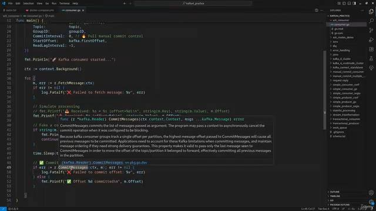
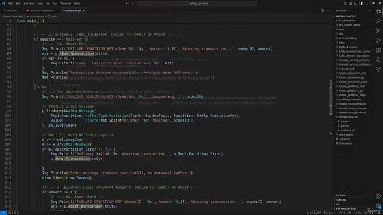
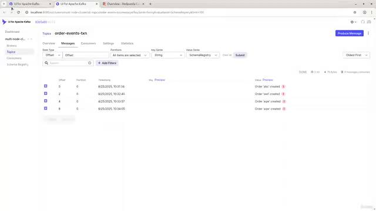
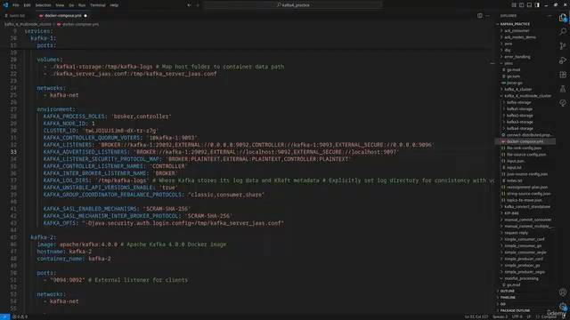
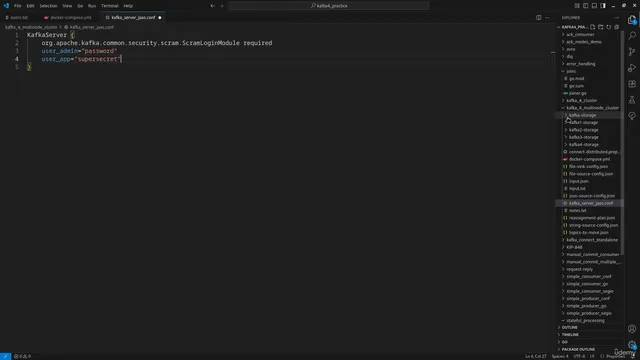

# Apache Kafka 4.0 实战复现文档（P089–P092）

> 覆盖内容：消费者确认（Offset 提交）、Kafka 事务（Confluent Kafka Go）、KStream / KTable / GlobalKTable 概念、SASL 安全集群配置。
> 读者定位：前端转 AI 应用工程师。文中涉及 Go 的地方会标注与 JS/Node 的对应关系；Java 语法只做「知道即可」处理。

---

## 1. 这一节做什么

这四节课把 Kafka 从「能收发消息」推进到「能保证数据不丢、不重、不被偷看」。具体产出三样东西：

1. **一个手动提交 Offset 的消费者**：用「不提交 Offset」来模拟消费失败，理解 Kafka 的「确认」不是 ACK 包，而是 Offset 提交。
2. **一个事务性生产者 + 事务性消费者**：用 Confluent Kafka Go 库实现「要么全成功、要么全回滚」的转账式语义，并用 `isolation.level=read committed` 的消费者验证「未提交消息读不到」。
3. **一个开了 SASL 认证的 Kafka 4.0 集群**：改 `docker-compose.yml`、写 `kafka_server_jaas.conf`、映射 9096 安全端口，最后用 `docker ps` 和 Kafka UI 验证 8 个容器全部起来。

P091 是纯概念课（KStream / KTable / GlobalKTable），没有代码。它的价值是给你一套「命名体系」：你之前用 `Kafka.Reader` 写的消费者、用 `map` 写的计数器、用全量 map 写的 join，在 Kafka 官方术语里分别叫什么。第 3.5 节会把这三个概念映射回你已经写过的 Go 代码。

最终目录结构建议如下（后文所有文件都放在这个结构里）：

```
kafka-4-demo/
├── docker-compose.yml
├── kafka_server_jaas.conf
├── go.mod
├── consumer-ack/
│   └── main.go
└── transactions/
    └── main.go
```

---

## 2. 讲师原话（带时间戳）

> "Kafka 的模型是偏移量管理，而不是确认机制。Kafka 通过偏移量跟踪每个消费者已读取到哪里，而不是通过确认。"
> —— p089 [00:34]

> "当遇到一条内容为 fail me 的消息时，我们是在模拟一次失败，然后从这个位置回到循环开头继续执行，并且不提交这条消息。"
> —— p089 [01:24]

> "黄金法则是，事务只有两种可能结果。如果两个步骤都成功，事务就会提交……如果任何一步因任何原因失败，比如服务器崩溃或出现错误，整个事务就会中止。"
> —— p090 [01:52]

> "对于事务型生产者，必须包含 transactional.id。"
> —— p090 [02:48]

> "我们有一个大小为 2 的缓冲区。接下来会看到这次为什么缓冲区大小是 2。"
> —— p090 [04:14]

> "事务型消费者不会读取未提交的消息。"
> —— p090 [14:22]

> "KStream 是最基本的构建块。它是一条持续不断、无休止且不可变的事件日志，表示已经发生了什么。"
> —— p091 [00:55]

> "KTable 通过聚合 KStream 创建……KTable 由一个经过压缩的 Kafka 主题支撑。"
> —— p091 [02:21]

> "Global KTable 的创建方式是，让流处理应用的每一个实例都消费源主题的每一个分区。"
> —— p091 [04:14]

> "Kafka 使用一个名为 SASL（简单认证与安全层）的框架。"
> —— p092 [02:37]

> "Apache Kafka 4.0 官方镜像有一个专用于安全通信的端口，该端口是 9096。"
> —— p092 [07:22]

> "KAFKA_OPTS 环境变量会告诉运行在 Kafka 容器内的 Java 程序，使用特定文件作为其安全和认证配置。"
> —— p092 [16:23]

---

## 3. 从零复现

### 3.1 环境准备

课里没有逐字给出 Go 版本和库版本，以下是我按「能跑通」补全的建议值，**版本号请以你本机实际为准**：

| 依赖 | 建议版本 | 说明 |
|---|---|---|
| Go | 1.22+ | 课里没讲版本，`confluent-kafka-go` 需要 cgo |
| `github.com/confluentinc/confluent-kafka-go/v2` | v2.x | 课里称「Confluent Ink library」，实际包名是 `confluent-kafka-go` |
| Docker / Docker Compose | 任意较新版本 | 用来起 Kafka 4.0 集群 |
| Apache Kafka 镜像 | `apache/kafka:4.0.0` | 课里明确说「Apache Kafka 4.0 official image」 |

初始化模块：

```bash
mkdir kafka-4-demo && cd kafka-4-demo
go mod init kafka4demo
go get github.com/confluentinc/confluent-kafka-go/v2/kafka
```

> 注意：`confluent-kafka-go` 底层是 librdkafka，需要 C 编译器。macOS 装 Xcode Command Line Tools，Linux 装 `build-essential`。这是课里没讲、但你第一次 `go build` 一定会撞上的坑。

### 3.2 第一步：起一个最简 Kafka（先不加密）

在写消费者之前，先确认 Kafka 能跑。课里 P092 之前用的就是普通集群，P092 才加 SASL。先给一个最小可用的 `docker-compose.yml`（KRaft 模式，单节点）：

```yaml
services:
  kafka1:
    image: apache/kafka:4.0.0
    container_name: kafka1
    ports:
      - "9092:9092"
    environment:
      KAFKA_NODE_ID: 1
      KAFKA_PROCESS_ROLES: broker,controller
      KAFKA_CONTROLLER_QUORUM_VOTERS: 1@kafka1:19093
      KAFKA_LISTENERS: CONTROLLER://:19093,PLAINTEXT://:9092
      KAFKA_ADVERTISED_LISTENERS: PLAINTEXT://localhost:9092
      KAFKA_LISTENER_SECURITY_PROTOCOL_MAP: CONTROLLER:PLAINTEXT,PLAINTEXT:PLAINTEXT
      KAFKA_CONTROLLER_LISTENER_NAMES: CONTROLLER
      KAFKA_INTER_BROKER_LISTENER_NAME: PLAINTEXT
      KAFKA_OFFSETS_TOPIC_REPLICATION_FACTOR: 1
      KAFKA_TRANSACTION_STATE_LOG_REPLICATION_FACTOR: 1
      KAFKA_TRANSACTION_STATE_LOG_MIN_ISR: 1
```

启动：

```bash
docker compose up -d
docker ps
```

### 3.3 第二步：消费者确认（P089）

课里没有贴出完整代码，只描述了逻辑：**手动提交 Offset，遇到 `fail me` 消息就 `continue` 回循环开头、不提交**。下面按这个描述补全成可运行文件。

先创建 topic（课里只说「create the topics」，没贴命令，这里补上）：

```bash
docker exec -it kafka1 /opt/kafka/bin/kafka-topics.sh \
  --bootstrap-server localhost:9092 \
  --create --topic consumer-ack --partitions 1 --replication-factor 1
```

`consumer-ack/main.go` 的完整代码见第 4 节。运行：

```bash
go run ./consumer-ack
```

然后在另一个终端生产消息：

```bash
docker exec -it kafka1 /opt/kafka/bin/kafka-console-producer.sh \
  --bootstrap-server localhost:9092 --topic consumer-ack
```

输入 `hello`、`world`、`fail me`、`after`。你会看到：`hello`、`world` 被提交；`fail me` 触发 `continue`，Offset 没有前进；`after` 虽然被消费到，但因为前面 `fail me` 没提交，重启消费者后 `fail me` 及之后的消息会重新投递。



### 3.4 第三步：Kafka 事务（P090）

事务 demo 需要两个 topic：`order-events-transaction` 和 `payment-events-transaction`。课里是在两个独立终端里分别起消费者，所以 topic 也分开建：

```bash
docker exec -it kafka1 /opt/kafka/bin/kafka-topics.sh \
  --bootstrap-server localhost:9092 \
  --create --topic order-events-transaction --partitions 1 --replication-factor 1

docker exec -it kafka1 /opt/kafka/bin/kafka-topics.sh \
  --bootstrap-server localhost:9092 \
  --create --topic payment-events-transaction --partitions 1 --replication-factor 1
```

起两个**事务性消费者**（关键是 `--consumer-property isolation.level=read committed`，逐字稿 p090 [07:57] 明确提到）：

```bash
# 终端 A
docker exec -it kafka1 /opt/kafka/bin/kafka-console-consumer.sh \
  --bootstrap-server localhost:9092 \
  --topic order-events-transaction \
  --consumer-property isolation.level=read_committed \
  --from-beginning

# 终端 B
docker exec -it kafka1 /opt/kafka/bin/kafka-console-consumer.sh \
  --bootstrap-server localhost:9092 \
  --topic payment-events-transaction \
  --consumer-property isolation.level=read_committed \
  --from-beginning
```

再开终端 C 跑生产者：

```bash
go run ./transactions
```

按提示输入。课里演示的几组输入与结果：

| 输入 | 结果 |
|---|---|
| `ABC` / `100` | 事务提交，两个 topic 都能看到消息 |
| `fail me` / `90` | 事务 abort，order 消息不会提交 |
| `BCV` / `0` | 金额非法，事务 abort，order 消息虽已发到 broker 但消费者读不到 |



跑完后打开 Kafka UI（如果 compose 里带了），在 `order-events-transaction` 和 `payment-events-transaction` 里能看到已提交的消息；未提交的消息在 UI 里也能看到「存在」，但 `read_committed` 消费者读不到——这正是逐字稿 p090 [14:22] 强调的差异。



### 3.5 第四步：概念映射（P091，纯讲解课）

P091 没有代码。它做的是「把你已经写过的 Go 代码，翻译成 Kafka 官方术语」。按讲师给的零售公司例子，推导链是：

1. **需求**：一个全球零售公司，Kafka 集群是「中央实时神经系统」。
2. **约束一**：收银台每卖一件商品，就要追加一条不可变记录 → 这是 **KStream**（连续、无界、不可变的事件日志）。
3. **约束二**：库存室需要一块屏幕显示「当前库存」，而不是「历史流水」 → 这是 **KTable**（当前状态快照，由 KStream 聚合而来，底层是 compacted topic）。
4. **约束三**：收银员查价格，必须每个收银台都有全量价格表，不能只查到自己分区的那部分 → 这是 **GlobalKTable**（每个实例消费所有分区，本地全量副本，查询零网络开销）。
5. **取舍**：KTable 分区、可扩展但查询要路由；GlobalKTable 全量复制、查询快但内存和网络成本高。讲师的原话是「That is great for scaling but what if every instance needs access to the entire data set」。

映射回你写过的 Go 代码（课里明确点名）：

| Kafka 概念 | 你写过的 Go 代码 | 课里原话 |
|---|---|---|
| KStream | 任何 `kafka.Reader` 消费普通 topic（如 `raw login attempts`） | p091 [05:11] |
| KTable | `statefulCounter.go` 里的 `clickCounts` map | p091 [05:41] |
| GlobalKTable | `joiner.go` 里消费 `product-updates` 建全量 map 的那段 | p091 [06:10] |


### 3.6 第五步：给集群加 SASL（P092）

这一步是改配置，不是写业务代码。按逐字稿顺序：

1. **改 `docker-compose.yml`**：给 4 个 broker 都加安全 listener `EXTERNAL_SECURE://:9096`，映射到宿主机 9097/9098/9099/9100；加三个环境变量 `KAFKA_SASL_ENABLED_MECHANISMS`、`KAFKA_SASL_MECHANISM_INTER_BROKER_PROTOCOL`、`KAFKA_OPTS`；加 volume 挂载 `kafka_server_jaas.conf`。
2. **写 `kafka_server_jaas.conf`**：一行 `ScramLoginModule` + 两个用户。
3. **重启**：`docker compose down && docker compose up -d`。
4. **验证**：`docker ps` 看到 8 个容器；Kafka UI 能连上所有 broker。


JAAS 文件内容（逐字稿 p092 [14:34]–[15:29] 口述）：

```
org.apache.kafka.common.security.scram.ScramLoginModule required
user_admin="password"
user_app="super secret";
```

注意：`user_` 前缀会被丢弃，实际用户名是 `admin` 和 `app`；密码带空格要加双引号；每行结尾要有分号。



重启后验证：

```bash
docker ps
```

逐字稿 p092 [19:42] 说看到 8 个容器（4 个 broker + 2 个 UI + Kafka Connect + Schema Registry），第 9 个是网络。你本机容器数量以实际 compose 为准。



---

## 4. 完整代码

> 说明：P089 和 P090 的 Go 代码，逐字稿只描述了逻辑，没有逐行贴出。以下文件是按讲师描述补全的**可运行版本**，变量名和结构与课里口述一致；课里没提到的辅助函数（如 `must`）做了最小化处理。

### 4.1 `go.mod`

```go
module kafka4demo

go 1.22

require github.com/confluentinc/confluent-kafka-go/v2 v2.5.0
```

### 4.2 `consumer-ack/main.go`（P089）

```go
package main

import (
	"fmt"
	"os"
	"os/signal"
	"syscall"

	"github.com/confluentinc/confluent-kafka-go/v2/kafka"
)

func main() {
	// 1. 创建消费者：关闭自动提交，改为手动提交
	c, err := kafka.NewConsumer(&kafka.ConfigMap{
		"bootstrap.servers":  "localhost:9092",
		"group.id":           "consumer-ack-group",
		"auto.offset.reset":  "earliest",
		"enable.auto.commit": false, // 关键：手动提交
	})
	if err != nil {
		panic(err)
	}
	defer c.Close()

	topic := "consumer-ack"
	if err := c.SubscribeTopics([]string{topic}, nil); err != nil {
		panic(err)
	}

	// 2. 优雅退出
	sigchan := make(chan os.Signal, 1)
	signal.Notify(sigchan, syscall.SIGINT, syscall.SIGTERM)

	fmt.Println("consumer started, waiting for messages...")

	for {
		select {
		case <-sigchan:
			fmt.Println("shutting down")
			return
		default:
			// 3. 拉取消息
			msg, err := c.ReadMessage(-1)
			if err != nil {
				fmt.Printf("read error: %v\n", err)
				continue
			}

			value := string(msg.Value)
			fmt.Printf("received: %s\n", value)

			// 4. 模拟失败：遇到 fail me 不提交 offset，直接回到循环开头
			if value == "fail me" {
				fmt.Println("failure simulated, offset NOT committed, continuing...")
				continue
			}

			// 5. 正常消息：手动提交 offset
			if _, err := c.CommitMessage(msg); err != nil {
				fmt.Printf("commit error: %v\n", err)
			} else {
				fmt.Printf("offset committed for: %s\n", value)
			}
		}
	}
}
```

### 4.3 `transactions/main.go`（P090）

```go
package main

import (
	"bufio"
	"context"
	"fmt"
	"os"
	"strconv"
	"strings"
	"time"

	"github.com/confluentinc/confluent-kafka-go/v2/kafka"
)

func main() {
	// 1. 创建事务性生产者：必须带 transactional.id
	p, err := kafka.NewProducer(&kafka.ConfigMap{
		"bootstrap.servers": "localhost:9092",
		"transactional.id":  "order-payment-tx-1",
	})
	if err != nil {
		panic(err)
	}
	defer p.Close()

	// 2. 30 秒超时上下文
	ctx, cancel := context.WithTimeout(context.Background(), 30*time.Second)
	defer cancel()

	// 3. 初始化事务
	if err := p.InitTransactions(ctx); err != nil {
		panic(err)
	}

	fmt.Println("Enter order ID and payment amount.")
	fmt.Println("Type 'fail me' as order ID to simulate failure.")
	fmt.Println("Type amount <= 0 to simulate payment failure.")

	reader := bufio.NewReader(os.Stdin)
	orderTopic := "order-events-transaction"
	paymentTopic := "payment-events-transaction"

	// 4. 投递报告通道，buffer 为 2：因为一次事务里最多两个 produce
	deliveryChan := make(chan kafka.Event, 2)

	for {
		// 5. 开启事务
		if err := p.BeginTransaction(); err != nil {
			fmt.Printf("begin transaction error: %v\n", err)
			continue
		}

		// 6. 读输入
		fmt.Print("Order ID: ")
		orderID, _ := reader.ReadString('\n')
		orderID = strings.TrimSpace(orderID)

		fmt.Print("Payment amount: ")
		amountStr, _ := reader.ReadString('\n')
		amountStr = strings.TrimSpace(amountStr)
		amount, _ := strconv.Atoi(amountStr)

		// 7. 业务规则一：order ID 为 fail me 则 abort
		if orderID == "fail me" {
			fmt.Println("failure condition met, aborting transaction...")
			_ = p.AbortTransaction(ctx)
			continue
		}

		// 8. 正常路径：先发 order 消息
		fmt.Println("success condition met, order ID is perfect")
		err = p.Produce(&kafka.Message{
			TopicPartition: kafka.TopicPartition{
				Topic:     &orderTopic,
				Partition: kafka.PartitionAny,
			},
			Value: []byte(fmt.Sprintf("order %s created", orderID)),
		}, deliveryChan)
		if err != nil {
			fmt.Printf("produce order error: %v\n", err)
			_ = p.AbortTransaction(ctx)
			continue
		}

		// 9. 等 order 的投递报告
		e := <-deliveryChan
		m := e.(*kafka.Message)
		if m.TopicPartition.Error != nil {
			fmt.Printf("order delivery failed: %v\n", m.TopicPartition.Error)
			_ = p.AbortTransaction(ctx)
			continue
		}
		fmt.Println("order message produced successfully")

		// 10. 业务规则二：金额 <= 0 则 abort
		if amount <= 0 {
			fmt.Println("failure condition met, amount is invalid, aborting transaction...")
			_ = p.AbortTransaction(ctx)
			continue
		}

		// 11. 发 payment 消息
		err = p.Produce(&kafka.Message{
			TopicPartition: kafka.TopicPartition{
				Topic:     &paymentTopic,
				Partition: kafka.PartitionAny,
			},
			Value: []byte(fmt.Sprintf("payment of $%d processed for order %s", amount, orderID)),
		}, deliveryChan)
		if err != nil {
			fmt.Printf("produce payment error: %v\n", err)
			_ = p.AbortTransaction(ctx)
			continue
		}

		// 12. 等 payment 的投递报告
		e = <-deliveryChan
		m = e.(*kafka.Message)
		if m.TopicPartition.Error != nil {
			fmt.Printf("payment delivery failed: %v\n", m.TopicPartition.Error)
			_ = p.AbortTransaction(ctx)
			continue
		}

		// 13. 两个消息都成功，提交事务
		if err := p.CommitTransaction(ctx); err != nil {
			fmt.Printf("commit error: %v\n", err)
			continue
		}
		fmt.Println("transaction committed successfully")
	}
}
```

> 课里还演示了一段「注释掉的替代业务逻辑」：把两个 `Produce` 都放在 `CommitTransaction` 之前，任何一步失败就 `AbortTransaction`。这样即使 order 消息已经发到 broker，只要事务没提交，`read_committed` 消费者也读不到。你可以把上面代码的 8–13 步改成「先 produce 两条，再统一等 delivery，最后 commit」，就能复现这个效果。

### 4.4 `docker-compose.yml`（P092，4 broker + SASL）

> 课里只展示了需要修改的片段（listener、advertised listener、security protocol map、三个环境变量、volume）。下面是补全后的完整文件；Kafka Connect / Schema Registry / 第二个 UI 的配置课里没有逐行展示，这里只保留 4 个 broker + 1 个 Kafka UI，其余服务按同样方式加 `EXTERNAL_SECURE` 即可。

```yaml
services:
  kafka1:
    image: apache/kafka:4.0.0
    container_name: kafka1
    ports:
      - "9092:9092"
      - "9097:9096"   # 宿主机 9097 -> 容器安全端口 9096
    volumes:
      - ./kafka_server_jaas.conf:/tmp/kafka_server_jaas.conf
    environment:
      KAFKA_NODE_ID: 1
      KAFKA_PROCESS_ROLES: broker,controller
      KAFKA_CONTROLLER_QUORUM_VOTERS: 1@kafka1:19093,2@kafka2:19093,3@kafka3:19093,4@kafka4:19093
      KAFKA_LISTENERS: CONTROLLER://:19093,PLAINTEXT://:9092,EXTERNAL_SECURE://:9096
      KAFKA_ADVERTISED_LISTENERS: PLAINTEXT://localhost:9092,EXTERNAL_SECURE://localhost:9097
      KAFKA_LISTENER_SECURITY_PROTOCOL_MAP: CONTROLLER:PLAINTEXT,PLAINTEXT:PLAINTEXT,EXTERNAL_SECURE:SASL_PLAINTEXT
      KAFKA_CONTROLLER_LISTENER_NAMES: CONTROLLER
      KAFKA_INTER_BROKER_LISTENER_NAME: EXTERNAL_SECURE
      KAFKA_SASL_ENABLED_MECHANISMS: SCRAM-SHA-256
      KAFKA_SASL_MECHANISM_INTER_BROKER_PROTOCOL: SCRAM-SHA-256
      KAFKA_OPTS: "-Djava.security.auth.login.config=/tmp/kafka_server_jaas.conf"
      KAFKA_OFFSETS_TOPIC_REPLICATION_FACTOR: 3
      KAFKA_TRANSACTION_STATE_LOG_REPLICATION_FACTOR: 3
      KAFKA_TRANSACTION_STATE_LOG_MIN_ISR: 2

  kafka2:
    image: apache/kafka:4.0.0
    container_name: kafka2
    ports:
      - "9098:9096"
    volumes:
      - ./kafka_server_jaas.conf:/tmp/kafka_server_jaas.conf
    environment:
      KAFKA_NODE_ID: 2
      KAFKA_PROCESS_ROLES: broker,controller
      KAFKA_CONTROLLER_QUORUM_VOTERS: 1@kafka1:19093,2@kafka2:19093,3@kafka3:19093,4@kafka4:19093
      KAFKA_LISTENERS: CONTROLLER://:19093,PLAINTEXT://:9092,EXTERNAL_SECURE://:9096
      KAFKA_ADVERTISED_LISTENERS: PLAINTEXT://localhost:9092,EXTERNAL_SECURE://localhost:9098
      KAFKA_LISTENER_SECURITY_PROTOCOL_MAP: CONTROLLER:PLAINTEXT,PLAINTEXT:PLAINTEXT,EXTERNAL_SECURE:SASL_PLAINTEXT
      KAFKA_CONTROLLER_LISTENER_NAMES: CONTROLLER
      KAFKA_INTER_BROKER_LISTENER_NAME: EXTERNAL_SECURE
      KAFKA_SASL_ENABLED_MECHANISMS: SCRAM-SHA-256
      KAFKA_SASL_MECHANISM_INTER_BROKER_PROTOCOL: SCRAM-SHA-256
      KAFKA_OPTS: "-Djava.security.auth.login.config=/tmp/kafka_server_jaas.conf"
      KAFKA_OFFSETS_TOPIC_REPLICATION_FACTOR: 3
      KAFKA_TRANSACTION_STATE_LOG_REPLICATION_FACTOR: 3
      KAFKA_TRANSACTION_STATE_LOG_MIN_ISR: 2

  kafka3:
    image: apache/kafka:4.0.0
    container_name: kafka3
    ports:
      - "9099:9096"
    volumes:
      - ./kafka_server_jaas.conf:/tmp/kafka_server_jaas.conf
    environment:
      KAFKA_NODE_ID: 3
      KAFKA_PROCESS_ROLES: broker,controller
      KAFKA_CONTROLLER_QUORUM_VOTERS: 1@kafka1:19093,2@kafka2:19093,3@kafka3:19093,4@kafka4:19093
      KAFKA_LISTENERS: CONTROLLER://:19093,PLAINTEXT://:9092,EXTERNAL_SECURE://:9096
      KAFKA_ADVERTISED_LISTENERS: PLAINTEXT://localhost:9092,EXTERNAL_SECURE://localhost:9099
      KAFKA_LISTENER_SECURITY_PROTOCOL_MAP: CONTROLLER:PLAINTEXT,PLAINTEXT:PLAINTEXT,EXTERNAL_SECURE:SASL_PLAINTEXT
      KAFKA_CONTROLLER_LISTENER_NAMES: CONTROLLER
      KAFKA_INTER_BROKER_LISTENER_NAME: EXTERNAL_SECURE
      KAFKA_SASL_ENABLED_MECHANISMS: SCRAM-SHA-256
      KAFKA_SASL_MECHANISM_INTER_BROKER_PROTOCOL: SCRAM-SHA-256
      KAFKA_OPTS: "-Djava.security.auth.login.config=/tmp/kafka_server_jaas.conf"
      KAFKA_OFFSETS_TOPIC_REPLICATION_FACTOR: 3
      KAFKA_TRANSACTION_STATE_LOG_REPLICATION_FACTOR: 3
      KAFKA_TRANSACTION_STATE_LOG_MIN_ISR: 2

  kafka4:
    image: apache/kafka:4.0.0
    container_name: kafka4
    ports:
      - "9100:9096"
    volumes:
      - ./kafka_server_jaas.conf:/tmp/kafka_server_jaas.conf
    environment:
      KAFKA_NODE_ID: 4
      KAFKA_PROCESS_ROLES: broker,controller
      KAFKA_CONTROLLER_QUORUM_VOTERS: 1@kafka1:19093,2@kafka2:19093,3@kafka3:19093,4@kafka4:19093
      KAFKA_LISTENERS: CONTROLLER://:19093,PLAINTEXT://:9092,EXTERNAL_SECURE://:9096
      KAFKA_ADVERTISED_LISTENERS: PLAINTEXT://localhost:9092,EXTERNAL_SECURE://localhost:9100
      KAFKA_LISTENER_SECURITY_PROTOCOL_MAP: CONTROLLER:PLAINTEXT,PLAINTEXT:PLAINTEXT,EXTERNAL_SECURE:SASL_PLAINTEXT
      KAFKA_CONTROLLER_LISTENER_NAMES: CONTROLLER
      KAFKA_INTER_BROKER_LISTENER_NAME: EXTERNAL_SECURE
      KAFKA_SASL_ENABLED_MECHANISMS: SCRAM-SHA-256
      KAFKA_SASL_MECHANISM_INTER_BROKER_PROTOCOL: SCRAM-SHA-256
      KAFKA_OPTS: "-Djava.security.auth.login.config=/tmp/kafka_server_jaas.conf"
      KAFKA_OFFSETS_TOPIC_REPLICATION_FACTOR: 3
      KAFKA_TRANSACTION_STATE_LOG_REPLICATION_FACTOR: 3
      KAFKA_TRANSACTION_STATE_LOG_MIN_ISR: 2

  kafka-ui:
    image: provectuslabs/kafka-ui:latest
    container_name: kafka-ui
    ports:
      - "8080:8080"
    environment:
      KAFKA_CLUSTERS_0_NAME: local
      KAFKA_CLUSTERS_0_BOOTSTRAPSERVERS: kafka1:9092,kafka2:9092,kafka3:9092,kafka4:9092
    depends_on:
      - kafka1
      - kafka2
      - kafka3
      - kafka4
```

### 4.5 `kafka_server_jaas.conf`（P092）

```
org.apache.kafka.common.security.scram.ScramLoginModule required
user_admin="password"
user_app="super secret";
```

> 逐字稿 p092 [15:01] 明确说：`user_` 前缀会被丢弃，只有 `admin` 会被读成用户名，密码是双引号里的 `password`；第二个用户是 `app`，密码 `super secret`。每行结尾的分号不能少。

---

## 5. 逐行解释

### 5.1 `consumer-ack/main.go`

- `"enable.auto.commit": false`：这是整个 P089 的核心。Kafka 默认会自动提交 Offset，你「收到消息」就等于「确认了」。关掉之后，确认动作必须由你显式调用 `CommitMessage` 完成。**在 JS/Node 里对应什么**：如果你用过 `kafkajs`，对应 `eachMessage` 里手动 `commitOffsets`，而不是 `autoCommit: true`。
- `c.ReadMessage(-1)`：`-1` 表示一直阻塞等消息。返回的 `msg` 里带 `TopicPartition.Offset`，这就是「行号」。
- `if value == "fail me" { continue }`：讲师的原话是「we continue to the beginning of the loop from this point and we do not commit this message」。注意这里**没有** `CommitMessage`，所以 Offset 不前进。下次消费者重启或 rebalance 时，这条消息会被重新投递。
- `c.CommitMessage(msg)`：提交的是「这条消息的 Offset + 1」，表示「这条及之前的都处理完了」。Kafka 不关心你处理结果，只关心你提交到哪。

### 5.2 `transactions/main.go`

- `"transactional.id": "order-payment-tx-1"`：事务性生产者的身份证。Kafka 用它来隔离不同生产者实例、做事务恢复。**同一个 `transactional.id` 同时只能有一个活跃生产者**，这是课里没展开但很重要的约束。
- `p.InitTransactions(ctx)`：初始化事务，必须在 `BeginTransaction` 之前调用一次。它会向 broker 注册这个 `transactional.id`。
- `context.WithTimeout(..., 30*time.Second)`：事务操作（init / commit / abort）的超时。课里 p090 [03:16] 明确说 30 秒。
- `deliveryChan := make(chan kafka.Event, 2)`：讲师说「buffer of two，we'll see why」。原因是一次事务里最多两个 `Produce`（order + payment），每个 `Produce` 都会往这个 channel 塞一个 delivery 事件。buffer 为 2 可以避免「produce 完还没读 channel 就阻塞」。
- `p.BeginTransaction()`：开启事务。之后所有 `Produce` 都挂在这个事务下，直到 `Commit` 或 `Abort`。
- `if orderID == "fail me" { AbortTransaction; continue }`：业务规则一。abort 之后 `continue` 回到循环开头，**不会**执行后面的 payment produce。讲师 p090 [06:09] 特意解释：因为这是 `else` 分支的对称逻辑，abort 后直接 `continue`，不需要在末尾再写 `continue`。
- `p.Produce(..., deliveryChan)`：异步发送，结果通过 `deliveryChan` 返回。**在 JS/Node 里对应什么**：类似 `producer.send()` 返回 Promise，但 Go 这里是 channel。
- `e := <-deliveryChan; m := e.(*kafka.Message)`：阻塞等投递报告。`m.TopicPartition.Error` 非空表示发送失败。**注意**：这里只检查了「有没有发出去」，没有检查「事务有没有提交」——提交是最后一步 `CommitTransaction` 的事。
- `if amount <= 0 { AbortTransaction; continue }`：业务规则二。此时 order 消息已经 produce 出去了，但事务 abort 后，`read_committed` 消费者读不到它。这就是讲师在 Kafka UI 里看到「order 消息存在但消费者读不到」的原因。
- `p.CommitTransaction(ctx)`：两个消息都成功后才提交。提交后消息才对 `read_committed` 消费者可见。

### 5.3 `docker-compose.yml`（P092）

- `EXTERNAL_SECURE://:9096`：新增的安全 listener。逐字稿 p092 [07:22] 说「Apache Kafka 4.0 official image has a port dedicated to secure communication, and that port is 9096」。
- `"9097:9096"`：宿主机 9097 映射到容器 9096。讲师原话是「9096 is occupied with Kafka 4... I am now going to assign 9097 to 9096」。四个 broker 分别用 9097/9098/9099/9100。
- `KAFKA_LISTENER_SECURITY_PROTOCOL_MAP: ... EXTERNAL_SECURE:SASL_PLAINTEXT`：把自定义 listener 名字映射到 Kafka 认识的协议 `SASL_PLAINTEXT`。逐字稿 p092 [11:14] 说「this is going to be mapped to sasl underscore plain text」。
- `KAFKA_SASL_ENABLED_MECHANISMS: SCRAM-SHA-256`：broker 端启用 SCRAM-SHA-256 机制。
- `KAFKA_SASL_MECHANISM_INTER_BROKER_PROTOCOL: SCRAM-SHA-256`：broker 之间通信也用 SCRAM。逐字稿 p092 [08:21] 明确提到这个变量名。
- `KAFKA_OPTS: "-Djava.security.auth.login.config=/tmp/kafka_server_jaas.conf"`：把 JAAS 配置路径传给 JVM。逐字稿 p092 [16:23] 解释得很细：`KAFKA_OPTS` 是 Apache Kafka Docker 镜像识别的特殊环境变量，`-D` 是 Java 设置系统属性的标准方式，`java.security.auth.login.config` 是告诉 Java 安全框架去哪找认证配置文件。
- `volumes: ./kafka_server_jaas.conf:/tmp/kafka_server_jaas.conf`：把本地文件挂进容器。讲师原话是「map a local file with the same name to the file on the container inside the tmp folder」。

### 5.4 `kafka_server_jaas.conf`

- `org.apache.kafka.common.security.scram.ScramLoginModule required`：指定登录模块为 SCRAM。`required` 表示这个模块必须成功。
- `user_admin="password"`：定义一个用户。`user_` 前缀是 JAAS 的约定，会被丢弃，实际用户名是 `admin`。
- `user_app="super secret"`：第二个用户，密码带空格所以必须加引号。
- 每行结尾的 `;`：JAAS 语法要求，最后一行也要有。

---

## 6. 复现检查清单

按顺序打勾，任何一项失败都先解决再往下：

- [ ] `go version` ≥ 1.22，`go build ./...` 能过（`confluent-kafka-go` 需要 cgo，macOS 装 Xcode CLT，Linux 装 `build-essential`）
- [ ] `docker compose up -d` 后 `docker ps` 能看到 kafka1–kafka4 和 kafka-ui
- [ ] `consumer-ack` topic 已创建，`go run ./consumer-ack` 能收到消息
- [ ] 输入 `fail me` 后，消费者打印「offset NOT committed」，重启后 `fail me` 及之后的消息重新投递
- [ ] `order-events-transaction` 和 `payment-events-transaction` 两个 topic 已创建
- [ ] 两个 `kafka-console-consumer.sh` 都带了 `--consumer-property isolation.level=read_committed`
- [ ] 输入 `ABC` / `100`，两个消费者都能看到消息
- [ ] 输入 `fail me` / `90`，两个消费者都看不到消息
- [ ] 输入 `BCV` / `0`，order 消费者看不到消息（因为事务 abort）
- [ ] 去掉 `isolation.level=read_committed` 再起一个消费者，能看到未提交消息（验证差异）
- [ ] `kafka_server_jaas.conf` 已创建，两个用户 `admin` / `app` 都在
- [ ] `docker-compose.yml` 里 4 个 broker 都有 `EXTERNAL_SECURE://:9096` 和对应的宿主机端口 9097–9100
- [ ] `docker compose down && docker compose up -d` 后 8 个容器全部 running
- [ ] Kafka UI 能连上所有 broker
- [ ] Kafka UI 的 Configure 里能连上 Kafka Connect（8083 端口，课里 p092 [20:09] 演示过）

---

## 7. 课里没讲但你会撞上的

1. **SCRAM 用户到底怎么创建**：课里只写了 JAAS 文件里的 `user_admin` / `user_app`，但 KRaft 模式下 SCRAM 凭据通常还要用 `kafka-configs.sh --alter --add-config 'SCRAM-SHA-256=[password=...]'` 写进 metadata。课里没讲这一步，如果你发现客户端用 `admin` / `password` 连不上，先检查 broker 里有没有这个 SCRAM 用户。**该字段名请以实际输出为准**。
2. **`transactional.id` 的唯一性**：同一个 `transactional.id` 同时只能有一个活跃生产者。课里只用了 `order-payment-tx-1`，你如果起两个实例会互相踢掉。生产环境一般用「业务名 + 分区号」做 id。
3. **`deliveryChan` 的 buffer 为什么是 2**：课里说「we'll see why」，但没展开。原因是事务里最多两个 `Produce`，每个 produce 一个事件。如果你加第三个 produce，buffer 要相应加大，否则会阻塞。
4. **`read_committed` 的消费者 lag**：事务未提交时，`read_committed` 消费者的 lag 会一直涨，因为它的「可读位点」被未提交事务卡住了。这是正常现象，不是 bug。
5. **Kafka 4.0 的 KRaft 模式**：课里用的是 KRaft（`KAFKA_PROCESS_ROLES: broker,controller`、`KAFKA_CONTROLLER_QUORUM_VOTERS`），不是 ZooKeeper。如果你网上搜到带 `ZOOKEEPER` 的 compose 文件，那是 3.x 的写法，别混用。
6. **端口占用**：课里 p092 [07:22] 明确说 9096 被占用所以映射到 9097。你本机如果 9097–9100 也被占，自己换一组，但 `KAFKA_ADVERTISED_LISTENERS` 里的端口要同步改。
7. **`confluent-kafka-go` 的 cgo 依赖**：这是纯 Go 项目里最容易翻车的一步。Windows 上需要 MinGW，CI 里需要装 librdkafka。如果不想折腾，可以换 `segmentio/kafka-go`（纯 Go），但 API 和课里不一样，事务写法要重写。
8. **Kafka UI 的 Connect 配置**：课里 p092 [20:09] 演示了在 UI 的 Configure 里手动加 Kafka Connect（8083 端口）。如果你 compose 里没起 connect 容器，这一步会连不上，属于正常。
9. **P091 的 KTable 不是「真的 KTable」**：课里明确说「We cannot create these specific Java objects in Go」。你写的 `map` 只是概念上的 KTable，没有 compacted topic 的持久化和容错。真要生产级 KTable，要么用 Kafka Streams（Java），要么自己实现 compacted topic + 本地状态恢复。
10. **事务和批量发送的关系**：课里 p090 [15:47] 说「transactions is all about committing offsets, then actually sending messages in a batch. However, you can do that」。意思是你可以把多条消息攒批再提交，但那样就看不清「未提交消息已到达 broker」这个内部行为了。课里选的「逐条 produce + 最后 commit」是为了教学演示，不是唯一写法。