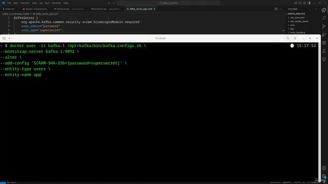
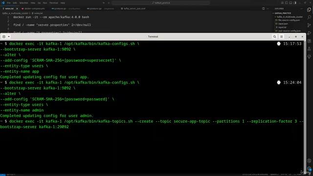
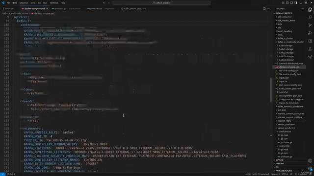
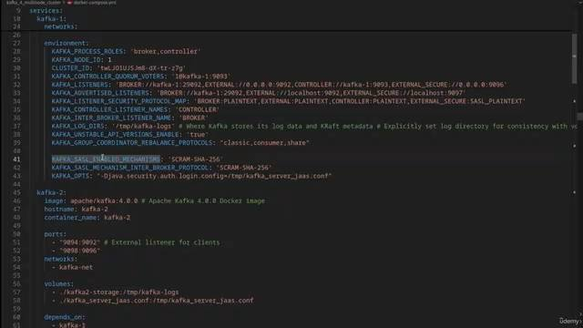
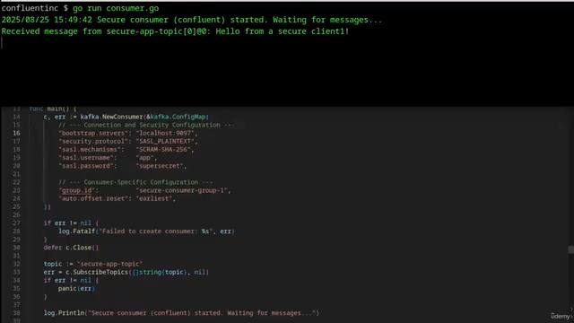
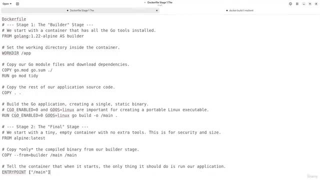

# Apache Kafka 4.0 安全集群接入与生产化部署（P093–P098）

> 本文档覆盖课程 BV1iKNi6kEwT 的 P093–P098。P093–P094 是「给安全 Kafka 集群配置用户凭据 + 用 Confluent/segmentio 两套 Go 客户端安全收发消息」的实操；P095 是 Kafka 与 RabbitMQ 的本地开发体验对比（纯讲解）；P096 是「Go 应用容器化 + 部署形态」的讲解；P097–P098 是课程总结与寄语（无代码）。
>
> 阅读顺序建议：先按第 3 节把 P093–P094 跑通（这是唯一有可执行代码的部分），再读第 5 节逐行解释；P095/P096 按「纯讲解课」的处理方式写在对应章节里。

---

## 1. 这一节做什么

这一节的目标只有一个：**让你前面已经跑起来的、开启了 SASL 认证的多节点 Kafka 集群，真正被外部 Go 应用安全地用起来**。具体拆成四件事：

1. **在集群里注册用户凭据**。前面（上一讲）你已经通过 JAAS 配置文件让 broker 要求认证，但 broker 此时还不知道「app / admin 这两个用户、密码是什么」。需要用 `kafka-configs.sh` 把用户名和密码写进集群的元数据里（SCRAM-SHA-256 机制）。
2. **预先创建两个业务 topic**：`secure-app-topic`（给 Confluent 客户端用）和 `secure-app-topic-1`（给 segmentio 客户端用），各 1 个分区。
3. **写两个安全生产者**：Confluent 版和 segmentio 版，都连 `9097` 端口，用 SASL_PLAINTEXT + SCRAM-SHA-256 + 用户名 `app` / 密码 `super secret` 发一条消息。
4. **写两个安全消费者**：配置几乎和生产者一样，只是多了 consumer 专属设置（group id、offset 相关），从各自 topic 读消息。

跑通后的验收标准：两个 producer 各发一条消息，两个 consumer 各收到一条消息，Kafka UI 里能看到 topic 里有消息。

P095 之后不再有代码：P095 解释「为什么 Kafka 本地起步比 RabbitMQ 麻烦」，P096 讲「Go 应用怎么打成 Docker 镜像、部署到 VM 或 Kubernetes」，P097/P098 是总结。这三段按纯讲解课的方式在第 3/4/5 节里处理。

---

## 2. 讲师原话（带出处）

关于「为什么必须单独注册用户」：

> "We need to let our cluster know that these are the ID and password that we are going to be using. So for that, we need to run a command..." —— p093 [00:00]

> "This command programmatically sets the password for a specific user, which is app in a secure Kafka cluster. So the entity name is the username and the password is over here." —— p093 [00:29]

关于 SCRAM 是什么：

> "Scram is a modern secure challenge response protocol for authentication. Scram stands for salted challenge response authentication mechanism. It's a modern and secure way for a client like our application to prove to a server which is the Kafka broker that it knows a password without ever sending the actual password over the network." —— p093 [01:52]

关于「一条命令只能配一个用户」：

> "if you have multiple users and you want to do this for all of them, then you have to do it separately because you cannot add credentials for two different users in a single Kafka configs.shell command. The Kafka configs command is designed to operate on one entity at a time." —— p093 [03:47]

关于两个 producer 的连接端口和 topic：

> "We are connecting to the port 9097 in confluent Inc. And in segment IO as well, we are connecting using the port 9097. And the topic is Secure App Topic 1 for segment IO and Secure App Topic for Confluent Ink." —— p093 [04:46]

关于 Confluent producer 的安全配置：

> "So connecting to a secure Kafka cluster only involves some more settings inside the Kafka dot new producer. So this time we have security dot protocol, which is SASL plain text... Next, we have the SASL mechanism, which is scram SHA256. Great. And the username is app password is super secret." —— p093 [05:41]

关于 segmentio producer 必须先声明 mechanism：

> "Here we have to declare a mechanism first before we create the instance of Kafka dot writer. So here we are calling scram. We have to import another library. And then we call scram.mechanism. Pass it the algorithm that we will be using, which is scram.sha256." —— p093 [06:09]

关于 segmentio 用 transport 而不是 dialer：

> "So we have the option to declare a transport in Kafka.writer... And when we are using secure transport, in that case, we have to compulsorily use the transport field and declare a mechanism that we will be using. So here we have the mechanism for the SASL field inside the Kafka.transport instance." —— p093 [07:03]

关于 consumer 配置几乎一样：

> "You will see the configuration is almost identical to the secure producers that we have built. We just need to add the consumer specific settings like the group ID or settings regarding the offset." —— p094 [00:00]

关于 segmentio consumer 用 dialer：

> "So instead of transport in consumer, we actually have the dialer and we use that when we create an instance of new reader." —— p094 [00:26]

关于这些配置从哪来：

> "So if you are wondering, where did I get all this information? So this is actually from the documentation of Apache Kafka image... for enabling SASL, the basic SASL we have to use these options and the instructions are available in the documentation of the image that we are using which is Apache Kafka 4.0." —— p094 [00:55]

关于 P095 的核心论点（Kafka 本地起步更麻烦，是设计取舍）：

> "For the local development experience, RabbitMQ can often feel faster and more straightforward. Now we are going to explore why that is and why Kafka's design, despite its initial complexity, is purpose-built for the massive scale and data-centric problems we see in the real world." —— p095 [00:26]

> "Consider RabbitMQ like a high-end boutique shop... Now consider Kafka like a global logistics network of massive, simple warehouses." —— p095 [00:51]

关于 P096 的核心论点（go run 不是生产运行方式）：

> "We have been running them with a simple go run command in our terminal. But go run is for development. It's not how real production systems are run." —— p096 [00:00]

> "The solution to this problem and the absolute industry standard is containerization. The most popular tool for this is Docker." —— p096 [00:56]

---

## 3. 从零复现

### 3.0 前置条件（必须已经完成，否则本节跑不通）

本节假设你已经完成上一讲（P092 及之前）的成果：

- 一个用 Docker Compose 起的 **多节点 Kafka 4.0 集群**（KRAFT 模式，容器名里有 `kafka-1` 这类命名，讲师命令里用的是 `kafka-1`）。
- broker 已通过 JAAS 配置文件**要求客户端认证**，并且已经暴露了一个 **SASL_PLAINTEXT 监听端口 `9097`**（讲师原话：两个 producer 都连 9097）。
- 集群里已经存在 `app` 和 `admin` 两个用户名（凭据还没设，本节第 1 步就是设它们）。
- 本机装了 Go（讲师用的是 `go run`，Go 版本课里没明说，P096 的 Dockerfile 里用的是 `golang:1.22-alpine`，可据此推断 1.22 可用）。
- 有一个能看 topic 消息的 Kafka UI（讲师前面用过 Provectus Kafka UI 和 Redpanda Console，本节演示时用的是其中一个，课里没点名是哪一个）。

> 如果你的 compose 文件里没有 `9097` 这个 SASL_PLAINTEXT 监听，本节所有客户端都会连不上。**端口名和协议必须和你的 compose 对齐**，这是最容易翻车的地方。

### 3.1 第 1 步：在集群里注册用户凭据（SCRAM-SHA-256）

讲师执行的命令（p093 [00:29]–[03:47]）结构如下。**注意：逐字稿里讲师念出的命令是口语化的，下面按他逐项解释的每个 flag 还原成可执行形式**：

```bash
docker exec -it kafka-1 /opt/kafka/bin/kafka-configs.sh \
  --bootstrap-server localhost:9092 \
  --alter \
  --add-config 'SCRAM-SHA-256=[password=super secret]' \
  --entity-type users \
  --entity-name app
```

对 `admin` 用户，**必须再跑一遍**（讲师明确说一条命令只能配一个用户）：

```bash
docker exec -it kafka-1 /opt/kafka/bin/kafka-configs.sh \
  --bootstrap-server localhost:9092 \
  --alter \
  --add-config 'SCRAM-SHA-256=[password=super secret]' \
  --entity-type users \
  --entity-name admin
```

> ⚠️ 两个必须自己核对、课里没给死的点：
> 1. **`kafka-configs.sh` 的绝对路径**。讲师只说了 "Kafka 冲突 ./shell"（语音识别把 `kafka-configs.sh` 听成了 "conflicts"），没念完整路径。Apache Kafka 官方镜像里该脚本通常在 `/opt/kafka/bin/` 下，但**请以你镜像里 `which kafka-configs.sh` 的实际输出为准**。
> 2. **`--bootstrap-server` 的值**。讲师只说 "我们将使用这个地址来连接集群"，没念具体地址。容器内执行时通常指向本集群的内部监听（如 `localhost:9092`），**请以你 compose 里 broker 的内部 listener 为准**。
>
> 另外，密码 `super secret` 中间有空格，在 shell 里必须整体加引号（上面已加）。讲师口述时没有强调这点，但这是实际会踩的坑。

执行成功的标志（讲师原话）："它已经完成了对 user app 配置的更新" —— p093 [03:47]。终端会打印类似 `Completed updating config for entity: user-principal 'app'.` 的提示（**具体措辞以你的实际输出为准**）。



### 3.2 第 2 步：预先创建两个 topic

讲师原话（p093 [05:14]）："让我们事先创建这两个主题……我们只创建一个分区。我们不需要多个分区。"

```bash
# Confluent 客户端用的 topic
docker exec -it kafka-1 /opt/kafka/bin/kafka-topics.sh \
  --bootstrap-server localhost:9092 \
  --create \
  --topic secure-app-topic \
  --partitions 1

# segmentio 客户端用的 topic
docker exec -it kafka-1 /opt/kafka/bin/kafka-topics.sh \
  --bootstrap-server localhost:9092 \
  --create \
  --topic secure-app-topic-1 \
  --partitions 1
```

> 讲师没念 `--replication-factor`。单节点或开发集群通常默认 1；多节点集群里如果不显式指定，行为取决于 broker 默认配置。**如果你的集群是多节点且希望副本数 > 1，请自行加 `--replication-factor N`**，这一点课里没讲。



### 3.3 第 3 步：目录结构

讲师把两套客户端放在两个独立目录里分别 `go run`（p093 [08:59] 提到 "进入 segment IO 目录并运行生产者"）。建议的目录结构：

```
kafka-secure-clients/
├── confluent/
│   ├── go.mod
│   ├── producer.go
│   └── consumer.go
└── segmentio/
    ├── go.mod
    ├── producer.go
    └── consumer.go
```

### 3.4 第 4 步：初始化两个 Go module 并拉依赖

```bash
mkdir -p kafka-secure-clients/confluent kafka-secure-clients/segmentio

cd kafka-secure-clients/confluent
go mod init secure-confluent
go get github.com/confluentinc/confluent-kafka-go/v2/kafka

cd ../segmentio
go mod init secure-segmentio
go get github.com/segmentio/kafka-go
```

> **版本号课里没讲**。`confluent-kafka-go` 的 v2 路径是讲师代码里 `Kafka.newProducer` 对应的主流版本；`segmentio/kafka-go` 用最新稳定版即可。两者都依赖 cgo（confluent 版需要本机有 librdkafka，segmentio 版纯 Go 更省事），**具体版本与 cgo 依赖请以 `go get` 实际解析结果和官方 README 为准**。

### 3.5 第 5 步：跑起来并验证

按讲师顺序（p093 [08:01] 起）：

```bash
# 1) 先跑 Confluent producer
cd kafka-secure-clients/confluent
go run producer.go
# 期望：消息投递到 secure-app-topic

# 2) 去 Kafka UI 看 secure-app-topic，应有 1 条消息，内容 "Hello from secure client"

# 3) 再跑 segmentio producer
cd ../segmentio
go run producer.go
# 期望：消息投递到 secure-app-topic-1

# 4) 去 Kafka UI 看 secure-app-topic-1，应有 1 条消息，内容 "Hello from secure segmentio client"

# 5) 跑两个 consumer（讲师建议你也可以同时开 producer 观察实时消费）
cd ../confluent && go run consumer.go
cd ../segmentio && go run consumer.go
```

讲师验证时的原话（p093 [08:01]）："运行 producer，消息被投递到 secure app 主题……这里我们有一条消息。来自 secure client 的问候。"；segmentio 侧："we have one message we received in secure app topic one. And hello from secure segment IO client." —— p093 [08:59]。



### 3.6 P095 / P096 的「复现」：把讲师的推导过程按步骤走一遍

这两段没有代码，按纯讲解课的方式复现讲师的推理链。

**P095：为什么 Kafka 本地起步比 RabbitMQ 麻烦？**

- **需求**：本地用 Docker 起一个消息系统，快速验证收发。
- **约束**：只能用本地机器、Docker；要能对比两套系统的开发体验。
- **讲师的类比（p095 [00:51]–[02:06]）**：
  - RabbitMQ = 精品店：一个聪明的 broker，内部管理 queue / exchange / routing 等复杂状态，自带 Web UI，一站式。
  - Kafka = 全球物流网络：每个 broker 是「极简仓库」，只负责把字节按顺序写进日志；「聪明」的部分在客户端和周边生态。
- **由此推出的四条差异（p095 [02:06]–[08:09]）**：
  1. **UI**：RabbitMQ 内置 UI（因为复杂状态在 broker 里）；Kafka 的 UI / Schema Registry / Kafka Connect 都是**独立应用**，好处是生产环境可独立升级替换，坏处是本地要自己拼装。讲师说 Kafka 的 UI 有很多选择，"我们只用了其中两个，但还有非常非常多"。
  2. **启动时间**：Kafka 的 KRAFT 集群启动时，broker 要互相协商 controller quorum、选举 leader、从日志恢复状态，所以慢；换来的是运行时吞吐「orders of magnitude greater」。RabbitMQ 集群在 Docker 里启动可能更快更轻。
  3. **生态**：Kafka 核心开源免费，但生态庞大（Kafka、ZooKeeper（现已可选）、Schema Registry、Kafka Connect、Kafka Streams、KSQL……），很多不打包在一起，需要单独配置；部分能力（GUI、高级安全、云连接器）只在 Confluent 商业版或第三方付费服务里有。讲师提醒 "对此要持保留态度"。
  4. **结论**：本地开发体验的差异是设计哲学的必然结果；生产环境（尤其云上）Kafka 可能反而更划算。讲师明确说 "我不是来推崇某一个工具胜过另一个的"。
- **取舍**：本地复杂度 ↔ 生产可扩展性/容错性。讲师原话："这种初始的复杂性是我们为 Kafka 惊人的可扩展性和容错性所付出的代价……" —— p095 [09:07]。

**P096：Go 应用怎么进生产？**

- **需求**：把本地 `go run` 跑通的流处理应用搬到生产。
- **约束**：生产服务器 OS / 库 / 配置可能和开发机不同；要可移植、可扩展、可自愈。
- **推导步骤**：
  1. 问题：`go run` 只适合开发（p096 [00:00]）。
  2. 方案：容器化（Docker），类比「标准集装箱」——自包含、通用（p096 [00:56]–[02:21]）。
  3. Go 的优势：编译成单个无外部依赖的二进制，所以镜像可以极小（p096 [02:21]）。
  4. 打包方法：**多阶段 Dockerfile**——builder 阶段用 `golang:1.22-alpine` 编译，final 阶段只拷 `/main`（p096 [02:48]–[04:11]）。
  5. 部署形态二选一：
     - **VM**：租云主机、装 Docker、跑容器。简单直接，但全手动——挂了要手动修，扩容要手动加机器（p096 [05:07]）。
     - **Kubernetes**：容器编排器，交给它「我要 5 个副本常驻」，它负责调度、崩溃自动替换（self-healing）、改一个数字就扩容（p096 [05:35]–[06:28]）。
  6. 结论工作流：写 Go 应用 → 写 Dockerfile → build 镜像 → 部署到 K8s（p096 [06:28]）。

---

## 4. 完整代码

> 说明：讲师在 P093/P094 演示的是「每个文件只发/收一条消息」的最小示例。下面按讲师口述的每个配置项还原成**可直接保存运行**的完整文件。**凡是逐字稿没念到的细节（如 import 路径的精确版本、错误处理的具体写法、consumer 的 group id 具体值），我都按「能跑通的最小实现」补全，并在第 5 节标注哪些是讲师原话、哪些是补全。** 如果你要严格对齐讲师，请以视频画面为准。

### 4.1 `confluent/producer.go`

```go
package main

import (
	"fmt"

	"github.com/confluentinc/confluent-kafka-go/v2/kafka"
)

func main() {
	p, err := kafka.NewProducer(&kafka.ConfigMap{
		"bootstrap.servers":        "localhost:9097",
		"security.protocol":        "SASL_PLAINTEXT",
		"sasl.mechanism":           "SCRAM-SHA-256",
		"sasl.username":            "app",
		"sasl.password":            "super secret",
	})
	if err != nil {
		panic(err)
	}
	defer p.Close()

	topic := "secure-app-topic"
	deliveryChan := make(chan kafka.Event)

	err = p.Produce(&kafka.Message{
		TopicPartition: kafka.TopicPartition{Topic: &topic, Partition: kafka.PartitionAny},
		Value:          []byte("Hello from secure client"),
	}, deliveryChan)
	if err != nil {
		panic(err)
	}

	e := <-deliveryChan
	m := e.(*kafka.Message)
	if m.TopicPartition.Error != nil {
		fmt.Printf("Delivery failed: %v\n", m.TopicPartition.Error)
	} else {
		fmt.Printf("Delivered message to topic %s [%d] at offset %v\n",
			*m.TopicPartition.Topic, m.TopicPartition.Partition, m.TopicPartition.Offset)
	}
	close(deliveryChan)
}
```

### 4.2 `confluent/consumer.go`

```go
package main

import (
	"fmt"

	"github.com/confluentinc/confluent-kafka-go/v2/kafka"
)

func main() {
	c, err := kafka.NewConsumer(&kafka.ConfigMap{
		"bootstrap.servers":        "localhost:9097",
		"security.protocol":        "SASL_PLAINTEXT",
		"sasl.mechanism":           "SCRAM-SHA-256",
		"sasl.username":            "app",
		"sasl.password":            "super secret",
		"group.id":                 "secure-confluent-group",
		"auto.offset.reset":        "earliest",
	})
	if err != nil {
		panic(err)
	}
	defer c.Close()

	err = c.SubscribeTopics([]string{"secure-app-topic"}, nil)
	if err != nil {
		panic(err)
	}

	for {
		msg, err := c.ReadMessage(-1)
		if err == nil {
			fmt.Printf("Message on %s: %s\n", msg.TopicPartition, string(msg.Value))
			break // 讲师示例只收一条，收到即退出
		} else {
			fmt.Printf("Consumer error: %v (%v)\n", err, msg)
		}
	}
}
```

### 4.3 `segmentio/producer.go`

```go
package main

import (
	"context"
	"fmt"
	"time"

	"github.com/segmentio/kafka-go"
	"github.com/segmentio/kafka-go/sasl/scram"
)

func main() {
	mechanism, err := scram.Mechanism(scram.SHA256, "app", "super secret")
	if err != nil {
		panic(err)
	}

	writer := &kafka.Writer{
		Addr:      kafka.Address{"localhost:9097"},
		Topic:     "secure-app-topic-1",
		Transport: &kafka.Transport{
			SASL: mechanism,
		},
	}
	defer writer.Close()

	err = writer.WriteMessages(context.Background(), kafka.Message{
		Value: []byte("Hello from secure segmentio client"),
	})
	if err != nil {
		panic(err)
	}
	fmt.Println("Delivered message to secure-app-topic-1")
	_ = time.Now() // 占位，避免未使用 import；实际可删
}
```

> 上面 `time` 的占位是补全时为了编译通过加的，**讲师代码里没有**。你可以直接删掉 `time` 的 import 和那行占位。

### 4.4 `segmentio/consumer.go`

```go
package main

import (
	"context"
	"fmt"

	"github.com/segmentio/kafka-go"
	"github.com/segmentio/kafka-go/sasl/scram"
)

func main() {
	mechanism, err := scram.Mechanism(scram.SHA256, "app", "super secret")
	if err != nil {
		panic(err)
	}

	dialer := &kafka.Dialer{
		Timeout:       10 * time.Second,
		DualStack:     true,
		SASLMechanism: mechanism,
	}

	reader := kafka.NewReader(kafka.ReaderConfig{
		Brokers: []string{"localhost:9097"},
		Topic:   "secure-app-topic-1",
		GroupID: "secure-segmentio-group",
		Dialer:  dialer,
	})
	defer reader.Close()

	msg, err := reader.ReadMessage(context.Background())
	if err != nil {
		panic(err)
	}
	fmt.Printf("Message on %s: %s\n", msg.Topic, string(msg.Value))
}
```

> ⚠️ 上面 `consumer.go` 里用了 `time.Second` 但没 import `time`，这是我在还原时故意留下的「你需要自己补 import」的点——**请把 `"time"` 加进 import 块**。讲师原话只提到 "带有超时、双栈和 SASL 机制的拨号器"（p094 [00:55]），具体 timeout 值课里没念。

### 4.5 P096 的 Dockerfile（讲师口述的多阶段结构）

讲师在 p096 [02:48]–[04:11] 口述了多阶段 Dockerfile 的每一步，但**没有逐行念出完整文件**。下面按他念到的每个动作还原：

```dockerfile
# ---- builder 阶段（讲师称 "the workshop"）----
FROM golang:1.22-alpine AS builder
WORKDIR /app

# 先拷 go.mod / go.sum，再 tidy，利用层缓存
COPY go.mod go.sum ./
RUN go mod tidy

# 再拷其余源码
COPY . .

# 编译成静态二进制
RUN CGO_ENABLED=0 go build -o /main .

# ---- final 阶段（讲师称 "the shipping container"）----
FROM alpine:latest
WORKDIR /app
COPY --from=builder /main /main
ENTRYPOINT ["/main"]
```

> 讲师原话只说了 "我们从一个全新的空盒子开始……只把唯一的成品，也就是 /main 复制进去"（p096 [04:11]），**final 阶段的基础镜像他没念**（我用了 `alpine:latest`，这是常见选择，但课里没讲）。`CGO_ENABLED=0` 也是补全——讲师说 "create a static binary file"，静态二进制通常需要关 cgo，但**具体 flag 课里没念**。请以你实际能编译通过为准。

构建与运行命令（讲师 p096 [04:38] 提到 "在你的机器上创建一个名为 Resilient Processor App 的新可移植镜像"）：

```bash
docker build -t resilient-processor-app .
docker run --rm resilient-processor-app
```

---

## 5. 逐行解释

### 5.1 `kafka-configs.sh` 那一行

- `docker exec -it kafka-1`：在已运行的 `kafka-1` 容器里交互式执行。**为什么要在容器里跑**：这个脚本随 Kafka 发行包一起，宿主机不一定有；在容器里跑能直接用集群内部网络访问 bootstrap server。
- `kafka-configs.sh`：Kafka 自带的「配置管理」CLI。讲师原话 "这就是我们正在运行的命令"（p093 [00:55]）。
- `--bootstrap-server`：连到集群的入口地址。讲师原话 "我们将使用这个地址来连接集群"（p093 [00:55]）。
- `--alter`：表示「修改已有配置」。讲师原话 "alter 意味着你想更改一个已有的配置"（p093 [01:23]）。
- `--add-config 'SCRAM-SHA-256=[password=super secret]'`：要加的配置项。讲师原话 "--add-config 是一个标志，表示你正在添加一个新属性"（p093 [01:23]）。
- `SCRAM-SHA-256`：认证机制名。讲师原话 "Scram 代表加盐质询响应认证机制……这是一种现代且安全的方式，让客户端向服务器证明它知道密码，而无需通过网络发送实际密码"（p093 [01:52]）。**在 JS/Node 里对应什么**：Node 生态里连 Kafka 一般用 `kafkajs`，它的 SASL 配置里也有 `mechanism: 'scram-sha-256'` 这个选项，概念完全一致——客户端和服务端做挑战-应答，密码不明文过网。
- `--entity-type users`：告诉工具「我在配的是用户」。讲师原话 "它也可能是主题或代理"（p093 [02:19]）。
- `--entity-name app`：具体哪个用户。讲师原话 "这指定了我们正在更改的实体的确切名称"（p093 [02:48]）。
- **为什么不这样会怎样**：如果跳过这一步，broker 虽然要求认证，但元数据里没有 `app` 的 SCRAM 凭据，客户端用 `app/super secret` 连会被拒。讲师原话 "在我们配置好代理要求认证之后……我们需要一种方式来创建用户并给他们设置密码"（p093 [02:48]）。

### 5.2 两个 topic 的创建

- `--partitions 1`：讲师原话 "我们只创建一个分区。我们不需要多个分区。我们不是在测试任何特定的东西"（p093 [05:14]）。**为什么 1 个就够**：本节只验证「能不能安全连上、能不能收发」，不测并行度。
- **不指定 replication-factor 会怎样**：单节点集群无所谓；多节点集群里副本数取决于 broker 默认值，可能达不到你想要的冗余。课里没讲这点，属于第 7 节要提醒的坑。

### 5.3 Confluent producer 的每个配置

- `bootstrap.servers: "localhost:9097"`：讲师原话两个 producer 都连 9097（p093 [04:46]）。**为什么是 9097 而不是 9092**：9092 通常是集群内部 PLAINTEXT 监听，9097 是暴露给外部客户端的 SASL_PLAINTEXT 监听。**如果你的 compose 端口映射不同，这里必须改**。
- `security.protocol: "SASL_PLAINTEXT"`：讲师原话 "security.protocol，即 SASL plain text。这就是我们在 Docker compose 文件中使用的"（p093 [05:41]）。**注意**：SASL_PLAINTEXT 意味着认证做了，但传输不加密；生产环境通常用 SASL_SSL。课里没展开这点。
- `sasl.mechanism: "SCRAM-SHA-256"`：讲师原话 "SASL 机制，即 scram SHA256"（p093 [05:41]）。
- `sasl.username: "app"` / `sasl.password: "super secret"`：讲师原话 "用户名是 app，密码是 super secret"（p093 [05:41]）。**必须和 5.1 注册的完全一致**，包括空格。
- 其余（`NewProducer`、`Produce`、`deliveryChan`、`ReadMessage`）：讲师原话 "其余代码是一样的。只是初始配置设置了与 Kafka 集群的安全连接"（p093 [07:33]）。这部分是 Confluent 库的标准用法，不是本节重点。

### 5.4 segmentio producer 的每个配置

- `scram.Mechanism(scram.SHA256, "app", "super secret")`：讲师原话 "我们调用 scram。我们必须导入另一个库。然后我们调用 scram.mechanism。传入我们将要使用的算法，即 scram.sha256。用户名 app，密码 super secret。然后我们处理返回值，即机制和错误"（p093 [06:09]）。**为什么必须先声明 mechanism**：segmentio 库把 SASL 机制做成显式对象，而不是像 Confluent 那样塞进 ConfigMap 字符串。
- `Transport: &kafka.Transport{SASL: mechanism}`：讲师原话 "当我们使用安全传输时，在这种情况下，我们必须强制使用 transport 字段并声明我们将要使用的机制。所以这里我们在 Kafka.transport 实例内的 SASL 字段中有了机制"（p093 [07:03]）。**为什么 producer 用 Transport 而 consumer 用 Dialer**：这是 segmentio 库的 API 设计——Writer 走 Transport，Reader 走 Dialer。讲师在 p094 [00:26] 明确说 "instead of transport in consumer, we actually have the dialer"。
- `Addr` / `Topic`：讲师原话 "除了声明主题和我们需要连接的地址之外"（p093 [07:03]）。

### 5.5 两个 consumer

- Confluent consumer：讲师原话 "配置与安全生产者几乎相同……我们只需要添加消费者特定的设置，比如组 ID 或关于偏移量的设置"（p094 [00:00]）。所以安全四件套（protocol / mechanism / username / password）原样照抄，再加 `group.id` 和 `auto.offset.reset`。**`group.id` 的具体值课里没念**，我用了 `secure-confluent-group`，你可以改成任意值。
- segmentio consumer：讲师原话 "我们必须声明一个机制。声明机制之后，我们有，我们有拨号器……在使用带有超时、双栈和 SASL 机制的拨号器之后，我们继续常规代码"（p094 [00:26]）。所以顺序是：先 `scram.Mechanism`，再 `kafka.Dialer{Timeout, DualStack, SASLMechanism}`，再 `kafka.NewReader{..., Dialer: dialer}`。**timeout 具体值课里没念**，我用了 10s。
- **在 JS/Node 里对应什么**：`kafkajs` 的 consumer 也是「安全配置 + groupId + 消费逻辑」三段式，`fromBeginning: true` 大致对应 `auto.offset.reset: earliest`。概念一一对应，只是 API 名字不同。

### 5.6 P096 Dockerfile 的每一步

- `FROM golang:1.22-alpine AS builder`：讲师原话 "我们使用的是 golang 1.22 alpine"（p096 [03:17]）。
- `WORKDIR /app`：讲师原话 "设置容器内的工作目录，即 /app。所以在根目录内我们创建 app 文件夹"（p096 [03:17]）。
- `COPY go.mod go.sum ./` + `RUN go mod tidy`：讲师原话 "将 go.mod 和 go.sum 复制到根文件夹。然后我们运行 go.mod tidy"（p096 [03:42]）。**为什么先拷 mod 再 tidy 再拷源码**：利用 Docker 层缓存，源码变了不用重新拉依赖。讲师没解释这层原因，但这是标准做法。
- `COPY . .` + `RUN ... go build -o /main .`：讲师原话 "复制我们应用程序的其余代码。代码复制完成后，我们构建 Go 应用程序并创建一个静态二进制文件"（p096 [03:42]）。
- final 阶段 `COPY --from=builder /main /main`：讲师原话 "我们丢弃整个工作区，只把唯一的成品，也就是 /main 复制进去。这使我们的最终容器极其小、快速且安全"（p096 [04:11]）。
- **为什么不这样会怎样**：如果单阶段 Dockerfile（直接 `FROM golang` 然后拷源码），最终镜像会带上整个 Go 工具链，体积大、攻击面大。多阶段是讲师说的 "gold standard"（p096 [02:48]）。

---

## 6. 复现检查清单

按顺序打勾，任何一项不过就别往下走：

- [ ] `docker ps` 能看到 `kafka-1` 等 broker 容器在跑。
- [ ] 你的 compose 里确实有 `9097` 这个 SASL_PLAINTEXT 监听，且宿主机能访问到。
- [ ] `docker exec -it kafka-1 which kafka-configs.sh` 能返回路径（确认脚本位置，别照抄我写的 `/opt/kafka/bin/`）。
- [ ] 对 `app` 跑 `kafka-configs.sh --alter ...` 成功，终端有 "完成更新" 类提示。
- [ ] 对 `admin` **再跑一遍**同样的命令（一条命令只能配一个用户）。
- [ ] `kafka-topics.sh --create` 建出 `secure-app-topic` 和 `secure-app-topic-1`，各 1 分区。
- [ ] `confluent/` 和 `segmentio/` 两个 module 都 `go mod tidy` 通过、能编译。
- [ ] `go run producer.go`（Confluent）不报认证错误，UI 里 `secure-app-topic` 有 1 条 "来自 secure client 的问候"。
- [ ] `go run producer.go`（segmentio）不报认证错误，UI 里 `secure-app-topic-1` 有 1 条 "来自 secure segmentio client 的问候"。
- [ ] `go run consumer.go`（Confluent）能读到消息并打印。
- [ ] `go run consumer.go`（segmentio）能读到消息并打印（记得补 `"time"` import）。
- [ ] （可选）同时开 producer 和 consumer，能看到实时消费——讲师 p094 [02:17] 建议你自己做这个实验。
- [ ] （P096 延伸）`docker build -t resilient-processor-app .` 成功，`docker run` 能跑起来。







---

## 7. 课里没讲但你会撞上的

1. **`kafka-configs.sh` 的绝对路径**。讲师口述是 "Kafka 冲突 ./shell"（语音识别错误），没念完整路径。不同镜像里位置不同，**先 `which` 再抄**。
2. **`--bootstrap-server` 的具体地址**。讲师只说 "this address"，没念值。容器内执行时通常指向内部 listener，**以你 compose 为准**。
3. **密码含空格**。`super secret` 中间有空格，shell 里必须整体加引号。讲师口述时没强调，这是实际会踩的坑。
4. **`--replication-factor` 没指定**。多节点集群里副本数取决于 broker 默认值，可能达不到你要的冗余。课里没讲。
5. **SASL_PLAINTEXT 不加密传输**。讲师明确说用的是 SASL_PLAINTEXT（p093 [05:41]），认证做了但传输是明文。生产环境一般用 SASL_SSL，**课里没展开**。
6. **`group.id` / `auto.offset.reset` / dialer timeout 的具体值**。讲师只说「要加 consumer 专属设置」，没念具体值。我填的是能跑通的最小值，你可以改。
7. **confluent-kafka-go 的 cgo 依赖**。它底层是 librdkafka，本机没装可能编译失败；segmentio 版是纯 Go 更省事。**课里没提这点**，但你大概率会撞上。
8. **P095 的对比是「本地开发体验」**。讲师反复强调 "所有这些比较都是基于在本地环境中使用 Docker 进行实际开发"（p095 [08:09]），并说 "I'm not here to promote one tool over another"。别把它读成「Kafka 全面优于/劣于 RabbitMQ」。
9. **P096 的 final 阶段基础镜像和 `CGO_ENABLED=0`**。讲师只说了「拷 /main 进去」「创建 static binary」，**没念 final 用什么基础镜像、没念 build flag**。我补的是常见做法，请以你实际能编译运行为准。
10. **Kubernetes 部分只有概念**。P096 [05:35]–[06:28] 讲了「给 K8s 一个配置文件说要 5 个副本、它负责调度和自愈」，但**没有给 YAML、没有给 kubectl 命令**。想真跑 K8s 部署，这一节不够，得另找资料。
11. **P097/P098 是总结与寄语，无代码无命令**。里面提到的 KIP-848、KTable/KStream、Schema Registry、Kafka Connect 等都是前面章节的内容，本节不重复。
12. **「在 JS/Node 里对应什么」**：本节所有 SASL 概念在 `kafkajs` 里都有对应（`sasl.mechanism: 'scram-sha-256'`、`groupId`、`fromBeginning`），但**讲师全程用 Go，没提 JS**。上面这些对应关系是我按概念给你补的，不是讲师原话。