## 1. 这一节做什么

这 5 节不是一上来写 CQRS/Saga/Event Sourcing 的业务代码，而是先建立一条因果链：

1. 微服务采用 **database per service** 后，数据被拆到多个数据库；
2. 数据一拆，传统单体里 `JOIN` 一张库就能完成的查询，就变成 **cross-service queries**；
3. 跨服务查询可以用 **API composition pattern** 先解决读操作；
4. API composition 可以放在客户端、API Gateway、或某个独立/已有服务里，讲师推荐放在 Spring Cloud Gateway；
5. P005 是 API composition 的工程准备 demo：用 IntelliJ 打开 `section1/00-start`，加载 Maven 项目，理解 `eazy-bom`、`common` 模块、Lombok 配置，并先用 Maven 把 `common` 安装到本地仓库。

需要先说明一个关键事实：**P001–P005 的逐字稿没有给出完整的 customers/accounts/loans/cards 业务源码，也没有给出具体端口、接口路径、数据库表结构、启动类名和 Gateway 路由配置。** P005 结束时，讲师只完成了项目打开、Maven 模块加载、BOM/common/Lombok 环境准备；真正把这些服务改造成 API composition 的代码，要看后续课程和讲师 GitHub 仓库。因此本文能严格复现到“工程可加载、可构建、common 可安装”这一步；再往后的业务接口不能靠逐字稿凭空补全。

课程最终会讲 CQRS、Event Sourcing、Materialized View、Transactional Outbox、Saga 的 orchestration/choreography，但 P001–P005 只覆盖到 API composition 的讲解与工程准备。

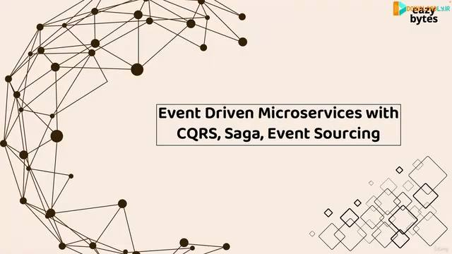

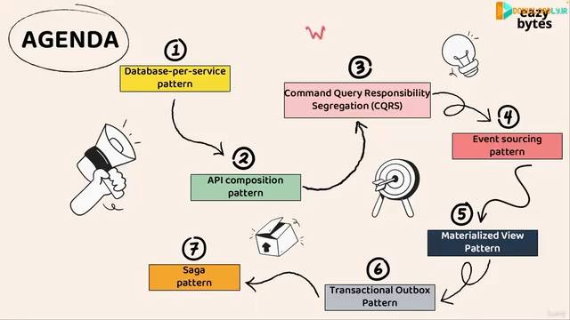

---

## 2. 讲师原话（带「—— pNNN [MM:SS]」）

- 课程先把问题指向微服务数据拆分：“By adopting this pattern inside our microservices, we are going to separate the write and read operations so that they can scale independently.” 这里说的是 CQRS 的目标。—— p001 [01:42]
- database per service 的定义：“the microservice developers, they will end up using separate or individual databases for their microservices.” —— p002 [01:17]
- 跨服务查询问题：“whenever you have a scenario where you want to fetch the data from multiple microservices then you will end up querying multiple databases which are owned by multiple microservices.” —— p003 [01:55]
- 讲师明确 API composition 的适用范围：“this pattern handles the query operations but not any data manipulation operations.” —— p004 [00:00]
- 关于 API Composer 的落点，讲师推荐：“From these three options, my recommendation is always to go with the second option.” 第二个选项是 API Gateway 作为 API Composer。—— p004 [04:16]
- “It is always a best practice to use API Gateway as an API Composer.” 并提到 Spring Cloud Gateway 基于 Reactive Programming Model，可以并行调用依赖服务。—— p004 [04:43]
- P005 的 demo 前提：“I’m not going to build these microservices and supporting components from scratch. What I’ll do is I’ll try to take the services that I have developed behind the scenes.” —— p005 [00:29]
- BOM 的作用：“you need to define the packaging as pom inside the same pom.xml.” 讲师用它集中管理 Spring Boot、Java、Spring Cloud、H2、Lombok 等版本属性。—— p005 [05:30]
- common 模块的命令：“maven clean install -Dmaven.test.skip=true”，目的是把 common 的 jar 发布到本地仓库，供其他微服务引用。—— p005 [11:31]

---

## 3. 从零复现

### 3.1 复现目标边界

严格按 P001–P005，复现目标不是“启动一个完整电商系统并调用聚合接口”，而是：

1. 找到课程仓库里的 `section1/00-start`；
2. 用 IntelliJ 打开 `00-start` 文件夹；
3. 让 Maven 识别 customers、accounts、loans、cards、Eureka server、Gateway server、BOM、common 等模块；
4. 确认 BOM 的 `pom.xml` 使用 `<packaging>pom</packaging>`；
5. 确认 common 模块存在并能先安装到本地 Maven 仓库；
6. 确认 IDE 已安装 Lombok 插件并开启 annotation processing；
7. 做一次构建检查。具体接口聚合代码不在 P001–P005 内。

### 3.2 前置环境

逐字稿只明确提到 Java、Spring Boot、Spring Cloud、H2、Lombok、Maven、IntelliJ IDEA、Lombok 插件、Spring Cloud Gateway、Eureka。它**没有给出 JDK 具体版本号、Maven 具体版本号、Spring Boot/Spring Cloud 具体版本号**；这些必须以仓库 `pom.xml` 为准，课里没讲具体值。

你本地需要准备：

- JDK：版本看仓库 BOM 属性，逐字稿未给出数字；
- Maven：能执行 `mvn -v`；
- IntelliJ IDEA：用于打开 `00-start`；
- Lombok 插件：IntelliJ 里安装；
- 网络：首次加载 Maven 依赖需要下载 jar。

课里没有提到任何环境变量名，不要自行假设 `DB_URL`、`EUREKA_URL` 之类变量；以仓库配置文件为准。

### 3.3 获取项目

讲师说代码会放在 GitHub repo，`section1` 下有 `00-start`，里面有四个微服务、Eureka server、Gateway server、`eazy-bom` 和 `common` 模块。但**逐字稿没有念出仓库 URL**，所以文档不能编造链接。你需要在课程资料或讲师 GitHub 页面找到该 repo，然后进入：

```text
<repo>/section1/00-start
```

逐字稿口述的 BOM 名称类似 `easy-bom` / `eazy-bom`，实际目录拼写以你打开的仓库为准；本文用“BOM 模块”指代它，避免把口述拼写当成唯一事实。

### 3.4 用 IntelliJ 打开 start 文件夹

讲师的操作是：IntelliJ 菜单 `Open`，导航到 `event-driven-microservices/section1/00-start`，选中整个 `start` 文件夹打开。打开后 IntelliJ 会提示 “Maven build scripts found”，点击 Load，把项目作为 Maven 项目加载。

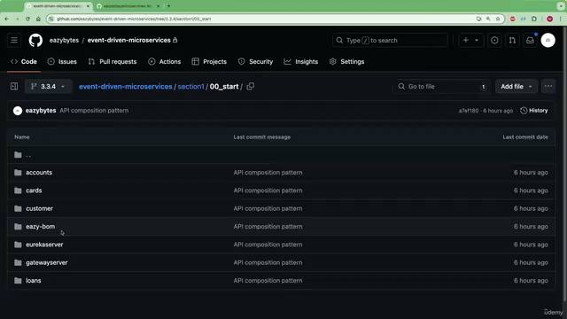

加载完成后检查右侧 Maven 窗口。讲师说：如果能在 Maven 窗口看到所有微服务和 supporting components，就说明项目加载正常。若某个模块没出现，用 `File > New > Module from Existing Sources`，选中对应模块目录，例如 `accounts`，再打开。

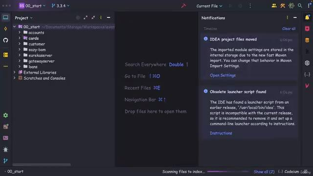

### 3.5 理解 BOM：先看 BOM 的 pom.xml

打开 BOM 模块的 `pom.xml`。讲师强调：

- 这个 Maven 项目的 packaging 必须是 `pom`；
- 里面集中声明 Spring Boot version、Java version、Spring Cloud version、H2 version、Lombok version 等属性；
- 有 `<modules>`，其中包含 `common`；
- 有公共依赖，例如 DevTools、Spring Boot starter test；
- 有 `<dependencyManagement>`，用 `spring-boot-dependencies` 的 `type=pom`、`scope=import` 导入 Spring Boot 的 BOM；
- 还声明 Lombok、H2 等第三方依赖，并声明 Spring Cloud 相关依赖；
- 底部有 build plugin。

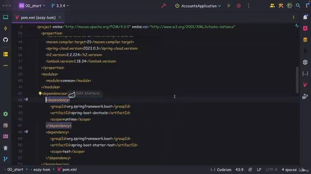

这里不要自己补版本号。逐字稿只说明“有这些属性”，没有给出具体版本数字；你应以仓库文件为准。

### 3.6 理解 common 模块

common 模块是 BOM 的子模块，用来放多个微服务共用的代码。逐字稿中明确提到当前有一个 `ErrorResponseDTO` 类，用于向客户端返回错误响应。其他内容课里没讲，不要猜。

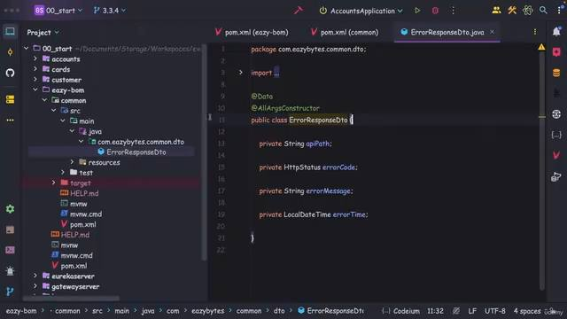

### 3.7 理解各服务如何继承 BOM

打开任意一个微服务的 `pom.xml`，例如 accounts。讲师说它通过 `<parent>` 指向 BOM，并用 `relativePath` 指到相对路径；然后在自己的 `<dependencies>` 里声明自己需要的 Spring Boot starter，例如 Data JPA、Validation、Web、Eureka Client、H2、Lombok，以及 `common` 模块依赖。Spring Boot 相关库可以不写版本，由 BOM 管理；第三方库讲师建议明确写版本，便于以后单独控制升级。

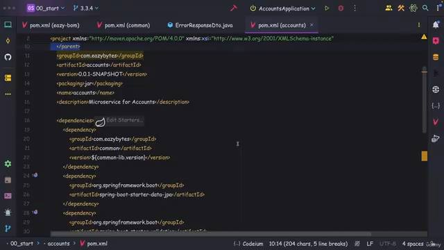

### 3.8 先安装 common

讲师演示：如果构建时出现编译错误，很可能是 common 没先编译安装。做法是在 IntelliJ 连按两次 Ctrl 打开 Run Anything，选择 `common` 项目，执行：

```bash
mvn clean install -Dmaven.test.skip=true
```

执行成功后，common 的 jar 会发布到本地 Maven 仓库，其他微服务才能从本地仓库解析 `common` 依赖。这个命令是逐字稿明确给出的。

### 3.9 安装 Lombok 插件并开启 annotation processing

讲师明确要求：

1. IntelliJ 安装 Lombok 插件；
2. 到 Preferences 的 Compiler 下搜索 `annotation processing`；
3. 启用 annotation processing，点击 Apply。

否则 Lombok 注解在 IDE 里可能不生效。

### 3.10 启动顺序

P005 没有讲具体启动命令、启动类、端口、Eureka 注册顺序和 Gateway 路由。不能编造。你可以在 IDE 中运行各模块启动类，但具体类名、端口、服务名、路由规则必须看仓库和后续课程。P005 的复现截止点是“模块加载、common 安装、构建通过、Lombok 可用”。

---

## 4. 完整代码

本课程 P001–P005 没有给出一份可以独立运行的完整业务源码。下面给一个**完整可保存的复现检查脚本**，用于检查从逐字稿能确定的结构：四个服务目录、BOM 的 packaging、common 模块、Maven/JDK 可用性，并可选地按讲师命令先安装 common，再构建其余模块。它不是讲师原代码，不替代仓库源码；它只把“P005 能确认的工程检查”自动化。

保存为 `verify-course-setup.sh`，放在 `section1/00-start` 同级或任意位置，用参数传入 `00-start` 路径。

```bash
#!/usr/bin/env bash
set -euo pipefail

ROOT="${1:-$(pwd)}"
BUILD="${BUILD:-0}"

log()  { printf '[check] %s\n' "$*"; }
fail() { printf '[fail] %s\n' "$*" >&2; exit 1; }

need_dir() {
  [[ -d "$1" ]] || fail "缺少目录：$1"
  log "目录存在：$1"
}

need_file() {
  [[ -f "$1" ]] || fail "缺少文件：$1"
  log "文件存在：$1"
}

command -v java >/dev/null || fail "未找到 java，请先安装 JDK"
command -v mvn  >/dev/null || fail "未找到 mvn，请先安装 Maven"

log "Java 版本："
java -version 2>&1 | head -n 1
log "Maven 版本："
mvn -v | head -n 3

need_dir "$ROOT/customers"
need_dir "$ROOT/accounts"
need_dir "$ROOT/loans"
need_dir "$ROOT/cards"

BOM_POM=""
while IFS= read -r pom; do
  if grep -q '<packaging>pom</packaging>' "$pom" && grep -qi 'bom' <<< "$pom"; then
    BOM_POM="$pom"
    break
  fi
done < <(find "$ROOT" -maxdepth 3 -type f -name pom.xml | sort)

[[ -n "$BOM_POM" ]] || fail "未找到 BOM 的 pom.xml。逐字稿口述名可能是 easy-bom/eazy-bom，请确认仓库实际目录名。"
log "BOM pom：$BOM_POM"
grep -q '<packaging>pom</packaging>' "$BOM_POM" || fail "BOM 的 pom.xml 未声明 packaging=pom"

COMMON_POM="$(find "$ROOT" -maxdepth 4 -type f -path '*/common/pom.xml' | head -n 1 || true)"
[[ -n "$COMMON_POM" ]] || fail "未找到 common/pom.xml"
log "common pom：$COMMON_POM"

if [[ "$BUILD" == "1" ]]; then
  log "先安装 common：mvn clean install -Dmaven.test.skip=true"
  mvn -f "$COMMON_POM" clean install -Dmaven.test.skip=true

  log "构建其余模块（跳过测试；仅用于环境检查）"
  while IFS= read -r pom; do
    if [[ "$pom" == "$BOM_POM" || "$pom" == "$COMMON_POM" ]]; then
      continue
    fi
    log "构建：$pom"
    mvn -f "$pom" -Dmaven.test.skip=true package
  done < <(find "$ROOT" -maxdepth 3 -type f -name pom.xml | sort)
fi

log "检查完成。"
log "启动类、端口、Eureka 地址、Gateway 路由在 P001-P005 中未讲，请按仓库 README 和后续课程执行。"
```

使用方式：

```bash
chmod +x verify-course-setup.sh
./verify-course-setup.sh /path/to/section1/00-start
```

只做结构检查，不构建：

```bash
./verify-course-setup.sh /path/to/section1/00-start
```

结构检查通过后，再执行构建：

```bash
BUILD=1 ./verify-course-setup.sh /path/to/section1/00-start
```

脚本对 Eureka server 和 Gateway server 的目录名不做硬编码，因为逐字稿只说“Eureka server”和“Edge server implemented with Spring Cloud Gateway”，没有给出精确目录名。你需要自己在 IntelliJ Maven 窗口确认它们存在。

---

## 5. 逐行解释

这一节解释上一节脚本和讲师配置步骤为什么这样做。

- `#!/usr/bin/env bash`：指定 Bash 运行脚本。你不需要写 Java 代码，只是用脚本检查课程工程是否就绪。
- `set -euo pipefail`：一旦某条检查失败就停止，避免“前面错了还继续构建”的假成功。
- `ROOT="${1:-$(pwd)}"`：第一个参数是 `00-start` 路径；不传就用当前目录。这样脚本可以放在任意位置。
- `BUILD="${BUILD:-0}"`：默认只检查结构，不触发 Maven 构建；设置 `BUILD=1` 才构建。因为构建可能下载大量依赖，也依赖仓库真实状态。
- `command -v java` / `command -v mvn`：检查 JDK 和 Maven 是否存在。逐字稿没有给版本号，所以脚本只打印版本，不做版本判断。
- `need_dir "$ROOT/customers"` 等：逐字稿明确说 demo 需要 customers、accounts、loans、cards 四个微服务，所以脚本检查这四个目录。注意这是“目录存在”，不是“业务代码正确”。
- `find ... -name pom.xml` 再检查 `<packaging>pom</packaging>` 和路径中含 `bom`：对应讲师说的 BOM 文件必须 `packaging=pom`。因为逐字稿口述的 BOM 名称可能有拼写差异，脚本用路径包含 `bom` 的方式找，找不到就提示你按实际目录改。
- `grep -q '<packaging>pom</packaging>' "$BOM_POM"`：再次确认 BOM 不是普通 jar 项目。BOM 的作用是集中管理版本，不是产出业务 jar。
- `find ... -path '*/common/pom.xml'`：对应讲师说的 common 是 BOM 下的子模块，其他服务依赖 common。找不到 common 就无法复现“先安装 common”的步骤。
- `mvn -f "$COMMON_POM" clean install -Dmaven.test.skip=true`：这是讲师给出的 original 命令。`clean` 清掉旧构建；`install` 把 common jar 放进本地 Maven 仓库；`-Dmaven.test.skip=true` 跳过测试，避免在环境准备阶段被单测错误卡住。注意：跳过测试只适合本地复现，不代表生产 CI 也应该这样做。
- 后续 `while` 循环构建其余 pom：这是辅助检查，不是逐字稿里的命令。脚本注释已标明“仅用于环境检查”。真实启动顺序和启动方式以仓库为准。
- 最后打印“启动类、端口、Eureka 地址、Gateway 路由未讲”：这是防止读者误以为 P005 已经给出完整运行参数。逐字稿确实没有给这些信息。

再解释几个课程概念如何落到工程上：

- **database per service**：每个微服务有自己的数据库。讲师说 99% 的微服务项目会采用它，只有少数共享数据库例外。好处是松耦合、独立扩容、独立开发部署、故障隔离、可选用不同数据库、不能直接读别人库；代价是跨服务查询、数据一致性、复杂事务、数据重复。—— p002 [01:17] 起。
- **cross-service queries**：单个数据库里可以 `JOIN`，多库后不能直接 `JOIN`。银行 UI 的 profile 页面要同时显示 customer、accounts、loans、cards 数据，这就是典型场景。—— p003 [00:59] 附近。
- **API composition**：API Composer 调多个 Provider Service，拿到各自数据后组合成一个响应。它只适合读，不适合跨服务 insert/update/delete。跨写操作应看后续的 CQRS/Saga。—— p004 [00:00]。
- **API Composer 放哪里**：客户端、API Gateway、独立服务或已有服务三种。讲师不推荐客户端直连，因为会暴露微服务地址；推荐 Gateway，因为 Spring Cloud Gateway 基于 Reactive 模型，可并行调用、线程和内存开销较小。—— p004 [03:01] 起。
- **API composition 的缺点**：调用服务越多延迟越高；结果组装逻辑可能复杂；部分服务失败/慢响应要处理重试和降级；跨服务数据可能不一致；Composer 可能成为瓶颈；依赖服务可用性；测试更复杂。—— p004 [05:01] 起。

如果你是从前端转 Node，补充一个对应关系：Node 里用 `Promise.all` 并行请求多个服务，只是“并行调用”，**不能**让多个数据库写入变成一个原子事务。跨服务写失败时，你仍然需要补偿、重试或后续 Saga/Outbox 这类方案。这个补充不是讲师在 P001–P005 里讲的实现。

---

## 6. 复现检查清单

- [ ] 已找到课程仓库中的 `section1/00-start`，不是自己新建空目录。
- [ ] IntelliJ 用 `Open` 打开的是整个 `00-start` 文件夹。
- [ ] 出现 Maven 加载提示后已点击 Load。
- [ ] Maven 窗口能看到 customers、accounts、loans、cards 四个服务。
- [ ] Maven 窗口能看到 Eureka server 和 Gateway server；若名称不同，以仓库为准。
- [ ] 能找到 BOM 模块的 `pom.xml`，并确认有 `<packaging>pom</packaging>`。
- [ ] BOM 中有版本属性、`<modules>`、`<dependencyManagement>`、Spring Boot BOM import、Lombok/H2/Spring Cloud 依赖等讲师提到的结构。
- [ ] 能找到 `common` 模块，且它作为 BOM 子模块存在。
- [ ] 已执行 `mvn clean install -Dmaven.test.skip=true` 安装 common，并看到 BUILD SUCCESS。
- [ ] IntelliJ 已安装 Lombok 插件。
- [ ] IntelliJ 已开启 annotation processing。
- [ ] 任选一个微服务 `pom.xml`，能看到 `<parent>` 指向 BOM，并声明了 common 依赖。
- [ ] 如果某个模块没被 Maven 识别，已用 `File > New > Module from Existing Sources` 补加载。
- [ ] 没有把 P005 当成“完整 API composition 已实现”；P005 只到工程准备。
- [ ] 没有自行编造端口、接口路径、数据库表、启动类名；这些以仓库和后续课程为准。

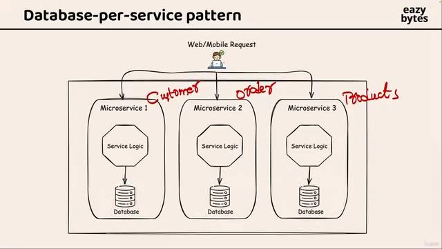

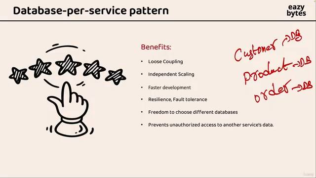

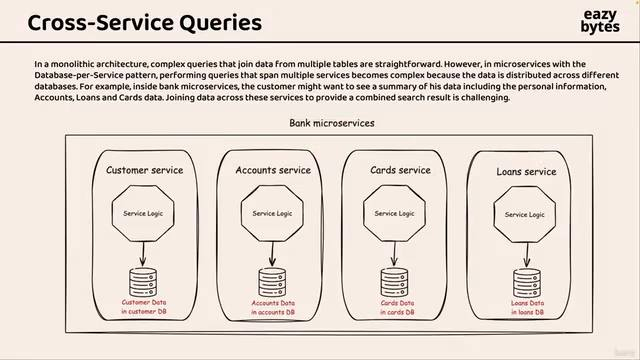

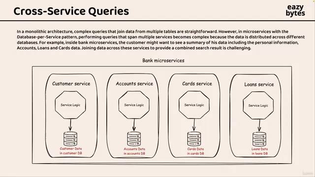

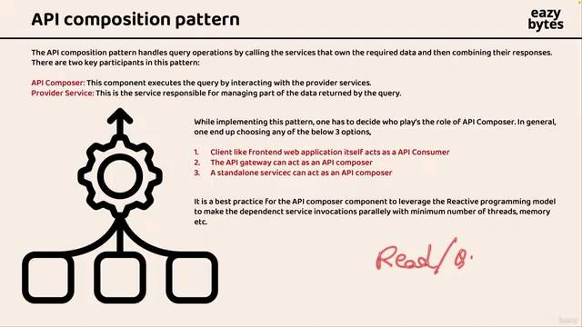

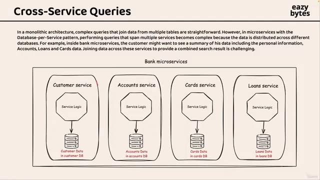

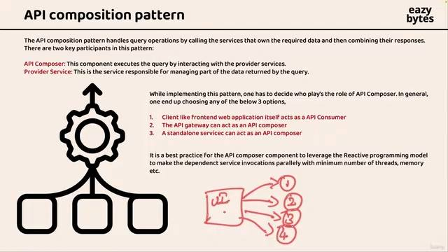

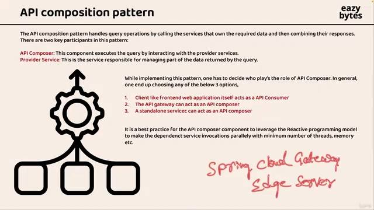

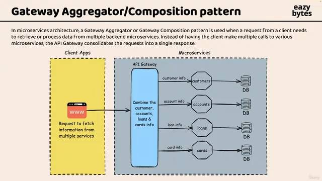

---

## 7. 课里没讲但你会撞上的

1. **GitHub 仓库 URL 没讲。** 逐字稿只说有 repo、`section1/00-start`，没有念 URL。你只能从课程资料或讲师主页找，不能靠本文猜。
2. **具体依赖版本没讲。** 讲师只提 Spring Boot version、Java version、Spring Cloud version、H2 version、Lombok version 这些属性名，没有给数字。不要照抄网上版本，先看仓库 BOM。
3. **启动类、端口、服务名没讲。** P005 只演示项目加载和 common 安装。Eureka server 怎么启动、Gateway 监听哪个端口、各服务怎么注册，课里没讲。
4. **API composition 的真正代码不在 P001–P005。** P004 讲设计，P005 讲工程准备；把 customers/accounts/loans/cards 聚合成 customer summary 的接口实现，要看后续课程。
5. **数据库表结构和初始数据没讲。** 不要自行编造 customer/account/loan/card 表；仓库里有什么就用什么。
6. **Eureka/Gateway 精确目录名没讲。** 本文脚本只硬检查逐字稿明确说出的四个服务目录，Eureka/Gateway 请你在 Maven 窗口确认。
7. **测试为什么会被跳过没展开。** `-Dmaven.test.skip=true` 是讲师为快速安装 common 用的；生产 CI 不建议盲目跳过测试。
8. **common 模块具体内容只提到 ErrorResponseDTO。** 其他公共类课里没讲，不要根据名字补代码。
9. **API composition 的错误处理只讲原则，没给实现。** 例如超时、重试、降级、部分失败返回 null 还是空数组，课里只说要处理，没给统一代码。
10. **分布式事务在 Node/前端视角的坑。** 多个服务写多个库时，Node 里没有一个“跨库事务”能包住全部操作；后续才会进入 Saga/Outbox 等模式。P001–P005 没有给这部分代码。
11. **API Gateway 并行调用的性能优势是设计层面的说明。** 讲师说 Spring Cloud Gateway 基于 Reactive Programming Model 可以并行调用、少线程少内存，但 P005 没有给出压测或路由代码。
12. **课程定位是高级课。** 讲师明确说不会从零教 Kafka/RabbitMQ 和微服务搭建，前置是微服务基础；如果直接照本文跳到 API composition，仍需要补 Eureka、Gateway、Spring Boot 的基础操作。