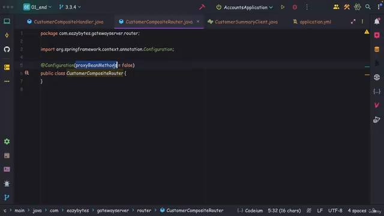
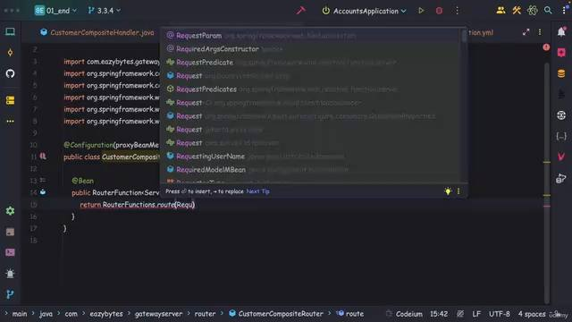
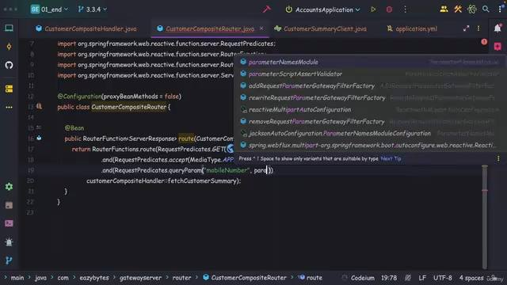
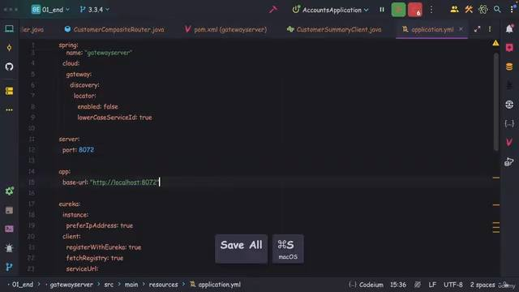
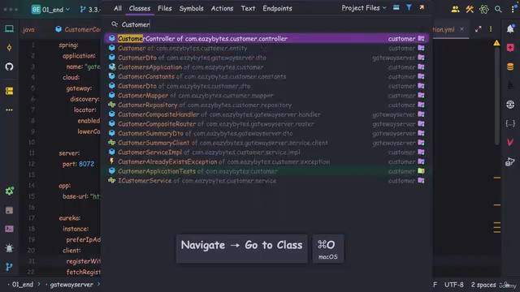
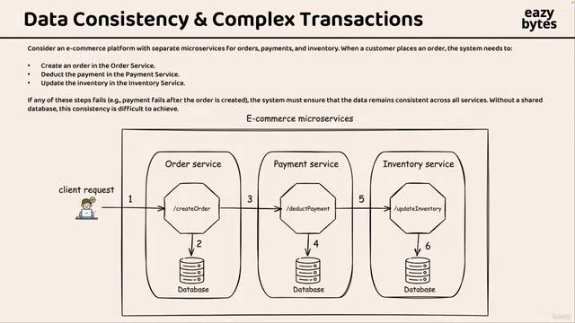
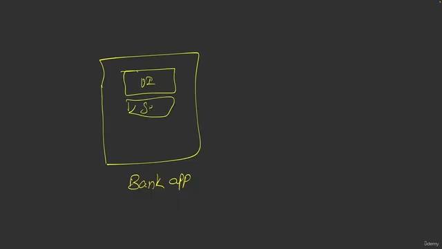
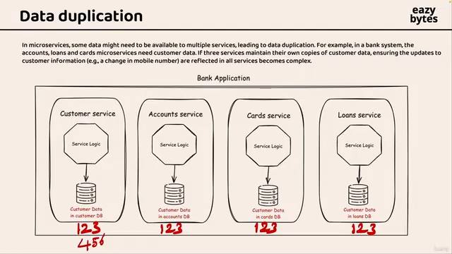
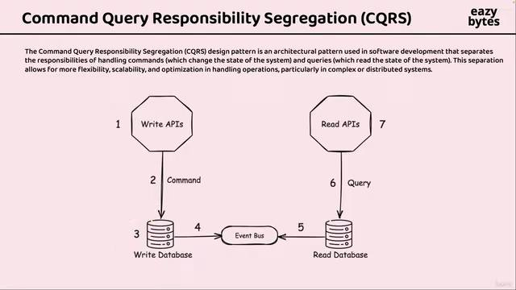
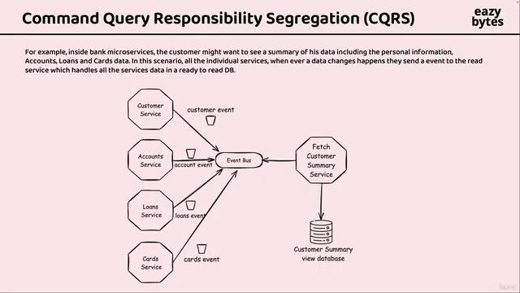

# CQRS/Saga/EventSourcing（P10–P13）复现文档

> 说明：这四段课不是“从空目录新建工程”，而是在一个已有的 Spring Cloud 微服务电商项目上做增量修改。P10 是可动手复现的 API Composition 实操：在 Spring Cloud Gateway 里用 `RouterFunction` 暴露组合查询接口。P11–P13 是理论铺垫：数据一致性、复杂事务、Saga、数据重复、事件驱动、CQRS。逐字稿没有给出完整工程、依赖版本、Handler 聚合实现、四个 Feign Client 的完整方法定义，因此本文会把“课程能确定的完整文件”写全，把“课里没讲、必须沿用你现有项目”的地方明确标出来，不凭空补造。

---

## 1. 这一节做什么

这一节要解决的核心问题是：**微服务采用 database per service 后，一个页面需要的数据分散在 customer、accounts、loans、cards 四个服务里，怎么查？**

P10 给出的第一种落地方式是 **API Composition（API 组合）**：不新建一个“大而全”的查询服务，而是在网关层定义一个组合路由。外部请求打到 Gateway 的：

```text
GET /api/composite/fetch-customer-summary?mobileNumber=...
```

网关只接受 `Accept: application/json`、并且必须带 `mobileNumber` 查询参数的请求；条件全部满足后，把请求交给 `CustomerCompositeHandler`，由它去聚合 customer、accounts、loans、cards 四个微服务的数据。逐字稿里讲师最后看到响应里分别来自 customer、accounts、loans、cards 四段数据，并提到响应时间约 66 毫秒。这个数字是讲师环境下的观察值，不是性能承诺。

P11 解释为什么跨服务查询之外，还会遇到 **数据一致性** 和 **复杂事务**：订单服务先写订单库，再调支付服务，再调库存服务；如果支付失败，订单记录可能已经写了；如果库存更新抛异常，支付可能已经扣了。单体应用里可以用一个数据库事务包住多张表，微服务里 accounts 库和 cards 库是不同库、不同进程，传统数据库事务边界不够用。讲师把这种跨多个微服务的事务叫 complex transactions，并引出 **Saga Pattern**：多个分布式数据更新要么整体成功，一旦某个服务失败，就在前面已经更新的服务里做回滚/补偿。

P12 讲 **数据重复**：customer 服务保存手机号、邮箱、地址；accounts/cards/loans 为了发通知、寄卡、展示信息，也需要这些字段。每次都同步调用 customer 服务会有性能和成本问题，所以常见做法是把少量 customer 字段冗余到各服务本地库；customer 手机号从 `123` 改成 `456` 后，通过 **事件驱动架构** 发布到消息队列或 Kafka topic，其他消费者更新本地副本。讲师明确说：这种同步不是瞬时的，会有毫秒/秒级延迟，即最终一致性。

P13 正式讲 **CQRS（Command Query Responsibility Segregation，命令查询职责分离）**：写 API 和读 API 拆成两个组件，写库和读库也拆开；写组件更新写库后，把事件发到 event bus（讲师举例 Kafka 或 RabbitMQ），读组件消费事件更新读库；读请求只查读库。读库可以是关系型，写库可以是文档型/NoSQL；读库可以针对查询优化、独立扩容。CQRS 也能解决跨服务查询：把多个服务的事件汇聚成一张“customer summary view”读表，UI 不再运行时调用四个服务。

对前端转 AI 应用工程师的类比：API Composition 很像 BFF 聚合接口；CQRS 的读库很像“物化视图/读模型”；Saga 像服务端的“乐观更新 + 补偿动作”，不是前端 `try/catch` 能替代的。事务部分在 Node/JS 里对应数据库的 transaction（例如 Prisma/Knex 的事务 API），但**跨服务没有单体数据库事务**，课里也没讲 Node 实现。



---

## 2. 讲师原话（带「—— pNNN [MM:SS]」）

关于为什么不能用普通 `@RestController` 直接包住网关组合逻辑，讲师说：

> "在响应式应用内部，我们需要定义能够处理特定路由的函数……我要创建一个名为 router 的新包。"
> —— p010 [00:22]

关于配置类的优化开关：

> "在配置注解中……把 proxyBeanMethods 设为 false……这是一个优化标志……用来提升我的网关服务器的启动性能。"
> —— p010 [00:37]

关于路由的组成：

> "我会返回 RouterFunctions……调用 route……它接收一个谓词和处理函数。"
> —— p010 [01:28]

关于第一个 GET 路由：

> "请求谓词……调用 GET……路径是 /api/composite/fetch-customer-summary……每当有人尝试用这个路径向我的网关服务器发起 GET 请求时，我希望调用我的客户综合处理程序。"
> —— p010 [01:56]

关于两个附加条件：

> "accept 方法……只有当有人用 JSON 格式发送输入数据时才匹配……queryParam 方法……传入某个手机号……一个始终返回 true 的简单谓词表达式。"
> —— p010 [02:51] / [03:12]

关于端口配错：

> "在基础 URL 下，我需要写明端口号 8072，这是网关服务器的端口号。之前我提到的是 8070，它属于 Eureka 服务器。"
> —— p010 [05:32]

关于 `@RequestParam` 没写参数名：

> "对于所有方法，我们都在使用 requestParam，但没有写明参数名是什么……把参数名写成 mobileNumber……并在所有这些方法里明确传入参数名。"
> —— p010 [06:24]

关于最终响应：

> "我们成功收到了响应……这部分来自客户微服务，这部分来自账户微服务，这部分来自贷款微服务，这部分来自银行卡微服务……用时 66 毫秒。"
> —— p010 [06:52]

关于复杂事务：

> "任何会跨越多个微服务的事务，我们都可以称为复杂事务。"
> —— p011 [04:54]

关于 Saga：

> "Saga 模式……这些事务要么整体成功；即使某个微服务中的某个事务失败，也会在所有之前已更新数据的微服务中执行数据回滚。"
> —— p011 [10:58]

关于数据重复与事件驱动：

> "每当客户微服务尝试更新手机号时……它会将事件发布到消息队列或 Kafka 主题。所有已注册的消费者……都可以读取该消息，并尝试更新各自本地副本中的手机号。"
> —— p012 [04:43]

关于 CQRS 定义：

> "CQRS 的全称是命令查询职责分离……把写 API 和读 API 拆分到两个不同的独立组件中……为写入和读取分别使用独立的数据库。"
> —— p013 [00:29] / [01:22]

关于 event bus 与最终一致性：

> "事件总线……可以是 Kafka 或 RabbitMQ 之类的任意组件……这两个数据库之间的同步不会是即时的……最终一致性。"
> —— p013 [02:49] / [03:46]



---

## 3. 从零复现

### 3.1 复现前提：你必须已有这些模块

逐字稿没有展示完整工程创建过程，所以“从零”指的是 **从已有微服务工程开始增量改**。你需要已有：

- 一个 Eureka Server，讲师口述端口为 `8070`；
- 一个 Spring Cloud Gateway 模块，讲师口述端口为 `8072`；
- customer、accounts、loans、cards 四个业务微服务；
- Gateway 模块里已经存在 `CustomerCompositeHandler`；
- 已经存在 `CustomerSummaryClient` 这类 Feign/HTTP 客户端接口，用来调用四个服务；
- 四个业务服务已经注册到 Eureka，Gateway 能从 Eureka 发现它们。

课里没讲版本号、父 POM、依赖坐标，因此不要从空目录硬造。你应当先让原项目能启动，再做下面步骤。

### 3.2 在 Gateway 里新建 router 包和配置类

在 Gateway 模块的源码目录下新建包，例如：

```text
src/main/java/com/example/gateway/router/
```

包名是示意，课里只说“create a new package with the name router”，没有展示完整包路径，按你项目现有包名替换。然后新建 `CustomerCompositeRouter.java`，完整代码见第 4 节。关键点：

1. 类上加 `@Configuration(proxyBeanMethods = false)`。讲师明确说 `proxy bin methods as false` 是启动性能优化开关，对应 Spring 的 `proxyBeanMethods = false`。
2. 类里定义一个 `@Bean` 方法，返回 `RouterFunction<ServerResponse>`。
3. 方法参数注入已有的 `CustomerCompositeHandler`。
4. 用 `RouterFunctions.route().GET(...)` 定义 GET 路由。
5. 路径按逐字稿：`/api/composite/fetch-customer-summary`。
6. 用 `RequestPredicates.accept(MediaType.APPLICATION_JSON)` 要求请求接受 JSON。
7. 用 `RequestPredicates.queryParam("mobileNumber", v -> true)` 要求必须存在 `mobileNumber` 查询参数。讲师课上把 predicate 写成永远返回 `true`，只校验“参数存在”，没有做手机号格式校验。
8. 处理器方法引用 `handler::fetchCustomerSummary`。方法签名必须是 `ServerRequest -> Mono<ServerResponse>`，这是 Reactive `RouterFunction` 的要求；Handler 内部实现课里没讲。

### 3.3 修 `CustomerSummaryClient` 的 `@RequestParam`

启动后如果你遇到类似：

```text
Name for argument of type ... not specified and parameter name information not available via reflection
```

逐字稿给出的原因是：接口方法用了 `@RequestParam`，但没有显式写参数名。讲师原以为方法参数名会被自动采用，实际没有，所以要在所有方法里写：

```java
@RequestParam(name = "mobileNumber") String mobileNumber
```

注意：`@RequestParam` 在 Spring MVC/Feign 场景下参数名是否可用，受编译是否保留参数名、注解写法等影响。课程给的修复方式就是显式写 `name = "mobileNumber"`，不要依赖反射拿方法参数名。

### 3.4 修 Gateway 的 `application.yml` 端口

逐字稿里第一次调用报运行时错误，讲师打开 Gateway 的 `application.yml`，发现 base URL 下写的是 `8070`（Eureka 端口），应改成 `8072`（Gateway 端口）。因为“整个微服务调用会发生在 Gateway 内部”，base URL 应指向 Gateway 自己。

课里没有展示完整 YAML key 名，所以不要照抄一个虚构 key。你需要在 Gateway 的 `application.yml` 里找到讲师说的 base URL 配置，把端口改为：

```text
8072
```

原值：

```text
8070
```

改完后重新构建、重启 Gateway。

### 3.5 构建与启动

讲师只说 “do a build”，没有展示具体命令。按你项目的 Maven/Gradle 写法执行，例如 Maven：

```bash
mvn clean package
```

或使用项目自带 wrapper：

```bash
./mvnw clean package
```

启动 Gateway 时，把 jar 名替换成你项目实际产物：

```bash
java -jar gateway/target/<your-gateway-jar>.jar
```

启动顺序建议先 Eureka、再业务服务、再 Gateway，让 Gateway 能从 Eureka 拉取服务实例。逐字稿只提到 “my gateway servers still bootstrapping and it is loading the data from the Eureka server”，没有明确给出启动顺序，所以这里标为建议。

### 3.6 用 Postman 造数据

逐字稿的操作是：

1. 之前的数据已经 soft deleted，不能复用，所以重新创建 customer。
2. 用同一个手机号创建 account。
3. 用同一个手机号创建 loan。
4. 用同一个手机号创建 card。
5. 然后调用 Gateway 的组合接口，query param 传同一个手机号。

请求示例：

```http
GET http://localhost:8072/api/composite/fetch-customer-summary?mobileNumber=123
Accept: application/json
```

用 curl 也可以：

```bash
curl -H "Accept: application/json" \
  "http://localhost:8072/api/composite/fetch-customer-summary?mobileNumber=123"
```

预期：响应里能看到 customer、accounts、loans、cards 四部分数据。具体 JSON 字段名课里没有完整展示，请以你项目实际响应为准。讲师环境观察到约 66ms，你的环境可能不同。



### 3.7 排错路径

按课程顺序，最容易撞两个错：

**错误一：端口指向 Eureka。**  
现象：调用组合接口出现 runtime error。  
处理：打开 Gateway 的 `application.yml`，把 base URL 里的 `8070` 改为 `8072`，重新 build、重启。

**错误二：`@RequestParam` 没写 name。**  
现象：类似 “Name for argument of type not specified and parameter name information not available via reflection”。  
处理：在 `CustomerSummaryClient` 所有相关方法上写 `@RequestParam(name = "mobileNumber")`，重新 build、重启。





---

## 4. 完整代码

### 4.1 文件树（只列本段课涉及的增量）

```text
gateway/
├── src/main/java/com/example/gateway/router/CustomerCompositeRouter.java   # 本课完整给出
├── src/main/java/com/example/gateway/handler/CustomerCompositeHandler.java  # 课里没给实现，需你项目已有
├── src/main/java/com/example/gateway/client/CustomerSummaryClient.java      # 课里只给修复点，需你项目已有
└── src/main/resources/application.yml                                      # 课里只给端口修改点
```

包名 `com.example.gateway` 是示意，课里没有展示完整包名。你必须替换成自己项目中的包名，否则 import 不成立。

### 4.2 `CustomerCompositeRouter.java`（本课能确定的完整文件）

```java
package com.example.gateway.router;

import com.example.gateway.handler.CustomerCompositeHandler;
import org.springframework.context.annotation.Bean;
import org.springframework.context.annotation.Configuration;
import org.springframework.http.MediaType;
import org.springframework.web.reactive.function.server.RequestPredicates;
import org.springframework.web.reactive.function.server.RouterFunction;
import org.springframework.web.reactive.function.server.RouterFunctions;
import org.springframework.web.reactive.function.server.ServerResponse;

@Configuration(proxyBeanMethods = false)
public class CustomerCompositeRouter {

    @Bean
    public RouterFunction<ServerResponse> customerCompositeRoutes(
            CustomerCompositeHandler handler) {

        return RouterFunctions.route()
                .GET(
                        "/api/composite/fetch-customer-summary",
                        RequestPredicates.accept(MediaType.APPLICATION_JSON)
                                .and(RequestPredicates.queryParam(
                                        "mobileNumber",
                                        mobileNumber -> true
                                )),
                        handler::fetchCustomerSummary
                )
                .build();
    }
}
```

这段代码对应逐字稿中的：

- `@Configuration` + `proxy bin methods as false`；
- `@Bean` 返回 `RouterFunction<ServerResponse>`；
- `GET` + `/api/composite/fetch-customer-summary`；
- `accept(MediaType.APPLICATION_JSON)`；
- `queryParam("mobileNumber", lambda 永远 true)`；
- `handler::fetchCustomerSummary`。

### 4.3 `CustomerSummaryClient.java` 的修复点（课里没给完整接口）

逐字稿只展示了“所有 `@RequestParam` 要显式写 `name = "mobileNumber"`”这个修复点，没有展示完整接口的方法名、URL、返回类型。因此下面只给方法签名样式，不能当作完整可编译接口直接覆盖你的原文件：

```java
public interface CustomerSummaryClient {

    // 课里只明确：@RequestParam 必须显式写 name = "mobileNumber"。
    // 方法名、请求路径、返回类型课里没讲，请保留你项目原有定义。
    SomeResponse fetchCustomerSummary(
            @RequestParam(name = "mobileNumber") String mobileNumber
    );
}
```

如果原接口有四个方法分别查 customer、accounts、loans、cards，那么每个方法的手机号参数都要按同样方式补 `name = "mobileNumber"`。课里没有给出四个方法名，不能硬编。

### 4.4 `application.yml` 的修改片段

课里只明确说了 base URL 下端口从 `8070` 改成 `8072`，没有展示完整 YAML。请在你的 Gateway `application.yml` 中找到对应配置修改，例如形态是：

```yaml
# 课里只展示需要改端口，key 名以你项目实际为准
some-base-url: http://localhost:8072
```

原错误值：

```yaml
some-base-url: http://localhost:8070
```

不要照抄 `some-base-url` 这个 key；它只是示意，课里没有给出实际 key 名。

### 4.5 验证命令

构建示例（课里只说 do a build，没给命令）：

```bash
mvn clean package
```

启动示例：

```bash
java -jar gateway/target/<your-gateway-jar>.jar
```

调用示例：

```bash
curl -H "Accept: application/json" \
  "http://localhost:8072/api/composite/fetch-customer-summary?mobileNumber=123"
```

---

## 5. 逐行解释

### 5.1 `CustomerCompositeRouter` 为什么这样写

`@Configuration(proxyBeanMethods = false)`：讲师原话是 “proxy bin methods as false is an optimization flag… improve the startup performance”。Spring 的 `proxyBeanMethods = false` 表示不通过 CGLIB 代理调用 `@Bean` 方法，减少启动期代理开销。对前端读者：可以把它理解成“告诉框架这个配置类里的 Bean 方法不需要被代理拦截”，知道即可。

`@Bean` 方法返回 `RouterFunction<ServerResponse>`：Reactive WebFlux 里，路由不是靠 `@RestController` + `@GetMapping` 注册，而是返回一个路由函数。逐字稿明确说 “inside reactive applications, we can't build the REST APIs by using REST controller… we need to define functions which are capable of handling a specific root”。所以这里用函数式路由。

`RouterFunctions.route()`：创建路由构建器。讲师说 “route… accept a predicate and handler function”，即一个路由由“匹配条件”和“处理函数”组成。

`.GET("/api/composite/fetch-customer-summary", predicate, handler)`：只匹配 GET，路径是组合查询路径。这个路径来自讲师口述 “API slash composite slash fetch customer summary”。

`RequestPredicates.accept(MediaType.APPLICATION_JSON)`：要求请求的 `Accept` 能接受 JSON。讲师说 “only if someone sends the input data using JSON format”，对应到 Spring WebFlux 的请求谓词就是 accept 条件。严格说这是对 `Accept` 头的匹配，不是请求体格式校验；不要把它误解成“请求体必须是 JSON”。本接口是 GET + query param，没有请求体。

`.and(RequestPredicates.queryParam("mobileNumber", mobileNumber -> true))`：在 GET + accept JSON 之上再 AND 一个条件：必须存在 `mobileNumber` 查询参数。讲师把 predicate 写成永远 `true`，意思是“只要参数存在就通过，不校验值”。生产环境你可能要校验非空、格式、长度，但那是课里没讲。

`handler::fetchCustomerSummary`：把匹配后的请求交给已有的组合处理器。逐字稿说 “inside my customer composite handler I have a method which is fetch customer summary. The same I want to invoke”。注意 Handler 的返回类型必须是 `Mono<ServerResponse>`，否则 `RouterFunction<ServerResponse>` 编译不过。Handler 内部怎么并发调用四个服务、怎么组装 JSON，课里没讲。

三个条件之间是 AND：GET、Accept JSON、带 `mobileNumber`。只要有一个不满足，这个路由不会调用 Handler。讲师说 “If someone don't follow these conditions, then this logic will never be invoked”。



### 5.2 为什么要修 `@RequestParam(name = "mobileNumber")`

`@RequestParam` 如果不写 name，Spring/Feign 需要从字节码里拿方法参数名。讲师遇到异常 “Name for argument of type not specified and parameter name information not available via reflection”，说明运行时拿不到参数名。显式写 `name = "mobileNumber"` 就不依赖反射参数名。对所有调用方法都要写，因为讲师说 “pass the param name specifically inside all these methods”。这是 P10 里第二个实际排错点。

### 5.3 为什么 base URL 要写 8072 而不是 8070

8070 是 Eureka Server 端口，8072 是 Gateway 端口。组合查询的入口在 Gateway，Handler 调四个服务也发生在 Gateway 进程内，所以 Gateway 自己的 base URL 应指向 8072。写成 8070 会把请求发到 Eureka，自然运行时错误。这个点课里讲得很明确，属于复现必查项。

### 5.4 P11：为什么单体事务救不了微服务

讲师用银行 accounts 和 cards 举例：单体应用里两张表在同一个库，service 方法上加 `@Transactional`，方法内先扣 accounts 表、再更新 cards 表；如果 cards 更新抛异常，整个方法回滚；因为 commit 要等方法执行完。这里 Java 注解 `@Transactional` 知道即可。

但在微服务里，accounts 库和 cards 库是两个数据库，代码在不同服务器/节点，甚至不同地点。传统数据库事务不能跨这两个库包住。于是出现数据一致性风险：accounts 扣了 100 美元，cards 没收到，钱“消失”在中间。讲师把跨多个微服务的事务叫 complex transaction。

在 JS/Node 里，你能用数据库事务包住同一个库的多张表；但跨服务时没有“全局数据库事务”。你会需要补偿逻辑、重试、幂等、状态机，这些就是 Saga 要解决的问题。课里没有讲 Node 实现，也没有讲具体 Saga 框架。



### 5.5 P12：为什么会有数据重复，为什么要事件驱动

customer 服务保存手机号、邮箱、地址；accounts 发交易通知需要邮箱/手机号；cards 寄卡需要地址；loans 也需要客户信息。如果 accounts 每笔交易都同步调 customer 查手机号，讲师说 1000 万笔交易就会带来性能和云成本问题。所以各服务本地冗余三个字段：mobileNumber、email、address。

冗余后，customer 把手机号从 `123` 改成 `456`，其他库还是 `123`，通知会发错。解决方式是 customer 更新本地库后发布事件到 message queue 或 Kafka topic，accounts/cards/loans 消费事件更新本地副本。讲师明确说这不是即时同步，会有毫秒/秒级延迟，即最终一致性。

为什么不用同步 API 让 customer 挨个调其他服务？讲师说会让终端用户等待更久，带来可用性问题。所以大多数场景用事件驱动。讲师还提到缓存方案，但缓存也要靠事件保持最新，最后仍建议事件驱动。



### 5.6 P13：CQRS 到底分离了什么

CQRS 全称 command query responsibility segregation。command 是 insert/update/delete/modify 等改变数据的操作；query 是只读查询。讲师建议把写 API 和读 API 拆成两个组件，并且写库、读库也分开。写组件处理命令，更新写库；写库变化后向 event bus 发事件；读组件消费事件更新读库；读请求只查读库。event bus 可以是 Kafka、RabbitMQ 或市场上其他产品。

这样做的好处：读多写少的系统可以选读优化数据库并独立扩容；写库可以用 NoSQL/文档库，读库可以用关系型，并在写入读库时做转换；跨服务查询可以预先汇聚成一张 customer summary 读表，UI 不再运行时调四个服务。代价是读写库同步不是瞬时的，是最终一致性。

CQRS 和 API Composition 的关系：API Composition 是运行时聚合多个服务，简单但请求多、网络流量大；CQRS 是把聚合结果预先物化到读库，查询快，但需要事件管道、读库、消费逻辑和一致性处理。讲师说小应用/只读场景可以用 API Composition，大企业应用要考虑 CQRS。





---

## 6. 复现检查清单

| 检查项 | 正确做法 | 常见错误 |
|---|---|---|
| 包名/import | `CustomerCompositeRouter` 放在 Gateway 模块的 `router` 包，import 你项目的 Handler | 直接抄示例包名导致找不到类 |
| 配置类注解 | `@Configuration(proxyBeanMethods = false)` | 忘写 `@Configuration`，Bean 不生效 |
| 返回类型 | `RouterFunction<ServerResponse>` | 返回类型写成 MVC 的 `RouterFunction` 或普通对象 |
| 路由路径 | `GET /api/composite/fetch-customer-summary` | 路径拼错、少了 `/api` |
| Accept 条件 | `RequestPredicates.accept(MediaType.APPLICATION_JSON)` | Postman 没带 `Accept: application/json`，路由不匹配 |
| query param | `queryParam("mobileNumber", v -> true)` | 参数名写成 `mobile`/`mobile_number` |
| Handler 方法 | `handler::fetchCustomerSummary` 签名匹配 `ServerRequest -> Mono<ServerResponse>` | Handler 方法参数/返回类型不匹配 |
| Client 参数名 | 所有 `@RequestParam` 写 `name = "mobileNumber"` | 只改一个方法，其他方法仍报反射异常 |
| Gateway 端口 | base URL 指向 `8072` | 仍写 Eureka 的 `8070` |
| Eureka 端口 | Eureka 为 `8070`（讲师环境） | 与 Gateway 端口混用 |
| 构建 | 重新 `mvn clean package` 或项目对应命令 | 改完没重新构建，跑的是旧 jar |
| 启动 | 重新启动 Gateway | 只重启业务服务，Gateway 仍旧配置 |
| 数据 | 用同一手机号创建 customer/account/loan/card | 用了已 soft delete 的旧数据 |
| 调用 | 带 `Accept: application/json` 和 `mobileNumber` | 缺 Header 或 query param，路由不进入 Handler |
| 响应 | 能看到四段来源数据 | 只看到一段，说明聚合逻辑/Client 没接通 |
| 性能 | 66ms 只是讲师观察值 | 把 66ms 当保证值 |
| 事务 | 跨服务无单库事务，Saga 需要补偿 | 以为 `@Transactional` 能跨微服务 |
| CQRS | 读库/读模型最终一致 | 以为读写库瞬时强一致 |

---

## 7. 课里没讲但你会撞上的

1. **完整工程和依赖版本没讲。** 这不是从空目录建项目课。Spring Boot、Spring Cloud、WebFlux、Eureka、Feign 的版本要按你现有项目锁定。课里没有给 `pom.xml` 完整内容。  
2. **`CustomerCompositeHandler` 的完整实现没讲。** 讲师只说它里面有 `fetchCustomerSummary` 方法，并负责聚合四个服务。它怎么并发调用、怎么合并 JSON、异常怎么处理，课里没给。  
3. **四个 Client 的完整方法名、URL、返回类型没讲。** 课里只展示 `CustomerSummaryClient` 里 `@RequestParam` 的修复点。不要编造四个方法名。  
4. **`application.yml` 的完整 key 名没讲。** 课里只说 base URL 下端口 8070 改 8072，没有展示完整 YAML 结构。  
5. **Eureka 注册细节、启动顺序没讲。** 课里只提到 Gateway 启动时从 Eureka 加载数据。建议先 Eureka、再业务服务、再 Gateway，但这是工程建议，不是讲师原话。  
6. **Reactive 依赖和线程模型没讲。** `RouterFunction` 属于 WebFlux；如果你项目是 Spring MVC，不能直接照搬。课里没有讲 WebFlux 依赖怎么加。  
7. **`queryParam` 的 `v -> true` 是课程简化。** 生产环境你会想校验手机号非空、格式、长度、权限；课里没讲这些。  
8. **CORS、鉴权、网关过滤器没讲。** 前端直接调 Gateway 时可能遇到跨域/认证问题；课里没有涉及。  
9. **软删除逻辑没讲。** 讲师说旧数据 soft deleted 不能复用，但没说软删除字段和恢复方式。  
10. **66ms 不可保证。** 它取决于机器、网络、四个服务响应、是否并发、数据量。你的响应时间以实际为准。  
11. **Saga 的补偿细节没讲。** 课里只给概念：失败后前面已更新的服务要回滚。补偿接口、幂等、重试、死信、状态机、消息顺序，课里都没展开。  
12. **CQRS 的读库 DDL、事件格式、消费幂等、重放没讲。** 课里只讲读组件消费事件更新读库。真正落地会遇到事件重复消费、顺序、读库重建、事务性发件箱等问题，这些课里没讲。  
13. **CQRS 不是必须用 event bus 的唯一方案。** 讲师说“可以避免 event bus 实现 CQRS，但不会特别有帮助，还会有挑战”，具体替代方案课里没展开。  
14. **Java 语法标注。** `@Configuration`、`@Bean`、`RouterFunction`、`@RequestParam`、`@Transactional` 这些 Java/Spring 语法，前端读者知道即可，不需要先成为后端。  
15. **Node/JS 对应关系。** 在 Node 里，单库多表可以用数据库事务；跨服务没有全局事务，只能做补偿、重试、幂等和事件消费。课里没有讲 Node 代码，也没有讲具体 Node 框架。你复现时先把 Java 网关跑通，再把“API 组合、事件驱动、CQRS 读模型”的概念映射到 Node 侧即可。