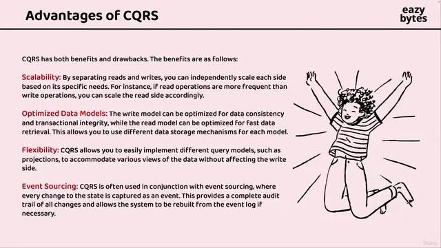
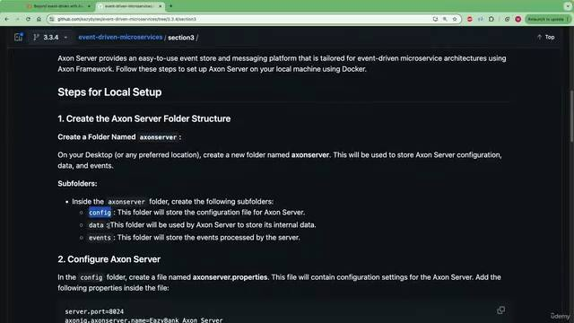
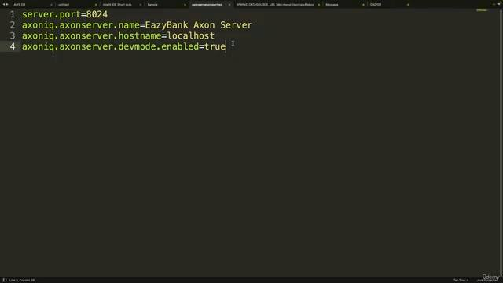
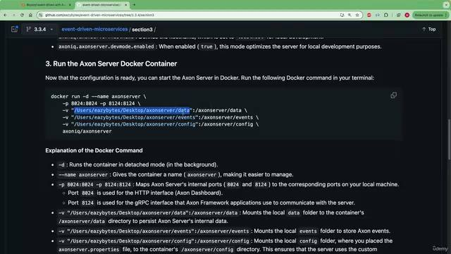
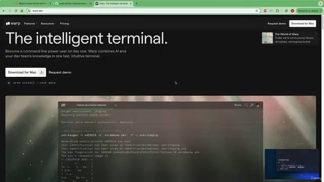
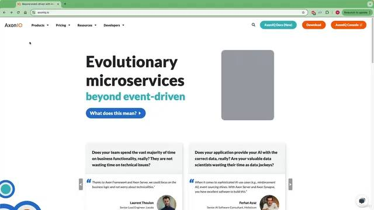
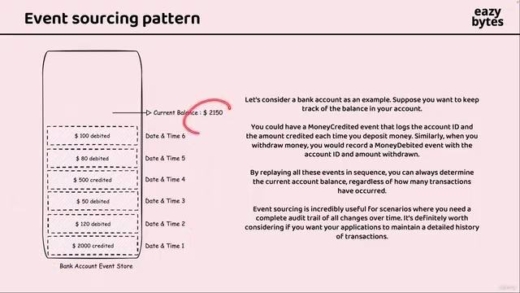
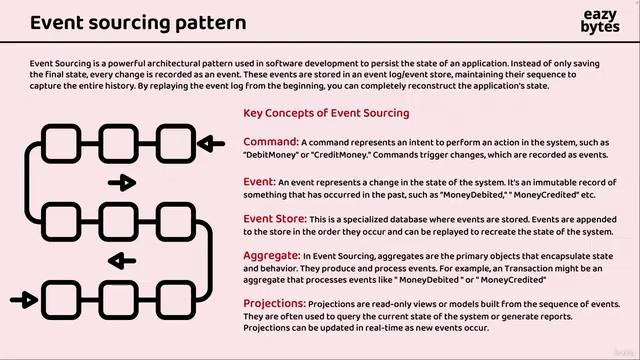
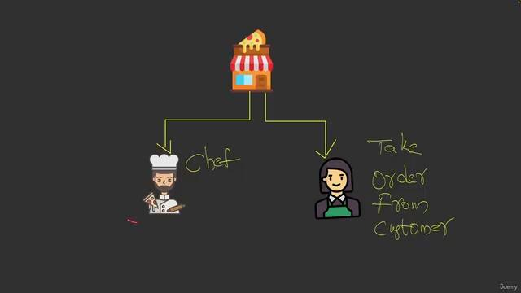

## 1. 这一节做什么

这一节覆盖 P14–P17，主线不是一上来写业务微服务，而是先把 **CQRS 与 Event Sourcing 的取舍、关键概念、在微服务里的落地步骤** 讲清楚，然后用 Docker 把后续实验依赖的 **Axon Server** 本地环境搭起来。Saga 在这几页里只被提到“AxonIQ 支持 CQRS、Event Sourcing、Saga”，**课里没有展开 Saga 的代码和流程**。

读完并照着本文做完，你应该得到三个结果：

1. 能用自己的话解释 CQRS 的读写分离、Event Sourcing 的事件日志、Aggregate、Projection 分别解决什么问题，以及代价是什么。
2. 能在本机创建一个可持久化的 Axon Server 目录结构，写出 `axonserver.properties`，用一条 `docker run` 启动容器。
3. 能打开 `http://localhost:8024`，在首次启动向导里选择 **Start standalone node**，完成本地 Axon Server 初始化，并看到 `admin`、`default` 两个 context。

注意：P14–P17 **没有提供可运行的 Java/Spring Boot 微服务源码**。所以本文的“完整代码”是 Axon Server 的配置文件、启动脚本和验证命令，不是一套 CQRS 业务应用。业务微服务代码在后续课程里才会出现；这几页能复现的最小产物就是本地 Axon Server。



---

## 2. 讲师原话（带「—— pNNN [MM:SS]」）

CQRS 的收益，讲师先强调读写两侧可以独立扩展：

> “By separating the read and write databases, we can independently scale each side based upon our project specific needs.” —— p014 [00:26]

读写模型可以分别优化：写侧考虑一致性与事务完整性，读侧考虑快速查询：

> “The right model or right database can be optimized for data consistency and transactional integrity while the read model can be optimized for the faster data retrieval.” —— p014 [01:13]

但 CQRS 不是银弹，第一个代价是复杂度：

> “The very first challenge is increased complexity. Since we are separating both read and write models, more complexity will be added into the system...” —— p014 [04:32]

第二个代价是最终一致性：写侧更新后，读侧不会瞬间同步：

> “Whenever the updates are happening on the right side, the data will not be copied onto the read side instantly.” —— p014 [05:24]

这里的 “right side” 是逐字稿转写，按上下文指 **write side**，也就是命令/写侧。

Event Sourcing 的定义，讲师用“银行流水”类比：

> “With the help of this pattern, we can store every change that is happening to your record as an event inside a storage system.” —— p015 [00:00]

命令和事件的区别，讲师强调时态：

> “Inside event sourcing a command represents an intent to perform an action in the system such as debit money or credit money.” —— p015 [04:01]

> “An event represents a change in the state of the system. It is an immutable record of something that has occurred in the past...” —— p015 [04:29]

Projection 是读侧从事件序列构建出来的只读视图：

> “Projections are the read only views or models built from the sequence of events.” —— p015 [07:19]

落到微服务时，第一步是拆写 API 和读 API：

> “we need to separate our APAs into write APIs and read APIs...” —— p016 [01:02]

讲师用餐厅类比 CQRS：厨师做披萨，前台接单，职责分开：

> “Sometimes we'll be having scenarios where implementing traditional microservices may not be an solution. So for such kind of scenarios, we are going to follow the CQRS approach...” —— p016 [03:54]

实现上，这一课选择借助 AxonIQ 产品，而不是从零手写：

> “We are going to take help from the accent framework or accent product which is available inside the market.” —— p016 [04:21]

逐字稿里 “accent” 是转写结果，按产品名应写作 **Axon / AxonIQ**。

Axon Server 本地环境用 Docker 搭：

> “Using the Docker, we are going to set up this Accent Server locally.” —— p017 [00:00]

目录结构先建 `axon-server`，里面建 `config`、`data`、`events`：

> “As a very first step we need to create the accent server folder structure.” —— p017 [01:14]

配置文件放在 `config` 下，文件名要按 Axon Server 约定：

> “Once these three subfolders are created inside the config folder you need to create a file with the name accent server dot properties.” —— p017 [01:40]

Docker 命令要映射两个端口：

> “Accent server is going to start at two different ports. The very first one is 8024... 8124 is a port used for the GRPC interface...” —— p017 [04:38]

启动后访问 `localhost:8024` 验证：

> “Just to confirm whether the action server started successfully or not we can try to access the URL which is localhost 8024.” —— p017 [08:15]

---

## 3. 从零复现

这一节按“先建目录 → 写配置 → 启容器 → 首次初始化 → 验证”的顺序做。讲师在 P17 明确说：Axon Server 的安装步骤会变化，**以课程 GitHub 仓库 `section3` 的 README 为准**；本文把 P17 讲到的步骤整理成可直接执行的版本。

### 3.1 前置条件

你需要：

- 已安装 Docker Desktop，并且 Docker Desktop 正在运行。
- 一个终端。讲师用的是 Warp，但 macOS Terminal、iTerm、Windows PowerShell 都可以。
- 本机 `8024`、`8124` 两个端口没有被占用。
- 建议把目录放在桌面或用户目录下。macOS 如果 Docker Desktop 没有给 Desktop 文件共享权限，可能挂载失败，此时把目录换到 `$HOME/axon-server`。

先确认 Docker 可用：

```bash
docker --version
docker info
```

不需要看具体版本号，只要命令能正常返回、Docker Desktop 处于运行状态即可。课里没有规定 Docker 版本和 Axon Server 镜像 tag，本文使用 `axoniq/axonserver` 不带 tag；生产或长期复现时，建议按课程 README 固定版本。

### 3.2 创建目录结构

macOS / Linux：

```bash
cd ~/Desktop
mkdir -p axon-server/config
mkdir -p axon-server/data
mkdir -p axon-server/events
cd axon-server
```

Windows PowerShell：

```powershell
cd $HOME\Desktop
New-Item -ItemType Directory -Force -Path axon-server\config, axon-server\data, axon-server\events | Out-Null
cd axon-server
```

最终结构必须是：

```text
axon-server/
├── config/
│   └── axonserver.properties
├── data/
└── events/
```

`data` 和 `events` 可以先为空目录。`config` 下必须放配置文件。



### 3.3 写 `config/axonserver.properties`

在 `axon-server/config` 下创建 `axonserver.properties`。注意文件名是 **`axonserver.properties`**，不是 `axon-server.properties`。讲师口述为 “axonserver dot properties”，Axon Server 会按这个文件名找配置。

macOS / Linux 可以用 heredoc：

```bash
cat > config/axonserver.properties <<'EOF'
server.port=8024
axoniq.axonserver.name=easy-bank-axonserver
axoniq.axonserver.hostname=localhost
axoniq.axonserver.devmode.enabled=true
EOF
```

Windows PowerShell：

```powershell
@'
server.port=8024
axoniq.axonserver.name=easy-bank-axonserver
axoniq.axonserver.hostname=localhost
axoniq.axonserver.devmode.enabled=true
'@ | Set-Content -Encoding ascii config\axonserver.properties
```

检查文件内容：

```bash
cat config/axonserver.properties
```

四个配置的含义在 P17 里分别讲过：

- `server.port=8024`：Axon Server 的 HTTP 端口。讲师说这是默认端口，但这里显式再写一遍。
- `axoniq.axonserver.name=...`：给 Axon Server 起名字。讲师示例意思是 “easy bank axon server”，名字可以按项目改。
- `axoniq.axonserver.hostname=localhost`：本地开发，hostname 用 localhost。
- `axoniq.axonserver.devmode.enabled=true`：开启开发模式。讲师明确说本地探索要开；不开会被当作生产环境，需要处理很多生产级设置。



### 3.4 启动 Axon Server 容器

确认当前目录是 `axon-server`，然后执行：

```bash
docker run -d \
  --name axon-server \
  -p 8024:8024 \
  -p 8124:8124 \
  -v "$PWD/config:/config" \
  -v "$PWD/data:/data" \
  -v "$PWD/events:/eventdata" \
  axoniq/axonserver
```

Windows PowerShell 使用绝对路径：

```powershell
docker run -d `
  --name axon-server `
  -p 8024:8024 `
  -p 8124:8124 `
  -v "${PWD}\config:/config" `
  -v "${PWD}\data:/data" `
  -v "${PWD}\events:/eventdata" `
  axoniq/axonserver
```

参数对应 P17 的讲解：

- `-d`：detached mode，容器后台运行。
- `--name axon-server`：给容器起名，后面 `docker logs`、`docker rm` 都用这个名字。
- `-p 8024:8024`：HTTP 接口。浏览器访问 Axon Server dashboard 用这个端口。
- `-p 8124:8124`：gRPC 接口。Axon Framework 应用通过它和 Axon Server 通信。普通浏览器不需要访问 8124。
- `-v "$PWD/config:/config"`：把本地 `config` 挂到容器配置目录，容器会读取 `axonserver.properties`。
- `-v "$PWD/data:/data"`：挂载 Axon Server 内部数据目录。
- `-v "$PWD/events:/eventdata"`：挂载事件存储目录。逐字稿只说明本地 `events` 目录要挂进容器，没有逐字母念容器内路径；这里使用 Axon Server 镜像常用的 `/eventdata`。如果你的课程 README 或镜像版本给出的路径不同，以 README 为准。
- `axoniq/axonserver`：镜像名。课里没有讲固定 tag。

如果提示容器名已存在，先删除旧容器再启动：

```bash
docker rm -f axon-server
```

注意：`docker rm -f` 删的是容器，不会删你本地 `data`、`events`、`config` 目录里的文件；这正是 volume 的目的。



### 3.5 看容器是否起来

```bash
docker ps --filter name=axon-server
docker logs --tail=100 axon-server
```

P17 里讲师说 Axon Server 也是用 Spring / Spring Boot 构建的，所以日志风格会类似 Spring Boot。你不需要在这里匹配某一行日志，只要容器在运行、日志没有立刻退出即可。然后做下一步的浏览器验证。

如果容器没起来，先看日志：

```bash
docker logs axon-server
```

### 3.6 打开 dashboard 并完成首次初始化

浏览器打开：

```text
http://localhost:8024
```

首次打开会出现 Axon Server 的初始化/完成页面。P17 的操作是：

1. 点击 **Complete**。
2. 在选项里选择 **Start standalone node**，表示本地以单节点方式启动。
3. 再次点击 **Complete** 完成设置。

讲师同时说明：生产环境可能是多节点集群，但这不是本地开发要操心的事，生产环境由基础设施/DevOps 处理。

完成之后，dashboard 里应该能看到 `admin` 和 `default` 两个 context。P17 明确说这两个是 Axon Server 自己使用的 context；等后续微服务注册进来，才会看到微服务。



### 3.7 重启后验证持久化

可以重启容器验证 volume 是否生效：

```bash
docker restart axon-server
```

然后再次打开 `http://localhost:8024`，确认还能访问。只要本地 `data`、`events`、`config` 还在，重建容器后仍会读取本地目录。课里没有讲备份策略，本文也不扩展。

---

## 4. 完整代码

下面两个文件可以直接保存。`axonserver.properties` 是 P17 明确要求创建的文件；`run-axon-server.sh` 是把 P17 的 Docker 命令固化成一个脚本，**课里没有单独要求写这个脚本**，但它能减少手敲命令的路径错误。

### 4.1 `axon-server/config/axonserver.properties`

```properties
# Axon Server local development configuration
# File name must be axonserver.properties
server.port=8024
axoniq.axonserver.name=easy-bank-axonserver
axoniq.axonserver.hostname=localhost
axoniq.axonserver.devmode.enabled=true
```

说明：逐字稿只逐字母确认了 `server.port`，其余三个键讲师讲的是含义（name、hostname、dev mode）。上面使用 Axon Server 常见配置键写法；如果你的课程 README 或镜像版本报未知配置，按 README 的键名替换即可。值 `easy-bank-axonserver` 只是讲师示例 “easy bank axon server” 的落地写法，你可以改成自己的项目名。

### 4.2 `axon-server/run-axon-server.sh`

```bash
#!/usr/bin/env bash
set -euo pipefail

# Always run from the directory that contains this script.
cd "$(dirname "$0")"

if [ ! -f "config/axonserver.properties" ]; then
  echo "ERROR: 缺少 config/axonserver.properties"
  echo "请先在 config 目录下创建 axonserver.properties"
  exit 1
fi

mkdir -p data
mkdir -p events

# If a container with the same name already exists, remove it first.
# This does NOT delete ./data, ./events, ./config.
if docker ps -a --format '{{.Names}}' | grep -qx "axon-server"; then
  echo "Removing existing container: axon-server"
  docker rm -f axon-server
fi

docker run -d \
  --name axon-server \
  -p 8024:8024 \
  -p 8124:8124 \
  -v "$PWD/config:/config" \
  -v "$PWD/data:/data" \
  -v "$PWD/events:/eventdata" \
  axoniq/axonserver

echo "Axon Server container started."
echo "Open: http://localhost:8024"
echo "Logs: docker logs -f axon-server"
```

赋予执行权限并运行：

```bash
chmod +x run-axon-server.sh
./run-axon-server.sh
```

### 4.3 目录结构总览

```text
axon-server/
├── config/
│   └── axonserver.properties
├── data/
├── events/
└── run-axon-server.sh
```

### 4.4 AxonIQ 组件职责表

P16 把 AxonIQ 产品拆成三个重要组件。本文只搭了第一个组件 Axon Server；另外两个在本段课程里没有实际启动。

| 组件 | 讲师说明的职责 | 本文是否搭建 |
|---|---|---|
| Axon Server | 提供开箱即用的消息路由和 event store，为 CQRS 等事件驱动模式提供基础设施 | 是，用 Docker 启动 |
| Axon Framework | 提供开发者使用的库和源码，用来实现事件驱动模式 | 否，P14–P17 没有应用代码 |
| AxonIQ Console | 可选组件，用于监控、管理、控制和报告微服务与事件处理 | 否，课里说它是 optional |



---

## 5. 逐行解释

### 5.1 `server.port=8024`

这是 Axon Server 的 HTTP 端口。P17 说 8024 默认就是 HTTP 接口，用来访问 dashboard。它必须和 Docker 的 `-p 8024:8024` 对得上：左边是宿主机端口，右边是容器端口。如果你只改 properties 文件里的端口，却不改 `-p`，浏览器访问宿主机 8024 仍然到不了容器里的新端口。反过来，只改 `-p` 不改 properties，容器内部仍然监听 8024，也会对不上。复现时最稳的做法是两个都保持 8024。

### 5.2 `axoniq.axonserver.name=easy-bank-axonserver`

这是给 Axon Server 实例起的名字。P17 说大部分 AxonIQ 相关属性都以 `axoniq` 为前缀，但 `server.port` 例外，因为 Axon Server 本身也是 Spring / Spring Boot 构建的，所以沿用 Spring Boot 的 `server.port`。名字不影响端口和启动，但后续多节点、监控、日志识别时会用到。本文用 `easy-bank-axonserver` 表达讲师说的 “easy bank axon server”；你可以换成项目名。

### 5.3 `axoniq.axonserver.hostname=localhost`

本地开发时 hostname 用 `localhost`。如果你把 Axon Server 放到另一台机器或容器网络里，这个值要跟着环境改。P14–P17 只做本地单机，所以保持 `localhost`。

### 5.4 `axoniq.axonserver.devmode.enabled=true`

开发模式开关。P17 明确说本地探索要开启；不开启会被当作生产环境，需要处理很多生产级设置。注意这只适合本地学习，不要把这个配置当成生产配置。生产环境的 Axon Server 搭建，讲师说由 infra/DevOps 负责，开发者不需要在这门课里手搭生产集群。

### 5.5 `docker run -d`

`-d` 是 detached，容器在后台运行，终端不会被日志占住。P17 说 “I want to start this command in a detached mode”。如果你不加 `-d`，终端会挂在前台，关掉终端容器可能就停了。后台运行后用 `docker logs` 看日志。

### 5.6 `--name axon-server`

给容器起名字。名字稳定后，后面所有命令都可以用 `axon-server`，不用记容器 ID。P17 说用这个名字给 Axon Server 容器命名。容器名和 Axon Server 实例名不是一回事：容器名是 Docker 层的，实例名是 `axoniq.axonserver.name` 配置的。

### 5.7 `-p 8024:8024` 与 `-p 8124:8124`

P17 讲得很清楚：Axon Server 会开两个端口。

- `8024`：HTTP 接口，dashboard 用它。你浏览器访问 `http://localhost:8024` 就是走这个端口。
- `8124`：gRPC 接口，Axon Framework 应用用它和 Axon Server 通信。普通浏览器不访问它，但后续微服务要连它，所以现在必须映射出来。

在 Node/前端视角里，可以把它类比成“一个给管理页面用的 HTTP 端口，一个给服务间 RPC 用的端口”。你不需要在前端代码里连 8124；连 8124 的是后端 Axon Framework 应用。

### 5.8 `-v "$PWD/config:/config"`

把本地 `config` 目录挂到容器 `/config`。Axon Server 会从容器配置目录读取 `axonserver.properties`。如果这个挂载没生效，容器会用自己的默认配置，可能不会读你写的 8024 和 dev mode。P17 说 config 目录用来提供配置，里面就是 `axonserver.properties`。

### 5.9 `-v "$PWD/data:/data"`

把本地 `data` 挂到容器 `/data`。P17 说 data 子目录下 Axon Server 会存内部数据。这样即使删除或重建容器，内部数据还在本地。Docker volume 的核心目的就是：容器生命周期和本地数据解耦。

### 5.10 `-v "$PWD/events:/eventdata"`

把本地 `events` 挂到容器事件存储目录。P17 说 events 目录下 Axon Server 会存业务逻辑发布的事件。Event Sourcing 的关键就是把每次变化按顺序追加到 event store；这个目录就是本地持久化事件的地方。逐字稿没有逐字母念容器内路径，本文用 Axon Server 镜像常见的 `/eventdata`；如果镜像版本或 README 要求不同，以 README 为准。

### 5.11 `axoniq/axonserver`

Axon Server 的 Docker 镜像名。P17 说 “the Docker image name is accent IQ slash accents our”，按产品名就是 `axoniq/axonserver`。课里没有给 tag，所以本文不写 tag。长期复现建议在 README 里固定版本，避免 `latest` 漂移。

### 5.12 为什么 CQRS 和 Event Sourcing 要一起看

P15 用银行账户解释得很清楚：如果只存最终余额，你就不知道余额怎么来的；如果只存流水，要得到当前余额就得每次重放所有事件。CQRS + Event Sourcing 的组合是：

- 写侧/命令侧：把每次变化作为事件按顺序写入 event store，保留完整历史。
- 读侧/查询侧：把事件投影成当前状态，例如当前余额、订单当前状态，供 UI 快速查询。

P14 的银行例子说，UI 要显示当前余额时，不必每次处理所有交易，可以在读库存一份当前余额。P15 的订单例子说，UI 要显示“下单 → 支付完成 → 发货 → 送达”的历史时，事件日志正好提供这种审计轨迹。

在 JS/Node 里可以这样类比：写接口把 `OrderPlaced`、`PaymentCompleted` 追加到事件表；读接口查 `order_summary` 这种投影表。投影表不是事实来源，事实来源是事件表。投影落后时，UI 可能短时间看到旧状态，这就是 P14 说的最终一致性。要立刻显示最新结果，讲师说可以用普通同步 REST API 调用，而不是等读模型同步。



### 5.13 命令、事件、聚合、投影的关系

P15 的关键概念可以整理成一条链：

1. 用户在 UI 发起命令，例如“借记 120 美元”。命令是 **present tense**，表示意图。
2. 命令由 Aggregate 处理。Aggregate 封装状态和行为，负责业务规则，例如余额是否足够。
3. 处理成功后产生事件，例如“120 美元已借记”。事件是 **past tense**，是不可变的历史记录。
4. 事件按顺序追加到 Event Store。
5. 读侧的 Projection 监听事件，更新当前状态视图，例如当前余额。
6. 查询侧只读 Projection，不重放全部事件。

P15 明确说：Aggregate 可以看作 CQRS 的命令侧/写侧，Projection 可以看作查询侧/读侧。Aggregate 把事件写入 event store，Projection 把当前状态更新到读数据库。



### 5.14 为什么需要事件总线

P16 的落地步骤里，写侧变化后要往 event bus 发事件；读侧消费事件后更新关系型数据库。本文只搭了 Axon Server，它提供消息路由和 event store 的基础设施；真正的生产者、消费者、Aggregate、Projection 需要 Axon Framework 应用代码，P14–P17 没有给。所以这份文档不能假装已经跑通 CQRS 业务链路，只能保证 Axon Server 这个基础设施可用。



---

## 6. 复现检查清单

按顺序勾选：

- [ ] Docker Desktop 已启动，`docker info` 能正常返回。
- [ ] 当前目录是 `axon-server`，下面有 `config`、`data`、`events` 三个子目录。
- [ ] `config/axonserver.properties` 文件名正确，不是 `axon-server.properties`。
- [ ] 配置文件包含 `server.port=8024`。
- [ ] 配置文件包含 `axoniq.axonserver.name=...`。
- [ ] 配置文件包含 `axoniq.axonserver.hostname=localhost`。
- [ ] 配置文件包含 `axoniq.axonserver.devmode.enabled=true`。
- [ ] `docker run` 命令里同时映射了 `8024:8024` 和 `8124:8124`。
- [ ] `docker run` 命令里同时挂载了 `config`、`data`、`events` 三个本地目录。
- [ ] `docker ps --filter name=axon-server` 能看到容器在运行。
- [ ] `docker logs --tail=100 axon-server` 没有显示容器立即退出。
- [ ] 浏览器能打开 `http://localhost:8024`。
- [ ] 首次打开点击了 **Complete**。
- [ ] 选择了 **Start standalone node** 并再次点击 **Complete**。
- [ ] dashboard 中能看到 `admin` 和 `default` 两个 context。
- [ ] 执行 `docker restart axon-server` 后，`http://localhost:8024` 仍能打开。
- [ ] 你知道 P14–P17 没有提供 CQRS/Saga 业务应用源码，当前完成的是 Axon Server 环境。

常用验证命令汇总：

```bash
docker ps --filter name=axon-server
docker logs --tail=100 axon-server
docker restart axon-server
```

如果端口冲突，先查占用：

```bash
lsof -i :8024
lsof -i :8124
```

Windows 可用：

```powershell
netstat -ano | findstr :8024
netstat -ano | findstr :8124
```

---

## 7. 课里没讲但你会撞上的

1. **Axon Server 镜像 tag 没固定。** P17 只给了镜像名 `axoniq/axonserver`，没有给版本号。长期复现建议按课程 README 固定 tag，否则 `latest` 可能随版本变化。本文不编造 tag。

2. **容器内 events 挂载点逐字稿没有逐字母给出。** 本文用 `/eventdata`，这是 Axon Server 镜像常见的事件存储挂载点；如果你的镜像或 README 不同，按 README 改。不要因为挂载点不同就认定配置错，先看 README 和 `docker logs`。

3. **首次打开 dashboard 不点 Complete，后续 context 可能不完整。** P17 的操作是 Complete → Start standalone node → Complete。很多人打开页面看到向导就关掉，后面微服务连不上还以为是端口问题。

4. **macOS Docker Desktop 对 Desktop 的文件共享权限。** 如果 `-v "$PWD/config:/config"` 挂载后容器读不到配置，优先把项目移到 `$HOME/axon-server`，或在 Docker Desktop 设置里给 Desktop 文件共享权限。

5. **Windows 的路径和换行。** PowerShell 里 `-v "${PWD}\config:/config"` 要用绝对路径；Bash 的反斜杠续行在 PowerShell 里要换成反引号。不要把 macOS 的 `$PWD` 原样粘到 PowerShell。

6. **端口占用。** 8024 是 dashboard 的 HTTP 端口，8124 是 gRPC 端口。被占用时容器可能启动失败或 dashboard 打不开。先查端口，再决定是否停掉占用进程。

7. **容器名冲突。** 重复执行 `docker run --name axon-server` 会报名字已存在。执行 `docker rm -f axon-server` 后再启动。删容器不会删本地 `data`、`events`、`config`。

8. **配置文件键名可能随版本变化。** 逐字稿只逐字母确认了 `server.port`，其余三项讲师讲的是含义。若启动日志提示未知配置，按课程 README 的键名替换。不要把本文的键名当成所有 Axon Server 版本都永久不变。

9. **AxonIQ Console 是可选组件，P17 没搭。** P16 说 AxonIQ Console 用于监控、管理、控制和报告，是 optional。本文只搭 Axon Server，不要以为 dashboard 就是 Console。后续如果需要监控，要按课程 README 另配。

10. **Saga 在这几页没有实现细节。** P16 只提到 AxonIQ 支持 CQRS、Event Sourcing、Saga。P14–P17 没有 Saga 的代码、补偿流程、状态机或编排示例。不要根据这几页编造 Saga 实现；等后续课程或 README。

11. **最终一致性会直接影响 UI。** P14 说写侧更新不会瞬间复制到读侧。前端转 AI 应用工程师要特别注意：写完立即读，可能读到旧投影。讲师给的处置方式是：需要立即显示最新数据的场景，用普通同步 REST API 调用，不要完全依赖读模型。读模型适合允许毫秒级到秒级延迟的查询。

12. **Axon Server 本地免费探索，不等于生产免费。** P16 说这个产品不是免费的，组织认真做微服务需要购买；本地开发、探索和学习完全免费。本文只做本地学习环境，不要把它当成生产授权方案。

13. **Spring Boot 日志风格不是失败。** P17 说 Axon Server 本身用 Spring / Spring Boot 构建，日志看起来像 Spring Boot 启动日志是正常的。判断成功以 `http://localhost:8024` 能否打开、容器是否持续运行、dashboard 是否完成为准。

14. **P14–P17 不能单独跑通一条 CQRS 业务链路。** 这几页的价值是概念 + 基础设施。要真正复现“写 API → Aggregate → Event Store → Projection → 读 API”，还需要后续 Axon Framework 应用代码；本文没有伪造那部分代码。