# CQRS / Saga / EventSourcing（P018–P021）复现文档

> 适用工程：`section3` 下的 `accounts / cards / customer / loans / common / eurekaserver / gatewayserver` 七个 Maven 模块，外加一个统一管理版本的顶层 BOM 工程。
> 本节结束时你会得到：四个微服务都引好了 Axon 依赖、`customer` 能对外暴露三个写接口（create / update / delete），并且已经产出命令类、查询类、事件类的完整骨架。**聚合器（Aggregate）还没写**，所以此刻调用接口会在 Axon 侧卡住/超时，这是本节的正常中间态，不是你把环境搭错了。

---

## 1. 这一节做什么

前面你已经在本机起了一个 Axon Server（事件存储 + 命令/事件总线），那只是「基础设施」。这一节做的是「把代码接上去」，分四件事，顺序不能乱：

第一，**版本收敛**。Axon 的所有 jar 版本不由各个微服务自己决定，而是在顶层 BOM 工程里用一个属性 `axon.version` 锁死，再通过 `axon-bom`（`type=pom`、`scope=import`）把整套依赖的版本号一次性导入。讲师在这里反复强调一件在真实团队里非常关键的事：**不要用 Maven 中央仓库上最新的那个版本**，用课程仓库里写的那个（本节课是 `4.10.1`）。因为讲师每隔几个月才会验证一次新版本，仓库里的版本是他跑通过的组合。

第二，**给需要的模块加依赖**。只有真正要跑 CQRS 的模块才加 `axon-spring-boot-starter`。本节课里是 `customer`、`accounts`、`cards`、`loans` 四个业务微服务，加上 `common`（因为后面公共 DTO / 事件要放这里）。`eurekaserver` 和 `gatewayserver` **不加**——它们是支撑组件，不承载业务命令。

第三，**告诉微服务 Axon Server 在哪**。在每个要接入的微服务的 `application.yml` 里加 `axon.axon-server.servers: localhost:8124`。本地只有一台，所以一个地址就够；将来集群化时用逗号分隔写多个。

第四，**在 `customer` 里搭 CQRS 的骨架**。这是本节真正的「业务代码」部分，产出四组类：

| 组 | 位置 | 命名规范 | 作用 |
|---|---|---|---|
| 命令（Command） | `command` 包 | 动词 + 名词 + `Command`，**现在时** | 描述「我要做一件事」，由 Controller 创建，交给 CommandGateway |
| 查询（Query） | `query` 包 | 动词 + 名词 + `Query` | 描述「我要读一份数据」 |
| 事件（Event） | `command/event` 包 | 名词 + 动词**过去式** + `Event` | 描述「事情已经发生了」，由 Axon Server 在写库完成后抛出 |
| 命令控制器 | `command/controller` 包 | — | REST 入口，把 JSON 转成 Command 对象，`sendAndWait` 发出去 |

命令类和事件类的命名时态是这节课的「隐藏考点」：**命令必须是现在时（Create / Update / Delete），事件必须是过去时（Created / Updated / Deleted）**。因为命令是「还没发生、请求你去做」，事件是「已经发生、通知你结果」。读的时候如果时态错了，说明你对这块语义还没吃透。

前端可以这么类比：命令 = 你 dispatch 一个 action；事件 = store 里 action 执行完之后 emit 出来的通知；命令网关 = 一个会 blocking 等结果的 dispatch 函数；事件类 = 事件对象本身（但不能带 `private final`，因为它要先被序列化到 Axon Server 再反序列化回来）。

听完本节你应该能做到：`mvn` 全量构建通过、四个服务的 yaml 都有 axon 配置、`customer` 里 6 个新类编译通过、旧的 `CustomerController` 里的 create/update/delete 三个方法已经被删掉。至于 `cards` 和 `loans`，讲师在 P018 明确把它留成了作业。

---

## 2. 讲师原话（带出处）

> "通过在本地系统中搭建 Axon Server，我们现在已经具备构建事件模式所需的基础设施组件。下一步，我们还应了解如何利用 Axon Framework 进行代码修改。"
> —— p018 [00:00]

> "我还需要定义与 Axon Framework 相关的细节。因此，我先创建一个名为 `axon.version` 的新属性。我将使用的版本是 `4.10.1`。"
> —— p018 [01:16]

> "我的建议始终是使用我在 GitHub 仓库中提到的那一版。不要尝试使用你在 Maven 仓库中看到的最新版本，因为有时最新版本可能存在一些稳定性问题。"
> —— p018 [02:06]

> "在这个依赖清单中，你会看到这里定义了许多依赖信息。我们的微服务并不需要所有这些依赖。它们需要哪些依赖，就会在各自的 `pom.xml` 中定义。"
> —— p018 [03:41]

> "我想和你约定一下：我会演示如何在两个微服务中实现 CQRS 和事件溯源模式，先讲 `customer`，再讲 `accounts`。你需要按照同样的步骤，在 `cards` 和 `loans` 中实现。"
> —— p018 [04:25]

> "我们不必在 Eureka 服务器和 Gateway 服务器中添加这个依赖，因为这些支撑组件中不会实现任何 CQRS 模式。"
> —— p018 [06:45]

> "我们这样做是在向微服务发出提示，让它去连接之前启动的 Axon Server。在存在 Axon Server 集群的场景中，我们应该能够在这里用逗号分隔并列出所有服务器的详细信息。"
> —— p019 [00:29]

> "并不强制要求通过实现 CQRS 把所有微服务都改造成事件驱动型微服务。你始终可以根据业务需求来决定。不应该强迫其他微服务改造成事件驱动型微服务。"
> —— p019 [02:12]

> "当有人想要调用命令操作时，他们会调用我们作为命令组件的一部分对外暴露的 REST API。收到输入数据后，我们可以执行校验；输入校验通过后，就需要发起一个命令，这个命令会由 Axon Server 处理。在处理该命令的过程中，Axon Server 会把数据存入相应的数据库。相应数据库更新完成后，Axon Server 会触发事件，该事件会被查询端消费；查询端处理这个事件，并同时把数据更新到读数据库中。"
> —— p019 [04:20]

> "务必确保命令类使用现在时，不应使用过去时或将来时。"
> —— p019 [06:26]

> "在 `customerId` 上，我们还需要标注一个与 Axon 相关的注解，即 `@TargetAggregateIdentifier`。这个注解与 Spring Data JPA 中的 `@Id` 注解非常相似。"
> —— p019 [09:07]

> "首先需要写名词，然后是过去式的动词，最后是 `event`。创建事件时始终应遵循这种命名约定。"
> —— p020 [02:30]

> "我没有把这些字段中的任何一个标记为 `final`，因为在事件场景中，有时在事件对象创建之后、尝试将它发布到事件总线之前，我们可能还需要修改某些数据。因此，我不想把这些字段标记为 `final`。"
> —— p020 [03:52]

> "如何说明这一点？很简单。Axon Server 中有一个名为 `CommandGateway` 的类……在启动期间，Axon Framework 会在幕后创建这个 `CommandGateway` 的实例。它是一个接口，但框架会在幕后创建其实现类的实例，并将其作为受管理的组件。"
> —— p021 [03:38]

> "如果你想触发命令并等待命令执行完成，就需要使用 `sendAndWait` 方法。这会采用阻塞式调用方式。线程会被阻塞，并等待命令执行完成。"
> —— p021 [04:07]

> "这里我尝试使用 `@PatchMapping`，而不是 `@DeleteMapping`。原因是，我们不会彻底删除这条记录，而是会对记录进行软删除。"
> —— p021 [07:20]

---

## 3. 从零复现

### 3.1 准备一个干净的 `section3` 工程

不要把上一节的代码直接改坏。讲师的做法是「复制一份」：

1. 找到你上一节做完的 `section1/end`（或 `section2/end`）目录，里面是 `accounts / cards / customer / loans / common / eurekaserver / gatewayserver` 等文件夹。
2. 在工作区新建目录 `section3`，把上面这些文件夹**整体复制**进来。
3. 用 IntelliJ 的 **Open** 打开 `section3` 目录本身（不是打开某个子模块），弹出「Load Maven Project」提示时点 **Load**，让 IntelliJ 把 7 个模块全部识别成 Maven 工程。

此时目录结构应当是：

```
section3/
├── accounts/
├── cards/
├── customer/
├── common/
├── eurekaserver/
├── gatewayserver/
├── loans/
└── easy-bom/          ← 顶层版本管理工程（讲师念作 "easy-bom"，实际目录名以你仓库为准）
```

> 说明：讲师口述里读作 "简单的连字符炸弹"，指的就是这个以 `-bom` 结尾的顶层 POM 工程。如果你仓库里的名字不同（比如 `eazy-bom`），以仓库为准，下文统一写 `easy-bom`。

### 3.2 锁版本：改顶层 BOM

打开 `easy-bom/pom.xml`。这个文件的职责是「统一管理所有模块和第三方库的版本」，所以 Axon 的版本也进这里。**改两处**：

第一处，`<properties>` 里新增一行 `axon.version`：

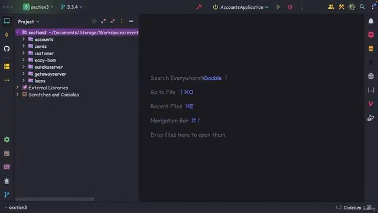

第二处，`<dependencyManagement><dependencies>` 里新增 `axon-bom` 的 import。写法与文件里已有的 `spring-boot-dependencies` 完全同理：

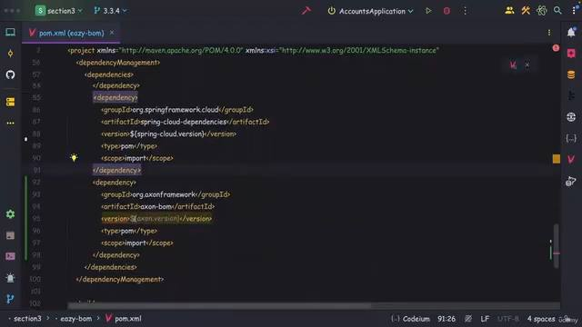

版本号从哪来？讲师的查法：Google 搜 `axon maven dependency` → 打开 Maven 官网第一个链接 → 找 `axon-spring-boot-starter` 模块 → 看最新版本（录制时是 `4.10.1`）。**但他明确要求不要用最新版，用仓库里的版本。**

改完点 IntelliJ Maven 面板的刷新（Reload All Maven Projects）。

### 3.3 给业务模块加 starter

四个业务微服务 + `common`，在各自 `pom.xml` 的 `<dependencies>` **末尾**追加 `axon-spring-boot-starter`（版本不写，由 BOM 管）。以 `customer` 为例：

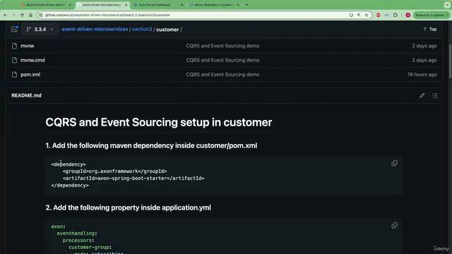

需要加的文件清单：

```
✅ section3/customer/pom.xml
✅ section3/accounts/pom.xml
✅ section3/cards/pom.xml
✅ section3/loans/pom.xml
✅ section3/common/pom.xml
❌ section3/eurekaserver/pom.xml   （不加）
❌ section3/gatewayserver/pom.xml  （不加）
```

### 3.4 配置 Axon Server 地址

在每个已加依赖的微服务的 `src/main/resources/application.yml` **末尾**追加三行。以 `customer` 为例：

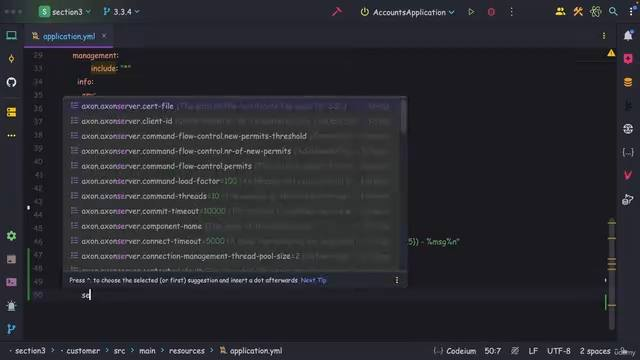

IntelliJ Ultimate 有小技巧：不用完整敲 `axon.axon-server.servers`，敲 `a.a.s` 就会弹出补全。这个技巧对任何 Spring Boot 配置键都成立（比如敲 `s.a` 补 `spring.application.name`）。

**这是本节最容易漏的一步**：漏了它，微服务启动时不会报错，但会去连默认地址，你后面发命令就会一直 `TimeoutException`。

### 3.5 在 customer 里建包结构

打开 `customer` 模块，在已有的 `com.eazybytes.customer`（包名以你仓库为准）下建两个平级子包：

```
customer/src/main/java/com/eazybytes/customer/
├── command/                    ← 写模型
│   ├── event/                  ← 事件类放这里
│   └── controller/             ← 命令 REST 接口
└── query/                      ← 读模型
```

为什么事件包放在 `command` 下面而不是 `query` 下面？讲师给了理由：**事件是由命令侧触发的，查询侧只负责消费**。所以从归属上讲它属于写侧。他也说了「你也可以放别处，随你」。

### 3.6 写三个命令类

在 `command` 包下建三个类。字段清单：`customerId` / `name` / `email` / `mobileNumber` / `activeSw`（后者是 boolean）。Delete 命令只保留 `customerId` 和 `activeSw` 两个字段。

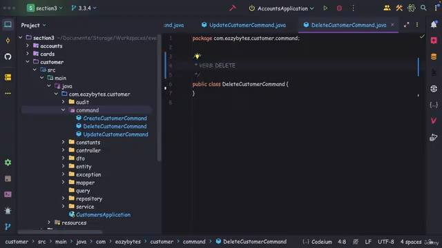

`customerId` 上必须挂 `@TargetAggregateIdentifier`。讲师的原话类比：**它相当于 Spring Data JPA 的 `@Id`**——告诉 Axon「用这个字段去路由到哪个聚合实例」。Axon 就是靠它在命令总线上找到「处理这条命令的那个聚合对象」。

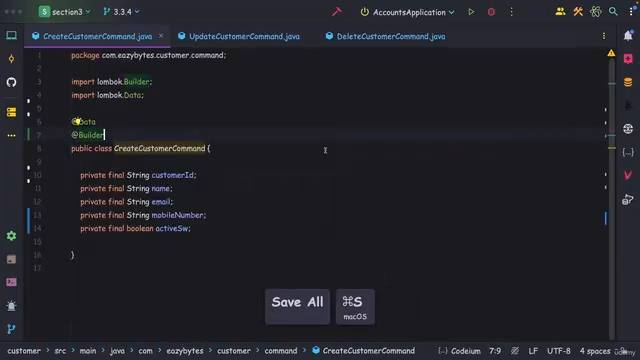

### 3.7 写一个查询类

在 `query` 包下建 `FindCustomerQuery`，只有一个字段 `mobileNumber`。注解用 `@Value` 而不是 `@Data`——因为查询对象一旦创建就不该再改，`@Value` 只生成 getter 不生成 setter。

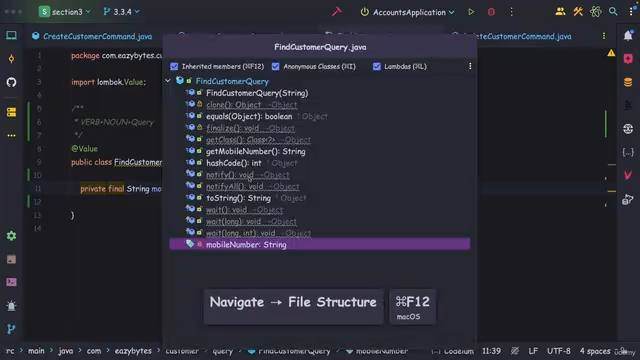

「一门课一个读操作就一个查询类，有多个读操作就建多个查询类。」本节客户服务只有一个「按手机号查客户」的读需求，所以只有一个。

### 3.8 写三个事件类

在 `command/event` 包下建 `CustomerCreatedEvent` / `CustomerUpdatedEvent` / `CustomerDeletedEvent`。

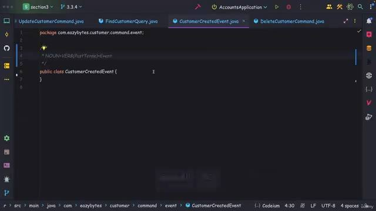

事件类的字段**故意不加 `final`**，只挂 `@Data`，并且**不挂** `@TargetAggregateIdentifier`——因为事件只是数据载体，不发往某个具体聚合，也不落库。

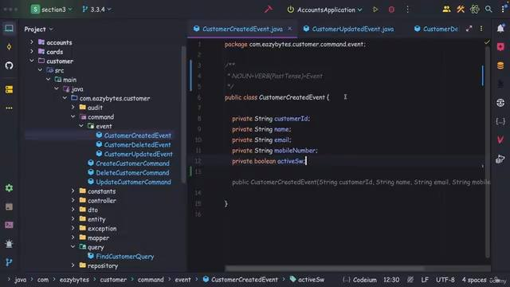

### 3.9 把 REST 接口改写成「命令入口」

在 `command/controller` 下建 `CustomerCommandController`。做法是把原来 `CustomerController` 里的三个方法签名**复制过来**，然后把方法体里的「直接调 Service 存库」换成「组装 Command → `commandGateway.sendAndWait()`」。

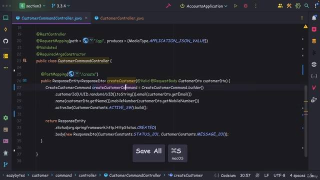

`sendAndWait` 有四个重载，讲师逐个点了：

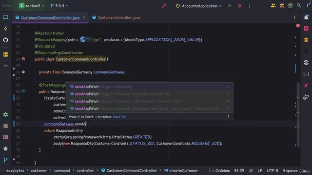

1. `sendAndWait(command)` —— 无限等待，直到命令执行完成（本节用的就是这个）
2. `sendAndWait(command, metadata)` —— 附带元数据
3. `sendAndWait(command, timeout)` —— 指定最长等待时间
4. `sendAndWait(command, metadata, timeout)` —— 两者都给

另有非阻塞的 `send(...)` 系列，接受一个 callback，命令执行完后回调。讲师说「我这条命令后面没有别的逻辑要跑，所以用 `sendAndWait` 就够了」。

delete 接口要用 `@PatchMapping` 而不是 `@DeleteMapping`，因为是**软删除**：不删记录，只把 `activeSw` 置为「不活跃」。

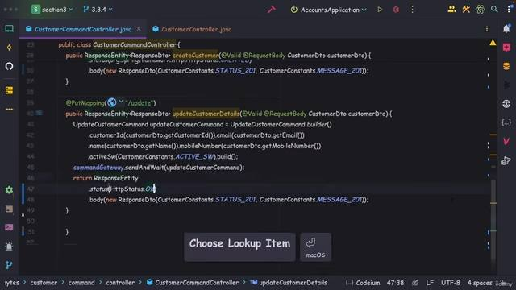

### 3.10 删掉旧的 CRUD

`CustomerController` 里的 create / update / delete 三个方法必须删掉，只保留 query 侧要用的读取方法（或者整类先留着、把写方法删掉）。**不删会导致两个 Controller 映射到同一路径，Spring 启动直接报 ambiguous mapping。**

### 3.11 验证

```bash
cd section3
# 顶层 BOM 先装到本地仓库，其他模块才能解析到版本
mvn -f easy-bom/pom.xml install -N
mvn -q clean package -DskipTests
```

构建成功后，先起 `eurekaserver` → `gatewayserver` → `customer`，再确认 Axon Server 已经在本机跑着（端口 `8124`）。控制台里能看到 Axon 的自动配置日志，就说明接上了。

---

## 4. 完整代码

> **关于包名的说明**：逐字稿里讲师从未念出包名，本课程作者惯用 `com.eazybytes.customer`。下面所有代码统一用它，**如果你的工程不是这个包名，请全局替换**。

### 4.1 `section3/easy-bom/pom.xml`（修改已有文件，两处新增）

```xml
<?xml version="1.0" encoding="UTF-8"?>
<project xmlns="http://maven.apache.org/POM/4.0.0"
         xmlns:xsi="http://www.w3.org/2001/XMLSchema-instance"
         xsi:schemaLocation="http://maven.apache.org/POM/4.0.0 https://maven.apache.org/xsd/maven-4.0.0.xsd">
  <modelVersion>4.0.0</modelVersion>

  <!-- 原有的 groupId / artifactId / packaging=pom 等保持不变 -->

  <properties>
    <!-- ===== 原有属性（java.version、spring-boot 版本、各模块版本）原样保留 ===== -->

    <!-- ===== 本节新增：Axon 版本 ===== -->
    <axon.version>4.10.1</axon.version>
  </properties>

  <dependencyManagement>
    <dependencies>
      <!-- ===== 原有的 spring-boot-dependencies / spring-cloud-dependencies 等原样保留 ===== -->

      <!-- ===== 本节新增：导入 Axon 的 BOM ===== -->
      <dependency>
        <groupId>org.axonframework</groupId>
        <artifactId>axon-bom</artifactId>
        <version>${axon.version}</version>
        <type>pom</type>
        <scope>import</scope>
      </dependency>
    </dependencies>
  </dependencyManagement>
</project>
```

### 4.2 各业务模块 `pom.xml` 的追加块（5 个文件内容相同）

`section3/customer/pom.xml`、`accounts`、`cards`、`loans`、`common` 各自 `<dependencies>` 末尾追加：

```xml
    <!-- ===== 本节新增：Axon Framework ===== -->
    <dependency>
      <groupId>org.axonframework</groupId>
      <artifactId>axon-spring-boot-starter</artifactId>
    </dependency>
```

### 4.3 `section3/customer/src/main/resources/application.yml`

```yaml
# ===== 以下为原有配置，保持你 section3/customer 里 application.yml 的原样，不要覆盖 =====
# server:
#   port: ...
# spring:
#   application:
#     name: "customer"
#   datasource: ...
#   jpa: ...
# eureka: ...
# build: ...

# ===== 本节新增（P019 讲的） =====
axon:
  axon-server:
    servers: localhost:8124
```

`accounts` / `cards` / `loans` 三个模块的 `application.yml` 末尾追加同样三行。

### 4.4 `CreateCustomerCommand.java`

路径：`section3/customer/src/main/java/com/eazybytes/customer/command/CreateCustomerCommand.java`

```java
package com.eazybytes.customer.command;

import lombok.Builder;
import lombok.Data;
import org.axonframework.modelling.command.TargetAggregateIdentifier;

@Data
@Builder
public class CreateCustomerCommand {

    @TargetAggregateIdentifier
    private final String customerId;

    private final String name;
    private final String email;
    private final String mobileNumber;
    private final boolean activeSw;
}
```

### 4.5 `UpdateCustomerCommand.java`

路径：`section3/customer/src/main/java/com/eazybytes/customer/command/UpdateCustomerCommand.java`

```java
package com.eazybytes.customer.command;

import lombok.Builder;
import lombok.Data;
import org.axonframework.modelling.command.TargetAggregateIdentifier;

@Data
@Builder
public class UpdateCustomerCommand {

    @TargetAggregateIdentifier
    private final String customerId;

    private final String name;
    private final String email;
    private final String mobileNumber;
    private final boolean activeSw;
}
```

### 4.6 `DeleteCustomerCommand.java`

路径：`section3/customer/src/main/java/com/eazybytes/customer/command/DeleteCustomerCommand.java`

```java
package com.eazybytes.customer.command;

import lombok.Builder;
import lombok.Data;
import org.axonframework.modelling.command.TargetAggregateIdentifier;

@Data
@Builder
public class DeleteCustomerCommand {

    @TargetAggregateIdentifier
    private final String customerId;

    private final boolean activeSw;
}
```

### 4.7 `FindCustomerQuery.java`

路径：`section3/customer/src/main/java/com/eazybytes/customer/query/FindCustomerQuery.java`

```java
package com.eazybytes.customer.query;

import lombok.Value;

@Value
public class FindCustomerQuery {

    private final String mobileNumber;
}
```

### 4.8 `CustomerCreatedEvent.java`

路径：`section3/customer/src/main/java/com/eazybytes/customer/command/event/CustomerCreatedEvent.java`

```java
package com.eazybytes.customer.command.event;

import lombok.Data;

@Data
public class CustomerCreatedEvent {

    private String customerId;
    private String name;
    private String email;
    private String mobileNumber;
    private boolean activeSw;
}
```

### 4.9 `CustomerUpdatedEvent.java`

路径：`section3/customer/src/main/java/com/eazybytes/customer/command/event/CustomerUpdatedEvent.java`

```java
package com.eazybytes.customer.command.event;

import lombok.Data;

@Data
public class CustomerUpdatedEvent {

    private String customerId;
    private String name;
    private String email;
    private String mobileNumber;
    private boolean activeSw;
}
```

### 4.10 `CustomerDeletedEvent.java`

路径：`section3/customer/src/main/java/com/eazybytes/customer/command/event/CustomerDeletedEvent.java`

```java
package com.eazybytes.customer.command.event;

import lombok.Data;

@Data
public class CustomerDeletedEvent {

    private String customerId;
    private boolean activeSw;
}
```

### 4.11 `CustomerCommandController.java`

路径：`section3/customer/src/main/java/com/eazybytes/customer/command/controller/CustomerCommandController.java`

```java
package com.eazybytes.customer.command.controller;

import com.eazybytes.customer.command.CreateCustomerCommand;
import com.eazybytes.customer.command.DeleteCustomerCommand;
import com.eazybytes.customer.command.UpdateCustomerCommand;
import com.eazybytes.customer.constants.CustomerConstants;
import com.eazybytes.customer.dto.CustomerDto;
import com.eazybytes.customer.dto.ResponseDto;
import lombok.RequiredArgsConstructor;
import org.axonframework.commandhandling.gateway.CommandGateway;
import org.springframework.http.HttpStatus;
import org.springframework.http.MediaType;
import org.springframework.http.ResponseEntity;
import org.springframework.web.bind.annotation.PatchMapping;
import org.springframework.web.bind.annotation.PostMapping;
import org.springframework.web.bind.annotation.PutMapping;
import org.springframework.web.bind.annotation.RequestBody;
import org.springframework.web.bind.annotation.RequestMapping;
import org.springframework.web.bind.annotation.RestController;

import java.util.UUID;

@RestController
@RequestMapping(path = "/api/customers", produces = {MediaType.APPLICATION_JSON_VALUE})
@RequiredArgsConstructor
public class CustomerCommandController {

    private final CommandGateway commandGateway;

    @PostMapping("/create")
    public ResponseEntity<ResponseDto> createCustomer(@RequestBody CustomerDto customerDto) {
        CreateCustomerCommand createCustomerCommand = CreateCustomerCommand.builder()
                .customerId(UUID.randomUUID().toString())
                .email(customerDto.getEmail())
                .name(customerDto.getName())
                .mobileNumber(customerDto.getMobileNumber())
                .activeSw(CustomerConstants.ACTIVE_SW)
                .build();
        commandGateway.sendAndWait(createCustomerCommand);
        return ResponseEntity
                .status(HttpStatus.CREATED)
                .body(new ResponseDto(CustomerConstants.STATUS_201, CustomerConstants.MESSAGE_201));
    }

    @PutMapping("/update")
    public ResponseEntity<ResponseDto> updateCustomer(@RequestBody CustomerDto customerDto) {
        UpdateCustomerCommand updateCustomerCommand = UpdateCustomerCommand.builder()
                .customerId(customerDto.getCustomerId())
                .email(customerDto.getEmail())
                .name(customerDto.getName())
                .mobileNumber(customerDto.getMobileNumber())
                .activeSw(CustomerConstants.ACTIVE_SW)
                .build();
        commandGateway.sendAndWait(updateCustomerCommand);
        return ResponseEntity
                .status(HttpStatus.OK)
                .body(new ResponseDto(CustomerConstants.STATUS_200, CustomerConstants.MESSAGE_200));
    }

    @PatchMapping("/delete")
    public ResponseEntity<ResponseDto> deleteCustomer(@RequestBody CustomerDto customerDto) {
        DeleteCustomerCommand deleteCustomerCommand = DeleteCustomerCommand.builder()
                .customerId(customerDto.getCustomerId())
                .activeSw(CustomerConstants.INACTIVE_SW)
                .build();
        commandGateway.sendAndWait(deleteCustomerCommand);
        return ResponseEntity
                .status(HttpStatus.OK)
                .body(new ResponseDto(CustomerConstants.STATUS_200, CustomerConstants.MESSAGE_200));
    }
}
```

**这段代码里有 8 个符号必须和你仓库里的已有代码对上，否则编译不过**（课里只念了名字、没念值）：

| 符号 | 出处 | 说明 |
|---|---|---|
| `CustomerDto` 的 `getCustomerId/getName/getEmail/getMobileNumber` | 你 section1 的 DTO | 字段名按你的 DTO 来 |
| `ResponseDto` 的构造签名 | 你 section1 的 DTO | 下面示例假设是 `(String statusCode, String statusMsg)`，如果不对就改成你仓库里的 |
| `CustomerConstants.ACTIVE_SW` | p021 [02:27] 提到 | 讲师说 `activeSw` 是 **boolean**，所以它应该是 `true` |
| `CustomerConstants.INACTIVE_SW` | p021 [07:47] 提到 | 同理应为 `false` |
| `CustomerConstants.STATUS_201 / MESSAGE_201` | 课里只说「返回 201」 | 常量名以你仓库为准，实在没有就直接写 `"201"` / `"Customer created successfully"` |
| `CustomerConstants.STATUS_200 / MESSAGE_200` | 课里只说「返回 200」 | 同上 |
| `@RequestMapping` 的路径 | 课里未念 | 从你原来的 `CustomerController` 复制 |
| 包名 `com.eazybytes.customer` | 课里未念 | 以你仓库为准 |

**关于 `activeSw` 的类型**：如果你仓库里现存代码用的是字符串 `"Y"/"N"`，那就把三个命令类和三个事件类里的 `boolean activeSw` 全部改成 `String activeSw`，控制器里传 `CustomerConstants.ACTIVE_SW`（值 `"Y"`）。**命令类、事件类、聚合器、实体四处类型必须完全一致**，否则 Axon 反序列化时会报类型不匹配。

---

## 5. 逐行解释

**`<axon.version>4.10.1</axon.version>`**
为什么放在 properties 而不是直接写死在 dependency 里？因为 `axon-bom` 是个「版本清单」，它内部还管着 `axon-spring-boot-starter`、`axon-server-connector`、`axon-metrics` 等一大堆 artifact。用属性统一引用，将来升级只改一行。如果你在每个模块里各写一遍版本，四个模块漂到四个不同版本，Axon 的序列化格式会冲突——这是线上很难查的一类 bug。

**`<type>pom</type> <scope>import</scope>`**
这两个必须成对出现。`import` scope 只对 `type=pom` 的依赖有效，它的语义是「把这个 POM 的 `dependencyManagement` 段落合并进我的 `dependencyManagement`」。少了 `type=pom` 会报 `invalid scope`。这和文件里已有的 `spring-boot-dependencies` 是同一个套路。

**`<artifactId>axon-spring-boot-starter</artifactId>` 不写 version**
因为 BOM 已经管了。写了反而会和 BOM 打架。这也是为什么必须先 `install` 顶层 BOM——否则子模块解析不到版本，Maven 会报 `dependencies.dependency.version is missing`。

**`axon.axon-server.servers: localhost:8124`**
`servers` 是复数、值是 List 类型，所以集群时写成 `host1:8124,host2:8124`。为什么不是 `port` 单独一项？因为 Axon 允许一台客户端连多台 Axon Server 做高可用，一个 key 装多个地址更自然。

**`@Data` + `@Builder` + `private final` 字段的组合**
Lombok 的机制：`@Data` 在有 `final` 字段时会生成 `@RequiredArgsConstructor`（只含 final 字段的构造器），`@Builder` 就挂在这个构造器上。所以 `CreateCustomerCommand.builder().customerId(...)....build()` 能跑通。如果字段全不是 final，`@RequiredArgsConstructor` 会退化成无参构造，`@Builder` 生成的 builder 就没有 `customerId(...)` 方法——这是新手最常见的编译错误。

**`@TargetAggregateIdentifier` 只能出现在一个字段上**
Axon 靠它决定命令路由。命令类里如果漏标，`sendAndWait` 会抛 `AxonConfigurationException: The command ... does not have a unique identifier`。如果标了两个，报 `Multiple identifiers`。所以每加一个命令类，回头检查一眼这个注解。

**`@Value` vs `@Data` 用在 Query 上**
`@Value` = 全字段 final + 全参构造 + getter + `equals/hashCode/toString`，**没有 setter**。查询对象是不可变的，一旦 QueryGateway 派发出去就不该被改。`@Data` 会生成 setter，虽然能跑，但语义上给了别人改你查询条件的机会——这在多线程下是隐患（Node 里相当于把一个本该 `Object.freeze` 的配置对象到处传引用）。

**事件类字段为什么不加 `final`**
讲师给的理由是「发布前可能还想改数据」。更深一层的原因是**序列化**：事件对象要先被序列化成 JSON 存进 Axon Server 的事件存储，再反序列化回对象交给查询侧。很多序列化框架（包括 Jackson）反序列化时需要一个无参构造器 + setter。`@Data` 在字段全是非 final 时正好生成无参构造 + setter，天然满足。你如果给事件字段加 `final`，`@Data` 生成的构造器会变成全参构造，Jackson 就需要额外的 `@JsonCreator` 才能反序列化——课里没讲这一层，但你改坏了就会撞上。

**事件类不加 `@TargetAggregateIdentifier`**
因为事件不是发给某个聚合的，它是「广播」给所有订阅者（查询侧、Saga、其他微服务）。加了反而会让 Axon 以为这是要在聚合上重放的领域事件，行为会很怪。

**`private final CommandGateway commandGateway;` + `@RequiredArgsConstructor`**
`CommandGateway` 是个接口，你从没 `new` 过它。它是 `axon-spring-boot-starter` 的自动配置在启动时注册成 bean 的。所以前提是：这个模块的 `pom.xml` 里有那个 starter，并且 `application.yml` 里配了 `axon-server` 地址。少任何一个，启动就报 `NoSuchBeanDefinitionException: CommandGateway`。

**`commandGateway.sendAndWait(createCustomerCommand)`**
这是**阻塞**调用。当前 Tomcat 的请求线程会挂在这里，直到 Axon 那边把命令处理完、事件也落盘、然后返回聚合 ID。讲师特意点了「blocking style」。对前端出身的你，等价于 `await commandBus.dispatch(cmd)`——但注意 Node 的 await 释放了事件循环，Java 这里是**真的占用一个线程**。如果后面命令处理很慢、并发又高，Tomcat 线程池（默认 200）会被

## 6. 复现检查清单

- [ ] **顶层 BOM 已锁 Axon 版本**：打开 `easy-bom/pom.xml`，验证 `<properties>` 里有 `<axon.version>4.10.1</axon.version>`，`dependencyManagement` 里有 `org.axonframework:axon-bom` 且 `type=pom`、`scope=import`；执行 `mvn -f easy-bom/pom.xml install -N`，应该看到 `BUILD SUCCESS`，子模块后续能解析到 Axon 版本。
- [ ] **依赖模块清单正确**：验证 `customer/accounts/cards/loans/common` 五个模块的 `pom.xml` 都有 `axon-spring-boot-starter` 且不写版本；验证 `eurekaserver/gatewayserver` 没有该 starter。Maven Reload 后不应报 `dependencies.dependency.version is missing`。
- [ ] **四个业务服务 yaml 都有 Axon Server 地址**：分别在 `customer/accounts/cards/loans` 的 `application.yml` 末尾验证存在 `axon.axon-server.servers: localhost:8124`；启动 customer 时应该看到 Axon 自动配置/连接日志，而不是等到发命令才发现连默认地址超时。
- [ ] **customer 包结构已建好**：验证存在 `command`、`command/event`、`command/controller`、`query` 四个包；应该看到三个 Command、一个 Query、三个 Event、一个 CommandController 都能编译通过。
- [ ] **命令类命名和注解正确**：验证 `Create/Update/DeleteCustomerCommand` 使用现在时命名，`customerId` 上有且仅有一个 `@TargetAggregateIdentifier`，类上有 `@Data @Builder`，字段按文档写成 `private final`；编译通过，`builder()` 应能点出 `customerId(...)` 等方法。
- [ ] **查询类不可变**：验证 `FindCustomerQuery` 在 `query` 包下，类上使用 `@Value`，只有 `mobileNumber` 一个字段；源码语义应是只生成 getter、不手写 setter，编译通过。
- [ ] **事件类命名和字段正确**：验证三个事件类按“名词 + 过去式 + Event”命名，类上只有 `@Data`，字段不是 `final`，且没有 `@TargetAggregateIdentifier`；编译通过。
- [ ] **命令控制器接线正确**：验证 `CustomerCommandController` 注入 `CommandGateway`，create/update 调 `sendAndWait`，delete 使用 `@PatchMapping` 且传 `INACTIVE_SW`；启动时不应报 `NoSuchBeanDefinitionException: CommandGateway`。
- [ ] **旧写接口已删**：验证旧 `CustomerController` 里的 create/update/delete 三个方法已删除或不再映射同一路径；启动 Spring 时不应出现 ambiguous mapping 报错。
- [ ] **仓库符号对得上**：验证 `CustomerDto` 的 getter、`ResponseDto` 构造签名、`CustomerConstants.ACTIVE_SW/INACTIVE_SW/STATUS_*/MESSAGE_*` 与控制器代码一致；执行 `mvn clean package -DskipTests` 不应出现 cannot find symbol 或构造器不匹配。
- [ ] **activeSw 类型一致**：如果仓库已有实体用字符串 `"Y"/"N"`，验证命令类、事件类、控制器都统一为 `String activeSw`；如果沿用文档示例，则全部为 `boolean activeSw`。不应出现有的类 boolean、有的类 String。
- [ ] **全量构建通过**：在 `section3` 执行 `mvn -q clean package -DskipTests`，应该看到 `BUILD SUCCESS`；`eurekaserver/gatewayserver` 不应因 Axon 依赖而失败。
- [ ] **运行中间态符合预期**：确认 Axon Server 在本机 `8124` 跑着，按 `eurekaserver → gatewayserver → customer` 启动；此时调用 create/update/delete 出现卡住/超时是本节正常中间态（聚合器还没写），不应同时出现 CommandGateway 缺 bean、连接默认地址、ambiguous mapping 等环境或映射错误。
- [ ] **作业边界确认**：`cards` 和 `loans` 本节只验证依赖和 yaml 已加；CQRS 骨架未实现属于课里留的作业，不应作为本节 customer 复现失败。

## 7. 课里没讲但你会撞上的

| 现象 | 原因 | 怎么办 |
|---|---|---|
| 子模块 Maven 报 `dependencies.dependency.version is missing`，或解析不到 `axon-spring-boot-starter` | 顶层 BOM 没先安装/没刷新；或 `axon-bom` 的 `type=pom`、`scope=import` 没配对。补充：课里没讲要先执行 `mvn -f easy-bom/pom.xml install -N` | 先修 `easy-bom/pom.xml`，执行 `mvn -f easy-bom/pom.xml install -N`，再在 IntelliJ Maven 面板 Reload，重新构建子模块 |
| 启动 customer 报 `NoSuchBeanDefinitionException: CommandGateway` | customer 没加 `axon-spring-boot-starter`，或 Maven 没刷新导致 BOM/依赖没生效 | 确认 `customer/pom.xml` 有 starter 且不写版本，Reload Maven，重新 `clean package` |
| 启动不报错，但调用 create/update/delete 一直卡住或 `TimeoutException`，Axon 连接日志正常 | 本节聚合器（Aggregate）还没写，Axon Server 没有命令处理器；这是课里明确的正常中间态 | 不要误判环境搭错；先确认 BOM、依赖、yaml 都正确，等下一节写聚合器 |
| 调用接口 `TimeoutException`，且启动时没看到连到配置的 Axon 地址 | `application.yml` 漏了 `axon.axon-server.servers: localhost:8124`，微服务去连默认地址 | 在 customer/accounts/cards/loans 四个 yaml 末尾补上配置，重启 customer；用 grep 确认四份都有 |
| 启动日志显示连不上 `8124`，或命令超时 | 本机 Axon Server 没启动，或端口不是 `8124` | 先启动 Axon Server，确认监听 `8124`，再重启微服务 |
| Spring 启动报 ambiguous mapping | 旧 `CustomerController` 里的 create/update/delete 没删，与新 `CustomerCommandController` 映射到同一路径 | 删除旧 Controller 里的写方法，只保留 query 侧读取方法；重启确认无映射冲突 |
| `CreateCustomerCommand.builder()` 没有 `customerId(...)` 等方法，或编译报构造器问题 | 命令类字段没按文档写成 `private final`，导致 Lombok 的 `@Data + @Builder` 生成构造器行为不符合预期。补充：课里没讲这层 Lombok 构造器机制 | 按文档把命令类字段写成 `private final`，保留 `@Data @Builder`，Maven Reload 后重新编译 |
| `sendAndWait` 抛 `AxonConfigurationException: ... does not have a unique identifier` 或 `Multiple identifiers` | 命令类漏标 `@TargetAggregateIdentifier`，或标在了多个字段上 | 每个命令类只在 `customerId` 上标一个 `@TargetAggregateIdentifier` |
| 事件被消费/反序列化时报 Jackson 构造器或 setter 相关错误 | 事件字段被加了 `final`。补充：课里没讲事件要先序列化到 Axon Server 再反序列化，需要无参构造 + setter 这一层 | 事件字段不要加 `final`，只挂 `@Data`；事件类不要加 `@TargetAggregateIdentifier` |
| Axon 反序列化报类型不匹配 | 命令、事件、控制器/后续聚合器实体里的 `activeSw` 类型不一致，例如有的 boolean、有的 String。补充：逐字稿没展开类型一致性 | 按仓库已有实体统一：要么全 `boolean`，要么全 `String`；若用 `"Y"/"N"`，命令类、事件类、控制器都改成 String |
| 编译报 `CustomerConstants`、`ResponseDto`、`CustomerDto` 找不到符号或构造器不匹配 | 课里只念了这些符号名字，没念具体常量名、构造签名、DTO getter。补充：课里没讲这些仓库已有代码的具体值 | 按你仓库里的 DTO/常量改控制器；没有对应常量就直接写状态码/消息；字段名以你的 `CustomerDto` 为准 |
| 用了 Maven 上最新的 Axon 版本，出现依赖或稳定性问题 | 课里明确建议不要用最新版，用课程仓库验证过的版本 | 把 `<axon.version>` 改回 `4.10.1`，统一由 BOM 管理，重新 Reload 和构建 |
| `eurekaserver` 或 `gatewayserver` 被误加了 Axon starter | 课里明确这两个是支撑组件，不承载 CQRS，不应加 `axon-spring-boot-starter` | 从这两个模块的 `pom.xml` 移除 starter，只保留业务模块和 `common` 的 Axon 依赖 |
