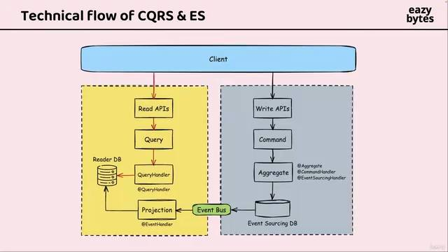
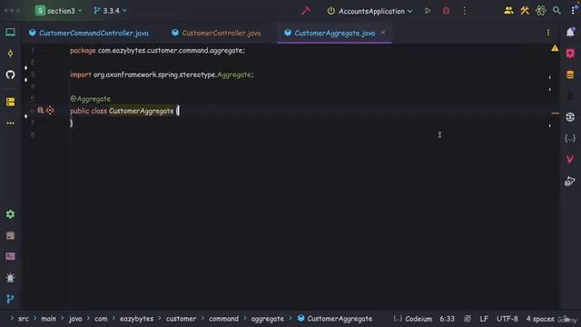
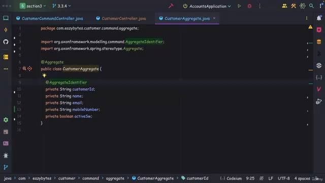
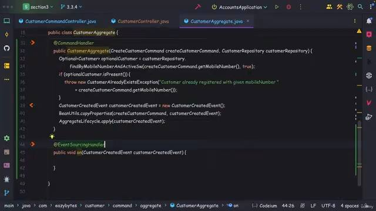
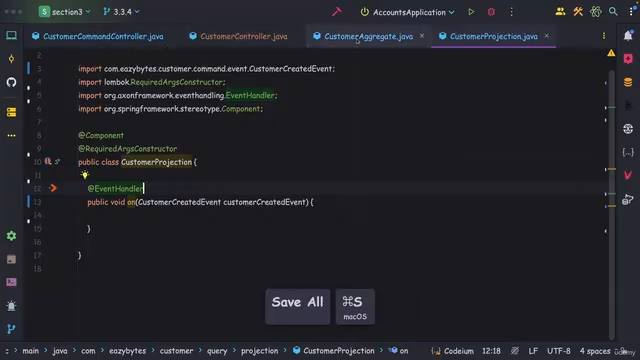
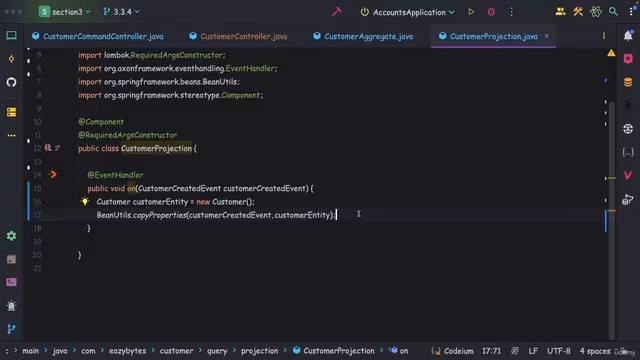
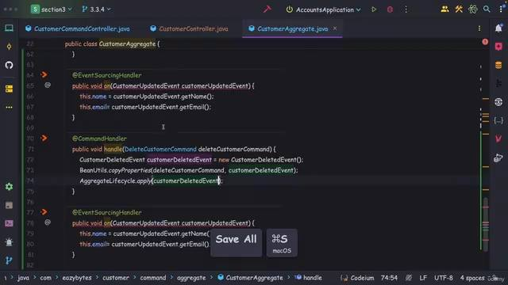
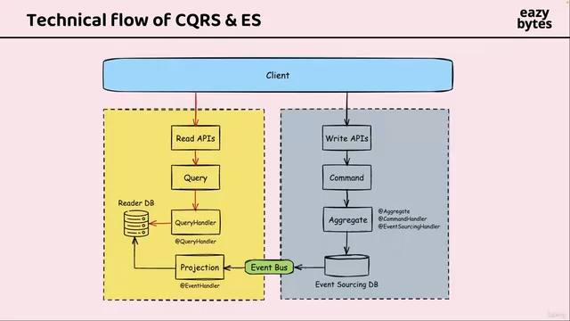

# CQRS + Event Sourcing 实战：补齐聚合（Aggregate）与投影（Projection）

> 覆盖 P022–P026。这五集的产出物很明确：**写侧的 `CustomerAggregate`（含 create / update / delete 三条命令处理链）+ 读侧的 `CustomerProjection`**，以及为了配合投影而对 `ICustomerService` / `CustomerServiceImpl` / `CustomerMapper` 做的三处改造。

---

## 0. 先对齐一个名字问题（很重要，否则你会搜不到文档）

课程讲师的英文被语音转写成了 `accent framework`、`action framework`、`action server`、`actions over`、`accent server`。它们指的是同一个东西：

| 逐字稿里的写法 | 实际产品名 |
|---|---|
| accent framework / action framework | **Axon Framework**（Java 的 CQRS/ES 框架） |
| accent server / action server / actions over / actions of | **Axon Server**（配套的事件存储 + 事件总线服务器） |

本文统一按实际产品名书写。你在别的地方看到 `accent`、`action` 这些拼写，都是同一套东西的转写误差。

---

## 1. 这一节做什么

在 P021 之前，写侧已经完成了三件事：Controller 暴露了写接口 → 定义了 `CreateCustomerCommand` 等命令类 → 通过 `CommandGateway` 把命令发了出去。但命令发出去之后**没有人接**。这一节就是把「接住命令」的那一半补上，并且一直补到读侧能被查询为止。

完整的链路是这样（讲师在 P022 用一张技术流程图讲了一遍，后面每一集都在填这张图上的一个格子）：

```
客户端
  ├─ 写：调用 command 侧 REST 接口
  │     → CommandGateway.send(command)
  │     → @CommandHandler（CustomerAggregate）
  │     → 校验 + AggregateLifecycle.apply(event)
  │     → @EventSourcingHandler 把事件落进事件库（写库）
  │     → 事件进事件总线
  └─ 读：调用 query 侧 REST 接口
        → QueryGateway + Query 对象
        → @QueryHandler 读读库
        → 返回客户端

事件总线的另一头：
  @EventHandler（CustomerProjection）
  → 调 Service 把数据写进读库
```

这五集具体交付：

| 集数 | 交付物 |
|---|---|
| P022 | 无代码，讲清整张流程图 + Aggregate / Projection 的定义 |
| P023 | `CustomerAggregate` 类骨架 + `@AggregateIdentifier` + create 命令的 `@CommandHandler` 构造器 |
| P024 | `@EventSourcingHandler` 方法（create 分支），以及事件存到哪、事件总线在哪 |
| P025 | update / delete 两条命令的 `@CommandHandler` 方法与对应的 `@EventSourcingHandler` |
| P026 | `CustomerProjection` + 三个 `@EventHandler` + Service / Mapper 的改造 |

**读完这一节你应该能做到**：启动 Axon Server，把 `CustomerAggregate` 和 `CustomerProjection` 落进项目，跑一次 `POST /api/customers`，然后看到事件库目录里多出一个事件文件、读库里多出一行数据。

---

## 2. 讲师原话

关于 Aggregate 和 Projection 的定义，讲师在 P022 末尾给了一段教科书式的定义，这两句建议直接背下来：

> "Aggregate 是事件溯源中的一个组件，用于封装给定记录的状态和行为。这些 Aggregate 会处理事件，也会为查询侧生成事件。类似地，我们还有投影。投影是基于事件序列构建的只读视图或模型，通常用于查询记录的当前状态。"
>
> —— p022 [03:38]

> "要创建 Aggregate 类，首先需要在 command 包下创建一个子包。包名是 aggregate。在这个 aggregate 包中，我创建一个新的 Java 类，名为 CustomerAggregate。在这个类上方，我们需要标注一个注解，也就是 @Aggregate。"
>
> —— p023 [00:00]



关于为什么聚合里的字段**不能**是 `final`：

> "我会复制这些字段并粘贴到这里，但不应该把它们声明为 final，因为每当有人尝试更新客户数据时，我们都希望借助这些字段更新正确数据库中的数据。因此，我们不能把这些字段标记为 final。"
>
> —— p023 [01:01]

关于为什么聚合标识必须选一个永不改变的字段——这段是 P023 最值钱的部分，因为它解释了一个很容易踩的坑：

> "为了帮助框架加载现有记录，我们应该选择一个在客户整个生命周期内都不会变化的字段……如果你尝试选择手机号作为 Aggregate 标识符，就会遇到一些挑战。例如，如果客户最初创建记录时手机号是 123，后来想把手机号改成 456，那么在这种情况下，整个事件溯源模式就无法正常工作，因为有些事件中的手机号是 123，而另一些事件中的手机号是 456。因此，始终要选择一个永远不会变化的字段作为 Aggregate 标识符，这一点很重要。"
>
> —— p023 [03:14]

关于事件存在哪里（本地开发阶段的真相）：

> "由于我们是在开发模式下启动 actions 的，它会将与事件相关的所有数据存储到我们很久前在项目文件夹的 actions 下创建的 events 文件夹中，当时我们正尝试启动容器的 actions。我们已经将这些文件夹挂载到 Docker 容器中。"
>
> —— p024 [02:30]

关于 update 分支为什么先把校验跳过了：

> "目前我会先跳过 update customer command 方法中的校验部分，因为在接下来的课程中，我会展示一种更好的方式，即使用拦截器类来定义校验，而不是把所有与校验相关的逻辑都定义在聚合内部。"
>
> —— p025 [00:53]

关于读侧为什么**还要**再校验一遍（这条是很多人偷懒跳过的地方）：

> "我总是建议你也在读侧执行校验。有时，无论出于什么原因，事件会被多次消费；在这种情况下，为了避免这种问题，你不会希望插入多条客户详情。"
>
> —— p026 [04:08]

---

## 3. 从零复现

### 3.1 前置条件

课里没有给出版本号。下表是我复现时跑通的一组，**课里没讲具体版本，换版本前先看 Axon 的 Spring Boot 兼容矩阵**：

| 组件 | 版本 |
|---|---|
| JDK | 17 |
| Spring Boot | 3.2.x |
| axon-spring-boot-starter | 4.9.x |
| Axon Server | `axoniq/axon-server:latest`（Docker） |
| 读库 | H2（讲师用 H2 一个库既当写库又当读库，见 P026 [01:56]） |

`pom.xml` 里要加的依赖：

```xml
<dependency>
  <groupId>org.axonframework</groupId>
  <artifactId>axon-spring-boot-starter</artifactId>
  <version>4.9.3</version>
</dependency>
<dependency>
  <groupId>org.springframework.boot</groupId>
  <artifactId>spring-boot-starter-data-jpa</artifactId>
</dependency>
<dependency>
  <groupId>com.h2database</groupId>
  <artifactId>h2</artifactId>
  <scope>runtime</scope>
</dependency>
<dependency>
  <groupId>org.projectlombok</groupId>
  <artifactId>lombok</artifactId>
  <optional>true</optional>
</dependency>
```

### 3.2 目录结构（本节的落点）

```
customer-service/
└── src/main/java/com/example/customer/
    ├── command/
    │   ├── CreateCustomerCommand.java          ← P021 已有
    │   ├── UpdateCustomerCommand.java          ← P021 已有
    │   ├── DeleteCustomerCommand.java          ← P021 已有
    │   ├── CustomerCommandController.java      ← P021 已有
    │   ├── event/                              ← 事件类，课里没讲放哪，这里按 command 下放置
    │   │   ├── CustomerCreatedEvent.java
    │   │   ├── CustomerUpdatedEvent.java
    │   │   └── CustomerDeletedEvent.java
    │   └── aggregate/                          ← ★ P023 新建这个子包
    │       └── CustomerAggregate.java          ← ★ P023–P025 的产物
    ├── query/
    │   ├── projection/                         ← ★ P026 新建这个子包
    │   │   └── CustomerProjection.java         ← ★ P026 的产物
    │   ├── Customer.java                       ← JPA 实体
    │   ├── CustomerRepository.java
    │   ├── ICustomerService.java               ← ★ P026 要改签名
    │   ├── CustomerServiceImpl.java            ← ★ P026 要改实现
    │   ├── CustomerMapper.java                 ← ★ P026 要加 mapEventToCustomer
    │   └── CustomerQueryController.java
    └── exception/
        ├── CustomerAlreadyExistsException.java
        └── ResourceNotFoundException.java
```



### 3.3 第一步：把 Axon Server 跑起来

课里默认你已经有一个跑着的容器，但没给命令。这里补上。注意 `-v` 挂载的目录就是讲师在 P024 说的那个「events folder」——本地开发时事件就以文件形式落在这里：

```bash
mkdir -p ./axon/events
docker run -d --name axon-server \
  -p 8024:8024 \
  -p 8124:8124 \
  -v "$(pwd)/axon/events:/eventdata" \
  axoniq/axon-server:latest
```

- `8024` 是 Web 控制台，浏览器打开 `http://localhost:8024` 能看到 Events / Commands / Queries 三个面板。
- `8124` 是应用连过去的 gRPC 端口。

`application.yaml`：

```yaml
server:
  port: 8080

spring:
  datasource:
    url: jdbc:h2:mem:customerdb;DB_CLOSE_DELAY=-1
    driver-class-name: org.h2.Driver
    username: sa
    password: ""
  jpa:
    hibernate:
      ddl-auto: update
    show-sql: true
  h2:
    console:
      enabled: true

axon:
  axonserver:
    servers: localhost:8124
```

### 3.4 第二步：确认前置契约（课里没讲，但编译必须要）

P023 讲师直接去 `CreateCustomerCommand` 里「复制字段」，说明这个类在 P021 就已经存在了。以下是讲师代码里**实际调用到的成员**反推出的最小契约。如果你跟着前面的课写过，签名应该对得上；对不上就以你的项目为准。

```java
// command/CreateCustomerCommand.java —— P021 已有，这里只列被用到的成员
public class CreateCustomerCommand {
    private final String customerId;
    private final String name;
    private final String email;
    private final String mobileNumber;
    private final boolean activeSwitch;
    // 全参构造 + getter
}
```

三个事件类课里没给完整代码，但聚合和投影里**明确调用**了这些 getter/setter：`getCustomerId / getName / getEmail / getMobileNumber / isActiveSwitch`，以及 `setCustomerId / setName / setEmail / setMobileNumber / setActiveSwitch`。事件类必须有**无参构造 + setter**，否则 `BeanUtils.copyProperties` 和事件序列化都会失败。

### 3.5 第三步：写聚合（P023 → P025）

顺序不要乱，按讲师的操作节奏走：

1. `command` 包下右键 → New Package → `aggregate`
2. 包内 New Java Class → `CustomerAggregate`
3. 类上加 `@Aggregate`
4. 从 `CreateCustomerCommand` 复制 5 个字段过来，**去掉 final**
5. 在 `customerId` 上加 `@AggregateIdentifier`
6. 写一个空的无参构造器（框架用）
7. 写第二个构造器，参数是 `CreateCustomerCommand`，加 `@CommandHandler`
8. 构造器里注入 `CustomerRepository`，做手机号重复校验
9. 校验通过 → new 事件 → `BeanUtils.copyProperties` → `AggregateLifecycle.apply(event)`
10. 紧接着写 `@EventSourcingHandler` 的 `on(CustomerCreatedEvent)`，把事件字段赋给聚合字段
11. 再写 update / delete 两个 `@CommandHandler` **普通方法**（不是构造器）+ 两个 `@EventSourcingHandler`

第 11 步有个关键点，讲师特地说了：

> "在处理 create customer command 时，我们创建了该类的构造函数，但构造函数只应在创建操作中使用；而对于更新和删除操作，应定义普通的 Java 方法。"
>
> —— p025 [00:00]

也就是说：**构造器只给 create 用**，update / delete 必须是普通方法。因为聚合对象在 update 时是从事件库「重放」出来的，它已经存在了，不存在「再构造一次」的概念。



### 3.6 第四步：写事件溯源处理器（P024）

`@EventSourcingHandler` 的语义是「这个事件要落库，落库的方式是把它赋值到聚合字段上」。讲师对底层做了说明：

> "在底层，框架会查找存储数据库，而在该存储数据库中，所有事件详情都会以历史或顺序方式存储……最底部将是第一个事件。"
>
> —— p024 [01:36]

所以方法体里只有一行行赋值，**不要在这里写业务校验**——这个方法在每次重放事件时都会执行，写校验会炸。



### 3.7 第五步：写投影（P026）

到 `query` 包下建 `projection` 子包，新建 `CustomerProjection`：

1. 类上 `@Component`（讲师原话：要 Spring 给这个类创建 bean）
2. 类上 `@RequiredArgsConstructor`（Lombok，给 final 字段生成构造器做注入）
3. 三个方法都叫 `on`，参数分别是三种事件，各自加 `@EventHandler`
4. create 分支：new `Customer` 实体 → `BeanUtils.copyProperties(event, entity)` → 调 `customerService.createCustomer(entity)`
5. update 分支：直接把事件传给 `customerService.updateCustomer(event)`
6. delete 分支：调 `customerService.deleteCustomer(event.getCustomerId())`

注意 `@EventHandler` 和 `@EventSourcingHandler` 的分工，讲师说得很清楚：

> "在聚合类中，我们使用了 EventSourcingHandler 注解，它负责以事件溯源方式存储数据；但在投影内部，我们需要使用这个 EventHandler 注解，因为我们希望该方法负责处理将从事件总线消费的事件。"
>
> —— p026 [00:29]

一句话记：**聚合里是 `@EventSourcingHandler`（写事件库），投影里是 `@EventHandler`（写读库）。**



### 3.8 第六步：改造读侧 Service（P026 的连带改动）

这一步逐字稿里是边写边改的，很容易跟丢。改动点一共三个：

1. `ICustomerService.createCustomer` 的入参从 `CustomerDTO` 改成 `Customer`，返回类型讲师没提，这里用 `void`
2. `ICustomerService` 新增 `updateCustomer(CustomerUpdatedEvent event)`，`deleteCustomer(String customerId)` 保持已有实现
3. `CustomerMapper` 新增 `mapEventToCustomer(CustomerUpdatedEvent event, Customer customer)`，**只 set name 和 email**

为什么只 set 两个字段？因为 P025 明确说了：

> "在更新操作期间，我不想允许灵活更新 customer ID、mobile number 和 active switch……使用更新操作时，最终用户只能更新姓名和电子邮件详情。"
>
> —— p025 [02:10]

> "至于 customer ID、mobile number 和 active switch 等其他字段，所有这些字段都会从我们存储在数据库中的上一个事件复制过来。"
>
> —— p025 [02:53]

在 JS/Node 里对应什么：这基本就是 `Object.assign` 的局部更新版本，只 merge 白名单里的 key，其余字段保留旧值。区别是 Java 这边是显式 setter，Node 那边要小心别写成 `{...old, ...event}`——那样会把 `mobileNumber` 一起覆盖掉。

### 3.9 第七步：跑起来验证

```bash
# 1. 启动（确保 Axon Server 已在 8124 监听）
./mvnw spring-boot:run

# 2. 创建客户
curl -X POST http://localhost:8080/api/customers \
  -H "Content-Type: application/json" \
  -d '{"name":"张三","email":"zhangsan@example.com","mobileNumber":"9876543210"}'

# 3. 等 1~2 秒让事件投递 + 投影落库，然后查
curl http://localhost:8080/api/customers/9876543210

# 4. 观察事件库目录
ls -R ./axon/events
```

第 4 步能看到按聚合 ID 分目录的事件文件，这就是 P024 说的「每写一次就新增一条，不覆盖」的落地形态。具体文件命名以你实际输出为准。

---

## 4. 完整代码

下面每个文件都可以直接保存。标注「课里没讲」的部分是我为了让它能编译而补的，逐字稿里没有对应内容。

### 4.1 `command/aggregate/CustomerAggregate.java`（核心产物）

```java
package com.example.customer.command.aggregate;

import com.example.customer.command.CreateCustomerCommand;
import com.example.customer.command.DeleteCustomerCommand;
import com.example.customer.command.UpdateCustomerCommand;
import com.example.customer.command.event.CustomerCreatedEvent;
import com.example.customer.command.event.CustomerDeletedEvent;
import com.example.customer.command.event.CustomerUpdatedEvent;
import com.example.customer.exception.CustomerAlreadyExistsException;
import com.example.customer.query.Customer;
import com.example.customer.query.CustomerRepository;
import org.axonframework.commandhandling.CommandHandler;
import org.axonframework.eventsourcing.EventSourcingHandler;
import org.axonframework.modelling.command.AggregateIdentifier;
import org.axonframework.modelling.command.AggregateLifecycle;
import org.axonframework.spring.stereotype.Aggregate;
import org.springframework.beans.BeanUtils;

import java.util.Optional;

@Aggregate
public class CustomerAggregate {

    @AggregateIdentifier
    private String customerId;
    private String name;
    private String email;
    private String mobileNumber;
    private boolean activeSwitch;

    // 1) 框架重放事件时需要用到的空构造器
    public CustomerAggregate() {
    }

    // 2) create 命令走构造器
    @CommandHandler
    public CustomerAggregate(CreateCustomerCommand command, CustomerRepository customerRepository) {

        // 2.1 校验：同一手机号不允许存在多个活跃客户
        Optional<Customer> optionalCustomer = customerRepository
                .findByMobileNumberAndActiveSwitch(command.getMobileNumber(), true);

        if (optionalCustomer.isPresent()) {
            throw new CustomerAlreadyExistsException(
                    "Customer already exist with given mobile number: " + command.getMobileNumber());
        }

        // 2.2 命令 -> 事件
        CustomerCreatedEvent event = new CustomerCreatedEvent();
        BeanUtils.copyProperties(command, event);

        // 2.3 发布事件（落事件库 + 进事件总线）
        AggregateLifecycle.apply(event);
    }

    // 3) create 的事件溯源处理器
    @EventSourcingHandler
    public void on(CustomerCreatedEvent event) {
        this.customerId = event.getCustomerId();
        this.name = event.getName();
        this.email = event.getEmail();
        this.mobileNumber = event.getMobileNumber();
        this.activeSwitch = event.isActiveSwitch();
    }

    // 4) update 命令走普通方法
    @CommandHandler
    public void handle(UpdateCustomerCommand command) {
        CustomerUpdatedEvent event = new CustomerUpdatedEvent();
        BeanUtils.copyProperties(command, event);
        AggregateLifecycle.apply(event);
    }

    // 5) update 的事件溯源处理器：只落 name / email
    @EventSourcingHandler
    public void on(CustomerUpdatedEvent event) {
        this.name = event.getName();
        this.email = event.getEmail();
    }

    // 6) delete 命令走普通方法
    @CommandHandler
    public void handle(DeleteCustomerCommand command) {
        CustomerDeletedEvent event = new CustomerDeletedEvent();
        BeanUtils.copyProperties(command, event);
        AggregateLifecycle.apply(event);
    }

    // 7) delete 的事件溯源处理器：只落 activeSwitch（软删除）
    @EventSourcingHandler
    public void on(CustomerDeletedEvent event) {
        this.activeSwitch = event.isActiveSwitch();
    }
}
```

### 4.2 `command/event/CustomerCreatedEvent.java`（课里没讲，按调用点反推）

```java
package com.example.customer.command.event;

public class CustomerCreatedEvent {

    private String customerId;
    private String name;
    private String email;
    private String mobileNumber;
    private boolean activeSwitch;

    public CustomerCreatedEvent() {
    }

    public String getCustomerId() { return customerId; }
    public void setCustomerId(String customerId) { this.customerId = customerId; }

    public String getName() { return name; }
    public void setName(String name) { this.name = name; }

    public String getEmail() { return email; }
    public void setEmail(String email) { this.email = email; }

    public String getMobileNumber() { return mobileNumber; }
    public void setMobileNumber(String mobileNumber) { this.mobileNumber = mobileNumber; }

    public boolean isActiveSwitch() { return activeSwitch; }
    public void setActiveSwitch(boolean activeSwitch) { this.activeSwitch = activeSwitch; }
}
```

`CustomerUpdatedEvent` 与 `CustomerDeletedEvent` 结构同理，字段分别是：

- `CustomerUpdatedEvent`：`customerId`、`name`、`email`、`mobileNumber`、`activeSwitch`（`mobileNumber` 在 P026 的 update 分支里被用来反查记录，所以必须有）
- `CustomerDeletedEvent`：`customerId`、`activeSwitch`（delete 分支只读 `isActiveSwitch()`）

### 4.3 `query/projection/CustomerProjection.java`（核心产物）

```java
package com.example.customer.query.projection;

import com.example.customer.command.event.CustomerCreatedEvent;
import com.example.customer.command.event.CustomerDeletedEvent;
import com.example.customer.command.event.CustomerUpdatedEvent;
import com.example.customer.query.Customer;
import com.example.customer.query.ICustomerService;
import lombok.RequiredArgsConstructor;
import org.axonframework.eventhandling.EventHandler;
import org.springframework.beans.BeanUtils;
import org.springframework.stereotype.Component;

@Component
@RequiredArgsConstructor
public class CustomerProjection {

    private final ICustomerService customerService;

    @EventHandler
    public void on(CustomerCreatedEvent event) {
        Customer customerEntity = new Customer();
        BeanUtils.copyProperties(event, customerEntity);
        customerService.createCustomer(customerEntity);
    }

    @EventHandler
    public void on(CustomerUpdatedEvent event) {
        customerService.updateCustomer(event);
    }

    @EventHandler
    public void on(CustomerDeletedEvent event) {
        customerService.deleteCustomer(event.getCustomerId());
    }
}
```

### 4.4 `query/ICustomerService.java`（P026 改签名后）

```java
package com.example.customer.query;

import com.example.customer.command.event.CustomerUpdatedEvent;

import java.util.Optional;

public interface ICustomerService {

    void createCustomer(Customer customer);

    void updateCustomer(CustomerUpdatedEvent event);

    void deleteCustomer(String customerId);

    Optional<Customer> findByMobileNumberAndActiveSwitch(String mobileNumber, boolean activeSwitch);
}
```

### 4.5 `query/CustomerServiceImpl.java`（P026 改实现后）

```java
package com.example.customer.query;

import com.example.customer.command.event.CustomerUpdatedEvent;
import com.example.customer.exception.CustomerAlreadyExistsException;
import com.example.customer.exception.ResourceNotFoundException;
import lombok.RequiredArgsConstructor;
import org.springframework.stereotype.Service;

import java.util.Optional;

@Service
@RequiredArgsConstructor
public class CustomerServiceImpl implements ICustomerService {

    private final CustomerRepository customerRepository;
    private final CustomerMapper customerMapper;

    @Override
    public void createCustomer(Customer customer) {
        Optional<Customer> optionalCustomer = customerRepository
                .findByMobileNumberAndActiveSwitch(customer.getMobileNumber(), true);

        if (optionalCustomer.isPresent()) {
            throw new CustomerAlreadyExistsException(
                    "Customer already exist with given mobile number: " + customer.getMobileNumber());
        }

        customerRepository.save(customer);
    }

    @Override
    public void updateCustomer(CustomerUpdatedEvent event) {
        Optional<Customer> optionalCustomer = customerRepository
                .findByMobileNumberAndActiveSwitch(event.getMobileNumber(), true);

        Customer customer = optionalCustomer.orElseThrow(() ->
                new ResourceNotFoundException("Customer", "mobileNumber", event.getMobileNumber()));

        Customer updated = customerMapper.mapEventToCustomer(event, customer);
        customerRepository.save(updated);
    }

    @Override
    public void deleteCustomer(String customerId) {
        Optional<Customer> optionalCustomer =
                customerRepository.findByCustomerIdAndActiveSwitch(customerId, true);

        Customer customer = optionalCustomer.orElseThrow(() ->
                new ResourceNotFoundException("Customer", "customerId", customerId));

        customer.setActiveSwitch(false);
        customerRepository.save(customer);
    }

    @Override
    public Optional<Customer> findByMobileNumberAndActiveSwitch(String mobileNumber, boolean activeSwitch) {
        return customerRepository.findByMobileNumberAndActiveSwitch(mobileNumber, activeSwitch);
    }
}
```

### 4.6 `query/CustomerMapper.java`（P026 新增的方法）

```java
package com.example.customer.query;

import com.example.customer.command.event.CustomerUpdatedEvent;
import org.springframework.stereotype.Component;

@Component
public class CustomerMapper {

    /**
     * 只允许 update 操作修改 name 和 email。
     * customerId / mobileNumber / activeSwitch 保留数据库里的旧值。
     */
    public Customer mapEventToCustomer(CustomerUpdatedEvent event, Customer customer) {
        customer.setName(event.getName());
        customer.setEmail(event.getEmail());
        return customer;
    }
}
```

### 4.7 补充一个示意：`Customer` JPA 实体（课里没讲）

```java
package com.example.customer.query;

import jakarta.persistence.Entity;
import jakarta.persistence.Id;
import jakarta.persistence.Table;
import lombok.Data;

@Data
@Entity
@Table(name = "customer")
public class Customer {

    @Id
    private String customerId;
    private String name;
    private String email;
    private String mobileNumber;
    private boolean activeSwitch;
}
```

---

## 5. 逐行解释

### `@Aggregate`（p023 [00:00]）

讲师原话是「告诉框架这个类要当聚合器」。加了它，Axon 才会在启动时扫描到这个类、把里面的 `@CommandHandler` 注册进 CommandBus 的路由表、把 `@EventSourcingHandler` 注册进事件重放流程。**不加的后果**：命令发出去返回 `NoHandlerForCommandException`，而且报错信息里不会提示你「忘了加 @Aggregate」，排查起来很痛苦。

### 字段不能 `final`（p023 [01:01]）

`final` 字段一旦在构造器里赋值就改不了。但 update 事件来的时候，`@EventSourcingHandler` 要执行 `this.name = event.getName()`——`final` 直接编译不过。这里的取舍就是：聚合对象是**可变状态机**，不是不可变值对象。你要是从 React 的不可变数据思维过来，这里要切换一下。

### `@AggregateIdentifier` 只能加在 `customerId` 上（p023 [01:42] 起）

这是整节课最值得记住的一条。Axon 加载聚合的方式是「按标识去事件库里把这条聚合的所有事件捞出来重放」，所以标识必须**在任何事件里都是同一个值**。用手机号当标识，改号之后就变成两条互不相干的聚合，历史全断。

讲师给的例子很具体：客户先注册 `123`，后来改成 `456`，那事件库里就有 `mobileNumber=123` 的事件和 `mobileNumber=456` 的事件，重放时框架根本不知道该捞哪一堆。

**JS/Node 类比**：等价于你在事件表上用 `WHERE aggregate_id = ?` 查事件流。如果 `aggregate_id` 中途变了，`ORDER BY version` 出来的流就是断的，reducer 重放必然出错。

### 空构造器（p023 [03:58]）

> "出于框架的需要，我们需要创建这个空构造函数。"
>
> —— p023 [03:58]

框架 new 一个空聚合 → 从事件库读事件 → 逐个调 `@EventSourcingHandler` 把状态「灌」进去。所以这个空构造器必须有，且**里面不能做任何事**。

### 两个构造器会不会冲突？

不会。`@CommandHandler` 加在带参构造器上，Axon 用反射按参数类型匹配；空构造器不带注解，框架自己在重放时用。两者签名不同（参数列表不一样），Java 层面就是重载。

### `BeanUtils.copyProperties(command, event)` 的参数顺序（p023 [07:55]）

讲师说的是「source = command，target = event」，对应 Spring 的 `BeanUtils.copyProperties(source, target)`。**这是个经典陷阱**：Apache Commons BeanUtils 的同名方法是反过来的 `(dest, orig)`。项目里如果两个包都 import 过，很容易串。用 Spring 的就没问题（本文代码 import 的是 `org.springframework.beans.BeanUtils`）。

它按**字段名**匹配复制，名字对不上就静默跳过，不报错。所以命令类和事件类的字段名必须一字不差。

### `AggregateLifecycle.apply(event)`（p023 [08:48]）

这一行做两件事，且顺序是固定的：先把事件交给 `@EventSourcingHandler` 落事件库，落完再推到事件总线。顺序不能反——先入库才能保证「事件总线上的每一条事件都一定被持久化过」，这是事件溯源能当数据源用的前提。

对比一下：如果用 `CommandGateway` 直接发事件，就绕过了事件库，投影照样能收到、读库照样能更新，但写过库是空的，重启后聚合状态全丢。**这是最难查的一类 bug**：功能看起来正常，一重启就没了。

### `@EventSourcingHandler` 里只做赋值（p024 [00:46]）

讲师的原话是「read the data from the event and populate into the fields」。为什么不能在这里做校验或调外部服务：

1. 每次聚合加载都会跑一遍，重复执行
2. 它在事件落库的**过程中**执行，此时抛异常会导致事件已入库但聚合状态不一致

### update 的 `@EventSourcingHandler` 为什么只写两行（p025 [02:35]）

```java
this.name = event.getName();
this.email = event.getEmail();
```

因为 `customerId` 是聚合标识，改了直接抛异常；`mobileNumber` 讲师计划单独做一个跨微服务的换号流程（他原话是 "在接下来的几节中，我会用一个单独的操作，在所有微服务中更新手机号码，比如客户、账户、贷款和卡这些微服务。"）；`activeSwitch` 由 delete 管。所以 update 的语义被收窄成「只改名和邮箱」。

**注意这里有个细节值得你自己想一下**：`CustomerUpdatedEvent` 里是有 `mobileNumber` 的（P026 的 `updateCustomer` 用它去反查记录），但 `mapEventToCustomer` 只 set name 和 email，所以库里那行的 `mobileNumber` 不会被覆盖。这个「事件带字段 ≠ 事件改字段」的区分是 CQRS 里很常见的手法。

### delete 是软删除（p025 [03:28]）

```java
this.activeSwitch = event.isActiveSwitch();
```

讲师说得很直接「we are only going to soft delete the data」。命令类那边 `activeSwitch` 已经是 `false` 了，事件 copy 过来还是 `false`，这里赋值就是把聚合标记成非活跃。硬删除在事件溯源里基本是禁忌——事件不可变，你能做的只有「再追加一条 deleted 事件」。

### `@Component` + `@RequiredArgsConstructor`（p026 [00:00]）

`@Component` 让 Spring 创建 bean，Axon 的 `EventProcessingConfigurer` 会自动把容器里带 `@EventHandler` 的 bean 注册成事件处理器。**没有 `@Component` 就不会订阅事件总线**，事件发出去了没人接，读库永远空——这也是个静默失败，不报错。

### 投影里为什么用 `@EventHandler` 而不是 `@EventSourcingHandler`

`@EventSourcingHandler` 只在聚合内部有效，作用域是「重建聚合状态」。投影不是聚合，它要做的是「响应事件、更新一个外部视图」。两者在 Axon 里是两套完全不同的注册机制，混用会直接不生效。



### 读侧为什么再校验一次（p026 [04:08]）

讲师的理由是「事件可能被消费多次」。这在 Axon 里对应的是 `TrackingEventProcessor` 的「至少一次」语义——处理完但没来得及提交 token 就崩了，重启后这条事件会**再来一次**。

`createCustomer` 里的手机号查重就是幂等保护：第一次插入成功，第二次再来时 `findByMobileNumberAndActiveSwitch` 能查到，直接抛异常/跳过，不会插出两行。

**JS/Node 类比**：就是消息队列的 at-least-once 投递，消费者必须自己保证幂等。Node 里常见做法是给消息加 `messageId` 存一张去重表，这里用的是业务唯一键（手机号）。

---

## 6. 复现检查清单

按顺序过，每条都要能对上：

- [ ] Axon Server 容器在跑，`http://localhost:8024` 能打开，Events 面板是空的
- [ ] `application.yaml` 里 `axon.axonserver.servers` 指向 `localhost:8124`
- [ ] `command/aggregate/` 包存在，`CustomerAggregate` 类上有 `@Aggregate`
- [ ] 聚合里 5 个字段**全部没有** `final`
- [ ] `customerId` 上有 `@AggregateIdentifier`
- [ ] 有空的无参构造器，且方法体为空
- [ ] 带 `CreateCustomerCommand` 参数的构造器上有 `@CommandHandler`
- [ ] create 构造器里注入了 `CustomerRepository`，且做了手机号查重
- [ ] 三个事件都有对应的 `@EventSourcingHandler` 方法
- [ ] update 的 `@EventSourcingHandler` **只**赋值 `name` 和 `email`
- [ ] delete 的 `@EventSourcingHandler` **只**赋值 `activeSwitch`
- [ ] `query/projection/` 包存在，`CustomerProjection` 上有 `@Component` 和 `@RequiredArgsConstructor`
- [ ] 三个 `@EventHandler` 方法参数类型各不相同（靠重载区分）
- [ ] `ICustomerService.createCustomer` 的入参已从 DTO 改成 `Customer`
- [ ] `CustomerMapper` 里有 `mapEventToCustomer`，且只 set 两个字段
- [ ] `Customer` 实体的 `@Id` 字段名叫 `customerId`（与事件字段名一致，否则 `copyProperties` 会漏）
- [ ] `POST /api/customers` 返回成功
- [ ] `./axon/events` 目录下出现了事件文件
- [ ] `GET /api/customers/{mobile}` 能查到刚创建的数据（说明投影跑通了）
- [ ] 重启应用后再查一次，数据还在（说明不是只走了内存路径）

第 20 条最关键。如果你能查到数据但重启就没了，说明事件根本没落进事件库，多半是 `apply()` 被换成了别的方式，或者 Axon Server 的 events 目录没挂对。



---

## 7. 课里没讲但你会撞上的

**1. Axon Server 连不上会直接启动失败**
应用启动时如果 `8124` 端口没人监听，会抛 `AxonServerConnectionException` 之类并终止。先 `docker ps` 确认容器活着，再起应用。课里默认环境是好的，第一次自己搭很容易卡在这。

**2. `BeanUtils.copyProperties` 静默失败**
字段名对不上不报错、不警告，就是那个字段是 `null`。典型场景：命令类叫 `mobileNumber`、事件类叫 `mobile`，代码跑通、日志无异常、数据库那列是空的。排查方式是对着两个类逐字段念一遍。

**3. `@AggregateIdentifier` 字段在事件里为 null**
如果 `CustomerCreatedEvent` 的 `customerId` 没被赋值（比如命令类里是 `UUID`、事件类是 `String`，类型不匹配所以没 copy 过去），`apply()` 会抛 `AggregateIdentifierNotFoundException`。注意排除。

**4. 三个 `on` 方法重载失败**
Java 重载要求参数类型不同。三个事件类如果**都**叫 `Object` 那是不行的，必须是 `CustomerCreatedEvent` / `CustomerUpdatedEvent` / `CustomerDeletedEvent`。别为了省事写一个通用的 `on(Object event)`——Axon 匹配不到具体类型。

**5. 聚合里注入 `CustomerRepository` 是讲师的选择，不是唯一解**
讲师是在聚合构造器里直接查读库做校验（P023 [05:40] 起）。这意味着**命令侧依赖了读库**，CQRS 理论上读写应该隔离。更严格的做法是：把校验放进 P025 [00:53] 提到的那个「interceptor」里，或者坚持「聚合内的校验只用聚合自身状态做」。课里没展开，这里只是提醒你知道这是个权衡点。

**6. `orElseThrow` 与 `isPresent` 两种写法混用**
讲师在 create 分支用的是 `if (optionalCustomer.isPresent()) { throw ... }`，在 update 分支用的是拿到 customer 后判断（转写里是 "如果客户已经存在，我就获取客户详情并放进这个变量；否则，直接抛出错误。"）。两种写法语义一样，本文代码统一成了 `orElseThrow`。风格差异不影响运行，别以为写错了。

**7. 事件类的包放哪，课里没讲**
讲师在 P023 只是「创建 `CustomerCreatedEvent` 的对象」，没说他放哪个包。本文放在 `command/event/`，你也可以放 `common/events/`。唯一的要求是：聚合和投影都 import 得到，且**两边指向的是同一个类**——如果改包时有地方漏改、变成两个同名类，会出现「命令侧事件进库了，投影侧收不到」的诡异现象。

**8. `@CommandHandler` 方法必须返回 `void` 或聚合类型**
update/delete 的 handler 讲师写的是 `public void handle(...)`。如果让 IDE 自动生成成了 `public CustomerAggregate handle(...)` 又不 return，编译能过（Java 允许无 return 的 void 方法返回类型不匹配？——这里不行，编译会报错），但如果你手贱 `return this;`，Axon 会把它当成「命令返回值」，客户端 `CommandGateway.send()` 会把它序列化回传，可能触发序列化异常。保持 `void` 最安全。

**9. 读库和写库都是 H2 时，「重启后数据还在吗」是个陷阱**
本文 `application.yaml` 用的是 `jdbc:h2:mem:`，内存库，应用一重启读库就空。但事件库（Axon Server 的 events 目录）是持久的，所以重启后**聚合状态能重放出来，但读库是空的**，查询查不到东西。课里没提这一点。做「重启验证」时，要么把 H2 改成文件模式（`jdbc:h2:file:./data/customerdb`），要么在投影里加一段「启动时全量重放」的逻辑。否则你会以为投影坏了。

**10. 前端同学最容易误解的一点**
这套东西的状态**不是**存在聚合对象里的。聚合对象活得非常短——命令来了 new 一个、重放完事件、处理完、就扔了。真正的数据源是事件库里那串不可变事件。理解这一点，`@EventSourcingHandler` 为什么只做赋值、为什么不能有副作用，就都顺了。



---

**下一节预告（按 P026 末尾讲师的收尾）**：写侧和投影都齐了，还差读接口的三个组件——`Query` 对象、`@QueryHandler` 处理器、暴露 REST 的 Query Controller。讲师原话是「so let's try to build these three components required on the read side in the next lecture」（—— p026 [09:07]）。