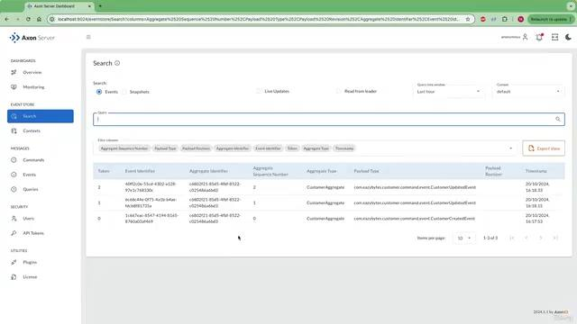
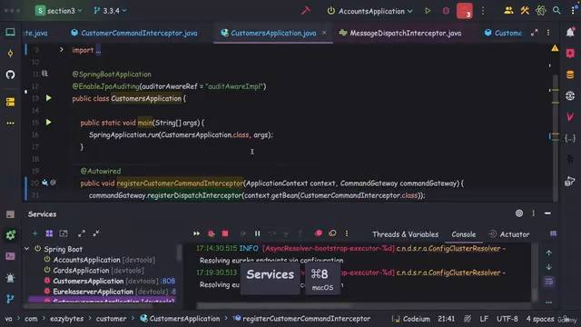
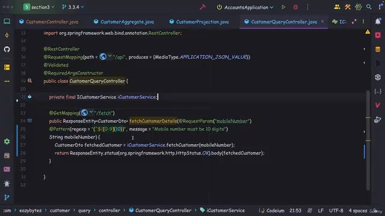
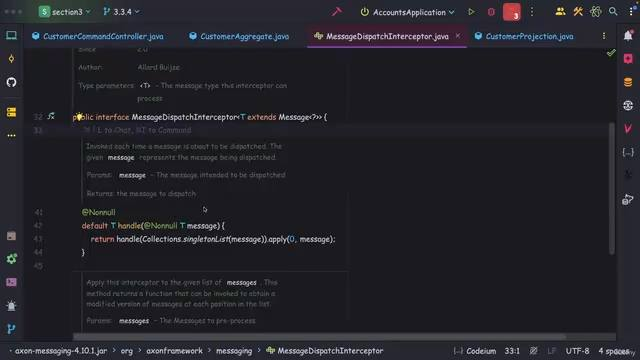
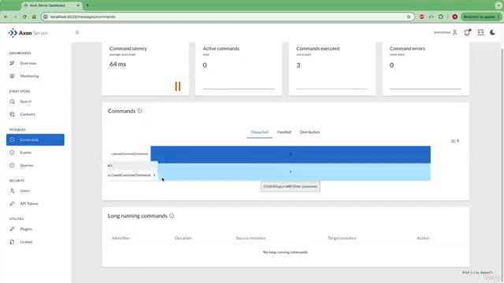
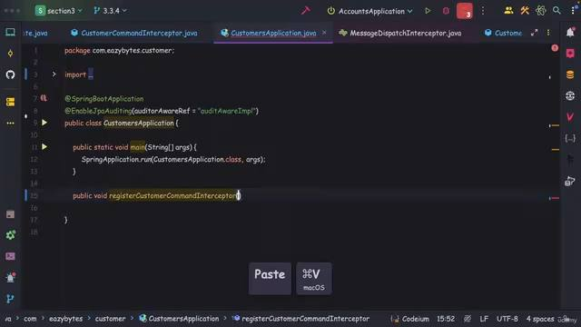

# CQRS + Event Sourcing 查询侧与命令拦截器：从零复现

> 课程：CQRS/Saga/EventSourcing（BV1bUpz6pEUy），覆盖 P027–P031
> 技术栈：Spring Boot + Axon Framework（课里叫 "Axon / Axon Framework"，是讲师口音转写，实际就是 **Axon**）+ Axon Server + Eureka + H2
> 读者定位：前端转 AI 应用工程师。凡是涉及「异步 / 非阻塞 / 拦截器」的地方，我会补一句在 Node/JS 里对应什么。

> 说明：以下是在原文基础上扩写，保留原有七段结构、章节标题、引用、图片和代码块。新增文字只用于把命令解释清楚、补充常见错误与排查方式、增加前端类比、说明检查清单如何逐条验证，不改变原文事实，不编造课里未出现的内容。

---

## 1. 这一节做什么

这五集干的是同一件事的两半：

**前半（P027 + P028）：把「读」这条路补完，并跑通整条 CQRS + Event Sourcing 链路。**
- 在 `query` 包下新建 `controller` 子包，写 `CustomerQueryController`，暴露一个「按手机号查客户」的 REST 接口；
- 这个接口**不直接调 service**，而是构造一个 `FindCustomerQuery` 查询对象，通过 `QueryGateway` 发给框架；
- 在 `query` 包下新建 `handler` 子包，写 `CustomerQueryHandler`，用 `@QueryHandler` 注解接住这个查询，去读库（read database）取数据；
- 删掉旧的 `CustomerController`（否则两个 controller 抢同一个 URL，Spring Boot 启动直接报错）；
- 启动 Axon Server → Eureka → customer 微服务 → gateway，用 Postman 依次打 create / fetch / update / delete，然后在 Axon Server Dashboard 里看 events、commands、queries 三个面板的数据。

**后半（P029 + P030 + P031）：把命令校验从聚合里挪到「命令拦截器」里，并让它真正生效。**
- P029 是插曲：装 IntelliJ 的 Axon 插件，用行号旁的橙色箭头在 command ↔ event ↔ handler 之间跳转；
- P030 写 `CustomerCommandInterceptor`，实现 `MessageDispatchInterceptor<CommandMessage<?>>`，把 create / update / delete 三个命令的校验逻辑从聚合类搬进来；
- P031 在 Spring Boot 主类里用 `@Autowired` 拿到 `CommandGateway`，调 `registerDispatchInterceptor(...)` 把拦截器注册进去，然后打断点验证三条校验都按预期抛异常。

一句话总结这五集的产出：**一个能跑通「写命令 → 存事件 → 投影到读库 → 查询对象 → 查询处理器 → 返回 DTO」全链路的 customer 微服务，外加一个集中式命令校验拦截器。**

从学习路径上看，这一段不是孤立地「加一个接口」，而是把前面已经存在的命令侧、事件侧、投影侧和查询侧接成闭环。命令侧负责接收写请求并产生事件，事件被 Axon Server 保存，投影再把事件同步到读库，查询侧只从读库取数据并返回 DTO。这样做的直接收益是：读接口不再依赖写模型，查询逻辑可以单独演进；命令校验也不再散落在聚合构造器里，而是在命令进入 handler 之前统一处理。对前端读者可以这样类比：`CustomerQueryController` 像 BFF/API 层，`QueryGateway` 像一条查询消息总线，`@QueryHandler` 像订阅了某类消息的消费者，`.join()` 则像在 JS 里 `await` 一个 Promise 的结果。课里演示的 Dashboard 三个面板，就是用来肉眼确认「命令有没有发出去、事件有没有存下来、查询有没有被处理」的。

---

## 2. 讲师原话（带出处）

关于为什么读接口不能直接调 service：

> "目前，如果你看这里，我们是在直接尝试调用 iCustomerService 中可用的 fetch customer 方法，但在实现 CQRS 时不应该这样做。我们应该遵循框架推荐的流程……在读取 API 中，我们需要创建一个查询对象，并将这个查询对象发布到框架，这样它就会进入查询处理器；在查询处理器中，我们会编写从读数据库读取数据的全部逻辑。"
> —— p027 [01:14]

关于 `join()` 的作用：

> "每当我们尝试在后台调用这个查询方法时，查询操作都会以非阻塞方式异步执行。但借助 join 方法，我们会等待输出结果，以便最终能把同样的输出发送给最终用户。"
> —— p027 [03:34]

关于为什么删掉旧 controller：

> "根据这个错误来看，customer query controller 里似乎存在重复的 REST API……由于我们在 customer query controller 下构建了相同的 API，Spring Boot 应用在启动时抛出了错误。我们可以做的是，不再需要这个 customer controller 类了。我们可以把整个包连同这个类一起删除。"
> —— p028 [01:19]

关于 Axon Server 里看到的三个事件：

> "你会看到已经发布了三个事件。所有这些事件都有相同的聚合标识符。这个聚合标识符其实就是客户 ID……第一个事件的聚合序列号是 0，后面依次是 1 和 2。"
> —— p028 [04:07]

关于为什么校验要前置到拦截器：

> "Axon 团队通常建议在把这个命令分发到处理器逻辑之前先实现这些校验。Axon 框架中有一个名为 MessageDispatchInterceptor 的接口。"
> —— p030 [00:28]

关于拦截器方法为什么收 `List`：

> "目前，在控制器层，我们尝试分发单个命令，但这个方法接受的是命令消息列表。原因是 Axon 框架也支持命令的批处理。"
> —— p030 [02:55]

关于拦截器不注册就不生效：

> "我们的拦截器类已经准备好了，但如果你尝试测试这个应用，拦截器逻辑不会被调用。要让它生效，我们还需要再做一项小配置。"
> —— p031 [00:00]

这些原话分别对应本节的两个关键设计点：查询侧必须走 `QueryGateway → @QueryHandler` 的框架链路，命令侧校验必须在命令被 dispatch 到 handler 之前完成。阅读时可以把它当成「为什么代码要这样写」的依据：如果只是把接口调通，很容易退回到 controller 直接调 service；如果只是把校验写进聚合，也很容易忽略拦截器未注册导致完全不生效的问题。下面的复现步骤和代码，就是围绕这两条依据展开的。

---

## 3. 从零复现

### 3.1 环境与目录约定

课里没给出版本号，以下是**按课程代码风格推断的可用组合**，装不上时优先怀疑版本：

| 组件 | 建议版本 | 说明 |
|---|---|---|
| JDK | 17 | 课里用 `record`/`var` 风格不明显，17 最稳 |
| Spring Boot | 3.x | 与 Axon 4.9+ 配套 |
| Axon Framework | 4.9.x | 提供 `QueryGateway` / `MessageDispatchInterceptor` |
| Axon Server | 用 Docker 起 | 端口 8024 是 Dashboard |
| Eureka Server | 单独一个模块 | 课里先启它 |
| H2 | 内存/文件均可 | 课里提到 user 目录下的 H2 文件 |

目录结构（customer 微服务内，只列本节涉及的）：

```
customer-service/
└── src/main/java/com/example/customer/
    ├── CustomerApplication.java              ← P031 在这里注册拦截器
    ├── command/
    │   ├── controller/CustomerCommandController.java
    │   ├── interceptor/CustomerCommandInterceptor.java   ← P030 新建
    │   ├── aggregate/CustomerAggregate.java
    │   ├── command/CreateCustomerCommand.java
    │   ├── command/UpdateCustomerCommand.java
    │   └── command/DeleteCustomerCommand.java
    ├── query/
    │   ├── controller/CustomerQueryController.java       ← P027 新建
    │   ├── handler/CustomerQueryHandler.java             ← P027 新建
    │   ├── query/FindCustomerQuery.java                  ← 早前已建
    │   └── projection/CustomerProjection.java
    ├── repository/CustomerRepository.java
    ├── service/ICustomerService.java
    ├── service/CustomerServiceImpl.java
    └── dto/CustomerDTO.java
```

> ⚠️ 课里没讲 `FindCustomerQuery`、`CustomerDTO`、`CustomerRepository` 的完整定义（这些是更早的集数写的）。下面第 4 节我会给出**能编译通过的最小版本**，字段名严格对齐逐字稿里出现过的：`mobileNumber`、`customerId`、`name`、`email`、`active`。

如果你从本节才开始搭项目，先不要急着改业务逻辑，先把包结构和依赖对齐。常见错误是：`query` 包和 `command` 包混在一起，导致 `@QueryHandler` 扫描不到；或者 `FindCustomerQuery` 的包名和 controller import 不一致，编译期就报错。排查时先看 IDE 的 import 是否有红色波浪线，再看 Spring Boot 启动日志里有没有 `CustomerQueryHandler` 被注册的迹象。前端读者可以把这个目录理解成「按消息方向分层」：command 目录处理写消息，query 目录处理读消息，repository/service/dto 是两侧共享的基础设施。

### 3.2 启动顺序（顺序错了会连不上）

1. **清空数据**：删掉 Axon Server 挂载的 `data/` 和 `events/` 目录；删掉用户目录下 H2 的 `.mv.db` 文件。讲师原话："我们想从零开始"（p028 [00:00]）。
2. **起 Axon Server**（Docker）：

```bash
docker run -d --name axonserver \
  -p 8024:8024 -p 8124:8124 \
  -v $(pwd)/axon-data:/data \
  -v $(pwd)/axon-events:/eventdata \
  axoniq/axonserver:latest
```

3. **打开 `http://localhost:8024`**，点 **Start standalone node**（讲师强调必须点这个，否则微服务连不上，p028 [00:26]）。看到图标变绿即成功。
4. **起 Eureka Server**（单独模块，`mvn spring-boot:run`）。
5. **起 customer 微服务**（debug 模式，方便 P031 打断点）。
6. **起 gateway server**。
7. Postman 打接口。

这里的顺序不是形式主义：Axon Server 没起或没点 standalone node，customer 微服务启动时会连不上事件存储；Eureka 没起，gateway 可能找不到下游服务；customer 微服务没起，Postman 通过 gateway 打接口会直接 503/404。清空数据是为了让 Dashboard 里的事件序号从 0 开始，方便对照讲师演示的「0、1、2、3」序列。常见排查方式是：先看 Docker 容器是否 `Up`，再看 `localhost:8024` 是否能打开，最后看 customer 微服务日志里有没有 Axon Server 连接失败的异常。前端对照：这类似本地起 mock server、API server、BFF 的先后顺序，底层依赖没起，上层请求只会报网络错误，而不是业务错误。

### 3.3 接口清单（Postman 里要建的请求）

| 名称 | 方法 | URL | Body |
|---|---|---|---|
| create customer | POST | `http://localhost:8080/customers` | `{"name":"...","email":"...","mobileNumber":"..."}` |
| fetch customer | GET | `http://localhost:8080/customers/{mobileNumber}` | — |
| update customer | PUT | `http://localhost:8080/customers` | 完整 customer body（含 customerId） |
| delete customer | DELETE | `http://localhost:8080/customers/{customerId}` | — |

> 端口 8080 是 gateway 的端口，课里没明说，按你项目实际配置改。

建 Postman 请求时，先确认 `Content-Type: application/json`。create 的 body 至少要有 `name`、`email`、`mobileNumber`；update 要把 fetch 回来的完整对象复制过去，并保留 `customerId`，否则 update 校验可能找不到客户；delete 用的是 `customerId`，不是手机号，这是课里演示时从 fetch 结果里复制出来的。常见错误是：把 update 的 URL 写成 `/customers/{mobileNumber}`，或者 delete 时误传手机号，结果命中不了 repository 查询。排查时先看 Postman 的 URL 和 body，再看 customer 微服务日志里 `CustomerCommandController` 收到的参数。

### 3.4 验证链路（P028 的演示步骤，照做即可）

1. create → 成功响应；
2. 用同一手机号 fetch → 拿到 customer 详情（含 customerId）；
3. 把整个 body 复制到 update 请求，改 `name` → send；
4. 再改 `email` → send（这是第二次 update）；
5. 打开 Axon Server Dashboard → **Search** 面板 → 时间窗选 last hour → 应看到 **3 条事件**，aggregate identifier 都是同一个 customerId，aggregate sequence number 依次是 0、1、2，payload type 依次是 `CustomerCreatedEvent`、`CustomerUpdatedEvent`、`CustomerUpdatedEvent`；
6. 勾选 payload data 复选框可看请求体原文；
7. **Commands** 面板 → 应显示 3 条命令（create ×1、update ×2）；
8. **Queries** 面板 → 应显示 2 条 `FindCustomerQuery`，errors 为 0；
9. delete（用 customerId）→ 成功；
10. 再 fetch 同一手机号 → 报 "根据所给输入数据中的手机号，未找到客户"（因为 active 已置 false）；
11. 回 Search → 应看到 **4 条事件**，最后一条是 `CustomerDeletedEvent`；
12. 在 Search 的 query tab 里输入 `aggregateIdentifier = "你的customerId"`（讲师强调**不能有空格、大小写要一致**）→ 精确筛出这个客户的 4 条事件。

每一步都可以单独排查：如果第 1 步失败，先看命令侧 controller 和 gateway；如果第 2 步失败，先看查询 handler 是否注册、读库是否已有投影数据；如果第 5 步事件数量不对，先看是不是没有清空旧数据，或者 update 请求没有真正发出去；如果第 8 步 Queries errors 不为 0，优先检查 `@QueryHandler` 方法签名和返回类型是否与 `ResponseTypes.instanceOf(CustomerDTO.class)` 匹配。前端读者可以把 `.join()` 理解成等待查询结果返回，如果 handler 没接住，表现就像 Promise 一直等不到解析，最终以框架超时异常结束。



---

## 4. 完整代码

> 以下每个文件都能直接保存。**标注「课里没给全，以下为最小可编译补全」的文件**是我按逐字稿里出现过的字段名补的，不是讲师逐字敲的。

### 4.1 `query/controller/CustomerQueryController.java`（P027 核心产物）

```java
package com.example.customer.query.controller;

import com.example.customer.dto.CustomerDTO;
import com.example.customer.query.query.FindCustomerQuery;
import lombok.RequiredArgsConstructor;
import org.axonframework.messaging.responsetypes.ResponseTypes;
import org.axonframework.queryhandling.QueryGateway;
import org.springframework.http.HttpStatus;
import org.springframework.http.ResponseEntity;
import org.springframework.web.bind.annotation.GetMapping;
import org.springframework.web.bind.annotation.PathVariable;
import org.springframework.web.bind.annotation.RequestMapping;
import org.springframework.web.bind.annotation.RestController;

@RestController
@RequestMapping("/customers")
@RequiredArgsConstructor
public class CustomerQueryController {

    private final QueryGateway queryGateway;

    @GetMapping("/{mobileNumber}")
    public ResponseEntity<CustomerDTO> fetchCustomer(@PathVariable String mobileNumber) {
        FindCustomerQuery query = new FindCustomerQuery(mobileNumber);

        CustomerDTO customerDTO = queryGateway
                .query(query, ResponseTypes.instanceOf(CustomerDTO.class))
                .join();

        return ResponseEntity.status(HttpStatus.OK).body(customerDTO);
    }
}
```

这个 controller 的关键点不是 REST 注解，而是它没有注入 `ICustomerService`，而是注入 `QueryGateway`。如果编译时报 `QueryGateway` 找不到，先检查 Axon Framework 依赖是否引入；如果启动时报 URL 冲突，说明旧 `CustomerController` 还在，需要按 P028 删除。前端对照：这里像把请求转交给一个消息总线，而不是直接调用数据访问函数。

### 4.2 `query/handler/CustomerQueryHandler.java`（P027 核心产物）

```java
package com.example.customer.query.handler;

import com.example.customer.dto.CustomerDTO;
import com.example.customer.query.query.FindCustomerQuery;
import com.example.customer.service.ICustomerService;
import lombok.RequiredArgsConstructor;
import org.axonframework.queryhandling.QueryHandler;
import org.springframework.stereotype.Component;

@Component
@RequiredArgsConstructor
public class CustomerQueryHandler {

    private final ICustomerService customerService;

    @QueryHandler
    public CustomerDTO findCustomer(FindCustomerQuery query) {
        return customerService.fetchCustomer(query.getMobileNumber());
    }
}
```

常见错误是方法参数写成 `String mobileNumber`，或者返回类型写成 `Optional<CustomerDTO>`，导致框架路由不到。这里的参数类型 `FindCustomerQuery` 是匹配依据，返回类型 `CustomerDTO` 要和 controller 里 `ResponseTypes.instanceOf(CustomerDTO.class)` 对齐。排查时看启动日志和 Queries 面板的 errors 数，最直接。

### 4.3 `query/query/FindCustomerQuery.java`（课里没给全，以下为最小可编译补全）

```java
package com.example.customer.query.query;

import lombok.AllArgsConstructor;
import lombok.Data;
import lombok.NoArgsConstructor;

@Data
@AllArgsConstructor
@NoArgsConstructor
public class FindCustomerQuery {
    private String mobileNumber;
}
```

### 4.4 `dto/CustomerDTO.java`（课里没给全，以下为最小可编译补全）

```java
package com.example.customer.dto;

import lombok.AllArgsConstructor;
import lombok.Builder;
import lombok.Data;
import lombok.NoArgsConstructor;

@Data
@Builder
@AllArgsConstructor
@NoArgsConstructor
public class CustomerDTO {
    private String customerId;
    private String name;
    private String email;
    private String mobileNumber;
    private Boolean active;
}
```

### 4.5 `command/interceptor/CustomerCommandInterceptor.java`（P030 核心产物）

```java
package com.example.customer.command.interceptor;

import com.example.customer.command.command.CreateCustomerCommand;
import com.example.customer.command.command.DeleteCustomerCommand;
import com.example.customer.command.command.UpdateCustomerCommand;
import com.example.customer.repository.CustomerRepository;
import lombok.RequiredArgsConstructor;
import org.axonframework.commandhandling.CommandMessage;
import org.axonframework.messaging.MessageDispatchInterceptor;
import org.springframework.stereotype.Component;

import javax.annotation.Nonnull;
import java.util.List;
import java.util.function.BiFunction;

@Component
@RequiredArgsConstructor
public class CustomerCommandInterceptor implements MessageDispatchInterceptor<CommandMessage<?>> {

    private final CustomerRepository customerRepository;

    @Nonnull
    @Override
    public BiFunction<Integer, CommandMessage<?>, CommandMessage<?>> handle(
            @Nonnull List<? extends CommandMessage<?>> messages) {

        return (index, command) -> {

            if (CreateCustomerCommand.class.equals(command.getPayloadType())) {
                CreateCustomerCommand createCommand = (CreateCustomerCommand) command.getPayload();
                if (customerRepository.findByMobileNumberAndActiveSwitch(
                        createCommand.getMobileNumber(), true).isPresent()) {
                    throw new IllegalStateException(
                            "Customer already registered with the given mobile number");
                }
            } else if (UpdateCustomerCommand.class.equals(command.getPayloadType())) {
                UpdateCustomerCommand updateCommand = (UpdateCustomerCommand) command.getPayload();
                if (customerRepository.findByMobileNumberAndActiveSwitch(
                        updateCommand.getMobileNumber(), true).isEmpty()) {
                    throw new IllegalStateException(
                            "Customer not found for the given mobile number");
                }
            } else if (DeleteCustomerCommand.class.equals(command.getPayloadType())) {
                DeleteCustomerCommand deleteCommand = (DeleteCustomerCommand) command.getPayload();
                if (customerRepository.findByCustomerIdAndActiveSwitch(
                        deleteCommand.getCustomerId(), true).isEmpty()) {
                    throw new IllegalStateException(
                            "Customer not found for the given customer id");
                }
            }

            return command;
        };
    }
}
```

> 逐字稿里讲师抛的是 `ResourceNotFoundException`（自定义异常），我这里用 `IllegalStateException` 是为了不额外引入一个课里没给全定义的类。**如果你项目里已有 `ResourceNotFoundException`，换回去即可，行为一致。**

这个类要注意：如果 import 的 `Nonnull` 在 Spring Boot 3 下报错，按第 7 节改成 `jakarta.annotation.Nonnull` 或删掉注解。拦截器里依赖 repository 做查询，属于读库校验；如果 repository 方法名拼错，Spring Data JPA 启动时就会报方法解析失败。前端对照：这像在 API 网关层做请求参数和状态校验，校验不过直接拒绝，不进入业务 handler。

### 4.6 `repository/CustomerRepository.java`（P030 末尾新增方法）

```java
package com.example.customer.repository;

import com.example.customer.entity.Customer;
import org.springframework.data.jpa.repository.JpaRepository;

import java.util.Optional;

public interface CustomerRepository extends JpaRepository<Customer, String> {

    Optional<Customer> findByMobileNumberAndActiveSwitch(String mobileNumber, Boolean active);

    // P030 [08:36] 讲师新增的第二个方法
    Optional<Customer> findByCustomerIdAndActiveSwitch(String customerId, Boolean active);
}
```

### 4.7 `CustomerApplication.java`（P031 核心产物）

```java
package com.example.customer;

import com.example.customer.command.interceptor.CustomerCommandInterceptor;
import org.axonframework.commandhandling.gateway.CommandGateway;
import org.springframework.boot.SpringApplication;
import org.springframework.boot.autoconfigure.SpringBootApplication;
import org.springframework.context.ApplicationContext;
import org.springframework.beans.factory.annotation.Autowired;

@SpringBootApplication
public class CustomerApplication {

    public static void main(String[] args) {
        SpringApplication.run(CustomerApplication.class, args);
    }

    @Autowired
    public void registerCustomerCommandInterceptor(ApplicationContext context,
                                                   CommandGateway commandGateway) {
        commandGateway.registerDispatchInterceptor(
                context.getBean(CustomerCommandInterceptor.class));
    }
}
```

### 4.8 `command/aggregate/CustomerAggregate.java`（P030 里被「注释掉校验」后的形态）

```java
package com.example.customer.command.aggregate;

import com.example.customer.command.command.CreateCustomerCommand;
import com.example.customer.command.command.DeleteCustomerCommand;
import com.example.customer.command.command.UpdateCustomerCommand;
import com.example.customer.command.event.CustomerCreatedEvent;
import com.example.customer.command.event.CustomerDeletedEvent;
import com.example.customer.command.event.CustomerUpdatedEvent;
import org.axonframework.commandhandling.CommandHandler;
import org.axonframework.eventsourcing.EventSourcingHandler;
import org.axonframework.modelling.command.AggregateIdentifier;
import org.axonframework.spring.stereotype.Aggregate;

import static org.axonframework.modelling.command.AggregateLifecycle.apply;

@Aggregate
public class CustomerAggregate {

    @AggregateIdentifier
    private String customerId;
    private String name;
    private String email;
    private String mobileNumber;
    private Boolean active;

    public CustomerAggregate() {
    }

    @CommandHandler
    public CustomerAggregate(CreateCustomerCommand command) {
        // P030 [05:50] 校验已搬到 CustomerCommandInterceptor，这里保留注释供参考
        // if (customerRepository.findByMobileNumberAndActiveSwitch(command.getMobileNumber(), true).isPresent()) {
        //     throw new IllegalStateException("Customer already registered with the given mobile number");
        // }
        apply(CustomerCreatedEvent.builder()
                .customerId(command.getCustomerId())
                .name(command.getName())
                .email(command.getEmail())
                .mobileNumber(command.getMobileNumber())
                .active(command.getActive())
                .build());
    }

    @CommandHandler
    public void handle(UpdateCustomerCommand command) {
        apply(CustomerUpdatedEvent.builder()
                .customerId(command.getCustomerId())
                .name(command.getName())
                .email(command.getEmail())
                .mobileNumber(command.getMobileNumber())
                .active(command.getActive())
                .build());
    }

    @CommandHandler
    public void handle(DeleteCustomerCommand command) {
        apply(CustomerDeletedEvent.builder()
                .customerId(command.getCustomerId())
                .build());
    }

    @EventSourcingHandler
    public void on(CustomerCreatedEvent event) {
        this.customerId = event.getCustomerId();
        this.name = event.getName();
        this.email = event.getEmail();
        this.mobileNumber = event.getMobileNumber();
        this.active = event.getActive();
    }

    @EventSourcingHandler
    public void on(CustomerUpdatedEvent event) {
        this.name = event.getName();
        this.email = event.getEmail();
        this.active = event.getActive();
    }

    @EventSourcingHandler
    public void on(CustomerDeletedEvent event) {
        this.active = false;
    }
}
```

> 三个 command / 三个 event 类（`CreateCustomerCommand`、`UpdateCustomerCommand`、`DeleteCustomerCommand`、`CustomerCreatedEvent`、`CustomerUpdatedEvent`、`CustomerDeletedEvent`）是更早集数写的，课里没重贴。按上面聚合里用到的 getter/builder 字段补即可，字段名严格用 `customerId / name / email / mobileNumber / active`。

---

## 5. 逐行解释

### 5.1 `CustomerQueryController`

- `private final QueryGateway queryGateway;` —— 这是 P027 的关键改动。讲师原话："与其这样做，我将把 QueryGateway 作为依赖注入到这个类中。就像在命令侧有 CommandGateway 一样，在查询侧同样有 QueryGateway。"（p027 [02:09]）。**在 Node 里对应什么**：相当于你把一个 `eventBus` / `queryBus` 实例注入到 controller，而不是直接 `await db.query()`。常见错误是仍注入 `ICustomerService`，这样虽然能跑，但绕过了查询侧链路，Dashboard 的 Queries 面板不会出现记录。
- `new FindCustomerQuery(mobileNumber)` —— 把「查谁」这件事封装成一个对象。这是 CQRS 的仪式感：查询也是消息。前端对照：类似把请求参数封装成 action/query 对象，再交给 store 或消息总线。
- `ResponseTypes.instanceOf(CustomerDTO.class)` —— 告诉框架「我期望的返回类型是 CustomerDTO」。框架据此做类型匹配，找到对应的 `@QueryHandler`。如果这里写成 `String.class`，handler 返回 `CustomerDTO` 时会匹配不上。
- `.join()` —— 讲师专门解释过（p027 [03:34]）：底层是异步非阻塞的，`join()` 是**阻塞等待结果**。**在 JS 里对应什么**：`queryGateway.query(...)` 返回的是 `CompletableFuture`，`join()` 约等于 `await promise`，区别是 `join()` 抛的是 `CompletionException`（unchecked），`await` 抛的是原异常。常见错误是忘记 `join()`，导致 controller 返回的是 Future 而不是 DTO。
- `ResponseEntity.status(HttpStatus.OK).body(customerDTO)` —— 标准 Spring 返回，无特殊。若 `customerDTO` 为 null，按 Spring 行为可能返回空 body 或 204，具体取决于你的写法；课里演示 delete 后 fetch 报错，说明 service 层是抛异常的。

### 5.2 `CustomerQueryHandler`

- `@Component` + `@RequiredArgsConstructor` —— 注册成 bean，构造器注入。若 handler 没被扫描到，`@QueryHandler` 不会生效。
- `@QueryHandler` —— **这一行是灵魂**。没有它，`QueryGateway` 发出去的查询没人接，会超时。讲师原话："在这个方法上，我们需要标注一个注解，即 @QueryHandler。"（p027 [06:22]）。
- 方法签名 `CustomerDTO findCustomer(FindCustomerQuery query)` —— 参数类型决定「接哪种查询」，返回类型决定「回什么」。框架靠这个签名做路由。排查时先确认包名、类名、方法参数类型三者是否和发送端一致。
- 内部直接调 `customerService.fetchCustomer(...)` —— 注意：**这里读的是读库**（read database），不是事件库。事件库由 Axon Server 管，读库是投影（`CustomerProjection`）写进去的。前端对照：查询 handler 像只读 API 的 service 层，它不负责写事件，只负责把读库数据组装成 DTO。

### 5.3 `CustomerCommandInterceptor`

- `implements MessageDispatchInterceptor<CommandMessage<?>>` —— 泛型写 `CommandMessage<?>` 表示「我拦所有命令」。讲师原话（p030 [01:58]）："每当我们尝试分发命令时，该命令都会以 CommandMessage 的形式被分发。"。
- `handle(List<? extends CommandMessage<?>> messages)` —— 收的是 **List**，因为 Axon 支持批量派发。讲师原话（p030 [02:55]）："这个方法接收一组 CommandMessage。原因是 Axon Framework 也支持批处理。"。
- 返回 `BiFunction<Integer, CommandMessage<?>, CommandMessage<?>>` —— 讲师原话（p030 [03:23]）："它将返回一个函数，调用该函数即可获取列表中每个位置消息的修改版本。"。**在 JS 里对应什么**：相当于 `messages.map((cmd, index) => { ...; return cmd; })` 里的那个回调。
- `command.getPayloadType()` —— 拿到 payload 的 Class，用来判断是哪种命令。**注意**：逐字稿里讲师写的是 `command.getPayloadType()`（p030 [05:01]），不是 `getPayload().getClass()`。常见错误是写成 `command.getPayload().getClass().equals(...)`，在代理或包装场景下可能判断不稳定。
- `(CreateCustomerCommand) command.getPayload()` —— 强转后取字段做校验。强转前已经用 `getPayloadType()` 判断过类型，所以是安全的。
- `throw new IllegalStateException(...)` —— 在 lambda 里抛异常，异常会沿 `commandGateway.send(...)` 的调用栈抛回 controller。**这就是「校验前置」的收益**：聚合根本没被创建，事件根本没被 apply。排查时如果异常没抛到 controller，先确认拦截器是否注册成功。
- `return command;` —— 校验通过就把原命令原样返回。讲师原话（p030 [06:18]）："如果未满足这个条件，我想做的就是直接返回收到的 CommandMessage。"。

### 5.4 `CustomerApplication.registerCustomerCommandInterceptor`

- `@Autowired` 打在方法上 —— Spring 会在启动时调用这个方法，把 `ApplicationContext` 和 `CommandGateway` 注入进来。
- `commandGateway.registerDispatchInterceptor(context.getBean(CustomerCommandInterceptor.class))` —— **这一行不写，拦截器就是个摆设**。讲师原话（p031 [00:00]）："拦截器逻辑将不会被调用。为了让其生效，我们还需要再做一个小配置。"
- 为什么用 `context.getBean(...)` 而不是直接方法参数注入？讲师没解释。**我的推测（非讲师原话）**：避免循环依赖——`CommandGateway` 的初始化可能早于拦截器 bean，用 `ApplicationContext` 延迟取更安全。
- 常见错误是只写了 `@Component` 就以为拦截器生效。验证方式是打断点或看异常是否在聚合 apply 前抛出；如果 create 已存在手机号时仍进入聚合，说明注册没成功。

### 5.5 `CustomerRepository` 新增方法

- `findByCustomerIdAndActiveSwitch(String customerId, Boolean active)` —— P030 [08:36] 讲师明确新增的。Spring Data JPA 靠方法名自动生成 SQL：`WHERE customer_id = ? AND active_switch = ?`。
- 为什么 delete 校验用 `customerId` 而不用 `mobileNumber`？因为 delete 接口的入参就是 customerId（P028 演示里讲师是从 fetch 结果里复制 customerId 再调 delete 的）。如果方法名写成 `findByCustomerIdAndActive`，而实体字段是 `activeSwitch`，启动时可能报方法解析错误，排查时看日志里的 JPA 方法名提示。

---

## 6. 复现检查清单

按顺序打勾，任何一项不过就别往下走：

- [ ] Axon Server 容器在跑，`localhost:8024` 能打开，且点了 **Start standalone node**。验证：浏览器打开 8024，Dashboard 可访问；Docker `ps` 里容器状态为 Up。
- [ ] `data/` 和 `events/` 目录已清空，H2 的 `.mv.db` 已删。验证：重启后 Search 面板事件从 0 开始，不残留旧 aggregate。
- [ ] Eureka Server 已启动。验证：打开 Eureka 控制台，customer 微服务注册成功。
- [ ] customer 微服务启动**无报错**（如果报 "重复的 REST API"，说明旧 `CustomerController` 没删干净 —— 见 P028 [01:19]）。验证：看启动日志无 `Ambiguous mapping`。
- [ ] gateway server 已启动。验证：Postman 请求能到达 gateway，日志有转发记录。
- [ ] Axon Server Dashboard 的 **Overview** 里能看到 customer 微服务已连接。验证：Overview 节点状态正常，不是 disconnected。
- [ ] create 接口返回成功。验证：HTTP 2xx，Commands 面板出现 create 命令。
- [ ] fetch 接口能拿到 customer 详情，且含 customerId。验证：响应 JSON 里 `customerId` 非空。
- [ ] update 两次（先改 name，再改 email）都成功。验证：两次 PUT 均 2xx，Search 面板事件数增加。
- [ ] Search 面板能看到 **3 条事件**，aggregate identifier 相同，sequence number 是 0/1/2。验证：逐条点开看 sequence 和 payload type。
- [ ] Commands 面板显示 **3 条命令**（create ×1、update ×2）。验证：面板计数与操作次数一致。
- [ ] Queries 面板显示 **2 条 FindCustomerQuery**，errors = 0。验证：每次 fetch 后计数增加，errors 不增长。
- [ ] delete 接口成功。验证：HTTP 2xx，Commands 面板出现 delete。
- [ ] 再 fetch 同一手机号 → 报 "根据所给输入数据中的手机号，未找到客户"。验证：响应为错误信息，不是旧数据。
- [ ] Search 面板变成 **4 条事件**，最后一条是 `CustomerDeletedEvent`。验证：看第 4 条 payload type。
- [ ] Search 的 query tab 输入 `aggregateIdentifier = "xxx"`（无空格、大小写一致）能精确筛出 4 条。验证：结果只包含同一 customerId。
- [ ] **P031 验证**：在 `CustomerCommandInterceptor` 的 lambda 里打断点，用已存在的手机号再 create → 断点命中 → 继续 → 抛 "客户已注册"。验证：断点停在类型判断后，异常在聚合前抛出。
- [ ] 用不存在的手机号 update → 抛 "未找到客户"。验证：断点命中 update 分支，repository 返回 empty。
- [ ] 用随机 customerId delete → 抛 "未找到客户"。验证：断点命中 delete 分支，repository 返回 empty。



---

## 7. 课里没讲但你会撞上的

| 现象 | 原因 | 怎么办 |
|---|---|---|
| 编译报 `javax.annotation.Nonnull` 找不到，或提示包名不兼容 | Spring Boot 3 之后包名从 `javax.*` 迁到 `jakarta.*`；课里代码风格看着像 Boot 2.x | 把 import 改成 `jakarta.annotation.Nonnull`，或者干脆删掉这个注解（不影响运行） |
| `QueryGateway.query(...)` 没有一直挂着，而是抛 `QueryExecutionException` | 默认有超时（Axon 默认几秒）；`@QueryHandler` 没注册上或签名不匹配 | 先查 handler 有没有 `@QueryHandler`，参数类型是否 `FindCustomerQuery`，返回类型是否与 `ResponseTypes.instanceOf(CustomerDTO.class)` 对齐 |
| 查询返回 null，接口没有返回 404 而是空 body/204 | 读库查不到时 service 返回 null，`join()` 拿到 null，`ResponseEntity.body(null)` 行为取决于写法 | 课里演示 delete 后 fetch 报的是 "未找到客户" 异常，说明 service 层是抛异常的；照抄 service 层行为，或在 controller 里显式处理 null |
| 启动时报循环依赖或拦截器初始化异常 | 拦截器里注入 `CustomerRepository` 一般不会循环；但如果把拦截器改成依赖 `CommandGateway`，就会循环（gateway 要注册拦截器，拦截器又要 gateway） | 保持拦截器只依赖 repository 等下游 bean；不要在拦截器里反向依赖 `CommandGateway` |
| 拦截器逻辑完全不执行 | `registerDispatchInterceptor` 没调用，或调用位置不对；课里讲师忽略了返回值直接调，Axon 4.x 内部可变注册可工作 | 确认 `CustomerApplication` 里注册方法被执行；严格说可 `this.commandGateway = commandGateway.registerDispatchInterceptor(...)`，但课里未讲这个细节，先按课里写法验证 |
| 批量命令场景下只校验了第一条或 index 不符合预期 | 拦截器 `handle` 收 List，Axon 支持批量派发；课里 controller 每次只发一条 | 以后用 `commandGateway.sendAll(...)` 时，lambda 会对每条都跑一遍，`index` 是列表下标；课里没演示批量，但方法签名已留口子 |
| 想换 Axon Server 事件存储，不知道配哪里 | 课里说 "你的 DevOps 团队成员可以配置将这些数据存储在 MongoDB 或任何其他 NoSQL 数据库中。"（p028 [05:50]），具体怎么配课里没讲 | 默认是文件存储（`events/` 目录）；生产环境要换存储得查 Axon Server 官方文档，不要凭猜测改配置 |
| 在 VS Code 里找不到 command ↔ event ↔ handler 的橙色箭头跳转 | IntelliJ Axon 插件只在 IntelliJ 有；讲师明确说 "这个插件目前仅在 IntelliJ 插件市场中可用，在 Eclipse、Visual Studio Code 等其他 IDE 市场中不可用。"（p029 [03:50]） | 用 VS Code 时只能手动 `Ctrl+Click` 找 `@CommandHandler` / `@EventSourcingHandler`，或全局搜索类名 |
| 想抛 `ResourceNotFoundException`，但项目里没有这个类 | 课里讲师抛的是这个自定义异常，但没给类定义 | 自己建一个 `extends RuntimeException` 的空类即可，或在全局异常处理器里映射成 404 |
| 事件能查到，但 fetch 一直查不到数据 | P028 演示里事件能同步到读库，靠的是 `CustomerProjection` 里的 `@EventHandler`；这个类在更早集数写的，本节没重贴 | 确认这个类存在且监听 `CustomerCreatedEvent / CustomerUpdatedEvent / CustomerDeletedEvent` 三个事件，否则读库永远是空的 |

---







