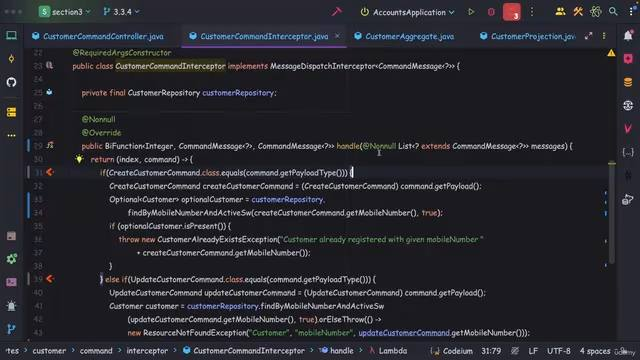
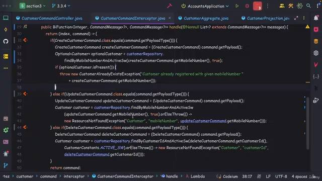
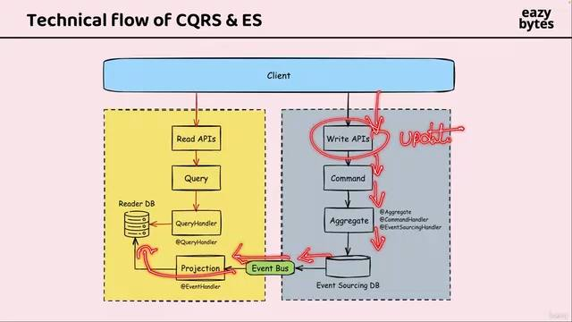
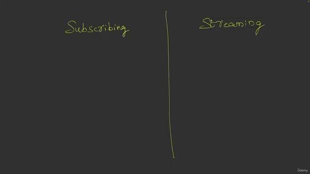
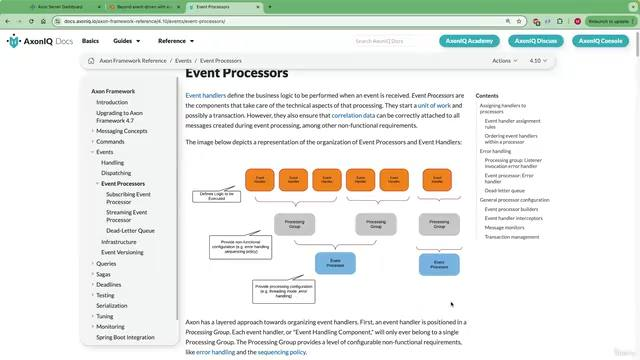
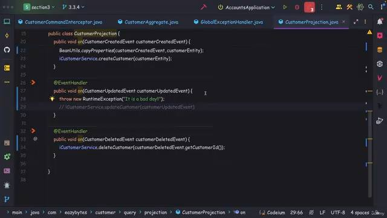
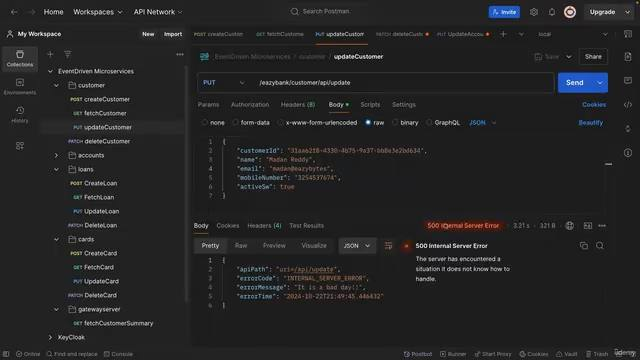
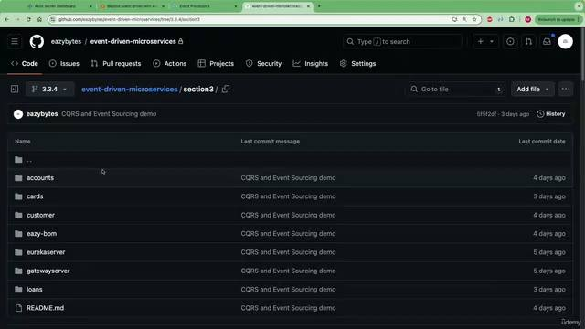
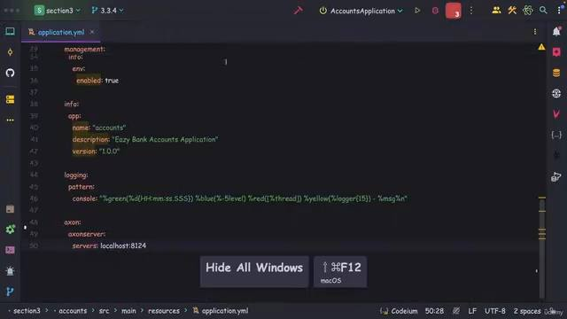

# CQRS / Event Sourcing 实战：从 EventStore 读数据校验、异常回滚与 Accounts 微服务复刻

> 课程：CQRS/Saga/EventSourcing（BV1bUpz6pEUy），覆盖 P32–P36  
> 前置说明：这是一门系列课的中段。P32–P36 默认你已经有一个可运行的 `customer` 微服务，并且已经完成“命令侧写 EventStore、查询侧 projection 写读库”的基础 CQRS/ES 改造。本文只复现这 5 集新增/修改的内容。课里没有逐行展示的类，文中会明确标注“课里没讲，以下按逐字稿类名补全骨架”。

---

## 1. 这一节做什么

这五集解决四个具体问题：

1. **P32：不在 interceptor 里查业务库，而是从 EventStore 读事件做校验。**  
   讲师在 `CustomerAggregate` 处理 `UpdateCustomerCommand` 的方法里注入 `EventStore`，调用 `readEvents(customerId)`，把事件流转成 `List`，如果为空就抛 `ResourceNotFoundException`。演示完又把代码注释掉，因为 interceptor 里已经做过同样校验。也就是说，P32 展示的是另一种校验思路：除了查读库/业务库，也可以直接查事件存储，确认这个聚合在事件流里是否存在。

2. **P33：演示读侧 projection 抛运行时异常时，命令侧不会自动回滚。**  
   在 projection 的 event handler 里 `throw new RuntimeException("it is a bad day")`。调用 update 接口仍然返回成功，EventStore 里多了一条事件，但读库还是旧数据。原因是 Axon 默认使用 streaming event processor，命令处理和事件处理不在同一个线程，读侧异常不会回滚命令侧事务。这个现象要亲手复现一次，才能理解后面为什么要改成 subscribing。

3. **P34：理解 event processor、processing group、多事件发布。**  
   一个 command 可以发布多个事件；`apply` 返回 `ApplyMore`，可以链式 `andThen` / `apply`。多个事件可以归到一个 `processing group`，再给这个组指定 `subscribing` 或 `streaming` event processor。一个 event handler 只能属于一个 processing group，这个约束在配置错误处理时很关键。

4. **P35：把默认 streaming 改成 subscribing，让单 JVM 内的读侧异常能回滚命令侧。**  
   三个动作：projection 类加 `@ProcessingGroup("customer-group")`；Spring Boot 主类注册 `EventProcessingConfigurer`，用 `PropagationErrorHandler.INSTANCE` 把异常原样抛到上层；`application.yml` 把 `customer-group` 的 mode 配成 `subscribing`。验证方式是看 Axon Server 里 aggregate sequence number 是否没变，以及接口是否返回 500。

5. **P36：在 `accounts` 微服务快速复刻 command 侧。**  
   讲师按 GitHub `section3/customer/README` 的步骤，在 accounts 里建包、建 command/event/aggregate/controller/interceptor，并在 repository 加 `findByAccountNumber`。P36 只讲到 accounts 的 command 侧，query 侧留到下一集。

> 前端读者类比：  
> - EventStore ≈ 一张只追加的事件表，`readEvents(aggregateId)` ≈ `SELECT * FROM events WHERE aggregate_id = ? ORDER BY sequence`。  
> - `subscribing` ≈ 单进程内串行消费，命令处理和事件处理在同一个调用栈/线程里，抛异常能一路冒泡回事务边界。  
> - `streaming` ≈ 多 worker 并行消费，读侧失败不会自动让写侧事务回滚；跨进程就要 Saga 补偿。  
> - Java 的 `@ProcessingGroup`、`EventProcessingConfigurer` 知道即可，思路和 Node 里“给 consumer group 配串行/并行、配 error handler”一样。

排查时可以先问自己：我现在看到的是“接口成功但读库没变”，还是“接口 500 但 EventStore 已多一条事件”？前者通常是 streaming 下读侧异常被吞或异步失败；后者说明异常已经冒泡到命令侧，但还要确认事务边界和 sequence number。前端页面调用 update 时，不要看到 500 就盲目重试写命令，先看 Axon Server 里对应 aggregate 的 sequence 是否变化，否则容易把“未提交”和“已提交但读侧失败”混在一起。

---

## 2. 讲师原话（带「—— pNNN [MM:SS]」）

> "在这些拦截器类中，我们会执行校验。执行校验时，实际上会从真实数据库加载数据……在真实项目里，可能会遇到一些特殊场景……你需要从事件存储读取数据来完成某些校验。"
> —— p032 [00:00]

> "为了从事件存储读取数据，首先我需要向这个类注入一个组件。这个组件就是事件存储。Axon Framework 提供这个事件存储，用来从正确的数据库或事件存储数据库读取数据。借助这个事件存储，我们可以调用 readEvents 方法。"
> —— p032 [00:54]

> "调用 readEvents 之后，需要再调用 asStream 方法，因为我们要把所有事件作为流来读取；接着要把整个元素流转换成列表……如果 commands 为空，就说明与给定客户 ID 关联的记录不存在；这种情况下执行更新操作没有意义，所以我要抛出异常。"
> —— p032 [01:52]

> "无论是在读数据库中存储数据，还是在投影端处理事件，假设我们遇到了运行时异常……你认为我们在事件溯源数据库中存储的内容也会一起回滚吗？这个问题的答案取决于你使用的那个事件处理器。"
> —— p033 [00:27]

> "在订阅式事件处理器中，所有操作都会由同一个线程执行……要利用这个订阅式事件处理器，你需要确保查询端和命令端都构建在同一个 JVM 中。"
> —— p033 [05:00]

> "在 Axon Framework 中，默认会构造流式事件处理器。这就是为什么查询端出现运行时异常时，命令端已经发生的事务不会回滚，因为命令与这个事件处理方法是在不同线程上运行的。"
> —— p035 [00:00]

> "在我的 customer 处理组中，如果处理事件时发生运行时异常，我希望把这个运行时异常原样传播到命令层，不做任何改动。"
> —— p035 [02:29]

> "要配置订阅式事件处理器，可以打开 application.yml……在 processors 下，需要填写处理器名称，即 customer-group。然后我要把订阅式事件处理器分配给这个 customer-group 处理器组。因此，在 mode 下需要写成 subscribing。"
> —— p035 [03:42]

> "由于命令执行是 CQRS 流程的第一步，这个流程中发生的任何运行时异常，都会被框架包装成命令执行异常。"
> —— p035 [07:09]

> "在 accounts 微服务中……我要更新配置属性……处理组名称为 account-group……首先，我需要新建一个名为 command 的子包，再新建一个名为 query 的子包……在 command 包下，我要新建一个名为 aggregate 的子包，再新建一个名为 event 的包；接下来是 controller，controller 之后是 interceptor。"
> —— p036 [03:54]

> "在 accounts 仓储中，我们还没有定义这个方法……我会把方法名改成 findByAccountNumber，把参数名改成 accountNumber；由于账号是 long 类型而不是 string，所以这里需要写成 long。"
> —— p036 [09:07]

这些原话分别对应后文的几个代码点：p032 对应 `readEvents(...).asStream().toList()` 和空列表判断；p033/p035 对应 streaming 与 subscribing 的线程差异、`PropagationErrorHandler` 和 yml 里的 `mode`；p036 对应 accounts 的包结构、`account-group` 和 `findByAccountNumber(Long)`。读逐字稿时可以拿这三组关键词去代码里定位，不要只记结论。

---

## 3. 从零复现

### 3.0 前置条件与目录

你需要已经有一个能跑的 `customer-service`，并且具备：

- JDK 17
- Maven 3.9+
- Docker
- Axon Server 已启动（课里演示了 Axon Server 控制台，但没有讲怎么启动；启动命令见第 7 节）
- 前序章节的 `customer` 基础代码：`Customer` 实体、`CustomerRepository`、`CustomerMapper`、`ICustomerService`、`CustomerServiceImpl`、`GlobalExceptionHandler`

本节涉及的文件路径（以 Maven 项目为例）：

```text
customer-service/
├── pom.xml
├── src/main/java/com/example/customer/
│   ├── CustomerApplication.java
│   ├── command/
│   │   ├── aggregate/CustomerAggregate.java
│   │   ├── command/CreateCustomerCommand.java
│   │   ├── command/UpdateCustomerCommand.java
│   │   ├── command/DeleteCustomerCommand.java
│   │   ├── event/CustomerCreatedEvent.java
│   │   ├── event/CustomerUpdatedEvent.java
│   │   ├── event/CustomerDeletedEvent.java
│   │   ├── controller/CustomerCommandController.java
│   │   └── interceptor/CustomerCommandInterceptor.java
│   ├── query/
│   │   ├── projection/CustomerProjection.java
│   │   ├── handler/CustomerQueryHandler.java
│   │   ├── controller/CustomerQueryController.java
│   │   └── entity/Customer.java
│   ├── repository/CustomerRepository.java
│   ├── mapper/CustomerMapper.java
│   ├── service/ICustomerService.java
│   ├── service/impl/CustomerServiceImpl.java
│   └── exception/GlobalExceptionHandler.java
└── src/main/resources/application.yml
```

> 课里没有给出完整 pom 和所有 DTO 字段。下面代码按逐字稿出现的类名、方法名、字段名补全成可编译骨架；标注【课里没讲】的地方，按你前序项目实际字段替换即可。

这里的目录先核对一遍：`command` 下放聚合、命令、事件、命令控制器和拦截器；`query` 下放投影、查询 handler、查询控制器和读库实体。如果你前面的项目把 `Customer` 实体放在别的包，后面的 import 要跟着改。常见错误是 `CustomerProjection` 和 `CustomerRepository` 引用了不同包下的同名 `Customer`，编译能过但运行时 JPA 映射对不上。启动前先确认 `application.yml` 里 Axon Server 地址是 gRPC 的 `8124`，不是控制台的 `8024`。

---

### 3.1 第一步：确认 Axon 依赖与 Axon Server 连接

`pom.xml` 加入 Axon Spring Boot Starter。课程没有说版本号，下面用 4.9.3 作为复现建议版本；你项目里已有版本就保持一致。

```xml
<?xml version="1.0" encoding="UTF-8"?>
<project xmlns="http://maven.apache.org/POM/4.0.0"
         xmlns:xsi="http://www.w3.org/2001/XMLSchema-instance"
         xsi:schemaLocation="http://maven.apache.org/POM/4.0.0 https://maven.apache.org/xsd/maven-4.0.0.xsd">
    <modelVersion>4.0.0</modelVersion>

    <parent>
        <groupId>org.springframework.boot</groupId>
        <artifactId>spring-boot-starter-parent</artifactId>
        <version>3.2.5</version>
        <relativePath/>
    </parent>

    <groupId>com.example</groupId>
    <artifactId>customer-service</artifactId>
    <version>0.0.1-SNAPSHOT</version>
    <name>customer-service</name>

    <properties>
        <java.version>17</java.version>
        <axon.version>4.9.3</axon.version>
    </properties>

    <dependencies>
        <dependency>
            <groupId>org.springframework.boot</groupId>
            <artifactId>spring-boot-starter-web</artifactId>
        </dependency>
        <dependency>
            <groupId>org.springframework.boot</groupId>
            <artifactId>spring-boot-starter-data-jpa</artifactId>
        </dependency>
        <dependency>
            <groupId>com.h2database</groupId>
            <artifactId>h2</artifactId>
            <scope>runtime</scope>
        </dependency>
        <dependency>
            <groupId>org.axonframework</groupId>
            <artifactId>axon-spring-boot-starter</artifactId>
            <version>${axon.version}</version>
        </dependency>
        <dependency>
            <groupId>org.projectlombok</groupId>
            <artifactId>lombok</artifactId>
            <optional>true</optional>
        </dependency>
        <dependency>
            <groupId>org.springframework.boot</groupId>
            <artifactId>spring-boot-starter-test</artifactId>
            <scope>test</scope>
        </dependency>
    </dependencies>

    <build>
        <plugins>
            <plugin>
                <groupId>org.springframework.boot</groupId>
                <artifactId>spring-boot-maven-plugin</artifactId>
            </plugin>
        </plugins>
    </build>
</project>
```

`src/main/resources/application.yml`：

```yaml
server:
  port: 8081

spring:
  application:
    name: customer-service
  datasource:
    url: jdbc:h2:mem:customerdb;DB_CLOSE_DELAY=-1
    driver-class-name: org.h2.Driver
    username: sa
    password:
  jpa:
    hibernate:
      ddl-auto: update
    show-sql: true

axon:
  axonserver:
    servers: localhost:8124
  eventhandling:
    processors:
      customer-group:
        mode: subscribing
```

> 注意：`customer-group` 这个名字必须和后面 `@ProcessingGroup("customer-group")`、`registerListenerInvocationErrorHandler("customer-group", ...)` 完全一致。大小写、连字符都算。

这一段的排查重点：先执行 `mvn -q spring-boot:run`，看启动日志里有没有 Axon Server 连接失败；如果连接失败，先 `docker ps` 看容器是否在跑，再用 `curl http://localhost:8024` 打开控制台确认。`application.yml` 的缩进层级也要检查，`axon.eventhandling.processors.customer-group.mode` 少一层或多一层都会导致配置不生效。名字一致性问题最常见：`customer-group` 写成 `customerGroup`、`Customer-Group`，编译不会报错，但 processor 不会按你预期工作。

---

### 3.2 第二步：命令侧——Aggregate 里从 EventStore 读事件做校验（P32）

P32 的核心代码在 `CustomerAggregate` 处理 `UpdateCustomerCommand` 的方法里。讲师先注入 `EventStore`，然后：

```java
List<?> commands = eventStore.readEvents(customerId)
        .asStream()
        .toList();

if (commands.isEmpty()) {
    throw new ResourceNotFoundException("Customer", "customerId", customerId);
}
```

课里演示时打了断点，看到 `commands` 有 3 个元素，对应这个 customerId 的 3 条历史事件。演示完讲师把这段注释掉了，因为 interceptor 里已经查业务库做校验。下面完整文件里保留注释代码，方便你对照。

这里的命令解释可以拆成三步：`eventStore.readEvents(customerId)` 拿到的是这个聚合的事件流；`.asStream()` 把 Axon 的 `DomainEventStream` 转成 Java `Stream`；`.toList()` 把流收集成列表。空列表表示这个 customerId 在事件存储里没有任何历史事件，update 没有意义。排查时如果断点没进来，先确认 update 请求确实走了 `CommandGateway.sendAndWait`，而不是直接调用 service/repository；如果列表为空，先确认创建接口返回的 customerId 和 update 路径参数是否一致。注意 `commands` 变量名容易误导，它实际是事件消息列表，不是命令对象列表。





---

### 3.3 第三步：复现“读侧异常、命令侧不回滚”（P33）

在 `CustomerProjection` 的 event handler 里临时加：

```java
throw new RuntimeException("it is a bad day");
```

把原来的读库更新代码注释掉。重新 build，调用 update 接口。你会看到：

- 接口返回成功；
- Axon Server 的 EventStore 里多了一条 `CustomerUpdatedEvent`；
- 读库还是旧 name / 旧 email；
- 再调 fetch customer，返回旧数据。

讲师原话是“Do you think this is acceptable? Of course not.” 这一步的目的不是让你保留异常，而是让你亲眼看到默认 streaming processor 下命令侧不会回滚。



复现前建议先记录该 aggregate 当前的 sequence number，再调用 update。如果接口直接返回 500，而不是“成功但读库没变”，说明你可能已经提前开启了 subscribing 或 error handler 配置，或者异常发生在命令 handler 而不是 projection。确认顺序是：先注释掉 `CustomerApplication` 里的 `EventProcessingConfigurer`，把 yml 的 mode 改回默认或删掉，再复现 streaming 行为。

---

### 3.4 第四步：理解 subscribing 与 streaming（P33/P34）

讲师打开 Axon 官方文档的 Events → Event Processors 页面，说明两种 processor：

| 维度 | Subscribing | Streaming |
|---|---|---|
| 线程 | 单线程 | 多线程 |
| 适用 | command/query 在同一个 JVM | command/query 拆在不同 JVM/容器 |
| 事件处理 | 顺序处理 | 可并行处理 |
| 异常回滚 | 单线程调用栈，可以回滚命令侧 | 读侧异常不会回滚其他 handler 已提交的事务 |
| 吞吐 | 相对低 | 相对高 |

课里明确说：我们现在的 customer 微服务 command 和 query 在同一个 JVM，所以应该选 `subscribing`。如果拆成两个 JVM，subscribing 就不合适，要用 streaming，跨服务事务要靠 Saga。



P34 还补充了 processing group 的概念：一个 command 可以发多个事件，多个事件可以归到一个 processing group，在这个组上配置错误处理、串行/并行。一个 event handler 只能属于一个 processing group。最后给这个组指定 event processor。



前端对照可以这样理解：streaming 更像消息队列里多个 consumer worker 并行消费，某个 worker 抛错不会让生产者已经提交的消息回滚；subscribing 更像同一个进程内的事件总线按顺序调用监听器，监听器抛错能沿着调用栈回到发起命令的地方。排查时看启动日志里 processor 的 mode，或者看 Axon Server 控制台里 processing group 的配置，不要只凭接口返回猜。

---

### 3.5 第五步：改成 subscribing，让异常回滚（P35）

三个动作，缺一不可：

**动作 1：projection 类加 `@ProcessingGroup`。**

```java
@ProcessingGroup("customer-group")
@Component
public class CustomerProjection {
    // ...
}
```

**动作 2：Spring Boot 主类注册 error handler。**

```java
@Bean
public EventProcessingConfigurer configure() {
    return config -> config.registerListenerInvocationErrorHandler(
            "customer-group",
            conf -> PropagationErrorHandler.INSTANCE
    );
}
```

课里原话是“register listener invocation error handler”，第一个参数是 processing group 名，第二个 lambda 返回 `PropagationErrorHandler.INSTANCE`。这个 handler 是 singleton，不做任何处理，只把运行时异常原样往上层抛。

**动作 3：`application.yml` 指定 mode。**

```yaml
axon:
  eventhandling:
    processors:
      customer-group:
        mode: subscribing
```

重启后再次调用 update。预期：

- 接口返回 500；
- 响应体里有 `it is a bad day`；
- Axon Server 里该 aggregate 的 sequence number 没有增加（课里演示从 4 还是 4）。





三处配置的排查顺序：先看 `@ProcessingGroup("customer-group")` 是否真的在 projection 类上；再看主类 bean 里注册的名字是否一致；最后看 yml 是否放在 `axon.eventhandling.processors` 下。若三处都看似正确但仍不回滚，检查异常是否被 `GlobalExceptionHandler` 的 `Exception.class` 方法提前吞掉，或者 `PropagationErrorHandler` 导入错包。验证时不要只看接口状态码，还要刷新 Axon Server 里 aggregate 的 sequence number。

---

### 3.6 第六步：单独处理 `CommandExecutionException`（P35）

原来 `GlobalExceptionHandler` 里有一个处理 `Exception.class` 的方法，所有异常都会进那里。讲师复制了一份，把参数改成 `CommandExecutionException`，并加前缀：

```java
@ExceptionHandler(CommandExecutionException.class)
public ResponseEntity<String> handleCommandExecutionException(CommandExecutionException exception) {
    return ResponseEntity.status(HttpStatus.INTERNAL_SERVER_ERROR)
            .body("command execution exception occurred due to: " + exception.getMessage());
}
```

因为 command execution 是 CQRS 流程第一步，框架会把流程里的运行时异常包装成 `CommandExecutionException`。这样你能单独给 Axon 流程的异常写处理逻辑。

排查时注意 Spring 异常处理器的匹配顺序：`CommandExecutionException` 比 `Exception` 更具体，通常会优先进入专属方法。如果你看到响应体仍然是普通 `Exception` 方法的格式，检查两个方法的注解参数是否写错，或者异常是否在进入 controller advice 之前被别的层处理了。原始异常通常在 cause 里，不要只根据 `getMessage()` 判断异常类型。

---

### 3.7 第七步：在 accounts 微服务复刻 command 侧（P36）

讲师打开 GitHub `section3/customer/README`，按步骤在 accounts 里做：

1. `pom.xml` 加 Axon 依赖（课里说 accounts 的 pom 已经加过）。
2. `application.yml` 复制 customer 的属性，processing group 改成 `account-group`。
3. 建包：
   ```text
   command/
     aggregate/
     event/
     controller/
     interceptor/
   query/
     controller/
     handler/
     projection/
   ```
4. 建 command：`CreateAccountCommand`、`UpdateAccountCommand`、`DeleteAccountCommand`。
5. 建 event：`AccountCreatedEvent`、`AccountUpdatedEvent`、`AccountDeletedEvent`。
6. 建 `AccountsAggregate`，`accountNumber` 作为 aggregate identifier。
7. 建 `AccountsCommandController`，用 `CommandGateway` 派发。
8. 建 `AccountsCommandInterceptor`，里面调用 `accountsRepository.findByAccountNumber(...)`，所以要在 repository 加方法：
   ```java
   Optional<Accounts> findByAccountNumber(Long accountNumber);
   ```
   注意 `accountNumber` 是 `Long`，不是 `String`。课里专门纠正了这一点。
9. query 侧（projection/handler/controller）P36 没讲完，下一集继续。





accounts 复刻时最常见的编译错误是 `findByAccountNumber` 参数类型写成 `String`，而 aggregate identifier 是 `Long`；第二个常见错误是 `Accounts` 实体所在包和 repository 的 import 不一致。先确认 accounts 的读库实体、repository 已存在，再写 interceptor。P36 没讲 query 侧，所以不要提前把 projection 当成已经完成。

---

## 4. 完整代码

> 说明：以下文件按逐字稿出现的类名、方法名、字段名补全成可编译骨架。课程没有逐行展示的字段（例如 Customer 的额外列、Accounts 的完整 JPA 注解）标注【课里没讲】，你可按前序项目替换。所有文件都是完整文件，不是省略号片段。

### 4.1 `customer-service/src/main/java/com/example/customer/CustomerApplication.java`

```java
package com.example.customer;

import org.axonframework.config.EventProcessingConfigurer;
import org.axonframework.eventhandling.PropagationErrorHandler;
import org.springframework.boot.SpringApplication;
import org.springframework.boot.autoconfigure.SpringBootApplication;
import org.springframework.context.annotation.Bean;

@SpringBootApplication
public class CustomerApplication {

    public static void main(String[] args) {
        SpringApplication.run(CustomerApplication.class, args);
    }

    @Bean
    public EventProcessingConfigurer configure() {
        return config -> config.registerListenerInvocationErrorHandler(
                "customer-group",
                conf -> PropagationErrorHandler.INSTANCE
        );
    }
}
```

### 4.2 `customer-service/src/main/java/com/example/customer/command/aggregate/CustomerAggregate.java`

```java
package com.example.customer.command.aggregate;

import com.example.customer.command.command.CreateCustomerCommand;
import com.example.customer.command.command.DeleteCustomerCommand;
import com.example.customer.command.command.UpdateCustomerCommand;
import com.example.customer.command.event.CustomerCreatedEvent;
import com.example.customer.command.event.CustomerDeletedEvent;
import com.example.customer.command.event.CustomerUpdatedEvent;
import com.example.customer.exception.ResourceNotFoundException;
import org.axonframework.commandhandling.CommandHandler;
import org.axonframework.eventsourcing.EventSourcingHandler;
import org.axonframework.eventsourcing.EventStore;
import org.axonframework.modelling.command.AggregateIdentifier;
import org.axonframework.spring.stereotype.Aggregate;

import java.util.List;

import static org.axonframework.modelling.command.AggregateLifecycle.apply;

@Aggregate
public class CustomerAggregate {

    @AggregateIdentifier
    private String customerId;
    private String name;
    private String email;
    private String mobileNumber;

    public CustomerAggregate() {
        // Axon 要求空构造
    }

    @CommandHandler
    public CustomerAggregate(CreateCustomerCommand command) {
        apply(new CustomerCreatedEvent(
                command.getCustomerId(),
                command.getName(),
                command.getEmail(),
                command.getMobileNumber()
        ));
    }

    @CommandHandler
    public void handle(UpdateCustomerCommand command, EventStore eventStore) {
        // P32 演示代码：从 EventStore 读事件做校验。
        // 讲师演示后把这段注释掉了，因为 interceptor 已经查业务库校验。
        // List<?> commands = eventStore.readEvents(command.getCustomerId())
        //         .asStream()
        //         .toList();
        //
        // if (commands.isEmpty()) {
        //     throw new ResourceNotFoundException("Customer", "customerId", command.getCustomerId());
        // }

        apply(new CustomerUpdatedEvent(
                command.getCustomerId(),
                command.getName(),
                command.getEmail(),
                command.getMobileNumber()
        ));
    }

    @CommandHandler
    public void handle(DeleteCustomerCommand command) {
        apply(new CustomerDeletedEvent(command.getCustomerId()));
    }

    @EventSourcingHandler
    public void on(CustomerCreatedEvent event) {
        this.customerId = event.getCustomerId();
        this.name = event.getName();
        this.email = event.getEmail();
        this.mobileNumber = event.getMobileNumber();
    }

    @EventSourcingHandler
    public void on(CustomerUpdatedEvent event) {
        this.name = event.getName();
        this.email = event.getEmail();
        this.mobileNumber = event.getMobileNumber();
    }

    @EventSourcingHandler
    public void on(CustomerDeletedEvent event) {
        this.customerId = event.getCustomerId();
    }
}
```

### 4.3 `customer-service/src/main/java/com/example/customer/command/command/UpdateCustomerCommand.java`

```java
package com.example.customer.command.command;

import org.axonframework.modelling.command.TargetAggregateIdentifier;

public class UpdateCustomerCommand {

    @TargetAggregateIdentifier
    private final String customerId;
    private final String name;
    private final String email;
    private final String mobileNumber;

    public UpdateCustomerCommand(String customerId, String name, String email, String mobileNumber) {
        this.customerId = customerId;
        this.name = name;
        this.email = email;
        this.mobileNumber = mobileNumber;
    }

    public String getCustomerId() {
        return customerId;
    }

    public String getName() {
        return name;
    }

    public String getEmail() {
        return email;
    }

    public String getMobileNumber() {
        return mobileNumber;
    }
}
```

### 4.4 `customer-service/src/main/java/com/example/customer/command/interceptor/CustomerCommandInterceptor.java`

```java
package com.example.customer.command.interceptor;

import com.example.customer.command.command.UpdateCustomerCommand;
import com.example.customer.repository.CustomerRepository;
import org.axonframework.commandhandling.CommandMessage;
import org.axonframework.messaging.MessageDispatchInterceptor;
import org.springframework.stereotype.Component;

import java.util.List;
import java.util.function.BiFunction;

@Component
public class CustomerCommandInterceptor implements MessageDispatchInterceptor<CommandMessage<?>> {

    private final CustomerRepository customerRepository;

    public CustomerCommandInterceptor(CustomerRepository customerRepository) {
        this.customerRepository = customerRepository;
    }

    @Override
    public BiFunction<Integer, CommandMessage<?>, CommandMessage<?>> handle(List<? extends CommandMessage<?>> messages) {
        return (index, command) -> {
            if (UpdateCustomerCommand.class.equals(command.getPayloadType())) {
                UpdateCustomerCommand payload = (UpdateCustomerCommand) command.getPayload();
                customerRepository.findByMobileNumber(payload.getMobileNumber())
                        .orElseThrow(() -> new RuntimeException(
                                "Customer with mobile number " + payload.getMobileNumber() + " not found"
                        ));
            }
            return command;
        };
    }
}
```

> 课里没有展示 interceptor 的完整实现，只说了“we are loading the data from the real database with customer repository”。上面是按前序章节常见写法补全的骨架；方法名 `findByMobileNumber` 以你项目实际 repository 为准。

### 4.5 `customer-service/src/main/java/com/example/customer/query/projection/CustomerProjection.java`

```java
package com.example.customer.query.projection;

import com.example.customer.command.event.CustomerCreatedEvent;
import com.example.customer.command.event.CustomerDeletedEvent;
import com.example.customer.command.event.CustomerUpdatedEvent;
import com.example.customer.query.entity.Customer;
import com.example.customer.repository.CustomerRepository;
import org.axonframework.config.ProcessingGroup;
import org.axonframework.eventhandling.EventHandler;
import org.springframework.stereotype.Component;

@Component
@ProcessingGroup("customer-group")
public class CustomerProjection {

    private final CustomerRepository customerRepository;

    public CustomerProjection(CustomerRepository customerRepository) {
        this.customerRepository = customerRepository;
    }

    @EventHandler
    public void on(CustomerCreatedEvent event) {
        Customer customer = new Customer();
        customer.setCustomerId(event.getCustomerId());
        customer.setName(event.getName());
        customer.setEmail(event.getEmail());
        customer.setMobileNumber(event.getMobileNumber());
        customerRepository.save(customer);
    }

    @EventHandler
    public void on(CustomerUpdatedEvent event) {
        // P33 演示时临时打开下面这行，观察命令侧不回滚：
        // throw new RuntimeException("it is a bad day");

        Customer customer = customerRepository.findById(event.getCustomerId())
                .orElseThrow(() -> new RuntimeException("Customer not found: " + event.getCustomerId()));
        customer.setName(event.getName());
        customer.setEmail(event.getEmail());
        customer.setMobileNumber(event.getMobileNumber());
        customerRepository.save(customer);
    }

    @EventHandler
    public void on(CustomerDeletedEvent event) {
        customerRepository.deleteById(event.getCustomerId());
    }
}
```

### 4.6 `customer-service/src/main/java/com/example/customer/exception/GlobalExceptionHandler.java`

```java
package com.example.customer.exception;

import org.axonframework.commandhandling.CommandExecutionException;
import org.springframework.http.HttpStatus;
import org.springframework.http.ResponseEntity;
import org.springframework.web.bind.annotation.ExceptionHandler;
import org.springframework.web.bind.annotation.RestControllerAdvice;

@RestControllerAdvice
public class GlobalExceptionHandler {

    @ExceptionHandler(Exception.class)
    public ResponseEntity<String> handleGlobalException(Exception exception) {
        return ResponseEntity.status(HttpStatus.INTERNAL_SERVER_ERROR)
                .body(exception.getMessage());
    }

    @ExceptionHandler(CommandExecutionException.class)
    public ResponseEntity<String> handleCommandExecutionException(CommandExecutionException exception) {
        return ResponseEntity.status(HttpStatus.INTERNAL_SERVER_ERROR)
                .body("command execution exception occurred due to: " + exception.getMessage());
    }
}
```

### 4.7 `customer-service/src/main/java/com/example/customer/exception/ResourceNotFoundException.java`

```java
package com.example.customer.exception;

public class ResourceNotFoundException extends RuntimeException {

    public ResourceNotFoundException(String resource, String field, Object value) {
        super(resource + " not found with " + field + " : " + value);
    }
}
```

### 4.8 `customer-service/src/main/java/com/example/customer/command/controller/CustomerCommandController.java`

```java
package com.example.customer.command.controller;

import com.example.customer.command.command.CreateCustomerCommand;
import com.example.customer.command.command.DeleteCustomerCommand;
import com.example.customer.command.command.UpdateCustomerCommand;
import org.axonframework.commandhandling.gateway.CommandGateway;
import org.springframework.web.bind.annotation.*;

import java.util.UUID;

@RestController
@RequestMapping("/api/customers")
public class CustomerCommandController {

    private final CommandGateway commandGateway;

    public CustomerCommandController(CommandGateway commandGateway) {
        this.commandGateway = commandGateway;
    }

    @PostMapping
    public String create(@RequestBody CreateCustomerCommand command) {
        String customerId = UUID.randomUUID().toString();
        commandGateway.sendAndWait(new CreateCustomerCommand(
                customerId,
                command.getName(),
                command.getEmail(),
                command.getMobileNumber()
        ));
        return customerId;
    }

    @PutMapping("/{customerId}")
    public String update(@PathVariable String customerId, @RequestBody UpdateCustomerCommand command) {
        commandGateway.sendAndWait(new UpdateCustomerCommand(
                customerId,
                command.getName(),
                command.getEmail(),
                command.getMobileNumber()
        ));
        return "Customer updated";
    }

    @DeleteMapping("/{customerId}")
    public String delete(@PathVariable String customerId) {
        commandGateway.sendAndWait(new DeleteCustomerCommand(customerId));
        return "Customer deleted";
    }
}
```

### 4.9 `customer-service/src/main/java/com/example/customer/query/controller/CustomerQueryController.java`

```java
package com.example.customer.query.controller;

import com.example.customer.query.entity.Customer;
import com.example.customer.repository.CustomerRepository;
import org.springframework.web.bind.annotation.*;

import java.util.List;

@RestController
@RequestMapping("/api/customers")
public class CustomerQueryController {

    private final CustomerRepository customerRepository;

    public CustomerQueryController(CustomerRepository customerRepository) {
        this.customerRepository = customerRepository;
    }

    @GetMapping("/mobile/{mobileNumber}")
    public Customer findByMobile(@PathVariable String mobileNumber) {
        return customerRepository.findByMobileNumber(mobileNumber)
                .orElseThrow(() -> new RuntimeException("Customer not found"));
    }

    @GetMapping
    public List<Customer> findAll() {
        return customerRepository.findAll();
    }
}
```

### 4.10 `customer-service/src/main/java/com/example/customer/repository/CustomerRepository.java`

```java
package com.example.customer.repository;

import com.example.customer.query.entity.Customer;
import org.springframework.data.jpa.repository.JpaRepository;

import java.util.Optional;

public interface CustomerRepository extends JpaRepository<Customer, String> {

    Optional<Customer> findByMobileNumber(String mobileNumber);
}
```

### 4.11 `customer-service/src/main/java/com/example/customer/query/entity/Customer.java`

```java
package com.example.customer.query.entity;

import jakarta.persistence.Entity;
import jakarta.persistence.Id;
import jakarta.persistence.Table;

@Entity
@Table(name = "customers")
public class Customer {

    @Id
    private String customerId;
    private String name;
    private String email;
    private String mobileNumber;

    public String getCustomerId() {
        return customerId;
    }

    public void setCustomerId(String customerId) {
        this.customerId = customerId;
    }

    public String getName() {
        return name;
    }

    public void setName(String name) {
        this.name = name;
    }

    public String getEmail() {
        return email;
    }

    public void setEmail(String email) {
        this.email = email;
    }

    public String getMobileNumber() {
        return mobileNumber;
    }

    public void setMobileNumber(String mobileNumber) {
        this.mobileNumber = mobileNumber;
    }
}
```

### 4.12 accounts 微服务 command 侧关键文件

`accounts-service/src/main/resources/application.yml`：

```yaml
server:
  port: 8082

spring:
  application:
    name: accounts-service
  datasource:
    url: jdbc:h2:mem:accountsdb;DB_CLOSE_DELAY=-1
    driver-class-name: org.h2.Driver
    username: sa
    password:
  jpa:
    hibernate:
      ddl-auto: update
    show-sql: true

axon:
  axonserver:
    servers: localhost:8124
  eventhandling:
    processors:
      account-group:
        mode: subscribing
```

`accounts-service/src/main/java/com/example/accounts/command/aggregate/AccountsAggregate.java`：

```java
package com.example.accounts.command.aggregate;

import com.example.accounts.command.command.CreateAccountCommand;
import com.example.accounts.command.command.DeleteAccountCommand;
import com.example.accounts.command.command.UpdateAccountCommand;
import com.example.accounts.command.event.AccountCreatedEvent;
import com.example.accounts.command.event.AccountDeletedEvent;
import com.example.accounts.command.event.AccountUpdatedEvent;
import org.axonframework.commandhandling.CommandHandler;
import org.axonframework.eventsourcing.EventSourcingHandler;
import org.axonframework.modelling.command.AggregateIdentifier;
import org.axonframework.spring.stereotype.Aggregate;

import static org.axonframework.modelling.command.AggregateLifecycle.apply;

@Aggregate
public class AccountsAggregate {

    @AggregateIdentifier
    private Long accountNumber;
    private String mobileNumber;
    private String accountType;
    private String branchAddress;
    private Boolean activeSwitch;

    public AccountsAggregate() {
        // Axon 要求空构造
    }

    @CommandHandler
    public AccountsAggregate(CreateAccountCommand command) {
        apply(new AccountCreatedEvent(
                command.getAccountNumber(),
                command.getMobileNumber(),
                command.getAccountType(),
                command.getBranchAddress(),
                command.getActiveSwitch()
        ));
    }

    @CommandHandler
    public void handle(UpdateAccountCommand command) {
        apply(new AccountUpdatedEvent(
                command.getAccountNumber(),
                command.getMobileNumber(),
                command.getAccountType(),
                command.getBranchAddress(),
                command.getActiveSwitch()
        ));
    }

    @CommandHandler
    public void handle(DeleteAccountCommand command) {
        apply(new AccountDeletedEvent(
                command.getAccountNumber(),
                command.getActiveSwitch()
        ));
    }

    @EventSourcingHandler
    public void on(AccountCreatedEvent event) {
        this.accountNumber = event.getAccountNumber();
        this.mobileNumber = event.getMobileNumber();
        this.accountType = event.getAccountType();
        this.branchAddress = event.getBranchAddress();
        this.activeSwitch = event.getActiveSwitch();
    }

    @EventSourcingHandler
    public void on(AccountUpdatedEvent event) {
        this.mobileNumber = event.getMobileNumber();
        this.accountType = event.getAccountType();
        this.branchAddress = event.getBranchAddress();
        this.activeSwitch = event.getActiveSwitch();
    }

    @EventSourcingHandler
    public void on(AccountDeletedEvent event) {
        this.accountNumber = event.getAccountNumber();
        this.activeSwitch = event.getActiveSwitch();
    }
}
```

`accounts-service/src/main/java/com/example/accounts/command/controller/AccountsCommandController.java`：

```java
package com.example.accounts.command.controller;

import com.example.accounts.command.command.CreateAccountCommand;
import com.example.accounts.command.command.DeleteAccountCommand;
import com.example.accounts.command.command.UpdateAccountCommand;
import org.axonframework.commandhandling.gateway.CommandGateway;
import org.springframework.web.bind.annotation.*;

import java.util.concurrent.ThreadLocalRandom;

@RestController
@RequestMapping("/api/accounts")
public class AccountsCommandController {

    private final CommandGateway commandGateway;

    public AccountsCommandController(CommandGateway commandGateway) {
        this.commandGateway = commandGateway;
    }

    @PostMapping
    public Long create(@RequestBody CreateAccountCommand command) {
        Long accountNumber = ThreadLocalRandom.current().nextLong(100000000L, 999999999L);
        commandGateway.sendAndWait(new CreateAccountCommand(
                accountNumber,
                command.getMobileNumber(),
                command.getAccountType(),
                command.getBranchAddress(),
                command.getActiveSwitch()
        ));
        return accountNumber;
    }

    @PutMapping("/{accountNumber}")
    public String update(@PathVariable Long accountNumber, @RequestBody UpdateAccountCommand command) {
        commandGateway.sendAndWait(new UpdateAccountCommand(
                accountNumber,
                command.getMobileNumber(),
                command.getAccountType(),
                command.getBranchAddress(),
                command.getActiveSwitch()
        ));
        return "Account updated";
    }

    @DeleteMapping("/{accountNumber}")
    public String delete(@PathVariable Long accountNumber, @RequestBody DeleteAccountCommand command) {
        commandGateway.sendAndWait(new DeleteAccountCommand(
                accountNumber,
                command.getActiveSwitch()
        ));
        return "Account deleted";
    }
}
```

`accounts-service/src/main/java/com/example/accounts/command/interceptor/AccountsCommandInterceptor.java`：

```java
package com.example.accounts.command.interceptor;

import com.example.accounts.command.command.UpdateAccountCommand;
import com.example.accounts.repository.AccountsRepository;
import org.axonframework.commandhandling.CommandMessage;
import org.axonframework.messaging.MessageDispatchInterceptor;
import org.springframework.stereotype.Component;

import java.util.List;
import java.util.function.BiFunction;

@Component
public class AccountsCommandInterceptor implements MessageDispatchInterceptor<CommandMessage<?>> {

    private final AccountsRepository accountsRepository;

    public AccountsCommandInterceptor(AccountsRepository accountsRepository) {
        this.accountsRepository = accountsRepository;
    }

    @Override
    public BiFunction<Integer, CommandMessage<?>, CommandMessage<?>> handle(List<? extends CommandMessage<?>> messages) {
        return (index, command) -> {
            if (UpdateAccountCommand.class.equals(command.getPayloadType())) {
                UpdateAccountCommand payload = (UpdateAccountCommand) command.getPayload();
                accountsRepository.findByAccountNumber(payload.getAccountNumber())
                        .orElseThrow(() -> new RuntimeException(
                                "Account not found: " + payload.getAccountNumber()
                        ));
            }
            return command;
        };
    }
}
```

`accounts-service/src/main/java/com/example/accounts/repository/AccountsRepository.java`：

```java
package com.example.accounts.repository;

import com.example.accounts.query.entity.Accounts;
import org.springframework.data.jpa.repository.JpaRepository;

import java.util.Optional;

public interface AccountsRepository extends JpaRepository<Accounts, Long> {

    Optional<Accounts> findByAccountNumber(Long accountNumber);
}
```

> P36 只讲到 command 侧，query 侧的 `AccountsProjection`、`AccountsQueryHandler`、`AccountsQueryController` 课里说“continue this discussion in the next lecture”，本文不补。

---

## 5. 逐行解释

### 5.1 P32：从 EventStore 读事件

```java
List<?> commands = eventStore.readEvents(command.getCustomerId())
        .asStream()
        .toList();
```

- `readEvents(aggregateIdentifier)`：逐字稿说有两个重载，第一个只接收 aggregate identifier，返回这个聚合的所有事件；第二个可以传 sequence number。课里用的是第一个。
- `asStream()`：把 Axon 的 `DomainEventStream` 转成 Java `Stream`。
- `toList()`：把流收成 `List`。在 JS 里相当于 `const commands = [...eventStream]`。
- 变量名叫 `commands` 有点迷惑，它实际是“这个 customerId 的事件列表”。逐字稿里讲师也直接叫 `commands`，我们保留。

```java
if (commands.isEmpty()) {
    throw new ResourceNotFoundException("Customer", "customerId", command.getCustomerId());
}
```

- 如果这个 aggregate 在 EventStore 里没有任何事件，说明 customerId 不存在，update 没有意义，直接抛业务异常。
- 课里说这个异常和 `CustomerCommandInterceptor` 里抛的是同一个 `ResourceNotFoundException`，所以复制了 interceptor 里的代码。
- 注意：P32 演示完讲师把这段注释掉了，因为 interceptor 已经查业务库。你保留注释代码即可，不要同时开两套校验，否则异常来源会混乱。

进一步理解：`readEvents` 读出来的是事件消息，不是当前聚合对象，也不是 command 对象。空列表只能说明“事件流里没有这个聚合的历史”，不能证明读库存在与否。若同时保留 interceptor 的读库校验和这里的 EventStore 校验，更新一个存在但读库尚未投影的聚合时，两处可能给出不同结果；调试时要先明确你期望以哪一边为准。

### 5.2 P33：为什么读侧异常不回滚命令侧

```java
throw new RuntimeException("it is a bad day");
```

- 这行在 `CustomerProjection.on(CustomerUpdatedEvent)` 里。Axon 默认 streaming processor 用不同线程处理 command 和 event。
- command 侧已经把 `CustomerUpdatedEvent` 写进 EventStore，事务已提交；projection 的读库事务在另一个线程里失败，不会反向回滚 EventStore。
- 所以接口返回成功、EventStore 多一条事件、读库旧数据。这不是 Axon 的 bug，是 event processor 的线程模型决定的。
- 在 Node 里类比：写侧 `await eventStore.append(event)` 成功后，读侧 consumer 在另一个 worker 里 `throw`，不会让写侧已经 append 的数据消失。

排查这个现象时，先确认异常确实发生在 projection 的 `@EventHandler` 里，而不是 aggregate 的 `@CommandHandler` 里；再看启动日志确认 processor 是 streaming；最后看接口是否用了 `sendAndWait`。如果接口是异步 `send`，你甚至可能看不到命令侧异常，这会干扰判断。

### 5.3 P35：`@ProcessingGroup` + `PropagationErrorHandler` + `mode: subscribing`

```java
@ProcessingGroup("customer-group")
```

- 把这个 projection 里的所有 `@EventHandler` 归到 `customer-group`。
- 一个 event handler 只能属于一个 processing group。课里 P34 专门强调过。
- 名字必须和 yml、`registerListenerInvocationErrorHandler` 三处完全一致。

```java
config.registerListenerInvocationErrorHandler(
        "customer-group",
        conf -> PropagationErrorHandler.INSTANCE
);
```

- 第一个参数是 processing group 名。
- 第二个参数是 error handler 工厂。`PropagationErrorHandler.INSTANCE` 是 singleton，不做任何处理，只把运行时异常原样往上层抛。
- 课里原话：“it is simply going to propagate whatever runtime exception happened to the upper layers or to the top layers.”
- 如果不配这个，Axon 默认 error handler 可能会把异常吞掉或记日志，命令侧就看不到异常，也就不会回滚。

```yaml
axon:
  eventhandling:
    processors:
      customer-group:
        mode: subscribing
```

- 把 `customer-group` 的 event processor 从默认 streaming 改成 subscribing。
- subscribing 用单线程跑 command dispatch → event handling → event store，读侧异常会沿着同一个调用栈冒泡回 command 侧，事务回滚。
- 课里验证：Axon Server 里 aggregate sequence number 仍是 4，说明新事件没提交。

注意 `PropagationErrorHandler.INSTANCE` 是类上的单例常量，不是 new 出来的对象；导入包是 `org.axonframework.eventhandling.PropagationErrorHandler`。如果导入成别的同名类，编译可能过，但行为不对。

### 5.4 P35：`CommandExecutionException`

```java
@ExceptionHandler(CommandExecutionException.class)
public ResponseEntity<String> handleCommandExecutionException(CommandExecutionException exception) {
    return ResponseEntity.status(HttpStatus.INTERNAL_SERVER_ERROR)
            .body("command execution exception occurred due to: " + exception.getMessage());
}
```

- Axon 把 CQRS 流程里的运行时异常包装成 `CommandExecutionException`。
- 这个 handler 比 `Exception.class` 更具体，Spring 会优先匹配它。
- 课里演示断点确实停在这个方法，而不是 `Exception.class` 那个方法。
- 返回体里能看到 `command execution exception occurred due to: it is a bad day`。

如果断点没停在这里，先检查异常是否在 controller 层之前被转换成别的异常，或者 `@ExceptionHandler` 的参数类型写错。包装后的异常消息里通常包含原始异常信息，但不要依赖 `instanceof RuntimeException` 判断原始类型。

### 5.5 P36：accounts 的 `findByAccountNumber(Long)`

```java
Optional<Accounts> findByAccountNumber(Long accountNumber);
```

- `accountNumber` 是 `Long`，不是 `String`。课里专门说“since the account number is of type long instead of string we need to type long here”。
- 如果写成 `String`，interceptor 里传 `Long` 会编译不过。
- `accountNumber` 是 aggregate identifier，创建后不变；`mobileNumber`、`accountType`、`branchAddress`、`activeSwitch` 是业务字段。课里说 account number 由业务逻辑生成，mobile number 由用户提供。

---

## 6. 复现检查清单

- [ ] Axon Server 已启动，`localhost:8124` 可连。验证方式：`docker ps` 看到容器，控制台 `http://localhost:8024` 能打开；启动日志无连接失败。
- [ ] `customer-service` 的 `pom.xml` 有 `axon-spring-boot-starter`。验证方式：`mvn dependency:tree` 能看到 Axon starter，且版本与你项目一致。
- [ ] `application.yml` 里 `axon.axonserver.servers` 指向正确地址。验证方式：确认写的是 `8124`，不是控制台 `8024`；启动日志无 Axon Server 连接报错。
- [ ] `CustomerAggregate` 的 `UpdateCustomerCommand` handler 里有注释掉的 `readEvents` 代码。验证方式：打开文件确认代码在注释中，且 import 了 `EventStore`。
- [ ] 打断点能看到 `commands` 至少有 3 个元素（取决于你前面创建/更新了几次）。验证方式：调用创建和更新接口后，在断点里看列表 size；若为 0，先核对 customerId。
- [ ] `CustomerProjection` 类上有 `@ProcessingGroup("customer-group")`。验证方式：确认导入的是 `org.axonframework.config.ProcessingGroup`，名字与 yml 完全一致。
- [ ] `CustomerApplication` 里有 `EventProcessingConfigurer` bean，注册了 `customer-group` 的 `PropagationErrorHandler.INSTANCE`。验证方式：断点或启动日志确认配置被执行，名字无拼写差异。
- [ ] `application.yml` 里 `customer-group.mode` 是 `subscribing`。验证方式：检查缩进层级，确认在 `axon.eventhandling.processors` 下。
- [ ] 临时打开 projection 里的 `throw new RuntimeException("it is a bad day")`，调用 update 返回 500。验证方式：用 curl/Postman 调 update，看状态码和响应体是否包含该消息。
- [ ] Axon Server 里该 aggregate 的 sequence number 没有增加。验证方式：调用前后刷新控制台，记录同一 aggregate 的 sequence 对比。
- [ ] `GlobalExceptionHandler` 里有 `CommandExecutionException` 专属方法，响应体前缀是 `command execution exception occurred due to:`。验证方式：在方法里打断点，确认异常进入的是这个方法而不是 `Exception.class` 方法。
- [ ] 验证完把 projection 的 `throw` 注释掉，恢复读库更新逻辑。验证方式：重新 build 后调用 update，读库数据应正常更新。
- [ ] `accounts-service` 建了 `command/aggregate`、`command/event`、`command/controller`、`command/interceptor`、`query/controller`、`query/handler`、`query/projection`。验证方式：查看目录树，确认包名与 import 一致。
- [ ] `accounts-service` 的 `application.yml` 里 processing group 是 `account-group`，mode 是 `subscribing`。验证方式：确认名字与 projection 计划使用的 `@ProcessingGroup` 一致。
- [ ] `AccountsRepository` 有 `findByAccountNumber(Long)`。验证方式：编译通过，interceptor 里传 `Long` 不报类型错误。
- [ ] `AccountsCommandInterceptor` 能编译通过。验证方式：`mvn compile` 通过，`Accounts` 实体和 repository 的 import 路径正确。
- [ ] P36 的 query 侧尚未实现，不要假装它已经能跑。验证方式：调用 accounts 查询接口应不存在或未完成，不要用 customer 的 query 结果替代。

---

## 7. 课里没讲但你会撞上的

| 现象 | 原因 | 怎么办 |
|---|---|---|
| 应用启动连不上 `localhost:8124` | Axon Server 没启动，或地址/端口填错；课里没讲启动方式 | 用 Docker 启动 Axon Server，控制台在 `8024`，gRPC 在 `8124`；完整命令见表格下方代码块。先 `docker ps` 再查启动日志。 |
| 依赖版本冲突，`jakarta`/`javax` 包名不一致 | 课里没讲版本号；你前序项目可能是 Spring Boot 2.x | 本文用 Axon 4.9.3 + Spring Boot 3.2.5 作为复现建议；已有项目保持版本一致，不要直接混用。 |
| `@ProcessingGroup` 不生效 | 导入错包，用了 Spring 的注解而不是 Axon 的注解 | 确认全限定名是 `org.axonframework.config.ProcessingGroup`；导入错包不一定报错，但分组不生效。 |
| `PropagationErrorHandler` 找不到或行为不对 | 导入错包，或把 `INSTANCE` 写成 new 对象 | 使用 `org.axonframework.eventhandling.PropagationErrorHandler.INSTANCE`；课里口音像“propagation error handler dot instance”。 |
| subscribing 不回滚，异常像被吞掉 | `@ProcessingGroup`、`registerListenerInvocationErrorHandler`、yml 三处名字不一致 | 三处都必须是 `customer-group`；大小写、连字符逐一核对。 |
| subscribing 配了但仍不适合 | command 和 query 已拆到不同 JVM/容器 | subscribing 只适合单 JVM；拆服务后用 streaming + Saga 补偿，P32–P36 没展开 Saga。 |
| controller 里看不到原始运行时异常 | Axon 把 CQRS 流程异常包装成 `CommandExecutionException` | 用专属 `@ExceptionHandler` 处理；原始信息看消息/cause，不要用 `instanceof RuntimeException` 判断原始类型。 |
| Axon Server 里找不到 sequence 对比点 | 课里只用它验证回滚，没展开控制台所有字段 | 找到对应 aggregate 的 events，调用前后刷新看 sequence 是否变化；字段名以控制台实际显示为准。 |
| accounts query 侧调用失败 | P36 只讲到 command 侧，query 侧下一集继续 | 不要照 customer 硬编 accounts 的 projection/handler/controller；等下一集或按 customer query 侧类推。 |
| 修改 event 字段后旧事件反序列化失败 | 课里没讲 event upcasting / serializer | 生产项目要配 Jackson serializer 和事件版本策略；不要直接改历史事件字段。 |
| 从 Java 转到 Node 时概念对不上 | 不熟悉 Axon 注解和事件流