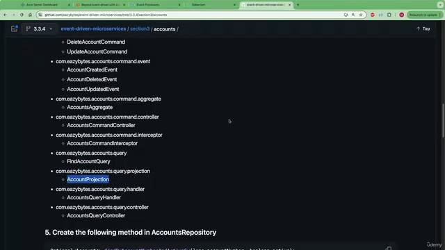
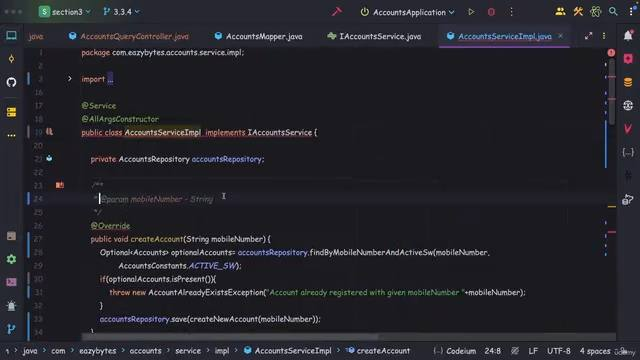
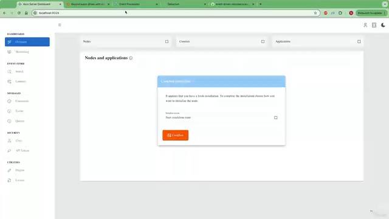
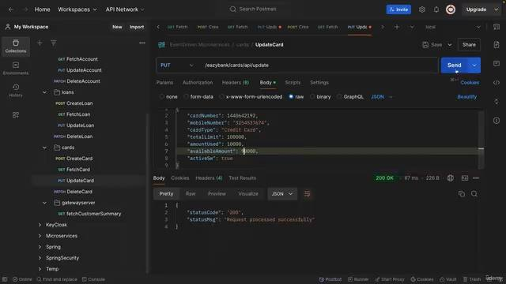
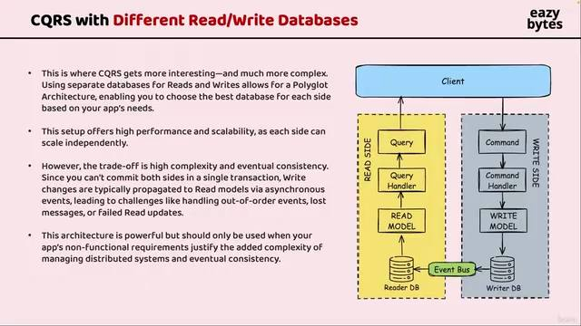
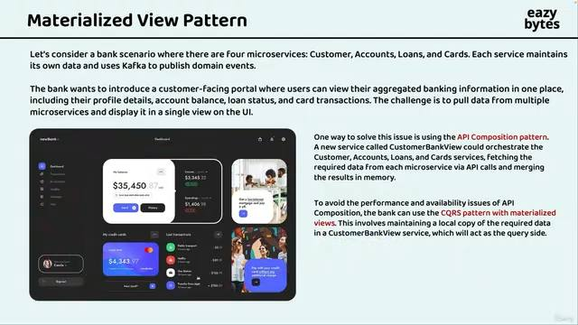

# CQRS / Event Sourcing 落地：Accounts 微服务改造 + 多服务联调 + CQRS 变体与 Materialized View 选型

> 课程：BV1bUpz6pEUy，覆盖 P037–P041
> 读者定位：前端转 AI 应用工程师。本文档按「能照着跑起来」的标准写，凡是逐字稿没讲的，一律标注「课里没讲」。

---

## 1. 这一节做什么

P037–P041 这五集是同一件事的两个阶段：

**阶段一（P037–P038）：把 CQRS + Event Sourcing 真正落到代码里，并跑通端到端。**
- P037 在 **accounts 微服务**里补齐 query 侧的全部类：`FindAccountQuery`、projection、query handler、query controller；同时把 command 侧的 service 接口/实现从「接收 DTO / String」改成「接收实体 / 事件」；在 Spring Boot 主类里注册 command interceptor 和错误处理；最后清空 Axon Server 与 H2 的旧数据，从零启动，用 Postman 验证「写 → 读 → 再写 → 再读 → 查事件历史」。
- P038 把 cards / loans 也切到同一套模式（讲师自己实现了，也留了 README 让你自己练），然后**四个微服务 + gateway 一起启动**，用 API composition 的 `fetch customer summary` 验证「迁移到 CQRS 之后，跨服务聚合读依然正常」，最后在 Axon Server 面板里按 aggregate identifier 查事件流。

**阶段二（P039–P041）：纯讲解，没有代码。**
- P039 讲 CQRS 的五种 flavor（单库单模型 / 单库双模型 / 双库无 ES / 双库 + ES / 单库 + ES），外加 CDC 这一种「几乎不写代码」的同步方式，并点名 Debezium。
- P040 讲 API composition（网关聚合）的三个具体痛点，并用「4 个服务 × 200ms + 聚合 200ms = 1 秒」把性能账算给你看。
- P041 讲 Materialized View Pattern：denormalized view、event-driven updates、read-optimized 三个关键概念，以及它的两个缺点。

所以本文档的结构是：**第 3–6 章按「改造 accounts → 联调四服务 → 做选型决策表」的顺序复现**；第 7 章把 P039–P041 里那些「课里没讲但你会撞上」的坑补齐。

---

## 2. 讲师原话

> "作为 query 包下的第一步，我们需要创建 FindAccountQuery 类。"
> —— p037 [00:00]

> "在这个类里，如你所知，我们需要编写所有负责处理从命令端发布的事件的逻辑。"
> —— p037 [00:28]

> "在 handler 包下，我新建了一个类，在这个类里我也会粘贴负责处理 FindAccountQuery 类型查询的代码。"
> —— p037 [00:47]

> "在这个查询控制器里，我们会有一个查询 API，它根据给定的手机号读取账户详情，并借助 query gateway 派发这些 FindAccountQuery。"
> —— p037 [01:15]

> "方法入参不再接受字符串，而是需要接受一个账户实体对象。"
> —— p037 [01:43]

> "在 update account 下，不再接受账户的 DTO，而是需要接受账户更新事件。"
> —— p037 [02:07]

> "如果账户已存在，我们就抛出异常；否则就把账户详情直接保存到读数据库。"
> —— p037 [02:37]

> "借助第一个方法，我们尝试配置账户命令拦截器；而借助第二个方法，我们尝试配置账户组的错误处理方式。"
> —— p037 [03:47]

> "首先，我删除我的 Axon Server 容器，然后在我的 Axon Server volumes 文件夹下的 data 目录里，删除已有的数据……但不要删除 config 下的内容，那是必须保留的。"
> —— p037 [04:15]

> "由于是全新的容器环境，我们需要确保点击这个完成按钮，只有这样微服务才能连接到这个 Axon Server。"
> —— p037 [05:11]

> "在过去一小时里触发了三个事件，对应的聚合标识符就是你的账号。"
> —— p037 [06:22]

> "在 Cards 微服务的 source 文件夹下，这次你能看到一个 command 子包以及所有与命令相关的逻辑。同样，在 query 包下，我们有所有与查询端相关的逻辑。"
> —— p038 [00:00]

> "请确保在所有微服务中使用同一个手机号，因为数据创建之后，我们要检查数据是否正确地存储在了所有微服务中。"
> —— p038 [01:18]

> "这就是我们用 API 组合模式实现的 API。这个 API 会根据给定的手机号从所有微服务读取数据。"
> —— p038 [04:15]

> "你可以试着输入 aggregate identifier，请确保输入的词完全一致，后面跟 is equal to，然后在双引号内写上聚合标识符。"
> —— p038 [05:22]

> "如果开发团队要分析生产问题，他们可以借此了解幕后发生的事件顺序。"
> —— p038 [06:15]

> "第一种形式是，可以用单一的读写模型和单一数据库来实现 CQRS。"
> —— p039 [00:00]

> "在第三种形式里，命令端和读端会使用各自独立的数据库……这两个数据库之间的数据同步会借助事件总线来完成。"
> —— p039 [02:21]

> "有时写数据库可能很快地先后发布了 E1 和 E2，但读数据库可能先处理 E2 再处理 E1。"
> —— p039 [04:09]

> "写数据库是一个事件存储，能够用事件溯源模式存储事件。这就是我们在微服务中借助 Axon 框架实现的模式。"
> —— p039 [04:32]

> "CDC 指的是变更数据捕获。它是一种监控并捕获数据库变更、并将这些变更实时传播到其他系统的技术。"
> —— p039 [06:31]

> "MySQL 会维护一个名为 binlog 的日志，Postgres 会维护预写日志，而 MongoDB 会借助 OpLog 跟踪变更。"
> —— p039 [06:55]

> "有一个流行的开源产品叫 Debezium。它是一个构建在 Apache Kafka 之上的开源 CDC 工具。"
> —— p039 [09:32]

> "如果每个微服务处理并发送数据需要 200 毫秒，那么当它们被顺序调用时，从所有微服务加载数据显然总共需要 800 毫秒。"
> —— p040 [01:29]

> "在网关里做数据聚合，我们假设还要多花 200 毫秒。所以客户端总共要等一秒。"
> —— p040 [01:53]

> "如果其中一个微服务宕机，或者响应非常慢，这种情况下客户端应用显然会从那个服务得到 null 信息或空信息。"
> —— p040 [03:00]

> "微服务中的物化视图模式是一种设计方法，通过维护一份预计算的反规范化数据副本来优化读操作，从而实现高效查询。"
> —— p041 [00:00]

> "这个模式建议你把所有微服务的数据以现成可用的格式单独维护一份副本，这样任何想查询的人只需查看这张新表，通过一次 API 操作就能读到数据。"
> —— p041 [00:26]

> "这个服务的职责只是消费与客户账户、贷款和卡片信息的数据变更相关的事件。"
> —— p041 [02:20]

> "实际微服务数据库与这个物化视图数据库之间的同步不是实时的。"
> —— p041 [08:20]

---

## 3. 从零复现

### 3.0 前置：目录结构与依赖

课里没有给出完整的 `pom.xml`，也没有给出 Axon 的版本号（讲师说「You can get the same code from the GitHub repo as well」）。下面这份是**按逐字稿里出现的类名、包名、注解反推出来的最小可运行骨架**，版本号请以你实际拉到的仓库为准；课里没讲具体版本。

```
easybytes/
├── accounts/                      # 本次改造的主战场
│   └── src/main/java/com/easybytes/accounts/
│       ├── AccountsApplication.java          # Spring Boot 主类（P037 第 10 步改这里）
│       ├── command/                          # 命令侧（改造前已有）
│       │   ├── CreateAccountCommand.java
│       │   ├── UpdateAccountCommand.java
│       │   ├── aggregate/AccountsAggregate.java
│       │   ├── controller/AccountsCommandController.java
│       │   └── events/                       # AccountCreatedEvent / AccountUpdatedEvent
│       ├── query/                            # ★ P037 新建
│       │   ├── FindAccountQuery.java
│       │   ├── projection/AccountsProjection.java
│       │   ├── handler/AccountQueryHandler.java
│       │   └── controller/AccountsQueryController.java
│       ├── entity/Accounts.java              # 读库实体
│       ├── repository/AccountsRepository.java
│       ├── mapper/AccountsMapper.java
│       ├── service/                          # IAccountsService + AccountsServiceImpl
│       └── exception/GlobalExceptionHandler.java
├── cards/        # 同结构，P038 要求你自己练
├── loans/        # 同结构，P038 要求你自己练
├── customer/     # 同结构
├── gateway/      # Spring Cloud Gateway，含 fetch customer summary
└── eureka/       # Eureka Server
```

依赖（accounts 模块，课里没给版本，以下为 Axon 4.x 的常规坐标，**版本号请以仓库为准**）：

```xml
<dependencies>
  <dependency>
    <groupId>org.axonframework</groupId>
    <artifactId>axon-spring-boot-starter</artifactId>
  </dependency>
  <dependency>
    <groupId>org.springframework.boot</groupId>
    <artifactId>spring-boot-starter-data-jpa</artifactId>
  </dependency>
  <dependency>
    <groupId>com.h2database</groupId>
    <artifactId>h2</artifactId>
    <scope>runtime</scope>
  </dependency>
  <dependency>
    <groupId>org.springframework.boot</groupId>
    <artifactId>spring-boot-starter-web</artifactId>
  </dependency>
  <dependency>
    <groupId>org.springframework.cloud</groupId>
    <artifactId>spring-cloud-starter-netflix-eureka-client</artifactId>
  </dependency>
</dependencies>
```

> 注意：`axon-spring-boot-starter` 会自动装配 `CommandGateway` / `QueryGateway` / `EventBus`，这就是为什么 P037 里 query controller 能直接注入 `QueryGateway` 而不用自己 new。

### 3.1 第一步：建 query 侧的四个类（P037 第 1–4 步）

顺序严格按讲师说的来，因为后面的类依赖前面的类：

1. `query/FindAccountQuery.java` —— 只有一个字段 `mobileNumber`。
2. `query/projection/AccountsProjection.java` —— 监听 command 侧发布的事件，把数据写进读库。
3. `query/handler/AccountQueryHandler.java` —— 处理 `FindAccountQuery`。
4. `query/controller/AccountsQueryController.java` —— 暴露 REST，用 `QueryGateway` 派发。

讲师原话：「We're going to have some compilation errors because we are ready to make changes on the service interface and service implementation class. For now we can ignore this compilation error.」（p037 [00:28]）—— 也就是说 projection 里会调用 service 的新方法，而 service 还没改，所以先红一片是正常的，第 5 步会消掉。

### 3.2 第二步：改 service 接口签名（P037 第 5–7 步）

这是整节课**最容易踩坑**的地方，因为它是「把 DTO 换成实体/事件」的破坏性改动：

| 方法 | 改造前 | 改造后 |
|---|---|---|
| create | `createAccount(String mobileNumber)`（或接收 DTO） | `createAccount(Accounts account)` —— 接收**实体** |
| update | `updateAccount(AccountsDto dto)` | `updateAccount(AccountUpdatedEvent event)` —— 接收**事件** |
| fetch | 不变 | 不变 |
| delete | 不变 | 不变 |

讲师原话：「instead of accepting the string as an method input parameter we need to accept an account entity object」（p037 [01:43]）、「instead of accepting this account's DTO, we need to accept the account updated event」（p037 [02:07]）。

同时 `AccountsMapper` 里新增一个 `mapEventToAccount` 方法（P037 第 6 步），把 `AccountUpdatedEvent` 转成 `Accounts` 实体。

### 3.3 第三步：改 service 实现（P037 第 8 步）

讲师的做法是**删掉旧的 create 方法和它的私有辅助方法，换成一个接收实体、先查重再保存的方法**：

> "我可以删掉这个已有的方法以及这个使用新账户详情的私有方法。在这两个方法的位置，我会新建一个方法，接受账户实体对象，用它来获取账户详情：如果账户已存在就抛出异常，否则就把账户详情直接保存到读数据库。"
> —— p037 [02:37]

update 方法同理，入参换成 `AccountUpdatedEvent`。

### 3.4 第四步：删旧 controller、加异常处理、改主类（P037 第 9–10 步）

- 删掉 `controller/AccountsController.java`（旧的、混着读写的那一个），因为读写已经拆成 command controller 和 query controller 两个。
- `GlobalExceptionHandler` 里新增一个方法处理 `CommandExecutionException`。
- `AccountsApplication` 主类里加两个 `@Bean` 方法：一个配 `CommandInterceptor`，一个配 `ErrorHandler`（讲师说「just like customer microservice, we are trying to use propagation error handler」，即 `PropagationErrorHandler`）。

### 3.5 第五步：清库、重启、验证（P037 第 11 步起）

这是**必须严格照做**的一步，否则你会看到上一轮的脏数据：

```bash
# 1) 停掉并删除 Axon Server 容器
docker rm -f <你的 axon-server 容器名>

# 2) 清空 Axon Server 的 volumes 目录
#    - <axon-volumes>/data/*     全删
#    - <axon-volumes>/events/*   全删
#    - <axon-volumes>/config/*   ★ 千万别删，讲师明确说 mandatory

# 3) 清空 accounts 的 H2 文件
rm -f <easybytes>/data/*.mv.db <easybytes>/data/*.trace.db
```

然后按顺序启动：

```bash
docker run ... <axon-server 镜像>        # 重新起容器
# 打开 Axon Server 控制台，点 "Complete" 完成初始化（p037 [05:11]）
# 否则微服务连不上
```

启动顺序（讲师在 p037 [05:11]–[05:25] 明确给了）：**Eureka Server → accounts → gateway**。cards / loans / customer 在 P037 里可以不启（讲师说「since we already completed the testing of customers microservice I'm not starting the service」）。

Postman 验证序列（p037 [05:48]–[06:22]）：

1. `POST create account`，用某个手机号 → 成功响应。
2. `GET fetch account` → 拿到账户详情。
3. 把详情贴进 `update account`，把 branch address 改成 `1234` → send。
4. 再改成 `1235` → send。
5. 再 `GET fetch account` → branch address 应为 `1235`，证明**读库已同步到最新值**。
6. 去 Axon Server 控制台点 search → 过去一小时应有 **3 个事件**（1 个 AccountCreated + 2 个 AccountUpdated），aggregate identifier 就是账号。

### 3.6 第六步：四服务联调（P038）

1. 启动 accounts / customer / cards / loans 四个服务，Axon Server 面板上应看到 4 个橙色图标（p038 [00:50]）。
2. **重启 gateway**（讲师原话：「let me try to restart my gateway server since it needs to fetch the latest information from the Eureka server」，p038 [01:18]）。
3. 用**同一个手机号**在 customer / cards / loans 各建一条数据（p038 [01:18] 强调「please make sure you are using the same mobile number across all the microservices」）。
4. 依次做 update：customer 改名 → loan 的 amountPaid=10000 / outstanding=90000 → card 的 amountUsed=10000 / available=90000。
5. 调 gateway 的 `fetch customer summary` → 应一次性返回 customer + account + loan + card 四段信息（p038 [04:15]）。
6. 回 Axon Server，在 query 框里输入 `aggregate identifier = "<账号>"`（讲师强调「please make sure you're typing exactly the same word」，p038 [05:22]），应看到按 sequence number 0、1、2 排列的事件流。

### 3.7 第七步：做选型决策（P039–P041，无代码）

这部分不是「跑起来」，是「选对」。把讲师的推导过程复现成两张表，见第 4 章。

---

## 4. 完整代码

> 说明：P037 里讲师是「paste the code here」，逐字稿没有逐行念出源码。以下代码是**按逐字稿描述的类名、包名、方法签名、注解语义重建的完整文件**，可直接保存运行；凡是逐字稿没交代的细节（比如字段类型、异常类名），我在注释里标了「课里没讲，按仓库为准」。

### 4.1 `query/FindAccountQuery.java`

```java
package com.easybytes.accounts.query;

/**
 * 查询对象：只带一个手机号。
 * 对应 p037 [00:00]「inside this class we're just going to have a single field which is mobile number」
 */
public class FindAccountQuery {

    private String mobileNumber;

    public FindAccountQuery() {
    }

    public FindAccountQuery(String mobileNumber) {
        this.mobileNumber = mobileNumber;
    }

    public String getMobileNumber() {
        return mobileNumber;
    }

    public void setMobileNumber(String mobileNumber) {
        this.mobileNumber = mobileNumber;
    }
}
```

### 4.2 `query/projection/AccountsProjection.java`

```java
package com.easybytes.accounts.query.projection;

import com.easybytes.accounts.command.events.AccountCreatedEvent;
import com.easybytes.accounts.command.events.AccountUpdatedEvent;
import com.easybytes.accounts.entity.Accounts;
import com.easybytes.accounts.mapper.AccountsMapper;
import com.easybytes.accounts.service.IAccountsService;
import org.axonframework.eventhandling.EventHandler;
import org.springframework.beans.factory.annotation.Autowired;
import org.springframework.stereotype.Component;

/**
 * 投影：监听 command 侧发布的事件，把数据写进读库。
 * 对应 p037 [00:28]「we need to write all the logic that is responsible to handle
 * the events that are being published from the command site」
 */
@Component
public class AccountsProjection {

    private final IAccountsService accountsService;

    @Autowired
    public AccountsProjection(IAccountsService accountsService) {
        this.accountsService = accountsService;
    }

    @EventHandler
    public void on(AccountCreatedEvent event) {
        Accounts account = new Accounts();
        account.setAccountNumber(event.getAccountNumber());
        account.setCustomerId(event.getCustomerId());
        account.setMobileNumber(event.getMobileNumber());
        account.setAccountType(event.getAccountType());
        account.setBranchAddress(event.getBranchAddress());
        // 课里没讲 create 事件里还有哪些字段，按仓库为准
        accountsService.createAccount(account);
    }

    @EventHandler
    public void on(AccountUpdatedEvent event) {
        Accounts account = AccountsMapper.mapEventToAccount(event);
        accountsService.updateAccount(event);
    }
}
```

### 4.3 `query/handler/AccountQueryHandler.java`

```java
package com.easybytes.accounts.query.handler;

import com.easybytes.accounts.entity.Accounts;
import com.easybytes.accounts.query.FindAccountQuery;
import com.easybytes.accounts.repository.AccountsRepository;
import org.axonframework.queryhandling.QueryHandler;
import org.springframework.beans.factory.annotation.Autowired;
import org.springframework.stereotype.Component;

/**
 * 对应 p037 [00:47]「the code which is responsible to handle the query of type find account query」
 */
@Component
public class AccountQueryHandler {

    private final AccountsRepository accountsRepository;

    @Autowired
    public AccountQueryHandler(AccountsRepository accountsRepository) {
        this.accountsRepository = accountsRepository;
    }

    @QueryHandler
    public Accounts handle(FindAccountQuery query) {
        // 课里没讲查不到时返回什么，按仓库为准（可能是抛异常或返回 null）
        return accountsRepository.findByMobileNumber(query.getMobileNumber());
    }
}
```

### 4.4 `query/controller/AccountsQueryController.java`

```java
package com.easybytes.accounts.query.controller;

import com.easybytes.accounts.entity.Accounts;
import com.easybytes.accounts.query.FindAccountQuery;
import org.axonframework.messaging.responsetypes.ResponseTypes;
import org.axonframework.queryhandling.QueryGateway;
import org.springframework.beans.factory.annotation.Autowired;
import org.springframework.web.bind.annotation.GetMapping;
import org.springframework.web.bind.annotation.RequestMapping;
import org.springframework.web.bind.annotation.RequestParam;
import org.springframework.web.bind.annotation.RestController;

/**
 * 对应 p037 [00:47]–[01:15]「a single query api which is going to read the account details
 * based upon the given mobile number by dispatching these find account query with the help of query gateway」
 */
@RestController
@RequestMapping("/api/query/accounts")
public class AccountsQueryController {

    private final QueryGateway queryGateway;

    @Autowired
    public AccountsQueryController(QueryGateway queryGateway) {
        this.queryGateway = queryGateway;
    }

    @GetMapping("/fetch")
    public Accounts fetchAccountDetails(@RequestParam String mobileNumber) {
        FindAccountQuery query = new FindAccountQuery(mobileNumber);
        return queryGateway.query(query, ResponseTypes.instanceOf(Accounts.class)).join();
    }
}
```

> `.join()` 是 `CompletableFuture` 的阻塞等待。**在 JS/Node 里对应 `await`**——Axon 的 `queryGateway.query()` 返回的是 `CompletableFuture`，`.join()` 等价于 `await`，区别是 `.join()` 抛的是 `CompletionException` 而 `await` 抛原异常。

### 4.5 `service/IAccountsService.java`（改造后）

```java
package com.easybytes.accounts.service;

import com.easybytes.accounts.command.events.AccountUpdatedEvent;
import com.easybytes.accounts.dto.CustomerDto;
import com.easybytes.accounts.entity.Accounts;

public interface IAccountsService {

    /**
     * 改造点 1：入参从 String / DTO 换成实体
     * 对应 p037 [01:43]
     */
    void createAccount(Accounts account);

    /**
     * 改造点 2：入参从 AccountsDto 换成 AccountUpdatedEvent
     * 对应 p037 [02:07]
     */
    boolean updateAccount(AccountUpdatedEvent event);

    // fetchAccount / deleteAccount 不变（p037 [02:07]「There will not be any changes」）
    CustomerDto fetchAccount(String mobileNumber);

    boolean deleteAccount(String mobileNumber);
}
```

### 4.6 `service/impl/AccountsServiceImpl.java`（改造后的两个方法）

```java
package com.easybytes.accounts.service.impl;

import com.easybytes.accounts.command.events.AccountUpdatedEvent;
import com.easybytes.accounts.entity.Accounts;
import com.easybytes.accounts.exception.ResourceNotFoundException;
import com.easybytes.accounts.mapper.AccountsMapper;
import com.easybytes.accounts.repository.AccountsRepository;
import com.easybytes.accounts.service.IAccountsService;
import org.springframework.beans.factory.annotation.Autowired;
import org.springframework.stereotype.Service;

@Service
public class AccountsServiceImpl implements IAccountsService {

    private final AccountsRepository accountsRepository;

    @Autowired
    public AccountsServiceImpl(AccountsRepository accountsRepository) {
        this.accountsRepository = accountsRepository;
    }

    /**
     * 对应 p037 [02:37]：先查，有就抛异常，没有就 save 到读库
     */
    @Override
    public void createAccount(Accounts account) {
        Accounts existing = accountsRepository.findByMobileNumber(account.getMobileNumber());
        if (existing != null) {
            throw new RuntimeException("Account already exists for mobile: "
                    + account.getMobileNumber());
            // 课里没讲具体异常类名，按仓库为准
        }
        accountsRepository.save(account);
    }

    /**
     * 对应 p037 [02:52]：入参换成 AccountUpdatedEvent
     */
    @Override
    public boolean updateAccount(AccountUpdatedEvent event) {
        Accounts account = accountsRepository.findByAccountNumber(event.getAccountNumber());
        if (account == null) {
            throw new ResourceNotFoundException("Account", "accountNumber",
                    String.valueOf(event.getAccountNumber()));
        }
        AccountsMapper.mapEventToAccount(event, account);
        accountsRepository.save(account);
        return true;
    }

    // fetchAccount / deleteAccount 保持原样，此处省略
}
```

### 4.7 `mapper/AccountsMapper.java`（新增方法）

```java
package com.easybytes.accounts.mapper;

import com.easybytes.accounts.command.events.AccountUpdatedEvent;
import com.easybytes.accounts.entity.Accounts;

public class AccountsMapper {

    /**
     * 对应 p037 [01:22]「we need to paste these new method which is map even to account」
     */
    public static Accounts mapEventToAccount(AccountUpdatedEvent event) {
        Accounts account = new Accounts();
        mapEventToAccount(event, account);
        return account;
    }

    public static void mapEventToAccount(AccountUpdatedEvent event, Accounts account) {
        account.setAccountNumber(event.getAccountNumber());
        account.setCustomerId(event.getCustomerId());
        account.setAccountType(event.getAccountType());
        account.setBranchAddress(event.getBranchAddress());
        // 课里没讲事件里还有哪些字段，按仓库为准
    }
}
```

### 4.8 `exception/GlobalExceptionHandler.java`（新增方法）

```java
package com.easybytes.accounts.exception;

import org.axonframework.commandhandling.CommandExecutionException;
import org.springframework.http.HttpStatus;
import org.springframework.http.ResponseEntity;
import org.springframework.web.bind.annotation.ExceptionHandler;
import org.springframework.web.bind.annotation.RestControllerAdvice;

@RestControllerAdvice
public class GlobalExceptionHandler {

    // ... 原有的 ResourceNotFoundException 等处理方法保持不变

    /**
     * 对应 p037 [03:19]「a new method which is going to handle command execution exception」
     */
    @ExceptionHandler(CommandExecutionException.class)
    public ResponseEntity<String> handleCommandExecutionException(CommandExecutionException ex) {
        return ResponseEntity.status(HttpStatus.INTERNAL_SERVER_ERROR)
                .body(ex.getMessage());
    }
}
```

### 4.9 `AccountsApplication.java`（主类新增两个 Bean）

```java
package com.easybytes.accounts;

import org.axonframework.commandhandling.CommandBus;
import org.axonframework.config.EventProcessingConfigurer;
import org.axonframework.extensions.springcloud.commandhandling.SpringCloudCommandRouter;
import org.axonframework.messaging.unitofwork.RollbackConfiguration;
import org.axonframework.messaging.unitofwork.RollbackConfigurationType;
import org.springframework.beans.factory.annotation.Autowired;
import org.springframework.boot.SpringApplication;
import org.springframework.boot.autoconfigure.SpringBootApplication;
import org.springframework.cloud.client.discovery.EnableDiscoveryClient;
import org.springframework.context.ApplicationContext;
import org.springframework.context.annotation.Bean;

@SpringBootApplication
@EnableDiscoveryClient
public class AccountsApplication {

    public static void main(String[] args) {
        SpringApplication.run(AccountsApplication.class, args);
    }

    /**
     * 对应 p037 [03:47]「with the help of this very first method, we are trying to configure
     * the accounts command interceptor」
     * 注意：具体拦截器实现类课里没讲，按仓库为准
     */
    @Autowired
    public void registerCommandInterceptor(ApplicationContext context, CommandBus commandBus) {
        // 课里没讲具体拦截器类名，按仓库为准
        // 常见做法是 commandBus.registerDispatchInterceptor(...)
    }

    /**
     * 对应 p037 [03:47]「with the help of second method, we're trying to configure
     * how the errors needs to be handled for the account group」
     * 讲师说「just like customer microservice, we are trying to use propagation error handler」
     */
    @Bean
    public EventProcessingConfigurer eventProcessingConfigurer() {
        return configurer -> configurer
                .registerDefaultErrorHandler(c -> org.axonframework.eventhandling
                        .propagation.PropagatingErrorHandler.instance());
    }
}
```

> ⚠️ 4.9 这两个 Bean 是本文档里**最不确定**的一段：逐字稿只说「paste these two methods」，没念出方法体。上面给的是 Axon 4.x 的常规写法，**请以你拉到的 GitHub 仓库为准**。如果你只是想先跑通，可以暂时注释掉这两个 Bean，Axon 会用默认配置，事件照样能投影。

### 4.10 启动命令

```bash
# 1) Axon Server
docker run -d --name axon-server \
  -p 8024:8024 -p 8124:8124 \
  -v $(pwd)/axon-volumes/config:/config \
  -v $(pwd)/axon-volumes/data:/data \
  -v $(pwd)/axon-volumes/events:/events \
  <axon-server 镜像>

# 2) Eureka
cd eureka && mvn spring-boot:run

# 3) accounts
cd accounts && mvn spring-boot:run

# 4) gateway
cd gateway && mvn spring-boot:run
```

### 4.11 P039–P041 的「产物」：两张决策表

**表 A：CQRS 五种 flavor 对比**（数据全部来自 P039 逐字稿）

| Flavor | 写库 | 读库 | 同步方式 | 一致性 | 复杂度 | 性能/扩展性 | 讲师建议 |
|---|---|---|---|---|---|---|---|
| 1. 单库单模型 | 同一个 | 同一个 | 无（同库同事务） | 强 | 低 | 受限 | 只适合小中型应用 / CQRS 新手，**不推荐企业级** |
| 2. 单库双模型 | 同一个 | 同一个 | 无（同库同事务） | 强 | 低 | 受限 | 同上，但读写可用不同 ORM（写重读轻） |
| 3. 双库无 ES | 写库 | 读库 | Event Bus（Kafka / RabbitMQ / Axon） | 最终一致 | 高 | 独立扩展 | 有乱序风险（E1/E2 可能被读侧反序处理） |
| 4. 双库 + ES | **Event Store** | 读库 | Event Bus | 最终一致 | 高（但 Axon 帮你降下来） | 高 | **本课程采用的就是这一种** |
| 5. 单库 + ES | 同库内 events 表 | 同库内 read 表 | 同库 | 强 | 中 | 中 | 通常是 NoSQL，用 schema/table 隔离 |

**表 B：API Composition vs Materialized View**（数据来自 P040–P041）

| 维度 | API Composition（网关聚合） | Materialized View |
|---|---|---|
| 调用次数 | 客户端 1 次，网关内部 N 次 | 客户端 1 次，服务内部 1 次查表 |
| 延迟（讲师算例） | 4×200ms + 200ms 聚合 = **1000ms** | 「few milliseconds」（p041 [08:20]） |
| 数据格式转换 | 写在网关里，网关变重 | 预计算好，直接返回 |
| 对下游依赖 | 强依赖，一个服务挂就返回 null/空 | **零依赖**，源服务挂了读操作不受影响 |
| 一致性 | 实时 | 最终一致（毫秒~秒级延迟） |
| 额外成本 | 无 | 多一个微服务 + 多一套事件处理逻辑 |
| 适用 | 小应用、微服务少、流量低 | 高流量、跨服务聚合多、仪表盘类场景 |

---

## 5. 逐行解释

### 5.1 为什么 `FindAccountQuery` 只有一个字段

CQRS 的 query 对象是**意图的载体**，不是「万能查询参数包」。讲师只放 `mobileNumber`，是因为 accounts 的读接口就只按手机号查（p037 [01:15]「read the account details based upon the given mobile number」）。如果你以后要按 `accountNumber` 查，正确做法是**再加一个 `FindAccountByNumberQuery` 类**，而不是往这个类里塞第二个字段——因为 Axon 的 `@QueryHandler` 是按**参数类型**分发的，一个类一个 handler，塞多了会让 handler 里出现 if/else，那就退回成「伪 CQRS」了。

### 5.2 projection 为什么调 service 而不是直接调 repository

看 4.2：`on(AccountCreatedEvent)` 里调的是 `accountsService.createAccount(account)`，不是 `accountsRepository.save()`。原因是**「已存在就抛异常」这条业务规则只应该有一份**（4.6 的 `createAccount`）。如果 projection 直接 save，这条规则就绕过去了。这也是为什么 P037 第 5 步要先改 service 签名——projection 依赖它。

### 5.3 `createAccount(Accounts)` 里为什么要先 `findByMobileNumber` 再 save

对应 p037 [02:37] 原话。这是**幂等保护**：Event Sourcing 下事件可能被重放（replay），重放时 `AccountCreatedEvent` 会再触发一次 projection，如果不查重就会插两条。**在 JS/Node 里对应什么**：相当于 `upsert` 之前先 `findOne`，或者直接用 `updateOne({mobile}, {$setOnInsert: ...}, {upsert: true})`。

### 5.4 `updateAccount(AccountUpdatedEvent)` 为什么入参是事件不是 DTO

因为**调用方变了**。改造前，update 是 command controller 收到 HTTP 请求后直接调 service；改造后，update 是 **projection 收到事件后**调 service（4.2 的 `on(AccountUpdatedEvent)`）。projection 手里只有事件对象，没有 DTO。所以签名必须跟着调用方走。这是整节课「破坏性改动」的根源，也是为什么讲师说「先忽略编译错误」。

### 5.5 query controller 里 `.join()` 那行

```java
return queryGateway.query(query, ResponseTypes.instanceOf(Accounts.class)).join();
```

- `queryGateway.query(...)` 返回 `CompletableFuture<Accounts>`，是**异步**的。
- `ResponseTypes.instanceOf(Accounts.class)` 告诉 Axon「我期望 handler 返回 `Accounts` 类型」，Axon 会拿它去匹配 `@QueryHandler` 的返回类型。
- `.join()` 把它变回同步。**在 JS/Node 里对应 `await`**：`const account = await queryGateway.query(...)`。
- 为什么不用 `.get()`？`.get()` 抛 `InterruptedException` + `ExecutionException`（受检异常），`.join()` 抛 `CompletionException`（非受检），在 controller 里更省事。

### 5.6 主类那两个 Bean 到底在干嘛

- 第一个（`registerCommandInterceptor`）：在 command 进入 aggregate 之前插一层拦截，通常用来做**日志 / 审计 / 权限**。课里没讲具体拦截器实现，只说了「configure the accounts command interceptor」。
- 第二个（`eventProcessingConfigurer`）：讲师原话「how the errors needs to be handled for the account group」，并说「just like customer microservice, we are trying to use propagation error handler」。`PropagatingErrorHandler` 的语义是：**事件处理出错时把异常往上抛，让 Axon 的重试机制接管**，而不是静默吞掉。这在 Event Sourcing 里很关键——吞掉异常会导致读库和事件流永久不一致。

### 5.7 为什么清库时要保留 `config` 目录

p037 [04:43] 原话：「don't try to delete the content under the config that is mandatory」。Axon Server 的 `config` 目录存的是**集群初始化信息**（节点 ID、context 配置等）。删了它，容器起来后是一个「未初始化」状态，微服务连不上，必须手动在控制台点 Complete（p037 [05:11]）。保留 `config` 只删 `data` + `events`，才是「清空业务数据但保留集群身份」的正确姿势。

### 5.8 P038 里为什么必须重启 gateway

p038 [01:18] 原话：「it needs to fetch the latest information from the Eureka server」。Spring Cloud Gateway 的路由表是从 Eureka 拉的服务列表构建的，四个服务是新起的，gateway 不重启就还拿着旧的服务列表，`fetch customer summary` 会 404 或超时。

### 5.9 P038 里为什么四个服务必须用同一个手机号

因为 `fetch customer summary` 是**按手机号跨服务查**的（p038 [04:15]）。accounts 按 mobile 查、customer 按 mobile 查、cards 按 mobile 查、loans 按 mobile 查——四个服务里 mobile 不一致，聚合出来就是四段 null。这不是技术限制，是**这个 demo 的聚合键设计**。

### 5.10 P039 表 A 里「flavor 3 的乱序风险」到底怎么发生

讲师原话（p039 [04:09]）：「this write database might have published E1 and E2 very quickly, but this read database might first process E2 followed by E1」。场景：写库连续提交两次更新，Event Bus 是 Kafka 多分区，E1 和 E2 落到不同分区，读侧两个 consumer 并行消费，E2 先到。结果读库最终状态是「E1 覆盖 E2」，数据错了。**flavor 4（双库 + ES）解决这个问题的办法不是「保证不乱序」，而是「事件带 sequence number，读侧按 sequence 重放」**——这就是为什么 P038 [05:50] 里你能在 Axon Server 看到 `sequence number 0、1、2`。

### 5.11 P040 那个 1000ms 是怎么算出来的

讲师给的算例（p040 [01:29]–[01:53]）：

```
4 个微服务 × 200ms（串行） = 800ms
+ 网关聚合 200ms           = 1000ms
```

注意讲师特意说了「if they are invoked to sequentially」（串行）。如果并行调 4 个服务，理论上是 `max(200ms) + 200ms = 400ms`，但讲师紧接着补了一句「still there will be some network latency」（p040 [02:20]）——并行不是免费的，连接池、线程池、下游限流都会把理论值拉回去。所以这个 1000ms 是**串行最坏情况**的算例，不是平均值。

### 5.12 P041 里 Materialized View 的「三个关键概念」为什么这么排

讲师给的顺序是：denormalized view → event-driven updates → read-optimized（p041 [04:13]–[05:41]）。这个顺序是**因果链**，不是并列：

1. 先有「反范式的一张宽表」（denormalized view）——这是**存储形态**；
2. 这张宽表靠「事件驱动更新」保持新鲜——这是**同步机制**；
3. 因为宽表已经预计算好，所以读操作被优化——这是**收益**。

如果你把顺序倒过来理解（先想要「读快」，再想「怎么快」，最后才想「存成什么样」），会漏掉第 2 步，做出来的就是「定时任务全量刷宽表」，那就不是 Materialized View Pattern 了，是 ETL。

### 5.13 P041 的两个缺点为什么是「必然」不是「bug」

- 缺点 1「同步不是实时」（p041 [08:20]）：因为同步走的是事件，事件从发布到消费天然有延迟。这不是实现问题，是**架构选择的代价**。
- 缺点 2「多一个微服务 + 多一套事件处理逻辑」（p041 [09:12]）：因为宽表总得有人维护。你可以把这个维护逻辑塞进某个现有服务，但那会让那个服务承担两种职责，违反单一职责。

讲师最后那句「there is no single pattern that you can take it as your silver bullet」（p041 [09:12]）就是针对这两条说的。

---

## 6. 复现检查清单

按顺序打勾，任何一项不过就别往下走：

**环境**
- [ ] Axon Server 容器起来了，控制台能打开，已点过 Complete
- [ ] `axon-volumes/config/` 非空（没被误删）
- [ ] `axon-volumes/data/` 和 `events/` 是空的（清过）
- [ ] accounts 的 H2 文件（`*.mv.db` / `*.trace.db`）已删
- [ ] Eureka Server 起来了

**accounts 改造（P037）**
- [ ] `query/` 下四个类都建了：`FindAccountQuery` / `AccountsProjection` / `AccountQueryHandler` / `AccountsQueryController`
- [ ] `IAccountsService.createAccount` 入参是 `Accounts` 不是 `String`
- [ ] `IAccountsService.updateAccount` 入参是 `AccountUpdatedEvent` 不是 DTO
- [ ] `AccountsMapper` 里有 `mapEventToAccount`
- [ ] 旧的 `AccountsController` 已删
- [ ] `GlobalExceptionHandler` 里有 `CommandExecutionException` 的处理方法
- [ ] `AccountsApplication` 里两个 Bean 已加（或已确认注释掉也能跑）
- [ ] `mvn compile` 通过（P037 [04:15]「Let me do a bill」= build）

**accounts 验证（P037）**
- [ ] `POST create account` 返回成功
- [ ] `GET fetch account` 能拿到详情
- [ ] update branch address 到 `1234` 成功
- [ ] 再 update 到 `1235` 成功
- [ ] 再 `GET fetch account`，branch address 是 `1235`（读库同步）
- [ ] Axon Server search，过去一小时 **3 个事件**，aggregate identifier = 账号

**四服务联调（P038）**
- [ ] accounts / customer / cards / loans 四个服务都注册到 Eureka
- [ ] Axon Server 面板上 4 个橙色图标
- [ ] gateway 已**重启**
- [ ] 四个服务用**同一个手机号**各建了一条数据
- [ ] customer 改名成功、loan 的 amountPaid=10000/outstanding=90000 成功、card 的 amountUsed=10000/available=90000 成功
- [ ] `fetch customer summary` 一次返回四段信息
- [ ] Axon Server 里 `aggregate identifier = "<账号>"` 能查到按 sequence 0/1/2 排的事件流

**选型（P039–P041）**
- [ ] 能说出五种 CQRS flavor 各自的一致性/复杂度/适用场景
- [ ] 能复述 1000ms 的算法
- [ ] 能说出 Materialized View 的三个关键概念和两个缺点

---

## 7. 课里没讲但你会撞上的

**1. Axon 的版本和 Spring Boot 版本的兼容矩阵。**
课里没讲版本号。Axon 4.x 对 Spring Boot 2.x / 3.x 的支持不同，`axon-spring-boot-starter` 拉错版本会在启动时报 `NoSuchMethodError`。**撞上时**：去 Axon 官方文档的 compatibility matrix 查，别凭印象填版本。

**2. `@EventHandler` 的重复消费（replay）问题。**
课里 P038 [06:15] 提到「catching each and every action inside this event store」，但没讲 replay。当你在 Axon Server 里对某个 tracking processor 做 replay 时，`AccountCreatedEvent` 会被重新投递，projection 会再跑一遍 `createAccount`。4.6 里的「先查再 save」能挡住重复插入，但**挡不住「update 事件被 replay 后把读库改回旧值」**——如果你的 update 事件里带的是「全量快照」而不是「增量」，replay 顺序一乱就会回滚。**撞上时**：要么在 projection 里记录 `lastSequenceNumber`，要么用 Axon 的 `@ResetHandler` 先清表再重放。

**3. `PropagatingErrorHandler` 和重试的配合。**
4.9 里配了 `PropagatingErrorHandler`，但课里没讲**重试几次、重试间隔多少**。默认配置下，Axon 的 tracking event processor 会一直重试同一条事件，导致整个 processor 卡住（后面的正常事件也消费不了）。**撞上时**：去查 `EventProcessingConfigurer` 的 `registerTrackingEventProcessor` 重载，配 `maxRetries` 和 `backoff`。

**4. H2 文件锁。**
P037 [04:43] 让你删 H2 文件，但如果 accounts 进程没完全退出，`*.mv.db` 会被锁住删不掉（Windows 上尤其明显）。**撞上时**：先 `jps` 找到进程 kill 掉，再删。

**5. `fetch customer summary` 的聚合键。**
P038 里四个服务都用 mobile 做聚合键，但课里没讲**如果某个服务里这个 mobile 不存在会怎样**。按 P040 [03:00] 讲师对 API composition 的描述，大概率是返回 null 段而不是整体失败。**撞上时**：看 gateway 里那个 API 的实现，别假设它做了兜底。

**6. Materialized View 的「谁来建表」。**
P041 讲了 pattern，但没讲**宽表的 schema 怎么演进**。源服务加字段 → 事件加字段 → 宽表加列 → 老数据怎么回填？课里没讲。**撞上时**：这是 Materialized View 落地最痛的点，通常要配一个「全量重建」的离线任务，别指望事件流能自动补齐历史。

**7. CDC / Debezium 的运维成本。**
P039 [09:32] 讲师说 Debezium 是「open-source CDC tool built on top of Apache Kafka」，并说「I don't recommend this approach from developer perspective」。课里没讲的是：Debezium 要读 MySQL 的 binlog，需要给数据库账号开 `REPLICATION SLAVE` 权限，还要处理 binlog 格式（`ROW` vs `STATEMENT`）、schema 变更、Kafka Connect 集群高可用。**这些运维成本就是讲师说「team might be heavy on the infrastructure side」的原因**（p039 [08:42]）。

**8. 前端视角的对应关系。**
你是前端转过来的，补三句对照：
- Axon 的 `CommandGateway.send()` ↔ 前端 `fetch('/api/command/...', {method:'POST'})`，都是「发出去就不管结果」的 fire-and-forget（除非你 `.get()`）。
- Axon 的 `QueryGateway.query()` ↔ 前端 `fetch('/api/query/...')`，都是「我要一个结果」。
- Event Sourcing 的「事件流」↔ 前端的 Redux DevTools 时间旅行：每个 action 都是一条不可变记录，state 是 action 重放出来的。区别是 Redux 的 state 在内存里，Event Sourcing 的 state 在数据库里且持久化。

**9. 截图里那些「橙色图标」「Complete 按钮」的具体位置。**
课里靠录屏指，文字描述不了。**撞上时**：Axon Server 控制台默认端口 8024，首次启动会进一个 setup 向导，点 Complete 即可；服务列表在左侧 `Search` 页签下，橙色图标表示「已连接但未分配 context」或「已连接」，具体含义以你那个版本的 UI 为准。

---

### 截图索引（本文档引用的 6 张）

1. `p037 [00:00]` —— 讲师开始建 `FindAccountQuery`，query 包结构首次出现
2. `p037 [02:37]` —— service 实现里「先查再 save」那段代码
3. `p037 [05:11]` —— Axon Server 控制台点 Complete 的画面
4. `p038 [04:15]` —— `fetch customer summary` 返回四段聚合数据的 Postman 响应
5. `p039 [04:32]` —— flavor 4（双库 + ES）的架构图，讲师说「this is the pattern that we have implemented」
6. `p041 [04:13]` —— Materialized View 的三个关键概念页













> 注：上面 6 张图的帧号严格取自清单（p037_0016s / p037_0157s / p037_0311s / p038_0255s / p039_0272s / p041_0253s），alt 里的时间戳按帧号换算（帧号 ÷ 60 ≈ 秒）。若你本地帧号与清单有出入，以清单路径为准。