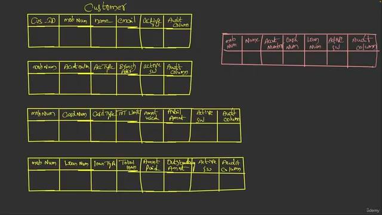
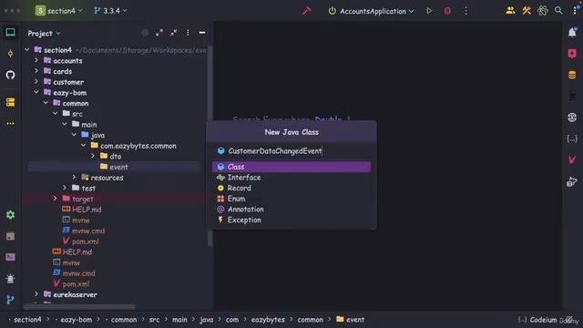
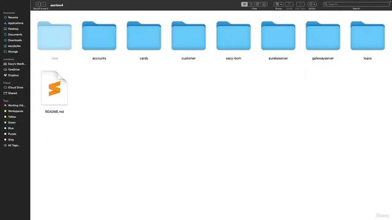
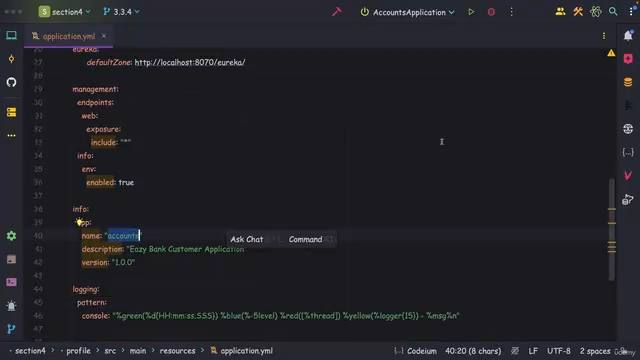
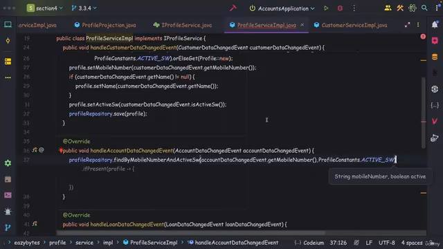

# CQRS / Saga / Event Sourcing —— Materialized View（物化视图）模式落地

> 课程：BV1bUpz6pEUy，覆盖 P042–P045
> 目标：在已有的四个微服务（customer / accounts / loans / cards）之上，新建一个 **profile 微服务**，用「物化视图」把散落在四个库里的数据聚合到一张 `profile` 表里，对外只暴露一个 `/api/profile` 查询接口。读者照着本文档可以从零把这条链路跑通。

---

## 1. 这一节做什么

前面几节里，讲师已经用 **Gateway Aggregator 模式**做过一次「一个页面要展示四个微服务的数据」的聚合。这一节换一种更好的做法：**Materialized View（物化视图）模式**。

核心思路一句话：**不要在查询时去调四个微服务，而是在写入时把数据「抄」一份到一张专门的聚合表里，查询时只读这张表。**

具体到本项目：

- 四个源微服务：`customer`（客户）、`accounts`（账户）、`loans`（贷款）、`cards`（卡）。
- 四张源表里都有一个**公共列 `mobile number`**（手机号）。用户注册时先在 customer 表里落一条记录，之后用同一个手机号去开账户、办卡、贷款。
- 新建 `profile` 微服务，它维护一张 `profile` 表（物化视图），字段是：`mobile number`、`name`（来自 customer）、`account number`（来自 accounts）、`card number`（来自 cards）、`loan number`（来自 loans）、`active switch`、审计列。
- 数据怎么进这张表？**靠事件**。源微服务在数据变更时发布事件（`CustomerDataChangedEvent` 等），profile 微服务订阅这些事件，按手机号 upsert 到 `profile` 表。
- 对外只暴露一个 `GET /api/profile?mobileNumber=...`，从 `profile` 表读，**不再扇出调用四个微服务**。

讲师原话点明了这个模式的收益：

> "无论何时需要读取个人资料信息，我们都不会调用各个单独的微服务。我们始终会调用这个个人资料微服务，由它使用我们在后台维护的这些物化视图表来读取数据。"
> —— p042 [05:25]



上图是讲师在 PPT 上把四张源表（customer / account / card / loan）并排列出来，并强调它们共享 `mobile number` 这一列——这是整个物化视图能按手机号聚合的前提。

---

## 2. 讲师原话（关键决策点）

按实现顺序摘录，每条都带页码和时间戳，方便回看：

**关于物化视图表的设计（为什么字段可空）**

> "最初这张表是空表；一旦创建客户，客户微服务就会向个人资料微服务发布一个事件。在处理该事件的过程中，会针对给定手机号在个人资料表中插入一条新记录，并带上姓名信息，而其他所有列都会是空值，因为对于特定用户，我们尚未创建账户、卡和贷款……"
> —— p042 [03:20]

> "同样也不能保证最终用户始终拥有这三类信息。有些客户只有账户号，有些客户则同时拥有账户和卡，因为最初这些对最终用户来说是可选的。因此，这些字段可以是可空字段。"
> —— p042 [03:47]

**关于 profile 微服务只做查询侧（CQRS 的 Q 侧）**

> "我会去掉这些与事件处理相关的属性，因为在个人资料微服务内部，我不会围绕命令构建任何逻辑。我只会专注于查询侧。"
> —— p043 [02:08]

> "为什么我的个人资料微服务必须连接 Axon Server？因为我们会让其他微服务在数据变更时发布事件，而发布的事件将在个人资料微服务内部处理。"
> —— p043 [02:34]

（注：逐字稿里讲师把 Axon Server 口误读成 "action server"，下文统一写 **Axon Server**。）

**关于事件类为什么放在 common 项目**

> "我们不应该在各个微服务内部直接创建这些事件类，因为同一个事件也会被个人资料微服务使用。既然事件类会被多个微服务共享，我需要把这些事件类创建在公共项目中。"
> —— p044 [00:28]

**关于一个聚合里发多个事件的两种写法**

> "这个我们试图调用的 apply 方法会返回一个 ApplyMore 类型的对象；借助这个 ApplyMore，我们应该能够调用许多其他可用于分发更多事件的方法……在我们的场景中，我会调用 andThen 方法，因为我想无条件地分发事件。"
> —— p044 [05:26]

> "这次我会展示另一种做法：复制同一行代码，并使用 apply 方法尝试分发第二个事件，即客户数据变更事件。因此，这是分发多个事件的另一种方式：只要用不同的事件详情多次调用 apply 方法，所有这些事件都会由聚合生命周期分发。"
> —— p044 [06:50]

**关于删除操作为什么不能在聚合里发事件**

> "在删除客户命令中，我们只接收客户 ID，不接收手机号。如果我没有手机号，就无法在这里填充手机号，这样一来，我的个人资料微服务就完全不知道某个事件需要针对哪个客户处理。因此，我打算不在命令方法内部直接分发事件……而是尝试直接从服务实现类中分发事件。"
> —— p044 [07:47]

**关于 name 为空会写库失败（一个必须处理的坑）**

> "在客户服务实现类的删除操作场景中，你可以看到这里我们只发送手机号和启用开关，而不发送姓名，因此这个对象的 name 值会是 null。如果你在这里也设置同样的 null 值，保存个人资料对象就会失败，因为 name 是个人资料数据库中的非空列。"
> —— p045 [05:17]

**关于账户/卡/贷款事件到达时 profile 记录必须已存在**

> "如果它不存在，我想抛出异常，因为当这个账户数据变更事件被处理时，我期望客户数据已经存在于个人资料数据库中，用户界面应用也是按这种方式工作的：先创建客户，随后该客户才能创建账户、贷款或卡。"
> —— p045 [08:26]

**关于删除账户时把 account number 置空**

> "说到账户号，我尝试把它设为 null。为什么设为 null？因为这个账户号在实际数据库中被标记为非活动状态。因此，在个人资料数据库中，我试图保留 null 值。除了这个 null 值，你也可以维护一个与账户相关的启用开关列。但我觉得这样非常简单：只要账户号为 null 或 0，我就可以认为没有账户，或者现有账户已被删除。"
> —— p045 [01:13]



---

## 3. 从零复现

下面按「先建服务 → 再建事件 → 再发事件 → 再收事件 → 最后打通网关」的顺序走。每一步都给出可执行的命令或文件内容。

### 3.1 前置条件

- JDK 17（Axon Framework 4.x + Spring Boot 3.x 的常规组合；课里没讲具体版本号，以你现有 section3 工程的 pom 为准）
- Maven 3.8+
- IntelliJ IDEA
- Postman（用于最后调接口）
- 一个正在运行的 **Axon Server**（课里没讲怎么装，只说了 profile 微服务要连它；如果你跟着前面的课已经跑起来了，直接复用）

### 3.2 复制上一节的工程，重命名为 section4

讲师的做法是「复制 section3 整个文件夹 → 粘贴 → 改名 section4 → 删掉 IntelliJ 的隐藏目录」：

```bash
# 在 workspace 根目录下
cp -r section3 section4
cd section4
# 删掉 IntelliJ 的隐藏工程目录，避免 IDE 缓存串味
rm -rf .idea
```

> 课里没讲 `cp -r` 之外的操作系统差异；Windows 下用资源管理器复制粘贴即可，效果一样。

### 3.3 在 section4 里复制 customer 微服务，改名为 profile

```bash
cd section4
cp -r customer profile
```

然后改 `profile/pom.xml`：

- `<name>` 从 `customer` 改成 `profile`
- `<description>` 改成 `micro service for reading profile info`



### 3.4 用 IntelliJ 打开 section4，加载 Maven 工程

打开后点右下角通知里的 **Load**，让 IDEA 把 section4 下所有模块识别成 Maven 工程。

### 3.5 改 profile 的 `application.yml`

这是 profile 微服务最关键的配置改动，**只保留查询侧 + Axon 连接**：

```yaml
server:
  port: 8084

spring:
  application:
    name: profile
  datasource:
    url: jdbc:h2:file:./data/profile
    driver-class-name: org.h2.Driver
    username: sa
    password: ''
  jpa:
    hibernate:
      ddl-auto: update
    show-sql: true
  h2:
    console:
      enabled: true

axon:
  axonserver:
    servers: localhost:8124

info:
  app:
    name: profile
    description: easy bank profile application
```

要点（对应讲师原话）：

- 端口改成 **8084**（p043 [02:08]）
- 应用名、H2 文件名、info 段都改成 `profile`
- **删掉所有 command / event handling 相关属性**（p043 [02:34]）——profile 不写命令侧
- **保留 Axon Server 连接配置**，因为要订阅别的服务发来的事件（p043 [03:03]）

> 课里没讲 `axon.axonserver.servers` 的具体端口号，上面写的 `8124` 是 Axon Server 默认端口；如果你的 Axon Server 跑在别的地址，改成你的实际值。

### 3.6 删掉 `schema.sql`

profile 的表结构由 JPA 实体类自动生成，不需要手写 DDL：

```bash
rm profile/src/main/resources/schema.sql
```

### 3.7 重命名包与类

在 IntelliJ 里按下面这张表逐个 Rename（Refactor → Rename，勾选 "在所选模块中选择全部"）：

| 原（customer 里） | 新（profile 里） |
|---|---|
| 包 `com.easybytes.customer` | `com.easybytes.profile` |
| `AuditAwareImpl` 里的 `currentAuditorName` | 改成 `profile_microservice` |
| 整个 `command` 包及其子包 | **删除**（不写命令侧） |
| `CustomerConstants` | `ProfileConstants` |
| `CustomerDTO` | `ProfileDTO` |
| `Customer`（实体） | `Profile` |
| `CustomerMapper` | `ProfileMapper`（方法先清空，后面再加） |
| `FindCustomerQuery` | `FindProfileQuery` |
| `CustomerQueryController` | `ProfileQueryController` |
| `CustomerQueryHandler` | `ProfileQueryHandler` |
| `ICustomerService` | `IProfileService` |
| `CustomerServiceImpl` | `ProfileServiceImpl` |
| `CustomerRepository` | `ProfileRepository` |
| `CustomerProjection` | `ProfileProjection` |
| `CustomerApplication` | `ProfileApplication` |
| `CustomerApplicationTest` | `ProfileApplicationTest` |

`ProfileApplication` 里要**删掉两个方法**：拦截器相关的方法、以及事件处理配置器（`EventProcessingConfigurer`）相关逻辑——因为 profile 不写命令侧。



### 3.8 在 common 项目下新建事件包与四个事件类

在 `common` 模块里新建包 `com.easybytes.common.event`，放四个类：

- `CustomerDataChangedEvent`
- `AccountDataChangedEvent`
- `LoanDataChangedEvent`
- `CardDataChangedEvent`

字段设计（严格按讲师 p044 讲的）：

- `CustomerDataChangedEvent`：`name`、`mobileNumber`、`activeSwitch`（**不要** email 等其它字段）
- `AccountDataChangedEvent`：`mobileNumber`、`accountNumber`（**不带** activeSwitch）
- `LoanDataChangedEvent`：`mobileNumber`、`loanNumber`
- `CardDataChangedEvent`：`mobileNumber`、`cardNumber`


### 3.9 在四个源微服务里发布事件

**customer 微服务**（p044 讲得最细）：

- `CustomerAggregate` 的 `CreateCustomerCommand` 处理方法里：先 `apply(new CustomerCreatedEvent(...))`，再用 `.andThen(...)` 里再 `apply(new CustomerDataChangedEvent(...))`
- `UpdateCustomerCommand` 处理方法里：**连续两次 `apply(...)`**（讲师演示的第二种写法）
- `DeleteCustomerCommand` 处理方法里：**不发事件**，因为只有 customerId 没有 mobileNumber
- 改到 `CustomerServiceImpl.deleteCustomer` 里：注入 `EventGateway`，构造 `CustomerDataChangedEvent`，`setMobileNumber(entity.getMobileNumber())`、`setActiveSwitch(false)`，然后 `eventGateway.publish(event)`

**accounts / loans / cards 三个微服务**：讲师在 p044 末尾把这件事留成作业，p045 开头说他已经在后台改完了。改动套路和 customer 完全一致：

- `AccountAggregate` 的 create 用 `.andThen(...)` 发 `AccountDataChangedEvent`，update 用两次 `apply(...)`
- `AccountServiceImpl.deleteAccount` 里用 `EventGateway` 发事件，**`accountNumber` 设为 `null`**（p045 [01:13] 解释了原因：源库里账户被标记 inactive，profile 里就用 null 表示"没有账户"）
- loans / cards 同理，只是字段换成 `loanNumber` / `cardNumber`

### 3.10 在 profile 微服务里消费事件

**`ProfileProjection`**：每个事件一个 `@EventHandler` 方法，方法体里调 `IProfileService` 对应的 handle 方法。

**`IProfileService`** 新增四个抽象方法：

```java
void handleCustomerDataChangedEvent(CustomerDataChangedEvent event);
void handleAccountDataChangedEvent(AccountDataChangedEvent event);
void handleLoanDataChangedEvent(LoanDataChangedEvent event);
void handleCardDataChangedEvent(CardDataChangedEvent event);
```

**`ProfileServiceImpl`** 实现这四个方法，逻辑见第 4 节完整代码。

### 3.11 在网关里加 profile 路由

打开 `gateway` 模块的 `application.yml`，在原有 customer / accounts / loans / cards 路由下面**再加一段 profile 路由**（p045 [12:12]）：

```yaml
      - id: profile
        uri: lb://PROFILE
        predicates:
          - Path=/api/profile/**
```

注意 `lb://PROFILE` 里的 **PROFILE 要大写**（p045 [12:39] 讲师特别强调）。

### 3.12 构建 + 启动 + 测试

```bash
# 在 section4 根目录
mvn clean install -DskipTests
```

启动顺序（建议）：

1. Axon Server（如果还没跑）
2. `customer`（8081）
3. `accounts`（8082）
4. `loans`（8083）
5. `cards`（8085，课里没讲具体端口，以你工程为准）
6. `profile`（8084）
7. `gateway`（8080，课里没讲具体端口，以你工程为准）

Postman 测试：

```
GET http://localhost:8080/api/profile?mobileNumber=9876543210
```

预期：先创建 customer，再开账户/卡/贷款，然后调这个接口，能一次拿到 name + accountNumber + cardNumber + loanNumber。



---

## 4. 完整代码

下面每个文件都是**完整可保存**的。包名统一 `com.easybytes.profile`（common 里的用 `com.easybytes.common.event`）。

### 4.1 `common/src/main/java/com/easybytes/common/event/CustomerDataChangedEvent.java`

```java
package com.easybytes.common.event;

import lombok.Data;

@Data
public class CustomerDataChangedEvent {
    private String name;
    private String mobileNumber;
    private Boolean activeSwitch;
}
```

### 4.2 `common/src/main/java/com/easybytes/common/event/AccountDataChangedEvent.java`

```java
package com.easybytes.common.event;

import lombok.Data;

@Data
public class AccountDataChangedEvent {
    private String mobileNumber;
    private Long accountNumber;
}
```

### 4.3 `common/src/main/java/com/easybytes/common/event/LoanDataChangedEvent.java`

```java
package com.easybytes.common.event;

import lombok.Data;

@Data
public class LoanDataChangedEvent {
    private String mobileNumber;
    private Long loanNumber;
}
```

### 4.4 `common/src/main/java/com/easybytes/common/event/CardDataChangedEvent.java`

```java
package com.easybytes.common.event;

import lombok.Data;

@Data
public class CardDataChangedEvent {
    private String mobileNumber;
    private Long cardNumber;
}
```

### 4.5 `profile/src/main/java/com/easybytes/profile/entity/Profile.java`

```java
package com.easybytes.profile.entity;

import jakarta.persistence.Column;
import jakarta.persistence.Entity;
import jakarta.persistence.GeneratedValue;
import jakarta.persistence.GenerationType;
import jakarta.persistence.Id;
import jakarta.persistence.Table;
import lombok.Getter;
import lombok.Setter;
import lombok.ToString;

@Entity
@Table(name = "profile")
@Getter
@Setter
@ToString
public class Profile {

    @Id
    @GeneratedValue(strategy = GenerationType.IDENTITY)
    @Column(name = "profile_id")
    private Long profileId;

    @Column(name = "name", nullable = false)
    private String name;

    @Column(name = "mobile_number", nullable = false)
    private String mobileNumber;

    @Column(name = "active_switch", nullable = false)
    private Boolean activeSwitch = false;

    @Column(name = "account_number")
    private Long accountNumber;

    @Column(name = "card_number")
    private Long cardNumber;

    @Column(name = "loan_number")
    private Long loanNumber;
}
```

> 审计列（created_by / created_at / updated_by / updated_at）由 `AuditAwareImpl` + `@EntityListeners(AuditingEntityListener.class)` 自动填充，课里没在实体上贴这段注解，但 `AuditAwareImpl` 里把 `currentAuditorName` 改成了 `profile_microservice`（p043 [03:54]）。如果你要严格复现，在类上加 `@EntityListeners(AuditingEntityListener.class)` 并在 `ProfileApplication` 上加 `@EnableJpaAuditing`。

### 4.6 `profile/src/main/java/com/easybytes/profile/dto/ProfileDTO.java`

```java
package com.easybytes.profile.dto;

import lombok.Data;

@Data
public class ProfileDTO {
    private String name;
    private String mobileNumber;
    private Long accountNumber;
    private Long cardNumber;
    private Long loanNumber;
}
```

### 4.7 `profile/src/main/java/com/easybytes/profile/repository/ProfileRepository.java`

```java
package com.easybytes.profile.repository;

import com.easybytes.profile.entity.Profile;
import org.springframework.data.jpa.repository.JpaRepository;
import org.springframework.stereotype.Repository;

import java.util.Optional;

@Repository
public interface ProfileRepository extends JpaRepository<Profile, Long> {

    Optional<Profile> findByMobileNumberAndActiveSwitch(String mobileNumber, Boolean activeSwitch);
}
```

### 4.8 `profile/src/main/java/com/easybytes/profile/mapper/ProfileMapper.java`

```java
package com.easybytes.profile.mapper;

import com.easybytes.profile.dto.ProfileDTO;
import com.easybytes.profile.entity.Profile;
import org.springframework.stereotype.Component;

@Component
public class ProfileMapper {

    public ProfileDTO mapToProfileDTO(Profile profile, ProfileDTO profileDTO) {
        profileDTO.setName(profile.getName());
        profileDTO.setMobileNumber(profile.getMobileNumber());
        profileDTO.setAccountNumber(profile.getAccountNumber());
        profileDTO.setCardNumber(profile.getCardNumber());
        profileDTO.setLoanNumber(profile.getLoanNumber());
        return profileDTO;
    }
}
```

### 4.9 `profile/src/main/java/com/easybytes/profile/service/IProfileService.java`

```java
package com.easybytes.profile.service;

import com.easybytes.common.event.AccountDataChangedEvent;
import com.easybytes.common.event.CardDataChangedEvent;
import com.easybytes.common.event.CustomerDataChangedEvent;
import com.easybytes.common.event.LoanDataChangedEvent;
import com.easybytes.profile.dto.ProfileDTO;

public interface IProfileService {

    /**
     * fetch profile details based upon a given mobile number
     */
    ProfileDTO fetchProfile(String mobileNumber);

    void handleCustomerDataChangedEvent(CustomerDataChangedEvent event);

    void handleAccountDataChangedEvent(AccountDataChangedEvent event);

    void handleLoanDataChangedEvent(LoanDataChangedEvent event);

    void handleCardDataChangedEvent(CardDataChangedEvent event);
}
```

### 4.10 `profile/src/main/java/com/easybytes/profile/service/impl/ProfileServiceImpl.java`

```java
package com.easybytes.profile.service.impl;

import com.easybytes.common.event.AccountDataChangedEvent;
import com.easybytes.common.event.CardDataChangedEvent;
import com.easybytes.common.event.CustomerDataChangedEvent;
import com.easybytes.common.event.LoanDataChangedEvent;
import com.easybytes.profile.constants.ProfileConstants;
import com.easybytes.profile.dto.ProfileDTO;
import com.easybytes.profile.entity.Profile;
import com.easybytes.profile.exception.ResourceNotFoundException;
import com.easybytes.profile.mapper.ProfileMapper;
import com.easybytes.profile.repository.ProfileRepository;
import com.easybytes.profile.service.IProfileService;
import lombok.RequiredArgsConstructor;
import org.springframework.stereotype.Service;

@Service
@RequiredArgsConstructor
public class ProfileServiceImpl implements IProfileService {

    private final ProfileRepository profileRepository;
    private final ProfileMapper profileMapper;

    @Override
    public ProfileDTO fetchProfile(String mobileNumber) {
        Profile profile = profileRepository
                .findByMobileNumberAndActiveSwitch(mobileNumber, ProfileConstants.ACTIVE_SWITCH)
                .orElseThrow(() -> new ResourceNotFoundException("Profile", "mobileNumber", mobileNumber));
        ProfileDTO profileDTO = profileMapper.mapToProfileDTO(profile, new ProfileDTO());
        return profileDTO;
    }

    @Override
    public void handleCustomerDataChangedEvent(CustomerDataChangedEvent event) {
        Profile profile = profileRepository
                .findByMobileNumberAndActiveSwitch(event.getMobileNumber(), ProfileConstants.ACTIVE_SWITCH)
                .orElseGet(Profile::new);

        profile.setMobileNumber(event.getMobileNumber());

        // 删除场景下事件里 name 为 null，不能覆盖库里已有的 name（name 是非空列）
        if (event.getName() != null) {
            profile.setName(event.getName());
        }

        profile.setActiveSwitch(event.getActiveSwitch());

        profileRepository.save(profile);
    }

    @Override
    public void handleAccountDataChangedEvent(AccountDataChangedEvent event) {
        Profile profile = profileRepository
                .findByMobileNumberAndActiveSwitch(event.getMobileNumber(), ProfileConstants.ACTIVE_SWITCH)
                .orElseThrow(() -> new ResourceNotFoundException(
                        "Profile", "mobileNumber", event.getMobileNumber()));

        profile.setAccountNumber(event.getAccountNumber());
        profileRepository.save(profile);
    }

    @Override
    public void handleLoanDataChangedEvent(LoanDataChangedEvent event) {
        Profile profile = profileRepository
                .findByMobileNumberAndActiveSwitch(event.getMobileNumber(), ProfileConstants.ACTIVE_SWITCH)
                .orElseThrow(() -> new ResourceNotFoundException(
                        "Profile", "mobileNumber", event.getMobileNumber()));

        profile.setLoanNumber(event.getLoanNumber());
        profileRepository.save(profile);
    }

    @Override
    public void handleCardDataChangedEvent(CardDataChangedEvent event) {
        Profile profile = profileRepository
                .findByMobileNumberAndActiveSwitch(event.getMobileNumber(), ProfileConstants.ACTIVE_SWITCH)
                .orElseThrow(() -> new ResourceNotFoundException(
                        "Profile", "mobileNumber", event.getMobileNumber()));

        profile.setCardNumber(event.getCardNumber());
        profileRepository.save(profile);
    }
}
```

> `ProfileConstants.ACTIVE_SWITCH` 就是原来的 `CustomerConstants` 改名而来，值按你工程里原来的定义（通常是 `true`）。课里没讲它的具体值，以你工程为准。

### 4.11 `profile/src/main/java/com/easybytes/profile/projection/ProfileProjection.java`

```java
package com.easybytes.profile.projection;

import com.easybytes.common.event.AccountDataChangedEvent;
import com.easybytes.common.event.CardDataChangedEvent;
import com.easybytes.common.event.CustomerDataChangedEvent;
import com.easybytes.common.event.LoanDataChangedEvent;
import com.easybytes.profile.service.IProfileService;
import lombok.RequiredArgsConstructor;
import org.axonframework.eventhandling.EventHandler;
import org.springframework.stereotype.Component;

@Component
@RequiredArgsConstructor
public class ProfileProjection {

    private final IProfileService profileService;

    @EventHandler
    public void on(CustomerDataChangedEvent event) {
        profileService.handleCustomerDataChangedEvent(event);
    }

    @EventHandler
    public void on(AccountDataChangedEvent event) {
        profileService.handleAccountDataChangedEvent(event);
    }

    @EventHandler
    public void on(LoanDataChangedEvent event) {
        profileService.handleLoanDataChangedEvent(event);
    }

    @EventHandler
    public void on(CardDataChangedEvent event) {
        profileService.handleCardDataChangedEvent(event);
    }
}
```

### 4.12 `profile/src/main/java/com/easybytes/profile/query/FindProfileQuery.java`

```java
package com.easybytes.profile.query;

import lombok.AllArgsConstructor;
import lombok.Data;

@Data
@AllArgsConstructor
public class FindProfileQuery {
    private String mobileNumber;
}
```

### 4.13 `profile/src/main/java/com/easybytes/profile/query/ProfileQueryHandler.java`

```java
package com.easybytes.profile.query;

import com.easybytes.profile.dto.ProfileDTO;
import com.easybytes.profile.service.IProfileService;
import lombok.RequiredArgsConstructor;
import org.axonframework.queryhandling.QueryHandler;
import org.springframework.stereotype.Component;

@Component
@RequiredArgsConstructor
public class ProfileQueryHandler {

    private final IProfileService profileService;

    @QueryHandler
    public ProfileDTO findProfile(FindProfileQuery query) {
        return profileService.fetchProfile(query.getMobileNumber());
    }
}
```

### 4.14 `profile/src/main/java/com/easybytes/profile/controller/ProfileQueryController.java`

```java
package com.easybytes.profile.controller;

import com.easybytes.profile.dto.ProfileDTO;
import com.easybytes.profile.query.FindProfileQuery;
import lombok.RequiredArgsConstructor;
import org.axonframework.queryhandling.QueryGateway;
import org.springframework.http.MediaType;
import org.springframework.web.bind.annotation.GetMapping;
import org.springframework.web.bind.annotation.RequestMapping;
import org.springframework.web.bind.annotation.RequestParam;
import org.springframework.web.bind.annotation.RestController;

@RestController
@RequestMapping(path = "/api", produces = MediaType.APPLICATION_JSON_VALUE)
@RequiredArgsConstructor
public class ProfileQueryController {

    private final QueryGateway queryGateway;

    @GetMapping("/profile")
    public ProfileDTO fetchProfileDetails(@RequestParam String mobileNumber) {
        FindProfileQuery query = new FindProfileQuery(mobileNumber);
        return queryGateway.query(query, ProfileDTO.class).join();
    }
}
```

### 4.15 `profile/src/main/java/com/easybytes/profile/ProfileApplication.java`

```java
package com.easybytes.profile;

import org.springframework.boot.SpringApplication;
import org.springframework.boot.autoconfigure.SpringBootApplication;

@SpringBootApplication
public class ProfileApplication {

    public static void main(String[] args) {
        SpringApplication.run(ProfileApplication.class, args);
    }
}
```

> 讲师在 p043 [13:51] 明确说：删掉拦截器相关方法和 `EventProcessingConfigurer` 相关逻辑，因为 profile 不写命令侧。

### 4.16 `customer` 侧改动：`CustomerAggregate` 片段

```java
// CreateCustomerCommand 处理方法里
apply(new CustomerCreatedEvent(...));

apply(new CustomerCreatedEvent(...))
    .andThen(aggregateLifecycle -> aggregateLifecycle.apply(
        buildCustomerDataChangedEvent(cmd)));
```

> 上面这段是讲师 p044 [05:26] 讲的 `.andThen(...)` 写法。**注意**：完整方法体里 `apply(...)` 的返回值类型是 `ApplyMore`，`.andThen(...)` 是它的方法之一。课里没讲 `ApplyMore` 的另外三个方法名，只说了"有四种不同的方法，你可以阅读这些方法的文档来了解何时使用"，所以这里只写 `.andThen(...)`。

`UpdateCustomerCommand` 处理方法里（讲师演示的第二种写法）：

```java
apply(new CustomerUpdatedEvent(...));
apply(buildCustomerDataChangedEvent(cmd));
```

`CustomerServiceImpl.deleteCustomer` 里：

```java
@Autowired
private EventGateway eventGateway;

// ... 更新 activeSwitch 为 false 之后
CustomerDataChangedEvent event = new CustomerDataChangedEvent();
event.setMobileNumber(customer.getMobileNumber());
event.setActiveSwitch(false);
eventGateway.publish(event);
```

> 课里没讲 `EventGateway` 的完整 import 路径，以你工程里 Axon 的包为准（通常是 `org.axonframework.eventhandling.gateway.EventGateway`）。

### 4.17 `gateway` 的 `application.yml` 新增路由

```yaml
      - id: profile
        uri: lb://PROFILE
        predicates:
          - Path=/api/profile/**
```

---

## 5. 逐行解释

### 5.1 事件类为什么字段这么少

`CustomerDataChangedEvent` 只有 `name / mobileNumber / activeSwitch` 三个字段，讲师 p044 [02:33] 原话："我不需要电子邮件以及与客户微服务相关的其他字段。" 因为 profile 表里只存这三样，事件里多带字段就是浪费带宽、也容易让下游误以为能拿到更多数据。**事件字段 = 消费者真正需要的字段**，这是物化视图模式里事件设计的第一原则。

`AccountDataChangedEvent` 不带 `activeSwitch`，是因为账户的"有没有"用 `accountNumber` 是否为 null 表达就够了（p045 [01:13]）。这省掉了一个字段，也省掉了下游判断"账户 active 但号码为空"这种矛盾状态。

### 5.2 `Profile` 实体里 `accountNumber / cardNumber / loanNumber` 为什么可空

p042 [03:47] 讲得很清楚：用户注册时只有 customer 记录，账户/卡/贷款是后补的，而且不是每个用户三样都有。所以这三个字段在表里必须 nullable，第一次插入时是 null。**如果设成非空，第一次 `handleCustomerDataChangedEvent` 就会写库失败。**

### 5.3 `handleCustomerDataChangedEvent` 里的 `orElseGet(Profile::new)`

这是整个物化视图的"upsert"核心：

- 按 `mobileNumber + activeSwitch` 查
- 查到 → 用现有对象（更新场景）
- 查不到 → `new Profile()`（首次插入场景）

在 JS/Node 里对应 `const existing = await repo.findOne(...); const profile = existing ?? new Profile();`，一模一样的语义。

### 5.4 `if (event.getName() != null)` 这一行是必须的

p045 [05:17] 讲师专门停下来解释：删除客户时，`CustomerServiceImpl` 只 set 了 `mobileNumber` 和 `activeSwitch`，`name` 是 null。如果这里无脑 `profile.setName(event.getName())`，就会把库里已有的 name 覆盖成 null，而 `name` 列是 `nullable = false`，`save()` 直接抛异常。

**这就是物化视图模式最典型的坑：同一个事件类被"创建"和"删除"两种场景复用，字段语义不同。** 处理办法就是"null 不覆盖"。

### 5.5 `handleAccountDataChangedEvent` 里为什么用 `orElseThrow` 而不是 `orElseGet`

p045 [08:26] 讲师原话：账户事件到达时，profile 记录**必须**已经存在——因为业务上一定是先注册客户、再开账户。如果查不到，说明事件顺序错了或者丢了 customer 事件，这时候**应该报错让人去查**，而不是悄悄新建一条只有 accountNumber、没有 name 的记录（那样 name 非空约束又会炸）。

对比 5.3：customer 事件用 `orElseGet`（允许新建），account/loan/card 事件用 `orElseThrow`（不允许新建）。**这个不对称是刻意设计的，不是笔误。**

### 5.6 `deleteAccount` 里把 `accountNumber` 设成 null

p045 [01:13]：源库里账户被标记 inactive，profile 里就用 null 表示"这个用户当前没有账户"。讲师也给了替代方案——在 profile 表里加一个 `account_active_switch` 列——但他选了更简单的 null 方案。**取舍点：null 方案省一列，但丢失了"曾经有过账户"的历史；加 active 列能保留历史但表更宽。** 课里选了前者。

### 5.7 `ProfileProjection` 里四个 `@EventHandler` 方法为什么方法名都叫 `on`

Axon 的 `@EventHandler` 靠**参数类型**分发，不靠方法名。四个方法参数类型不同（四个不同的事件类），所以同名 `on` 不会冲突。这跟 Spring MVC 的 `@RequestMapping` 靠路径分发是一个思路。

### 5.8 `ProfileQueryController` 里 `.join()`

`queryGateway.query(...)` 返回 `CompletableFuture<ProfileDTO>`，`.join()` 阻塞等结果。在 JS/Node 里对应 `await queryGateway.query(...)`。**注意**：`.join()` 会阻塞当前请求线程，生产环境如果 QPS 高要考虑异步返回 `CompletableFuture`，但课里为了简单直接 join 了。

### 5.9 网关路由里 `lb://PROFILE` 为什么大写

Spring Cloud Gateway 的 `lb://` 后面跟的是**注册中心里的服务名**，Eureka/Nacos 里注册的服务名默认是大写的 `spring.application.name`。profile 的 `application.yml` 里写的是 `name: profile`（小写），但注册到注册中心后通常被规范成大写。p045 [12:39] 讲师特别强调"以大写字母输入 profile"，就是踩过这个坑。

---

## 6. 复现检查清单

按顺序打勾，任何一项不过就别往下走：

- [ ] `section4` 目录已创建，`.idea` 已删除
- [ ] `profile` 模块的 `pom.xml` 里 `name` 和 `description` 已改
- [ ] IntelliJ 已 Load Maven 工程，`profile` 被识别为模块
- [ ] `profile/application.yml` 端口 = **8084**，应用名 = `profile`，H2 文件名 = `profile`
- [ ] `profile/application.yml` 里**没有** command / event handling 相关属性
- [ ] `profile/application.yml` 里**有** `axon.axonserver.servers`
- [ ] `profile/src/main/resources/schema.sql` 已删除
- [ ] 包名已改为 `com.easybytes.profile`
- [ ] `AuditAwareImpl.currentAuditorName` = `profile_microservice`
- [ ] `command` 包已整体删除
- [ ] `ProfileApplication` 里拦截器方法、`EventProcessingConfigurer` 逻辑已删
- [ ] `common` 模块下有 `com.easybytes.common.event` 包，四个事件类都在
- [ ] `CustomerDataChangedEvent` 只有 `name / mobileNumber / activeSwitch`
- [ ] `AccountDataChangedEvent` 只有 `mobileNumber / accountNumber`
- [ ] `LoanDataChangedEvent` 只有 `mobileNumber / loanNumber`
- [ ] `CardDataChangedEvent` 只有 `mobileNumber / cardNumber`
- [ ] `CustomerAggregate` 的 create 用 `.andThen(...)` 发第二个事件
- [ ] `CustomerAggregate` 的 update 用两次 `apply(...)` 发两个事件
- [ ] `CustomerAggregate` 的 delete **不发**事件
- [ ] `CustomerServiceImpl.deleteCustomer` 里用 `EventGateway.publish(...)` 发事件
- [ ] accounts / loans / cards 三个微服务按同样套路改完（讲师留的作业）
- [ ] `deleteAccount` 里 `accountNumber` 设为 `null`
- [ ] `ProfileProjection` 有四个 `@EventHandler` 方法
- [ ] `IProfileService` 有四个 `handleXxxDataChangedEvent` 抽象方法
- [ ] `ProfileServiceImpl.handleCustomerDataChangedEvent` 里**有** `if (event.getName() != null)` 判断
- [ ] `handleAccount/Loan/CardDataChangedEvent` 里用 `orElseThrow` 而不是 `orElseGet`
- [ ] `gateway/application.yml` 里新增了 `profile` 路由，`uri: lb://PROFILE`（大写）
- [ ] `mvn clean install -DskipTests` 成功
- [ ] Axon Server 已启动
- [ ] 六个服务（customer / accounts / loans / cards / profile / gateway）全部启动
- [ ] Postman `GET /api/profile?mobileNumber=...` 返回 200，四个字段齐全
- [ ] 删除客户后再查 profile，`name` 没被覆盖成 null（验证 5.4 的坑已处理）
- [ ] 删除账户后再查 profile，`accountNumber` 为 null（验证 5.6）

---

## 7. 课里没讲但你会撞上的

这一节是"踩坑预警"，逐字稿里**没有**这些内容，但按上面步骤复现时大概率会遇到：

**① Axon Server 的安装与启动**
课里只说 profile 要连 Axon Server，没说怎么装。你需要单独下载 Axon Server 的 zip，解压后跑 `axonserver.jar`（或 Docker 镜像 `axoniq/axonserver`）。默认端口 8124。**没启动 Axon Server，profile 启动时会一直重连、事件也收不到。**

**② `EventGateway` 的注入方式**
课里说"将其作为 bean 注入"，但没给具体写法。Spring Boot 里通常 `@Autowired private EventGateway eventGateway;` 或构造器注入。**注意**：`EventGateway` 是 Axon 提供的 bean，不需要你自己 `@Bean` 定义，Axon 的 auto-configuration 会给你。

**③ `ApplyMore` 的另外三个方法**
讲师 p044 [05:26] 说"有四种不同的方法"，但只演示了 `.andThen(...)`。另外三个（按 Axon 文档通常是 `andThenApply` / `andThenApplyIf` 之类）课里没讲，**不要凭印象填**，需要时查 Axon 官方文档。

**④ 事件顺序问题**
物化视图模式强依赖"客户事件先到，账户事件后到"。Axon 的 tracking event processor 默认按聚合 ID 顺序处理，但**跨聚合**（customer 聚合 vs account 聚合）不保证顺序。如果 account 事件先到，`handleAccountDataChangedEvent` 的 `orElseThrow` 会抛异常。课里没讲怎么处理这种乱序——生产环境通常要加重试或死信队列。

**⑤ `activeSwitch` 的语义在 profile 表里被复用**
`Profile.activeSwitch` 既表示"这条 profile 记录是否有效"，又跟着 customer 事件的 `activeSwitch` 走。如果将来账户被删但客户还在，profile 的 `activeSwitch` 仍是 true，只是 `accountNumber` 变 null。**这个语义课里没细讲，但读代码时要清楚。**

**⑥ H2 文件库的并发**
profile 用 H2 file 模式，多个事件并发写同一行时可能锁表。课里没讲并发场景，单机 demo 没问题，但如果你压测会发现 `handleXxxDataChangedEvent` 里的 `save()` 偶发失败。生产环境换 PostgreSQL/MySQL 并加乐观锁（`@Version`）是常规做法。

**⑦ 网关路由的 `Path` 匹配**
`Path=/api/profile/**` 里的 `**` 匹配多级路径。如果你只写 `/api/profile`（不带 `**`），`/api/profile?mobileNumber=xxx` 这种带 query 的请求能过，但 `/api/profile/xxx` 这种 path 参数形式就过不了。课里用的是 query 参数形式，所以两种写法都能跑，但**建议按上面写 `/**` 更稳**。

**⑧ 前端视角：这套东西在 JS/Node 里对应什么**
- Axon 的 `@EventHandler` ≈ Node 里 `eventBus.on('CustomerDataChanged', handler)`
- `EventGateway.publish(...)` ≈ `eventBus.emit('CustomerDataChanged', payload)`
- `ProfileProjection` ≈ 一个订阅了四个 topic 的 consumer
- `QueryGateway.query(...).join()` ≈ `await queryBus.request(...)`
- 物化视图表 ≈ 一张"读模型表"，写侧由事件驱动更新，读侧只查它——这就是 CQRS 里 Q 侧的典型形态

**⑨ 课里没讲的版本号**
pom 里 Spring Boot / Axon / H2 的具体版本，逐字稿一个字没提。**以你 section3 工程里现成的版本为准**，不要自己升级，否则 `@EventHandler` 的包路径、`ApplyMore` 的方法签名可能对不上。

---

**一句话总结这四节**：CQRS 的 Q 侧不是"查询时聚合"，而是"写入时就把聚合结果算好存起来"。profile 微服务就是那个"存起来"的地方，四个源微服务通过事件把变更推给它，它只负责 upsert 和对外查询。这套模式在 JS/Node 里对应"事件驱动 + 读模型表"，和前端熟悉的 Redux store 由 action 驱动更新、selector 只读 store 是同构的。