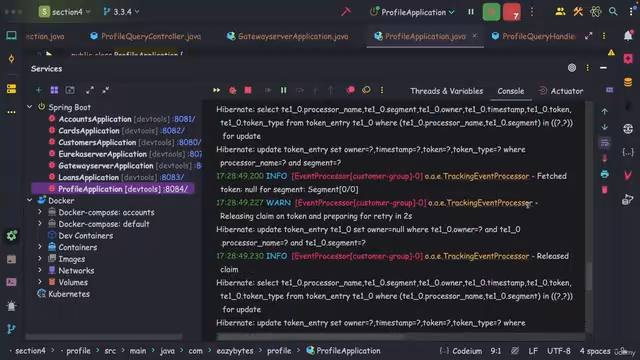
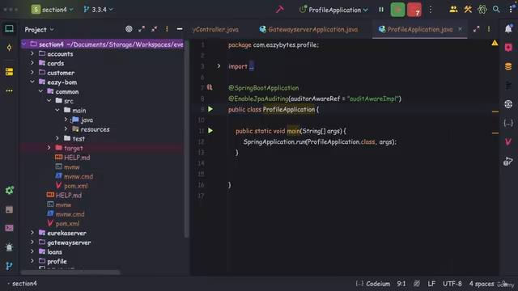
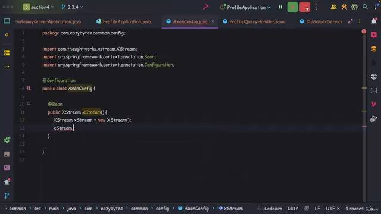
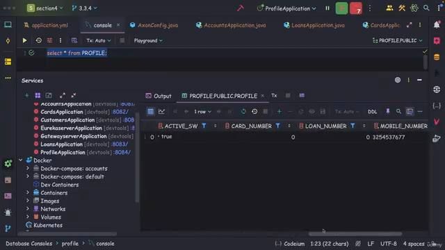
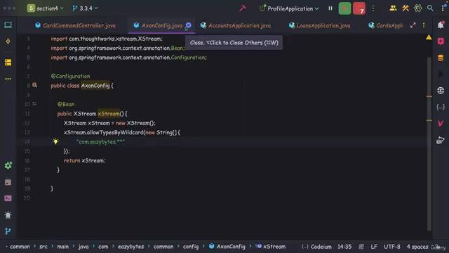
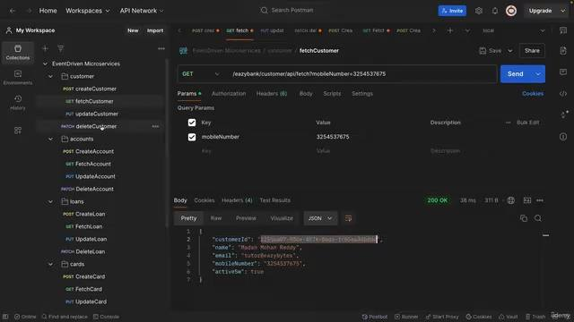
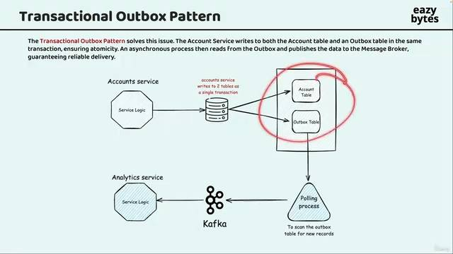
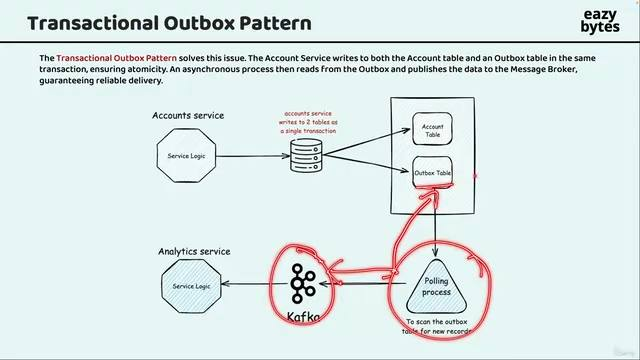

# CQRS 读侧落地：Materialized View Pattern 与 Transactional Outbox Pattern（P046–P048）

> 覆盖范围：P046、P047、P048 三讲。P046/P047 是**物化视图模式**的完整编码 + 演示，P048 是**事务性发件箱模式**的纯理论讲解（PPT，无代码）。
> 迁移提醒：这是 Java / Spring Boot 生态的课。下文所有 Java 语法你**知道即可**（看懂结构就行），重点是「服务之间用什么方式同步数据」这件事本身，Node 里同样会撞上。涉及事务、并发的地方，我会补一句在 JS/Node 里对应什么。

---

## 1. 这一节做什么

这一节建立在前面已经搭好的 7 个 Spring Boot 微服务之上：`eureka`（服务注册）、`gateway`（网关）、`accounts`、`cards`、`customer`、`loans`、`profile`，外加一个 `common` 公共模块和一个跑在容器里的 Axon Server（事件总线）。这一节新增的东西只有两类：

**第一类（P046 + P047）：让 profile 微服务变成一张跨服务的「物化视图」。**
customer / accounts / cards / loans 四个微服务，每次对数据做增、改、删，都往 Axon Server 发一个事件；profile 微服务订阅这些事件，把四个库里的字段拼成自己库里的**一张 `profile` 宽表**。对外只暴露一个 `GET /profiles/fetchProfile?mobileNumber=...`，一次调用就能拿到某个用户的姓名、账号、卡号、贷款号。这就是 Materialized View Pattern —— 读的时候不再跨服务拼装，写的时候用事件异步同步。

**第二类（P048）：讲清 Transactional Outbox Pattern。**
场景是：账号微服务写库后要通知数据科学团队，直接开库权限不行、两阶段提交（2PC）太慢，直接「写库 + 发 Kafka」又会因为两次操作不在一个事务里而丢消息。Outbox 的做法是在**同一个数据库里再加一张 `outbox` 表**，业务表和 outbox 表放在同一个事务里写，再由一个独立的轮询进程去扫 outbox、投递到 Kafka，投递成功才删或改标志位。最后讲师把 Outbox 和 Materialized View 从「目的 / 一致性对像 / 数据同步方式 / 典型场景 / 挑战」几个维度逐条对比。

按课程标题（CQRS / Saga / EventSourcing）的归类，P046–P047 是 **CQRS 里 Q（Query）那一侧**的落地；P048 是在为后面 Saga 打地基——先讲清「怎么把一条业务消息可靠地送出去」，下一步才谈「怎么在多个服务之间编排补偿」。

---

## 2. 讲师原话

> "出于安全原因，默认情况下，当我们使用 Axon framework 时，不允许将一个服务中的对象共享给其他服务。"
> —— p046 [03:07]

> "与其在每个微服务中分别定义这个配置类，我可以尝试把它创建在公共模块中，然后在所有微服务里导入同一个配置类。"
> —— p046 [03:50]

> "在这个字符串数组中，我需要传入所有希望被视为安全的通配符……只要某个类的包名以 `com.easybytes` 开头，我就希望允许对该类对象进行序列化。"
> —— p046 [05:14]

> "我们本应派发客户数据变更事件，但这里由于某些原因，我派发成了客户更新事件，这是错误的。"
> —— p047 [03:36]（删除客户时事件类型写错，导致运行时异常）

> "在卡号、贷款号和账号这三个微服务的数据库中，我们使用的是 `int` 数据类型。因此不能接受 null……我们可以尝试发送零值而不是 null 值。"
> —— p046 [11:16]

> "账户微服务最终可能只完成一半工作：它可能只确保把数据写入账户微服务，或者只向 Kafka 发布事件。"
> —— p048 [06:07]（这是 Outbox 模式要解决的问题）

> "要么两张表都写入，要么回滚整个事务……不会出现账户微服务只把数据插入其中一张表的情况。"
> —— p048 [07:43]

> "物化视图模式的重点是提升查询性能，而事务性发件箱模式的重点是维护事件发布过程中的数据一致性和可靠性。"
> —— p048 [14:11]

---

## 3. 从零复现

> 前提：你已经有前面几节搭好的 7 个微服务、`common` 模块、以及一个在跑的 Axon Server 容器（端口 8024 是 dashboard，8124 是 gRPC）。这一节只需要**新增一个配置类 + 五个主类加一行注解 + 各处 `@RequestParam` 补名字 + 三个 ServiceImpl 把 null 换成 0L + 一处事件类型改对**。

### 3.1 环境清空（从零开始）

讲师做的第一件事不是写代码，而是**把上一轮跑残留的东西全部清掉**，否则 H2 里会有脏数据、Axon Server 里会有旧事件，导致「明明代码对，结果不对」。

1. 停掉并删除正在跑的 Axon Server 容器：
   ```bash
   docker stop <axon-server-container-name>
   docker rm  <axon-server-container-name>
   ```
2. 删掉该容器挂载出来的 `data`、`events` 两个目录（这两个目录名是讲师原话点名的：*"删除 data 和 events 中现有的内容"*）。
3. 到你的**用户主目录**删掉所有 H2 数据库文件。H2 默认把 `.mv.db` 落在 `~/`（Windows 是 `C:\Users\<你的用户名>\`），每个微服务一个：
   ```bash
   # macOS / Linux
   ls ~/*.mv.db
   rm  ~/*.mv.db

   # Windows PowerShell
   Get-ChildItem $HOME -Filter *.mv.db | Remove-Item
   ```
4. 重新启动 Axon Server 容器，打开 `http://localhost:8024` dashboard，**点 "Complete" 按钮**（讲师特别强调："请确保你点击的是这个完成按钮"，不点这个按钮，之前登记的 context 状态会一直卡着）。

> 具体的 `docker run` 命令课里没念出来，请沿用你前面启动 Axon Server 的那条命令（通常是挂载两个 volume 到 8024/8124）。课里没讲版本号，别照抄我编一个。

### 3.2 按顺序拉起微服务

顺序很重要，Eureka 必须先起来，否则其它服务注册不上去：

1. `eureka-server`
2. `accounts`
3. `cards`
4. `customer`
5. `loans`
6. `profile`（**注意**：讲师遇到一个 IDE 的坑 —— "配置里的应用名称显示成了 customers application"，原因是 IDE 里 profile 的 Run Configuration 复制自 customer 但没改名，删掉重建一个即可。这是 IDE 问题，不是代码问题）
7. `gateway`

### 3.3 复现第一个 Bug：事件反序列化被拦

在 Postman 里对 `customer` 微服务发 `POST /customers/create`，body 里给一个手机号（例如 `3254537677`）。**接口返回成功**，但切到 `profile` 微服务控制台，会看到一条运行时异常（讲师现场演示的就是这一步）：



讲师对着日志说：*"我们知道所说的“某人”是谁，这里的“某人”指的就是 customer microservice"* —— 发件人确实是 customer，事件也确实到了 profile，但 profile 在**反序列化**的时候被 Axon 框架的安全策略拦下来了。原因是：两个微服务跑在不同的 JVM / 不同 Tomcat 里，跨网络传输事件本质是「序列化一个 Java 对象 → 到对端再反序列化回来」，Axon 默认只允许白名单内的类型，防止反序列化远程代码执行（类似 JSON 里 `constructor` 被滥用）。



### 3.4 在 common 模块添加 AxonConfig

讲师的处理方式是**不写 5 份配置，而是写一份放 common 模块，各微服务用 `@Import` 引进来**（原话见第 2 节）。在你的 `common` 模块下新建 `config` 包，放入下面这个类（完整文件见第 4 节 `AxonConfig.java`）。核心就一句话：把 `com.easybytes` 下所有类型加进 XStream 的反序列化白名单。



讲师在这里给了个可扩展性建议：**他用的是 `com.easybytes.**` 通配，而不是精确到 `com.easybytes.common.event`**。理由是"以后如果新增了什么东西，我不想再跑到这里来改"——以后新加事件类就不用改配置。你要按团队安全规范来：通配更省事，但白名单越窄越安全。

### 3.5 五个微服务加 `@Import`

在 `customer`、`accounts`、`loans`、`cards`、`profile` 五个 **Application 主类**上各加一行：

```java
@SpringBootApplication
@Import(AxonConfig.class)   // ← 新增这一行
public class CustomerApplication { ... }
```

`profile` 微服务同样适用，因为「the root package is com.easybytes」——五个服务的根包都一样，所以一份配置能通用。

### 3.6 验证事件通了

重启 / 让 devtools 热加载生效后，重新对 `customer` 发一次创建请求（讲师换了个尾号 `7677` 的手机号），profile 控制台不再报错。

然后进 H2 控制台查数据：打开 `profile` 的 `application.yaml`，点数据源图标 → Test Connection → Apply，再右键 `profile` 表 → New Query Console：

```sql
SELECT * FROM profile;
```

你应该能看到一行：`mobile_number = 3254537677`、`name` 已经被填上、`account_number / card_number / loan_number` 都是 **0**。



### 3.7 复现第二个 Bug：`@RequestParam` 丢了参数名

接着测**更新**（`PUT /customers/update` 把名字改成 "马丹·莫汉·雷迪"）没问题，profile 侧同步更新；测**创建 account / loan / card** 也都能同步。但一测 `cards` 的删除接口就炸：



报错信息是 `name for the argument of type not specified`。讲师的原话是：*"由于我们添加了这些与 xstream 相关的改动，运行时出现了一些问题"* —— 加了 XStream 配置之后，Maven 重新构建时的编译参数变了，`-parameters` 没带上，导致运行时拿不到方法参数名，`@RequestParam` 不知道要绑哪个 query 参数。

讲师的修法很直接：**在 `@RequestParam` 里显式写上参数名**。

```java
// 修复前
@DeleteMapping("/delete")
public ResponseEntity<...> delete(@RequestParam Long cardNumber) { ... }

// 修复后
@DeleteMapping("/delete")
public ResponseEntity<...> delete(@RequestParam("cardNumber") Long cardNumber) { ... }
```

讲师强调：**所有用了 `@RequestParam` 的地方都要改**，不只是 cards。`accounts`、`loans`、`customer`、`profile` 里凡是 `@RequestParam` 的都要补上名字。

> 根因补充（课里没讲透）：Spring Boot 3 之后官方推荐在 `pom.xml` 的 `maven-compiler-plugin` 里加 `<parameters>true</parameters>`，这样参数名靠编译时元数据保留。讲师走的是「显式写名字」这条更稳妥的路。两种都对，选一即可。

### 3.8 复现第三个 Bug：null 不能变 primitive

再测「删除卡片 → profile 里的 cardNumber 变成 0」。你会看到：

- 删除接口返回成功；
- 但 profile 里的 `cardNumber` **还是旧值**；
- profile 控制台又抛运行时异常。

讲师现场定位：删除卡片后，cards 微服务给 profile 发事件，事件里的 `cardNumber` 传的是 **null**；profile 侧的 `profile` 表里 `card_number` 是 primitive `long`，**primitive 不接受 null**，转换时炸了。

修法：在 `cards`、`loans`、`accounts` 三个 ServiceImpl 里，把删除时事件中的 `null` **改成 `0L`**：

```java
// 修复前
publisher.publish(new CustomerDataChangedEvent(..., null, ...));

// 修复后
publisher.publish(new CustomerDataChangedEvent(..., 0L, ...));
```

改完之后重新 build，再删一次 loan（card 之前已经删了，没法再删；所以讲师换测 loan 和 account）。结果：`fetchProfile` 返回的 `loanNumber` / `accountNumber` 依次变成 0。

### 3.9 复现第四个 Bug：删客户时发错了事件类型（P047）

P047 是同一套代码的**完整回归测试**，测序如下（自己照着走一遍就能复现全部行为）：

1. 创建客户 7675 → `fetchProfile` 能查到（说明事件同步到 MV）。
2. `PUT /customers/update` 改名 → `fetchProfile` 里 name 同步变。
3. 创建 account → `fetchProfile` 里 `accountNumber` 有值。
4. 创建 loan → `loanNumber` 有值。
5. 创建 card → `cardNumber` 有值。
6. 删 card → `cardNumber` 变 0。
7. 删 loan → `loanNumber` 变 0。
8. 删 account → `accountNumber` 变 0。
9. 删 customer → **炸了**。



讲师在 `CustomerServiceImpl` 里 scroll 到 delete 方法一看，发现：**delete 成功后应该发 `CustomerDataChangedEvent`，但代码里发成了 `CustomerUpdatedEvent`**。原话在 P047 [03:36]（第 2 节已引用）。改对之后重新构建，再删一次 7675：

- 接口返回成功；
- 再 `fetchProfile?mobileNumber=...7675` 返回 `profile not found with the given input data mobile number`。

到这里，物化视图模式的读侧就全部打通了。

> 注意：`profile` 接收到「客户被删除」这个事件后具体怎么删自己表里的行，**课里没展开讲**，讲师只演示了最终返回 `profile not found` 的结果。你的实现只要保证「客户删了 → 再查 profile 得 404」，中间怎么处理由你决定（真删 / 打软删除标记都行）。

### 3.10 P048：把 Outbox 的推演过程复现一遍（纯逻辑，无代码）

P048 是白板式讲解，没有可运行代码。但可以把讲师的**推理链**当作设计过程完整复现一遍：

**Step 1｜需求**
账号微服务每创建一条 account，数据科学团队要基于这条新数据做分析。

**Step 2｜约束（讲师逐条否掉的三种方案）**

| 方案 | 讲师给的问题 |
|---|---|
| A. 把 accounts 库的直接读权限开给数据科学团队 | ① 强耦合：accounts 改 schema 就要协调数科改逻辑；② 数科跑重分析会打爆 accounts 库，影响账号业务本身 |
| B. 两阶段提交（2PC） | 代码要协调两个库「先问 ready 不 ready，再统一 commit / rollback」；慢、阻塞、实现复杂；行业里用的人很少 |
| C. 写库 + 发 Kafka/RabbitMQ | 两次操作不在一个事务里：可能出现「库写了、Kafka 没发」或「Kafka 发了、库没写」的「半成品」 |

**Step 3｜关键洞察**
A、B、C 都做不到「只要有业务数据，就一定有事件」。问题不在 Kafka，而在「写库」和「发消息」是两次 I/O。

**Step 4｜方案**
- 在 accounts **同一个数据库**里加一张 `outbox` 表。
- 写入 account 表时，**同一事务**里往 outbox 表插一条记录（记录内容 = 待发事件的载荷 + 状态）。
- 因为同库同事务，要么两张表都插进去，要么都回滚——从结构上消除「半成品」。
- 另一个**独立进程**（轮询进程 / CDC）负责扫 outbox：
  - 轮询进程：定时扫 `status = NEW` 的记录 → 投递 Kafka → 收到 ACK 后删除或改成 `SENT`；没收到 ACK 就不动，下一轮再试。
  - CDC：监听数据库事务日志变更，自动把 outbox 的新增行投到 Kafka。

**Step 5｜取舍**
- 轮询简单、依赖少，但延迟受轮询间隔限制（讲师举的例子是每 30 分钟跑一次，出故障要等到 9:30 才补上）。
- CDC 实时性更好，但依赖数据库日志解析组件，部署复杂。
- 两种方式**都要有 outbox 表**，这是不变量。



**Step 6｜优缺点总结（讲师原话归纳）**

- **解耦**：accounts 只管往 outbox 写，不用关心消息怎么发、发给谁。
- **可靠性**：主业务失败则 outbox 一并回滚；有 outbox 记录就最终一定能送达（至少一次语义）。
- **可扩展**：消费方按自己节奏拉 outbox，快慢由消费方决定。
- **性能**：业务事务里少了「向消息中间件发请求」这一步，发消息变成异步。

**Step 7｜与 Materialized View 的对比**



讲师给出的差异表述（P048 [13:24]–[15:31]）可以整理成下面这张表，第 4 节会原样复述这张表作为交付物：

| 维度 | Materialized View Pattern | Transactional Outbox Pattern |
|---|---|---|
| 优化目标 | 读性能（Query 友好） | 事件投递可靠性 |
| 一致性载体 | 视图表（read model） | outbox 表 + 消息中间件 |
| 数据同步方式 | 消费业务事件 → 异步写视图表 | 业务表与 outbox 表**同事务**写入 → 异步进程搬运到 broker |
| 典型场景 | 跨服务查询、跨服务共享数据副本、报表聚合 | 事件驱动系统里「写库后必须可靠通知下游」 |
| 挑战 | 最终一致性调优、额外存储 | outbox 表清理、轮询/CDC 的运维开销 |

---

## 4. 完整代码

> 说明：P046–P047 讲师是在 IDE 里现场敲的，逐字稿里能 100% 确定的**只有下面这些落点**。凡是逐字稿没念出的部分（比如 `CustomerDataChangedEvent` 的完整字段、`profile` 部分的仓储层），我不会凭空补，会明确标「课里没讲」。P048 完全没有代码，第 4.6 节的内容标注为「课里没有代码，以下为示意」。

### 4.1 `common/src/main/java/com/easybytes/common/config/AxonConfig.java`

这是 P046 最重要的新增文件，**逐字稿里完整念过逻辑，可以直接照抄**：

```java
package com.easybytes.common.config;

import com.thoughtworks.xstream.XStream;
import org.springframework.context.annotation.Bean;
import org.springframework.context.annotation.Configuration;

@Configuration
public class AxonConfig {

    @Bean
    public XStream xStream() {
        XStream xStream = new XStream();
        // 把 com.easybytes 下所有类型加入反序列化白名单
        xStream.allowTypesByWildcard(new String[]{
                "com.easybytes.**"
        });
        return xStream;
    }
}
```

### 4.2 五个 Application 主类加 `@Import`

以 `customer` 为例（`accounts`、`loans`、`cards`、`profile` 做法完全相同，只是类名不同）：

```java
package com.easybytes.customer;

import com.easybytes.common.config.AxonConfig;
import org.springframework.boot.SpringApplication;
import org.springframework.boot.autoconfigure.SpringBootApplication;
import org.springframework.context.annotation.Import;

@SpringBootApplication
@Import(AxonConfig.class)
public class CustomerApplication {

    public static void main(String[] args) {
        SpringApplication.run(CustomerApplication.class, args);
    }
}
```

### 4.3 `@RequestParam` 显式命名（以 cards 为例）

逐字稿只念了「改 `@RequestParam` 加参数名」这一处改动，其余方法体它没念，**请保留你原有的卡片删除业务逻辑**。改动点如下：

```java
package com.easybytes.cards.controller;

import org.springframework.http.ResponseEntity;
import org.springframework.web.bind.annotation.*;

@RestController
@RequestMapping("/cards")
public class CardsController {

    // 其它 CRUD 方法课里没展开，保留你原有实现

    @DeleteMapping("/delete")
    public ResponseEntity<String> deleteCard(
            @RequestParam("cardNumber") Long cardNumber) {   // ← 关键：显式写名字
        // 原删除 + 发布事件的业务逻辑保持不变
        return ResponseEntity.ok("Card deleted successfully");
    }
}
```

> 同样的改法要在 `accounts`、`loans`、`customer`、`profile` 所有用到 `@RequestParam` 的方法上做一遍。讲师的现场做法就是「I'm going to make the similar change in the remaining places」。

### 4.4 删除时把 null 换成 0L（三个 ServiceImpl）

逐字稿**只在三个地方**明确点到要传 `0L`：`loans` 的 ServiceImpl、`cards` 的 ServiceImpl、`accounts` 的 ServiceImpl。事件构造的其余参数逐字稿没念，**以你现有的 `CustomerDataChangedEvent` 构造函数签名和原有参数为准**。改动点：

```java
// 以 CardsServiceImpl 为例；LoansServiceImpl / AccountsServiceImpl 的改法完全一样

// 修复前（删除卡片后事件里传 null）
publisher.publish(new CustomerDataChangedEvent(
        customer.getMobileNumber(),
        customer.getName(),
        customer.getAccountNumber(),
        customer.getLoanNumber(),
        null,                       // ← cardNumber 传了 null
        customer.getCustomerId()
));

// 修复后
publisher.publish(new CustomerDataChangedEvent(
        customer.getMobileNumber(),
        customer.getName(),
        customer.getAccountNumber(),
        customer.getLoanNumber(),
        0L,                         // ← 换成 0L（long 字面量）
        customer.getCustomerId()
));
```

### 4.5 `CustomerServiceImpl.deleteCustomer` 事件类型修正（P047 [03:36]）

逐字稿只念了「这里应该发 `CustomerDataChangedEvent`，我错发成 `CustomerUpdatedEvent`」这一段，事件里的具体参数**课里没念**。修正点是**事件类型**：

```java
// 错误写法（讲师原稿）
eventPublisher.publish(new CustomerUpdatedEvent(
        mobileNumber, customerId, /* ...原有参数... */
));

// 正确写法
eventPublisher.publish(new CustomerDataChangedEvent(
        mobileNumber, customerId, /* ...原有参数... */
));
```

### 4.6 Outbox 模式的数据库结构（课里没有代码，以下为示意）

> P048 讲师是 PPT 讲解，没有敲代码。下面不是讲师交付的产物，是我按他讲的三件事（同库、同事务、独立投递进程）画的**示意表结构和伪代码**，方便你日后落地时对着看。

```sql
-- 业务表（讲师只说了"账号表"，字段省略为示意）
CREATE TABLE account (
  account_number   BIGINT PRIMARY KEY,
  customer_id      BIGINT NOT NULL,
  account_type     VARCHAR(20),
  branch_address   VARCHAR(200)
);

-- outbox 表（同一个数据库）
CREATE TABLE outbox (
  id            BIGINT AUTO_INCREMENT PRIMARY KEY,
  aggregate_type VARCHAR(50) NOT NULL,        -- 例如 'Account'
  aggregate_id   VARCHAR(50) NOT NULL,
  event_type     VARCHAR(100) NOT NULL,
  payload        TEXT        NOT NULL,        -- 事件 JSON
  status         VARCHAR(20) NOT NULL DEFAULT 'NEW',   -- NEW / SENT
  created_at     TIMESTAMP   NOT NULL DEFAULT CURRENT_TIMESTAMP
);
```

```java
// 业务方法里：两个 insert 在同一个事务里
@Transactional
public void createAccount(Account account) {
    accountRepo.save(account);

    OutboxRecord record = new OutboxRecord();
    record.setAggregateType("Account");
    record.setAggregateId(String.valueOf(account.getAccountNumber()));
    record.setEventType("AccountCreated");
    record.setPayload(toJson(account));
    record.setStatus("NEW");
    outboxRepo.save(record);
    // 事务提交后，要么两行都在，要么都没有
}
```

```java
// 独立的轮询进程（讲师提到的 "polling process"，示意）
@Scheduled(fixedDelayString = "${outbox.poll.interval.ms:30000}")
public void publishPending() {
    for (OutboxRecord r : outboxRepo.findByStatus("NEW")) {
        try {
            kafkaTemplate.send("account-events", r.getPayload()).get(); // 等 broker ACK
            r.setStatus("SENT");
            outboxRepo.save(r);
        } catch (Exception ex) {
            // 不删、不改状态，等下一轮重试
            log.warn("publish failed, will retry: {}", r.getId(), ex);
        }
    }
}
```

> 补充：Outbox 若用 CDC 实现，则不需要上面这段 `@Scheduled` 轮询，但**outbox 表本身仍然要在**（讲师原话："这两种方案都会在 accounts microservice 一侧有 outbox 表"）。

**Node/JS 对照**：上面「两个 insert 必须在一个事务里」这件事，在 Node + Prisma 里就是 `await prisma.$transaction([prisma.account.create(...), prisma.outbox.create(...)])` —— 本质是同一个数据库的同一个事务，跟 Java 里 `@Transactional` 是同一个意思。跨库做不到这一点，这就是为什么 Outbox 一定要「同库」。

---

## 5. 逐行解释

**`@Configuration` + `@Bean`**：Spring 启动时会调用 `xStream()` 方法，把返回的 `XStream` 对象注册进容器。任何需要 XStream 的组件（Axon 内部会用到）都会拿这一个实例。**为什么不 put 在五个微服务各自的 Application 里？**——这正是讲师 P046 [03:50] 的那句话：定义一处 + `@Import` 五处，改一次全生效。

**`new XStream()`**：不带参数构造出来的是一个 **legacy XStream**，它有一个安全模式配置。Axon 默认会用它来序列化事件，所以咱们需要干预它的白名单。

**`allowTypesByWildcard(new String[]{"com.easybytes.**"})` 里的 `**`**：`*` 只匹配一层包，`**` 匹配任意层。讲师写的是 `com.easybytes.**`，意思是「凡是 `com.easybytes` 下任何子包、任何类，都允许」。为什么不用精确到 `com.easybytes.common.event`？讲师原话："以后如果新增了什么东西，我不想再跑到这里来改"——牺牲最小权限原则换取可维护性。你如果做金融、做开放平台，这里要收窄。

**`@Import(AxonConfig.class)`**：Spring 的普通 import。它把 `AxonConfig` 里定义的 Bean 塞进当前应用的容器。当只有一个类时，`@Import(AxonConfig.class)` 就够了；多个类才需要 `@Import({A.class, B.class})` —— 讲师说的 "既然我们只有一个类，就可以把这些大括号去掉" 指的就是这个。

**`@RequestParam("cardNumber")`**：不写字符串值时，Spring 靠**编译期参数名元数据**来绑定 query `?cardNumber=xxx`；一旦参数名元数据没保留（通常是 Maven `-parameters` 没开），Spring 就会在启动 / 调用时报 `name for the argument of type not specified`。显式写 `"cardNumber"` 就绕开了对元数据的依赖。**每个 `@RequestParam` 都建议这么写**，不仅为了这次 bug，也为了代码可读性。

**`null` → `0L`**：`profile` 表里 `account_number` / `card_number` / `loan_number` 是 primitive `long`（Java 基本类型，不能为 null），而事件对象里那个字段是包装类型 `Long`（可以为 null）。删除时若把 `null` 塞进去，到 profile 端落库时 `null → long` 的自动拆箱会抛 NPE。讲师用 `0L` 当哨兵值，等于「无号」。**这也是给读侧用户一个明确信号**：数字为 0 就表示该客户没有对应类型的账户 / 卡 / 贷款。

**`CustomerDataChangedEvent` vs `CustomerUpdatedEvent`**：两个事件名字很相近，但语义不同。`Updated` 通常带「旧的、新的」两面信息，profile 侧处理时默认「客户还存在，只是改了字段」；`Changed` 是更通用的事件。客户被删除时发 `Updated` 会导致 profile 侧按「更新」逻辑去处理一个「已经不存在」的实体，从而 NPE / 查不到。**改对事件类型之后，profile 侧就能判断「这个客户没了 → 删掉 / 标记 → 再查返回 profile not found」**。这是事件驱动里非常容易踩的坑：事件名必须表达**意图**，不能表达**相似性**。

**Outbox 为什么能解决问题、而「写库 + 发 MQ」不能**：因为写库和发 MQ 是**两次独立的网络 / 磁盘 I/O**，中间任何一步崩溃都会产生半成品。把「要发的事件」先写进同库的 outbox 表，跟业务写入共用同一个 DB 事务——这就是把「发消息」这个跨系统问题，降级成「同库两表写」这个 DB 天生就能保证的问题。剩下「outbox → broker」这一步交给异步进程，因为「投递失败可以重试」是可接受的，而「业务数据丢一半」是不可接受的。**在 Node 里，这对应 `await prisma.$transaction([...])` 把两次 insert 包进同一个事务**。

**为什么要 outbox 表而不用「先写业务表、提交后再发 Kafka、失败重试」**：因为「提交后发 Kafka」这一步已经脱离了事务，Kafka 发失败就得靠重试队列 + 幂等 + 去重表来保证最终一致；那套机制本身就是 outbox 的一种弱化实现，又比 outbox 多一个「判断哪些没发出去」的问题。**outbox 是把状态放在关系库里，最直白**。

**MV 与 Outbox 最本质的区别**：方向不同。MV 是「事件 → 读模型」，优化的是**查询**；Outbox 是「业务数据 → 可靠地变成事件」，优化的是**写后通知**。讲师 P048 最后那句 "物化视图的重点是提高查询性能，而 outbox 的重点是保证事件发布过程中的数据一致性和可靠性" 就是这个意思。

---

## 6. 复现检查清单

按顺序打勾，跳过任何一步都会让你误以为代码写错了。

**A. 环境与启动**

- [ ] Axon Server 容器已删旧 volume，`data`、`events` 目录内容已清空，容器重启后 dashboard 点了 **Complete**。
- [ ] 用户主目录下所有 `*.mv.db` 已删。
- [ ] 启动顺序：Eureka → accounts → cards → customer → loans → profile → gateway。
- [ ] Eureka dashboard 里能看到全部 7 个服务的注册状态（profile 的 Application name 不是 `CUSTOMER`，否则去 IDE Run Configuration 查）。

**B. 事件通不通**

- [ ] 建客户后 profile 控制台**没有** `XStream`/反序列化类异常。
- [ ] `profile` 的 H2 里 `SELECT * FROM profile` 能看到新行，`name` 已填。
- [ ] 更新客户姓名后，profile 里 `name` 同步变。
- [ ] 删卡片后 `cardNumber` 变 0（若仍是旧值 → 回去查 4.4 的 `0L`）。
- [ ] 删贷款后 `loanNumber` 变 0。
- [ ] 删账号后 `accountNumber` 变 0。
- [ ] 删客户后 `fetchProfile` 返回 `profile not found`（若报 NPE / 报事件异常 → 回去查 4.5 的事件类型）。

**C. 编译层面**

- [ ] 所有 `@RequestParam` 都写了参数名字符串（否则删除接口报 `name for the argument of type not specified`）。
- [ ] 五个微服务主类都加了 `@Import(AxonConfig.class)`（漏一个，那个服务收到事件就会在反序列化时炸）。
- [ ] 构建通过后再重新跑一遍，否则 devtools 热加载可能拿到旧 class。

**D. 中间件与数据**

- [ ] Axon Server 容器没有中途重启导致 context 状态丢失（讲师演示中两次重启都是因为要清数据）。
- [ ] 若删除卡片后再调「再删一次」，会得到业务异常，这是**预期行为**（源数据已经没了，没法再发删除事件）。

---

## 7. 课里没讲但你会撞上的

这一节不保证讲师讲过，是从你复现这套工程时会真遇到的坑整理的，**标「课里没讲」的就是我补充的**。

1. **Axon Server 的 `data` / `events` 目录具体挂在哪**
   课里讲师只说「delete the content present inside the data and events」，但 `docker run` 命令没念。你按自己项目的 `-v` 参数找，一般是 `axonserver-data` / `axonserver-events` 两个命名卷，或者项目根目录下的 `./data`、`./events`。**课里没讲卷名**。

2. **Spring Boot 3 之后 XStream 的版本兼容**
   课里讲师没提 `xstream` 版本。你如果 `allowTypesByWildcard` 编译不过，先确认 `pom.xml` 里 `xstream` 依赖和 Axon 的版本对齐。**这是「版本没对齐」而不是「讲师写错了」**。

3. **Maven `-parameters` 编译开关**
   `@RequestParam` 这种「靠参数名绑定」的机制，只要你给 Maven 加上 `<parameters>true</parameters>` 就能一劳永逸，不必每个方法手写名字。**课里讲师选了手写名字这条路**，你两条都能用，但别混着来：`<parameters>true</parameters>` 一开、又不写名字，行为会不一致。

4. **`CustomerDataChangedEvent` 是不是空值也照发**
   删除时 `0L` 充当「没有号码」的哨兵值，这是讲师的做法。**另一种做法是在事件里带一个 `deleted=true` 标记**，profile 侧据此把对应号码清 0——这比「猜 0 是没号还是没数据」更明确。课里没讲这种写法，这是给你的备选。

5. **profile 侧「客户被删之后」怎么处理**
   讲师只演示了「再查返回 `profile not found`」这个对外结果，**profile 侧是硬删行还是软删标记，课里没讲**。如果你的表有外键 / 需要用历史数据做审计，选软删；否则硬删。

6. **`@Scheduled` 轮询进程的幂等**
   讲师在 P048 只是说「polling process 收到 ACK 才删/改标志位，否则重试」，**没有展开讲「如果 broker 实际上收到了、但 ACK 丢了」怎么办**——这就是典型的「至少一次」投递，消费端必须幂等。业务表里加一个 `event_id UNIQUE` 约束是最简单的幂等键。**课里没讲这一层**，但只要你上生产，这一层躲不掉。

7. **CDC 的具体组件**
   讲师在 P048 [09:50] 说「the same outbox pattern can be also implemented using CDC technology」，**没有点名任何具体工具**（Debezium、Maxwell 等一概没提）。你要选 CDC 就按团队已有技术栈来，别在文档里把某个具体工具说成「讲师推荐的」。

8. **MV 场景二 / 场景三的落地**
   P047 [05:00] 起讲师讲物化视图的另外两个场景（跨服务共享地址副本、报表预聚合），**都是 PPT 讲解，没有代码**。如果你要落地「accounts 需要 customer 的地址」，就是照搬 P046 已经跑通的模式：customer 发 `CustomerAddressChangedEvent`，accounts 侧建一张 `customer_address_view` 表订阅写。**逻辑同构，代码形态你没见过，但规律是同一个**。

9. **跨服务事件反序列化的安全边界**
   `com.easybytes.**` 通配很省事，但意味着「任何 `com.easybytes` 下新增的类都会被反序列化」。**如果哪天你的 common 模块被引入了一个带危险 gadget 的第三方依赖，这里是攻击面**。教材里没讲安全审计，生产环境建议用精确到事件包的 `com.easybytes.common.event.**`。这一条纯属「课里没讲、你要自己加的」。

10. **JS/Node 侧的等价物**
    - 「同库两表同事务」→ `prisma.$transaction([...])` 或 `sequelize.transaction(async t => {...})`。
    - 「事件白名单」→ JSON.parse 的 reviver 里做类型校验 / 引入 zod 校验，避免任意对象反序列化。
    - 「轮询 + 重试」→ `setInterval` + `pg` 表锁 / `SELECT ... FOR UPDATE SKIP LOCKED`（PG）挑待发记录。**SKIP LOCKED 这一招课里没提**，但多实例轮询必用，否则两个实例会抢同一条记录发两遍。
    - 「幂等键」→ 在消费端表上加 `event_id UNIQUE` 约束。