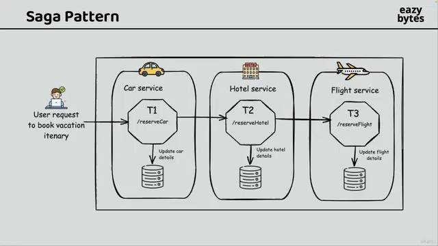
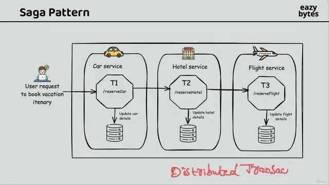
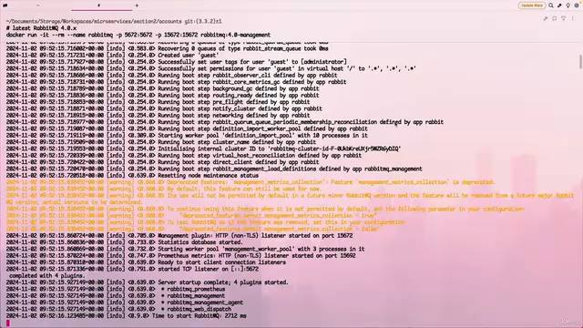
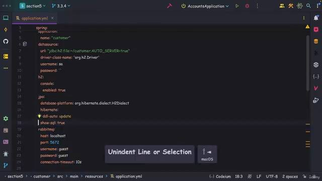
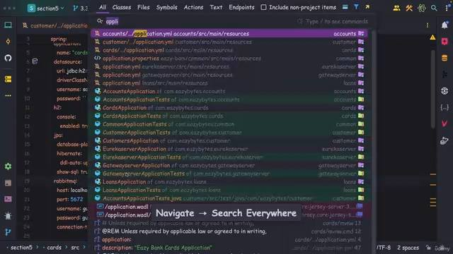
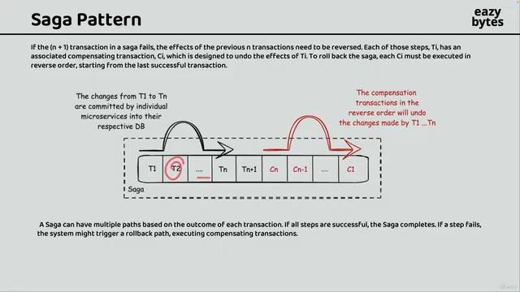
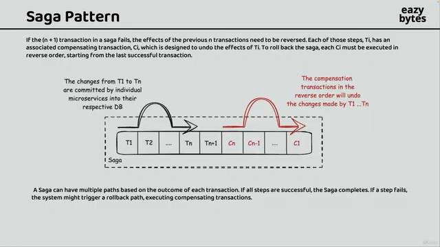
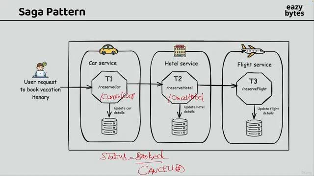
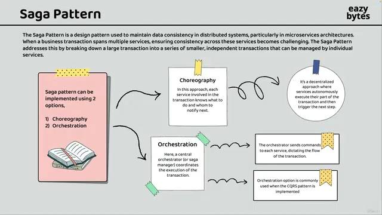

# CQRS/Saga/EventSourcing（BV1bUpz6pEUy）P49–P53 复现文档：从分布式事务痛点走到 Choreography Saga 的第一行代码

## 1. 这一节做什么

这五讲（P49–P53）是一条完整的“从问题到开工”的链路，不是零散知识点。把目标说清楚：

**要交付的东西**：一个名为 `section5` 的独立工程目录，里面是四个银行微服务（`customer` / `accounts` / `cards` / `loans`），每个微服务有自己独立的数据库；四个微服务的 `pom.xml` 都引入了 Spring Cloud Stream 与 RabbitMQ binder；四个 `application.yaml` 都配好了本地 RabbitMQ 连接；`common` 模块里新增了一个跨服务共用的请求 DTO `MobileNumberUpdateDTO`；`customer` 微服务里新增了一个 `PATCH /mobile-number` 接口。

**为什么是这套东西**：P49 先讲痛点——一次“订度假”的请求会穿过 car、hotel、flight 三个微服务，每个服务内部各自提交本地事务。如果第三个服务（flight）抛运行时异常，它自己那份数据能靠 `@Transactional` 回滚，但前面 car 和 hotel 已经提交进各自数据库的数据回滚不了，结果是“用户没订到机票，却背了一台车和一间房”。P50 给出解法：把一个大事务拆成每服务一个更小、独立的本地事务（T1…Tn），每个 Tn 配一个补偿事务 Cn，失败时按**逆序**执行 C3 → C2 → C1。P51 讲这个模式的收益和代价。P52 把例子换成课程里已经有的银行微服务，用“更新手机号”作为 Saga 场景。P53 真正动手：建 `section5`、复制代码、加依赖、起 RabbitMQ、写配置、写 DTO、写第一个接口。

**明确的边界**：这五讲**只到“把骨架搭好 + 一个永远返回 200 的 dummy 接口”**为止。真正的“调用下一个微服务、发事件、收到异常后触发补偿”的代码，P53 结尾讲师明说放到下一讲（“we're going to enhance this API to have some business logic”）。所以本文档不会替你补那段事件流转的代码——那属于课里没讲。

**为什么用 `section1` 的代码而不是 `section3/4`**：P53 [00:29] 明确说要“plain saga pattern without any cqrs and accent framework（逐字稿把 Axon 识别成了 accent），by using spring projects alone”，而 section 3、4 里的代码是套了 CQRS 框架的，所以基线取 `section 1` 的 `end` 目录。



## 2. 讲师原话

按讲义顺序摘关键判断句，方便你回查原视频。

**关于问题本质（分布式事务）**：

> "从最终用户的角度仔细观察，他尝试发起的只是一个事务或一个请求。但同一个请求会跨越多个微服务……这种在微服务内部处理请求的过程，我们可以称为分布式事务。"
> —— p049 [02:49]

> "我们也不能让这些事务一直等待，直到从其他微服务收到成功响应，因为这样会把数据库行锁住太长时间，从而引发性能问题……所以，在微服务中通常一完成业务逻辑就提交事务，并释放数据库表行上的锁。"
> —— p049 [04:29]

> "尽管我们在航班侧还没有预订任何东西，但最终却为最终用户预订了酒店房间和汽车。这会带来数据一致性问题。"
> —— p049 [04:59]

**关于补偿事务的语义（这是全书最重要的一句，别读漏）**：

> "Saga 模式在异常流程或错误流程中建议：补偿事务需要按相反顺序执行，以撤销原始事务（例如 T1、T2）所做的更改。因此，每个事务都应该有一个关联的补偿事务。"
> —— p050 [02:11]

> "我说回滚数据时，并不是指数据库事务回滚，而是指把数据回滚到一个有意义的状态。例如，汽车服务最初预订了一辆车，数据库中的状态可以是 booked。但当取消汽车的补偿事务执行时，它会做的事情是：可以把状态从 booked 更新为 cancel。"
> —— p050 [03:58]

> "我们在 T1 和 C1 中编写的逻辑会位于同一个微服务内，并指向同一个数据库。因此，C1 将是 T1 的本地补偿事务。"
> —— p050 [06:14]

**关于两种实现风格**：

> "作为协同式 Saga 模式的一部分……参与业务事务的每个微服务都需要知道，在成功场景下它需要调用的下一个微服务是谁……换句话说，我们可以把这种方法称为去中心化方法……而在编排流程中，由一个集中式编排器或集中式 Saga 管理器来协调事务的执行。"
> —— p050 [06:55]

> "通常，在实现 CQRS 模式时会使用编排方案……否则，你可以采用协同式 Saga 模式。这里没有好坏之分。"
> —— p050 [08:43]

**关于收益与代价**：

> "Saga 模式并不是解决所有问题的银弹。"
> —— p051 [00:27]

> "如果你希望在数据库中实现即时更新，那么 Saga 模式可能不是一个合适的选择。你要么准备好接受最终一致性，要么需要让客户端知道数据不会立即更新。它们需要持续轮询几秒或几毫秒。"
> —— p051 [06:18]

**关于本次选的实现方案**：

> "在尝试实现这种协同式 Saga 模式时，我不会使用任何 CQRS 模式，因为在实现 Saga 模式时并不强制使用 CQRS 模式。所以，我会向你展示使用 CQRS 和不使用 CQRS 的两种方案。"
> —— p052 [04:12]

> "这种协同式 Saga 模式的美妙之处在于，当我们尝试实现它时，不依赖任何框架，比如不必依赖 Axon 这类框架；你可以借助 RabbitMQ 或 Kafka 主题这样的队列，在微服务之间通过纯异步通信来实现这一模式。我会尝试借助 Spring Cloud Functions 和 Spring Cloud Stream 来实现异步通信……至于基础设施组件，我将使用 RabbitMQ。"
> —— p052 [04:35]

**关于基线代码的选择**：

> "我会把代码从 section 1 的 end 文件夹复制到 section 5 文件夹中，因为在第 3 节和第 4 节中，我们借助 Axon 框架实现了 CQRS 模式……我会采用 section 1 下 end 文件夹中的代码，所以让我把这些项目全部复制并粘贴到 section 5 中。"
> —— p053 [00:00]



## 3. 从零复现

下面每一步都给出“做完之后你该看到什么”，照顺序做即可。假定你的课程仓库结构是 `section1/end/...`、`section3/...` 这种形式（讲师用这个结构，你的仓库若不是，对应调整路径即可）。

### 步骤 0：环境前置

- JDK 与 Maven（版本随你 `section1/end` 里的工程确定，课里没喊具体版本号，先用能跑 `section1` 的那套）。
- IntelliJ IDEA（讲师用的是这个）。
- Docker（用来起 RabbitMQ 容器）。
- 一份能跑的 `section1/end` 代码。

### 步骤 1：建 `section5`，把 `section1` 的代码复制进来

在仓库根目录旁建一个文件夹 `section5`，把 `section1/end` 下的全部工程目录（`common`、`customer`、`accounts`、`cards`、`loans`，以及 Eureka/配置相关工程，以你实际仓库为准）整体复制进 `section5`。

复制完成后目录形如：

```
section5/
├── common/
├── customer/
├── accounts/
├── cards/
└── loans/
```

**为什么不能直接用 section3/4**：那两个 section 的代码里已经接了 CQRS 框架，和本节要演的“不用任何 CQRS 框架的纯 Saga”冲突。

### 步骤 2：用 IDE 打开，加载 Maven，先 build 一次

IntelliJ 点 Open 选中 `section5` 目录。打开后 IDE 右上会弹一条通知，点其中的 **Load**，它会把所有微服务识别成 Maven 工程。识别完先做一次 build，确认没有编译问题再往下走——先建立基线，后面出错才知道是新加的依赖引入的。

### 步骤 3：四个微服务的 `pom.xml` 各加两个依赖

依次打开 `customer`、`accounts`、`cards`、`loans` 四个工程的 `pom.xml`，在 **Eureka client 依赖的紧后面**插入两个依赖：

- `spring-cloud-stream`：把事件流到 RabbitMQ/Kafka 这类消息队列。
- `spring-cloud-stream-binder-rabbit`：因为本次基础设施选的是 RabbitMQ，需要 Rabbit 的 binder。

每加完一个工程就点一次 **Load Maven Changes**。

**验证 spring-cloud-function 是自动带进来的**：讲师的做法是点开 `spring-cloud-stream` 的 pom，往下滚，能看到 `spring-cloud-function-context`，再点进去还能看到 `spring-cloud-function-core`——这说明“加 stream 就不用额外声明 function”。你按同样路径点一次，能确认就不用单独加依赖。

### 步骤 4：起一个 RabbitMQ 容器

讲师没有在课上念 `docker run` 的具体参数，而是让你去 RabbitMQ 官网：`docs` 页 → 找到 **install and upgrade** 链接 → 里面给了一条 Docker 命令 → 复制到终端执行。

执行后**这个终端不要 Ctrl+C、不要关窗口**，因为容器进程就挂在这个终端上，停终端等于停 RabbitMQ。后面四个微服务都要连它。



### 步骤 5：四个 `application.yaml` 都加 RabbitMQ 连接段

打开 `customer` 的 `application.yaml`，在 `spring:` 节点下（也就是已有的 `jpa` 等属性之后、缩进回 `spring` 的那一层）新增 `rabbitmq` 段，写 `host`、`port`、`username`、`password`、`connection-timeout` 五项。用户名密码用默认的 `guest`/`guest`。注意缩进：`rabbitmq` 必须与 `datasource`、`jpa` 平级，都在 `spring` 下。

同一段配置复制到 `accounts`、`cards`、`loans` 三个 `application.yaml`，每个都点一次 Load Maven Changes 无害（yaml 不需要 reload，但保持习惯）。



### 步骤 6：给 `common` 模块补上校验依赖

不加这一步会卡住：DTO 上要写 `@NotEmpty`、`@Pattern`，但 `common` 的 `pom.xml` 里没有校验相关依赖，注解会直接飘红编译不过。

做法：从任意一个微服务的 `pom.xml` 里把 `spring-boot-starter-validation` 那条依赖复制出来，粘到 `common/pom.xml` 的 `<dependencies>` 里，Load Maven Changes，红线消失。

（逐字稿把这条依赖的 artifactId 念成了 “springboard starter validation”，标准的写法是 `spring-boot-starter-validation`。）

### 步骤 7：在 `common` 里建请求 DTO

在 `common` 工程的 DTO 包下新建类 `MobileNumberUpdateDTO`：类上 `@Data`；两个字段 `currentMobileNumber`、`newMobileNumber`，都是 `String`；两个字段上各压一组校验（非空 + 只接受 10 位数字）。



### 步骤 8：在 `customer` 的 controller 里加 PATCH 接口

打开 customer 的 controller，在已有 CRUD 方法后面加一个方法：`@PatchMapping("/mobile-number")`，返回 `ResponseEntity<ResponseDTO>`，入参是 `@Valid @RequestBody MobileNumberUpdateDTO`。第一版就是假的：直接返回 200 和一句 “Request processed successfully”，不写任何业务。

**做到这里，本节可交付物就齐了**：四个服务能启动、能连上 RabbitMQ、DTO 能编译、接口能被调到并返回 200。真正把 T1→T2→T3→T4 串起来、把 Cn 触发链写出来，是下一讲的内容（课里没讲，本文档不补）。

## 4. 完整代码

以下文件都能直接保存。带 `<!-- 课里没讲 -->` 或 `// 课里没讲` 注释的部分，是逐字稿没有念出、必须由你从 `section1/end` 现有代码里沿用的内容——我按“不编造”原则没有替你造版本号和包名。

### 4.1 目录结构（`section5` 完成后）

```
section5/
├── common/
│   ├── pom.xml                      ← 加 validation 依赖
│   └── src/main/java/.../dto/
│       └── MobileNumberUpdateDTO.java   ← 新建
├── customer/
│   ├── pom.xml                      ← 加 stream + binder-rabbit
│   ├── src/main/resources/application.yaml   ← 加 rabbitmq 段
│   └── src/main/java/.../controller/...     ← 加 PATCH /mobile-number
├── accounts/  (pom.xml + application.yaml 同上改法)
├── cards/     (pom.xml + application.yaml 同上改法)
└── loans/     (pom.xml + application.yaml 同上改法)
```

### 4.2 四个微服务的 `pom.xml` 依赖块（四份内容相同）

```xml
<!-- customer / accounts / cards / loans 四个 pom.xml 中，依赖块写成这样。
     已有依赖（Eureka client、JPA、Web 等）保留你 section 1 里的原样，课里没念具体坐标。 -->
<dependencies>

    <!-- 课里没讲版本号，沿用你 section1/end 里已有的版本管理（Spring Cloud BOM） -->
    <dependency>
        <groupId>org.springframework.cloud</groupId>
        <artifactId>spring-cloud-starter-netflix-eureka-client</artifactId>
    </dependency>

    <!-- 本次新增 1：事件流能力，负责把消息发到 RabbitMQ / Kafka -->
    <dependency>
        <groupId>org.springframework.cloud</groupId>
        <artifactId>spring-cloud-stream</artifactId>
    </dependency>

    <!-- 本次新增 2：RabbitMQ 绑定器，决定上面那个 stream 连的是 Rabbit 还是 Kafka -->
    <dependency>
        <groupId>org.springframework.cloud</groupId>
        <artifactId>spring-cloud-stream-binder-rabbit</artifactId>
    </dependency>

</dependencies>
```

> 说明：`spring-cloud-function-context` / `spring-cloud-function-core` 由 `spring-cloud-stream` 传递引入，**不需要**手写第三条依赖。验证办法见步骤 3。

### 4.3 `common/pom.xml` 新增的校验依赖

```xml
<!-- common/pom.xml 的 <dependencies> 内追加。
     这条是从某个微服务的 pom.xml 里复制过来的。 -->
<dependency>
    <groupId>org.springframework.boot</groupId>
    <artifactId>spring-boot-starter-validation</artifactId>
    <!-- 课里没讲版本号，走父工程/BOM 管理 -->
</dependency>
```

### 4.4 四个 `application.yaml` 的 RabbitMQ 段（四份内容相同）

```yaml
spring:
  # 课里没讲：datasource、jpa 等原有配置原样保留，下面只贴本次新增的部分
  rabbitmq:
    host: localhost
    port: 5672
    username: guest
    password: guest
    connection-timeout: 30000   # 课里只说有这个属性，没念具体数值，写毫秒整数即可
```

> 缩进要点：`rabbitmq:` 与 `datasource:` / `jpa:` 同级，全部在 `spring:` 下。讲师在 P53 [05:55]–[06:20] 反复强调“press enter、press tab one time”，就是在调这个层级。

### 4.5 `common` 模块的 `MobileNumberUpdateDTO.java`

```java
package com.example.common.dto;
// 课里没讲具体包名，请换成你 section1/end 里 common 模块实际的 dto 包路径

import jakarta.validation.constraints.NotEmpty;
import jakarta.validation.constraints.Pattern;
import lombok.Data;
// 课里没讲是 jakarta 还是 javax，取决于你的 Spring Boot 版本；Boot 3.x 用 jakarta

@Data
public class MobileNumberUpdateDTO {

    @NotEmpty(message = "Current mobile number must not be empty")
    @Pattern(regexp = "^[0-9]{10}$",
             message = "Current mobile number must contain exactly 10 digits")
    private String currentMobileNumber;

    @NotEmpty(message = "New mobile number must not be empty")
    @Pattern(regexp = "^[0-9]{10}$",
             message = "New mobile number must contain exactly 10 digits")
    private String newMobileNumber;
}
```

> 讲师只说了“rejects pattern which accept only 10 digit numerical value”，没有念出正则字符串本身；`^[0-9]{10}$` 是满足该描述的等价写法。

### 4.6 `customer` 微服务 controller 里新增的接口

```java
package com.example.customer.controller;
// 课里没讲包名，沿用你 section1/end 里的实际包路径

import com.example.common.dto.MobileNumberUpdateDTO;
// ResponseDTO、ResponseEntity 等 import 沿用该类里已有的写法，课里没念

import jakarta.validation.Valid;
import org.springframework.http.HttpStatus;
import org.springframework.http.ResponseEntity;
import org.springframework.web.bind.annotation.PatchMapping;
import org.springframework.web.bind.annotation.RequestBody;

// 类声明与已有的 CRUD 方法原样保留，下面只在类里追加这一个方法
// @RestController
// @RequestMapping(...)   ← 课里没念，沿用原类注解
public class CustomerController {

    // ... 已有的 CRUD 方法保留 ...

    @PatchMapping("/mobile-number")
    public ResponseEntity<ResponseDTO> updateMobileNumber(
            @Valid @RequestBody MobileNumberUpdateDTO request) {

        return ResponseEntity
                .status(HttpStatus.OK)
                .body(new ResponseDTO("200", "Request processed successfully"));
    }
}
```

> `ResponseDTO` 的构造参数与字段名在逐字稿里只被描述为“status code as 200 / status message ... request process successfully”，**具体构造签名请以你 `section1/end` 中现有 `ResponseDTO` 类为准**，不要照抄上面的字符串顺序。

### 4.7 一个可选的手工验证请求（课里没演示过发请求）

```bash
curl -X PATCH http://localhost:<customer服务端口>/mobile-number \
  -H "Content-Type: application/json" \
  -d '{"currentMobileNumber":"9876543210","newMobileNumber":"9123456780"}'
```

> 端口号课里没念；请求体字段名来自 4.5 的 DTO。这条命令是我补的验证手段，不是讲师演示过的内容。

## 5. 逐行解释

**`spring-cloud-stream` + `spring-cloud-stream-binder-rabbit` 两条依赖**：这两条是“能力 + 驱动”的关系。`spring-cloud-stream` 提供的是“把方法当消息处理器”的抽象，`binder-rabbit` 才是真正把消息往 RabbitMQ 的 exchange/queue 上推的那一层。只加第一条不加第二条，编译能过但运行时没有 binder，事件发不出去。讲师在 P53 [02:33] 特别点出“Since I'm looking to use rabbit mq as the infrastructure component, I need to make sure I'm adding these second dependency”——换句话说，如果哪天换成 Kafka，要换的是第二条，不是第一条。这也是 P52 [05:15] 说的“Regardless whether you are using RabbitMQ or Kafka，The way we implement choreography saga pattern it is going to be very similar”。

**为什么 `spring-cloud-function` 不用单独写**：因为 `spring-cloud-stream` 把它声明成了传递依赖。讲师在 P53 [02:59] 让你点进去看 `spring-cloud-function-context` 再点进去看 `spring-cloud-function-core`，就是让你确认“即使哪天 stream 换了版本，只要你还能看到这两个 artifact，function 的自动引入就没断”。

**`@Data`**：Lombok 给你补 getter/setter/`equals`/`hashCode`/`toString`。这个 DTO 会跨四个微服务使用（反序列化时 Jackson 要调 setter），所以 setter 不能少。

**`@NotEmpty` + `@Pattern(regexp="^[0-9]{10}$")`**：前者拦“null 和空串”，后者拦“长度或字符不对”。为什么两层都要：只写 `@Pattern` 时，字段为 `null` 会被当成“不校验，放行”，你会漏掉一个空手机号。讲师在 P53 [09:05] 说“I want to make sure these two fields are not empty and they are following a rejects pattern which accept only 10 digit numerical value”，说的就是这两层。（类比给前端同学：`@NotEmpty` ≈ `value.length > 0`，`@Pattern` ≈ `/^\d{10}$/.test(value)`。）

**`@Valid` 写在 controller 入参上**：校验注解只有被框架“触发”才生效。DTO 上写了 `@Pattern` 不加 `@Valid`，Spring 根本不会去跑校验器，非法手机号会一路进到业务逻辑里。讲师在 P53 [10:01] 明确说“Since I'm looking to perform the validations on the data that I'm going to receive inside this object, I need to mention one more annotation as well, which is at valid”。

**`@PatchMapping("/mobile-number")`**：选 PATCH 而不是 PUT，是因为这个操作的语义是“部分更新某个字段”，不是“整体替换客户资源”。这一点课里没解释，但用 PATCH 是这个领域里的通行做法。

**`ResponseEntity.status(HttpStatus.OK).body(...)`**：显式给出 200 和 body。讲师在 P53 [10:30] 说“the invocation is successful and inside the body, I can try to send response DTO object with the status as 200”，这一段是为了让“链路还没接通”的时候你能先做一个可调通的壳。

**`rabbitmq.connection-timeout`**：连接超时。给它一个值的好处是，RabbitMQ 没起来时微服务启动不会无限挂着等——你会得到一个超时异常，而不是一个沉默卡死的进程。这个属性的存在讲师提了，具体数值没提。

**关于 p049 [04:29] 那句“不要把行锁捂太久”，给前端同学补一对概念**：Java 里一个 `@Transactional` 方法从进入到返回，数据库行锁一直被这个事务握着，所以微服务里都是“做完就立刻提交、立刻释放锁”。在 Node/JS 里没有 `@Transactional` 这种东西，对应物是你在 `pg` / `mysql2` 里手动 `BEGIN` → 若干 SQL → `COMMIT`，同一个连接从 BEGIN 到 COMMIT 期间被这个事务独占，别的连接想改同一行会被阻塞。所以“让事务等别的微服务返回”这件事在 Node 里同样会让连接池被长时间占住——问题的形状完全一样，只是换了个语言。

**为什么补偿不是“数据库回滚”**（P50 [03:58] 那句最容易被误读）：Car 服务当初的 `booked` 状态已经 `COMMIT` 进数据库了，这部分数据在 Flight 服务崩溃时**不在任何还活着的事务里**，数据库层面根本没有“回滚”可言。所以 Cn 的实现方式是把状态从 `booked` 改成 `cancelled`——业务上等价于取消，运营那边看到 `cancelled` 就不会派车，也就没有业务损失。这就是“rollback to a meaningful state”的意思。前端视角类比：不是把数组 pop 掉，而是把记录上的 `status` 从 `success` 改成 `refunded`，下游只看 `status`。









## 6. 复现检查清单

按顺序打勾，任何一项不过就不要往下走：

- [ ] `section5` 存在，且里面是 `section1/end` 的代码（不是 section3/4，那两份带 CQRS 框架）。
- [ ] IDE 打开 `section5` 后点了 Load，所有工程都被识别为 Maven 工程。
- [ ] 加依赖**之前**先 build 过一次，是绿的。
- [ ] `customer`、`accounts`、`cards`、`loans` 四个 `pom.xml` 里，`spring-cloud-stream` 与 `spring-cloud-stream-binder-rabbit` 都在 Eureka client 依赖之后出现。
- [ ] 点开 `spring-cloud-stream` 的 pom，能看到 `spring-cloud-function-context`；再点进去能看到 `spring-cloud-function-core`。看得到 = 不用单独加 function 依赖。
- [ ] RabbitMQ 容器已启动，且**启动它的那个终端没被 Ctrl+C、没被关掉**。
- [ ] 四个 `application.yaml` 里 `spring.rabbitmq` 的缩进正确（与 `datasource`、`jpa` 平级）。
- [ ] `common/pom.xml` 有 `spring-boot-starter-validation`，`MobileNumberUpdateDTO` 不再飘红。
- [ ] `MobileNumberUpdateDTO` 两个字段都有 `@NotEmpty` + `@Pattern`，且用到了 10 位数字正则。
- [ ] `customer` 的 controller 里有 `@PatchMapping("/mobile-number")`，方法参数上有 `@Valid @RequestBody`。
- [ ] 四个微服务能启动；启动日志里没有 binder 缺失、没有 RabbitMQ 连接拒绝。
- [ ] 用 4.7 的 curl 打过去，拿到 200 和那句 `Request processed successfully`；把 `newMobileNumber` 改成 `123` 再打一次，应该被校验拦掉（这一步课里没演示，属于你自己补的验证）。

## 7. 课里没讲但你会撞上的

**① 版本对齐会让你在第一分钟卡住。** `spring-cloud-stream` / `binder-rabbit` 的版本必须和你的 Spring Boot 版本配套，否则表现为“依赖加上了、编译过了、启动时报 binder 找不到”或者“function 相关类 NoClassDefFound”。课里从头到尾没念过一个版本号，都是靠 `section1/end` 已有的 BOM 兜着。所以：**加依赖时不要自己写字面版本号**，让父工程的依赖管理决定；一旦组里 Boot 版本升过级，先去看 Spring Cloud 官方的版本对应表。

**② RabbitMQ 那条 Docker 命令的坑。** 讲师让你去官网 install 页复制，但没讲端口。你需要 5672（AMQP 协议端口，微服务连的是这个，`application.yaml` 里的 `port: 5672` 就是它）和 15672（管理台端口，浏览器看队列用的）都映射出来；否则容器起来了、微服务连不上、管理台也打不开。另外默认的 `guest` 用户通常只允许本机登录，从容器外连会认证失败——本地开发够用，一旦换到共享环境就会撞上。

**③ “终端不能关”这件事的真身。** 讲师 P53 [05:32] 说“don't try to disturb this terminal”，原因是 `docker run` 前台运行。你更该做的是加 `-d` 让它后台跑、再 `docker ps` 确认状态，比一直挂着个终端稳得多。这是课里没讲的实践差异。

**④ 四个微服务的启动顺序。** section1 的工程里有 Eureka，`customer` 会去注册。如果你先启 `customer` 再启 Eureka，前几十秒会看到注册失败/重试日志——不是你的 Saga 配置错了，是顺序问题。课里顺序演示，没提这层。

**⑤ DTO 放 `common` 的代价。** 放共享模块是为了四个服务都能反序列化同一个请求体，但代价是 `common` 一改，四个服务都得重新构建。如果你的团队后来拆仓了，这个共享 DTO 要么各自复制一份，要么单独发一个包（课里没讲团队协作侧的任何内容）。

**⑥ 你现在做的还只是“壳”，别以为跑通就是 Saga。** P53 结尾那句 “For now this API is a dummy API which is always going to return this dummy response but we're going to enhance this API to have some business logic” 说得很清楚。真正难的部分——T1 完成后怎么把事件发给 accounts、accounts 怎么发 event 给 cards、异常时是谁负责触发 Cn、以及 Spring Cloud Stream 里 binding / function definition 那些配置项——**课里没讲**。你现在如果硬要自己补，最可能踩的坑是事件重复投递（RabbitMQ 重试会导致同一条事件被消费两次），而补偿事务重复执行会出业务事故——所以至少给每个 Cn 做幂等（按 `customerId + 当前手机号` 判重），这一点是通用的工程要求，不是讲师说的。

**⑦ 最终一致性会改变前端写法。** P51 [06:18] 讲师明确说了：Saga 走事件驱动后数据是**最终**更新，客户端拿不到“当场成功”的答案，只能轮询。这意味着你后面要做的不是“点了按钮等服务端返回成功”，而是“拿到 202 之类的受理状态，然后每 1–2 秒查一次 `/status`，直到 `SUCCESS` 或 `FAILED`”。这条对前端出身的读者是最实打实的行为变化，课里只给了一句提醒，没说接口该怎么设计。

**⑧ 测试与调试是真的麻烦。** P51 [06:47] 讲师把这条列为 Saga 的三大缺点之一：一条业务链路横跨四五个服务、外加一串补偿分支，“very cumbersome process to test them and debug them”。实操上你至少需要一个能把四个服务 + RabbitMQ 一起拉起来的本地编排（你 section1 里的 docker/启动脚本，课里没细讲），否则手点四个 IDE 窗口跑一遍失败路径，一天也就跑三次。

**⑨ 什么时候别用这套。** P50 [08:43] 和 P52 [04:12] 都说了：编排式更适合已经上了 CQRS 框架的项目，否则走编排式。而如果你的业务其实只需要一个数据库、一次事务就能搞定，那就根本不需要 Saga——硬上等于凭空多出十分复杂度。这一条课里没说透，但 P51 [00:27] 那句 “Saga pattern is not your silver bullet” 就是这个意思。