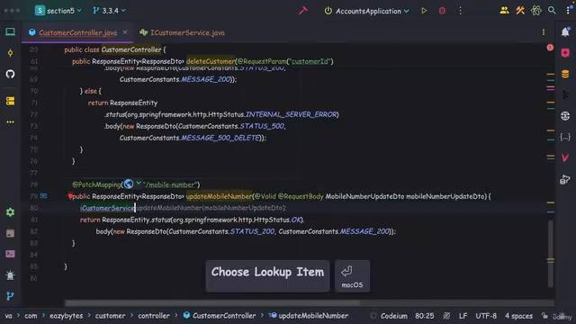
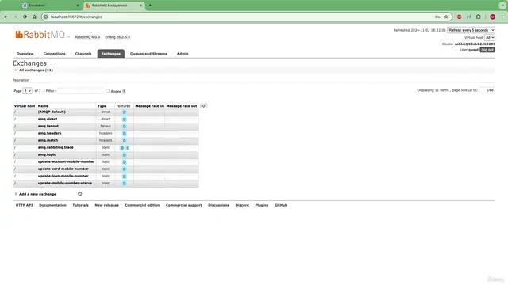
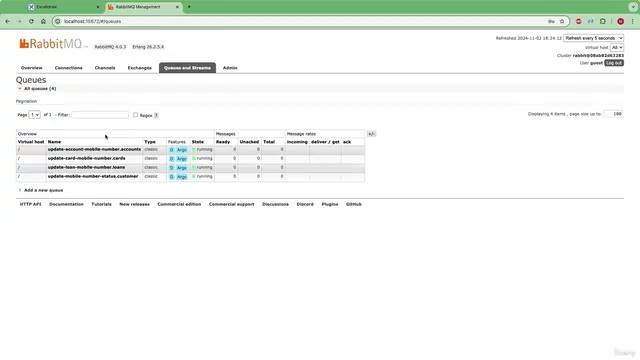
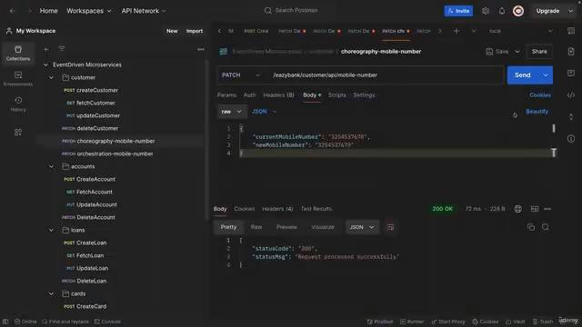
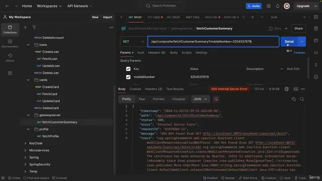

# CQRS/Saga/EventSourcing（BV1bUpz6pEUy）P54–P57 复现文档

> 课程范围：P54–P57。这四讲把「手机号变更」这个跨微服务业务，用 **Spring Cloud Stream + RabbitMQ** 串成一条 **Saga 编排（choreography）** 链路：customer → accounts → cards → loans → customer（回执）。本阶段只实现 **happy path**，补偿事务（compensating transaction）留到后续课程。
>
> 读者背景：前端转 AI 应用工程师。文中涉及 Java 语法的地方会标注「知道即可」，涉及并发/消息的地方会补一句「在 JS/Node 里对应什么」。

---

## 1. 这一节做什么

前几讲已经把 customer / accounts / cards / loans 四个业务微服务、Eureka 注册中心、gateway 网关、RabbitMQ 容器都搭好了。这一节要做的是一件具体的事：

**让「修改手机号」这一个用户动作，在四个微服务各自的数据库里都生效，并且能确认整条链路都成功。**

拆开看，这一节完成四件事：

1. 在 customer 微服务里新增 REST 接口 `updateMobileNumber`，接收 `currentMobileNumber` + `newMobileNumber`，先更新 customer 库。
2. customer 更新成功后，通过 Spring Cloud Stream 把消息发到 RabbitMQ 的一个 destination（`update-account-mobile-number`）。
3. accounts 消费这条消息 → 更新 accounts 库 → 再发消息给 cards（`update-card-mobile-number`）；cards 同理发给 loans（`update-loan-mobile-number`）。
4. loans 更新完自己的库后，发一条「整体状态」消息（`update-mobile-number-status`）回 customer，customer 消费它，打日志确认整条 Saga 完成。

这就是 **choreography 式 Saga**：没有中央协调者，每个参与者干完自己的活就把消息往下传，最后一个参与者把结果回传给发起者。课里没有出现「Saga 状态机」「补偿事务代码」，那些是后续课程内容。

从复现角度看，这一节的重点不是写多少业务代码，而是把「一个服务更新完数据库后发消息、下一个服务收到消息后继续更新并继续发消息」这条链跑通。每个服务都有两类代码：一类是消费者函数，负责接收上一条消息并调用本服务的 `updateMobileNumber`；另一类是在本服务更新成功后，用 `StreamBridge` 把消息发给下一个 destination。链路中的每个 destination 都只负责一段，最后一段再由 loans 把状态消息发回 customer。这样做的结果是：没有中央协调器，任何一个服务只要知道「上一步成功了」和「下一步该通知谁」，就可以独立推进。

从前端视角看，可以把这条链理解成一次「串行 Promise」：Postman 调 `PUT /mobile-number` 只是发起第一步，HTTP 响应返回时并不代表四个库都已经更新完；customer 发消息给 accounts、accounts 发消息给 cards、cards 发消息给 loans、loans 再回执给 customer，都是异步的。前端如果要做真实进度展示，不能只看第一个 HTTP 响应，而应该轮询一个「Saga 状态」接口，或者由 customer 在收到回执后更新状态字段。课里只打日志，所以这一节验证时要看四个服务的控制台日志，而不是只看 Postman 的响应。



---

## 2. 讲师原话（带出处）

> "首先，我会在 iCustomerService 中创建一个抽象方法，方法名是 updateMobileNumber。它返回 boolean 值，并接收一个 mobileNumberUpdateDTO 类型的参数。"
> —— p054 [00:00]

> "通过 Spring Cloud Functions 和 Spring Cloud Stream，我们将实现异步通信……我会新建一个私有方法，它返回 void，方法名是 updateAccountMobileNumber。"
> —— p054 [02:43]

> "这里要提到的绑定名称是 update-account-mobile-number-out-0。同样的绑定名称，我也会在 application.yml 中配置。"
> —— p054 [04:07]

> "由于 account 要接收请求，我们需要把这个绑定名称改成 -in-0，这就是你在 Spring Cloud Functions 和 Spring Cloud Stream 中需要遵循的标准命名约定。"
> —— p054 [07:25]

> "需要为输入绑定指定分组，而不需要为输出绑定指定分组，原因很简单……当消费者组形成后，Spring Cloud Stream 会确保请求只转发到消费者微服务的其中一个实例。"
> —— p054 [08:20]–[09:09]

> "我们需要告诉 Spring Cloud Stream，处理这些绑定所接收请求的业务逻辑在哪里……我要创建一个属性，也就是 function.definition。在这个 definition 中，我需要指定一个值，也就是 updateAccountMobileNumber。"
> —— p054 [10:20]–[10:47]

> "请确保方法名或函数名与 definition 名称一致，并且输入绑定中应使用同一个 definition 名称作为前缀。"
> —— p054 [13:15]

> "第一步，我们需要在这个函数上方加上 @Bean 注解，这样这个函数就能由 Spring Cloud Functions 在底层管理。"
> —— p055 [00:00]

> "由于流程的执行在 Saga 模式中非常重要，所以我尝试加入这些日志记录器，它们会帮助我进行调试。"
> —— p055 [00:51]

> "一旦我们在 loans 微服务中更新了手机号，就没有下一个要调用的微服务了。业务流程应该结束……另一种选择是，我们可以向消息队列发布一个事件，确认 loans 微服务也更新了它的手机号。"
> —— p056 [00:48]–[01:40]

> "我会尝试采用第二种方案，也就是发布一个事件，确认所有服务中的手机号更新都已成功。我还会尝试在 customer 微服务中消费同一条消息，而 customer 微服务正是整个业务流程的发起方。"
> —— p056 [01:54]

> "队列名称将是目标名称.应用名称，或者微服务名称。如果你有 10 个不同的 account 微服务实例，它们会注册到同一个队列，因为我们在 application.yml 中把分组名称写成了应用名称本身。"
> —— p057 [02:09]–[02:37]

> "当然，我们目前只实现了正常路径。围绕补偿事务的逻辑还有待开发。"
> —— p056 [09:25]

上面这些原话基本覆盖了本节的关键决策：用函数式消费者接消息、用 `StreamBridge` 编程式发消息、input binding 必须带 `group`、`function.definition` 要和函数名对应、loans 作为末端也要发回执、当前只实现 happy path。复现时如果某一步跑不通，可以回到这些原话对照：先看 binding 名是否按 `-in-0` / `-out-0` 写，再看 `function.definition` 是否指向了正确的 `@Bean` 方法。

---

## 3. 从零复现

### 3.1 前置条件（课里默认你已有）

课里 P57 开头说「I have started all my microservices... total six services are running inside my local」，说明以下环境在 P54 之前已经就绪：

- Eureka Server（注册中心）
- customer / accounts / cards / loans 四个业务微服务（各自有独立数据库）
- gateway 网关
- RabbitMQ 容器，管理端口 `15672`，默认账号密码 `guest/guest`

课里没有给出这些服务的完整搭建过程（那是前面 P1–P53 的内容），本节只复现 P54–P57 的增量改动。**如果你是从零开始，需要先按前序课程把六个服务跑起来**，否则本节代码无法启动。

这里的「前置条件」不是一句空话，验证方式是：先打开 Eureka 面板确认四个业务服务和 gateway 都已注册；再打开 RabbitMQ 管理台确认 `guest/guest` 能登录；最后随便调一个前序课程已有的查询接口，确认数据库连接和网关转发都正常。只有这三步都正常，本节新增的 binding 才有意义。否则你看到的错误可能是「消息发了但没人消费」「服务没注册导致 gateway 404」「数据库表不存在导致更新失败」等混杂问题，很难定位。

### 3.2 启动顺序（p057 [00:00] 明确给出）

```
1. Eureka Server
2. accounts
3. cards
4. customer
5. loans
6. gateway
```

讲师原话顺序是「Eureka server followed by accounts, cards, customer loans and towards the end gateway」。注意 customer 排在 cards 之后，但实际启动顺序对 Spring Cloud Stream 的绑定没有硬性依赖（绑定是懒加载的），照讲师顺序即可。

这段启动顺序可以理解为「先基础设施、再业务服务、最后入口」：Eureka 先起来，业务服务启动时才能注册；RabbitMQ 是独立容器，通常在前置条件里已经启动；gateway 放最后，是因为它要转发到已经注册的业务服务，虽然 Spring Cloud Gateway 本身也能先启动，但按讲师顺序做可以减少「gateway 启动时下游还没注册」的干扰。启动每个服务时，观察控制台是否出现类似 `Started XxxApplication` 的日志，以及是否出现 binding 相关日志。如果某个服务启动时报 `function definition not found`，优先检查 `spring.cloud.stream.function.definition` 是否写成了对应 `@Bean` 方法名。

常见错误排查：如果启动顺序正确但 RabbitMQ 管理台没有连接，先看该服务 `application.yml` 中 `spring.rabbitmq.host/port/username/password` 是否与容器一致；如果连接有了但没有 exchange/queue，检查 `spring.cloud.stream.bindings` 是否写在正确的层级，以及 `destination` 是否拼写一致。前端对照：这类似 Node 里先启动 Redis/RabbitMQ，再启动 producer/consumer 进程；如果 consumer 进程没起来，producer 的 `publish` 仍可能成功，但消息会留在队列里没人处理。

### 3.3 改动清单（按服务分组）

| 服务 | 角色 | 改动 |
|---|---|---|
| customer | 发起者 + 最终回执消费者 | 新增 REST 接口、`updateMobileNumber` 实现、`updateAccountMobileNumber` 私有方法、`customerFunctions` 类、application.yml 增加 out + in 两组 binding |
| accounts | 中间消费者 + 生产者 | 新增 `updateMobileNumber` 实现、`updateCardMobileNumber` 私有方法、`accountFunctions` 类、application.yml 增加 in + out 两组 binding |
| cards | 中间消费者 + 生产者 | 新增 `updateMobileNumber` 实现、`updateLoanMobileNumber` 私有方法、`cardFunctions` 类、application.yml 增加 in + out 两组 binding |
| loans | 末端消费者 + 状态发布者 | 新增 `updateMobileNumber` 实现、`updateMobileNumberStatus` 私有方法、`loanFunctions` 类、application.yml 增加 in + out 两组 binding |

这张表建议在复现时当作「施工清单」使用：每完成一个服务，就在表里打勾。customer 特殊之处是它既有 REST 入口，又有最终回执消费者；accounts/cards 是中间节点，既有 input 又有 output；loans 是末端节点，只有 input 和回执 output。三者配置形态不同，不要直接把 accounts 的 yml 复制给 loans 后忘记改 destination。

### 3.4 命名约定（这是整节最容易踩坑的地方）

讲师反复强调的命名规则，必须严格遵守，否则 Spring Cloud Stream 找不到函数：

```
function.definition = update-account-mobile-number
input binding 名     = update-account-mobile-number-in-0
output binding 名    = update-account-mobile-number-out-0
destination          = update-account-mobile-number
```

- `-in-0` / `-out-0` 是 Spring Cloud Stream 的固定后缀，`0` 表示第 0 个输入/输出。
- **function definition 名 = binding 名前缀**，这是自动路由的关键。
- **destination 在生产者侧和消费者侧必须完全一致**，否则消息发出去没人收。
- **只有 input binding 需要 `group`**，output binding 不需要（讲师在 p054 [08:20] 解释了原因：生产者不需要负载均衡，消费者需要 consumer group）。

这里再强调一次实际配置中的两个易混点：`function.definition` 的值在 Java 代码里通常写驼峰方法名，例如 `updateAccountMobileNumber`；而 binding 名和 destination 是 kebab-case，例如 `update-account-mobile-number-in-0`。Spring Cloud Stream 会做驼峰和短横线的语义匹配，但前提是「名字逻辑上对应」。如果你把 `function.definition` 写成 `update-account-mobile-number`，很多版本会直接报找不到函数；如果你把 binding 名写成 `updateAccountMobileNumber-in-0`，也可能无法按预期绑定。最稳妥的验证方式：启动服务后看日志中是否出现该 binding 的声明，或者打开 RabbitMQ 管理台看 exchange/queue 是否按预期创建。

常见错误排查：消息发出但下游没收到，先比较生产者的 `destination` 和消费者的 `destination` 是否逐字符一致；消费者重复收到消息或队列名带随机后缀，检查 input binding 是否漏了 `group`；启动时报 binding 找不到，检查 `-in-0` / `-out-0` 是否写错，以及 `function.definition` 是否与 `@Bean` 方法名一致。前端对照：这类似 WebSocket/EventEmitter 的事件名，producer `emit('update-account-mobile-number')`，consumer 必须 `on('update-account-mobile-number')`，事件名不一致就收不到；`group` 类似「同一个 consumer group 只让一个实例处理」，避免多实例重复消费。

### 3.5 消息流转图（p056 [08:04] 讲师口述的完整链路）

```
Postman
  │ POST /mobile-number  (body: currentMobileNumber, newMobileNumber)
  ▼
customer  ──更新 customer 库──► 发消息到 destination: update-account-mobile-number
                                        │
                                        ▼
                                  accounts ──更新 accounts 库──► 发消息到 update-card-mobile-number
                                                                        │
                                                                        ▼
                                                                  cards ──更新 cards 库──► 发消息到 update-loan-mobile-number
                                                                                                │
                                                                                                ▼
                                                                                          loans ──更新 loans 库──► 发消息到 update-mobile-number-status
                                                                                                                        │
                                                                                                                        ▼
                                                                                                                  customer 消费，打日志「received update mobile number status request」
```

这张图是排查问题的路线图：如果 customer 日志显示已发送，但 accounts 没有消费日志，问题在 `update-account-mobile-number` 这一段；如果 accounts 已消费但 cards 没有，问题在 `update-card-mobile-number` 这一段；依次类推。最后一段 `update-mobile-number-status` 回到 customer，如果前面都成功但 customer 没收到回执，检查 loans 的 output binding 和 customer 的 input binding 是否都指向 `update-mobile-number-status`，以及 customer 的 `function.definition` 是否配置了回执消费者。

### 3.6 验证步骤（p057 完整流程）

1. 浏览器打开 `http://localhost:15672`，guest/guest 登录。
2. **Connections** 页应看到 4 个连接（customer / accounts / cards / loans 各一个）。
3. **Exchanges** 页应看到 4 个 exchange，名字就是四个 destination。
4. **Queues** 页应看到队列，队列名格式为 `destination.applicationName`，例如 `update-account-mobile-number.accounts`。
5. Postman 依次创建数据：customer（手机号尾号 7678）→ account（同手机号）→ loan → card。
6. 调 gateway 的 fetch customer summary API，确认四个服务的数据都在。
7. 调 customer 的 `choreography mobile number` 请求，body 里 `currentMobileNumber` 填 7678 结尾，`newMobileNumber` 填 7679 结尾。
8. 分别看四个服务的控制台日志，应依次出现：
   - customer: `is the update account mobile number request successfully triggered` = true
   - accounts: `is the update card mobile number request successfully triggered` = true
   - cards: `is the update loan mobile number request successfully triggered` = true
   - loans: `is the update mobile number status request successfully triggered` = true
   - customer: `received update mobile number status request for the details`
9. 用新手机号（7679）再调 fetch customer API，四个对象里的 mobileNumber 都应是新值。

每一步的验证方法可以更具体一点：第 2 步看 Connections 时，不是只看数量，而是看连接对应的应用名是否分别包含 customer/accounts/cards/loans；第 3 步看 Exchanges 时，四个 exchange 的 name 必须与 yml 中四个 destination 完全一致；第 4 步看 Queues 时，重点看队列名是否是 `destination.group` 格式，如果看到 `destination.anonymous.xxx` 之类随机后缀，通常是 input binding 缺少 `group`。第 5 步创建数据时，四个服务的 mobileNumber 必须使用同一个测试号码，否则后续按 `currentMobileNumber` 查询会抛 `ResourceNotFoundException`。第 8 步看日志时，建议按时间顺序看，确认 customer → accounts → cards → loans → customer 的顺序，如果中间断掉，就按 3.5 的链路图定位。第 9 步用新号码查询，是最终的业务正确性验证，不能只看日志。




---

## 4. 完整代码

> 说明：课里讲师是「复制粘贴 + 改名字」的方式写的，没有逐字念出完整文件。下面按讲师口述的逻辑还原成**可直接保存的完整文件**。包名沿用讲师口述的 `function` 包；`com.example` 这类根包名课里没讲，请替换成你自己的项目根包。DTO 字段名 `currentMobileNumber` / `newMobileNumber` 来自 p057 [03:53] 讲师展示的 Postman body。

### 4.1 customer 微服务

#### `ICustomerService.java`（新增抽象方法）

```java
package com.example.customer.service;

import com.example.customer.dto.MobileNumberUpdateDTO;

public interface ICustomerService {

    // 课里没讲这个接口原有的其他方法，这里只保留本节新增的
    boolean updateMobileNumber(MobileNumberUpdateDTO mobileNumberUpdateDTO);
}
```

#### `MobileNumberUpdateDTO.java`（课里没给完整定义，按 Postman body 还原）

```java
package com.example.customer.dto;

public class MobileNumberUpdateDTO {

    private String currentMobileNumber;
    private String newMobileNumber;

    public String getCurrentMobileNumber() {
        return currentMobileNumber;
    }

    public void setCurrentMobileNumber(String currentMobileNumber) {
        this.currentMobileNumber = currentMobileNumber;
    }

    public String getNewMobileNumber() {
        return newMobileNumber;
    }

    public void setNewMobileNumber(String newMobileNumber) {
        this.newMobileNumber = newMobileNumber;
    }
}
```

#### `CustomerServiceImpl.java`

```java
package com.example.customer.service.impl;

import com.example.customer.dto.MobileNumberUpdateDTO;
import com.example.customer.entity.Customer;
import com.example.customer.exception.ResourceNotFoundException;
import com.example.customer.repository.CustomerRepository;
import com.example.customer.service.ICustomerService;
import lombok.extern.slf4j.Slf4j;
import org.springframework.cloud.stream.function.StreamBridge;
import org.springframework.stereotype.Service;

@Slf4j
@Service
public class CustomerServiceImpl implements ICustomerService {

    private final CustomerRepository customerRepository;
    private final StreamBridge streamBridge;

    public CustomerServiceImpl(CustomerRepository customerRepository,
                               StreamBridge streamBridge) {
        this.customerRepository = customerRepository;
        this.streamBridge = streamBridge;
    }

    @Override
    public boolean updateMobileNumber(MobileNumberUpdateDTO mobileNumberUpdateDTO) {
        String currentMobileNumber = mobileNumberUpdateDTO.getCurrentMobileNumber();

        Customer customer = customerRepository.findByMobileNumber(currentMobileNumber)
                .orElseThrow(() -> new ResourceNotFoundException(
                        "Customer not found for mobile number: " + currentMobileNumber));

        customer.setMobileNumber(mobileNumberUpdateDTO.getNewMobileNumber());
        customerRepository.save(customer);

        // 更新完 customer 库后，发消息给 accounts
        updateAccountMobileNumber(mobileNumberUpdateDTO);

        return true;
    }

    private void updateAccountMobileNumber(MobileNumberUpdateDTO mobileNumberUpdateDTO) {
        log.info("Sending update account mobile number request for the details {}",
                mobileNumberUpdateDTO);

        boolean result = streamBridge.send(
                "update-account-mobile-number-out-0",
                mobileNumberUpdateDTO);

        log.info("Is the update account mobile number request successfully triggered: {}", result);
    }
}
```

#### `CustomerFunctions.java`（消费 loans 回传的状态）

```java
package com.example.customer.function;

import com.example.customer.dto.MobileNumberUpdateDTO;
import lombok.extern.slf4j.Slf4j;
import org.springframework.context.annotation.Bean;
import org.springframework.context.annotation.Configuration;

import java.util.function.Consumer;

@Configuration
@Slf4j
public class CustomerFunctions {

    @Bean
    public Consumer<MobileNumberUpdateDTO> updateMobileNumberStatus() {
        return mobileNumberUpdateDTO -> {
            log.info("Received update mobile number status request for the details {}",
                    mobileNumberUpdateDTO);
            // 课里没讲这里要做数据库变更，讲师原话：
            // "I'm not going to trigger any database changes. I'm going to simply add a logger message for now."
        };
    }
}
```

#### `application.yml`（customer）

```yaml
spring:
  application:
    name: customer
  rabbitmq:
    host: localhost
    port: 5672
    username: guest
    password: guest
  cloud:
    stream:
      bindings:
        # 输出：customer -> accounts
        update-account-mobile-number-out-0:
          destination: update-account-mobile-number
        # 输入：loans -> customer（回执）
        update-mobile-number-status-in-0:
          destination: update-mobile-number-status
          group: ${spring.application.name}
    function:
      definition: updateMobileNumberStatus
```

> 注意：`function.definition` 的值是 **Java 方法名**（驼峰 `updateMobileNumberStatus`），而 binding 前缀是 **kebab-case**（`update-mobile-number-status`）。Spring Cloud Stream 会自动做驼峰↔短横线转换，讲师在 p054 [10:47] 说「function definition is same as the prefix」，指的是语义对应，不是字面完全相同。这一点课里没有明确区分，实际配置时以能启动为准。

### 4.2 accounts 微服务

#### `IAccountService.java`

```java
package com.example.accounts.service;

import com.example.accounts.dto.MobileNumberUpdateDTO;

public interface IAccountService {

    boolean updateMobileNumber(MobileNumberUpdateDTO mobileNumberUpdateDTO);
}
```

#### `AccountServiceImpl.java`

```java
package com.example.accounts.service.impl;

import com.example.accounts.dto.MobileNumberUpdateDTO;
import com.example.accounts.entity.Accounts;
import com.example.accounts.exception.ResourceNotFoundException;
import com.example.accounts.repository.AccountsRepository;
import com.example.accounts.service.IAccountService;
import lombok.extern.slf4j.Slf4j;
import org.springframework.cloud.stream.function.StreamBridge;
import org.springframework.stereotype.Service;

@Slf4j
@Service
public class AccountServiceImpl implements IAccountService {

    private final AccountsRepository accountsRepository;
    private final StreamBridge streamBridge;

    public AccountServiceImpl(AccountsRepository accountsRepository,
                              StreamBridge streamBridge) {
        this.accountsRepository = accountsRepository;
        this.streamBridge = streamBridge;
    }

    @Override
    public boolean updateMobileNumber(MobileNumberUpdateDTO mobileNumberUpdateDTO) {
        String currentMobileNumber = mobileNumberUpdateDTO.getCurrentMobileNumber();

        Accounts accounts = accountsRepository.findByMobileNumber(currentMobileNumber)
                .orElseThrow(() -> new ResourceNotFoundException(
                        "Account not found for mobile number: " + currentMobileNumber));

        accounts.setMobileNumber(mobileNumberUpdateDTO.getNewMobileNumber());
        accountsRepository.save(accounts);

        updateCardMobileNumber(mobileNumberUpdateDTO);

        return true;
    }

    private void updateCardMobileNumber(MobileNumberUpdateDTO mobileNumberUpdateDTO) {
        log.info("Sending update card mobile number request for the details {}",
                mobileNumberUpdateDTO);

        boolean result = streamBridge.send(
                "update-card-mobile-number-out-0",
                mobileNumberUpdateDTO);

        log.info("Is the update card mobile number request successfully triggered: {}", result);
    }
}
```

#### `AccountFunctions.java`

```java
package com.example.accounts.function;

import com.example.accounts.dto.MobileNumberUpdateDTO;
import com.example.accounts.service.IAccountService;
import lombok.extern.slf4j.Slf4j;
import org.springframework.context.annotation.Bean;
import org.springframework.context.annotation.Configuration;

import java.util.function.Consumer;

@Configuration
@Slf4j
public class AccountFunctions {

    @Bean
    public Consumer<MobileNumberUpdateDTO> updateAccountMobileNumber(IAccountService iAccountService) {
        return mobileNumberUpdateDTO -> {
            log.info("Received update account mobile number request for the details {}",
                    mobileNumberUpdateDTO);
            iAccountService.updateMobileNumber(mobileNumberUpdateDTO);
        };
    }
}
```

#### `application.yml`（accounts）

```yaml
spring:
  application:
    name: accounts
  rabbitmq:
    host: localhost
    port: 5672
    username: guest
    password: guest
  cloud:
    stream:
      bindings:
        # 输入：customer -> accounts
        update-account-mobile-number-in-0:
          destination: update-account-mobile-number
          group: ${spring.application.name}
        # 输出：accounts -> cards
        update-card-mobile-number-out-0:
          destination: update-card-mobile-number
    function:
      definition: updateAccountMobileNumber
```

### 4.3 cards 微服务

#### `ICardService.java`

```java
package com.example.cards.service;

import com.example.cards.dto.MobileNumberUpdateDTO;

public interface ICardService {

    boolean updateMobileNumber(MobileNumberUpdateDTO mobileNumberUpdateDTO);
}
```

#### `CardServiceImpl.java`

```java
package com.example.cards.service.impl;

import com.example.cards.dto.MobileNumberUpdateDTO;
import com.example.cards.entity.Cards;
import com.example.cards.exception.ResourceNotFoundException;
import com.example.cards.repository.CardsRepository;
import com.example.cards.service.ICardService;
import lombok.extern.slf4j.Slf4j;
import org.springframework.cloud.stream.function.StreamBridge;
import org.springframework.stereotype.Service;

@Slf4j
@Service
public class CardServiceImpl implements ICardService {

    private final CardsRepository cardsRepository;
    private final StreamBridge streamBridge;

    public CardServiceImpl(CardsRepository cardsRepository,
                           StreamBridge streamBridge) {
        this.cardsRepository = cardsRepository;
        this.streamBridge = streamBridge;
    }

    @Override
    public boolean updateMobileNumber(MobileNumberUpdateDTO mobileNumberUpdateDTO) {
        String currentMobileNumber = mobileNumberUpdateDTO.getCurrentMobileNumber();

        Cards cards = cardsRepository.findByMobileNumber(currentMobileNumber)
                .orElseThrow(() -> new ResourceNotFoundException(
                        "Card not found for mobile number: " + currentMobileNumber));

        cards.setMobileNumber(mobileNumberUpdateDTO.getNewMobileNumber());
        cardsRepository.save(cards);

        updateLoanMobileNumber(mobileNumberUpdateDTO);

        return true;
    }

    private void updateLoanMobileNumber(MobileNumberUpdateDTO mobileNumberUpdateDTO) {
        log.info("Sending update loan mobile number request for the details {}",
                mobileNumberUpdateDTO);

        boolean result = streamBridge.send(
                "update-loan-mobile-number-out-0",
                mobileNumberUpdateDTO);

        log.info("Is the update loan mobile number request successfully triggered: {}", result);
    }
}
```

#### `CardFunctions.java`

```java
package com.example.cards.function;

import com.example.cards.dto.MobileNumberUpdateDTO;
import com.example.cards.service.ICardService;
import lombok.extern.slf4j.Slf4j;
import org.springframework.context.annotation.Bean;
import org.springframework.context.annotation.Configuration;

import java.util.function.Consumer;

@Configuration
@Slf4j
public class CardFunctions {

    @Bean
    public Consumer<MobileNumberUpdateDTO> updateCardMobileNumber(ICardService iCardService) {
        return mobileNumberUpdateDTO -> {
            log.info("Received update card mobile number request for the details {}",
                    mobileNumberUpdateDTO);
            iCardService.updateMobileNumber(mobileNumberUpdateDTO);
        };
    }
}
```

#### `application.yml`（cards）

```yaml
spring:
  application:
    name: cards
  rabbitmq:
    host: localhost
    port: 5672
    username: guest
    password: guest
  cloud:
    stream:
      bindings:
        # 输入：accounts -> cards
        update-card-mobile-number-in-0:
          destination: update-card-mobile-number
          group: ${spring.application.name}
        # 输出：cards -> loans
        update-loan-mobile-number-out-0:
          destination: update-loan-mobile-number
    function:
      definition: updateCardMobileNumber
```

### 4.4 loans 微服务

#### `ILoanService.java`

```java
package com.example.loans.service;

import com.example.loans.dto.MobileNumberUpdateDTO;

public interface ILoanService {

    boolean updateMobileNumber(MobileNumberUpdateDTO mobileNumberUpdateDTO);
}
```

#### `LoanServiceImpl.java`

```java
package com.example.loans.service.impl;

import com.example.loans.dto.MobileNumberUpdateDTO;
import com.example.loans.entity.Loans;
import com.example.loans.exception.ResourceNotFoundException;
import com.example.loans.repository.LoansRepository;
import com.example.loans.service.ILoanService;
import lombok.extern.slf4j.Slf4j;
import org.springframework.cloud.stream.function.StreamBridge;
import org.springframework.stereotype.Service;

@Slf4j
@Service
public class LoanServiceImpl implements ILoanService {

    private final LoansRepository loansRepository;
    private final StreamBridge streamBridge;

    public LoanServiceImpl(LoansRepository loansRepository,
                           StreamBridge streamBridge) {
        this.loansRepository = loansRepository;
        this.streamBridge = streamBridge;
    }

    @Override
    public boolean updateMobileNumber(MobileNumberUpdateDTO mobileNumberUpdateDTO) {
        String currentMobileNumber = mobileNumberUpdateDTO.getCurrentMobileNumber();

        Loans loans = loansRepository.findByMobileNumber(currentMobileNumber)
                .orElseThrow(() -> new ResourceNotFoundException(
                        "Loan not found for mobile number: " + currentMobileNumber));

        loans.setMobileNumber(mobileNumberUpdateDTO.getNewMobileNumber());
        loansRepository.save(loans);

        updateMobileNumberStatus(mobileNumberUpdateDTO);

        return true;
    }

    private void updateMobileNumberStatus(MobileNumberUpdateDTO mobileNumberUpdateDTO) {
        log.info("Sending update mobile number status request for the details {}",
                mobileNumberUpdateDTO);

        boolean result = streamBridge.send(
                "update-mobile-number-status-out-0",
                mobileNumberUpdateDTO);

        log.info("Is the update mobile number status request successfully triggered: {}", result);
    }
}
```

#### `LoanFunctions.java`

```java
package com.example.loans.function;

import com.example.loans.dto.MobileNumberUpdateDTO;
import com.example.loans.service.ILoanService;
import lombok.extern.slf4j.Slf4j;
import org.springframework.context.annotation.Bean;
import org.springframework.context.annotation.Configuration;

import java.util.function.Consumer;

@Configuration
@Slf4j
public class LoanFunctions {

    @Bean
    public Consumer<MobileNumberUpdateDTO> updateLoanMobileNumber(ILoanService iLoanService) {
        return mobileNumberUpdateDTO -> {
            log.info("Received update loan mobile number request for the details {}",
                    mobileNumberUpdateDTO);
            iLoanService.updateMobileNumber(mobileNumberUpdateDTO);
        };
    }
}
```

#### `application.yml`（loans）

```yaml
spring:
  application:
    name: loans
  rabbitmq:
    host: localhost
    port: 5672
    username: guest
    password: guest
  cloud:
    stream:
      bindings:
        # 输入：cards -> loans
        update-loan-mobile-number-in-0:
          destination: update-loan-mobile-number
          group: ${spring.application.name}
        # 输出：loans -> customer（回执）
        update-mobile-number-status-out-0:
          destination: update-mobile-number-status
    function:
      definition: updateLoanMobileNumber
```

### 4.5 customer 的 REST 接口（p054 [00:25] 提到）

```java
package com.example.customer.controller;

import com.example.customer.dto.MobileNumberUpdateDTO;
import com.example.customer.service.ICustomerService;
import org.springframework.http.ResponseEntity;
import org.springframework.web.bind.annotation.PutMapping;
import org.springframework.web.bind.annotation.RequestBody;
import org.springframework.web.bind.annotation.RequestMapping;
import org.springframework.web.bind.annotation.RestController;

@RestController
@RequestMapping("/mobile-number")
public class MobileNumberController {

    private final ICustomerService iCustomerService;

    public MobileNumberController(ICustomerService iCustomerService) {
        this.iCustomerService = iCustomerService;
    }

    @PutMapping
    public ResponseEntity<String> updateMobileNumber(
            @RequestBody MobileNumberUpdateDTO mobileNumberUpdateDTO) {
        boolean result = iCustomerService.updateMobileNumber(mobileNumberUpdateDTO);
        if (result) {
            return ResponseEntity.ok("Mobile number update request accepted");
        }
        return ResponseEntity.internalServerError().body("Mobile number update failed");
    }
}
```

> 课里没讲这个 controller 的完整代码，只说了「this method, I'm going to call from my REST API method」。上面是按讲师口述的调用关系还原的最小可用版本，HTTP 方法（PUT）和路径（`/mobile-number`）来自 p056 [08:04] 讲师口述「The API path is mobile number」。

---

## 5. 逐行解释

### 5.1 为什么用 `StreamBridge` 而不是 `@Output` 注解

讲师在 p054 [03:38] 说「inject the bean of type stream bridge so this stream bridge is coming from the spring cloud functions package」。`StreamBridge` 是 Spring Cloud Stream 提供的编程式发送器，好处是**不需要为每个输出绑定声明接口**，直接 `send(bindingName, payload)` 即可。在 Node 里对应的是 `amqpChannel.publish(exchange, routingKey, Buffer.from(JSON.stringify(payload)))` 这种直接调 channel 的写法，而不是声明式消费者。

从代码结构上看，`CustomerServiceImpl` 注入 `StreamBridge` 后，在 `updateMobileNumber` 里先保存数据库，再调用私有方法 `updateAccountMobileNumber`；私有方法里只有两件事：打日志和 `streamBridge.send(...)`。这种写法的好处是把「业务更新」和「消息发送」放在同一个服务方法里，方便阅读；坏处是消息发送没有事务保证，如果数据库保存成功但消息发送失败，就会出现「本库已更新、下游没收到」的不一致。课里只实现 happy path，所以暂时不处理这个问题。

### 5.2 `streamBridge.send(...)` 返回 boolean 的含义

p054 [05:16] 讲师说「if you click on this send button you'll be able to see we are going to get a Boolean」。这个 boolean 表示**消息是否成功交给 binder**（即是否成功发到 RabbitMQ），**不代表下游消费成功**。这是异步消息的常见语义，在 JS 里对应 `channel.publish()` 的返回值——只表示「已交给 broker」，不表示「已被消费」。

因此日志里看到 `successfully triggered: true`，只能说明消息发送动作成功，不能说明 accounts 已经更新成功。要确认整条链路成功，必须看下游服务的消费日志，或者最后 customer 收到的回执日志。排查时如果 customer 日志为 true 但 accounts 没日志，问题通常不在 customer 的发送动作，而在 binding/destination/消费者启动状态。

### 5.3 `-out-0` / `-in-0` 后缀

Spring Cloud Stream 的 binding 命名规范：`<functionName>-<in|out>-<index>`。`0` 是索引，因为一个函数可能有多个输入/输出。讲师在 p054 [07:25] 说「this is the standard naming convention that you need to follow」。**写错后缀，Spring 启动时会报找不到 binding**。

常见错误是把 input 写成 `-out-0`，或者把 output 写成 `-in-0`。前者会导致消费者去监听一个不存在的输出绑定，后者会导致生产者往一个输入绑定发送消息。排查时可以直接对照 yml：input binding 用于 `Consumer` 函数，output binding 用于 `streamBridge.send` 的第一个参数。前端对照：类似 Node 中 `consumer.consume(queue)` 和 `producer.send(topic)` 不能混用，方向错了就收不到或发不出。

### 5.4 `group` 为什么只在 input 侧

p054 [08:20]–[09:37] 讲师解释得很清楚：消费者需要 consumer group 来做负载均衡（10 个 accounts 实例只让 1 个处理一条消息），生产者不需要。在 RabbitMQ 层面，group 对应 queue 的绑定关系；没有 group 的 input binding 会创建一个**匿名、自动删除**的队列，重启就丢，所以生产环境必须写 group。

验证方式是看 RabbitMQ Queues 页：有 `group` 时队列名通常是 `destination.group`，例如 `update-account-mobile-number.accounts`；没有 `group` 时可能出现随机后缀队列。前端对照：类似 Socket.IO 的 room 或 Kafka consumer group，同一个 group 内只有一个消费者处理消息，避免多实例重复消费。

### 5.5 `function.definition` 的作用

p054 [10:20] 讲师说「we need to convey to the spring cloud stream where is the business logic present」。`function.definition` 告诉 Spring Cloud Stream：**哪个 `@Bean` 方法要绑定到哪个 binding**。匹配规则是「definition 名 = binding 名前缀」。如果 definition 写 `updateAccountMobileNumber`，binding 写 `update-account-mobile-number-in-0`，Spring 会自动做驼峰↔短横线转换后匹配。

常见错误：`function.definition` 写成短横线形式、写成类名、或者写成不存在的方法名。排查时看启动日志是否有 `function definition not found`，并确认 `@Bean` 方法名和 `function.definition` 的值一致。

### 5.6 `@Bean` 注解为什么必须加

p055 [00:00] 讲师说「we need to mention at Bean annotation on top of this function so that this function can be managed by the Spring Cloud Functions behind the scenes」。没有 `@Bean`，这个方法只是一个普通方法，Spring 容器不会把它注册为 function，`function.definition` 就找不到它。

### 5.7 `Consumer<T>` 而不是 `Function<T,R>`

p054 [11:55] 讲师说「I want to create a function that adopts the consumer functional interface. Since I'm going to build a logic which only accept the input but not publish any output」。`Consumer<T>` 是 Java 的 `java.util.function.Consumer`，`accept(T)` 无返回值。在 JS 里对应 `(msg) => { ... }` 这种只处理不返回的回调。**知道即可**：Java 的 `Function<T,R>` 是 `R apply(T)`，有返回值。

### 5.8 loans 为什么还要发消息

p056 [00:48] 讲师给了两个选项：① loans 更新完直接结束；② loans 发一条状态消息回 customer。讲师选了 ②，理由是「confirming that mobile number update is successful in all the services」，让发起者知道整条 Saga 完成。这是 choreography 式 Saga 的常见收尾方式——**没有中央协调者，就靠最后一个参与者回执**。

### 5.9 customer 消费回执时为什么不做数据库变更

p056 [07:35] 讲师原话「I'm not going to trigger any database changes. I'm going to simply add a logger message for now. But in real applications, there are unlimited possibilities」。课里只打日志，实际项目里可以更新一个 `saga_status` 字段，让前端轮询。

### 5.10 关于「锁/事务/并发」

课里**没有**讲分布式事务的 2PC、TCC、本地消息表等方案，也没有讲消息幂等、消息重试、死信队列。这一节只实现了 happy path。如果你在 JS/Node 里做类似的事，会撞上的问题见第 7 节。

---

## 6. 复现检查清单

启动前逐项核对：

- [ ] RabbitMQ 容器已启动，`http://localhost:15672` 能登录（guest/guest）。验证：浏览器能打开管理台并看到 Overview 页，若打不开先检查容器端口映射和账号密码。
- [ ] Eureka Server 已启动，四个业务微服务都能在 Eureka 面板看到。验证：打开 Eureka 页面，确认 customer/accounts/cards/loans 的实例状态为 UP。
- [ ] 四个服务的 `pom.xml` 都引入了 `spring-cloud-starter-stream-rabbit` 和 `spring-cloud-starter-function-web`（课里没讲具体依赖坐标，按你项目的 Spring Cloud 版本选）。验证：在 IDE 的依赖树中能看到对应 starter，或启动日志中出现 Spring Cloud Stream 相关自动配置。
- [ ] 四个服务的 `application.yml` 里 `spring.cloud.stream.bindings` 下的 binding 名，与代码里 `streamBridge.send(...)` 的第一个参数**完全一致**。验证：逐个对照 yml 的 key 和 Java 字符串，注意 `-out-0` 不能漏。
- [ ] 每个 input binding 都有 `group: ${spring.application.name}`。验证：打开 yml 看所有 `-in-0` 下是否有 group，并到 RabbitMQ Queues 页确认队列名是 `destination.group` 形式。
- [ ] 每个 output binding 都**没有** `group`。验证：输出侧只保留 destination；如果误加 group，观察是否出现不必要队列或绑定异常。
- [ ] 每个服务的 `function.definition` 值与对应 `@Bean` 方法名一致。验证：把方法名和 definition 值并排对照，启动日志无 function 找不到错误。
- [ ] 生产者和消费者的 `destination` 完全一致（例如 customer 的 out 和 accounts 的 in 都是 `update-account-mobile-number`）。验证：在 RabbitMQ Exchanges 页看到对应 exchange，且生产/消费两端 yml 字符串逐字一致。
- [ ] 四个 `*Functions` 类都有 `@Configuration` 和 `@Slf4j`。验证：类上注解存在，日志中能打印出类里的 `log.info`。
- [ ] 四个 `*Functions` 类里的 `@Bean` 方法都返回 `Consumer<MobileNumberUpdateDTO>`。验证：方法签名正确，启动时被注册为 function；若返回类型不对，binding 不会按预期工作。
- [ ] `MobileNumberUpdateDTO` 在四个服务里字段名一致（`currentMobileNumber` / `newMobileNumber`），否则 JSON 反序列化会得到 null。验证：用 Postman 发请求后看下游日志打印的 DTO 字段是否有值。

启动后验证：

- [ ] RabbitMQ Connections 页有 4 个连接。验证：连接数对应四个微服务，且连接的应用名能对应上。
- [ ] RabbitMQ Exchanges 页有 4 个 exchange：`update-account-mobile-number`、`update-card-mobile-number`、`update-loan-mobile-number`、`update-mobile-number-status`。验证：逐个搜索 exchange 名称，确认都存在。
- [ ] RabbitMQ Queues 页有 4 个队列，名字形如 `update-account-mobile-number.accounts`。验证：队列名应带 group 后缀，不应是随机匿名队列。
- [ ] Postman 创建数据后，gateway 的 fetch customer API 能返回四个对象。验证：返回 JSON 中 customer/accounts/cards/loans 都有数据，手机号一致。
- [ ] 调 `PUT /mobile-number` 后，四个服务控制台依次出现「successfully triggered: true」日志。验证：按 customer → accounts → cards → loans 顺序检查日志时间戳。
- [ ] customer 控制台最后出现「received update mobile number status request」。验证：这是回执消费者 `updateMobileNumberStatus` 打印的日志，出现即表示链路闭环。
- [ ] 用新手机号调 fetch customer API，四个对象的 mobileNumber 都是新值。验证：分别检查四个对象字段，不能只看其中一个。

p057 [07:14] 讲师还发现了一个 bug：accounts 返回的 DTO 里没有 mobileNumber 字段，导致 fetch 时 accounts 对象里看不到手机号。修复方式是「open the customer DTO and try to copy this mobile number and paste it inside the accounts DTO」。**如果你复现时也发现 accounts 对象缺 mobileNumber，就是这个原因**，在 `AccountsDTO` 里补一个 `mobileNumber` 字段即可。







---

## 7. 课里没讲但你会撞上的

| 现象 | 原因 | 怎么办 |
|---|---|---|
| 同一条消息被消费两次，日志重复打印 | RabbitMQ 默认 at-least-once，网络抖动或消费者确认失败时可能重投；课里没讲幂等键设计 | 在消费端做幂等：用 `newMobileNumber + 时间戳`、业务唯一 ID 或 messageId 去重；在 Node 里对应「消费前先查 Redis 有没有处理过这个 messageId」 |
| 同一手机号的两次并发修改出现顺序错乱 | choreography 链路本身按消息顺序推进，但两个请求并发时，各自的消息可能交错；课里没讲并发控制 | 对同一手机号的变更做串行化，例如按手机号加分布式锁，或让前端/网关对同一 key 的请求排队；JS 里对应「同一 key 的请求串行化」 |
| accounts 更新失败，但 customer 已经更新成功 | p056 [09:25] 讲师明确说「we have implemented only the happy path. We are yet to develop the logic around the compensating transactions」 | 当前只能记录失败并人工排查；补偿事务留到后续课程，实际项目要设计回滚消息或 Saga 补偿动作 |
| `streamBridge.send()` 返回 false，但业务没有重试 | 课里只打了日志，没有重试；发送失败可能意味着 broker 不可用或 binding 配置异常 | 增加重试和死信队列；至少记录失败日志并告警。排查时先看 RabbitMQ 连接和 exchange 是否存在 |
| 四个服务各有一份 `MobileNumberUpdateDTO`，字段靠人工保持一致 | 课里没有共享 DTO 模块，也没有 schema 管理 | 实际项目抽 `common-dto` 模块，或用 Avro/Protobuf 做 schema 管理；复现阶段至少保证四个 DTO 字段名完全一致 |
| 启动报找不到 function | `function.definition` 写成了短横线，或与 `@Bean` 方法名不一致；讲师口述「same as the prefix」容易被误解为字面相同 | 以驼峰方法名为准，例如 `updateAccountMobileNumber`；binding 前缀用短横线，启动日志确认无 function not found |
| RabbitMQ 队列名不是 `destination.applicationName`，而是带随机后缀 | input binding 的 `group` 没配或配错，binding 退化成了匿名队列 | 检查每个 `-in-0` 下是否有 `group: ${spring.application.name}`；到 Queues 页确认队列名格式 |
| 编译报错找不到 `log` | `@Slf4j` 是 Lombok 注解，课里用了但没解释；项目没引入 Lombok 时不会自动生成 `log` 字段 | 引入 Lombok，或手动写 `private static final Logger log = LoggerFactory.getLogger(Xxx.class);`；知道即可，不影响业务逻辑 |
| 启动报 `ResourceNotFoundException` 找不到 | 课里提到但没给定义，它是前序课程已有的自定义异常 | 从零搭项目时自己建一个带 `@ResponseStatus(HttpStatus.NOT_FOUND)` 的异常类，并确保各服务包路径正确 |
| 调 gateway 的 fetch customer summary API 失败 | p057 反复用它验证，但课里没讲实现；它属于前序课程的 Feign 聚合调用 | 没有该 API 时，分别调四个服务的查询接口验证；有该 API 时检查 gateway 路由和 Feign 客户端配置 |

**小结**：这一节把「手机号变更」做成了四段式 choreography Saga，核心是 **Spring Cloud Stream 的 binding 命名约定** + **StreamBridge 编程式发送** + **Consumer 函数式消费**。happy path 跑通后，下一节才进入补偿事务。复现时最容易卡住的地方是 binding 名、destination、function.definition 三者的一致性，按第 6 节清单逐项核对即可。