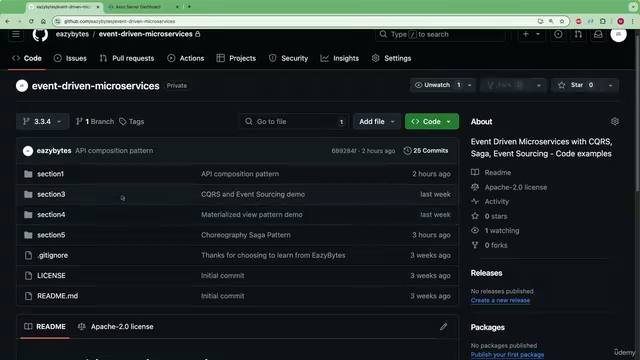
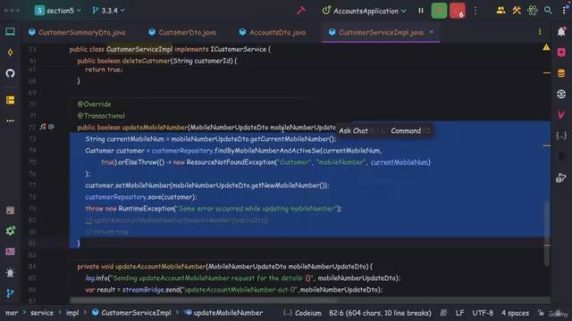
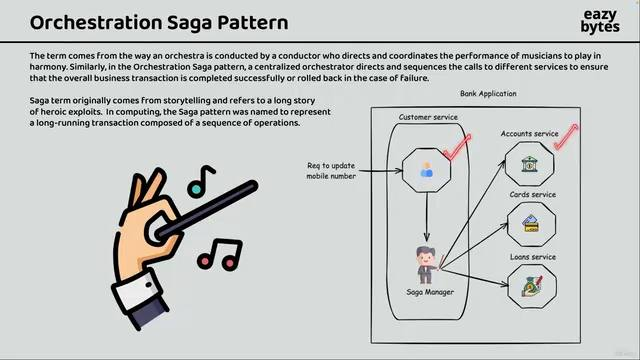
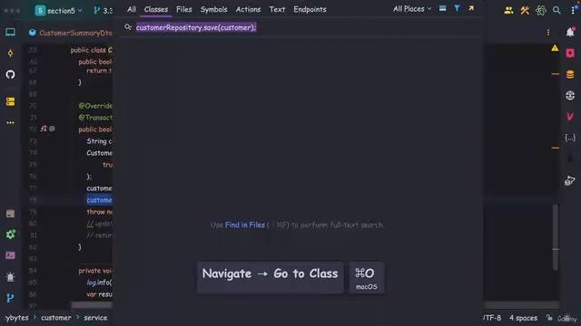
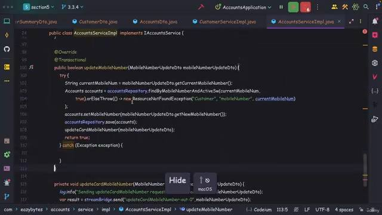
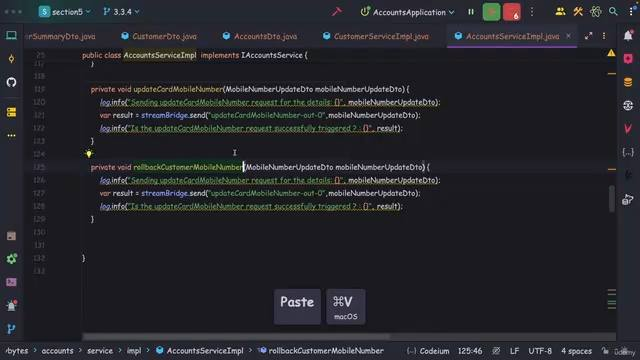
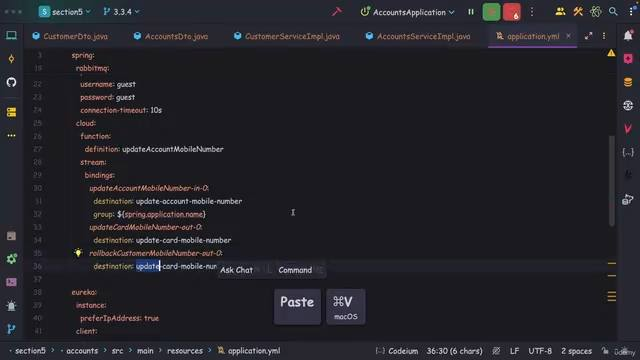

## 1. 这一节做什么

这一节覆盖两条线：P58–P60 把 **choreography saga 的补偿事务**在 customer、accounts、cards、loans 四个微服务里补齐并做负向/正向测试；P61–P62 开始进入 **orchestration saga**，讲师先解释 saga manager 的角色，再新建 `section6`，从 `section3` 的 CQRS + EventSourcing 代码复制一份，补 common 模块里的 DTO、AxonConfig、command 和 event 类，为后续 Axon saga manager 做准备。注意：P62 只做到 command/event 骨架，**saga manager 的具体实现课里没讲**，不要在这一篇里假装已经完成。

这一节不是从空白项目搭四个微服务。逐字稿明确要求：把 `section3` 里已经完成 CQRS 和 event sourcing 的代码复制到 `section6`，再在上面加 saga pattern。因此你复现前必须先有 `section3` 的可用工程；没有这份基线，逐字稿没有给出完整 pom、数据库脚本、端口、消息中间件类型，单靠 P58–P62 无法从零生成整个银行应用。


P58–P60 的补偿链路是：customer 本地异常时只回滚 customer；accounts 异常时回滚 accounts，并触发 customer 的补偿；cards 异常时回滚 cards，触发 accounts 补偿，accounts 再触发 customer 补偿；loans 异常时回滚 loans，触发 cards 补偿，cards 再触发 accounts 补偿，accounts 再触发 customer 补偿。loans 是链路最后一个服务，所以它没有“被上一个服务触发”的 rollback command/event。P62 里讲师也明确说，loans 不需要单独的 rollback class，因为任何 runtime exception 时它只回滚自己数据库。



## 2. 讲师原话

> "要实现这一点，我们需要加上 @Transactional 注解……只要发生运行时异常……事务就会自动回滚……"
> —— p058 [01:24]

> "由于我们捕获了异常，而且不打算把这个异常抛给父方法……所以需要手动回滚当前事务……调用 TransactionAspectSupport.currentTransactionStatus().setRollbackOnly()。"
> —— p058 [04:57]

> "等到执行这个回滚手机号的操作时，旧手机号已经被新手机号替换了……因此首先需要用新手机号从数据库加载现有数据。"
> —— p058 [08:41]

> "如果贷款微服务内部发生异常，那么卡片、账户和客户微服务中的补偿事务就必须执行。"
> —— p060 [00:00]

> "会有一个 Saga 管理器来控制 Saga 模式的流程。"
> —— p061 [00:26]

> "由于原始请求由这个客户微服务接收，所以我会只在客户服务内部构建一个 Saga 管理器。"
> —— p061 [02:44]

> "发生补偿事务时，这两个数据库内部都需要执行回滚。"
> —— p061 [04:31]

> "复制第三部分中的代码……在这段代码的基础上，我们还要加入 Saga 模式。"
> —— p062 [00:00]





## 3. 从零复现

### 3.1 先准备基线

逐字稿给出的基线是 `section3`：已经完成 CQRS 和 event sourcing 的银行应用。P62 的操作是：

1. 在工作区新建 `section6` 文件夹。
2. 把 `section3` 下的 customer、accounts、cards、loans、common、gateway 等 Maven 项目整体复制进 `section6`。逐字稿说“copy all these projects”，并打开 `section6` 后用 IntelliJ 的 Maven 面板加载。
3. 删除与本节无关的 `readme.md`（讲师原话是删除这个 readme）。
4. 先跑一次 Maven build，确认复制后的工程没有编译问题，再改代码。

目录不要臆造具体 artifactId；按你 `section3` 的实际 Maven 项目名保留。下面只是按逐字稿出现顺序列出的逻辑结构：

```text
section6/
  common/
  customer/
  accounts/
  cards/
  loans/
  gateway/
```

课里没有给出 JDK 版本、Spring Boot 版本、Axon 版本、Spring Cloud Stream 版本、数据库类型、消息中间件类型和启动端口。不要从这篇文档里猜版本号。你应按 `section3` 原有 `pom.xml` 和 `application.yml` 运行。若必须写命令，通用 Maven 命令是：

```bash
cd section6
mvn clean package
```

逐字稿只说“do the build”“restart all my microservices”，没有给出具体启动命令。用 IDE 分别启动各微服务的 Application 类，或按你项目原有方式运行。P60 特别提醒：改动多、新增函数多时，不要依赖 DevTools，手动重启所有微服务。



### 3.2 先在 customer 里制造异常，验证本地事务回滚

在 customer 的 `CustomerServiceImpl` 中，`updateMobileNumber` 更新手机号后，临时加入：

```java
throw new RuntimeException("some error occurred while updating mobile number");
```

然后把后续代码临时注释掉，解决编译错误。给 `updateMobileNumber` 加 `@Transactional`。逐字稿解释：Spring Data JPA 遇到 runtime exception 或子类异常时，会自动回滚这个事务。用 Postman 调 choreography mobile number API，current mobile number 用 `7679`，new mobile number 用 `7680`。请求报错后，再用 fetch customer summary 查 `7679`，仍能查到旧数据，说明新号码没有落库。

注意：`@Transactional` 是 Java/Spring 注解，前端同学知道即可；在 Node/JS 里对应的是把多条数据库写操作包进同一个 transaction 回调，catch 后不能静默吞掉，要 `throw` 或调用驱动提供的 rollback，否则数据库不会自动回滚。



### 3.3 accounts 异常：回滚自己，再发消息补偿 customer

恢复 customer 里被注释的代码，去掉临时 `throw`。到 `AccountServiceImpl.updateMobileNumber`：

1. 方法上加 `@Transactional`。
2. 方法体放进 `try`。
3. `boolean result = false;`，try 全部成功后置 `true`，最后返回 `result`。
4. `catch (Exception ex)` 里先记录日志。
5. 因为异常被 catch 住了，没有继续抛给 Spring，所以 Spring 不会自动回滚。必须手动：
   `TransactionAspectSupport.currentTransactionStatus().setRollbackOnly();`
6. 在 catch 里调用新建的私有方法 `rollbackCustomerMobileNumber(dto)`，向 customer 发补偿消息。
7. 在 accounts 的 `application.yml` 增加 outbound binding，逐字稿给出的绑定名口述为 `RollbackCustomerMobileNumber-out-0`，destination 为 `rollback customer mobile number` 对应的 kebab-case。实际大小写必须和你的函数名一致；本文代码按 Java 小驼峰函数名写成 `rollbackCustomerMobileNumber-out-0`。若你项目函数名不同，yaml 跟着改。



### 3.4 customer 消费补偿消息：用新号码查记录，再改回旧号码

在 customer 的 `application.yml` 增加 inbound binding，destination 与 accounts 发出的 destination 一致。`spring.cloud.function.definition` 里加入 `rollbackCustomerMobileNumber`；多个函数定义用分号分隔。

在 customer 的 Functions 类新增函数 `rollbackCustomerMobileNumber`，注入 `ICustomerService`，函数里调用 `customerService.rollbackMobileNumber(dto)`。`ICustomerService` 新增抽象方法 `rollbackMobileNumber(MobileNumberUpdateDTO dto)`。

`CustomerServiceImpl.rollbackMobileNumber` 的关键 trick：执行到这里时，数据库里的手机号已经是 `newMobileNumber`，所以要先按 `newMobileNumber` 查记录，再把 `mobileNumber` 设回 `currentMobileNumber`，最后 `save`。不要调用原来那个会继续触发 accounts 更新的私有方法，否则会再次进入正向 saga。



![p058 07:01 讲师在 customer 微服务增加消费 rollback 消息

## 5. 逐行解释

说明：给定材料没有贴出「4. 完整代码」的全文和文件清单，因此不能对未出现的代码行做逐行猜测。下面只按第 3 节和逐字稿中实际出现的文件、片段与设计决策解释；材料没出现的部分明确标为“课里没讲/材料未给出”。

### 5.1 `customer` 的 `CustomerServiceImpl.updateMobileNumber`

- `@Transactional` 加在 `updateMobileNumber` 上  
  为什么这么写：逐字稿说这个方法里的数据库更新要作为一个事务执行；发生 runtime exception 或其子类异常时，Spring Data JPA 自动回滚。  
  不这么写会怎样：`save` 可能已经提交，后面再 `throw` 时不会自动回滚，数据库里会留下新手机号。

- 临时 `throw new RuntimeException("更新手机号码时出现错误。");`  
  为什么这么写：模拟 customer 微服务自身在更新手机号后、调用 accounts 之前发生异常。  
  不这么写会怎样：无法验证“customer 本地异常只回滚 customer”的场景。

- 把 `throw` 后面的代码临时注释掉  
  为什么这么写：`throw` 之后代码不可达，会编译报错；注释是为了先完成负向测试。  
  不这么写会怎样：编译不过。  
  注意：测试完必须恢复；不恢复会导致所有更新请求都失败。

- 用 `7679` 作为 current、`7680` 作为 new 测试，再用 `7679` 查 fetch customer summary  
  为什么这么写：如果回滚成功，旧号码 `7679` 仍可查到；如果新号码 `7680` 能查到，说明回滚失败。  
  不这么验证会怎样：只看接口报错不能证明数据库已回滚。

### 5.2 `accounts` 的 `AccountServiceImpl.updateMobileNumber`

- 方法上加 `@Transactional`  
  为什么这么写：accounts 本地数据库更新需要事务，失败时才能回滚 accounts 自己的数据。  
  不这么写会怎样：accounts 本地更新可能无法按事务回滚。

- 整个方法体放进 `try`，用 `catch (Exception ex)` 捕获  
  为什么这么写：必须捕获异常，才能在 catch 里主动触发 customer 的补偿事务。  
  不这么写会怎样：异常直接抛出去，accounts 自己可能回滚，但不会主动向 customer 发补偿消息。

- `boolean result = false;`，try 内全部成功后置 `true`，最后返回 `result`  
  为什么这么写：catch 分支后也需要返回值，避免 missing return statement；同时用结果标记成功与否。  
  不这么写会怎样：编译报错，或 catch 分支没有明确返回。

- catch 里先记录日志  
  为什么这么写：便于确认异常发生和补偿链是否被触发。  
  不这么写会怎样：出问题时无法从日志判断是否进入补偿逻辑。

- `TransactionAspectSupport.currentTransactionStatus().setRollbackOnly();`  
  为什么这么写：异常已经被 catch 住，没有再抛给 Spring；Spring 不会自动回滚，必须手动把当前事务标记为 rollback only。  
  不这么写会怎样：accounts 本地已经做的更新可能不会回滚。

- catch 里调用私有方法 `rollbackCustomerMobileNumber(dto)`  
  为什么这么写：accounts 回滚自己后，要通知 customer 执行补偿。  
  不这么写会怎样：accounts 回滚了，但 customer 仍保留新号码，补偿链断掉。

- accounts 的 `application.yml` 增加 outbound binding，绑定名前缀按函数名写成 `rollbackCustomerMobileNumber-out-0`  
  为什么这么写：Spring Cloud Stream 用函数名和 binding 前缀关联发送通道。  
  不这么写会怎样：函数和 binding 对不上，消息发不出去或启动时报 binding 配置问题。  
  逐字稿口述 destination 为 “rollback customer mobile number”，文档要求按 kebab-case 处理；实际必须与 customer 端 inbound destination 完全一致。

### 5.3 `customer` 消费补偿消息与 `CustomerServiceImpl.rollbackMobileNumber`

- customer 的 `application.yml` 增加 inbound binding，destination 与 accounts 发出的 destination 一致  
  为什么这么写：消息两端 destination 必须相同，customer 才能消费到 accounts 发出的补偿消息。  
  不这么写会怎样：消息发到另一个 destination，customer 收不到。

- `spring.cloud.function.definition` 里加入 `rollbackCustomerMobileNumber`，多个函数用分号分隔  
  为什么这么写：Spring Cloud Function 需要知道要绑定和暴露哪些函数。  
  不这么写会怎样：即使配置了 binding，函数也可能不会作为消费者执行。

- customer 的 Functions 类新增 `rollbackCustomerMobileNumber`，注入 `ICustomerService` 并调用 `customerService.rollbackMobileNumber(dto)`  
  为什么这么写：Functions 只负责接消息，真正数据库回滚放在 service 层。  
  不这么写会怎样：如果函数里只打日志，消息被消费了，但 customer 数据库不会回滚。

- `ICustomerService` 新增抽象方法 `rollbackMobileNumber(MobileNumberUpdateDTO dto)`  
  为什么这么写：让 Functions 通过接口调用 service，符合已有分层。  
  不这么写会怎样：Functions 直接依赖实现类，或无法调用回滚逻辑。

- `CustomerServiceImpl.rollbackMobileNumber` 先用 `newMobileNumber` 查记录  
  为什么这么写：执行补偿时数据库里的手机号已经被正向更新成 `newMobileNumber`；逐字稿明确说“old mobile number is already replaced with the new mobile number”。  
  不这么写会怎样：如果用 `currentMobileNumber` 查，数据库里已经查不到旧号码对应记录，补偿失败。

- 查到记录后把 `mobileNumber` 设回 `currentMobileNumber`，再 `save`  
  为什么这么写：补偿的目标是恢复旧号码。  
  不这么写会怎样：customer 会继续保留新号码。

- 不再调用原来那个会更新 accounts 的私有方法  
  为什么这么写：rollback 只需要回滚 customer 自己，不能再次进入正向更新链路。  
  不这么写会怎样：可能再次触发 accounts 更新，形成错误的正向/补偿循环。

### 5.4 `cards` 的 `CardServiceImpl.updateMobileNumber` 与补偿链

- `CardServiceImpl.updateMobileNumber` 加 `@Transactional`，使用 `result`、`try/catch`  
  为什么这么写：cards 发生 runtime exception 时，先回滚 cards 自己，再触发 accounts 补偿。  
  不这么写会怎样：cards 本地更新可能不回滚，或 catch 中无法主动触发 accounts 补偿。

- catch 中手动 `setRollbackOnly()`，并调用 `rollbackAccountMobileNumber(dto)`  
  为什么这么写：逐字稿说 cards 只负责触发 accounts 的补偿；accounts 再触发 customer 的补偿。  
  不这么写会怎样：cards 自己回滚了，但 accounts 和 customer 不回滚。

- cards 的 `application.yml` 增加 outbound binding，函数名/绑定名用 `rollbackAccountMobileNumber` 对应前缀  
  为什么这么写：cards 要向 accounts 发补偿消息。  
  不这么写会怎样：accounts 收不到 cards 的补偿消息。

- accounts 的 `application.yml` 增加 inbound binding，destination 与 cards 发出的 destination 一致；`spring.cloud.function.definition` 加入 `rollbackAccountMobileNumber`  
  为什么这么写：accounts 要消费 cards 发来的补偿消息。  
  不这么写会怎样：消息无人消费，accounts 不执行回滚。

- `AccountFunctions` 新增 `rollbackAccountMobileNumber`，调用 `IAccountService.rollbackMobileNumber(dto)`  
  为什么这么写：和 customer 一样，消息入口只负责转发到 service。  
  不这么写会怎样：只消费日志，不执行数据库补偿。

- `AccountServiceImpl.rollbackMobileNumber` 使用 account repository，按 new mobile 查记录，设回 old mobile，`save`  
  为什么这么写：accounts 数据库也要从新号码恢复成旧号码。  
  不这么写会怎样：accounts 保留新号码。

- accounts 回滚自己并 `save` 后，再调用 `rollbackCustomerMobileNumber(dto)`  
  为什么这么写：逐字稿说 accounts 回滚自己后，还要触发 customer 的补偿；这个调用顺序是 cards → accounts → customer 链的一部分。  
  不这么写会怎样：accounts 回滚了，但 customer 不回滚，链路断在 accounts。

### 5.5 `loans` 的 `LoanServiceImpl.updateMobileNumber` 与补偿链

- `LoanServiceImpl.updateMobileNumber` 加 `@Transactional`，使用 `result`、`try/catch`  
  为什么这么写：loans 是最后一个服务；发生异常时先回滚 loans 自己，再触发 cards 补偿。  
  不这么写会怎样：loans 本地可能不回滚，或无法触发 cards 补偿。

- catch 中手动 `setRollbackOnly()`，并调用 `rollbackCardMobileNumber(dto)`  
  为什么这么写：loans 只负责触发 cards 的补偿；cards 再触发 accounts，accounts 再触发 customer。  
  不这么写会怎样：loans 报错后，cards/accounts/customer 都不会回滚。

- loans 的 `application.yml` 增加 outbound binding；cards 的 `application.yml` 增加 inbound binding，并加入 `spring.cloud.function.definition`  
  为什么这么写：loans 发消息，cards 消费消息。  
  不这么写会怎样：cards 收不到补偿消息。

- `CardFunctions` 新增 `rollbackCardMobileNumber`，调用 `ICardService.rollbackMobileNumber(dto)`  
  为什么这么写：cards 收到消息后要执行自己的回滚。  
  不这么写会怎样：cards 只消费不处理数据库。

- `CardServiceImpl.rollbackMobileNumber` 按 new mobile 查 card，设回 old mobile，`save`，然后调用 `rollbackAccountMobileNumber(dto)`  
  为什么这么写：cards 回滚自己后，还要继续触发 accounts 补偿，形成 cards → accounts → customer。  
  不这么写会怎样：cards 回滚了，但 accounts/customer 保留新号码。

- loans 不创建自己的 rollback command/class  
  为什么这么写：逐字稿明确说 loans 是链路最后一个服务，发生 runtime exception 时只回滚自己数据库，不需要单独的 rollback class。  
  不这么写会怎样：会多出不符合本节设计的 loans 补偿入口，容易误以为还有下游服务。

### 5.6 P60 的测试设计

- 改动多个微服务后手动重启所有微服务，不依赖 DevTools  
  为什么这么写：新增了配置和多个函数，DevTools 不一定能完整刷新。  
  不这么写会怎样：旧函数/旧 binding 仍在运行，日志和结果不可信。

- 先创建手机号尾号 `7670` 的 customer/account/loan/card 数据，再调用 choreography mobile number API，从 `7670` 改到 `7671`  
  为什么这么写：需要四份数据都存在，才能验证四服务链路。  
  不这么写会怎样：旧号或新号查询失败，无法判断是补偿问题还是数据本来不存在。

- 接口返回 200 不能当作分布式事务成功  
  为什么这么写：逐字稿明确说这是异步通信，客户端拿到的 200 不是整体 saga 的最终状态；需要查数据库或轮询。  
  不这么写会怎样：loans 已回滚，但接口仍可能 200，你会误判成功。

- 在 loans `save` 后临时 `throw new RuntimeException`，观察日志顺序  
  应该看到：loans 记录错误并触发 card 补偿；cards 记录触发 account 补偿；accounts 记录触发 customer 补偿；customer 记录收到 rollback customer mobile number 请求。  
  不这么写会怎样：无法验证异常从最后一个服务向前传播的完整补偿链。

- 再用网关按新号码 `7671` 查应失败、按旧号码 `7670` 查应成功，且四个服务仍是旧号  
  为什么这么写：这是数据库层面的最终验证，比只看日志可靠。  
  不这么写会怎样：日志有补偿消息但数据库可能没回滚，你会漏掉问题。

- 去掉 loans 的 `throw`，恢复被注释代码，重新 build 和重启，再走 happy path  
  为什么这么写：验证没有异常时四服务都更新为新号码。  
  不这么写会怎样：只验证了负向补偿，没验证正向更新。

### 5.7 P61 的 orchestration saga 设计决策

- saga manager 放在 customer 微服务内  
  为什么这么写：customer 接收客户端原始请求；逐字稿说放在 customer 内可以减少 customer 与外部 saga manager 之间的网络延迟。  
  不这么写会怎样：多一层网络通信和延迟，但这不是说外部一定不可用；课里选择的是放 customer 内。

- 使用 Axon 实现 saga manager  
  为什么这么写：section3 已经用 Axon 实现 CQRS 和 event sourcing，同一框架也能实现 saga manager。  
  不这么写会怎样：需要额外引入另一套 saga 协调机制，偏离本节技术路线。

- orchestration 场景下 CQRS 有 reader/writer 两个数据库，补偿要回滚两个库  
  为什么这么写：P61 明确提醒，choreography 只有单库较简单；orchestration 叠加 CQRS 后，更新和回滚都要同时考虑读写两个数据库。  
  不这么写会怎样：只回滚一个库会导致读写数据不一致。  
  注意：P61 只讲了风险，**具体怎么同时回滚两个库，课里没讲**；P62 也只做骨架。

- P62 只做 orchestration 的 command/event 骨架，不要假设 saga manager 已完成  
  为什么这么写：文档明确“P62 只做到 command/event 骨架，saga manager 的具体实现课里没讲”。  
  不这么写会怎样：会把一个还不能端到端运行的 orchestration saga 当成已完成。

### 5.8 P62 的 `section6`、`common`、DTO、AxonConfig、command/event

- 新建 `section6`，从 `section3` 复制代码，而不是从 `section4` 复制  
  为什么这么写：逐字稿说 section4 有 materialized view pattern，不想把多个 pattern 混在一个代码库里；section3 已完成 CQRS 和 event sourcing，适合作为基线。  
  不这么写会怎样：代码基线混入 materialized view，后续加 saga 时变量更多，难以判断问题来源。

- 复制所有项目后，在 IntelliJ 里作为 Maven 项目加载，先 build  
  为什么这么写：先确认复制后的基线能编译，再改代码。  
  不这么写会怎样：后续编译错误可能来自复制遗漏，也可能来自新代码，难排查。

- 删除与本节无关的 `readme.md`  
  为什么这么写：讲师明确删除。  
  不这么写会怎样：一般不影响运行，但不符合讲师操作。

- `common` 的 `pom.xml` 增加 `spring-boot-starter-validation`  
  为什么这么写：P62 要在 common 的 DTO 里使用 validation 相关注解。  
  不这么写会怎样：DTO 校验注解可能编译失败或运行时不生效。

- 新建 `MobileNumberUpdateDTO`，加 `@Data`，字段包括 current mobile number、new mobile number、customer ID、account number、loan number、card number  
  为什么这么写：客户 ID、账号、贷款号、卡号分别对应 customer/account/loan/card 聚合的标识；event sourcing 保存更新时需要这些 aggregate identifier。  
  不这么写会怎样：命令进入 event sourcing 时可能找不到目标聚合。  
  逐字稿还说：如果客户端不传这些字段，也可以在 command interceptor 里按 current mobile number 查询加载；但讲师为了减少不必要 DB 查询，选择让客户端传。

- 新建 `AxonConfig`，加 `@Configuration`，提供一个序列化相关 bean  
  为什么这么写：逐字稿说这是为了避免事件对象在应用之间序列化时出现安全相关异常，思路与 materialized view 中的类似配置一致。  
  不这么写会怎样：事件跨应用序列化时可能出现安全异常。  
  注意：逐字稿转写为“return the bean of extreme”，具体 bean 类型材料没有准确给出，课里没讲清；不要在这里猜类名。

- 在 customer、accounts、cards、loans 的 Application 类上加 `@Import(AxonConfig.class)`

## 6. 复现检查清单

- [ ] **section6 基线来自 section3**：验证 `section6/` 下有从 `section3` 复制的 `common`、`customer`、`accounts`、`cards`、`loans`、`gateway` 等项目；在 `section6` 执行 `mvn clean package`，应看到 Build Success；不应把 `section4` 的 materialized view 代码混进来。
- [ ] **复制后先构建再改代码**：在未改业务代码前执行一次 Maven build；验证 IDE Maven 面板已加载各项目；应看到无复制遗漏导致的编译错误。若失败，先解决基线问题，不要继续加补偿逻辑。
- [ ] **common 增加 validation 依赖**：检查 `common/pom.xml` 是否加入 `spring-boot-starter-validation` 并已 Reload Maven；验证 `common` 能编译通过；应看到 DTO 上的 validation 相关注解不再因缺依赖报错。
- [ ] **MobileNumberUpdateDTO 字段齐全**：检查 `MobileNumberUpdateDTO` 使用 `@Data`，包含 current mobile number、new mobile number、customer ID、account number、loan number、card number；验证该 DTO 能被 customer/accounts/cards/loans 的 command/event 骨架引用；应能通过编译。
- [ ] **AxonConfig 已创建并被四个服务导入**：检查 common 的 config 包中有 `AxonConfig`、类上有 `@Configuration`，并且 customer、accounts、cards、loans 的 Application 类均有 `@Import(AxonConfig.class)`；启动时不应因漏导入而缺配置。注意：具体序列化 bean 类型逐字稿转写不清楚，**课里没讲清**，不要按猜测的类名验收。
- [ ] **P62 command 骨架完整且 loans 无 rollback command**：检查 common 的 command 包中已有 update customer/account/card/loan mobile num command，以及 rollback customer/account/card mobile number command；验证 target identifier 分别为 customerId、accountNumber、cardNumber、loanNumber，rollback account 含 accountNumber 与 customerId，rollback card 含 cardNumber、accountNumber、customerId；不应出现 loans 的 rollback command，因为 loans 是链路最后服务，课里明确说不需要。
- [ ] **P62 event 骨架与 command 对应**：检查 event 包中已按材料出现的 customer/account/card mobile updated event，字段与对应 command 对齐；验证能通过编译。材料在 P62 事件部分被截断，**loans event 后续内容课里没讲全**，不要用猜测类名当验收项。
- [ ] **customer 本地异常回滚验证**：临时在 `CustomerServiceImpl.updateMobileNumber` 中加 `throw new RuntimeException(...)`，给方法加 `@Transactional`；调用 choreography mobile number API，用 `7679 -> 7680`；请求应报错，随后用 `7679` 查 fetch customer summary 应仍能查到旧数据，说明新号码未落库。
- [ ] **accounts catch 中确实手动回滚并触发 customer 补偿**：检查 `AccountServiceImpl.updateMobileNumber` 有 `@Transactional`、`try/catch`、`boolean result`、catch 中 `TransactionAspectSupport.currentTransactionStatus().setRollbackOnly()`，并调用 `rollbackCustomerMobileNumber(dto)`；验证 accounts 的 outbound binding 与 customer 的 inbound destination 一致，customer 的 `spring.cloud.function.definition` 含 `rollbackCustomerMobileNumber`；触发 accounts 异常时应看到 accounts 先标记回滚，再向 customer 发补偿消息。若没有按同样方式在 accounts 注入异常，则只能做配置与代码路径检查；**accounts 异常注入的具体测试步骤课里没讲**。
- [ ] **customer 消费补偿后用新号查、再改回旧号**：检查 `CustomerServiceImpl.rollbackMobileNumber` 先用 `newMobileNumber` 查记录，再把 `mobileNumber` 设回 `currentMobileNumber`，最后 `save`；不要调用会继续更新 accounts 的正向私有方法；运行补偿后 customer 数据库应恢复旧号，且日志出现收到 rollback customer mobile number 请求。
- [ ] **cards 补偿链配置正确**：检查 `CardServiceImpl.updateMobileNumber` 有 `@Transactional`、`try/catch`、`setRollbackOnly()`，catch 中调用 `rollbackAccountMobileNumber(dto)`；cards 的 outbound destination 与 accounts 的 inbound destination 一致；accounts 的 function definition 含 `rollbackAccountMobileNumber`；触发 cards 异常时日志应显示 cards 触发 account 补偿，accounts 回滚自己后再触发 customer 补偿。
- [ ] **accounts 收到 cards 补偿后的处理正确**：检查 `AccountFunctions` 的 `rollbackAccountMobileNumber` 调用 `IAccountService.rollbackMobileNumber(dto)`；`AccountServiceImpl.rollbackMobileNumber` 按 new mobile 查 account，设回 old mobile，`save` 后再调用 `rollbackCustomerMobileNumber(dto)`；运行后 accounts 应恢复旧号，并继续触发 customer 补偿。
- [ ] **loans 补偿链配置正确且不创建 loans rollback 类**：检查 `LoanServiceImpl.updateMobileNumber` 有 `@Transactional`、`try/catch`、`setRollbackOnly()`，catch 中调用 `rollbackCardMobileNumber(dto)`；loans 的 outbound destination 与 cards 的 inbound destination 一致；cards 的 function definition 含 `rollbackCardMobileNumber`；`CardFunctions` 调用 `ICardService.rollbackMobileNumber(dto)`，`CardServiceImpl.rollbackMobileNumber` 按 new mobile 查 card、设回 old mobile、`save` 后再调用 `rollbackAccountMobileNumber(dto)`；不应有 loans 的 rollback command/event。
- [ ] **P60 负向全链路测试**：先创建尾号 `7670` 的 customer/account/loan/card 数据，清空各微服务日志，再调用 choreography mobile number API 从 `7670` 改到 `7671`；客户端可能仍收到 200，但应看到 loans 记录错误并触发 card 补偿、cards 触发 account 补偿、accounts 触发 customer 补偿、customer 收到 rollback 请求；随后用 `7671` 查应失败，用 `7670` 查应成功，四个服务仍为旧号。
- [ ] **P60 正向 happy path 测试**：去掉 loans 中临时 `throw`，恢复被注释代码，重新 build 并手动重启所有微服务；再次调用同一 API 从 `7670` 改到 `7671`；用 `7671` 查 fetch customer summary 应成功，并确认 customer/account/loan/card 四个服务都已是新号。
- [ ] **改动后手动重启所有微服务**：验证不依赖 DevTools；逐个重启 customer、accounts、cards、loans、gateway；启动日志应加载新函数和新 binding，不应残留旧函数/旧 destination。
- [ ] **orchestration 边界检查**：P62 只验收 `section6` 基线、common DTO、AxonConfig、command/event 骨架；验证 `section6` 能 build、四服务能导入 common 配置；不要把 orchestration saga manager 当已完成，因为 **saga manager 的具体实现课里没讲**，P62 只做到 command/event 骨架。
- [ ] **CQRS 双库回滚风险检查**：确认本节没有把“只回滚一个数据库”当作完成；P61 只提醒 orchestration + CQRS 需要同时考虑 reader/writer 两个数据库的更新与回滚，**具体怎么同时回滚两个库课里没讲**；复现 P62 骨架时只验证骨架，不编造双库补偿实现。

## 7. 课里没讲但你会撞上的

| 现象 | 原因 | 怎么办 |
|---|---|---|
| `section6` 直接启动失败，或 Maven 报依赖/版本/连接问题 | **课里没讲**：逐字稿没有给出 JDK、Spring Boot、Axon、Spring Cloud Stream 版本、数据库类型、消息中间件类型和启动端口；也可能是从 `section3` 复制时漏了模块或配置。 | 不猜版本，按你 `section3` 原有 `pom.xml` 和 `application.yml` 运行；先确认 `section6` 是完整复制并执行 `mvn clean package`；再逐个排查复制遗漏。 |
| common 中 DTO 的 validation 注解编译失败 | common 的 `pom.xml` 没有加入 `spring-boot-starter-validation`，或加完后没有 Reload Maven。 | 在 common 加依赖，Reload Maven，再重新 build；确认 `MobileNumberUpdateDTO` 能通过编译。 |
| 消息发不出去，或另一端收不到 | outbound/inbound binding 前缀与函数名不一致、两端 destination 不一致，或 `spring.cloud.function.definition` 没加新函数/多个函数没用分号分隔。 | 按函数名核对 binding 前缀；accounts→customer、cards→accounts、loans→cards 两端 destination 必须完全一致；function definition 中多个函数用分号分隔。逐字稿口述大小写不完全可靠，**以你实际函数名为准**。 |
| 启动时报 binding 配置问题 | yaml 里的 binding 名和 Java 函数名大小写/拼写对不上；逐字稿中口述过 `RollbackCustomerMobileNumber-out-0`，但文档要求按实际小驼峰函数名处理。 | 让 Java 函数名、binding 前缀、yaml 配置三者一致；不要只照抄口述大小写。 |
| catch 住了异常，但 accounts/cards/loans 本地数据仍被更新 | 异常被 catch 后没有再抛给 Spring，Spring 不会自动回滚；如果漏了手动回滚，事务可能仍提交。 | 在 catch 中调用 `TransactionAspectSupport.currentTransactionStatus().setRollbackOnly();`，再触发上一服务的补偿消息。 |
| customer 补偿失败，按旧号查不到记录 | 补偿执行时数据库里的手机号已经被正向更新成 `newMobileNumber`，如果还用 `currentMobileNumber` 查，就查不到原记录。 | 在 `rollbackMobileNumber` 中先用 `newMobileNumber` 查记录，再把手机号设回 `currentMobileNumber`，最后 `save`。 |
| customer 补偿后出现错误的正向/补偿循环 | 在 customer 的 rollback 方法里误调用了原来会继续更新 accounts 的私有方法。 | rollback 只回滚 customer 自己；不要调用会触发 accounts 正向更新的方法。 |
| 负向测试时接口返回 200，就误以为分布式事务成功 | 这是异步通信，客户端拿到的 200 不是整体 saga 的最终状态；loans 已回滚时接口仍可能返回成功。 | 不看单个 200；清日志后看补偿链日志，并用旧号/新号分别查数据库或通过网关查 fetch customer summary。 |
| 负向测试查不到旧号或新号，误判为补偿失败 | 没有先创建四服务都存在的 `7670` 数据，或之前测试已污染号码。 | 先创建 customer、account、loan、card 四份同尾号数据，再清日志做 `7670 -> 7671` 测试；每次用干净数据。 |
| 改完多个服务后日志/结果不可信 | 新增函数和 binding 较多，DevTools 不一定能完整刷新；旧函数或旧配置可能还在运行。 | 不要依赖 DevTools；重新 build 后手动重启 customer、accounts、cards、loans、gateway。 |
| 从 `section4` 复制，后续问题变多 | `section4` 含 materialized view pattern，逐字稿明确不想把多个 pattern 混在一个代码库；应复制 `section3` 的 CQRS + event sourcing 代码。 | 重新从 `section3` 复制到 `section6`，先构建通过，再加 saga 相关骨架。 |
| P62 中 `AxonConfig` 无法照抄具体 bean 类名 | 逐字稿转写为“return the bean of extreme”，**课里没讲清**具体 bean 类型；材料没有准确给出。 | 不要猜类名；按 `section3` 或课程已有同类配置核对。若材料没有，就明确标注待确认，不要自己编一个类名。 |
| P62 事件序列化出现安全相关异常 | 四个微服务漏加 `@Import(AxonConfig.class)`，或 common 的 AxonConfig 没生效。 | 逐个检查 customer、accounts、cards、loans 的 Application 类都有 `@Import(AxonConfig.class)`；确认 common 配置被加载。 |
| P62 command/event 中 aggregate identifier 缺失，后续 event sourcing 找不到聚合 | DTO/command 需要带 customerId、accountNumber、loanNumber、cardNumber 等聚合标识；rollback account 需要 accountNumber 和 customerId，rollback card 需要 cardNumber、accountNumber、customerId。 | 对照材料补齐字段；update command 的 target identifier 分别用 customerId/accountNumber/cardNumber/loanNumber；rollback command 按补偿链需要保留上游聚合标识。 |
| 误给 loans 加了 rollback command/event | loans 是链路最后一个服务，发生 runtime exception 时只回滚自己数据库；逐字稿明确说不需要单独的 loans rollback class。 | 删除 loans 的 rollback command/event 设计；loans 只保留 `rollbackCardMobileNumber` 触发 cards 补偿。 |
| 复现 P62 后以为 orchestration saga 已能端到端运行 | P62 只做到 common DTO、AxonConfig、command/event 骨架；**saga manager 的具体实现课里没讲**。 | 只验收 `section6` 构建和骨架；不要把 orchestration saga manager 当作已完成；后续实现需等课程后续材料，不能在本节编造。 |
| 只回滚了 reader 或 writer 一个库 | P61 只提醒 orchestration + CQRS 需要同时回滚 reader/writer 两个数据库，**具体怎么同时回滚两个库课里没讲**。 | 复现 P62 骨架时不要假装完成双库补偿；到实现 saga manager 时，必须把读写两个库的更新和回滚都纳入测试，不能只验证一个库。 |
| 临时 `throw` 后忘记恢复，happy path 全部失败 | customer/loans 中为负向测试加的 `throw new RuntimeException` 和注释代码没有恢复。 | 负向测试后恢复被注释代码、删除临时 `throw`，重新 build 并手动重启所有微服务，再跑正向测试。 |
