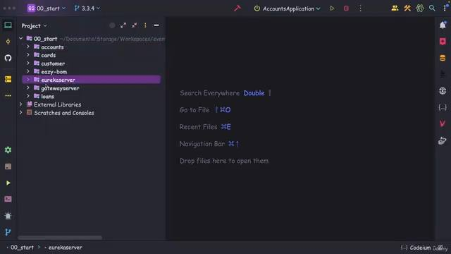
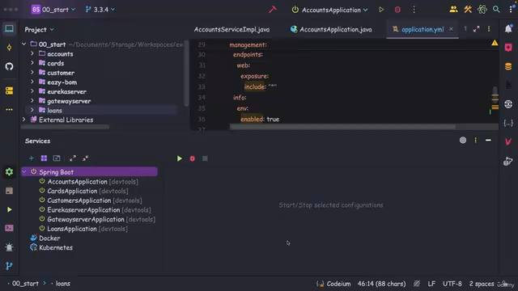
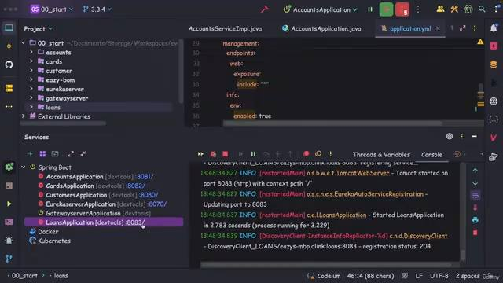
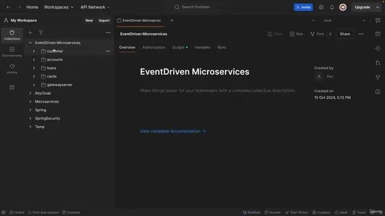
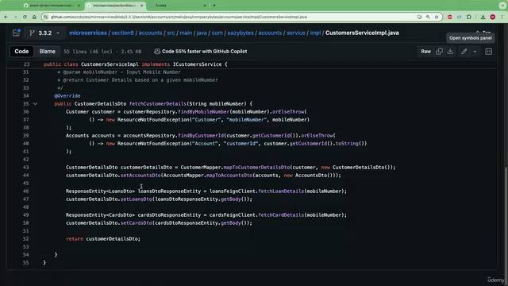
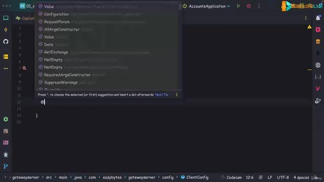
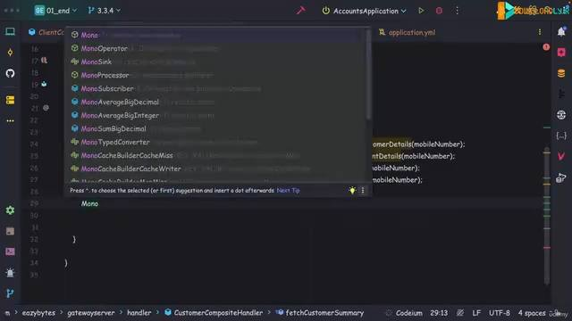

# CQRS/Saga/EventSourcing 课程复现文档（P006–P009）

> 覆盖范围：P006 微服务代码结构梳理 → P007 启动与接口联调 → P008 API 组合模式（DTO 与声明式客户端）→ P009 WebClient 配置与并行聚合 Handler。
> 说明：本课程是「事件驱动微服务」系列的前置铺垫，P006–P009 尚未进入 CQRS/Saga/EventSourcing 本体，而是先把四个微服务跑通、再用 Spring Cloud Gateway 实现 API 组合（API Composition）。本文严格按「能照着跑起来」来写。

---

## 1. 这一节做什么

这四讲要完成三件事，缺一件后面的事件驱动章节都跑不动：

1. **把四个微服务（customer / accounts / cards / loans）+ Eureka + Gateway 在本地跑起来**，并用 Postman 走通 CRUD。四个服务共用同一个 `mobileNumber` 作为跨服务关联键——这是整门课的数据主线。也就是说，客户、账户、卡、贷款不是靠外键数据库关联，而是靠业务字段 `mobileNumber` 串起来；后面做 API 组合时，Gateway 正是拿这个号码分别去四个服务查数据，再拼成一个汇总对象返回。这里要特别注意：四个服务各自有独立数据库，彼此不知道对方表结构，所以 `mobileNumber` 必须在四个服务里保持一致，否则聚合时会出现“客户查得到、账户查不到”的半成功状态。

2. **理解 accounts 服务的业务逻辑**（创建/查询/更新/软删除），因为后面所有事件驱动改造都会围绕它展开。创建是插入一条新账户记录；查询是按 `mobileNumber` 或账户号取有效记录；更新是改账户类型、网点地址等字段；删除不是物理删除，而是把 `activeSw` 置为 `false`。这一套动作在后面会被拆成命令和事件，所以现在先按普通 CRUD 跑通，知道每个接口的输入输出和数据库变化，后面改造成事件驱动时才有对照物。

3. **在 Gateway 里实现 API 组合模式（API Composition）**：客户端只调一个 `/easybank/fetchCustomerSummary?mobileNumber=...`，Gateway 并行调用四个微服务，把结果聚合成一个 `CustomerSummaryDTO` 返回。这里的关键词是“并行”和“聚合”：不是 Gateway 先查客户、再查账户、再查卡、再查贷款串行等待，而是四个请求同时发出去，用 `Mono.zip` 等四个结果都回来后再组装。对前端来说，这相当于把多次网络请求收敛成一次，减少页面首屏的请求数量和等待时间；对后端来说，Gateway 临时承担了 BFF（Backend for Frontend）的角色。

技术栈（课里实际用到的）：Spring Boot + Spring Data JPA + H2（文件模式）+ Eureka + Spring Cloud Gateway（响应式）+ WebClient + `@HttpExchange` 声明式客户端 + Lombok。**没有用 OpenFeign 做组合**，讲师明确说 Feign 不支持响应式，所以组合逻辑用 WebClient。前端同学可以把 WebClient 理解成浏览器里的 `fetch`/`axios`，把 `@HttpExchange` 接口理解成“只写类型声明、运行时生成实现的 HTTP 客户端”；把 `Mono` 理解成带背压能力的 `Promise`，但要注意它只有被订阅才会真正执行。



---

## 2. 讲师原话（带出处）

> "如果你打开我的账户微服务，就会看到这些都是审计包下的包……创建 API 会帮助我在数据库中创建一个全新的账户。"
> —— p006 [00:29]

> "在真实项目中，我们绝不应尝试硬删除整条记录。我们应始终借助启用开关这类列对它们进行软删除。"
> —— p006 [04:55]

> "默认情况下，每当我执行重启或关闭时，我存储的所有数据都会被清除。但如果我希望在重启和关闭后仍保留这些数据，就需要让 H2 数据库把所有数据存到文件中……你需要提供的属性就是 JDBC:H2:file。"
> —— p006 [05:24]–[05:48]

> "首先需要启动 Eureka 服务器，因为我的所有微服务都要注册到 Eureka 服务器……请确保你也按相同顺序启动了各项服务。"
> —— p007 [01:06]–[01:46]

> "请始终确保在所有服务中使用同一个手机号，这是所有微服务之间唯一共用的数据。"
> —— p007 [08:42]

> "对于这种并行调用，我们不能使用 OpenFeignClient。原因是 OpenFeignClient 不支持响应式编程模型。因此，我们将不使用 OpenFeignClient，而改用 WebClient。"
> —— p009 [00:29]

> "为了确保我的线程等待上述四个操作全部完成，我需要使用 Mono 中提供的 zip 方法。"
> —— p009 [09:34]

> "这不是 REST API，只是一个处理程序方法。在响应式应用中，我们不能像传统方式那样借助 REST 控制器构建 REST API。相反，我们需要定义路由配置。"
> —— p009 [13:21]

上面这些原话分别对应四个关键点：accounts 包的 audit 结构、软删除原则、H2 文件模式、Eureka 启动顺序、`mobileNumber` 统一、Feign 不支持响应式、`Mono.zip` 等待全部完成、函数式 Handler 不是传统 `@RestController`。复现时如果某一项对不上，优先回到对应原话检查，而不是盲目改代码。

---

## 3. 从零复现

### 3.1 目录结构

课程仓库按 section 组织，P008 起把 `start` 复制成 `end`，所有改动只在 `end` 里做：

```
event-driven-microservices/
└── section1/
    ├── start/                      # 起始代码（P006/P007 用的就是这套）
    │   ├── eurekaserver/
    │   ├── gatewayserver/
    │   ├── customer/
    │   ├── accounts/
    │   ├── cards/
    │   └── loans/
    └── end/                        # P008 起复制过来，API 组合改动都在这里
        ├── eurekaserver/
        ├── gatewayserver/          # ← 本节唯一改动的模块
        ├── customer/
        ├── accounts/
        ├── cards/
        └── loans/
```

> 课里没讲 Maven 父 POM 的具体内容，只提到「load maven scripts」「build successful」。按你的 IDE 提示加载即可。

这里 `start` 和 `end` 的区别要理解清楚：`start` 是联调基线，`end` 是后续改动的副本。P006/P007 先在 `start` 里把六个模块跑通；P008 开始复制出 `end`，之后 DTO、声明式客户端、Handler 都加在 `end/gatewayserver` 里。这样做的好处是你可以随时回到 `start` 对照“没有 API 组合时前端要调几次接口”，而 `end` 里能看到聚合后的单接口。加载 Maven 时，IDE 如果提示 “Maven projects need to be imported”，点导入即可；命令行可用 `mvn clean install` 验证，`clean` 清理旧产物，`install` 编译、测试并安装到本地仓库。若只想跑某个模块，可在对应模块目录执行 `mvn spring-boot:run`，但课程主要用 IDE Services 面板启动，不要混用导致端口重复占用。

### 3.2 端口分配（讲师在 P007 明确给出）

| 服务 | 端口 |
|---|---|
| eurekaserver | 8070 |
| customer | 8080 |
| accounts | 8081 |
| cards | 8082 |
| loans | 8083 |
| gatewayserver | 8072 |

端口表要背下来：Eureka 是 8070，Gateway 是 8072，四个业务服务分别是 8080–8083。排查时先看控制台启动日志里的 `Tomcat started on port(s): xxxx`，如果端口和表不一致，要么是配置被改，要么是旧进程没退出。前端联调时只应访问 Gateway 的 8072，不应该直接访问 8080–8083；直接访问业务服务会绕过路由和聚合逻辑，容易误判“Gateway 没生效”。

### 3.3 启动顺序（必须照做）

1. `eurekaserver`（8070）
2. `accounts`（8081）
3. `cards`（8082）
4. `customer`（8080）
5. `loans`（8083）
6. `gatewayserver`（8072）

IntelliJ Ultimate 可用 `Ctrl+8`（Mac 是 `Cmd+8`）打开 Services 面板批量启动；Community 版只能手动打开每个 Spring Boot 主类运行。启动顺序的原因是业务服务启动后会向 Eureka 注册，Eureka 必须先可用；Gateway 又要从 Eureka 拉取路由目标，所以放在最后。若先启动 Gateway，它可能短时间看不到服务实例，虽然 Eureka 有自我保护重试，但课上演示会不稳定。每启动一个服务，等日志出现 “Started ...Application” 和 “DiscoveryClient ... registering service” 再启动下一个，避免并发启动时注册心跳还没发出去就误判失败。



### 3.4 H2 文件模式配置（关键，否则重启数据全丢）

在**每个**业务微服务的 `application.yaml` 里，datasource URL 必须写成文件模式：

```yaml
spring:
  datasource:
    url: jdbc:h2:file:~/accounts;AUTO_SERVER=TRUE
    username: sa
    password: 
  h2:
    console:
      enabled: true
```

accounts / cards / customer / loans 各自把文件名换成自己的（`~/accounts`、`~/cards`、`~/customer`、`~/loans`）。数据文件会落在用户主目录下，扩展名 `.db`。**想清空重来，就删掉这些 `.db` 文件**（讲师在 P007 [10:11] 明确说了）。

逐段解释这个 URL：`jdbc:h2:` 是 H2 驱动协议；`file:` 表示用文件存储而不是内存；`~/accounts` 表示用户主目录下的 `accounts` 数据库文件；`AUTO_SERVER=TRUE` 允许同一台机器上多个进程访问同一个数据库文件，适合本地同时开服务和 H2 Console 的场景。`username: sa` 和空 `password` 是 H2 默认本地开发账号。`h2.console.enabled: true` 打开 `/h2-console` 网页控制台，方便执行 `select * from customer` 验证软删除。常见错误：把 URL 写成 `jdbc:h2:mem:accounts` 则重启即丢；写成相对路径 `./accounts` 则文件落在工作目录而不是主目录；`AUTO_SERVER=TRUE` 下重复启动同一服务可能报文件锁冲突，先确认旧进程是否退出。



### 3.5 Postman 集合

讲师把集合命名为 `event-driven-microservices` 并上传到 GitHub，导入即可。集合级 Pre-request Script 里用 `pm` 对象设置 baseUrl：

```javascript
pm.request.url.protocol = 'http';
pm.request.url.host = ['localhost'];
pm.request.url.port = '8072';   // 指向 gateway
```

所有请求都走 Gateway（8072），由 Gateway 按前缀路由到具体微服务。`pm` 是 Postman 的脚本对象，`pm.request` 代表当前请求；Pre-request Script 在请求发出前执行，所以可以统一改协议、主机和端口。前端对照：这相当于在 axios 实例上设置 `baseURL`，每个请求只写路径。常见错误：某些 Postman 版本里 `pm.request.url` 是只读对象，改端口不生效；此时不要和脚本较劲，直接在请求 URL 里写 `http://localhost:8072/...`，并检查集合变量是否被环境变量覆盖。验证方法是发一个 `GET /easybank/customer/api/fetch?mobileNumber=...`，看地址栏实际请求是否为 8072。

### 3.6 联调顺序（P007 演示的完整链路）

1. `POST /easybank/customer/api/create` → 建客户，记下 `mobileNumber`
2. `GET /easybank/customer/api/fetch?mobileNumber=...` → 查客户
3. `PUT /easybank/customer/api/update` → 改名，再 fetch 验证
4. `DELETE /easybank/customer/api/delete?customerId=...` → 软删，查库确认 `active_switch=false`
5. 用**同一个 mobileNumber** 依次对 accounts / cards / loans 做 create → fetch → update → delete

这条链路的核心是“先 customer，后其它；每一步都验证返回和库”。create 成功后先记下 `mobileNumber`，后面三个服务都用它；fetch 验证查得到；update 验证字段确实变了；delete 后不要只看接口返回，要到 H2 Console 里查 `active_switch` 是否为 `false`。前端对照：这相当于先建用户主档，再建账户、卡、贷款子资源，最后验证软删除后列表接口不再返回该记录。常见错误是四个服务用了不同号码，导致后面 API 组合时只查到部分数据；另一个错误是 delete 后还用原号码查，看到 404 就以为服务坏了，其实是软删除条件 `activeSw = true` 生效。



### 3.7 API 组合模式改造（P008–P009）

只在 `gatewayserver` 模块内新增：

```
gatewayserver/src/main/java/com/easybank/gatewayserver/
├── dto/
│   ├── CustomerDTO.java
│   ├── AccountsDTO.java
│   ├── CardsDTO.java
│   ├── LoansDTO.java
│   └── CustomerSummaryDTO.java
├── service/client/
│   └── CustomerSummaryClient.java
├── config/
│   └── ClientConfig.java
└── handler/
    └── CustomerCompositeHandler.java
```

`application.yaml` 里加一行 `app.base-url: http://localhost:8070`（注意：讲师口述是 8070，但 Eureka 也在 8070，实际应以你本地 Gateway 端口 8072 为准，见第 7 节）。

这些包的职责要分清：`dto` 只放数据传输对象，字段和业务微服务返回的 JSON 对齐；`service/client` 放声明式接口，只写方法签名和 `@GetExchange` 路径；`config` 负责用 `WebClient` 和 `HttpServiceProxyFactory` 生成接口代理；`handler` 放函数式端点，把四个 `Mono` 聚合后返回 `ServerResponse`。前端对照：`dto` 类似 TypeScript 的 `interface`，`client` 类似 API 类型声明，`config` 类似 axios 实例，`handler` 类似 BFF 的聚合 controller。常见错误是 DTO 字段名和下游 JSON 不一致，比如下游返回 `activeSw`，DTO 写成 `activeSwitch`，反序列化后字段为 `null`；排查时先拿 Postman 直接调业务服务看原始 JSON，再对照 DTO。

---

## 4. 完整代码

> 以下代码按讲师在 P008/P009 中逐行敲出的内容整理成完整文件。包名以讲师口述的 `com.easybank.gatewayserver` 为准；若你的仓库包名不同，请整体替换。

### 4.1 `dto/CustomerDTO.java`

```java
package com.easybank.gatewayserver.dto;

import jakarta.validation.constraints.Email;
import jakarta.validation.constraints.NotEmpty;
import jakarta.validation.constraints.Pattern;
import jakarta.validation.constraints.Size;
import lombok.Data;

@Data
public class CustomerDTO {

    @NotEmpty(message = "Name can not be a null or empty")
    @Size(min = 5, max = 30, message = "The length of the customer name should be between 5 and 30")
    private String name;

    @NotEmpty(message = "Email address can not be a null or empty")
    @Email(message = "Email address should be a valid value")
    private String email;

    @Pattern(regexp = "(^$|[0-9]{10})", message = "Mobile number must be 10 digits")
    private String mobileNumber;

    private boolean activeSw;
}
```

### 4.2 `dto/AccountsDTO.java`

```java
package com.easybank.gatewayserver.dto;

import lombok.Data;

@Data
public class AccountsDTO {
    private Long accountNumber;
    private String accountType;
    private String branchAddress;
    private boolean activeSw;
}
```

### 4.3 `dto/CardsDTO.java`

```java
package com.easybank.gatewayserver.dto;

import lombok.Data;

@Data
public class CardsDTO {
    private String mobileNumber;
    private String cardNumber;
    private String cardType;
    private int totalLimit;
    private int amountUsed;
    private int availableAmount;
    private boolean activeSw;
}
```

### 4.4 `dto/LoansDTO.java`

```java
package com.easybank.gatewayserver.dto;

import lombok.Data;

@Data
public class LoansDTO {
    private String mobileNumber;
    private String loanNumber;
    private String loanType;
    private int totalLoan;
    private int amountPaid;
    private int outstandingAmount;
    private boolean activeSw;
}
```

### 4.5 `dto/CustomerSummaryDTO.java`

```java
package com.easybank.gatewayserver.dto;

import lombok.AllArgsConstructor;
import lombok.Data;

@Data
@AllArgsConstructor
public class CustomerSummaryDTO {
    private CustomerDTO customer;
    private AccountsDTO accounts;
    private LoansDTO loans;
    private CardsDTO cards;
}
```

### 4.6 `service/client/CustomerSummaryClient.java`

```java
package com.easybank.gatewayserver.service.client;

import com.easybank.gatewayserver.dto.AccountsDTO;
import com.easybank.gatewayserver.dto.CardsDTO;
import com.easybank.gatewayserver.dto.CustomerDTO;
import com.easybank.gatewayserver.dto.LoansDTO;
import org.springframework.http.MediaType;
import org.springframework.http.ResponseEntity;
import org.springframework.web.bind.annotation.RequestParam;
import org.springframework.web.service.annotation.GetExchange;
import reactor.core.publisher.Mono;

public interface CustomerSummaryClient {

    @GetExchange(value = "/easybank/customer/api/fetch", accept = MediaType.APPLICATION_JSON_VALUE)
    Mono<ResponseEntity<CustomerDTO>> fetchCustomerDetails(@RequestParam String mobileNumber);

    @GetExchange(value = "/easybank/accounts/api/fetch", accept = MediaType.APPLICATION_JSON_VALUE)
    Mono<ResponseEntity<AccountsDTO>> fetchAccountDetails(@RequestParam String mobileNumber);

    @GetExchange(value = "/easybank/loans/api/fetch", accept = MediaType.APPLICATION_JSON_VALUE)
    Mono<ResponseEntity<LoansDTO>> fetchLoanDetails(@RequestParam String mobileNumber);

    @GetExchange(value = "/easybank/cards/api/fetch", accept = MediaType.APPLICATION_JSON_VALUE)
    Mono<ResponseEntity<CardsDTO>> fetchCardDetails(@RequestParam String mobileNumber);
}
```

> 注意：讲师口述的路径前缀是 `easybank customer` / `easybank accounts` 等，实际路由前缀请以你 `gatewayserver` 里 `RouteLocator` 的配置为准（P007 提到「easybank customer 前缀转发到 customer 微服务」）。上面按 `easybank/customer` 写，若你的路由是 `easybankcustomer` 请改。

### 4.7 `config/ClientConfig.java`

```java
package com.easybank.gatewayserver.config;

import com.easybank.gatewayserver.service.client.CustomerSummaryClient;
import org.springframework.beans.factory.annotation.Value;
import org.springframework.context.annotation.Bean;
import org.springframework.context.annotation.Configuration;
import org.springframework.web.reactive.function.client.WebClient;
import org.springframework.web.reactive.function.client.support.WebClientAdapter;
import org.springframework.web.service.invoker.HttpServiceProxyFactory;

@Configuration
public class ClientConfig {

    @Value("${app.base-url}")
    private String baseUrl;

    @Bean
    public CustomerSummaryClient customerClient() {
        WebClient webClient = WebClient.builder()
                .baseUrl(baseUrl)
                .build();

        WebClientAdapter adapter = WebClientAdapter.create(webClient);

        HttpServiceProxyFactory factory = HttpServiceProxyFactory
                .builderFor(adapter)
                .build();

        return factory.createClient(CustomerSummaryClient.class);
    }
}
```

### 4.8 `handler/CustomerCompositeHandler.java`

```java
package com.easybank.gatewayserver.handler;

import com.easybank.gatewayserver.dto.AccountsDTO;
import com.easybank.gatewayserver.dto.CardsDTO;
import com.easybank.gatewayserver.dto.CustomerDTO;
import com.easybank.gatewayserver.dto.CustomerSummaryDTO;
import com.easybank.gatewayserver.dto.LoansDTO;
import com.easybank.gatewayserver.service.client.CustomerSummaryClient;
import lombok.RequiredArgsConstructor;
import org.springframework.http.MediaType;
import org.springframework.stereotype.Component;
import org.springframework.web.reactive.function.server.ServerRequest;
import org.springframework.web.reactive.function.server.ServerResponse;
import reactor.core.publisher.Mono;

@Component
@RequiredArgsConstructor
public class CustomerCompositeHandler {

    private final CustomerSummaryClient customerSummaryClient;

    public Mono<ServerResponse> fetchCustomerSummary(ServerRequest serverRequest) {
        String mobileNumber = serverRequest.queryParam("mobileNumber").orElseThrow();

        Mono<CustomerDTO> customerDetails =
                customerSummaryClient.fetchCustomerDetails(mobileNumber).map(r -> r.getBody());
        Mono<AccountsDTO> accountDetails =
                customerSummaryClient.fetchAccountDetails(mobileNumber).map(r -> r.getBody());
        Mono<LoansDTO> loansDetails =
                customerSummaryClient.fetchLoanDetails(mobileNumber).map(r -> r.getBody());
        Mono<CardsDTO> cardsDetails =
                customerSummaryClient.fetchCardDetails(mobileNumber).map(r -> r.getBody());

        return Mono.zip(customerDetails, accountDetails, loansDetails, cardsDetails)
                .flatMap(tuple -> {
                    CustomerDTO customerDTO = tuple.getT1();
                    AccountsDTO accountsDTO = tuple.getT2();
                    LoansDTO loansDTO = tuple.getT3();
                    CardsDTO cardsDTO = tuple.getT4();

                    CustomerSummaryDTO summary =
                            new CustomerSummaryDTO(customerDTO, accountsDTO, loansDTO, cardsDTO);

                    return ServerResponse.ok()
                            .contentType(MediaType.APPLICATION_JSON)
                            .bodyValue(summary);
                });
    }
}
```

> 讲师原话用的是 `body(BodyInserters.fromValue(...))`，`bodyValue(...)` 是等价简写；若你照抄讲师版本，把 `.bodyValue(summary)` 换成 `.body(BodyInserters.fromValue(summary))` 并 import `org.springframework.web.reactive.function.BodyInserters`。

### 4.9 `gatewayserver/src/main/resources/application.yaml`（新增片段）

```yaml
app:
  base-url: http://localhost:8072
```

> 讲师口述是 `localhost:8070`，但 8070 是 Eureka 端口，Gateway 在 8072。以你本地实际 Gateway 端口为准，见第 7 节。

### 4.10 路由配置（P009 结尾说「下一讲再写」，本节未给出完整代码）

讲师在 P009 [13:21] 明确说「这不是 REST API，只是 handler 方法，需要定义 routing configurations」，但**本节没有写出 `RouterFunction` 的完整代码**。按 Spring Cloud Gateway 的常规写法，你需要在 `gatewayserver` 里补一个 `@Bean RouterFunction<ServerResponse>`，把 `/easybank/fetchCustomerSummary` 映射到 `customerCompositeHandler::fetchCustomerSummary`。具体写法课里没讲，请以官方文档为准。

---

## 5. 逐行解释

**`@Data`（Lombok）**：自动生成 getter/setter/toString/equals/hashCode。前端同学可以理解为「自动生成 class 的访问器」，等价于 TS 里手写一堆 get/set。它的价值在 DTO 字段多时减少样板代码；但要注意 `@Data` 生成的 `equals/hashCode` 对实体类不一定合适，课程只在 DTO 上用，问题不大。

**`@AllArgsConstructor`（CustomerSummaryDTO）**：生成全参构造器，所以 `new CustomerSummaryDTO(customerDTO, accountsDTO, loansDTO, cardsDTO)` 能编译通过。没有这个注解，四参构造器不存在。前端对照：相当于 TS 里写 `constructor(public customer, public accounts, public loans, public cards)`，但 Java 需要显式注解生成。

**`@GetExchange`**：Spring 6 的声明式 HTTP 接口注解，类似 Feign 的 `@GetMapping`，但走的是 `HttpServiceProxyFactory` 代理。**只写接口不写实现**，实现由工厂在运行时生成。常见错误是以为要写 `implements CustomerSummaryClient`，其实不需要；另一个错误是路径前缀和 Gateway 路由不一致，导致 404。

**`Mono<ResponseEntity<T>>`**：`Mono` 表示「0 或 1 个元素的异步流」，`Flux` 表示「0 到 N 个」。这里每个微服务只返回一个对象，所以用 `Mono`。**在 JS/Node 里对应 `Promise<T>`**——`Mono` 不阻塞线程，订阅后才执行，和 Promise 的 then 链思路一致，但支持背压（backpressure），这是 Promise 没有的。前端最容易误解的是“写了 `map` 就会执行”；实际上没有订阅者时，整条链不会发请求。

**`WebClient.builder().baseUrl(baseUrl).build()`**：创建响应式 HTTP 客户端，绑定根地址。**对应 Node 里的 `axios.create({ baseURL })`**。`baseUrl` 来自 `app.base-url`，这样四个 `@GetExchange` 路径只需写相对路径。

**`WebClientAdapter.create(webClient)`**：把 `WebClient` 包装成 `HttpServiceProxyFactory` 能接受的适配器。讲师原话解释：`HttpServiceProxyFactory.builderFor()` 不直接收 `WebClient`，所以要包一层。`WebClientAdapter` 实现了 `ReactorHttpExchangeAdapter`，再往上继承 `HttpExchangeAdapter`。常见错误是 import 错包，见第 7 节。

**`HttpServiceProxyFactory.builderFor(adapter).build()`**：构建代理工厂。它负责把接口上的 `@GetExchange` 元数据解析成真实 HTTP 调用。

**`factory.createClient(CustomerSummaryClient.class)`**：为接口生成代理实例。**这就是为什么接口里只有抽象方法也能调**——运行时字节码生成实现。前端对照：类似用 `Proxy` 给对象生成方法实现，但这里是 HTTP 代理。

**`@Value("${app.base-url}")`**：从 `application.yaml` 读配置，便于多环境切换。**对应 Node 里的 `process.env.BASE_URL`**。如果配置缺失，启动会报占位符无法解析，检查 yaml 缩进和 key 名。

**`serverRequest.queryParam("mobileNumber").orElseThrow()`**：从 query string 取 `mobileNumber`，取不到抛异常。`ServerRequest`/`ServerResponse` 是 WebFlux 的函数式端点类型，**对应 Express 的 `req`/`res`**，但不可变、链式返回 `Mono`。常见错误是参数名大小写不一致，或者 URL 编码问题。

**四行 `customerSummaryClient.fetchXxx(...).map(r -> r.getBody())`**：每行发起一次异步调用，`.map` 把 `ResponseEntity<T>` 拆成 `T`。**关键：这四行不会阻塞**，线程发完请求立刻执行下一行，四个请求并行在途。前端对照：类似 `Promise.all` 前先创建四个 `fetch` Promise，但这里只是“声明”，真正订阅发生在返回给框架后。

**`Mono.zip(a, b, c, d)`**：等四个 `Mono` 全部 emit 后，合成一个 `Tuple4`。**对应 JS 的 `Promise.all([...])`**。任何一个失败，整个 zip 失败（fail-fast），课里没讲错误处理。前端对照：`Promise.all` 也是任一 reject 整体 reject；若要部分成功，需要 `Promise.allSettled`，Reactor 里对应 `onErrorResume` 或 `zipDelayError`。

**`tuple.getT1()...getT4()`**：按 zip 参数顺序取。`Tuple` 是 Reactor 的多类型容器，`List` 只能装同类型，`Tuple` 可以装不同类型——讲师在 P009 [10:29] 专门解释了这点。常见错误是 zip 参数顺序和 `getT` 顺序不一致，导致 customer 和 accounts 错位。

**`ServerResponse.ok().contentType(...).bodyValue(summary)`**：构造 200 响应，JSON 体为聚合后的 `CustomerSummaryDTO`。**对应 Express 的 `res.status(200).json(summary)`**。如果 summary 里有 `null` 字段，Jackson 默认会输出 `null`，前端要允许字段为空。

**软删除（accounts 服务）**：`deleteAccount` 不删行，只把 `activeSw` 置 false。**在 JS/Node 里对应 `UPDATE ... SET active_sw = false WHERE ...`，而不是 `DELETE FROM`**。所有 fetch 查询都带 `activeSw = true` 条件，所以软删后查不到——这是讲师在 P006 [04:55] 强调的「真实项目永远不要硬删」。验证时要同时看接口返回和数据库行，不能只看接口 200。

**`@EnableJpaAuditing`（accounts 主类）**：开启 JPA 审计，自动填 `createdDate`/`updatedDate`/`createdBy`/`updatedBy`。**对应 Node 里用 TypeORM 的 `@CreateDateColumn`/`@UpdateDateColumn`**。如果审计字段为 null，检查主类是否加注解、实体字段是否加 `@CreatedDate` 等。

---

## 6. 复现检查清单

按顺序打勾，任何一项不过不要往下走：

- [ ] 六个模块 Maven 加载成功，`mvn clean install` 无报错  
  **验证：** 在仓库根目录执行命令，看最后是否 `BUILD SUCCESS`；若失败，先看第一个报错模块，不要从最后一个错误倒推。

- [ ] 按 3.3 顺序启动，六个进程都起来  
  **验证：** Services 面板或控制台逐个确认 `Started ...Application`，并检查 8070/8072/8080–8083 端口都有进程监听。

- [ ] 浏览器打开 `http://localhost:8070` 能看到 Eureka 面板，四个业务服务 + gateway 都注册上  
  **验证：** Eureka 首页 `Instances currently registered with Eureka` 列表里应出现 `CUSTOMER`、`ACCOUNTS`、`CARDS`、`LOANS`、`GATEWAYSERVER`，状态为 `UP`。

- [ ] 每个业务服务的 `application.yaml` 里 datasource URL 是 `jdbc:h2:file:~/xxx;AUTO_SERVER=TRUE`  
  **验证：** 逐个打开四个 yaml，确认不是 `mem:`，文件名和服务对应，`AUTO_SERVER` 没拼错。

- [ ] 用户主目录下出现 `accounts.mv.db` / `cards.mv.db` / `customer.mv.db` / `loans.mv.db`（H2 2.x 是 `.mv.db`，1.x 是 `.h2.db`，以实际为准）  
  **验证：** 启动并 create 一条数据后，到用户主目录 `ls` 看文件是否生成；若没有，检查 URL 和工作目录。

- [ ] Postman 导入集合，Pre-request Script 里 port 是 `8072`  
  **验证：** 发请求后看 Postman 地址栏实际端口；若仍是 8080，说明脚本没生效或被环境变量覆盖。

- [ ] `POST /easybank/customer/api/create` 返回成功，记下 mobileNumber  
  **验证：** 响应体应有客户信息，复制 `mobileNumber` 到记事本，后续三个服务必须完全一致。

- [ ] 用同一 mobileNumber 对 accounts / cards / loans 各 create 一次成功  
  **验证：** 每次 create 后用对应 fetch 查一次，确认四个服务都能按同一号码查到数据。

- [ ] 对 customer 执行 delete 后，H2 控制台 `select * from customer` 看到 `active_switch = false`  
  **验证：** 打开 `/h2-console`，执行 SQL，看行还在但 `active_switch` 为 false；再 fetch 应查不到。

- [ ] 重启任一服务，之前的数据还在（验证文件模式生效）  
  **验证：** 停掉 accounts 再启动，fetch 之前创建的账户；数据仍在说明文件模式生效，丢了则回查 datasource URL。

- [ ] `gatewayserver` 里 `dto` / `service/client` / `config` / `handler` 四个包都建好，五个 DTO + 一个接口 + 一个配置类 + 一个 handler 都能编译  
  **验证：** IDE 无红波浪线，`mvn -pl gatewayserver compile` 或整体 `mvn clean install` 通过。

- [ ] `application.yaml` 里有 `app.base-url`  
  **验证：** 值应为 `http://localhost:8072`；启动 Gateway 不报占位符解析错误。

- [ ] （P009 结尾未完成）`RouterFunction` 路由配置已补，`GET /easybank/fetchCustomerSummary?mobileNumber=...` 能返回四段聚合 JSON  
  **验证：** Postman 发请求，响应 JSON 同时含 `customer`、`accounts`、`loans`、`cards` 四段；缺段则查对应 client 路径和下游服务。







---

## 7. 课里没讲但你会撞上的

下表按“现象 / 原因 / 怎么办”整理，和上面清单配合使用；这些点课程没有展开，但本地复现时很容易遇到。

| 现象 | 原因 | 怎么办 |
|---|---|---|
| `app.base-url` 配成 `localhost:8070` 后，聚合接口 404 或打到 Eureka | 讲师口述 `localhost:8070`，但 8070 是 Eureka，Gateway 是 8072；照抄会打错目标 | 改成 `http://localhost:8072`；启动后看 Gateway 日志和 Postman 实际请求地址确认 |
| P009 结尾说“下一讲再写”，本地没有 `RouterFunction`，`/easybank/fetchCustomerSummary` 访问不到 | 本节只写了 Handler，没有写路由配置；函数式端点必须显式映射 | 自己补 `@Bean RouterFunction<ServerResponse>`，用 `RouterFunctions.route().GET(...)` 映射到 `customerCompositeHandler::fetchCustomerSummary`；以官方文档为准 |
| 四个服务中任一 404/500，整个聚合接口直接 500 | `Mono.zip` 是 fail-fast，任一 Mono error 整个 zip error；课里没讲降级 | 生产可给每个 Mono 加 `.onErrorResume(e -> Mono.empty())` 或用 `zipDelayError`；本地先保证四个 fetch 都能单独成功 |
| 不传 `mobileNumber` 返回 500，而不是 400 | `queryParam("mobileNumber").orElseThrow()` 抛 `NoSuchElementException`，WebFlux 默认转 500；课里没讲参数校验 | 改成 `.orElseThrow(() -> new ResponseStatusException(BAD_REQUEST, ...))`，或先 `map` 校验再返回 400 |
| 同一服务重复启动报 H2 文件锁冲突 | `AUTO_SERVER=TRUE` 允许多进程访问，但同一数据库文件被残留进程占用会锁冲突；课里没讲 | 先确认旧 java 进程退出，必要时 `taskkill` 掉残留进程；仍不行再删 `.lock.db`，不要直接删业务 `.mv.db` |
| `@GetExchange` 编译不过或找不到注解 | `@HttpExchange` 需要 Spring 6+，Spring Boot 3.x 才有；Boot 2.x 没有该注解；课里没讲版本要求 | 确认项目是 Boot 3；若是 Boot 2，退回 `@RequestMapping(method = GET)` + Feign 或其它客户端 |
| `WebClientAdapter` import 报错 | 正确包是 `org.springframework.web.reactive.function.client.support.WebClientAdapter`，容易错导成 `WebClient` 所在包；课里没讲 | 用 IDE 自动补全时看清 `support` 子包；编译报错就删掉错误 import 重新选 |
| Postman 集合级脚本改端口不生效 | 不同 Postman 版本对 `pm.request.url` 可写性有差异，某些版本只读；课里没讲 | 不依赖脚本，每个请求直接写完整 URL `http://localhost:8072/...`，或改用集合变量 |
| H2 里查 `activeSw` 报列不存在 | Java 字段 `activeSw`，JPA 默认驼峰转下划线，表列是 `active_switch`；课里没讲命名映射 | SQL 写 `active_switch`；P007 [08:14] 讲师查库用的就是该列名 |
| 写了 `map` 里的 `System.out.println` 但不打印 | `Mono`/`Flux` 不订阅不执行；handler 返回给框架后框架才订阅；课里没讲 | 不要用副作用调试响应式链；用日志或 `doOnNext` 并确保最终有订阅者；理解 Reactor 与 Promise 的心智差异 |

---

**下一节预告（P010 起）**：讲师在 P009 结尾说「下一讲实现 routing configurations」，之后才会进入 CQRS/Saga/EventSourcing 本体。本文档只覆盖 P006–P009，事件驱动部分请等后续文档。