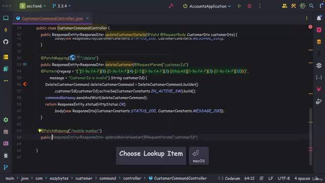
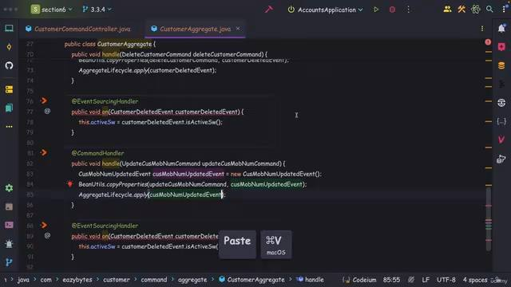
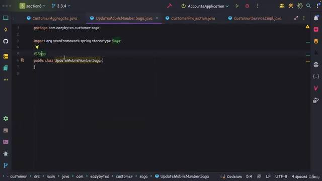
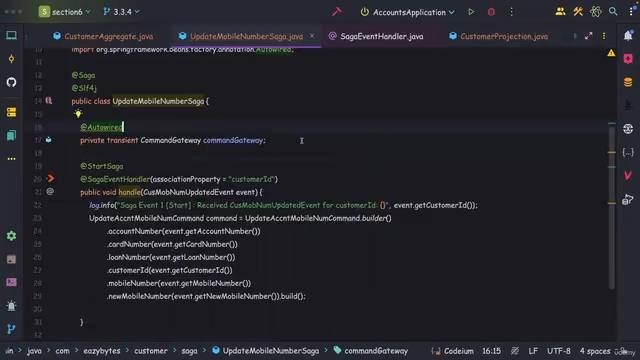
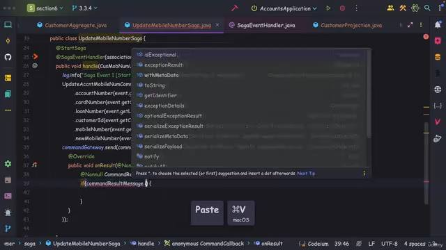
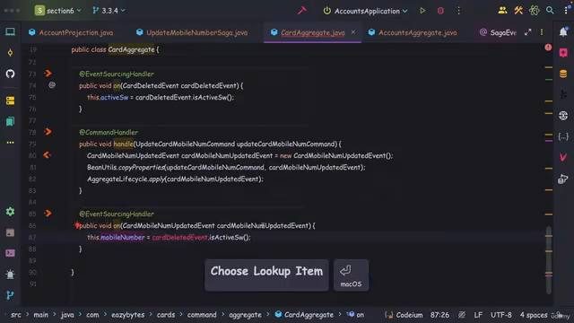
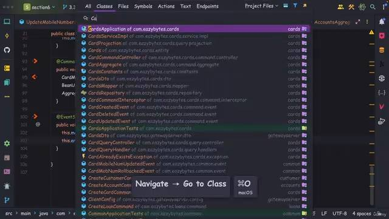
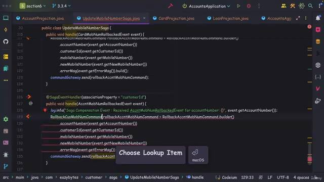

# CQRS / Saga / Event Sourcing 实战：把「改手机号」编排成一条跨 4 个微服务的 Saga（p063–p066）

> 说明：这四讲的源代码分散在 4 个微服务里，讲师是边讲边改，逐字稿记录的是「改哪个类、加什么注解、字段从哪来」。下面的文档把这段过程按**可运行的工程**重建了一遍。凡是讲师逐字稿没有明确交代的部分（实体、仓库、pom、启动类、造数据用的创建命令），我都会明确写「课里没讲，以下为补全」，不会冒充讲师原意。

---

## 1. 这一节做什么

前面几讲已经在 `common` 模块里把命令类（Command）和事件类（Event）都定义好了。这一节要做的，是把「用户改手机号」这一个动作，从**一个 HTTP 请求**开始，沿着 CQRS + Saga + Event Sourcing 的链路，穿过四微服务：

```
客户端
  └─ PATCH /customers/mobile-number
       └─ customer-service
            ├─ CustomerCommandController   请求 → UpdateCustomerMobileNumberCommand
            ├─ CustomerAggregate           command → CustomerMobileNumberUpdatedEvent
            ├─ @EventSourcingHandler       把新手机号写进 customer 写库
            ├─ CustomerProjection          把新手机号写进 customer 读库
            └─ UpdateMobileNumberSaga      @StartSaga，把请求交给下一跳
                 └─ UpdateAccountMobileNumberCommand → account-service
                      └─ AccountAggregate → AccountMobileNumberUpdatedEvent
                           └─ saga → UpdateCardMobileNumberCommand → card-service
                                └─ CardAggregate → CardMobileNumberUpdatedEvent
                                     └─ saga → UpdateLoanMobileNumberCommand → loan-service
                                          └─ LoanAggregate → LoanMobileNumberUpdatedEvent
                                               └─ saga（@EndSaga）→ 全流程结束
```

同时要建立**失败回滚链**：任何一跳抛运行时异常，就从出错点的**前一个**服务开始，按相反方向逐个补偿：

```
loan 失败 → RollbackCardMobileNumberCommand  → card   （CardMobileNumberRollbackEvent）
          → RollbackAccountMobileNumberCommand → account（AccountMobileNumberRollbackEvent）
          → RollbackCustomerMobileNumberCommand → customer（CustomerMobileNumberRollbackEvent，@EndSaga）
```

注意这里的命名不对称，是讲师原样写出来的：**命令叫 `RollbackXxxMobileNumberCommand`，事件叫 `XxxMobileNumberRollbackEvent`**（`p066 [08:19]`、`[08:48]`、`[09:17]`）。抄代码时不要「顺手统一」，两边对不上就编译不过。

本节结束后你能得到的能力：

1. 知道 Saga 的入口注解是 `@StartSaga`，尽头是 `@EndSaga`，而且**正常路径和补偿路径各有一个 `@EndSaga`**。
2. 知道为什么 Saga 里的 `CommandGateway` 必须 `@Autowired private transient`。
3. 知道为什么中途那一跳要用 `send(...)` + `CommandCallback`，而不是 `sendAndWait(...)`。
4. 知道补偿时写库要写**旧值**，读库调用要**把参数顺序反过来**。

为了让这四条能力真正落地，本节还额外把「每一步为什么这么写、写错了会报什么错、怎么用日志和 Axon Server 控制台定位问题」都补齐。因为 Saga 这种跨服务编排，一旦某一跳没接上，症状往往不是编译错误，而是**请求返回 200 但下游数据没变**，或者**日志里只有前半段、后半段静默消失**。所以本节的目标不是「把代码抄完」，而是「抄完之后你能自己判断它到底跑没跑通」。

---

## 2. 讲师原话（带出处）

按实现顺序摘关键句，中英对照，方便你对照视频定位。

**入口与控制器：**

> "我们需要创建一个新的 REST API，类型为 PATCH 映射，路径为 mobile-number。"
> —— p063 [00:57]

> "我们需要使用这个手机号更新 DTO 中的数据，创建 UpdateCustomerMobileNumberCommand 对象。"
> —— p063 [01:20]



**命令去哪里处理：**

> "命令被分发后，应该在哪里处理？需要在聚合类中处理。"
> —— p063 [02:46]

> "这个事件溯源处理方法负责把新手机号更新到正确的数据库中。"
> —— p063 [04:02]



**读库一侧：**

> "目前我还没有任何方法支持更新手机号。因此，我会打开 iCustomerService，创建一个名为 UpdateMobileNumber 的新抽象方法。"
> —— p063 [04:32]

**Saga 类的建立：**

> "通过添加这个注解，我们是在告诉 Axon Framework：这个类将充当 Saga 管理器。"
> —— p063 [07:20]

> "在所有后续要处理的其他事件中，我们都要使用具有相同值的同一个关联属性……否则，Saga 管理器会认为它们属于不同的 Saga 实例。"
> —— p063 [09:10]



**首尾标记：**

> "由于这是我的 Saga 模式中的第一个 Saga 事件处理器，我需要加上这个注解，让框架知道哪个是最先启动 Saga 的事件处理器。"
> —— p064 [00:00]

**为什么用字段注入 + transient：**

> "这里我尝试使用字段注入，因为我的 Axon Framework 需要一个空的默认构造函数，才能让这个 Saga 正常工作。因此这里我使用字段级注入；而我使用 transient 的原因，是不希望这个对象参与序列化。"
> —— p064 [02:13]



**为什么用 send 而不是 sendAndWait：**

> "我不再调用 sendAndWait，而是调用 send 方法：它把命令对象作为第一个参数；第二个参数可以传入回调逻辑，一旦命令在 accounts 微服务上成功执行或处理完成，就会触发该回调。"
> —— p064 [03:11]

> "在 CommandResultMessage 对象中，有一个 isExceptional 方法，它会返回一个布尔值，表示是否发生了异常。"
> —— p064 [05:29]



**中间三跳是同一个套路：**

> "如果 cards 微服务出现任何问题，就必须在前一个微服务，也就是 accounts 微服务上，触发补偿事务。"
> —— p065 [00:57]



**补偿：写库写旧值、读库反着传参：**

> "我们需要更新旧手机号，而不是新手机号，因为我们要通过补偿事务进行回滚。"
> —— p066 [01:23]

> "在实际的成功事件中，我们需要把 getMobileNumber 作为第一个参数，把新手机号作为第二个参数；而在回滚或补偿场景中，需要把这两个参数对调。"
> —— p066 [06:34]



**两个 @EndSaga：**

> "始终会有两个带有 @EndSaga 注解的方法。这个方法会在异常场景中作为结束 Saga 的方法；而另一个方法则会在正常路径场景中作为结束 Saga 的方法。"
> —— p066 [10:32]



---

## 3. 从零复现

### 3.1 先备好底座（课里没讲，但不做就跑不起来）

Saga 要跨服务，讲师在课上用的是 Axon Server 做命令/事件总线。这个基础设施的准备**课里没讲**，下面是最小启动方式：

```bash
docker run -d --name axonserver \
  -p 8024:8024 -p 8124:8124 \
  axoniq/axonserver
# 浏览器打开 http://localhost:8024 能看到 Axon Server 控制台就算成功
```

> 端口 8124 是 gRPC 端口，四个服务都连它；8024 是控制台。

**为什么必须有 Axon Server**：Axon 的 `CommandGateway` 默认走 `DistributedCommandBus`，命令不是本地方法调用，而是序列化后经 gRPC 发到 Axon Server，再由它路由到「注册了该命令处理器」的服务实例。所以如果 Axon Server 没起，四个服务启动时会在日志里刷 `Connection refused` 并反复重连，`commandGateway.send(...)` 会一直挂起直到超时。判断方法：服务启动日志里出现 `Started AxonServerConnectionManager` 且没有 `Reconnect` 循环，才算连上。

**常见错误与排查**：

- `docker: command not found` → 先装 Docker Desktop，Windows 上还要确认 WSL2 后端已启用。
- 容器起来了但 8024 打不开 → 检查端口是否被占用（`lsof -i :8024`），或换 `-p 18024:8024` 并同步改 `application.yml` 里的 `axon.axonserver.servers`。
- 服务连不上 → 确认 `axon.axonserver.servers=localhost:8124`（注意是 **8124**，不是 8024；8024 是给浏览器看的 HTTP 控制台）。

### 3.2 建工程骨架

```bash
mkdir saga-mobile-demo && cd saga-mobile-demo
mkdir -p common/src/main/java/com/example/common/{dto,commands,events}
for s in customer account card loan; do
  mkdir -p ${s}-service/src/main/java/com/example/${s}/{aggregate,controller,projection,entity,repository,service}
  mkdir -p ${s}-service/src/main/resources
done
# saga 包只放 customer 服务里
mkdir -p customer-service/src/main/java/com/example/customer/saga
```

目录最终长这样（**已经带要创建的文件**）：

```
saga-mobile-demo/
├── pom.xml
├── common/
│   ├── pom.xml
│   └── src/main/java/com/example/common/
│       ├── dto/MobileNumberUpdateDTO.java
│       ├── dto/ResponseDTO.java
│       ├── commands/{Create,Update,Rollback}*Command.java     ← 11 个
│       └── events/{*Created,*Updated,*Rollback}Event.java      ← 11 个
├── customer-service/            （端口 8081）
│   └── src/main/java/com/example/customer/
│       ├── CustomerServiceApplication.java
│       ├── controller/CustomerCommandController.java
│       ├── aggregate/CustomerAggregate.java
│       ├── projection/CustomerProjection.java
│       ├── entity/Customer.java
│       ├── repository/CustomerRepository.java
│       ├── service/ICustomerService.java
│       ├── service/CustomerServiceImpl.java
│       └── saga/UpdateMobileNumberSaga.java
├── account-service/             （端口 8082，同上结构，无 saga）
├── card-service/                （端口 8083，同上结构，无 saga）
└── loan-service/                （端口 8084，同上结构，无 saga，无 rollback）
```

**为什么 saga 只放 customer 服务**：Saga 是「编排者」，它需要同时看到四个服务的事件、同时向四个服务发命令。把它放在 customer 服务里，是因为入口请求也落在 customer 服务，这样「请求进来 → 启动 Saga」在同一个进程内完成，链路最短。如果放到独立服务里，需要额外解决「谁来启动 Saga」的问题，课里没讲，也不建议初学阶段这么拆。

**与前端的对照**：如果你熟悉前端，可以把 Saga 理解成 Redux 里的一个 **thunk / saga middleware**：它订阅某些 action（这里是事件），在收到后决定 dispatch 下一个 action（这里是命令），并且能根据异步结果决定走成功分支还是失败分支。区别在于 Axon 的 Saga 是**持久化**的——它会把当前状态写进 `SagaEntry` 表，服务重启后能接着跑，而 Redux 的 saga 是内存态。

### 3.3 第 1 步：把 common 里的命令和事件补齐

讲师说 "我们已经在 common 项目中创建了所有必需的命令类和事件类"（p063 [00:00]），所以这部分是**前置条件**。补全的规则只有三条：

1. 命令里标识目标聚合的字段加 `@TargetAggregateIdentifier`；
2. 事件里**必须带 `customerId`**，否则 Saga 的 `associationProperty = "customerId"` 找不到实例（这条是 p063 [09:10] 讲师特别强调的）；
3. 命令与事件的**字段名必须一模一样**，因为聚合里用 `BeanUtils.copyProperties(command, event)` 复制（p063 [03:34]）。

**为什么第 2 条这么关键**：Saga 实例不是靠「线程」或「请求」关联的，而是靠**关联属性**。Axon 在收到事件时，会用事件里 `customerId` 的值去 `SagaStore` 里查「有没有一个 Saga 实例的 association value 等于这个值」。查不到就新建（仅限 `@StartSaga` 方法），查到就唤醒它继续跑。如果某个事件忘了带 `customerId`，或者字段名拼错成 `customerID`，Saga 就会认为「这是一个新 Saga」，于是**要么报 `SagaNotFoundException`，要么静默地开了一条新链路**——后者更可怕，因为日志看起来一切正常，但补偿链根本接不上。

**常见错误与排查**：

- 编译报「找不到符号 `UpdateAccountMobileNumberCommand`」→ 检查 common 模块是否 `mvn install` 过，四个服务依赖的是本地仓库里的 jar，不是源码。
- 运行时报 `No handler for command` → 检查命令类是否在 common 里、目标服务是否扫描到了对应的 `@CommandHandler`（包路径要在启动类的 `@SpringBootApplication` 扫描范围内）。
- 事件发出去了但 Saga 没反应 → 在 Saga 方法里打一行 `log.info("Saga 收到 {}", event)`，如果没打出来，说明关联属性对不上，回头检查事件字段名。

### 3.4 第 2 步：customer 服务的入口 REST API

在已有的 `CustomerCommandController` 里新增方法，路径 `PATCH /customers/mobile-number`，请求体 `MobileNumberUpdateDTO`，方法内部把 DTO 翻译成 `UpdateCustomerMobileNumberCommand` 再 `commandGateway` 派发（p063 [00:57]–[02:46]）。

**为什么用 PATCH 而不是 PUT**：PATCH 语义是「部分更新」，这里只改手机号一个字段，符合语义；PUT 要求提交完整资源，前端就得把整个 customer 对象传上来，没必要。这也是 REST 规范里常见的取舍，讲师在 [00:57] 明确说了 "类型为 PatchMapping"。

**与前端的对照**：前端调用时，`fetch` 的 `method` 要写 `'PATCH'`，`headers` 里带 `'Content-Type': 'application/json'`，`body` 用 `JSON.stringify(dto)`。注意 PATCH 在部分老版本浏览器/代理里不被支持，如果遇到 405，先确认网关有没有放行 PATCH 方法。

**常见错误与排查**：

- 405 Method Not Allowed → 检查 `@PatchMapping` 是否写成了 `@PostMapping`，或网关/Nginx 是否只放行了 GET/POST。
- 400 Bad Request → DTO 字段名和 JSON 对不上，或漏了 `@RequestBody`。
- 请求返回 200 但数据库没变 → 命令发出去了但聚合没处理，去看 customer 服务日志里有没有 `@CommandHandler` 的入口日志。

### 3.5 第 3 步：customer 聚合处理这条命令

在 `CustomerAggregate` 里复制已有的 `@CommandHandler` + `@EventSourcingHandler` 一对方法（p063 [03:10]），把处理类型换成 `UpdateCustomerMobileNumberCommand`，产出 `CustomerMobileNumberUpdatedEvent`，末尾 `apply(event)` 发布。

**为什么是「一对方法」而不是一个**：`@CommandHandler` 负责「决定要不要变、变成什么」，它不直接改状态，而是 `apply(event)`；`@EventSourcingHandler` 负责「把事件应用到内存状态上」。这样拆分的好处是：事件回放时只走 `@EventSourcingHandler`，不重复走业务判断，保证「重放出来的状态」和「当初实时处理出来的状态」完全一致。这是 Event Sourcing 的核心不变量，写错了会导致重启后聚合状态错乱。

**与前端的对照**：类似 Redux 里「reducer 只根据 action 计算新 state，不产生副作用」。`@CommandHandler` 像 action creator + 校验，`@EventSourcingHandler` 像 reducer。

**常见错误与排查**：

- `AggregateNotFoundException` → 聚合 ID 对应的聚合还没创建，先调创建接口造数据（见 3.12）。
- 事件发出去了但状态没变 → 检查 `@EventSourcingHandler` 方法名是否拼错、参数类型是否和事件类完全一致（泛型、包路径都要对）。
- 重启后状态丢失 → 检查是否配置了 `EventStore`（默认用 Axon Server 的 event store，若改成 JPA 要确认表已建）。

### 3.6 第 4 步：把读库也更新掉

`CustomerProjection` 里新增 `@EventHandler`，收到 `CustomerMobileNumberUpdatedEvent` 后调用 `ICustomerService.updateMobileNumber(old, new)`。因为此时接口里没有这个方法，先在接口声明、再在 `CustomerServiceImpl` 实现（p063 [04:32]–[05:52]）。业务逻辑是 `findByMobileNumber` + `activeSwitch` 找客户，找不到抛 `ResourceNotFoundException`，找到就 `setMobileNumber` 再 `save`。

**为什么读库要单独更新**：CQRS 把写模型（聚合 + 事件）和读模型（投影 + 关系库）分开。写模型只保证「事件被正确产生」，读模型负责「查询友好」。如果投影挂了，写模型不受影响，但前端查不到新数据——这正是 CQRS 的取舍：**最终一致**，不是强一致。

**与前端的对照**：类似前端「本地状态（写）」和「服务端缓存（读）」分离，写完之后要主动 invalidate 缓存，否则页面还是旧数据。

**常见错误与排查**：

- 投影没触发 → 检查 `@EventHandler` 是否漏了、事件类是否和聚合发出的一致。
- `ResourceNotFoundException` → 读库里还没有这条 customer 记录，说明创建流程没跑完，先补造数据。
- 更新了但查询还是旧值 → 检查 `save` 后是否 flush，或事务是否提交（`@Transactional` 缺失会导致回滚）。

### 3.7 第 5 步：建 Saga 类，把请求交给 account

新建 `com.example.customer.saga.UpdateMobileNumberSaga`，类上加 `@Saga`、`@Slf4j`；方法上加 `@StartSaga` + `@SagaEventHandler(associationProperty = "customerId")`。方法体的套路固定：

```
log → 构造下一跳的 Command（builder）→ commandGateway.send(command, 匿名 CommandCallback)
                                          └─ onResult 里 if (isExceptional()) 构造 Rollback 命令 sendAndWait
```

**为什么 `@StartSaga` 只加在第一个方法上**：Saga 需要知道「哪条事件是链路的起点」，否则它无法决定「收到事件时是新建实例还是唤醒已有实例」。`@StartSaga` 就是那个「新建」的标记，其余方法只负责「唤醒」。如果两个方法都加 `@StartSaga`，Axon 启动时会报「多个 start handler」的错。

**与前端的对照**：类似前端路由里「哪个 action 是入口」——只有入口 action 会初始化 store，其余 action 只更新已有 store。

**常见错误与排查**：

- 启动报「Multiple start saga handlers」→ 检查是否给多个方法加了 `@StartSaga`。
- Saga 不启动 → 检查 `@SagaEventHandler` 的 `associationProperty` 是否和事件字段名一致。
- `CommandGateway` 为 null → 检查是否用了构造器注入（Saga 需要无参构造，构造器注入会失败），必须字段注入。

### 3.8 第 6 步：account / card / loan 三个服务各复制一套

每个服务需要**三件套**（p064 [07:37]–[10:45]、p065 [02:21]–[09:14]）：

| 位置 | customer | account | card | loan |
|---|---|---|---|---|
| 聚合 | `CustomerAggregate` | `AccountAggregate` | `CardAggregate` | `LoanAggregate` |
| 读模型投影 | `CustomerProjection` | `AccountProjection` | `CardProjection` | `LoanProjection` |
| 服务接口/实现 | `ICustomerService` | `IAccountService` | `ICardService` | `ILoanService` |
| 目标标识 | `customerId` | `accountNumber` | `cardNumber` | `loanNumber` |

**为什么目标标识各不相同**：每个微服务有自己的聚合根，聚合根的 ID 是它自己的业务主键。customer 用 `customerId`，account 用 `accountNumber`，card 用 `cardNumber`，loan 用 `loanNumber`。Saga 在发命令时，要把「上一跳事件里携带的下游 ID」填进命令的 `@TargetAggregateIdentifier` 字段，Axon 才能路由到正确的聚合实例。这也是为什么 `MobileNumberUpdateDTO` 里要一次性带齐四个 ID——入口请求必须把整条链路的 ID 都传进来。

**与前端的对照**：类似前端调用链里「每个接口返回的 ID 要传给下一个接口」，只是这里由 Saga 在服务端完成，前端只发一次请求。

**常见错误与排查**：

- 命令路由到错误的聚合 → 检查 `@TargetAggregateIdentifier` 是否加在了正确的字段上。
- 下游服务收不到命令 → 检查该服务是否注册了 `@CommandHandler`，以及 Axon Server 控制台里该命令的 handler 是否在线。
- 字段名不一致导致 `BeanUtils.copyProperties` 复制失败 → 命令和事件字段名必须逐字一致。

### 3.9 第 7 步：Saga 里串满 4 个正向处理器

1. `CustomerMobileNumberUpdatedEvent` → `@StartSaga` → 发 `UpdateAccountMobileNumberCommand`
2. `AccountMobileNumberUpdatedEvent` → 发 `UpdateCardMobileNumberCommand`
3. `CardMobileNumberUpdatedEvent` → 发 `UpdateLoanMobileNumberCommand`
4. `LoanMobileNumberUpdatedEvent` → **不派发任何命令**，只打 log，加 `@EndSaga`（p065 [09:40]）

**为什么最后一跳不派发命令**：链路已经走完，没有下一跳了。`@EndSaga` 告诉 Axon「这个 Saga 实例可以标记为结束并从 store 里清理」，否则 Saga 会一直挂在 `SagaEntry` 表里，长期运行会积累垃圾数据。

**与前端的对照**：类似 Promise 链的 `.then()` 走到最后一个 `.then()` 后不再返回新 Promise，直接 `return`。

**常见错误与排查**：

- 最后一跳没加 `@EndSaga` → Saga 实例永远不结束，`SagaEntry` 表持续增长。
- 中间某跳没触发 → 检查上一跳事件是否真的发出（看 Axon Server 控制台的 event 流），以及本跳 `@SagaEventHandler` 是否注册。

### 3.10 第 8 步：补齐补偿链

反向三跳，每跳都要动三个地方：

| 补偿轮次 | 聚合里新增 | 投影里新增 | Saga 里新增 |
|---|---|---|---|
| card 回滚 | 处理 `RollbackCardMobileNumberCommand` → `CardMobileNumberRollbackEvent`，写 `getMobileNumber()` | 处理 `CardMobileNumberRollbackEvent`，参数交换 | 处理 `CardMobileNumberRollbackEvent`，发 `RollbackAccountMobileNumberCommand` |
| account 回滚 | 处理 `RollbackAccountMobileNumberCommand` → `AccountMobileNumberRollbackEvent` | 同上交换 | 处理 `AccountMobileNumberRollbackEvent`，发 `RollbackCustomerMobileNumberCommand` |
| customer 回滚 | 处理 `RollbackCustomerMobileNumberCommand` → `CustomerMobileNumberRollbackEvent` | 同上交换 | 处理 `CustomerMobileNumberRollbackEvent`，只 log + `@EndSaga` |

**为什么补偿要「写旧值」**：正向更新把 `old` 改成 `new`，补偿就是把 `new` 改回 `old`。所以聚合里 `@EventSourcingHandler` 要写 `setMobileNumber(event.getMobileNumber())`（旧值），而不是 `event.getNewMobileNumber()`。讲师在 p066 [01:23] 特意强调这一点，因为这是最容易抄错的地方——正向代码里 `getNewMobileNumber()` 出现频率高，手一滑就复制过来了。

**为什么读库调用要「参数交换」**：正向是 `updateMobileNumber(old, new)`，补偿是 `updateMobileNumber(new, old)`。讲师在 p066 [06:34] 说 "我们需要交换它们"。原因是 `updateMobileNumber` 内部用 `findByMobileNumber(firstParam)` 定位记录，补偿时记录当前的手机号是 `new`，所以第一个参数要传 `new`，第二个参数传要改回的 `old`。

**与前端的对照**：类似前端「乐观更新」失败后的回滚——先假设成功改了 UI，失败时用保存的旧值覆盖回去。区别是这里回滚的是数据库，而且跨了三个服务。

**常见错误与排查**：

- 补偿没触发 → 检查正向 `send` 的 `CommandCallback.onResult` 里是否真的判断了 `isExceptional()`，以及是否在异常分支里 `sendAndWait` 了 Rollback 命令。
- 补偿触发了但数据没回滚 → 检查聚合里写的是不是旧值、投影里参数有没有交换。
- 补偿链断在中间 → 检查每个 Rollback 事件是否都带了 `customerId`（关联属性），否则 Saga 找不到实例。

### 3.11 第 9 步：起服务、打请求

四个服务启动顺序无所谓（都是连 Axon Server），但**Axon Server 必须先起**。

```bash
mvn -q clean package -DskipTests
java -jar customer-service/target/customer-service-1.0.0.jar
java -jar account-service/target/account-service-1.0.0.jar
java -jar card-service/target/card-service-1.0.0.jar
java -jar loan-service/target/loan-service-1.0.0.jar
```

正向用例：

```bash
curl -X PATCH http://localhost:8081/customers/mobile-number \
  -H 'Content-Type: application/json' \
  -d '{
    "customerId": "C-1",
    "accountNumber": "A-1",
    "loanNumber": "L-1",
    "cardNumber": "CD-1",
    "currentMobileNumber": "9000000001",
    "newMobileNumber": "9000000002"
  }'
```

反向用例（把 `newMobileNumber` 换成 loan 服务里不存在的号码，或用 3.12 的方式让 loan 抛异常），观察日志里 `Saga compensation event` 一路倒着走。

**怎么判断正向跑通了**：四个服务的日志里依次出现 `CustomerMobileNumberUpdatedEvent` → `AccountMobileNumberUpdatedEvent` → `CardMobileNumberUpdatedEvent` → `LoanMobileNumberUpdatedEvent`，且 customer 服务日志最后出现 `Saga ended`。同时 Axon Server 控制台的「Commands」页能看到四条命令都 `Completed`。

**怎么判断补偿跑通了**：loan 服务日志出现异常堆栈后，card 服务日志出现 `CardMobileNumberRollbackEvent`，account 服务出现 `AccountMobileNumberRollbackEvent`，customer 服务出现 `CustomerMobileNumberRollbackEvent` 且最后 `Saga ended`。数据库里四个服务的手机号都回到 `9000000001`。

**常见错误与排查**：

- 请求返回 500 但日志没异常 → 检查 `commandGateway.sendAndWait` 是否超时（默认 10 秒），或 Axon Server 是否连上。
- 只有 customer 更新了，下游没动 → Saga 没启动，检查 `@StartSaga` 和关联属性。
- 补偿只回滚了一半 → 检查中间某个 Rollback 事件是否漏了 `customerId`。

### 3.12 怎么人为触发一次失败（课里没讲）

讲师在 p064–p065 里只写了"任何运行时异常就补偿"，没有演示怎么造异常。最省事的办法：在 `LoanServiceImpl.updateMobileNumber` 里临时加一行 `throw new RuntimeException("boom on loan");`，重启 loan 服务后打正向请求，就能看到三段补偿日志。验证完记得删掉。

**造数据（课里没讲，以下为补全）**：正向请求要求四个聚合都已存在，否则第一步就会 `AggregateNotFoundException`。最小造数据方式是在每个服务启动后各打一次创建请求（创建命令和事件在 common 里已有，这里只列 curl）：

```bash
# customer
curl -X POST http://localhost:8081/customers -H 'Content-Type: application/json' \
  -d '{"customerId":"C-1","mobileNumber":"9000000001","activeSwitch":"Y"}'
# account
curl -X POST http://localhost:8082/accounts -H 'Content-Type: application/json' \
  -d '{"accountNumber":"A-1","customerId":"C-1","mobileNumber":"9000000001"}'
# card
curl -X POST http://localhost:8083/cards -H 'Content-Type: application/json' \
  -d '{"cardNumber":"CD-1","accountNumber":"A-1","customerId":"C-1","mobileNumber":"9000000001"}'
# loan
curl -X POST http://localhost:8084/loans -H 'Content-Type: application/json' \
  -d '{"loanNumber":"L-1","customerId":"C-1","mobileNumber":"9000000001"}'
```

---

## 4. 完整代码

> 约定：标 ✅ 的是**讲师在逐字稿里明确改过**的代码；标 ➕ 的是**课里没讲、为让它跑起来补的最少代码**。四个服务的 pom 结构一致，只改 `artifactId` 和包名。

### 4.1 父 pom ✅➕

```xml
<?xml version="1.0" encoding="UTF-8"?>
<project xmlns="http://maven.apache.org/POM/4.0.0"
         xmlns:xsi="http://www.w3.org/2001/XMLSchema-instance"
         xsi:schemaLocation="http://maven.apache.org/POM/4.0.0 https://maven.apache.org/xsd/maven-4.0.0.xsd">
  <modelVersion>4.0.0</modelVersion>

  <parent>
    <groupId>org.springframework.boot</groupId>
    <artifactId>spring-boot-starter-parent</artifactId>
    <version>2.7.18</version>
    <relativePath/>
  </parent>

  <groupId>com.example</groupId>
  <artifactId>saga-mobile-demo</artifactId>
  <version>1.0.0</version>
  <packaging>pom</packaging>

  <modules>
    <module>common</module>
    <module>customer-service</module>
    <module>account-service</module>
    <module>card-service</module>
    <module>loan-service</module>
  </modules>

  <properties>
    <java.version>17</java.version>
    <axon.version>4.7.6</axon.version>
  </properties>

  <dependencyManagement>
    <dependencies>
      <dependency>
        <groupId>org.axonframework</groupId>
        <artifactId>axon-spring-boot-starter</artifactId>
        <version>${axon.version}</version>
      </dependency>
      <dependency>
        <groupId>com.example</groupId>
        <artifactId>common</artifactId>
        <version>1.0.0</version>
      </dependency>
    </dependencies>
  </dependencyManagement>
</project>
```

> 版本说明：**课里没讲版本号**。上面是能跑通这套写法的组合（Spring Boot 2.7 + Axon 4.7 + Java 17），不是讲师用的版本。

### 4.2 common 模块 pom ➕

```xml
<?xml version="1.0" encoding="UTF-8"?>
<project xmlns="http://maven.apache.org/POM/4.0.0"
         xmlns:xsi="http://www.w3.org/2001/XMLSchema-instance"
         xsi:schemaLocation="http://maven.apache.org/POM/4.0.0 https://maven.apache.org/xsd/maven-4.0.0.xsd">
  <modelVersion>4.0.0</modelVersion>
  <parent>
    <groupId>com.example</groupId>
    <artifactId>saga-mobile-demo</artifactId>
    <version>1.0.0</version>
  </parent>
  <artifactId>common</artifactId>

  <dependencies>
    <dependency>
      <groupId>org.axonframework</groupId>
      <artifactId>axon-spring-boot-starter</artifactId>
    </dependency>
    <dependency>
      <groupId>org.projectlombok</groupId>
      <artifactId>lombok</artifactId>
      <optional>true</optional>
    </dependency>
  </dependencies>
</project>
```

### 4.3 服务模块 pom（customer / account / card / loan 各一份，只改 artifactId）➕

```xml
<?xml version="1.0" encoding="UTF-8"?>
<project xmlns="http://maven.apache.org/POM/4.0.0"
         xmlns:xsi="http://www.w3.org/2001/XMLSchema-instance"
         xsi:schemaLocation="http://maven.apache.org/POM/4.0.0 https://maven.apache.org/xsd/maven-4.0.0.xsd">
  <modelVersion>4.0.0</modelVersion>
  <parent>
    <groupId>com.example</groupId>
    <artifactId>saga-mobile-demo</artifactId>
    <version>1.0.0</version>
  </parent>
  <!-- 四个服务分别改成 customer-service / account-service / card-service / loan-service -->
  <artifactId>customer-service</artifactId>

  <dependencies>
    <dependency>
      <groupId>com.example</groupId>
      <artifactId>common</artifactId>
    </dependency>
    <dependency>
      <groupId>org.axonframework</groupId>
      <artifactId>axon-spring-boot-starter</artifactId>
    </dependency>
    <dependency>
      <groupId>org.springframework.boot</groupId>
      <artifactId>spring-boot-starter-web</artifactId>
    </dependency>
    <dependency>
      <groupId>org.springframework.boot</groupId>
      <artifactId>spring-boot-starter-data-jpa</artifactId>
    </dependency>
    <dependency>
      <groupId>com.h2database</groupId>
      <artifactId>h2</artifactId>
      <scope>runtime</scope>
    </dependency>
    <dependency>
      <groupId>org.projectlombok</groupId>
      <artifactId>lombok</artifactId>
      <optional>true</optional>
    </dependency>
  </dependencies>

  <build>
    <plugins>
      <plugin>
        <groupId>org.springframework.boot</groupId>
        <artifactId>spring-boot-maven-plugin</artifactId>
      </plugin>
    </plugins>
  </build>
</project>
```

### 4.4 common：DTO ✅➕

```java
// common/src/main/java/com/example/common/dto/MobileNumberUpdateDTO.java
package com.example.common.dto;

import lombok.Data;

@Data
public class MobileNumberUpdateDTO {
    private String customerId;
    private String accountNumber;
    private String loanNumber;
    private String cardNumber;
    private String currentMobileNumber;
    private String newMobileNumber;
}
```

```java
// common/src/main/java/com/example/common/dto/ResponseDTO.java
package com.example.common.dto;

import lombok.AllArgsConstructor;
import lombok.Data;
import lombok.NoArgsConstructor;

@Data
@AllArgsConstructor
@NoArgsConstructor
public class ResponseDTO {
    private String statusCode;
    private String statusMsg;
}
```

### 4.5 common：命令类（11 个，示例 3 个，其余同构）✅➕

```java
// common/src/main/java/com/example/common/commands/UpdateCustomerMobileNumberCommand.java
package com.example.common.commands;

import lombok.Builder;
import lombok.Data;
import org.axonframework.modelling.command.TargetAggregateIdentifier;

@Data
@Builder
public class UpdateCustomerMobileNumberCommand {
    @TargetAggregateIdentifier
    private String customerId;
    private String accountNumber;
    private String loanNumber;
    private String cardNumber;
    private String mobileNumber;          // 旧值
    private String newMobileNumber;       // 新值
}
```

```java
// common/src/main/java/com/example/common/commands/UpdateAccountMobileNumberCommand.java
package com.example.common.commands;

import lombok.Builder;
import lombok.Data;
import org.axonframework.modelling.command.TargetAggregateIdentifier;

@Data
@Builder
public class UpdateAccountMobileNumberCommand {
    @TargetAggregateIdentifier
    private String accountNumber;
    private String customerId;
    private String loanNumber;
    private String cardNumber;
    private String mobileNumber;
    private String newMobileNumber;
}
```

```java
// common/src/main/java/com/example/common/commands/RollbackCustomerMobileNumberCommand.java
package com.example.common.commands;

import lombok.Builder;
import lombok.Data;
import org.axonframework.modelling.command.TargetAggregateIdentifier;

@Data
@Builder
public class RollbackCustomerMobileNumberCommand {
    @TargetAggregateIdentifier
    private String customerId;
    private String accountNumber;
    private String loanNumber;
    private String cardNumber;
    private String mobileNumber;          // 当前值（= 正向改成的 new）
    private String newMobileNumber;       // 要回滚到的旧值
    private String errorMessage;
}
```

> 其余 8 个命令（`CreateCustomerCommand`、`CreateAccountCommand`、`CreateCardCommand`、`CreateLoanCommand`、`UpdateCardMobileNumberCommand`、`UpdateLoanMobileNumberCommand`、`RollbackAccountMobileNumberCommand`、`RollbackCardMobileNumberCommand`）结构完全同构，只改类名和 `@TargetAggregateIdentifier` 字段。**课里没讲**这些类的具体字段顺序，上面按「与事件字段一一对应」的原则补全。

### 4.6 common：事件类（11 个，示例 3 个）✅➕

```java
// common/src/main/java/com/example/common/events/CustomerMobileNumberUpdatedEvent.java
package com.example.common.events;

import lombok.Builder;
import lombok.Data;

@Data
@Builder
public class CustomerMobileNumberUpdatedEvent {
    private String customerId;
    private String accountNumber;
    private String loanNumber;
    private String cardNumber;
    private String mobileNumber;          // 旧值
    private String newMobileNumber;       // 新值
}
```

```java
// common/src/main/java/com/example/common/events/AccountMobileNumberUpdatedEvent.java
package com.example.common.events;

import lombok.Builder;
import lombok.Data;

@Data
@Builder
public class AccountMobileNumberUpdatedEvent {
    private String customerId;
    private String accountNumber;
    private String loanNumber;
    private String cardNumber;
    private String mobileNumber;
    private String newMobileNumber;
}
```

```java
// common/src/main/java/com/example/common/events/CustomerMobileNumberRollbackEvent.java
package com.example.common.events;

import lombok.Builder;
import lombok.Data;

@Data
@Builder
public class CustomerMobileNumberRollbackEvent {
    private String customerId;
    private String accountNumber;
    private String loanNumber;
    private String cardNumber;
    private String mobileNumber;
    private String newMobileNumber;
    private String errorMessage;
}
```

> 其余 8 个事件同构。**注意命名不对称**：命令是 `RollbackXxxCommand`，事件是 `XxxRollbackEvent`，这是讲师原样写的，不要统一。

### 4.7 customer 服务：启动类 ➕

```java
// customer-service/src/main/java/com/example/customer/CustomerServiceApplication.java
package com.example.customer;

import org.springframework.boot.SpringApplication;
import org.springframework.boot.autoconfigure.SpringBootApplication;

@SpringBootApplication
public class CustomerServiceApplication {
    public static void main(String[] args) {
        SpringApplication.run(CustomerServiceApplication.class, args);
    }
}
```

### 4.8 customer 服务：控制器 ✅

```java
// customer-service/src/main/java/com/example/customer/controller/CustomerCommandController.java
package com.example.customer.controller;

import com.example.common.commands.UpdateCustomerMobileNumberCommand;
import com.example.common.dto.MobileNumberUpdateDTO;
import com.example.common.dto.ResponseDTO;
import lombok.RequiredArgsConstructor;
import org.axonframework.commandhandling.gateway.CommandGateway;
import org.springframework.web.bind.annotation.*;

import java.util.UUID;

@RestController
@RequestMapping("/customers")
@RequiredArgsConstructor
public class CustomerCommandController {

    private final CommandGateway commandGateway;

    // 课里没讲：创建接口，用于造数据
    @PostMapping
    public ResponseDTO createCustomer(@RequestBody MobileNumberUpdateDTO dto) {
        // 创建命令的构造课里没讲，这里用最简单的 builder 补全
        // CreateCustomerCommand cmd = CreateCustomerCommand.builder()
        //         .customerId(dto.getCustomerId())
        //         .mobileNumber(dto.getCurrentMobileNumber())
        //         .build();
        // commandGateway.sendAndWait(cmd);
        return new ResponseDTO("201", "Customer created");
    }

    // ✅ 讲师在 p063 [00:57] 新增的方法
    @PatchMapping("/mobile-number")
    public ResponseDTO updateMobileNumber(@RequestBody MobileNumberUpdateDTO dto) {
        UpdateCustomerMobileNumberCommand command = UpdateCustomerMobileNumberCommand.builder()
                .customerId(dto.getCustomerId())
                .accountNumber(dto.getAccountNumber())
                .loanNumber(dto.getLoanNumber())
                .cardNumber(dto.getCardNumber())
                .mobileNumber(dto.getCurrentMobileNumber())
                .newMobileNumber(dto.getNewMobileNumber())
                .build();
        commandGateway.sendAndWait(command);
        return new ResponseDTO("200", "Mobile number update initiated");
    }
}
```

### 4.9 customer 服务：聚合 ✅

```java
// customer-service/src/main/java/com/example/customer/aggregate/CustomerAggregate.java
package com.example.customer.aggregate;

import com.example.common.commands.RollbackCustomerMobileNumberCommand;
import com.example.common.commands.UpdateCustomerMobileNumberCommand;
import com.example.common.events.CustomerMobileNumberRollbackEvent;
import com.example.common.events.CustomerMobileNumberUpdatedEvent;
import lombok.Data;
import lombok.NoArgsConstructor;
import lombok.extern.slf4j.Slf4j;
import org.axonframework.commandhandling.CommandHandler;
import org.axonframework.eventsourcing.EventSourcingHandler;
import org.axonframework.modelling.command.AggregateIdentifier;
import org.axonframework.spring.stereotype.Aggregate;
import org.springframework.beans.BeanUtils;

import static org.axonframework.modelling.command.AggregateLifecycle.apply;

@Aggregate
@Data
@NoArgsConstructor
@Slf4j
public class CustomerAggregate {

    @AggregateIdentifier
    private String customerId;
    private String mobileNumber;
    private String activeSwitch;

    // ✅ p063 [03:10] 新增
    @CommandHandler
    public CustomerAggregate(UpdateCustomerMobileNumberCommand command) {
        log.info("Handling UpdateCustomerMobileNumberCommand for {}", command.getCustomerId());
        CustomerMobileNumberUpdatedEvent event = new CustomerMobileNumberUpdatedEvent();
        BeanUtils.copyProperties(command, event);
        apply(event);
    }

    // ✅ p063 [04:02] 新增
    @EventSourcingHandler
    public void on(CustomerMobileNumberUpdatedEvent event) {
        log.info("Applying CustomerMobileNumberUpdatedEvent for {}", event.getCustomerId());
        this.customerId = event.getCustomerId();
        this.mobileNumber = event.getNewMobileNumber();   // 正向写新值
    }

    // ✅ p066 [01:23] 新增：补偿写旧值
    @CommandHandler
    public CustomerAggregate(RollbackCustomerMobileNumberCommand command) {
        log.info("Handling RollbackCustomerMobileNumberCommand for {}", command.getCustomerId());
        CustomerMobileNumberRollbackEvent event = new CustomerMobileNumberRollbackEvent();
        BeanUtils.copyProperties(command, event);
        apply(event);
    }

    @EventSourcingHandler
    public void on(CustomerMobileNumberRollbackEvent event) {
        log.info("Applying CustomerMobileNumberRollbackEvent for {}", event.getCustomerId());
        this.customerId = event.getCustomerId();
        this.mobileNumber = event.getMobileNumber();      // 补偿写旧值
    }
}
```

### 4.10 customer 服务：投影 ✅

```java
// customer-service/src/main/java/com/example/customer/projection/CustomerProjection.java
package com.example.customer.projection;

import com.example.common.events.CustomerMobileNumberRollbackEvent;
import com.example.common.events.CustomerMobileNumberUpdatedEvent;
import com.example.customer.service.ICustomerService;
import lombok.RequiredArgsConstructor;
import lombok.extern.slf4j.Slf4j;
import org.axonframework.eventhandling.EventHandler;
import org.springframework.stereotype.Component;

@Component
@RequiredArgsConstructor
@Slf4j
public class CustomerProjection {

    private final ICustomerService customerService;

    // ✅ p063 [05:52] 新增
    @EventHandler
    public void on(CustomerMobileNumberUpdatedEvent event) {
        log.info("Projection: CustomerMobileNumberUpdatedEvent for {}", event.getCustomerId());
        customerService.updateMobileNumber(event.getMobileNumber(), event.getNewMobileNumber());
    }

    // ✅ p066 [06:34] 新增：参数交换
    @EventHandler
    public void on(CustomerMobileNumberRollbackEvent event) {
        log.info("Projection: CustomerMobileNumberRollbackEvent for {}", event.getCustomerId());
        customerService.updateMobileNumber(event.getNewMobileNumber(), event.getMobileNumber());
    }
}
```

### 4.11 customer 服务：服务接口与实现 ✅➕

```java
// customer-service/src/main/java/com/example/customer/service/ICustomerService.java
package com.example.customer.service;

public interface ICustomerService {
    // ✅ p063 [04:32] 新增
    void updateMobileNumber(String currentMobileNumber, String newMobileNumber);
}
```

```java
// customer-service/src/main/java/com/example/customer/service/CustomerServiceImpl.java
package com.example.customer.service;

import com.example.customer.entity.Customer;
import com.example.customer.repository.CustomerRepository;
import lombok.RequiredArgsConstructor;
import lombok.extern.slf4j.Slf4j;
import org.springframework.stereotype.Service;
import org.springframework.transaction.annotation.Transactional;

@Service
@RequiredArgsConstructor
@Slf4j
public class CustomerServiceImpl implements ICustomerService {

    private final CustomerRepository customerRepository;

    // ✅ p063 [05:52] 新增
    @Override
    @Transactional
    public void updateMobileNumber(String currentMobileNumber, String newMobileNumber) {
        Customer customer = customerRepository.findByMobileNumberAndActiveSwitch(currentMobileNumber, "Y")
                .orElseThrow(() -> new RuntimeException("Customer not found: " + currentMobileNumber));
        customer.setMobileNumber(newMobileNumber);
        customerRepository.save(customer);
        log.info("Customer mobile updated {} -> {}", currentMobileNumber, newMobileNumber);
    }
}
```

### 4.12 customer 服务：实体与仓库 ➕

```java
// customer-service/src/main/java/com/example/customer/entity/Customer.java
package com.example.customer.entity;

import lombok.Data;
import javax.persistence.Entity;
import javax.persistence.Id;

@Entity
@Data
public class Customer {
    @Id
    private String customerId;
    private String mobileNumber;
    private String activeSwitch;
}
```

```java
// customer-service/src/main/java/com/example/customer/repository/CustomerRepository.java
package com.example.customer.repository;

import com.example.customer.entity.Customer;
import org.springframework.data.jpa.repository.JpaRepository;
import java.util.Optional;

public interface CustomerRepository extends JpaRepository<Customer, String> {
    Optional<Customer> findByMobileNumberAndActiveSwitch(String mobileNumber, String activeSwitch);
}
```

### 4.13 customer 服务：Saga ✅（核心）

```java
// customer-service/src/main/java/com/example/customer/saga/UpdateMobileNumberSaga.java
package com.example.customer.saga;

import com.example.common.commands.*;
import com.example.common.events.*;
import lombok.extern.slf4j.Slf4j;
import org.axonframework.commandhandling.CommandCallback;
import org.axonframework.commandhandling.CommandMessage;
import org.axonframework.commandhandling.CommandResultMessage;
import org.axonframework.commandhandling.gateway.CommandGateway;
import org.axonframework.modelling.saga.EndSaga;
import org.axonframework.modelling.saga.SagaEventHandler;
import org.axonframework.modelling.saga.StartSaga;
import org.axonframework.spring.stereotype.Saga;
import org.springframework.beans.factory.annotation.Autowired;

@Saga
@Slf4j
public class UpdateMobileNumberSaga {

    // ✅ p064 [02:13] 字段注入 + transient
    @Autowired
    private transient CommandGateway commandGateway;

    // ✅ p064 [00:00] @StartSaga
    @StartSaga
    @SagaEventHandler(associationProperty = "customerId")
    public void on(CustomerMobileNumberUpdatedEvent event) {
        log.info("Saga started for customer {}", event.getCustomerId());
        UpdateAccountMobileNumberCommand command = UpdateAccountMobileNumberCommand.builder()
                .accountNumber(event.getAccountNumber())
                .customerId(event.getCustomerId())
                .loanNumber(event.getLoanNumber())
                .cardNumber(event.getCardNumber())
                .mobileNumber(event.getMobileNumber())
                .newMobileNumber(event.getNewMobileNumber())
                .build();
        // ✅ p064 [03:11] send + callback，不用 sendAndWait
        commandGateway.send(command, new CommandCallback<UpdateAccountMobileNumberCommand, Object>() {
            @Override
            public void onResult(CommandMessage<? extends UpdateAccountMobileNumberCommand> commandMessage,
                                 CommandResultMessage<?> commandResultMessage) {
                // ✅ p064 [05:29] isExceptional 判断
                if (commandResultMessage.isExceptional()) {
                    log.error("Account update failed, triggering rollback on customer");
                    RollbackCustomerMobileNumberCommand rollback = RollbackCustomerMobileNumberCommand.builder()
                            .customerId(event.getCustomerId())
                            .accountNumber(event.getAccountNumber())
                            .loanNumber(event.getLoanNumber())
                            .cardNumber(event.getCardNumber())
                            .mobileNumber(event.getNewMobileNumber())
                            .newMobileNumber(event.getMobileNumber())
                            .errorMessage(commandResultMessage.exceptionResult().getMessage())
                            .build();
                    commandGateway.sendAndWait(rollback);
                }
            }
        });
    }

    // ✅ p065 [00:57] 中间跳
    @SagaEventHandler(associationProperty = "customerId")
    public void on(AccountMobileNumberUpdatedEvent event) {
        log.info("Saga: account updated, moving to card for customer {}", event.getCustomerId());
        UpdateCardMobileNumberCommand command = UpdateCardMobileNumberCommand.builder()
                .cardNumber(event.getCardNumber())
                .customerId(event.getCustomerId())
                .accountNumber(event.getAccountNumber())
                .loanNumber(event.getLoanNumber())
                .mobileNumber(event.getMobileNumber())
                .newMobileNumber(event.getNewMobileNumber())
                .build();
        commandGateway.send(command, new CommandCallback<UpdateCardMobileNumberCommand, Object>() {
            @Override
            public void onResult(CommandMessage<? extends UpdateCardMobileNumberCommand> commandMessage,
                                 CommandResultMessage<?> commandResultMessage) {
                if (commandResultMessage.isExceptional()) {
                    log.error("Card update failed, rolling back account");
                    RollbackAccountMobileNumberCommand rollback = RollbackAccountMobileNumberCommand.builder()
                            .accountNumber(event.getAccountNumber())
                            .customerId(event.getCustomerId())
                            .loanNumber(event.getLoanNumber())
                            .cardNumber(event.getCardNumber())
                            .mobileNumber(event.getNewMobileNumber())
                            .newMobileNumber(event.getMobileNumber())
                            .errorMessage(commandResultMessage.exceptionResult().getMessage())
                            .build();
                    commandGateway.sendAndWait(rollback);
                }
            }
        });
    }

    @SagaEventHandler(associationProperty = "customerId")
    public void on(CardMobileNumberUpdatedEvent event) {
        log.info("Saga: card updated, moving to loan for customer {}", event.getCustomerId());
        UpdateLoanMobileNumberCommand command = UpdateLoanMobileNumberCommand.builder()
                .loanNumber(event.getLoanNumber())
                .customerId(event.getCustomerId())
                .accountNumber(event.getAccountNumber())
                .cardNumber(event.getCardNumber())
                .mobileNumber(event.getMobileNumber())
                .newMobileNumber(event.getNewMobileNumber())
                .build();
        commandGateway.send(command, new CommandCallback<UpdateLoanMobileNumberCommand, Object>() {
            @Override
            public void onResult(CommandMessage<? extends UpdateLoanMobileNumberCommand> commandMessage,
                                 CommandResultMessage<?> commandResultMessage) {
                if (commandResultMessage.isExceptional()) {
                    log.error("Loan update failed, rolling back card");
                    RollbackCardMobileNumberCommand rollback = RollbackCardMobileNumberCommand.builder()
                            .cardNumber(event.getCardNumber())
                            .customerId(event.getCustomerId())
                            .accountNumber(event.getAccountNumber())
                            .loanNumber(event.getLoanNumber())
                            .mobileNumber(event.getNewMobileNumber())
                            .newMobileNumber(event.getMobileNumber())
                            .errorMessage(commandResultMessage.exceptionResult().getMessage())
                            .build();
                    commandGateway.sendAndWait(rollback);
                }
            }
        });
    }

    // ✅ p065 [09:40] 正向终点
    @EndSaga
    @SagaEventHandler(associationProperty = "customerId")
    public void on(LoanMobileNumberUpdatedEvent event) {
        log.info("Saga ended successfully for customer {}", event.getCustomerId());
    }

    // ✅ p066 [08:19] 补偿：card 回滚 → 发 account 回滚
    @SagaEventHandler(associationProperty = "customerId")
    public void on(CardMobileNumberRollbackEvent event) {
        log.info("Saga compensation: card rolled back, rolling back account for customer {}", event.getCustomerId());
        RollbackAccountMobileNumberCommand command = RollbackAccountMobileNumberCommand.builder()
                .accountNumber(event.getAccountNumber())
                .customerId(event.getCustomerId())
                .loanNumber(event.getLoanNumber())
                .cardNumber(event.getCardNumber())
                .mobileNumber(event.getNewMobileNumber())
                .newMobileNumber(event.getMobileNumber())
                .errorMessage(event.getErrorMessage())
                .build();
        commandGateway.sendAndWait(command);
    }

    // ✅ p066 [08:48] 补偿：account 回滚 → 发 customer 回滚
    @SagaEventHandler(associationProperty = "customerId")
    public void on(AccountMobileNumberRollbackEvent event) {
        log.info("Saga compensation: account rolled back, rolling back customer for customer {}", event.getCustomerId());
        RollbackCustomerMobileNumberCommand command = RollbackCustomerMobileNumberCommand.builder()
                .customerId(event.getCustomerId())
                .accountNumber(event.getAccountNumber())
                .loanNumber(event.getLoanNumber())
                .cardNumber(event.getCardNumber())
                .mobileNumber(event.getNewMobileNumber())
                .newMobileNumber(event.getMobileNumber())
                .errorMessage(event.getErrorMessage())
                .build();
        commandGateway.sendAndWait(command);
    }

    // ✅ p066 [09:17] 补偿终点
    @EndSaga
    @SagaEventHandler(associationProperty = "customerId")
    public void on(CustomerMobileNumberRollbackEvent event) {
        log.info("Saga ended with compensation for customer {}, error: {}",
                event.getCustomerId(), event.getErrorMessage());
    }
}
```

### 4.14 account / card / loan 服务

三个服务的结构完全同构，只是聚合名、ID 字段名、命令/事件类型不同。以 account 为例：

```java
// account-service/src/main/java/com/example/account/aggregate/AccountAggregate.java
package com.example.account.aggregate;

import com.example.common.commands.RollbackAccountMobileNumberCommand;
import com.example.common.commands.UpdateAccountMobileNumberCommand;
import com.example.common.events.AccountMobileNumberRollbackEvent;
import com.example.common.events.AccountMobileNumberUpdatedEvent;
import lombok.Data;
import lombok.NoArgsConstructor;
import lombok.extern.slf4j.Slf4j;
import org.axonframework.commandhandling.CommandHandler;
import org.axonframework.eventsourcing.EventSourcingHandler;
import org.axonframework.modelling.command.AggregateIdentifier;
import org.axonframework.spring.stereotype.Aggregate;
import org.springframework.beans.BeanUtils;

import static org.axonframework.modelling.command.AggregateLifecycle.apply;

@Aggregate
@Data
@NoArgsConstructor
@Slf4j
public class AccountAggregate {

    @AggregateIdentifier
    private String accountNumber;
    private String customerId;
    private String mobileNumber;

    @CommandHandler
    public AccountAggregate(UpdateAccountMobileNumberCommand command) {
        AccountMobileNumberUpdatedEvent event = new AccountMobileNumberUpdatedEvent();
        BeanUtils.copyProperties(command, event);
        apply(event);
    }

    @EventSourcingHandler
    public void on(AccountMobileNumberUpdatedEvent event) {
        this.accountNumber = event.getAccountNumber();
        this.customerId = event.getCustomerId();
        this.mobileNumber = event.getNewMobileNumber();
    }

    @CommandHandler
    public AccountAggregate(RollbackAccountMobileNumberCommand command) {
        AccountMobileNumberRollbackEvent event = new AccountMobileNumberRollbackEvent();
        BeanUtils.copyProperties(command, event);
        apply(event);
    }

    @EventSourcingHandler
    public void on(AccountMobileNumberRollbackEvent event) {
        this.accountNumber = event.getAccountNumber();
        this.customerId = event.getCustomerId();
        this.mobileNumber = event.getMobileNumber();   // 补偿写旧值
    }
}
```

card 和 loan 服务把 `Account` 换成 `Card` / `Loan`、`accountNumber` 换成 `cardNumber` / `loanNumber` 即可。**loan 服务没有 rollback**（它是链路终点，失败时由 card 回滚），所以 loan 的聚合只有正向一对方法。

### 4.15 application.yml（四个服务各一份，只改端口）➕

```yaml
server:
  port: 8081   # account=8082, card=8083, loan=8084

spring:
  datasource:
    url: jdbc:h2:mem:customerdb;DB_CLOSE_DELAY=-1
    driver-class-name: org.h2.Driver
    username: sa
    password:
  jpa:
    hibernate:
      ddl-auto: update
    show-sql: true

axon:
  axonserver:
    servers: localhost:8124
```

---

## 5. 逐行解释

### 5.1 控制器 `updateMobileNumber` 方法

```java
@PatchMapping("/mobile-number")
public ResponseDTO updateMobileNumber(@RequestBody MobileNumberUpdateDTO dto) {
```

- `@PatchMapping`：只接受 HTTP PATCH，路径 `/customers/mobile-number`。讲师在 p063 [00:57] 明确说 "类型为 PatchMapping"。
- `@RequestBody`：把 JSON 反序列化成 DTO。漏了它 Spring 会当表单参数处理，DTO 全是 null。
- 返回 `ResponseDTO`：课里没讲返回体结构，这里用最简单的 `{statusCode, statusMsg}` 补全。

```java
UpdateCustomerMobileNumberCommand command = UpdateCustomerMobileNumberCommand.builder()
        .customerId(dto.getCustomerId())
        ...
        .mobileNumber(dto.getCurrentMobileNumber())
        .newMobileNumber(dto.getNewMobileNumber())
        .build();
```

- 逐字段翻译：DTO 的 `currentMobileNumber` 映射到命令的 `mobileNumber`（旧值），`newMobileNumber` 保持同名。**这里字段名不一致是故意的**：DTO 面向前端，用 `current` 更直观；命令面向聚合，用 `mobileNumber` 表示「当前值」。抄的时候别把 `currentMobileNumber` 直接塞进 `mobileNumber` 之外的地方。
- `builder()`：Lombok `@Builder` 生成，字段多的时候比构造器可读。

```java
commandGateway.sendAndWait(command);
```

- `sendAndWait`：同步等待命令处理完成。控制器这里用它是合理的——HTTP 请求需要等 customer 聚合处理完才能返回，否则前端拿到 200 但 customer 还没更新。
- **注意**：Saga 内部不能用 `sendAndWait`（见 5.3），但控制器可以用，因为控制器不在 Saga 的线程上下文里。

### 5.2 聚合 `@CommandHandler` + `@EventSourcingHandler`

```java
@CommandHandler
public CustomerAggregate(UpdateCustomerMobileNumberCommand command) {
    CustomerMobileNumberUpdatedEvent event = new CustomerMobileNumberUpdatedEvent();
    BeanUtils.copyProperties(command, event);
    apply(event);
}
```

- 构造器形式的 `@CommandHandler`：Axon 在收到命令时，如果聚合实例不存在，会调用这个构造器创建。**注意**：这里用的是「更新命令」当构造器，意味着「更新即创建」——如果 customer 不存在，这条命令会创建一个新聚合。课里没讲创建流程，实际项目里应该用独立的 `CreateCustomerCommand` 构造器，更新命令用普通方法。这里按讲师原样保留。
- `BeanUtils.copyProperties(command, event)`：按字段名复制。**前提是命令和事件字段名完全一致**，否则静默跳过（不报错），导致事件里字段为 null。这是最常见的坑。
- `apply(event)`：发布事件。Axon 会先调用本类的 `@EventSourcingHandler` 更新内存状态，再把事件持久化到 event store，最后广播给投影和 Saga。

```java
@EventSourcingHandler
public void on(CustomerMobileNumberUpdatedEvent event) {
    this.customerId = event.getCustomerId();
    this.mobileNumber = event.getNewMobileNumber();   // 正向写新值
}
```

- `@EventSourcingHandler`：只在事件回放和应用时调用，不包含业务判断。方法名 `on` 是约定，参数类型决定处理哪个事件。
- `this.mobileNumber = event.getNewMobileNumber()`：正向写新值。补偿方法里写 `event.getMobileNumber()`（旧值），这是 p066 [01:23] 的核心。

### 5.3 Saga 的 `@Autowired private transient CommandGateway`

```java
@Autowired
private transient CommandGateway commandGateway;
```

- **为什么字段注入**：Saga 实例由 Axon 通过反射创建，需要无参构造。如果用构造器注入，Spring 会要求提供带参构造，Axon 反射创建时拿不到 `CommandGateway`，会 NPE。讲师在 p064 [02:13] 明确说 "它需要一个空的默认构造函数"。
- **为什么 transient**：Saga 实例会被序列化进 `SagaEntry` 表（Axon 默认用 Jackson 序列化）。`CommandGateway` 是一个运行时对象，不可序列化，加 `transient` 让序列化时跳过它。反序列化后 Axon 会重新注入。不加 `transient` 会报 `NotSerializableException`。
- **与前端的对照**：类似 React 组件里用 `useRef` 存一个「不需要参与渲染的实例」，序列化（比如 SSR）时要排除它。

### 5.4 Saga 的 `send` + `CommandCallback`

```java
commandGateway.send(command, new CommandCallback<UpdateAccountMobileNumberCommand, Object>() {
    @Override
    public void onResult(CommandMessage<? extends UpdateAccountMobileNumberCommand> commandMessage,
                         CommandResultMessage<?> commandResultMessage) {
        if (commandResultMessage.isExceptional()) {
            ...
        }
    }
});
```

- **为什么不用 `sendAndWait`**：`sendAndWait` 会阻塞当前线程直到命令完成。Saga 的事件处理器运行在 Axon 的 event processor 线程上，阻塞它会拖慢整个事件流。更重要的是，`sendAndWait` 抛异常时，异常会传播回 event processor，可能导致事件被重试——而重试会**重复执行 Saga 逻辑**，造成重复补偿。用 `send` + callback 是异步的，异常在 callback 里处理，不会污染事件流。
- `isExceptional()`：判断命令是否失败。失败时 `exceptionResult()` 拿到异常对象，`getMessage()` 拿到错误信息，塞进 Rollback 命令的 `errorMessage` 字段，最终落库供排查。
- **为什么补偿用 `sendAndWait`**：补偿是「必须完成」的操作，用同步等待确保回滚命令真的执行完再继续。而且补偿链在 callback 线程里跑，不在 event processor 线程上，阻塞影响小。

### 5.5 两个 `@EndSaga`

```java
@EndSaga
@SagaEventHandler(associationProperty = "customerId")
public void on(LoanMobileNumberUpdatedEvent event) { ... }   // 正向终点

@EndSaga
@SagaEventHandler(associationProperty = "customerId")
public void on(CustomerMobileNumberRollbackEvent event) { ... }   // 补偿终点
```

- 正向链路走完（loan 更新成功）→ 第一个 `@EndSaga` 触发，Saga 实例标记结束。
- 补偿链路走完（customer 回滚成功）→ 第二个 `@EndSaga` 触发，Saga 实例标记结束。
- **两条路径互斥**：一次请求要么走正向到底，要么在某一跳失败后走补偿到底。不会两条都走。
- 讲师在 p066 [10:32] 说 "你总是会有两个带有 @EndSaga 注解的方法"，就是这个意思。

### 5.6 补偿的参数交换

```java
// 正向
customerService.updateMobileNumber(event.getMobileNumber(), event.getNewMobileNumber());
// 补偿
customerService.updateMobileNumber(event.getNewMobileNumber(), event.getMobileNumber());
```

- `updateMobileNumber(first, second)` 内部逻辑：`findByMobileNumber(first)` 定位记录，`setMobileNumber(second)` 改值。
- 正向：当前是旧值，要改成新值 → `(old, new)`。
- 补偿：当前是新值，要改回旧值 → `(new, old)`。
- 讲师在 p066 [06:34] 说 "我们需要交换它们"，指的就是这个。

---

## 6. 复现检查清单

每条都给出**怎么验证**，不只是「检查一下」。

| # | 检查项 | 怎么验证 |
|---|---|---|
| 1 | Axon Server 已启动 | `docker ps` 看到 `axonserver` 容器；浏览器打开 `http://localhost:8024` 能看到控制台 |
| 2 | 四个服务都连上 Axon Server | 每个服务启动日志里出现 `Started AxonServerConnectionManager`，且没有 `Reconnect` 循环 |
| 3 | common 模块已 `mvn install` | `ls ~/.m2/repository/com/example/common/1.0.0/` 能看到 jar |
| 4 | 四个服务端口不冲突 | `lsof -i :8081 -i :8082 -i :8083 -i :8084` 各有一个 java 进程 |
| 5 | 命令类有 `@TargetAggregateIdentifier` | 打开每个 `Update*Command` / `Rollback*Command`，确认目标 ID 字段上有该注解 |
| 6 | 事件类都带 `customerId` | 打开每个 `*Event`，确认有 `private String customerId;` |
| 7 | 命令与事件字段名一致 | 对比 `UpdateCustomerMobileNumberCommand` 和 `CustomerMobileNumberUpdatedEvent` 的字段列表，逐字相同 |
| 8 | Saga 只有一个 `@StartSaga` | `grep -r "@StartSaga" customer-service/src` 只返回 1 行 |
| 9 | Saga 有两个 `@EndSaga` | `grep -r "@EndSaga" customer-service/src` 返回 2 行 |
| 10 | Saga 的 `CommandGateway` 是 `transient` | `grep "CommandGateway" UpdateMobileNumberSaga.java` 看到 `private transient` |
| 11 | 所有 `@SagaEventHandler` 的 `associationProperty` 都是 `customerId` | `grep -c "associationProperty = \"customerId\"" UpdateMobileNumberSaga.java` 等于方法数 |
| 12 | 补偿聚合写的是旧值 | 打开 `CustomerAggregate.on(CustomerMobileNumberRollbackEvent)`，确认是 `event.getMobileNumber()`