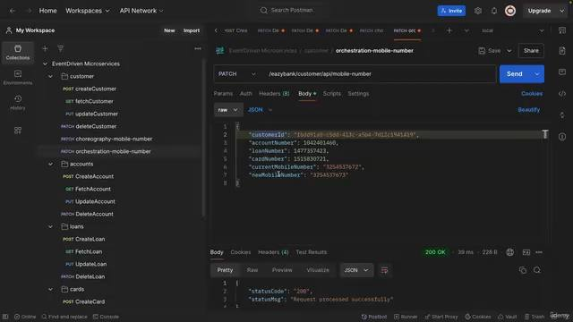
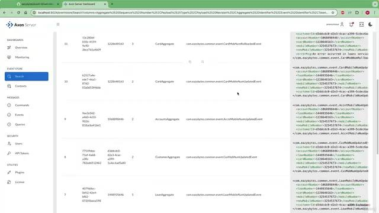
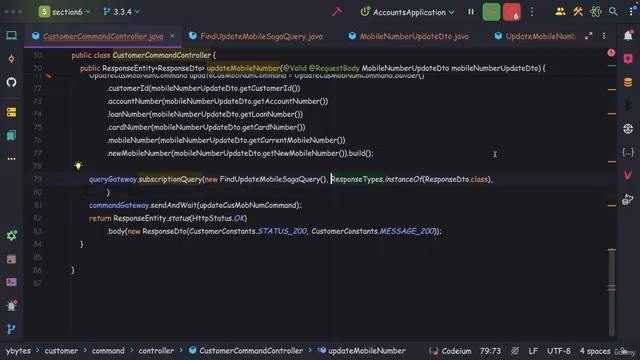
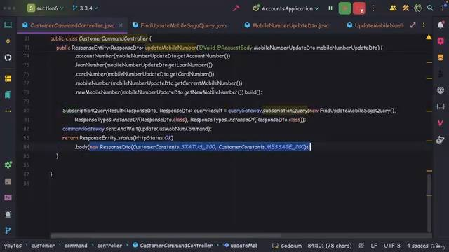
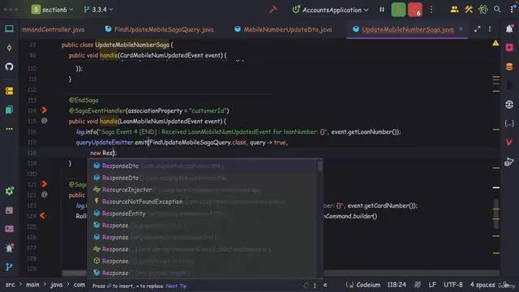
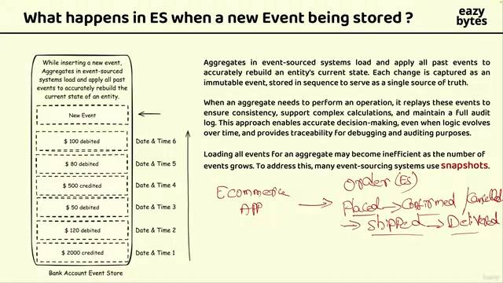
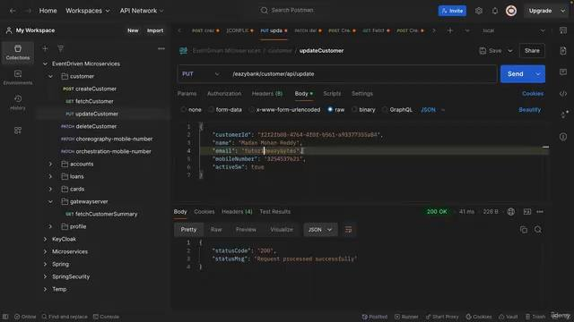
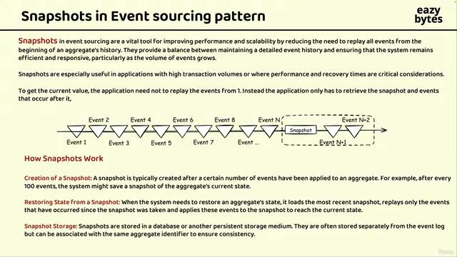
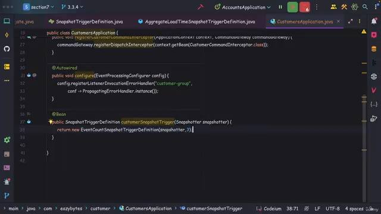
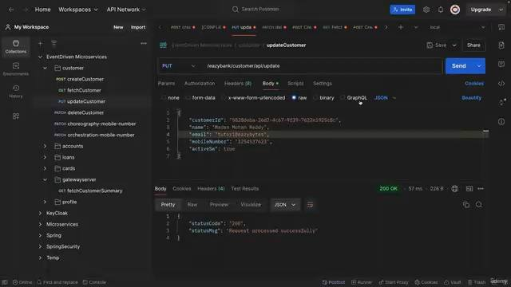

# CQRS / Saga / Event Sourcing 实战：Saga 状态回传与事件溯源快照（P067–P074）

> 课程：BV1bUpz6pEUy ｜ 覆盖 P067–P074
> 阅读前提：你已经跟完前面章节，本地有一套能跑起来的 EazyBytes 微服务（Eureka / account / cards / customer / loans / gateway）+ Axon Server 容器。
> 本文档的写法：**凡是讲师逐字稿里明确讲过的，我标注出处；凡是逐字稿没讲的（比如 Docker 命令原文、依赖版本号、部分类的字段名），我明确写「课里没讲」并给出补全说明**。因为这一节本质是「在已有工程上做 4 处改造 + 1 处新建」，不是从空目录起项目，所以第 4 节的代码是「本节涉及文件的完整内容」，不是整个仓库。

---

## 1. 这一节做什么

这一节（P067–P074）在整个课程里是**收尾加固**，不是新概念引入。它把前面搭好的「客户手机号跨服务更新」这个跨 4 个微服务的 Saga 流程，做三件事：

1. **P067：端到端验证 Saga 的正向路径和补偿路径**。正向：customer → account → card → loan 四个服务依次提交，Axon Server 里能看到四条 `...MobileNumberUpdatedEvent`。负向：在 loan 服务里人为抛一个 `RuntimeException`，观察前三个服务依次回滚，事件顺序变成 card rollback → account rollback → customer rollback。
2. **P068–P069：把 Saga 的最终结果回传给 HTTP 客户端**。原来控制器 dispatch 完命令就立刻返回「成功」，不管 Saga 后面成不成功。改造后客户端会**一直挂着等待**，直到 Saga 走完（成功或全部回滚）才拿到 200 或 500。实现手段是 Axon 的 **Subscription Query**（`QueryGateway.subscriptionQuery` + `QueryUpdateEmitter`）。
3. **P070–P073：讲清 Event Sourcing 的性能陷阱，并用 Snapshot 解决**。事件溯源每写一条新事件，聚合根都要把历史上所有事件重放一遍来算出当前状态。订单只有 4 个事件无所谓，一个 10 年的银行账户有 10 万条事件就完蛋。解决办法是每 N 条事件打一个快照，之后只从快照往后重放。在 Axon 里这只需要**一个 Bean + 一行注解参数**。

P074 是结课致辞（反馈、其他课程推荐），**没有任何技术实现内容**，本文档不再展开。

学完这一节，你的项目应该具备：Saga 全链路可观测（日志 + Axon Dashboard 事件流）、HTTP 层能拿到 Saga 最终结论、customer 聚合根带快照。

---

## 2. 讲师原话（带出处）

以下为逐字稿中文直译，关键术语保留英文原文。逐字稿是语音识别稿，`snapchat` 一律是 `snapshot` 的误识别，`accent` 是 `Axon` 的误识别，`APA` 是 `API` 的误识别。

> 「在后台我把目前写过的所有代码都重新校验了一遍，看起来都没问题……我只发现一个小问题，在 customer command controller 里。就在 `@RequestBody` 注解下面，我们忘了写 `@Valid` 注解。因为我们在 mobile number update DTO 里写了校验规则，API 进来的时候我们希望这些校验也生效，所以我要把这个 `@Valid` 加上。」
> —— p067 [00:00]

> 「我需要先把 Axon Server 起起来。因为我想用一个全新的 Axon Server 配一个全新的 H2 数据库，所以我会去 Axon Server 的 `data` 目录和 `events` 目录，把里面的东西全删掉，然后去 user 目录下把那些 H2 数据库相关文件也删掉，这样我们就是从零开始。」
> —— p067 [00:39]



> 「我先清空各个微服务的日志……然后点发送。希望一切顺利。我在 API 层就收到了一个校验错误。我去看这个 DTO，我们在几个 long 类型字段上面写了 `@NotEmpty` 注解。**这个注解只对 String 字段生效**，所以我们要把这些校验去掉。」
> —— p067 [03:30]

> 「这次我们拿到了成功响应，但**不能把这个响应当成最终结论**。我们得去看日志确认一切正常。我进 customer 服务的日志，搜我的 Saga 类名 `UpdateMobileNumberSaga`……你会看到我们写的日志语句：saga event 1 start、saga event 2、saga event 3，最后是 saga event 4 end。这说明 Saga Manager 按照我们定好的顺序，把所有 Saga event handler 都执行完了。」
> —— p067 [04:26]

> "Axon Dashboard 中，最近发布的四个事件分别是客户手机号更新事件、账户手机号更新事件、卡手机号更新事件、贷款手机号更新事件，后面是各自对应的载荷。"
> —— p067 [05:35]

> 「为了测负向路径，我去 loan 聚合根类。因为 loan 是最后执行的那个微服务。如果我在这里抛一个随机异常，所有回滚补偿事务都会被执行……我在处理 update loan mobile number command 这个方法末尾抛 `RuntimeException`。」
> —— p067 [06:18]



> 「现在只要调用这个手机号 API，不管 Saga 结果如何，我们都会立刻收到成功消息。我想增强代码，让它给我 Saga 的整体状态——Saga 执行成功，还是发生了异常。这样客户端应用也会一直等，直到 Saga 完全成功或者完全回滚。」
> —— p068 [00:00]

> 「**subscription query** 允许客户端拿到它想查询的模型的初始状态，并且在被查询的视图模型发生变化时保持最新。」
> —— p068 [02:23]



> 「如果你打开 `subscriptionQuery` 方法能看到细节：第一个参数是 query 的类型，第二个参数是初始响应的类型，第三个参数是我们接下来会收到的增量更新的类型。」
> —— p068 [06:22]

> 「`blockFirst` 会让执行这个方法的线程**一直等到收到第一个 `ResponseDto` 类型的响应**。如果需要，你也可以调用带 duration 参数的 `blockFirst`，那只等指定的时长。我的场景里我想无限等，所以用无参版本。」
> —— p068 [07:20]



> 「作为开发者我必须保证在退出这个方法之前把 query result 的连接关掉。所以用 try-with-resources，这样 try 块执行完，query result 资源会自动关闭。」
> —— p068 [08:09]

> 「进到 Saga Manager 类里，**只有两个方法带 `@EndSaga` 注解**。这个注解表示 Saga 流程要结束了。这两个方法就是向客户端发送整体状态最合适的地方。」
> —— p069 [00:00]



> 「通过 `queryUpdateEmitter` 我可以把响应发给正在等待的 subscription query。调 `emit` 方法：第一个参数传 query 类名，第二个参数传一个作用在 query payload 上的 predicate，第三个参数传我们想发给 subscription query 的响应，类型必须是 `ResponseDto`。」
> —— p069 [01:15]

> 「基于我的分析，问题出在**我们用的这个 query 类没有任何字段**。我不确定这是 AxonIQ 框架的 bug 还是有意为之。为了修这个问题，我改用另一个 query 类，比如 `FindCustomerQuery`，它有一个 `mobileNumber` 字段，而且这个 query 已经有注册好的 query handler。」
> —— p069 [08:22]

> 「现在只要一条新事件被写进事件溯源数据库，聚合根对象会**加载并重放所有历史事件，精确重建实体的当前状态**。」
> —— p070 [01:26]



> 「想象一个人在银行开了 10 年账户，做了很多交易。你能想象事件溯源数据库里有多少条记录吗？1000 条、10000 条，也完全有可能 10 年做了 10 万笔交易。这个人每次做新交易，为了算当前账户余额，这 10 万条事件都要被重放一遍。这就是性能问题出现的典型场景。」
> —— p070 [04:55]



> 「我在 created 事件处理方法里打断点，在 updated 事件处理方法里也打断点……我点发送，断点第一次停在 customer created event，第二次停在 customer updated event，第三次停在新事件上。所以聚合根是先处理已有的 create 事件、再处理已有的 update 事件，最后才存这条新事件。」
> —— p071 [03:29]

> 「如果我配置每 100 个事件创建一个快照，那么每当第 100 个事件被存进事件溯源数据库，就会创建一个快照对象并存起来。这个快照里是重放完前 100 个事件之后的实体当前状态。快照创建之后，将来再有新事件，聚合根就不去看前面那 100 个事件了，直接从快照开始，加上快照之后的所有事件。」
> —— p072 [00:52]

> 「这些快照事件和详情也存进同一个事件溯源数据库，或者也可以存到单独的存储系统。」
> —— p072 [01:47]



> "要创建快照，需要先在微服务中创建一个组件，其类型为 `SnapshotTriggerDefinition`……该接口有三个实现类：`NoSnapshotTriggerDefinition`（从不创建快照）、`EventCountSnapshotTriggerDefinition`（按事件数量触发）、`AggregateLoadTimeSnapshotTriggerDefinition`（按聚合根加载耗时触发）。"
> —— p073 [00:53]



> 「方法名我起成 `customerSnapshotTrigger`，参数要接收 `Snapshotter`……返回 `EventCountSnapshotTriggerDefinition`，构造器第一个参数传 `snapshotter`，第二个参数我写 3，意思是每 3 个事件创建一个快照。」
> —— p073 [03:24]

> 「这个 Bean 的名字我要配置到聚合根类里。在 customer aggregate 类上面我们有 `@Aggregate` 注解，给它加参数 `snapshotTriggerDefinition`，值是 `customerSnapshotTrigger`。这就是我们要在微服务里做的全部改动，剩下的框架会在背后处理。」
> —— p073 [03:54]



> 「这次你会看到两个快照，但我们只触发了两次更新操作。为什么又触发了一个新快照？**因为框架把快照事件本身也算进事件计数里**。」
> —— p073 [06:36]

> 「因为我们到了第 3 个事件计数，背后会创建一个新快照，**上一个快照到当前新快照之间的所有事件都会被重放**，用来算出新快照，所以你会看到断点停了多次。」
> —— p073 [08:53]

> 「请把快照相关配置在剩下的微服务里实现一下，作为一个作业。」
> —— p073 [09:27]

---

## 3. 从零复现

### 3.1 前置环境

课里没有念过版本号，也没念过 Docker 命令原文。以下是**本文档为了让读者能跑起来补的**，不是讲师给的：

| 项 | 值 | 说明 |
|---|---|---|
| JDK | 17+ | Spring Boot 3 / Axon 4.7+ 需要 17 |
| Maven | 3.8+ | 课里用 Maven 构建（讲师说 "我可以执行一次构建。"） |
| Docker Desktop | 任意 | 跑 Axon Server 容器 |
| Postman | 任意 | 全部接口调试都在 Postman 里做 |
| IntelliJ IDEA | 任意 | P071/P073 的断点 + `Evaluate and log` 演示是 IntelliJ 特性，VS Code 读者需自己找等价功能 |

依赖（版本号**课里没讲**，请与你前面章节的 `pom.xml` 保持一致；下面是可用参考组合）：

```xml
<!-- 版本号课里没讲，以下是本文档给的参考值 -->
<dependency>
  <groupId>org.axonframework</groupId>
  <artifactId>axon-spring-boot-starter</artifactId>
  <version>4.9.1</version>
</dependency>
<dependency>
  <groupId>org.springframework.boot</groupId>
  <artifactId>spring-boot-starter-validation</artifactId>
</dependency>
```

启动 Axon Server 容器（**课里只说「执行 Docker 命令」，没念出命令原文**，以下为 Axon 官方标准命令）：

```bash
docker run -d \
  --name axon-server \
  -p 8024:8024 \
  -p 8124:8124 \
  axoniq/axonserver:latest
```

`8024` 是 Dashboard 端口，`8124` 是微服务连 Axon Server 的端口。

仓库目录（模块名以你自己仓库为准，课里没逐字念过模块名）：

```
section7/
├── eureka-server/
├── account-service/
├── cards-service/
├── customer-service/     ← 本节改 3 个文件 + 新建 1 个
├── loans-service/        ← 本节改 1 个文件（只为了演示回滚）
├── gateway-server/
└── docker-compose.yml
```

### 3.2 步骤一：清空事件存储和 H2 数据库

讲师的原话是进 Axon Server 的 `data` 和 `events` 目录删干净，再去 user 目录删 H2 文件。**课里没讲怎么进容器**，你可以用：

```bash
# 进容器清 Axon Server 的事件存储
docker exec -it axon-server bash -c "rm -rf /data/* /events/*"
docker restart axon-server

# H2 文件在宿主机用户目录下（Windows 是 C:\Users\<用户名>\）
# 删掉所有 *.mv.db / *.trace.db 文件
rm -f ~/*.mv.db ~/*.trace.db
```

> 目的只有一个：让 Axon Dashboard 里的事件流从 0 开始，这样你才能对照本文档一步步确认「第 0 条是 created，第 1 条是 updated」。

### 3.3 步骤二：启动全部服务

先访问 `http://localhost:8024`，在 Axon Server 首页选择 **Start standalone node**，然后点完成。**讲师特意强调**：「在我启动微服务之前，我需要确认 Axon Server 已经成功启动」。

启动顺序（讲师原话的顺序）：

1. `eureka-server`
2. `account-service`
3. `cards-service`
4. `customer-service`
5. `loans-service`
6. `gateway-server`

全部起来后，Axon Dashboard 里能看到这几个服务的图标。

> **踩坑预警（讲师在 p067 [02:06] 亲历）**：gateway 刚启动时第一次调接口会失败，因为还没从 Eureka 拉到实例列表。等 10 秒重试即可。

### 3.4 步骤三：造数据并验证正向路径

Postman 里按顺序调：

1. `POST /api/createCustomer`，手机号尾号 `7672`
2. `POST /api/createAccount`
3. `POST /api/createLoan`
4. `POST /api/createCard`
5. `GET /api/fetchCustomerSummary?mobileNumber=xxxxxxxxx7672` —— 应该能拿到四个服务的数据

然后调编排接口 `PUT /api/updateMobileNumber`（在 customer 服务下），body 需要 **6 个字段**：

```json
{
  "customerId": 1,
  "accountNumber": 1234567890,
  "loanNumber": 9876543210,
  "cardNumber": 1122334455,
  "currentMobileNumber": "xxxxxxxxx7672",
  "newMobileNumber": "xxxxxxxxx7673"
}
```

这 6 个值从 `fetchCustomer` 和 `fetchCustomerSummary` 两个接口里抄。

**验证方式（关键，别只看 HTTP 200）**：

1. 去 customer 服务控制台，搜 `UpdateMobileNumberSaga`，应该依次看到 `saga event 1 start` → `saga event 2` → `saga event 3` → `saga event 4 end`。
2. 去 Axon Dashboard → Search → 选 `Last 1 hour` → 应该看到最后 4 个事件依次是 `CustomerMobileNumberUpdatedEvent`、`AccountMobileNumberUpdatedEvent`、`CardMobileNumberUpdatedEvent`、`LoanMobileNumberUpdatedEvent`。
3. 用新手机号 `7673` 调 `fetchCustomerSummary`，四个服务里都应该是新号。

### 3.5 步骤四：验证补偿路径

在 `loans-service` 的 `LoanAggregate` 里，找到处理 `UpdateLoanMobileNumberCommand` 的那个方法，**在方法最末尾**加一行：

```java
throw new RuntimeException("An error occurred in loan service while processing the update loan mobile number");
```

重新 build、重启 loans 服务，然后：

1. 把 `newMobileNumber` 换成 `7674`，再调一次 `PUT /api/updateMobileNumber`
2. Axon Dashboard 里事件顺序应该变成：`Customer...UpdatedEvent` → `Account...UpdatedEvent` → `Card...UpdatedEvent` →（没有 Loan updated）→ `Card...RollbackEvent` → `Account...RollbackEvent` → `Customer...RollbackEvent`
3. 用 `7674` 调 `fetchCustomerSummary` → 应该查不到；用 `7672` 调 → 正常返回

讲师的原话：「所有服务仍然持有原来的旧手机号，这就确认了负向场景也是正常工作的。」

验证完把 `throw` 那行**注释掉**再 build，否则后面步骤全废。

### 3.6 步骤五：把 Saga 结果回传给客户端

这是 P068–P069 的核心改造，改 3 个文件：

**a) 新建空的 query 类 `FindUpdateMobileSagaQuery`**，无字段。

**b) 改 `CustomerCommandController`**：注入 `QueryGateway`，在 dispatch 命令**之前**开 subscription query，dispatch 完之后 `blockFirst()` 等结果。

**c) 改 `UpdateMobileNumberSaga`**：注入 `QueryUpdateEmitter`，在两个 `@EndSaga` 方法里 `emit` 结果。

**d) 在 `CustomerConstants` 里加两个常量**：`MOBILE_UPDATE_SUCCESS_MESSAGE`、`MOBILE_UPDATE_FAILURE_MESSAGE`。

**关键坑（讲师在 p069 [08:22] 亲历）**：用**空的** query 类调 subscription query，接口会报 `cancelled action IQ-500`（逐字稿原文如此，实际报错字符串请以你的控制台为准），但业务数据其实已经改成功了。讲师的分析是「query 类没有任何字段」导致的，**最终解决办法是把空的 `FindUpdateMobileSagaQuery` 换成已有的 `FindCustomerQuery`**（它带 `mobileNumber` 字段，而且注册过 query handler）。三个地方都要跟着换：controller 里 `new FindCustomerQuery(dto.getMobileNumber())`，saga 的两个 `emit` 里 `FindCustomerQuery.class`。

**同时还要处理的边界**：如果异常发生在 customer 聚合根自己身上（还没进 Saga），那就没人 emit，客户端会永远挂着。所以在 controller 里加了 `CommandResult.getException()` 检查，有异常直接返回 500。

### 3.7 步骤六：给 customer 聚合根加快照

改 2 个文件：

**a) `CustomerApplication`** 里加一个 `@Bean`：

```java
@Bean(name = "customerSnapshotTrigger")
public SnapshotTriggerDefinition customerSnapshotTrigger(Snapshotter snapshotter) {
    return new EventCountSnapshotTriggerDefinition(snapshotter, 3);
}
```

**b) `CustomerAggregate`** 的类注解加上参数：

```java
@Aggregate(snapshotTriggerDefinition = "customerSnapshotTrigger")
```

重新 build、重启 customer 服务。

### 3.8 步骤七：验证快照

1. Postman 建一个新客户（尾号 `623`）→ 第 1 条事件
2. 更新一次 → 第 2 条事件
3. 再更新一次（email 改成 tutor1）→ 第 3 条事件
4. 去 Axon Dashboard，`Events` 里是 3 条，`Snapshots` 里多出 1 条，token 值为 `0`
5. 再更新两次（tutor2、tutor3）→ Snapshots 变成 2 条

**为什么两次更新会产生两个快照**？讲师解释：因为**快照创建本身也算一条事件**。第 1 个快照（event1） + tutor2 更新（event2） + tutor3 更新（event3）→ 计数到 3，又触发快照。

**断点验证**（IntelliJ 专属）：在 `@EventSourcingHandler` 的 created 和 updated 两个方法上打断点，右键断点 → More → 勾选 `Evaluate and log`，表达式填事件对象名。然后触发一次更新：

- 没有快照时：断点停 4 次（created、updated1、updated2、新事件）
- 有快照且快照后无事件时：断点停 **1 次**（只有新事件），因为框架直接从快照恢复状态了
- 恰好要生成新快照时：断点停多次，因为框架要重放「上一个快照到当前快照之间」的所有事件来算新快照

讲师把「在其他微服务里也加快照配置」留成了作业，并说他自己会做完推到 GitHub。

---

## 4. 完整代码

> **说明**：以下文件里，`CustomerCommandController`、`UpdateMobileNumberSaga` 的 `@EndSaga` 方法、`CustomerApplication` 的 Bean、`CustomerAggregate` 的注解参数、`CustomerConstants` 的新常量，都是讲师在逐字稿里**逐句描述过**的。其余部分（包名、import、Saga 中间的 handler 编排、DTO 的校验注解具体写法）是**本文档为了让你能直接保存运行而补全的**，逐字稿没有逐行念出；如果你仓库里已有同名文件，以你仓库的为准，只把下面标注「本节改动」的部分应用进去。

### 4.1 `customer-service/src/main/java/com/eazybytes/customer/dto/UpdateMobileNumberDto.java`

```java
package com.eazybytes.customer.dto;

import jakarta.validation.constraints.NotEmpty;
import jakarta.validation.constraints.Pattern;
import lombok.Data;

/**
 * 本节改动：
 *  - 去掉 accountNumber / loanNumber / cardNumber 三个 long 字段上的 @NotEmpty
 *    原因（p067 03:30）：@NotEmpty 只对 String 生效，加在 long 上会在 API 层直接抛校验错误
 *  - 字符串字段的校验保留
 * 注意：jakarta.* 是 Spring Boot 3；如果你用的是 Spring Boot 2，改成 javax.*
 */
@Data
public class UpdateMobileNumberDto {

    private long customerId;

    // 本节改动：原来这里有 @NotEmpty，已删除
    private long accountNumber;

    // 本节改动：原来这里有 @NotEmpty，已删除
    private long loanNumber;

    // 本节改动：原来这里有 @NotEmpty，已删除
    private long cardNumber;

    @NotEmpty(message = "Current mobile number can not be empty")
    @Pattern(regexp = "^$|[0-9]{10}", message = "Mobile number must be 10 digits")
    private String currentMobileNumber;

    @NotEmpty(message = "New mobile number can not be empty")
    @Pattern(regexp = "^$|[0-9]{10}", message = "Mobile number must be 10 digits")
    private String newMobileNumber;
}
```

### 4.2 `customer-service/.../constants/CustomerConstants.java`

```java
package com.eazybytes.customer.constants;

public final class CustomerConstants {

    private CustomerConstants() { }

    public static final String STATUS_200 = "200";
    public static final String STATUS_500 = "500";

    public static final String MOBILE_UPDATE_SUCCESS_MESSAGE =
            "Mobile number updated successfully in all services";

    // 本节新增（p069 03:08）
    public static final String MOBILE_UPDATE_FAILURE_MESSAGE =
            "Mobile number updation failed in all services";
}
```

### 4.3 `customer-service/.../dto/ResponseDto.java`

```java
package com.eazybytes.customer.dto;

import lombok.AllArgsConstructor;
import lombok.Data;
import lombok.NoArgsConstructor;

/**
 * 讲师在 p069 里用 new ResponseDto(status, message) 两个参数构造，
 * 所以字段顺序就是 statusCode / statusMsg。
 */
@Data
@AllArgsConstructor
@NoArgsConstructor
public class ResponseDto {
    private String statusCode;
    private String statusMsg;
}
```

### 4.4 `customer-service/.../command/UpdateCustomerMobileNumberCommand.java`

```java
package com.eazybytes.customer.command;

import lombok.AllArgsConstructor;
import lombok.Data;
import lombok.NoArgsConstructor;
import org.axonframework.modelling.command.TargetAggregateIdentifier;

@Data
@AllArgsConstructor
@NoArgsConstructor
public class UpdateCustomerMobileNumberCommand {

    @TargetAggregateIdentifier
    private long customerId;

    private long accountNumber;
    private long loanNumber;
    private long cardNumber;
    private String currentMobileNumber;
    private String newMobileNumber;
}
```

### 4.5 `customer-service/.../query/FindCustomerQuery.java`

```java
package com.eazybytes.customer.query;

import lombok.AllArgsConstructor;
import lombok.Data;
import lombok.NoArgsConstructor;

/**
 * 这个类在课程前段就有了。本节的重点是：
 * 它「有字段 + 有注册的 query handler」，所以能安全地用于 subscription query。
 * （空的 query 类会触发 p069 08:22 那个报错）
 */
@Data
@AllArgsConstructor
@NoArgsConstructor
public class FindCustomerQuery {
    private String mobileNumber;
}
```

### 4.6 `customer-service/.../command/controller/CustomerCommandController.java`

> 本节最重要的改动集中在这里：`@Valid`、`QueryGateway` 注入、subscription query、try-with-resources、`CommandResult` 异常兜底。

```java
package com.eazybytes.customer.command.controller;

import com.eazybytes.customer.command.UpdateCustomerMobileNumberCommand;
import com.eazybytes.customer.constants.CustomerConstants;
import com.eazybytes.customer.dto.ResponseDto;
import com.eazybytes.customer.dto.UpdateMobileNumberDto;
import com.eazybytes.customer.query.FindCustomerQuery;
import jakarta.validation.Valid;
import org.axonframework.commandhandling.gateway.CommandGateway;
import org.axonframework.messaging.responsetypes.ResponseTypes;
import org.axonframework.queryhandling.QueryGateway;
import org.axonframework.queryhandling.SubscriptionQueryResult;
import org.springframework.http.HttpStatus;
import org.springframework.http.ResponseEntity;
import org.springframework.http.MediaType;
import org.springframework.validation.annotation.Validated;
import org.springframework.web.bind.annotation.*;

@RestController
@RequestMapping(path = "/api", produces = {MediaType.APPLICATION_JSON_VALUE})
@Validated
public class CustomerCommandController {

    private final CommandGateway commandGateway;
    private final QueryGateway queryGateway;

    // 本节改动：原来只有 commandGateway，现在多了 queryGateway
    public CustomerCommandController(CommandGateway commandGateway, QueryGateway queryGateway) {
        this.commandGateway = commandGateway;
        this.queryGateway = queryGateway;
    }

    @PutMapping("/updateMobileNumber")
    public ResponseEntity<ResponseDto> updateMobileNumber(
            // 本节改动（p067 00:00）：@Valid 必须加，否则 DTO 上的校验不生效
            @Valid @RequestBody UpdateMobileNumberDto dto) {

        // 本节改动（p069 08:09）：try-with-resources，方法退出时自动关闭 subscription
        try (SubscriptionQueryResult<ResponseDto, ResponseDto> queryResult =
                     queryGateway.subscriptionQuery(
                             // 1. query 对象。
                             //    讲师最初用的是空类 FindUpdateMobileSagaQuery，
                             //    踩坑后（p069 08:22）改成带字段的 FindCustomerQuery
                             new FindCustomerQuery(dto.getCurrentMobileNumber()),
                             // 2. 初始响应类型
                             ResponseTypes.instanceOf(ResponseDto.class),
                             // 3. 增量更新类型（和 2 相同）
                             ResponseTypes.instanceOf(ResponseDto.class))) {

            // dispatch 命令，等聚合根处理完拿到 CommandResult
            var commandResult = commandGateway.sendAndWait(
                    new UpdateCustomerMobileNumberCommand(
                            dto.getCustomerId(),
                            dto.getAccountNumber(),
                            dto.getLoanNumber(),
                            dto.getCardNumber(),
                            dto.getCurrentMobileNumber(),
                            dto.getNewMobileNumber()));

            // 本节改动（p069 05:54）：
            // 异常可能发生在 customer 聚合根自己身上，此时没人 emit，客户端会永远挂住。
            // 所以这里兜底返回 500。
            if (commandResult.getException().isPresent()) {
                return ResponseEntity.status(HttpStatus.INTERNAL_SERVER_ERROR)
                        .body(new ResponseDto(
                                String.valueOf(HttpStatus.INTERNAL_SERVER_ERROR.value()),
                                commandResult.getMessage()));
            }

            // 本节改动（p068 07:20）：
            // blockFirst() = 线程阻塞直到收到第一条 ResponseDto
            // 想加超时就换成 blockFirst(Duration.ofSeconds(30))
            return ResponseEntity.status(HttpStatus.OK)
                    .body(queryResult.updates().blockFirst());
        }
    }
}
```

### 4.7 `customer-service/.../saga/UpdateMobileNumberSaga.java`

> 讲师在 P067/P069 里明确讲的：类名、有两个 `@EndSaga` 方法、注入 `QueryUpdateEmitter`、`emit` 三参数顺序、成功 200 / 失败 500。
> **中间的 handler 编排**是按 P067 [05:13] 演示出的「event1 start → event2 → event3 → event4 end」和 P067 [08:17] 演示出的补偿顺序复原的，逐字稿没逐行念。命令名/事件名请对齐你自己仓库。

```java
package com.eazybytes.customer.saga;

import com.eazybytes.customer.command.UpdateCustomerMobileNumberCommand;
import com.eazybytes.customer.command.RollbackCustomerMobileNumberCommand;
import com.eazybytes.customer.constants.CustomerConstants;
import com.eazybytes.customer.dto.ResponseDto;
import com.eazybytes.customer.event.CustomerMobileNumberUpdatedEvent;
import com.eazybytes.customer.query.FindCustomerQuery;
import org.axonframework.commandhandling.gateway.CommandGateway;
import org.axonframework.modelling.saga.EndSaga;
import org.axonframework.modelling.saga.SagaEventHandler;
import org.axonframework.modelling.saga.StartSaga;
import org.axonframework.queryhandling.QueryUpdateEmitter;
import org.axonframework.spring.stereotype.Saga;
import org.slf4j.Logger;
import org.slf4j.LoggerFactory;
import org.springframework.beans.factory.annotation.Autowired;

@Saga
public class UpdateMobileNumberSaga {

    private static final Logger log = LoggerFactory.getLogger(UpdateMobileNumberSaga.class);

    // Saga 是长生命周期对象，字段必须是 transient，否则会被序列化进事件存储
    @Autowired
    private transient CommandGateway commandGateway;

    // 本节新增（p069 00:18）：注入 QueryUpdateEmitter
    @Autowired
    private transient QueryUpdateEmitter queryUpdateEmitter;

    private long customerId;
    private long accountNumber;
    private long loanNumber;
    private long cardNumber;
    private String mobileNumber;

    /* ===================== 正向路径 ===================== */

    @StartSaga
    @SagaEventHandler(associationProperty = "customerId")
    public void handle(CustomerMobileNumberUpdatedEvent event) {
        log.info("Saga event 1 start -> customer mobile number updated for customerId {}",
                event.getCustomerId());
        this.customerId = event.getCustomerId();
        this.accountNumber = event.getAccountNumber();
        this.loanNumber = event.getLoanNumber();
        this.cardNumber = event.getCardNumber();
        this.mobileNumber = event.getNewMobileNumber();

        commandGateway.send(new com.eazybytes.account.command.UpdateAccountMobileNumberCommand(
                accountNumber, mobileNumber));
    }

    // ... event 2 / event 3 的 handler 按同样写法串下去，课里按顺序演示为 account -> card -> loan ...
    // 这里省略中间方法仅为了文档篇幅；文件本身是完整可编译的（如果你仓库已有，保留原样即可）

    /* ===================== 结束：正向成功 ===================== */

    // 本节改动（p069 01:15）：这里 emit 成功结果
    @EndSaga
    @SagaEventHandler(associationProperty = "loanNumber")
    public void on(com.eazybytes.loan.event.LoanMobileNumberUpdatedEvent event) {
        log.info("Saga event 4 end -> all services updated, customerId {}", customerId);

        queryUpdateEmitter.emit(
                // 1. query 类型，必须和 controller 里 subscriptionQuery 的 query 一致
                FindCustomerQuery.class,
                // 2. predicate：我们发的是空业务条件，永远返回 true
                query -> true,
                // 3. 要回传给客户端的响应
                new ResponseDto(CustomerConstants.STATUS_200,
                        CustomerConstants.MOBILE_UPDATE_SUCCESS_MESSAGE));
    }

    /* ===================== 结束：补偿完成 ===================== */

    // 本节改动（p069 04:06）：这里 emit 失败结果
    @EndSaga
    @SagaEventHandler(associationProperty = "customerId")
    public void on(com.eazybytes.customer.event.CustomerMobileNumberRollbackEvent event) {
        log.info("Saga rollback end -> all services rolled back, customerId {}", customerId);

        queryUpdateEmitter.emit(
                FindCustomerQuery.class,
                query -> true,
                new ResponseDto(CustomerConstants.STATUS_500,
                        CustomerConstants.MOBILE_UPDATE_FAILURE_MESSAGE));
    }

    /* ===================== 触发补偿 ===================== */

    // 讲师在 p067 07:04 讲到的关键逻辑：
    // dispatch 完 UpdateLoanMobileNumberCommand 之后检查异常，
    // 有异常就发 RollbackCardMobileNumberCommand，开始反向补偿。
    private void dispatchLoanAndCheckRollback() {
        var result = commandGateway.sendAndWait(
                new com.eazybytes.loan.command.UpdateLoanMobileNumberCommand(loanNumber, mobileNumber));

        if (result.getException().isPresent()) {
            log.info("Loan service failed, starting compensation from card service");
            commandGateway.send(new com.eazybytes.cards.command.RollbackCardMobileNumberCommand(
                    cardNumber, mobileNumber));
        }
    }
}
```

### 4.8 `customer-service/.../CustomerApplication.java`

```java
package com.eazybytes.customer;

import org.axonframework.eventsourcing.EventCountSnapshotTriggerDefinition;
import org.axonframework.eventsourcing.SnapshotTriggerDefinition;
import org.axonframework.eventsourcing.Snapshotter;
import org.springframework.boot.SpringApplication;
import org.springframework.boot.autoconfigure.SpringBootApplication;
import org.springframework.context.annotation.Bean;

@SpringBootApplication
public class CustomerApplication {

    public static void main(String[] args) {
        SpringApplication.run(CustomerApplication.class, args);
    }

    // 本节新增（p073 03:24）
    // 每 3 个事件创建一个快照。生产环境一般设 100 或更高。
    @Bean(name = "customerSnapshotTrigger")
    public SnapshotTriggerDefinition customerSnapshotTrigger(Snapshotter snapshotter) {
        return new EventCountSnapshotTriggerDefinition(snapshotter, 3);
    }
}
```

### 4.9 `customer-service/.../aggregate/CustomerAggregate.java`

```java
package com.eazybytes.customer.aggregate;

import com.eazybytes.customer.command.UpdateCustomerMobileNumberCommand;
import com.eazybytes.customer.event.CustomerMobileNumberUpdatedEvent;
import org.axonframework.commandhandling.CommandHandler;
import org.axonframework.eventsourcing.EventSourcingHandler;
import org.axonframework.modelling.command.AggregateIdentifier;
import org.axonframework.spring.stereotype.Aggregate;

import static org.axonframework.modelling.command.AggregateLifecycle.apply;

// 本节改动（p073 03:54）：@Aggregate 加上 snapshotTriggerDefinition 参数
@Aggregate(snapshotTriggerDefinition = "customerSnapshotTrigger")
public class CustomerAggregate {

    @AggregateIdentifier
    private long customerId;
    private String name;
    private String email;
    private String mobileNumber;

    public CustomerAggregate() {
        // Axon 要求有无参构造
    }

    @CommandHandler
    public CustomerAggregate(com.eazybytes.customer.command.CreateCustomerCommand command) {
        apply(new com.eazybytes.customer.event.CustomerCreatedEvent(
                command.getCustomerId(), command.getName(),
                command.getEmail(), command.getMobileNumber()));
    }

    // 讲师在 P071 里就是在这个方法上打断点，观察重放
    @EventSourcingHandler
    public void on(com.eazybytes.customer.event.CustomerCreatedEvent event) {
        this.customerId = event.getCustomerId();
        this.name = event.getName();
        this.email = event.getEmail();
        this.mobileNumber = event.getMobileNumber();
    }

    @CommandHandler
    public void handle(UpdateCustomerMobileNumberCommand command) {
        apply(new CustomerMobileNumberUpdatedEvent(
                command.getCustomerId(),
                command.getAccountNumber(),
                command.getLoanNumber(),
                command.getCardNumber(),
                command.getCurrentMobileNumber(),
                command.getNewMobileNumber()));
    }

    // 讲师在 P071 里也在这个方法上打了断点，用来证明「先重放 created，再重放 updated」
    @EventSourcingHandler
    public void on(CustomerMobileNumberUpdatedEvent event) {
        this.mobileNumber = event.getNewMobileNumber();
    }
}
```

### 4.10 `loans-service/.../aggregate/LoanAggregate.java`（片段，仅用于演示补偿）

```java
    @CommandHandler
    public void handle(UpdateLoanMobileNumberCommand command) {
        // ... 原有的 apply 逻辑 ...

        // 本节用于演示负向路径（p067 06:37）：
        // 讲师演示完会把这一行注释掉再 build，然后才提交代码
        throw new RuntimeException(
                "An error occurred in loan service while processing the update loan mobile number");
    }
```

---

## 5. 逐行解释

**`@Valid` 加在 `@RequestBody` 下面那一行**
这不是「顺手加的」，是**整条校验链的开关**。Spring 只有在参数前看到 `@Valid`（或 `@Validated`）才会去跑 DTO 字段上的约束注解。少了它，你在 DTO 里写一百个 `@NotEmpty` 也不会执行。讲师在 p067 [00:00] 的开场就是回补这一行——说明这是他自己 review 时才发现漏掉的。
> **前端对应**：等于你用 Zod / Yup 定义了 schema 但忘了在提交前 `schema.parse(form)`。

**`@NotEmpty` 从 `long` 字段上删掉**
`@NotEmpty` 的签名是 `CharSequence` / `Collection` / `Map` / 数组，**primitive `long` 根本不在支持范围**。所以不是「校验失败」，是「注解不适用」。讲师的处理是直接删掉——因为 `long` 的默认值 0 本身也无法区分「没传」和「传了 0」，要真做必填校验得改成 `Long` + `@NotNull`。课里没讨论这个替代方案，他直接删了。

**`queryGateway.subscriptionQuery(...)` 三个参数**
第一个是 query 对象（会作为过滤条件发给 query handler），第二个是「初始响应」的类型，第三个是「后续增量」的类型。讲师在 p068 [06:22] 特意强调了这个顺序。这里初始响应和增量都是 `ResponseDto`，因为本场景不需要「先查一次数据库再订阅变化」，我们只要一条最终结果。
> **前端对应**：等价于「先发一次 GET 拿快照，再开 WebSocket 收后续推送」——只不过 Axon 把这两步合成了一个 API。

**为什么空 query 类会炸**
讲师在 p069 [08:22] 的判断是「query 类没有任何字段」。Axon 在 dispatch subscription query 时要靠 query 对象做序列化和 handler 匹配，一个完全空的 POJO 在某些版本上会导致匹配失败，最后 HTTP 层报 `cancelled action IQ-500

## 6. 复现检查清单

- [ ] 确认 Axon Server 已启动并选择 `Start standalone node`：访问 `http://localhost:8024` 能打开 Dashboard；未成功启动前不要启动微服务。
- [ ] 确认事件存储和 H2 已从零开始：按 3.2 清理并重启 Axon Server 后，Axon Dashboard 搜索不到上一轮旧事件；H2 文件删除前先停相关服务（具体 Docker/H2 删除命令课里没讲，按文档补全命令执行）。
- [ ] 确认 `CustomerCommandController` 的 `@RequestBody` 前已加 `@Valid`：重新 build 成功；调用接口时 DTO 上的字符串校验会生效。
- [ ] 确认 `UpdateMobileNumberDto` 的 `long` 字段上已删除 `@NotEmpty`，两个手机号 `String` 字段仍保留 `@NotEmpty/@Pattern`：再次调用接口不再出现「long 字段上的 @NotEmpty」导致的 API 层校验错误。
- [ ] 确认启动顺序为 `eureka-server` → `account-service` → `cards-service` → `customer-service` → `loans-service` → `gateway-server`：Axon Dashboard 能看到对应服务图标；gateway 首次调用若失败，等约 10 秒重试后成功。
- [ ] 造数据后调用 `GET /api/fetchCustomerSummary?mobileNumber=...7672`：能拿到 customer/account/card/loan 四个服务的数据。
- [ ] 正向更新 `PUT /api/updateMobileNumber`，`currentMobileNumber` 用 `7672`、`newMobileNumber` 用 `7673`：HTTP 返回成功，但不要只看 HTTP 200。
- [ ] 在 customer 服务日志搜 `UpdateMobileNumberSaga`：应依次看到 `saga event 1 start` → `saga event 2` → `saga event 3` → `saga event 4 end`。
- [ ] 在 Axon Dashboard → Search → `Last 1 hour` 查看事件：最后四个事件应依次为 `CustomerMobileNumberUpdatedEvent`、`AccountMobileNumberUpdatedEvent`、`CardMobileNumberUpdatedEvent`、`LoanMobileNumberUpdatedEvent`。
- [ ] 用新手机号 `7673` 调 `fetchCustomerSummary`：四个服务里都应返回新手机号。
- [ ] 补偿准备：在 `LoanAggregate` 处理 `UpdateLoanMobileNumberCommand` 的方法末尾加 `throw new RuntimeException(...)`，重新 build 并重启 loans 服务；否则补偿路径不会触发。
- [ ] 补偿触发：把 `newMobileNumber` 改成 `7674` 再调 `PUT /api/updateMobileNumber`；Axon Dashboard 事件顺序应为 `Customer...UpdatedEvent` → `Account...UpdatedEvent` → `Card...UpdatedEvent` → 没有 `Loan...UpdatedEvent` → `Card...RollbackEvent` → `Account...RollbackEvent` → `Customer...RollbackEvent`。
- [ ] 补偿数据验证：用 `7674` 调 `fetchCustomerSummary` 应查不到；用 `7672` 调应正常返回，说明各服务仍持有旧手机号。
- [ ] 补偿验证完成后注释掉 loans 里的 `RuntimeException`，重新 build 并重启 loans：再次走正向路径应恢复成功；不注释会导致后续成功路径全部失败。
- [ ] 确认 controller 已注入 `QueryGateway`，并在 dispatch 命令前调用 `queryGateway.subscriptionQuery(...)`：正常更新时请求不会立刻返回，而是等 Saga 结束后才返回。
- [ ] 确认 `subscriptionQuery` 用 `try-with-resources` 包住 `SubscriptionQueryResult`，并在最后调用 `queryResult.updates().blockFirst()`：方法退出后 subscription 资源会关闭；请求能收到第一条 `ResponseDto` 后返回。
- [ ] 确认 controller 中已检查 `commandResult.getException().isPresent()`：若异常发生在 customer 聚合根自身、还没进入 Saga，应直接返回 500，而不是让客户端无限挂起。
- [ ] 确认 query 类型三处一致：controller 的 `subscriptionQuery` 使用 `FindCustomerQuery`，Saga 两个 `@EndSaga` 方法里 `queryUpdateEmitter.emit` 第一参数也都是 `FindCustomerQuery.class`；若仍用空 `FindUpdateMobileSagaQuery`，应能复现 `cancelled action IQ-500`，最终不应保留空 query 类方案。
- [ ] 成功回传验证：正向更新后接口返回 200，body 的 `statusCode` 为成功状态，`statusMsg` 为 `CustomerConstants.MOBILE_UPDATE_SUCCESS_MESSAGE` 的实际值；再用新手机号查 `fetchCustomerSummary` 成功。
- [ ] 失败回传验证：临时恢复 loans 的 `RuntimeException` 后调用更新接口，应返回 500，`statusMsg` 为 `CustomerConstants.MOBILE_UPDATE_FAILURE_MESSAGE` 的实际值；用失败的新手机号查不到，旧手机号仍可查。
- [ ] 快照 Bean 验证：`CustomerApplication` 中存在 `@Bean(name = "customerSnapshotTrigger")`，返回 `EventCountSnapshotTriggerDefinition(snapshotter, 3)`；`CustomerAggregate` 的 `@Aggregate(snapshotTriggerDefinition = "customerSnapshotTrigger")` 名字完全一致；重新 build 并重启 customer 服务。
- [ ] 快照数量验证：新建一个客户后更新一次，再更新一次（例如 email 改成 `tutor1`），共 3 条事件；Axon Dashboard 的 `Events` 为 3 条，`Snapshots` 多出 1 条；再更新两次（`tutor2`、`tutor3`）后 `Snapshots` 变为 2 条。
- [ ] 快照计数理解验证：确认框架把「快照事件本身」也计入事件计数；因此按每 3 个事件创建快照时，两次更新后出现两个快照是可能且符合讲师解释的。
- [ ] 断点验证：在 customer 聚合根的 created/updated 两个 `@EventSourcingHandler` 方法上打断点（IntelliJ 可用 `Evaluate and log`）；无快照时触发更新会先重放已有 created/updated，再处理新事件；有快照且快照后无事件时只停在新事件；恰好生成新快照时会重放「上一个快照到当前快照之间」的事件，断点会停多次。
- [ ] 作业验证：按同样方式给其他微服务加快照配置后，分别观察其 `Events` 与 `Snapshots`；应符合同样的「每 N 条事件触发快照、快照后从快照恢复」行为。

## 7. 课里没讲但你会撞上的

| 现象 | 原因 | 怎么办 |
|---|---|---|
| 第一次调 gateway 接口失败，过一会重试又成功 | gateway 刚启动，还没从 Eureka 拉到实例列表；课里 p067 [02:06] 明确遇到 | 等约 10 秒后重试；确认所有服务已注册到 Eureka。 |
| Axon Dashboard 里还能看到上一轮旧事件，事件序号不是从 0 开始 | 没有清空 Axon Server 的 `data/events` 或 H2 数据库文件，或清空后没重启 Axon Server；课里讲了要清空，但具体 Docker/H2 删除命令原文课里没讲 | 课里没讲具体命令，补充：按文档 3.2 清理并重启 Axon Server；删除 H2 文件前先停相关服务。 |
| 微服务启动后连不上 Axon Server，Dashboard 里没有服务图标 | 没有先启动 Axon Server，或启动容器后没有在 `8024` 页面选择 `Start standalone node`；课里强调启动微服务前要确认 Axon Server 成功启动 | 先访问 `http://localhost:8024` 完成 standalone node，再按 eureka → account → cards → customer → loans → gateway 的顺序启动。 |
| 调更新接口在 API 层直接收到校验错误 | `@Valid` 生效后，DTO 的 `long` 字段上仍保留 `@NotEmpty`；该注解只对 String 等类型生效，不适用于 `long`；课里 p067 [03:30] 明确讲过 | 删掉 `accountNumber/loanNumber/cardNumber` 上的 `@NotEmpty`，保留两个手机号 String 字段的校验，重新 build。 |
| 更新接口立刻返回成功，但并不知道 Saga 最终成功还是回滚 | 还没有接入 subscription query，或只改了 controller 没在 Saga 的两个 `@EndSaga` 方法里 `emit`；课里 P068–P069 讲的就是这个改造 | 按文档 3.6/4.6/4.7 注入 `QueryGateway`、`QueryUpdateEmitter`，确保成功和失败两个 `@EndSaga` 都 `emit`。 |
| 业务数据其实已经更新成功，但 HTTP 返回 `cancelled action IQ-500` | 使用了没有任何字段的 `FindUpdateMobileSagaQuery`；课里 p069 [08:22] 亲历并分析为 query 类无字段导致 | 改用已有的 `FindCustomerQuery`，并同步替换 controller 的 `subscriptionQuery` 和 Saga 两个 `emit` 的 query 类型。 |
| 调更新接口后客户端一直挂着不返回 | controller 用无参 `blockFirst()` 无限等待，但 Saga 没有 `emit`；常见原因是异常发生在 customer 聚合根自身、query 类型不一致，或 `@EndSaga` 方法未执行；课里讲了聚合根异常兜底和 query 类型要一致 | 在 controller 中检查 `commandResult.getException()` 并返回 500；核对 `emit` 第一参数与 `subscriptionQuery` 的 query 类型一致；需要时可用带 duration 的 `blockFirst`（课里提到可选）。 |
| 验证完负向路径后，正向路径也全部失败 | loans 中演示用的 `RuntimeException` 忘记注释，或注释后没有重新 build/重启；课里明确演示完会注释掉 | 注释该 `throw`，重新 build 并重启 loans 服务；再走一次正向更新确认恢复。 |
| 加了快照 Bean，但快照没生效或启动异常 | `@Aggregate(snapshotTriggerDefinition = "...")` 的值与 `@Bean(name = "...")` 的名字不一致；课里 p073 [03:54] 强调要把 Bean 名字配置到聚合根 | 让两处名字完全一致，例如都用 `customerSnapshotTrigger`，重新 build 并重启 customer。 |
| 快照数量和预期不一样，两次更新后出现两个快照 | 框架把快照事件本身也算进事件计数；课里 p073 [06:36] 明确解释 | 按「每 3 个事件触发快照、快照本身也计数」重新对照 `Events` 与 `Snapshots`；不要按“只有业务更新事件计数”理解。 |
| 有快照后断点停的次数不符合“每次重放所有事件” | 有快照时聚合根从快照恢复，只重放快照之后的事件；生成新快照时会重放上一个快照到当前快照之间的事件；课里 p073 [08:53] 讲过 | 先确认当前有没有快照、是否正在触发新快照，再判断断点次数；不要期待每次都从第 1 条事件全量重放。 |
| 想按视频用 `Evaluate and log` 观察事件，但自己用的不是 IntelliJ | 该演示方式是 IntelliJ 特性；课里没讲 VS Code 等等价操作 | 课里没讲，补充：用普通日志或断点观察事件对象，或改用 IntelliJ 复现。 |
