# OpenTelemetry 课程复现文档（P1–P8）

> 覆盖范围：P1 课程全景 · P2 课程定位与前置要求 · P3 Windows 安装 Ubuntu(WSL) · P4 WSL 与 Windows 文件互通 + VS Code 集成 · P5 可观测性章节导览 · P6 什么是可观测性 · P7 三大支柱 · P8 指标类型
>
> **先说清楚一件事**：这一节（P1–P8）**没有任何 OpenTelemetry SDK 代码、没有 Docker Compose 文件、没有 Collector 配置、没有 instrumentation 代码**。它做的是两件事：① 把跑后面所有实验的 Linux 环境搭好；② 建立可观测性的概念坐标系。所以本文档的「复现」是**复现环境 + 复现讲师的推导路径**，第 4 章里所有由本文档补充的脚本都会明确标注「课里没有」，不会伪装成课程原文。

---

## 1. 这一节做什么

学完 P1–P8，你手上应该有的东西是：

1. **一台在 Windows 上跑起来的 Ubuntu 虚拟机**（通过 WSL / Windows Subsystem for Linux），并且你知道怎么从 Windows 访问它的文件、怎么从它的终端访问 Windows 的文件。
2. **一个 VS Code 工作区**，终端默认落在 Linux 里，`code .` 能从 Linux 侧打开项目。
3. **一张概念地图**：可观测性 ≟ 监控、三大支柱（metrics / logs / traces）各自解决什么问题、metrics 的三种类型（counter / gauge / histogram）分别怎么用。

你手上**还不会有**：Prometheus / Loki / Tempo / Grafana 的运行实例，分布式示例应用，OpenTelemetry Collector。这些是 P1 大纲里承诺的后续章节内容，到 P8 为止讲师只讲了它们「是什么角色」，没给任何配置文件。

整个课程最终的技术栈（讲师在 P1 里明确点名，可以据此提前准备）：

| 角色 | 组件 | 讲师原话定位 |
|---|---|---|
| 指标后端 | Prometheus | backends for all the three signal types |
| 日志后端 | Loki | 同上 |
| 追踪后端 | Tempo | 同上 |
| 统一可视化 | Grafana | the unified visualization layer across all these signals |
| 编排（前期） | Docker Compose | deploy our observability stack using Docker Compose |
| 编排（后期） | Kubernetes | develop the Kubernetes equivalent |
| 示例应用-前端 | TypeScript / Node.js | our front end is in TypeScript |
| 示例应用-后端 | Python | our Python worker |
| 中间队列 | Redis | a thin queue that is going to sit between the front end and the worker |

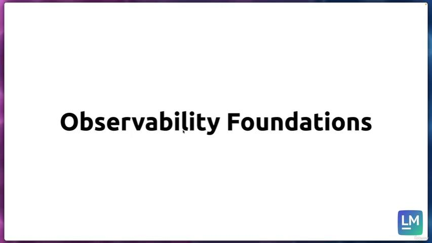

这张导览页是本节（P5–P8）的目录：**可观测性是什么 → 三大支柱 → metrics/histograms → logs/traces → SLI/SLO/SLA → 错误预算 → 四个黄金信号**。注意后四项在 P1–P8 的正片里只到「被点到名」，没有展开讲，本文档也不会替讲师编。

---

## 2. 讲师原话（带定位）

> "observability 是现代软件工程中极其重要的主题，它真的可能决定弄清楚生产系统中发生了什么需要五分钟还是五个小时。"
> —— p001 [00:00]

这句话是整门课的动机：可观测性的价值不在于「有数据」，而在于**把排障时间从小时级压到分钟级**。后面所有配置的取舍都回到这个标尺上。

> "我们将从零开始部署一整套 observability 栈，并用 metrics、logs 和 traces 对一个真实世界的分布式系统进行 instrument。我们这里的重点是学习行业标准，所以我们会聚焦 OpenTelemetry。"
> —— p001 [00:57]

重点在 "行业标准"：Prometheus / Loki / Tempo / Grafana 是**脚手架**，OpenTelemetry 才是被教的主体。这解释了 P2 里的那段免责声明。

> "我们将部署 Prometheus、Loki 和 Tempo，作为所有三类 signal 的后端……并且我们会部署 Grafana 作为跨所有这些 signal 的统一可视化层。"
> —— p001 [02:13]

一对一映射：Prometheus↔metrics、Loki↔logs、Tempo↔traces，Grafana 横切三者。后面你在 Grafana 里做 log→trace 跳转（P1 里提到 "在 Grafana 中设置日志与追踪关联"）就是靠这层统一。

> "我们这里的目标是覆盖使用 OpenTelemetry 时最重要的方面……但本课程的重点不是详尽地教你们这些工具。"
> —— p002 [00:00] / [00:56]

明确边界：课程不教 Prometheus 的全部特性、不教 Loki 查询语言、不教 Grafana 面板技巧。你想深挖这些工具，得自己补。

> "本课程的代码前端会用 JavaScript，或者更具体地说 TypeScript，后端 worker 会用 Python。我们还会在组合中加入 Redis，作为一个轻量队列，位于前端和 worker 之间，将它们解耦。"
> —— p002 [03:54] / [04:02]

对前端转 AI 应用的读者来说，这是好消息：**你不需要学一门新语言才能跟下去**。Node/TS 侧是主战场，Python 侧相当于「第二语言视角」，Redis 只是那条解耦的管子。

> "这里有几类 metrics 我们应该学习……第一类是 counters。Counters 是单调递增的值。它们只能上升。"
> —— p008 [01:19]

> "gauges 是某个时间点的测量值，可以上升也可以下降。"
> —— p008 [01:37]

（逐字稿把 gauge 转写成了 "gorges"，指的就是 gauge。）

> "histograms 捕获值的分布。这比只看平均值要有洞察力得多。"
> —— p008 [02:04]

这是 P8 最重要的一句判断题：**平均值会掩盖长尾**，而长尾才是用户投诉的来源。

> "observability 不会立即给我们答案，它应该给我们工具和 signals，让我们能够弄清楚这个答案。"
> —— p006 [02:28]

> "monitoring……让我们能够回答已知问题" / "另一方面，observability 针对的是未知问题。"
> —— p006 [01:59] / [02:28]

监控答「是/否」，可观测性答「为什么」。

> "关键不在于我们能写多少，而在于我们应该写多少。"
> —— p007 [02:51]

别把日志当垃圾场。这句话在后面你写 instrumentation 时会反复回来找你。

---

## 3. 从零复现

### 3.1 阶段 A：把 Linux 环境搭起来（P3–P4 的真实操作）

讲师在 P3 用的是 **Microsoft Store 安装 Ubuntu** 这条路径，不是 `wsl --install`。按她演示的顺序走：

**Step 1｜打开 Microsoft Store，搜索 `Ubuntu`。**
讲师输入 "Ubuntu like so"，搜索结果里会出现 `Ubuntu`（无版本号）、`Ubuntu 22`、`Ubuntu 20`、`Ubuntu 18`、`Ubuntu 24` 等多个发行版。

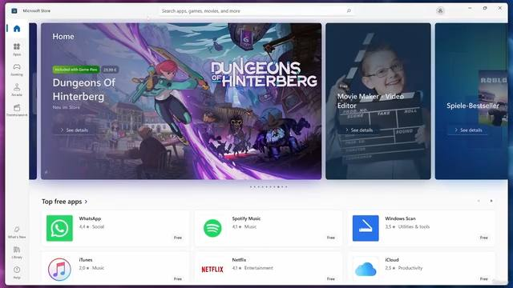

**Step 2｜点无版本号的 `Ubuntu`，点 `Get` 安装。**
讲师原话是 "我们在这里点击 Ubuntu，不选择任何具体版本，然后你可以点击获取"。**选不带版本号的那个**——它对应最新 LTS，后面 Docker / Node / Python 的安装说明都能直接照 Linux 官方文档抄。

**Step 3｜首次启动，设置 UNIX 用户名和密码。**
点 `Open` 后会提示 "这可能需要几分钟"，然后要求创建初始用户。讲师示范的用户名是 `lauramiller`，密码任意但**必须记住**——后面 `sudo` 提权会反复要它。

```text
Installing, this may take a few minutes...
Please create a default UNIX user account. The username does not need to match your Windows username.
For more information visit: https://aka.ms/wslusers
Enter new UNIX username: lauramiller
New password:
Retype new password:
passwd: password updated successfully
```

**Step 4｜验证你确实在 Linux 里。**

```bash
uname -a
cat /etc/os-release
```

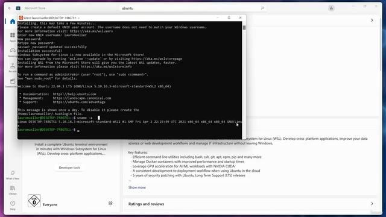

讲师的原话是 "我们会看到，这实际上是一台 Linux 虚拟机……运行在我们的 Microsoft 系统上，但这里的系统是 Linux"。`uname -a` 打内核信息，`cat /etc/os-release` 打发行版信息（发行版名称、版本号等字段，具体字段名以你机器的实际输出为准）。**这一步的意义**：从此以后，课程里所有 UNIX 命令对你都成立，你不用再区分「我是 Windows」。

**Step 5｜改用终端启动，别用那个图形窗口。**

```powershell
wsl
```

在 PowerShell 里敲 `wsl` 就进入 Ubuntu。讲师关掉了 Store 那个窗口，因为她不喜欢那个界面。你也可以在开始菜单搜 `Terminal`（Windows Terminal）再敲 `wsl`。

**Step 6｜搞清楚路径映射（这一步最容易踩坑）。**
从 Windows 目录启动 `wsl` 时，你落在的是 Windows 用户目录的挂载点（`/mnt/c/Users/<你的Windows用户名>`）。切回家目录：

```bash
cd ~
pwd
```

`~` 展开成 `/home/lauramiller`。**建议所有课程项目都放在 `~` 下面**，不要放在 `/mnt/c/...`（原因见第 7 章）。

**Step 7｜双向文件互通。**
在 WSL 里创建文件，Windows 侧立刻能看到：

```bash
echo hello world > hello.txt
ls -l hello.txt
```

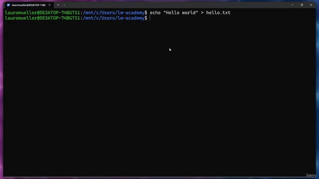

讲师随后在 Windows 侧打开 `C:\Users\<用户名>` 找到了 `hello.txt`，用记事本打开确认内容。反向验证：她在 Windows 里**删掉**这个文件，回到终端执行 `cat hello.txt`，得到的是 "没有那个文件或目录"。两条路径指向同一份数据。

从 Linux 侧打开 Windows 资源管理器：

```bash
explorer.exe .
```

讲师用这个命令直接打开了 `\\wsl$\Ubuntu\home\lauramiller`——注意这是**反方向**的能力：Linux 命令去驱动 Windows 程序。

**Step 8｜装 VS Code 的 WSL 扩展，这是讲师强烈推荐的姿势。**
VS Code → 左侧 Extensions → 搜 `WSL` → 安装微软官方的 WSL 扩展。然后：

左侧 Activity Bar → **Remote Explorer** → 找到 `Ubuntu` → `Connect in current window`。

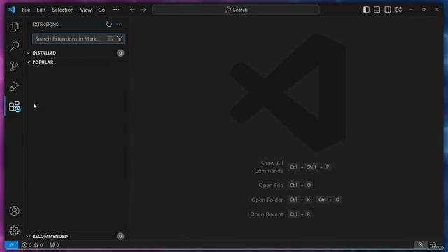

连接成功后，VS Code 左下角会显示 WSL 标识，**新开的集成终端直接在 Linux 里**。讲师的原话："你会看到，这个终端会立即进入我们的 Linux 虚拟机内部"

**Step 9｜跑通第一个可执行脚本（验证权限模型）。**

```bash
mkdir -p ~/dummy && cd ~/dummy
echo 'echo hello world' > say-hi.sh
ls -l
chmod +x say-hi.sh
./say-hi.sh
```

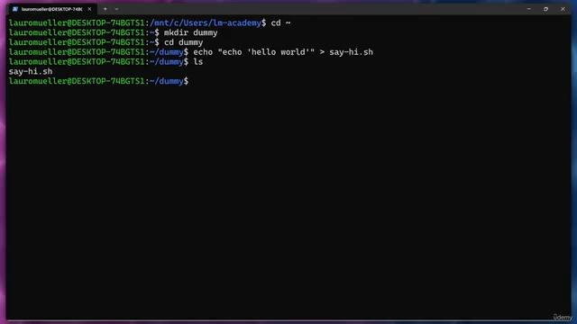

顺序很重要：**先 `ls -l` 看到没有 `x` 位 → `chmod +x` → 再运行**。讲师演示里如果直接跑未加执行位的脚本会报 `Permission denied`。

**Step 10｜从 Linux 侧打开编辑器。**

```bash
code .
```

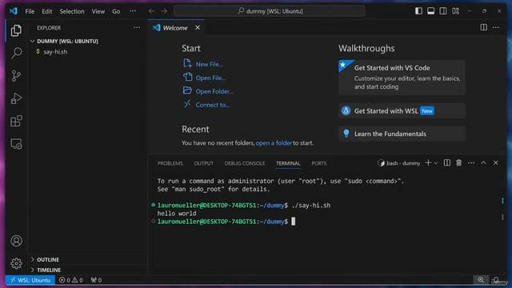

这就是后面所有实验的标准开法：**终端在 WSL → `code .` → 编辑器工作在 Linux 侧**。讲师原话是 "这会直接连接到我们的 Ubuntu 机器"。

### 3.2 阶段 B：把概念推导走一遍（P6–P8，纯讲解，无代码）

讲师这四集是白板式讲解，复现方式是把她的推导链自己重走一遍。下面每一步都标了来源。

**第 1 步：定义。** 可观测性 = 通过系统发出的**外部信号**理解系统行为（p006 [00:00]）。关键词是「外部」——你不再靠读代码、不再靠打日志到控制台猜，而是靠系统对外的输出反推内部状态。

**第 2 步：为什么现在变难了。** 讲师给的场景是电商结账：用户下不了单，屏幕上刷 "checkout failed"。老系统是单体，你可以翻代码库；现在是一堆服务通过**网络**互相调用，可能跨集群、跨集群外，失败可能来自多个组件的交互而不是单点（p006 [00:29]–[03:28]）。结论：需要系统主动发射足够多、足够好的信号。

**第 3 步：区分监控与可观测性（这是最容易混的一步）。**

| | 监控 monitoring | 可观测性 observability |
|---|---|---|
| 回答的问题 | **已知**问题（known questions） | **未知**问题（unknown questions） |
| 典型问法 | 错误率是否 > 1%？ | 这个请求为什么在 14:03 失败？ |
| 答案形态 | 是 / 否 | 需要下钻，可能有多个根因 |
| 关系 | 是可观测性的**子集** | 有可观测性就自动能做监控，反之不成立 |

来源：p006 [01:59]–[02:58]，讲师原话 "如果你具备可观测性，就能轻松进行监控，但反过来不行"

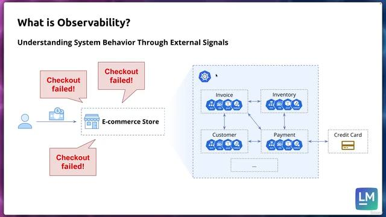

**第 4 步：三大支柱分工。** 讲师在 p007 里给了一个非常清晰的切分，照抄她的关键词：

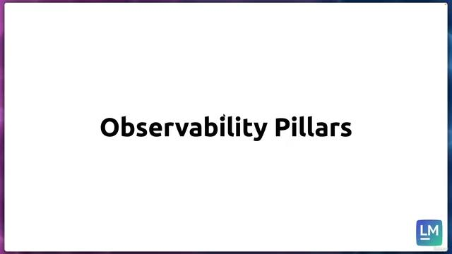

- **metrics**：numeric aggregates，数字 + 聚合。用途是**高层健康概览、告警、容量规划**。局限：因为是聚合的，"用指标来排查单个故障点是非常困难的"（p007 [00:40]）。
- **logs**：discrete events，离散事件，带大量上下文。用途是给你**精确的错误信息、某一时刻的具体条件**。
- **traces**：record the journeys of requests through the different services。用途是**跨服务边界**定位瓶颈、延迟问题和失败点。当一个用户请求要穿过三四百个系统时，只有 trace 能把散落各处的信息串起来。

讲师强调这是 **"an end decision" 不是 "一个二选一的决定"**（p005 [00:29] 的转写，意思是 AND 不是 OR）：三个都要，靠它们互补。

**第 5 步：加多少信号？** p007 [02:51] 的答案是否定「越多越好」：信号过量会制造噪音、反而降低可观测性。判据是「这条数据能不能帮我理解系统」，而不是「能不能采到」。

**第 6 步：metrics 的三种类型。** 这是 P8 的核心，也是你后面写 instrumentation 时第一个要做的决策：


| 类型 | 单调性 | 语义 | 讲师给的例子 | 常见误用 |
|---|---|---|---|---|
| Counter | **只能增**，永不回落 | 累计发生了多少次 | total HTTP requests、total bytes transferred、total errors | 拿它表示「当前连接数」——重启归零时会被误读成断崖 |
| Gauge | 可上可下 | 某一时刻的快照值 | current memory usage、queue depth、CPU percentage | 拿它做累计统计——聚合出来没有意义 |
| Histogram | 记录**分布** | 值落在哪些桶里，可算分位数 | p95 / p99 / p99.9 请求延迟 | 只看平均值——长尾被抹平 |

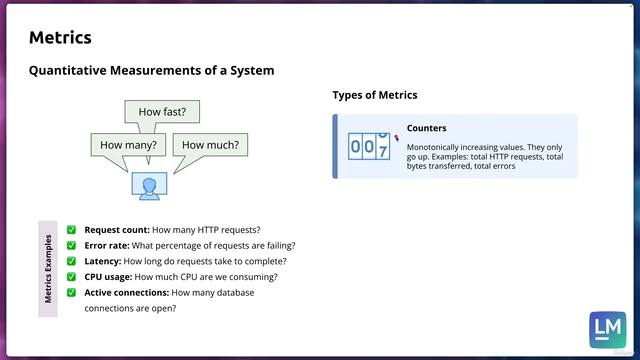

histogram 那段讲师讲得最细，值得复述：不要只看「平均延迟 200ms」，要看分布——

- 50% 的请求在 100ms 内完成
- 95% 在 500ms 内完成
- 99% 在 2s 内完成

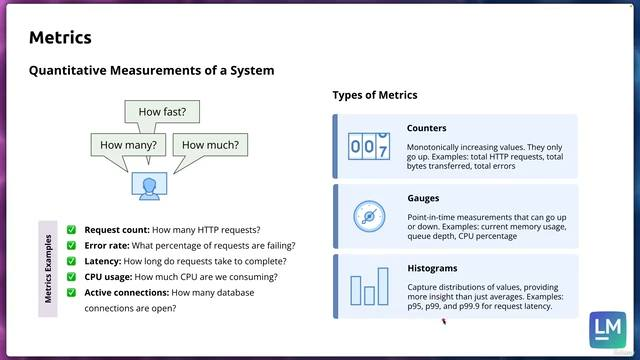

这三行合起来告诉你：大部分用户很快，但有 1% 的人在等两秒。只看平均值你永远发现不了这 1%。

---

## 4. 完整代码

> 再次声明：**P1–P8 没有给出任何 OTel 代码、Compose 文件或 Collector 配置。** 本章 4.2 是讲师在 P4 里实际敲出来的内容；4.1、4.3、4.5 是本文档补充的辅助产物，已逐条标注；4.4 是把讲师口头内容整理成的决策表，不含任何她没说过的东西。

### 4.1 `verify-env.sh` — 环境自检脚本（**课里没有，本文档补充**）

放在 `~/otel-course/verify-env.sh`。用途：在你开始后面章节前，一次性确认 P3–P4 的环境是否达标。

```bash
#!/usr/bin/env bash
# 本文档补充的辅助脚本，非课程内容。
# 用途：确认 P3-P4 要求的 Linux 环境已经就绪。
set -u

pass=0
fail=0

check() {
  local label="$1"; shift
  if "$@" >/dev/null 2>&1; then
    printf '  [ OK ] %s\n' "$label"
    pass=$((pass + 1))
  else
    printf '  [FAIL] %s\n' "$label"
    fail=$((fail + 1))
  fi
}

echo "== 1. 是否运行在 Linux 内核上 =="
if [ "$(uname -s)" = "Linux" ]; then
  echo "  [ OK ] uname -s = Linux"
  pass=$((pass + 1))
else
  echo "  [FAIL] 当前不是 Linux：$(uname -s)"
  fail=$((fail + 1))
fi

echo "== 2. 发行版信息 =="
if [ -r /etc/os-release ]; then
  # shellcheck disable=SC1091
  . /etc/os-release
  echo "  发行版: ${NAME:-unknown} ${VERSION_ID:-未知版本}"
  echo "  （具体字段名以 /etc/os-release 实际内容为准）"
  pass=$((pass + 1))
else
  echo "  [FAIL] 读不到 /etc/os-release"
  fail=$((fail + 1))
fi

echo "== 3. 是否在 WSL 里 =="
if grep -qi microsoft /proc/version 2>/dev/null; then
  echo "  [ OK ] 检测到 WSL（/proc/version 含 microsoft）"
else
  echo "  [INFO] 未检测到 WSL —— 如果你用的是原生 Linux 或 macOS，可忽略"
fi

echo "== 4. 家目录与当前工作目录 =="
echo "  HOME = $HOME"
echo "  PWD  = $(pwd)"

echo "== 5. 基础工具（后面章节会用到；缺失项现在不用急着装） =="
check "git"            command -v git
check "curl"           command -v curl
check "node"           command -v node
check "npm"            command -v npm
check "python3"        command -v python3
check "docker"         command -v docker
check "docker compose" docker compose version
check "code (VS Code CLI)" command -v code

echo
echo "== 汇总：通过 $pass 项，失败 $fail 项 =="
if [ "$fail" -gt 0 ]; then
  echo "有失败项。若是 node/python/docker 缺失，属于预期——课程后续才装；"
  echo "若是 Linux 内核或 WSL 检测失败，请回到 P3 重做环境搭建。"
  exit 1
fi
echo "环境检查全部通过。"
```

执行方式：

```bash
cd ~/otel-course
chmod +x verify-env.sh
./verify-env.sh
```

### 4.2 `say-hi.sh` — 讲师在 P4 实际演示的脚本（**课程内**）

讲师的操作序列是：`mkdir dummy` → `cd dummy` → 写脚本 → `ls` → `chmod +x` → 运行 → `code .`。脚本全文就一行：

```bash
#!/usr/bin/env bash
echo hello world
```

落地命令：

```bash
cd ~
mkdir -p dummy
cd dummy
printf '#!/usr/bin/env bash\necho hello world\n' > say-hi.sh
ls -l say-hi.sh
chmod +x say-hi.sh
ls -l say-hi.sh
./say-hi.sh
```

预期最后输出 `hello world`，且第二次 `ls -l` 的权限位从 `-rw-r--r--` 变成 `-rwxr-xr-x`（或你 `umask` 下的等价形式）。

### 4.3 建议的目录结构（**本文档建议，课里没给**）

```
~/otel-course/
├── verify-env.sh              # 4.1 环境自检
├── dummy/
│   └── say-hi.sh              # 4.2 讲师的示例脚本
├── notes/
│   └── concepts.md            # 三大支柱与 metrics 类型笔记
└── (后续章节会在这里出现 compose 文件与各服务的 instrument 代码)
```

最后一行是占位：P1 明确说会用 Docker Compose 部署整套栈，但**具体的 `docker-compose.yml` 里没讲、本文档不写**——写了就是编造。

### 4.4 把讲师的口头内容整理成落地产物

**表 A｜组件职责表**（来源：p001 [02:13]）

| 组件 | 信号类型 | 课程里的角色 | 不属于它的职责 |
|---|---|---|---|
| Prometheus | metrics | 指标后端 | 不负责日志、不负责 trace |
| Loki | logs | 日志后端 | 不做全文检索引擎的定位 |
| Tempo | traces | 追踪后端 | 不负责指标聚合 |
| Grafana | 全部 | 统一可视化层、log↔trace 关联入口 | 不产生信号 |

**表 B｜三支柱对照表**（来源：p007 全段）

| 维度 | metrics | logs | traces |
|---|---|---|---|
| 数据形态 | 数值聚合 | 离散事件 + 上下文 | 请求的跨服务旅程 |
| 回答什么 | 多少 / 多快 / 多少量 | 那一刻到底发生了什么 | 慢在哪一跳、断在哪个服务 |
| 适合 | 告警、容量规划、高层概览 | 精确错误、现场条件 | 跨服务边界的瓶颈与失败点 |
| 不适合 | 定位**单次**失败 | 做大范围趋势统计 | 看整体水位 |
| 相互引用 | — | 带 trace ID → 跳到 trace | 带 span → 回查该 span 的日志 |

**表 C｜metrics 类型决策表**（来源：p008 [01:19]–[02:34]）

| 你要测的东西 | 选什么 | 为什么 |
|---|---|---|
| 总共处理了多少次请求 | Counter | 只增不减 |
| 总共传了多少字节 | Counter | 只增不减 |
| 一共出了多少错 | Counter | 只增不减 |
| 此刻内存占用多少 MB | Gauge | 会涨会跌 |
| 此刻队列里积压多少条 | Gauge | 会涨会跌 |
| 此刻 CPU 百分比 | Gauge | 会涨会跌 |
| 请求延迟的 p50/p95/p99 | Histogram | 需要分布，平均值会掩盖长尾 |

**表 D｜P1 承诺的后续内容清单**（用来对照你学到哪儿了，全部来自 p001 大纲）

| 阶段 | 内容 | 状态（截至 P8） |
|---|---|---|
| 1 | 可观测性基础概念 | ✅ 已讲（P5–P8，部分概念仅点到名） |
| 2 | Docker Compose 部署栈 + 示例应用 | ⬜ 未讲 |
| 3 | OpenTelemetry 概念：API / SDK / Collector、自动 vs 手动、语义约定 | ⬜ 未讲 |
| 4 | 单服务 instrument：Collector 管道、前端服务的 metrics/traces/logs、Grafana 中 log-trace 关联、配置重构 | ⬜ 未讲 |
| 5 | 分布式服务：Python worker、跨异步边界的 context propagation（Redis 队列） | ⬜ 未讲 |
| 6 | Kubernetes 化：manifests、跨 namespace 配置管理、真实集群端到端验证 | ⬜ 未讲 |

> 阶段 6 里讲师提到的 "利用这里的自定义设置来管理分布在多个命名空间中的配置"，转写不清晰，具体工具名**以原课为准**，本文档不擅自填名字。

### 4.5 示意代码：用 JS 亲手验证「平均值会骗人」（**课里没有代码，以下为示意**）

这是为了让你真正吃透 p008 [02:04] 那句话。不是 OTel API，只是用一段纯 Node 脚本对比「平均值」和「分位数」。

```javascript
// percentile-demo.js —— 本文档补充的教学示意，非课程代码
// 运行：node percentile-demo.js

// 99 个快请求 + 1 个慢请求：这就是真实世界里最常见的长尾形态
const latencies = [];
for (let i = 0; i < 99; i++) latencies.push(80 + Math.random() * 20); // 80~100ms
latencies.push(2000); // 一个 2 秒的慢请求

const sorted = [...latencies].sort((a, b) => a - b);

// 最近秩法（nearest-rank）：最简单的分位数算法，够用来建立直觉
function percentile(sortedArr, p) {
  const idx = Math.ceil((p / 100) * sortedArr.length) - 1;
  return sortedArr[Math.max(0, idx)];
}

const avg = latencies.reduce((s, v) => s + v, 0) / latencies.length;

console.log(`样本数: ${latencies.length}`);
console.log(`平均值: ${avg.toFixed(1)} ms   <-- 看起来一切正常`);
console.log(`p50   : ${percentile(sorted, 50).toFixed(1)} ms`);
console.log(`p95   : ${percentile(sorted, 95).toFixed(1)} ms`);
console.log(`p99   : ${percentile(sorted, 99).toFixed(1)} ms   <-- 长尾暴露`);
console.log(`最大值: ${percentile(sorted, 100).toFixed(1)} ms`);
```

跑出来你会看到平均值在 100ms 出头，而 p99 已经接近 2 秒。**这就是讲师说的 "这比只看平均值要更有洞察力得多"**——直方图的价值不是精度，是让长尾可见。

---

## 5. 逐行解释

**`wsl`**
Windows 上的入口命令，启动默认 WSL 发行版并落在当前 Windows 目录的挂载点。讲师特意强调过这一点：从 `C:\Users\xxx` 里敲 `wsl`，你进去不是家目录而是 `/mnt/c/Users/xxx`，所以后面必须 `cd ~`。

**`uname -a` / `cat /etc/os-release`**
前者打内核（证明这是 Linux 而不是「Windows 上装了个终端模拟器」），后者打发行版。为什么这两条重要：课程后面所有依赖安装都要求你按 **Linux 版**的官方文档操作。讲师在 P4 结尾专门提醒 "如果你要在 Windows Subsystem for Linux 中安装，请务必查看 Linux 的说明"。搞混了就会出现「照 Windows 教程装完，命令找不到」的经典事故。

**`echo hello world > hello.txt`**
`>` 是覆盖重定向。这一步同时验证了三件事：Shell 能用、文件系统可写、WSL 的文件系统与 Windows 资源管理器看到的是**同一份数据**（不是两份拷贝）。讲师用「在 Windows 里删掉 → 回终端 `cat` 报错」做了反向确认，这个反向验证比正向更有说服力。

**`explorer.exe .`**
`. ` 是当前目录；`explorer.exe` 是 Windows 的资源管理器可执行文件。能在 Linux shell 里直接调 Windows 程序，是 WSL 的核心互操作能力。讲师用它打开了 `\\wsl$\Ubuntu\home\lauramiller`。

**`chmod +x say-hi.sh`**
`chmod` 改权限位，`+x` 加上执行位。为什么需要它：Linux 下「文件能不能被执行」是权限位的属性，不是扩展名的属性——这点和 Windows 的 `.bat`/`.exe` 心智完全不同。讲师演示里 `ls -l` 前后对比就是在展示这个位从无到有。**这一步也是你后面跑任何 `.sh` 启动脚本时的必做动作**，包括将来 Compose 相关的辅助脚本。

**`code .`**
VS Code 的 CLI。在 WSL 的终端里执行，它会通过 WSL 扩展在 Linux 侧打开工作区，而不是用 Windows 侧的文件系统去读写 `/home/...`。这决定了后面 Node 的 `node_modules`、Python 的虚拟环境全部落在 Linux 侧，避免跨文件系统带来的性能塌方（见第 7 章）。

**`./say-hi.sh`**
前面的 `./` 不能省。Linux 出于安全不把当前目录放进 `PATH`，只写 `say-hi.sh` 会报 command not found。

**关于表 A 的每一行为什么这么定**
Prometheus 只收 metrics、Loki 只收 logs、Tempo 只收 traces——这不是随便分的，是因为**三种信号的数据模型根本不同**：metrics 是带标签的时间序列数值，logs 是带时间戳的文本行，traces 是树形 span 结构。混在一个后端里做，查询和存储都会变形。Grafana 独立出来做可视化层，是因为**关联发生在查询时**，而不是存储时——log→trace 的跳转（P1 里提到的 log trace correlation）本质是 Grafana 拿着日志里的 trace ID 去 Tempo 查。

**关于表 C 的每一行为什么这么定**
Counter 和 Gauge 的分界线是**「这个量在系统重启后语义是否还能延续」**。总请求数每次重启归零，但它是「累计」语义，所以用 counter + 后端做 rate 计算；当前内存占用重启后是新值，没有累计含义，只能是 gauge。把「当前连接数」做成 counter 是最常见的翻车：服务重启时曲线断崖式下跌，告警会误报。Histogram 的必要性则来自 4.5 那段脚本——平均数把 1% 的 2 秒抹平了。

**关于讲师那句 "我们应该写多少"**
这句话在 P7 出现，但它真正的约束力要到后面章节才显现。你现在可以先记住判据：一条信号如果回答不了「多少 / 多快 / 多少量 / 那一刻发生了什么 / 慢在哪一跳」中的任何一问，它大概率是噪音。

---

## 6. 复现检查清单

**环境部分（P3–P4）**

- [ ] Microsoft Store 里装的是**不带版本号**的 `Ubuntu`，不是 22/20/18/24 某个具体版本
- [ ] 记住了 UNIX 用户名和密码（后面 `sudo` 会反复要）
- [ ] PowerShell 里执行 `wsl` 能进入 Linux
- [ ] `uname -a` 输出里有 Linux 字样
- [ ] `cat /etc/os-release` 能读出发行版名称与版本号
- [ ] `cd ~` 后 `pwd` 输出 `/home/<用户名>`
- [ ] `echo hello world > hello.txt` 后，在 Windows 资源管理器对应目录能看到 `hello.txt`
- [ ] 在 Windows 里删掉该文件后，回到终端 `cat hello.txt` 报 "没有那个文件或目录"
- [ ] `explorer.exe .` 能弹出 Windows 资源管理器并定位到当前 Linux 目录
- [ ] VS Code 已安装 WSL 扩展（Extensions 搜 `WSL`）
- [ ] Remote Explorer → Ubuntu → Connect in current window 成功，左下角显示 WSL 标识
- [ ] VS Code 新开集成终端，提示符是 Linux 风格
- [ ] `~/dummy/say-hi.sh` 存在，`ls -l` 显示有 `x` 位，直接执行输出 `hello world`
- [ ] `code .` 能打开当前 Linux 目录
- [ ] `./verify-env.sh` 的「Linux 内核」「/etc/os-release」「是否在 WSL」三项全绿

**概念部分（P6–P8）**

- [ ] 能用自己的话说出可观测性的定义里「外部信号」四个字的分量
- [ ] 能举一个「监控答不了、可观测性能答」的具体问题
- [ ] 能说清三大支柱各自**不适合**干什么（不只是适合干什么）
- [ ] 给你三个指标（总请求数 / 当前内存 / 请求延迟分位数），能立刻判断该用 counter / gauge / histogram
- [ ] 跑过 4.5 的脚本，亲眼看到平均值和 p99 的差距
- [ ] 知道 P1–P8 **没有**给出 compose 文件、Collector 配置和 instrumentation 代码（避免你去找不存在的代码）

---

## 7. 课里没讲但你会撞上的

**1. WSL 装不上，提示需要开启虚拟化。**
`Get` 之后卡住或报错，通常是 BIOS 里 CPU 虚拟化（Intel VT-x / AMD-V）没开，或者 Windows 的「虚拟机平台 / Hyper-V」功能没启用。讲师在 P3 里是从「打开 Store 搜索」直接开始的，装完就进去了，没有覆盖失败路径。真撞上了：任务管理器 → 性能 → CPU，看「虚拟化」是否为「已启用」。

**2. Store 版 Ubuntu 下载卡在几 MB 不动。**
P3 里讲师说 "这可能需要几分钟"，但没说会卡多久。Store 分发的网络问题在部分地区很常见。可以换命令行方式安装（**课里没走这条路径**，属于补救）：
```powershell
wsl --install -d Ubuntu
```
注意这跟课程演示的路径不完全一致，装完的发行版名字可能不同，`explorer.exe .` 打开的 UNC 路径里那段发行版名要按你实际的改。

**3. 用 `wsl` 进去后发现自己在 `/mnt/c/...`，`ls` 出来全是 Windows 的桌面、文档、下载。**
这是 P4 讲师专门演示过的现象（"由于我们当时位于 Windows 上的用户目录中，你会看到这里实际上映射到这个挂载目录"）。不是 bug。养成习惯：**每条 `wsl` 进来先 `cd ~`**。

**4. 项目放在 `/mnt/c/...` 下，`npm install` 慢到怀疑人生。**
这是 WSL 最经典的坑：跨文件系统（Linux 进程访问 Windows 盘）的 IO 开销比原生 ext4 高一个数量级。后面的 Node 项目、Python 虚拟环境、以及 Docker 卷都建议放在 `~/` 下。讲师没提这一点，但她的示范全程都在 `~` 里，照做就行。

**5. 从 Windows 侧编辑了 `.sh` 文件，回 Linux 跑报 `bad interpreter: /bin/bash^M`。**
Windows 记事本存的是 CRLF 行尾，Linux 需要 LF。用 VS Code 时看右下角的 `CRLF`，点一下切成 `LF` 即可。或者装个 `dos2unix` 转一下。P4 讲师用记事本**只做了读取**，所以这个坑她没暴露出来。

**6. `docker` 命令在 WSL 里找不到。**
P1 说会用 Docker Compose 部署整套栈，但 P1–P8 完全没讲怎么在 WSL 里装 Docker。两条常见路：装 Docker Desktop 并在设置里打开「WSL 集成」，或者在 Ubuntu 里原生安装 Docker Engine（Linux 版官方文档）。这里要注意讲师 P4 结尾的提醒：**装依赖要看 Linux 说明，不要照 Windows 说明抄**。具体选哪条，等课程讲部署那一节再定。

**7. `code .` 打不开，或打开的是 Windows 侧的 VS Code 但终端还是 PowerShell。**
先确认 WSL 扩展已装，并且是**通过 Remote Explorer 连接**进来的。如果左下角没有 WSL 标识，说明你只是在 Windows 侧开了个 VS Code 然后 `code` 被转发过去了，环境不对。

**8. 端口冲突（为后面做准备）。**
后面整套栈会在本地起多个 HTTP 服务（Prometheus / Loki / Tempo / Grafana 各占端口）。**课程到 P8 没给出任何具体端口号**，所以现在没法提前排查，只能记住这个风险：如果你本机已经跑着别的服务，部署时留意映射端口，以你实际拿到的 compose 文件为准。

**9. 关于 context propagation 的一个前瞻（课里还没讲）。**
P1 提到 "分布式上下文传播如何跨越异步服务边界发挥作用"，还点名了 Redis 队列。对前端读者来说值得提前知道：在 Node 里，跨 `async`/`await`、跨回调保持「同一个 trace 上下文」在语言层面是没有天然语法的，业界常用的底层机制是 `AsyncLocalStorage`。**但讲师在 P1–P8 里完全没有提这个 API**，这里只是给你一个以后听到 "在 JS 里怎么做上下文传播？" 时不至于完全陌生的锚点。真正的做法等课程讲到那一节再按讲师的原话走。

**10. 讲师提到但本段没展开的概念。**
SLI / SLO / SLA、error budget、Google SRE 的 four golden signals（逐字稿转写为 "四大黄金信号"）在 p005 的导览页里都出现了，但在 P5–P8 的正片里**只点名、未展开**。如果你赶进度，别在这一节就去啃这些名词，等课程对应章节。另外 P1 [04:36] 那句 "自定义指标、追踪跨度、面包屑、导出器和结构化日志" 里的 "breadies" 属于转写噪声，具体所指以原课音频为准，本文档不做猜测性定义。