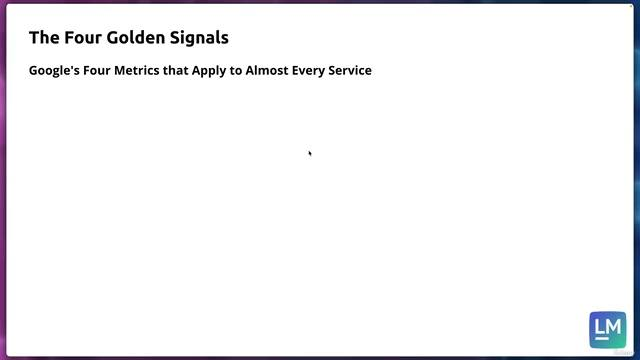
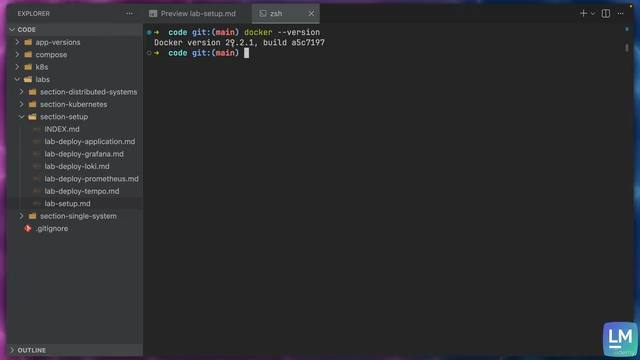
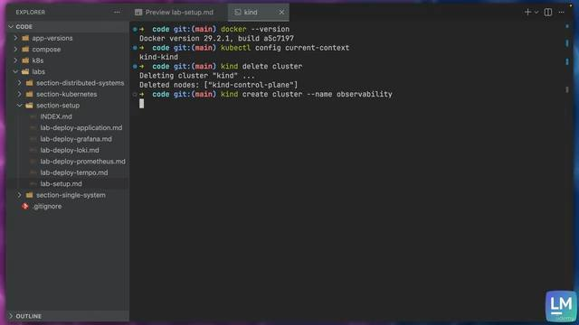
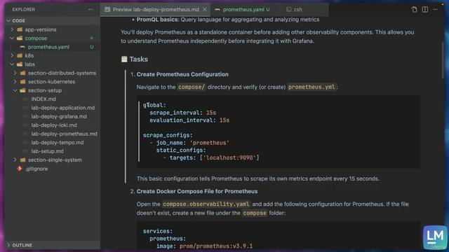
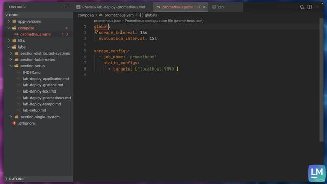
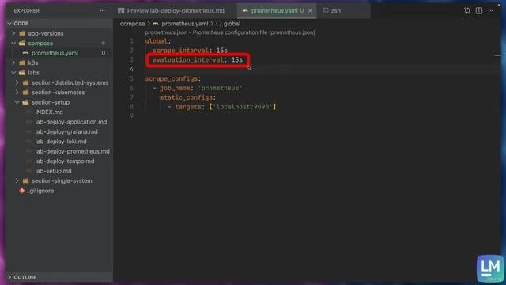
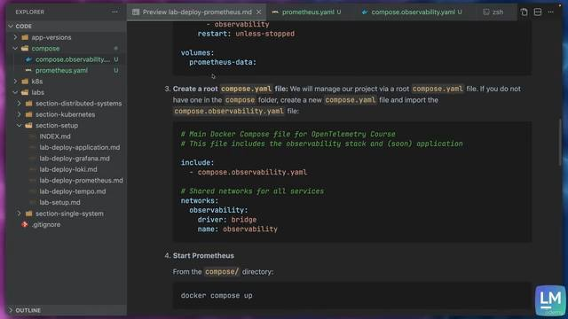
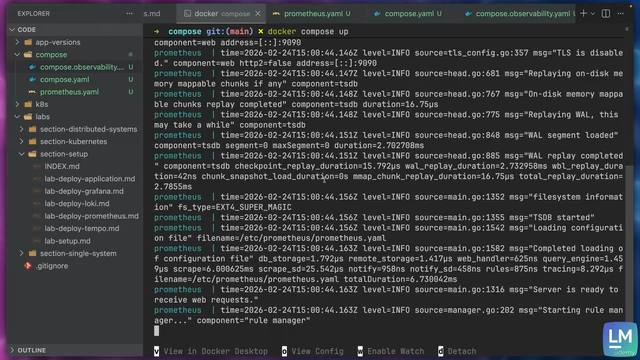
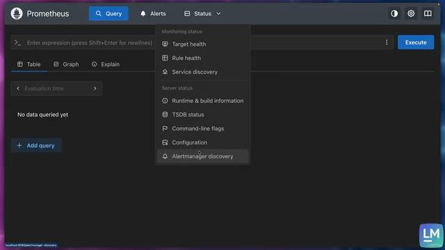
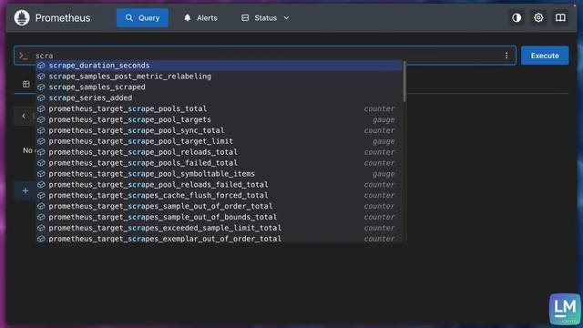

# OpenTelemetry 可观测性实战：从四黄金信号到 Prometheus + Docker Compose（P17–P23）

> 本文只覆盖 P17–P23。P17 讲四黄金信号；P18–P23 进入本地环境与 Prometheus Lab。  
> 注意：P18 虽然提到 Prometheus、Loki、Tempo、Grafana 整套后端，但 P17–P23 实际落地的是 **Prometheus + Docker Compose**。Loki、Tempo、Grafana 的部署代码在这几段里没有出现，不要误以为本节能跑完整 observability stack。

---

## 1. 这一节做什么

这一节要完成三件事：

1. **建立指标观**：理解 Google SRE 的“四黄金信号”——延迟、流量、错误、饱和度。重点不是背四个词，而是知道每个信号该测什么、为什么不能只看平均值。延迟要看分布和分位数，因为平均值会把慢请求和极慢请求混在一起；流量要看系统实际承受多少请求或事件；错误不能只盯 5xx，也要把 4xx、超时和显式定义的失败算进去；饱和度要看 CPU、内存、磁盘、网络等资源是否接近上限。这个指标观会决定后面看 Prometheus 查询时，应该先看哪些指标、怎样判断一个 target 是否健康。
2. **准备本地环境**：确认 Docker、Docker Compose、Kubernetes、kubectl、kind 可用。P19 明确要求 Docker 和 Kubernetes 跑起来，并建议用一次性 kind 集群，避免误删重要资源。这里的“准备”不是马上把整套监控部署进 Kubernetes，而是先把工具链验证一遍，知道当前上下文、集群名称和 Docker 状态，后面切换环境时不会把 Compose 和 Kubernetes 混在一起。
3. **部署并验证 Prometheus**：用 Docker Compose 启动 Prometheus，访问 `http://localhost:9090`，运行 `scrape_duration_seconds`、`rate(prometheus_http_requests_total[5m])` 等查询，并在 Targets 页面确认 Prometheus 能抓到自己。验证顺序建议是：先看容器是否起来，再看 UI 是否能打开，再看 target 是否为 UP，最后看查询是否返回时间序列。这样出错时能快速判断是 Compose 启动问题、端口问题、配置挂载问题，还是 PromQL 写法问题。

最终产物是一个可复现的 `labs/setup/compose/` 目录，里面有三个文件：

```text
labs/setup/compose/
├── compose.yaml
├── compose.observability.yaml
└── prometheus.yaml
```

启动后应看到：

- 容器 `prometheus` 处于运行状态；
- 宿主机 `localhost:9090` 能打开 Prometheus UI；
- `Status -> Targets` 里 `prometheus` 这个 target 是 `UP`；
- 查询 `scrape_duration_seconds` 能返回 `instance`、`job` 等信息。



本节不包含：应用埋点、OpenTelemetry Collector 的完整配置、Loki/Tempo/Grafana 部署、Kubernetes 部署 Prometheus。课里说这些会在后续推进，但 P17–P23 没有给出对应 YAML。因此本节的目标边界要守住：先把 Prometheus 单后端跑通，别提前把“整套可观测性平台”当作已经完成的内容。

---

## 2. 讲师原话（带「—— pNNN [MM:SS]」）

> "它们来自 Google 的 SRE 书，基本上就是 Google 的那四个指标，几乎适用于所有服务。"
> —— p017 [00:29]

> "你还应该跟踪我们已经提到的百分位数，而不只是平均值，因为平均值会隐藏很多信息。"
> —— p017 [00:59]

> "你应该关注的第二组指标是流量。也就是系统实际处理了多少需求？"
> —— p017 [01:29]

> "我们还应该明确地定义错误。所以，虽然我们通常把 5xx 响应码视为错误，但我们的 4XX 响应也算错误，超时也算错误，等等。"
> —— p017 [01:56]

> "这里的最后一组指标是饱和度指标。也就是系统有多满？它会衡量资源利用率，比如 CPU、内存、磁盘、网络带宽。"
> —— p017 [02:26]

> "你需要的是 Docker 和 Kubernetes。当然，还有你自己选择的 IDE。在这个例子里，我用的是 VS Code。"
> —— p019 [00:17]

> "它确实有一个基于拉取的系统，这意味着不是我们的服务直接把数据发送给 Prometheus，而是 Prometheus 服务器在这里主动发起，去联系它监控的服务，然后按特定间隔抓取指标数据。"
> —— p020 [01:05]

> "这里每一个这样的值对的单独组合，都会创建一个新的 time series。"
> —— p020 [02:10]

> "在这里的 compose 文件夹下，我要创建一个新的 Prometheus.yaml 文件。"
> —— p022 [00:16]

> "它只是说，嘿，每 15 秒抓取你的目标，从你的目标收集指标。而这里的 evaluation interval 是……Prometheus 多久会评估一次 recording rules。"
> —— p022 [00:45]

> "我强烈建议你把镜像的标签保持得和我这里使用的一模一样，以获得最大兼容性。"
> —— p022 [03:22]

> "这会存储在 Prometheus 本地，并保留 15 天。"
> —— p022 [04:23]

> "这个 rootcompose.yaml 文件只是要……充当编排器。它只是要为我们把所有东西整合在一起。"
> —— p023 [00:29]

> "我们回到这里，scrape_duration_seconds……这只是告诉我们实例 localhost:1990、job 为 Prometheus 的抓取持续时间。"
> —— p023 [03:15]

> "我们会用到 rate 函数，然后提供 HTTP requests total……它期望的是 matrix 类型，但得到的是 vector。所以我们需要做的是，确实需要在一段时间内对它求平均。"
> —— p023 [04:19]

以上引用保持原文和转写误差，例如 `1990` 是语音转写结果，实际配置与 UI 中以 `localhost:9090` 为准；引用本身不做改写，避免把讲师原话和本文补充说明混在一起。

---

## 3. 从零复现

### 3.1 环境准备与验证

先确认 Docker、Compose、kubectl、kind 都存在。P19 里讲师用 VS Code + 内置终端，但不强制。

```bash
docker --version
docker compose version
kubectl version
kubectl config current-context
kind get clusters
```

这些命令的用途要分清：`docker --version` 只验证 Docker 客户端版本存在，不代表 Docker daemon 一定已经启动；`docker compose version` 验证 Compose v2 插件是否可用；`kubectl version` 看客户端和服务端信息，如果没有集群服务端信息，说明当前可能没有连上 Kubernetes；`kubectl config current-context` 用来确认当前操作的是哪个集群上下文，避免误操作重要环境；`kind get clusters` 用来列出本机 kind 创建的集群名称。常见错误是 Docker 没启动、当前用户没有 Docker 权限、`docker compose` 被当成旧版 `docker-compose`、kubectl 没配上下文。排查时先看命令自身报错，再执行 `docker info` 检查 daemon 状态。

如果你要按讲师的方式重建一个一次性 kind 集群：

```bash
kind delete cluster --name observability
kind create cluster --name observability
kubectl config current-context
```

这里的 `kind delete cluster --name observability` 会删除同名的 kind 集群，`kind create cluster --name observability` 会重新创建一个一次性集群，`kubectl config current-context` 用来确认当前上下文已经切换。注意：删除同名集群是破坏性操作，如果你之前已有同名集群并有需要保留的资源，不要直接执行。本文场景是一次性实验环境，所以可以这样做。

注意：本段 Prometheus Lab **实际只用 Docker Compose**，kind 集群只是先准备好，后面 Kubernetes 部分才会用。不要一上来就把 Prometheus 往 k8s 里塞，P17–P23 没讲那一步。





### 3.2 建目录

在课程 lab 的 setup 目录下建 `compose`：

```bash
mkdir -p labs/setup/compose
cd labs/setup/compose
```

`mkdir -p` 会递归创建目录，并在目录已存在时不报错；`cd` 进入该目录后，后续的 `./prometheus.yaml` 挂载路径才是相对于这个目录解析的。常见错误是人在仓库根目录却直接执行 `docker compose up`，或者把 `prometheus.yaml` 建到了上一级目录，导致 Compose 能启动但容器内配置文件不存在。验证方式是执行 `pwd` 和 `ls -la`，确认当前目录就是 `labs/setup/compose`，并且三个文件都在同一层。

最终目录必须是：

```text
labs/setup/compose/
├── compose.yaml
├── compose.observability.yaml
└── prometheus.yaml
```

### 3.3 写 Prometheus 配置

新建 `prometheus.yaml`，内容见第 4 节。核心是：

- `scrape_interval: 15s`：每 15 秒抓一次 target；
- `evaluation_interval: 15s`：每 15 秒评估 recording rules（讲师说本地开发先给这个默认值）；
- `scrape_configs` 里显式列出 target：Prometheus 自己，地址 `localhost:9090`。

P22 里讲师特意提到：这里用最简单的 Compose 静态 target，不使用 Prometheus Operator 或 Kubernetes 服务发现。所以不要写复杂动态发现。静态 target 的好处是行为明确，出错时只需要检查 `prometheus.yaml` 和目标地址；坏处是所有 target 都要手写，后面扩展应用监控时要再补配置。



### 3.4 写 observability Compose 文件

新建 `compose.observability.yaml`，内容见第 4 节。它只负责 Prometheus：

- 镜像 tag 固定；
- 挂载 `prometheus.yaml` 到容器内配置路径；
- 使用 named volume 持久化 `/prometheus`；
- 保留 15 天数据；
- 映射 `9090:9090`；
- 接入 `observability` 网络。

P22 里讲师强调：镜像 tag 尽量和课程一致，否则排查问题时版本对不上。本文为了可复现固定了一个 tag，见代码下方说明。常见错误是把宿主机配置文件路径写错、容器内路径和 `--config.file` 不一致、named volume 名字和声明不一致、端口左边写成容器端口。排查时先运行 `docker compose config` 看最终解析结果，再运行 `docker compose ps` 看容器状态和端口映射。

### 3.5 写根 `compose.yaml`

新建根 `compose.yaml`，只做编排：

- `include` 引入 `compose.observability.yaml`；
- 定义共享网络 `observability`。

这样以后加 `compose.app.yaml` 时，可以把应用和 observability 后端分文件管理。讲师说这是个人偏好，也可以全塞一个文件，但分开更利于扩展。`include` 的作用是把多个 Compose 文件合并成一个项目视图；共享网络的作用是让以后加入同一项目的容器可以通过服务名或网络别名互相访问。注意这不是 Kubernetes 的网络模型，本节仍然只是 Docker Compose 网络。







### 3.6 启动 Prometheus

```bash
cd labs/setup/compose
docker compose config
docker compose up -d
docker compose ps
```

`docker compose config` 会在真正启动前解析并合并配置，能提前暴露 YAML 缩进、`include` 路径、volume 路径、端口格式等问题；`docker compose up -d` 在后台创建并启动服务；`docker compose ps` 查看当前项目的容器状态、端口和命令。常见错误是端口 9090 已被占用、配置文件不存在、镜像拉取失败、Docker daemon 未运行、Compose 版本不支持 `include`。排查时先看 `docker compose config` 的输出，再执行 `docker compose logs prometheus` 看容器日志。

如果提示容器名 `prometheus` 已存在，先检查旧容器：

```bash
docker ps -a --filter name=prometheus
docker rm -f prometheus
docker compose up -d
```

`docker ps -a --filter name=prometheus` 只筛选名字里包含 `prometheus` 的容器，包括已停止容器；`docker rm -f prometheus` 强制删除指定名字的容器。这里只删冲突容器，比全机器清理安全。

讲师在 P23 里因为之前测试过，用了 `docker system prune` 清环境。**不要随便在自己的机器上执行**，它会删掉很多未运行容器。更安全的是只删冲突容器。

启动后打开浏览器：

```text
http://localhost:9090
```



### 3.7 跑查询并检查 Targets

在 Prometheus UI 的查询框里执行：

```promql
scrape_duration_seconds
```

应该返回一条记录，包含 `instance`、`job` 等标签。讲师在 P23 里看到的是 `instance="localhost:9090"`、`job="prometheus"`（逐字稿转写成 1990，以实际 UI 和你的配置为准）。这个查询的含义是查看 Prometheus 抓取 target 所花的时间，它能同时验证“配置里的 target 被读到了”和“抓取行为发生了”。如果没有结果，先看 Targets 页面是否 UP，再看 `prometheus.yaml` 的 `targets` 是否写对。

再执行：

```promql
rate(prometheus_http_requests_total[5m])
```

如果只写 `rate(prometheus_http_requests_total)` 会报错，因为 `rate()` 需要 range vector，必须加 `[5m]`。讲师在 P23 [04:19] 明确演示了这个错误。`[5m]` 表示取最近五分钟的时间窗口，`rate()` 在这个窗口内计算每秒平均增长速率；不加窗口时，Prometheus 拿到的是 instant vector，而函数期待 matrix/range vector，所以会报类型错误。

最后点 `Status -> Targets`，确认 `prometheus` target 是 `UP`。





停止：

```bash
docker compose down
```

如果要连数据卷一起删：

```bash
docker compose down -v
```

`docker compose down` 只停止并删除当前项目的容器和网络，默认不删除 named volume；`docker compose down -v` 会连同 volume 一起删除。`-v` 会删除 named volume，15 天保留的数据也会没。课里没讲恢复方案，删前自己确认。

**与前端的对照**：如果你熟悉 Node 或浏览器前端，容易把监控理解成“应用主动 push 数据到监控平台”。Prometheus 这里是 **pull 模型**，它按 `scrape_interval` 主动访问 target 的指标端点。可以先把它类比成“服务端定时轮询”，而不是“前端埋点后主动上报”。本节还没有写 Node 服务的 `/metrics` 端点，也没有写 OpenTelemetry SDK；现在验证的是 Prometheus 后端自身能跑、能抓、能查。

---

## 4. 完整代码

> 说明：课程口播没有给出具体镜像 tag；为了可复现，下面固定 `prom/prometheus:v2.55.1`。这不是讲师原话中的版本号。若你使用课程附件，请以附件 tag 为准，不要混用多个版本。  
> 本节代码不使用任何环境变量；课里也没讲任何环境变量名。

### 4.1 目录结构

```text
labs/setup/compose/
├── compose.yaml
├── compose.observability.yaml
└── prometheus.yaml
```

### 4.2 `labs/setup/compose/prometheus.yaml`

```yaml
global:
  scrape_interval: 15s
  evaluation_interval: 15s

scrape_configs:
  - job_name: prometheus
    static_configs:
      - targets:
          - localhost:9090
```

### 4.3 `labs/setup/compose/compose.observability.yaml`

```yaml
services:
  prometheus:
    image: prom/prometheus:v2.55.1
    command:
      - --config.file=/etc/prometheus/prometheus.yml
      - --storage.tsdb.path=/prometheus
      - --storage.tsdb.retention.time=15d
    volumes:
      - ./prometheus.yaml:/etc/prometheus/prometheus.yml:ro
      - prometheus_data:/prometheus
    ports:
      - "9090:9090"
    networks:
      - observability

volumes:
  prometheus_data:
```

### 4.4 `labs/setup/compose/compose.yaml`

```yaml
name: observability-lab

include:
  - path: compose.observability.yaml

networks:
  observability:
    name: observability
```

### 4.5 启动命令汇总

```bash
cd labs/setup/compose
docker compose config
docker compose up -d
docker compose ps
```

浏览器打开：

```text
http://localhost:9090
```

查询：

```promql
scrape_duration_seconds
```

```promql
rate(prometheus_http_requests_total[5m])
```

---

## 5. 逐行解释

### 5.1 `prometheus.yaml`

`global.scrape_interval: 15s`  
Prometheus 每 15 秒去抓一次 target。讲师说本地开发用 15 秒是合理默认；更大服务器可能 30 秒或 60 秒，否则计算和抓取太频繁。这个值影响抓取频率，也影响时间序列的采样密度；排查“为什么图表点很稀”时先看它。

`global.evaluation_interval: 15s`  
这是评估 recording rules 的间隔。讲师在 P22 [00:45] 特意区分：它不是 scrape 间隔。本 Lab 没写 recording rule，但配置里保留这个默认值。注意：不是所有 Prometheus 版本字段名都一样，课里只讲了 `evaluation intervals` 这个概念，具体字段以你的版本为准。常见误解是把它当成抓取间隔，结果改了它却发现 target 抓取频率没变；抓取频率只看 `scrape_interval`。

`scrape_configs`  
显式列出要抓的 target。讲师说这里不用服务发现，因为是最简单的 Compose 环境。静态配置的优点是直观，缺点是每个 target 都要手写；以后加应用 target 时，需要继续在这个列表里追加。

`job_name: prometheus`  
这个 job 名字会变成查询结果里的 `job="prometheus"` 标签。P23 的查询结果里能看到 `job Prometheus`。标签是 Prometheus 查询和过滤的基础，排查多 target 问题时，先看 `job` 和 `instance` 能区分出哪一条时间序列。

`targets: - localhost:9090`  
Prometheus 抓自己。因为 Prometheus 进程就在容器里，所以容器内 `localhost:9090` 可达。P23 里查询结果显示 `instance="localhost:9090"`（逐字稿写作 1990，是语音转写误差；以 UI 为准）。如果以后抓其他容器，`localhost` 通常不再合适，要用 Compose 服务名或容器网络地址；这一点课里没有展开。

### 5.2 `compose.observability.yaml`

`image: prom/prometheus:v2.55.1`  
固定版本，避免“昨天能跑今天不能跑”。讲师 P22 [03:22] 强烈建议 tag 和课程一致。这里 tag 是本文补充的，不是讲师口播版本。固定 tag 的代价是升级要手动改，但复现实验更稳定。

`command: --config.file=/etc/prometheus/prometheus.yml`  
告诉 Prometheus 用哪个配置文件。左边是容器内路径，右边通过 volume 挂进去。注意容器内路径是 `/etc/prometheus/prometheus.yml`，而宿主机文件叫 `./prometheus.yaml`，扩展名不同但挂载后对应。

`--storage.tsdb.path=/prometheus`  
Prometheus 把时序数据写到容器内 `/prometheus`。讲师 P22 [04:23] 说数据存在这个目录，并保留 15 天。这个路径必须和 volume 挂载目标一致，否则数据可能写到容器临时层，容器删除后丢失。

`--storage.tsdb.retention.time=15d`  
数据保留 15 天。超过后由 Prometheus 自己清理。它控制的是本地 TSDB 保留时间，不是 Compose 容器生命周期；容器重启不会自动清数据，`down -v` 才会删卷。

`volumes: - ./prometheus.yaml:/etc/prometheus/prometheus.yml:ro`  
把宿主机的 `prometheus.yaml` 挂到容器内配置路径，`ro` 是只读。这里最容易错：宿主机文件名必须真的是 `prometheus.yaml`，且你在 `compose` 目录下执行命令。讲师在 P22 里因为文件扩展名 `.yaml` 和 `.yml` 不一致，专门改了挂载路径。排查时用 `ls -l ./prometheus.yaml` 确认文件存在。

`volumes: - prometheus_data:/prometheus`  
named volume。容器重启后数据还在。没有它，容器一删数据就没。注意 `docker compose down -v` 会删这个卷。named volume 的名字最终可能带项目前缀，实际以 `docker volume ls` 为准。

`ports: - "9090:9090"`  
宿主机 9090 映射容器 9090。浏览器访问 `http://localhost:9090`。如果本机 9090 被占用，会启动失败；课里没讲换端口方案，你可以改成 `"9091:9090"`，但 UI 地址也要跟着变。排查端口占用可先看 `docker compose ps` 或系统端口占用情况。

`networks: - observability`  
接入共享网络。这个网络在根 `compose.yaml` 里定义。它保证以后加入同一项目的容器能在这个网络内解析服务名。

`volumes: prometheus_data:`  
声明 named volume。名字最终可能带 Compose project 前缀，实际以 `docker volume ls` 为准。声明名和挂载名必须一致，否则 Compose 会报未定义 volume。

### 5.3 根 `compose.yaml`

`name: observability-lab`  
给 Compose 项目命名，影响容器、网络、volume 的默认前缀。课里没讲这个字段，这是为了让复现更稳定补的。项目名稳定后，`docker compose ps`、`docker volume ls` 更容易辨认当前实验资源。

`include: - path: compose.observability.yaml`  
把 observability 服务引入根项目。讲师 P23 [00:29] 说根 compose 的作用是“编排器”，把多个文件合在一起。注意 `include` 需要较新的 Docker Compose v2；老版本可能不认，见第 7 节。`path` 是相对根 `compose.yaml` 的路径，所以文件名和相对位置必须完全对上。

`networks: observability: name: observability`  
定义共享网络。这样 Prometheus 和以后加的应用容器能在同一网络里互相访问。讲师说这个网络在根文件里创建，不在 observability 文件里创建。若把网络只定义在子文件里，根文件合并后可能出现引用不一致；本 Lab 按讲师的结构把网络放在根文件。

### 5.4 查询解释

`scrape_duration_seconds`  
看 Prometheus 抓某个 target 花了多久。P23 里返回单条记录，讲师用它确认 target 能被抓。字段名以你实际 UI 为准。查询无结果时，先查 Targets 是否 UP，再查 `job_name` 和 `targets` 是否与 UI 中的标签一致。

`rate(prometheus_http_requests_total[5m])`  
`rate()` 计算每秒平均增长速率，`[5m]` 表示看最近 5 分钟。讲师 P23 [04:19] 演示：如果不加 `[5m]`，会提示 expecting matrix but got vector。加上时间范围后才能算 rate。这个错误是 PromQL 类型错误，不是数据为空；看到报错先检查函数参数类型，而不是先怀疑 Prometheus 没抓到数据。

`Status -> Targets`  
看 target 健康状态。P23 里只有 Prometheus 自己一个 target，显示 UP。以后接入 Loki、Tempo、应用后 target 会变多。课里没讲那些 target 的具体配置。Targets 页面能直接看到最后一次抓取错误，是排查配置问题最快的位置。

### 5.5 对前端/Node 读者的对应关系

本节没有锁、事务、并发问题。Prometheus 是 **pull 模型**：它定时来抓你的服务，不需要你的 Node 服务主动 push。课里没讲 Node SDK、没讲 `/metrics` 端点实现，也没讲 OpenTelemetry Collector 配置。你现在只需要先把 Prometheus 后端跑起来，验证 UI 和查询链路。对前端读者来说，可以把它理解成“监控系统主动轮询目标”，而不是“页面埋点上报”；后面真正接入应用时，才需要讨论指标暴露、端点和采集配置。不要因为熟悉前端上报模型，就误以为本节要写 push 客户端。

---

## 6. 复现检查清单

- [ ] `docker --version` 有输出。  
  验证方式：在终端执行该命令，确认打印 Docker 客户端版本；若报“command not found”，先解决 Docker 安装或 PATH 问题。

- [ ] `docker compose version` 有输出。  
  验证方式：执行后应看到 Compose v2 版本信息；若提示 `docker: 'compose' is not a docker command`，说明 Compose 插件不可用，需要升级或安装。

- [ ] `kubectl version` 有 client/server 信息；如果没有 k8s 环境，本节 Prometheus Lab 仍可先跑 Compose。  
  验证方式：执行后看 client 版本是否打印；server 部分报连接失败也不影响本节的 Compose 实验，但要在心里记下当前没有可用 k8s 服务端。

- [ ] 已创建 `labs/setup/compose/prometheus.yaml`。  
  验证方式：`ls -l labs/setup/compose/prometheus.yaml` 能看到文件；打开确认有 `scrape_interval`、`evaluation_interval` 和 `scrape_configs`。

- [ ] 已创建 `labs/setup/compose/compose.observability.yaml`。  
  验证方式：`ls -l labs/setup/compose/compose.observability.yaml` 能看到文件；确认其中 `image`、`command`、`volumes`、`ports`、`networks` 都存在。

- [ ] 已创建 `labs/setup/compose/compose.yaml`。  
  验证方式：`ls -l labs/setup/compose/compose.yaml` 能看到文件；确认 `include.path` 指向 `compose.observability.yaml`。

- [ ] `docker compose config` 没有报 YAML 或 include 错误。  
  验证方式：在 `labs/setup/compose` 目录执行该命令，观察退出码和输出；若报 include 不支持，记录 Compose 版本并按第 7 节处理。

- [ ] `docker compose up -d` 成功。  
  验证方式：执行后无错误退出，再用 `docker compose ps` 查看服务；若失败，执行 `docker compose logs prometheus` 看配置或端口错误。

- [ ] `docker compose ps` 显示 `prometheus` 容器 Up。  
  验证方式：看输出中 State 是否为 Up，端口列是否出现 `9090->9090/tcp` 或类似映射；若不是 Up，先看日志。

- [ ] 浏览器打开 `http://localhost:9090` 能看到 Prometheus UI。  
  验证方式：浏览器访问该地址，确认页面标题或导航出现 Prometheus；若打不开，检查端口映射和本机 9090 占用。

- [ ] 查询 `scrape_duration_seconds` 有结果。  
  验证方式：在 UI 查询框执行，确认结果表里有 `instance`、`job` 标签；无结果时到 Targets 页面看 target 状态。

- [ ] 查询 `rate(prometheus_http_requests_total[5m])` 不报 matrix/vector 错误。  
  验证方式：执行完整查询，确认没有 “expecting matrix but got vector” 一类错误；若报错，检查是否漏了 `[5m]`。

- [ ] `Status -> Targets` 里 `prometheus` target 为 UP。  
  验证方式：点击 `Status` 菜单进入 `Targets`，找到 job 为 `prometheus` 的行，确认 State 是 UP；若不是，查看 Last Error。

- [ ] 知道 `docker compose down` 只停容器，`docker compose down -v` 会删数据卷。  
  验证方式：先理解两条命令差异，不急着执行 `-v`；需要清理时先运行 `docker volume ls` 记录卷名，再决定是否删除。

---

## 7. 课里没讲但你会撞上的

下面把本节最容易撞上的问题整理成“现象 / 原因 / 怎么办”表格，原有注意点全部保留，并补充可执行的排查方向。表格中的“课里没讲”部分是提醒，不是把课里没出现的内容冒充成讲师原话。

| 现象 | 原因 | 怎么办 |
|---|---|---|
| `include` 的 Compose 版本兼容问题：执行 `docker compose config` 或 `up` 时报不支持 `include`。 | 课里只说用根 `compose.yaml` 做编排，没有给最低 Compose 版本；`include` 需要较新的 Docker Compose v2。 | 先运行 `docker compose version` 记录版本；若版本过旧，升级 Compose，或把 `compose.observability.yaml` 内容合并进根 `compose.yaml`。这是兼容处理，不是课程原配置。 |
| 镜像 tag 不是讲师口播内容，照抄后不确定版本是否正确。 | 讲师说“tag 要和课程一致”，但没有在逐字稿里念出具体 tag；本文固定 `prom/prometheus:v2.55.1` 属于补充。 | 如果你使用课程附件，以附件 tag 为准；不要同时混用多个 Prometheus 版本。记录你实际使用的 tag，排查时先确认版本。 |
| `container_name: prometheus` 导致重名冲突，启动时报容器名已存在。 | P23 里讲师因为之前测试过出现容器名冲突，最后用 `docker system prune` 清理；本文没有写 `container_name`，就是为了避免这个问题。 | 不要因为看到讲师说“setting the container name Prometheus”就硬加，除非你知道影响；先执行 `docker ps -a --filter name=prometheus`，只删除冲突容器，而不是清理全机器。 |
| 执行 `docker system prune` 后其他项目资源消失。 | 这是破坏性命令，会删除很多未运行容器、网络等；讲师在自己的测试机执行，是因为要清空环境。 | 不要直接抄。你的机器可能有其他项目容器；优先用 `docker ps -a` 精确找冲突容器，再 `docker rm -f` 指定容器。 |
| 端口 9090 被占用，`docker compose up -d` 启动失败。 | 宿主机 9090 已被其他进程或容器占用，Compose 无法绑定 `"9090:9090"`。 | 先查 `docker compose ps` 或 `docker ps`，再查系统端口占用；课里没讲换端口，你可以改 `ports` 左边为 `9091`，但访问地址也要改成 `http://localhost:9091`。 |
| Prometheus 启动失败或容器反复重启，日志提示配置文件不存在。 | `./prometheus.yaml:/etc/prometheus/prometheus.yml:ro` 左边是宿主机文件，右边是容器内路径；文件扩展名 `.yaml` 和 `.yml` 不匹配、目录跑错，都会导致挂载失败。 | 在 `labs/setup/compose` 下执行 `ls -l ./prometheus.yaml`；运行 `docker compose config` 看最终路径；确认 `--config.file` 与容器内挂载目标完全一致。P22 专门提醒过文件名问题。 |
| 改了 `evaluation_interval`，但以为抓取频率也变了。 | 它用于 recording rules 评估，不是 scrape 间隔；抓取频率看 `scrape_interval`。 | 检查 `prometheus.yaml` 中两个字段的含义；若想改抓取频率，改 `scrape_interval`，并注意过于频繁会增加计算和抓取压力。 |
| 查询 `rate(prometheus_http_requests_total)` 报 “expecting matrix but got vector”。 | `rate()` 需要 range vector，而直接写指标名得到的是 instant vector；必须给时间范围。 | 写成 `rate(prometheus_http_requests_total[5m])`。这是 P23 [04:19] 的原话所演示的错误；先检查函数参数类型，不要先怀疑 target 没数据。 |
| 查询结果里 `localhost:9090` 与逐字稿的 `1990` 对不上，怀疑配置错了。 | `localhost:9090` 是容器内自抓，逐字稿里的 `1990` 是语音转写误差；以实际 UI 和配置为准。 | 看 `Status -> Targets` 和查询结果里的 `instance`、`job` 标签；以后抓别的容器不能用 `localhost`，要用 Compose 服务名或容器网络地址。课里没讲那一步。 |
| 以为本节已经部署了 Loki、Tempo、Grafana。 | P18 说要部署整套后端，但 P17–P23 只推进到 Prometheus；这些部署代码在这几段里没有出现。 | 不要期待这几个文件已经存在，也不要自己编造它们的配置冒充课程内容；先把 Prometheus 单后端验证完，后续课程再推进。 |
| 准备了 kind 集群，却发现 Prometheus Lab 没用到它。 | P19 让你准备 Kubernetes，是为了后面课程；Prometheus Lab 用 Compose 跑。 | 不要把 kind 集群和 Compose 网络混在一起理解；本节验证命令以 `docker compose` 为主，kind 只做环境准备。 |
| 想找 `.env` 或 `OTEL_*` 环境变量，但代码里没有。 | 本节没有环境变量，课里也没讲任何环境变量名；OpenTelemetry SDK/Collector 配置还没到。 | 不要自行添加未讲过的变量名；等你到 OpenTelemetry SDK/Collector 部分再处理那些配置。当前只按本文代码和命令复现。 |

以上表格没有新增课程事实，只是把已有注意点和常见排查方式整理成可执行清单。复现时建议按“环境命令 → Compose 解析 → 容器状态 → UI 打开 → Targets UP → PromQL 查询”的顺序逐项验证，这样任何一步失败都能定位到具体层面，而不会把配置、端口、查询语法的问题混在一起。