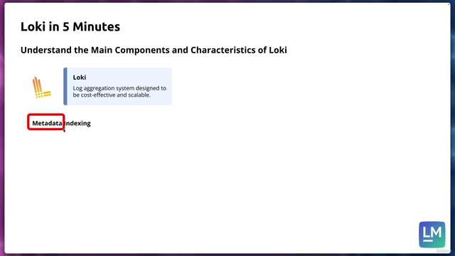
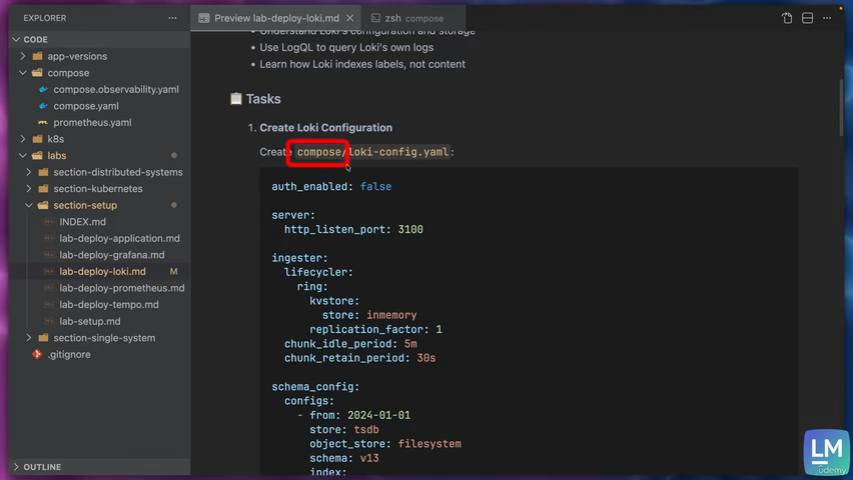
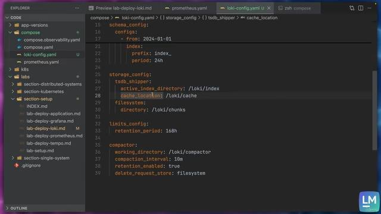
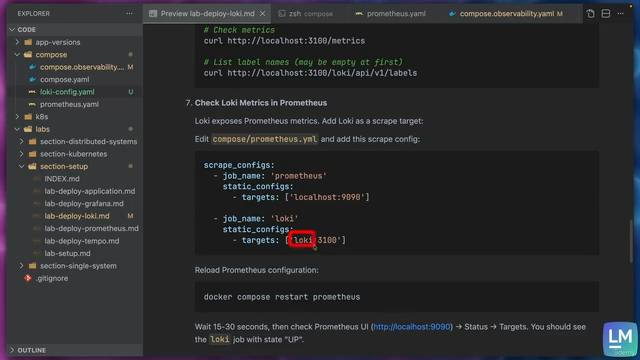
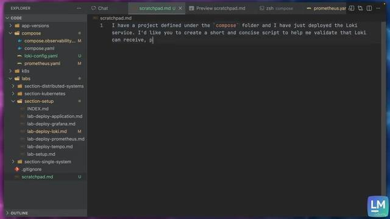
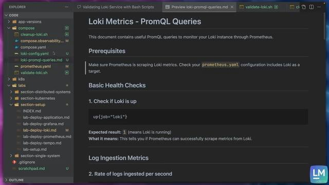
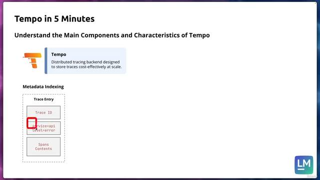

# OpenTelemetry 实战：把 Loki 接进本地可观测性栈（P24–P30）

> 覆盖课程：BV1yKX4BmEbT 的 P24–P30。
> 这七节的主线只有一条：**讲清楚 Loki 是什么 → 在本机把它跑起来 → 让 Prometheus 抓它的指标 → 用脚本证明它真的能收日志、查日志、删日志 → 顺带用 PromQL 看一眼它健不健康 → 最后用同样的思路理解 Tempo（只讲概念，不动手）**。
> 读完之后你手上应该有一个 `docker compose up` 就能起、`curl` 就能验证、Grafana/Prometheus 里能看到 target 的日志后端。
>
> 说明：讲师授课语言是英文，本文引用原话时给的是**中文译文**，英文原句请对照逐字稿。逐字稿里被语音识别成 "lowkey" 的一律是 **Loki**，`.EMO` 一律是 **.yaml**。

---

## 1. 这一节做什么

在整套 OpenTelemetry 可观测性体系里，三种信号各有各的后端：

| 信号 | 采集侧 | 后端 | 查询语言 |
|---|---|---|---|
| Metrics | OTel SDK / Prometheus 抓取 | Prometheus | PromQL |
| Logs | OTel SDK（往应用日志里注入 trace ID） | **Loki** | LogQL |
| Traces | OTel SDK（负责 context propagation） | **Tempo** | TraceQL |

P24–P30 这一段的落点是**第二行**：把 Loki 从"一个概念"变成"本机 3100 端口上一个跑着的容器"，并且让它进入 Prometheus 的监控视野。Tempo（P30）在这一段里只有概念介绍，没有实验，所以本文把 Tempo 的处理放在概念对齐和查询语法理解上，不硬编造部署步骤。

具体到可验收的产物，这一段结束时你会有：

1. 一个 `compose/loki-config.yaml` —— Loki 的单机（single binary）配置，关掉鉴权、监听 3100、单副本、tsdb + schema v13、compactor 每 10 分钟检查一次保留期。
2. 在 `compose/compose.observability.yaml` 里多出来的 `loki` service，以及配套的 `loki_data` / `loki_wal` 两个 volume。
3. `prometheus.yaml` 里多出来的 `job_name: loki` 抓取任务，Prometheus 的 Targets 页面能看到 Loki 是 UP。
4. `validate-loki.sh` 和 `cleanup-loki.sh` 两个脚本：前者往 Loki 推一条日志、再用 range query 查回来；后者调删除 API 清掉测试数据。
5. 几条能在 Prometheus 表达式浏览器里直接跑的 PromQL，用来确认"Loki 活着""Loki 在收日志"。

**为什么这件事值得单独做一遍**：Loki 的设计哲学和 Elasticsearch 那种"全文索引"完全相反——它**只索引时间戳和标签（label 键值对）**，日志正文压缩后塞进 chunk，走的是对象存储/文件系统，不做倒排索引。这带来两个直接后果，会贯穿后面的所有操作：

- 查询必须**先用标签把范围收窄**，再用 `|=` / `| json` 这类管道去过滤正文。标签选得烂，查询就会变成全量扫描。
- 删除/保留（retention）不是实时的，是 compactor 周期性跑的，所以你删完数据不会立刻消失。

这两点在后文的"复现检查清单"和"你会撞上的坑"里都会再出现。



---

## 2. 讲师原话

按主题摘录，每条都标了出处，方便你回看原片。

**关于 Loki 的本质（为什么它便宜）**

> "Loki 是一个为成本效益和可扩展性而设计的日志聚合系统。它和其他日志/可观测性后端的做法有点不同，因为它**只索引元数据，而不是你日志里的每一个词**。"
> —— p024 [00:00]

> "一条日志条目会有时间戳，会有一组键值对，这些是标签和它们的值，然后是真正的日志内容。Loki 在这里**只索引时间戳和这组标签**，日志内容只是以 chunk 的形式存在一个**非索引**的数据库里。"
> —— p024 [00:29]

**关于 LogQL**

> "这就是 LogQL，基本上是日志数据的查询语言，灵感来自 PromQL，所以你会看到相似之处。它把**标签选择、日志流过滤和解析**结合在一起。"
> —— p024 [00:59]

> "比如说给我 `job=frontend` 的所有日志，然后管道接一个过滤器，只选包含 `error` 关键字的日志，这里必须是精确匹配，然后再接一个过滤器去找 `timeout` 或者 `failed`。要提醒一点，这个可能不够健壮，因为它是**大小写敏感**的。"
> —— p024 [01:35]

> "我们也有解析器，可以用来从日志里抽取结构化数据。所以如果你还没在用结构化日志，你应该用起来，因为那样你就能很轻松地写出这样的管道：拿到 `job=frontend` 的所有日志，抽取这条日志的所有 JSON 属性，然后过滤出那些状态码大于等于 500 的。你也可以在 `json` 这个操作之前再加别的过滤器，因为在几百万几千万行日志上跑 JSON 操作可能是相当昂贵的。"
> —— p024 [02:05]

**关于 Loki 在体系里的位置**

> "OpenTelemetry SDK 会把 trace ID 注入到我们的应用日志里，这些日志会被发送到 OpenTelemetry Collector，再由它转发到 Loki 后端。然后和 Prometheus 类似，**Loki 会成为一个可以被 Grafana 查询的数据源**。"
> —— p024 [03:43]

**关于配置里的几个决定**

> "我们会为本地用途**关闭鉴权**，我们不想操心去配置它。我就在这里说，监听 3100 端口。然后我们会有 ingester，这其实是系统里**接收新日志**的那部分，它也会决定把这些日志存在哪里。所以这里我们设置的就是存储，以及备份或者说**复制因子，我们设成 1**，这基本上意味着没有备份。"
> —— p025 [00:29]

> "然后我们设置配置的 schema，用来存储日志，这里就是用一个时间序列数据库，内部 schema 版本 **13**。"
> —— p025 [01:20]

> "我们还有 compactor。compactor 负责——等等——**压缩**信息，这样它就不会占用本来会占用的那么多存储。它做的事是**每 10 分钟检查一次**某条日志是不是超过了保留期，然后删掉那些不该再保留的日志。"
> —— p025 [01:49]

> "现在更新我们的 `compose.observability.yaml`。**注意不要在顶层重复添加 services 这个键**。"
> —— p025 [02:19]

**关于挂载和启动**

> "我们这里会有一个 bind mount，从我们的 Loki 配置——就是这个文件——挂载到 Loki 里面去。有一个小改动，我注意到这里不一致：这个应该叫 `loki-config`，或者这个文件应该就叫 `loki.yaml`。你想怎么改都行，**只要保证 bind mount 左边、也就是你本地目录的路径，和你配置文件的路径完全一致**。"
> —— p026 [01:27]

> "然后我们有两个 volume 用来存 Loki 的数据和**预写日志（write ahead logs）**。我们把 3100 端口绑定到本机。然后我们把 Loki 也接到 observability 这个网络上。"
> —— p026 [01:55]

> "我相信我们是以**单二进制模式（single binary mode）**把 Loki 启动起来了。"
> —— p026 [02:40]

**关于验证**

> "我们可以通过向 `/ready` 端点发一个 curl 命令来确认 Loki 起来了……Loki 有很多组件需要启动，所以如果你发请求得到某个东西还没 ready，它会等几秒，**这是完全正常的**，给它几秒钟，最终你应该会看到 ready 的响应回来。"
> —— p026 [03:40]

> "我们也可以确认这里有暴露出来的 metrics……你能看到 Loki 的所有不同组件：**Compactor、Distributor、Ingester 和 Scheduler**，我们还能拿到一堆别的指标。"
> —— p026 [04:39]

> "因为 Loki 和 Prometheus 都在同一个网络上，我们可以在 Docker compose 里**用服务名来引用 Loki**。"
> —— p027 [00:00]

**关于用 AI 写验证脚本**

> "我希望你创建一个简短精炼的脚本，帮我验证 Loki 能接收、处理和存储日志数据……脚本应该用 curl 或者我系统里可用的等价工具，**避免去检查 Loki 的内部细节**。"
> —— p028 [01:14]

> "日志数据成功发送了，但我们在这里得到一个错误：`invalid numeric literal at line 1 column 4`。**这是意料之中的**，我不指望 AI 第一次就能弄对。"
> —— p028 [05:44]

> "它会检查 Loki 实际返回什么，我们得到的是："**log queries 不支持作为 instant query 类型，将你的查询改为 range query 类型**。""
> —— p028 [06:43]

> "我们确实拿到了查询结果，有 success 状态，这些是数据流，我们能看到有个 `job=test-app` 和 `service_name=test-app`……我们确实能发送某条日志，并且真的从 Loki 把数据取回来。"
> —— p028 [07:28]

> "这里有个警告说**有些日志可能还存在，压缩会周期性运行**，删除可能需要几分钟。我怀疑这跟 compactor 的配置有关，因为它每 10 分钟才跑一次。"
> —— p028 [07:51]

**关于 PromQL 的细节**

> "`up` 查询，如果目标可达，值就是 1；如果不可达，值就是 0。"
> —— p029 [00:29]

> "这是一个**计数器**，意思是这个指标只会增长，永远不会下降，所以我们会看到 1、2、10、30 这样。如果我们在外面套 `rate`，它做的就是把这个接收总量的**变化**在过去一段时间里做平均。"
> —— p029 [02:56]

> "这是我唯一想强调的：这里是**正则表达式**的用法，你用等号加波浪线 `=~`，然后传一个正则进去，而不是硬编码的字符串。"
> —— p029 [04:07]

**关于 Tempo 与 TraceQL**

> "Tempo 是一个分布式追踪后端，为在大规模下低成本地存储 trace 而设计。Loki 里那种元数据索引，在 Tempo 里也是类似的。Tempo 会有 trace ID，会有一组标签，以及 span 的内容。Tempo 做的就是**把 trace ID 和标签索引到一个极小的索引里**……然后把 **span 内容压缩**后存在另一个数据库里。"
> —— p030 [00:00]

> "TraceQL 是分布式追踪的查询语言，让你**按属性搜索 span**，也能**分析 trace 的结构**……我们还可以按 trace 的时长过滤……更准确地说这不是 trace 的时长，这实际上是 **span 的时长**。"
> —— p030 [01:02]

> "我们也有**结构查询**，用来刻画父子关系。记住一条 trace 是一组 span，我们可能有父 span 和子 span……我们也可以在这里做聚合，比如按 `resource.service.name` 统计状态为 error 的 span 数量。"
> —— p030 [01:53]

> "OpenTelemetry SDK 负责 **context propagation**。什么是上下文传播？有时候操作会跑到单个应用的上下文之外，我们就需要把 trace ID 传播出去，保证不同系统里发生的所有操作能通过一个**稳定的 trace ID** 连起来。"
> —— p030 [02:23]

---

## 3. 从零复现

这一章是"照着敲"的部分。默认你已经在 P1–P23 里把 Prometheus 那套跑起来了（`compose/compose.observability.yaml` 存在、`prometheus.yaml` 存在、`observability` 网络存在）。如果还没跑起来，先回去把 Prometheus 的 lab 做完再来，下面假设这两个文件已经在了。

### 3.0 目录结构（先对齐，后面所有路径都相对项目根）

```
project-root/
├── compose.yaml                          # 根 compose（已有，课里说要"更新"它）
└── compose/
    ├── compose.observability.yaml        # 本次要扩展：加 loki service
    ├── prometheus.yaml                   # 本次要扩展：加 loki 抓取任务
    ├── loki-config.yaml                  # 本次新建
    ├── validate-loki.sh                  # 本次新建（可由 AI 生成）
    └── cleanup-loki.sh                   # 本次新建（可由 AI 生成）
```

课里明确说的两件事：

- `loki-config.yaml` 建在 **compose 文件夹里**（p026 [00:00]：「在 compose 文件夹里，我要创建一个新的 yaml 文件，就是 `loki-config.yaml`」）。
- 所有 `docker compose` 命令都在 **compose 目录下执行**（p026 [02:25]：「让我们来到 compose 文件所在的目录，运行 `docker compose up`」）。

> 注意 bind mount 的坑：`./loki-config.yaml` 这个相对路径是**相对于 compose 文件所在目录**解析的，不是相对于你执行命令的目录。所以要么保证你在 `compose/` 里执行，要么写成绝对路径。讲师专门提醒过这一点（p026 [01:27]）。

### 3.1 第一步：写 `loki-config.yaml`

新建 `compose/loki-config.yaml`，内容见第 4 章代码块 4.1，**整份照抄**。

这一份配置里，哪些是讲师讲过的、哪些是让它能跑起来必须补的，我在第 5 章逐行说明，这里先记住四个关键点：

- `auth_enabled: false` —— 本地不折腾鉴权。
- `server.http_listen_port: 3100` —— 后面所有 curl、Prometheus 抓取都打这个端口。
- `common.replication_factor: 1` —— 单副本，没有备份，适合本地，不适合生产。
- `schema_config.configs[0]` 用 `store: tsdb` + `schema: v13`。



### 3.2 第二步：把 `loki` service 加进 `compose.observability.yaml`

打开 `compose/compose.observability.yaml`。**注意**：文件里已经有一个顶层的 `services:` 键了（Prometheus 在里面），你只需要在它下面**追加** `loki:` 这一段，不要再来一个 `services:`。

同时在这个文件的顶层 `volumes:` 下加两个卷名：`loki_data` 和 `loki_wal`。

完整文件见代码块 4.2（我把 Prometheus 那段也一起给全了，方便你对照；如果你已有的 Prometheus 段落和我给的不完全一样，**保留你自己的，只把 `loki:` 段贴进去**）。



### 3.3 第三步：启动

在 `compose/` 目录下：

```bash
cd compose
docker compose up -d
```

讲师在这里的两个经验：

- 他说 `docker compose up` 本身是幂等的（会补起新实例、不用先 down），但他建议**保险起见先 `docker compose down`**。
- 他第一次是**前台**跑的，然后要停掉重来，因为前台模式 `Ctrl+C` 会把容器一起带走（p026 [02:40]：「让我把这个停掉，我觉得这会把 Loki 容器停掉，所以我们应该用 detached 模式跑 compose up」）。

**如果你的 compose 文件在根目录、observability 是另一个独立文件**，那命令要改成：

```bash
docker compose -f compose.observability.yaml up -d
```

（课里没有展开讲根 `compose.yaml` 是怎么把这两个文件串起来的，只说"更新你的根 compose.yaml"；用 `-f` 或者 compose 的 include 机制都能达到同样效果，选一个能跑通的就行。）

启动后先看日志，确认是 single binary：

```bash
docker compose logs -f loki
```

你应该看到它把各个组件（distributor / ingester / querier / compactor / scheduler 等）在同一个进程里拉起来了。讲师的说法是「我相信我们是以单二进制模式把 Loki 启动起来了」。

### 3.4 第四步：验证 `/ready` 和 `/metrics`

```bash
curl -i http://localhost:3100/ready
```

期望返回 `ready`。**第一次请求大概率不是 ready**，讲师明确说过这是正常的：Loki 组件多，给它几秒钟。你可以循环等：

```bash
until curl -sf http://localhost:3100/ready | grep -q ready; do
  echo "waiting for loki..."; sleep 2
done
echo "loki is ready"
```

再确认指标端点：

```bash
curl -s http://localhost:3100/metrics | head -n 30
```

讲师在这一步的原话是「你可以看到 Loki 的所有不同组件在这里：Compactor、Distributor、Ingester 和 Scheduler，我们还能拿到一堆别的指标」。

> 关于指标名：视频里讲师念的和屏幕上滚动的不一定完全一致，**具体字段名请以你 `/metrics` 的实际输出为准**，不要照抄我这边的字符串去 grep。

### 3.5 第五步：让 Prometheus 抓 Loki

编辑 `compose/prometheus.yaml`，在 `scrape_configs:` 下追加一个 job：

```yaml
  - job_name: loki
    static_configs:
      - targets: ['loki:3100']
```

为什么这里写 `loki:3100` 而不是 `localhost:3100`？因为 **Prometheus 自己在容器里**，容器里的 `localhost` 是它自己。两个容器在同一个 `observability` 网络里，Docker 内置 DNS 会把服务名 `loki` 解析成容器 IP。这正是讲师那句「因为它们都在同一个网络上，我们可以在 Docker compose 里用服务名引用 Loki」。

改完重启（只重启 Prometheus 就够，不用动 Loki）：

```bash
docker compose restart prometheus
```

然后打开 `http://localhost:9090/targets`，找到 `loki` 这个 job，等它变 UP。讲师提到 Prometheus 自身那条 target 可能会慢一点出现，因为 Prometheus 自己要先起来才能把自己注册成 target。

再到 `http://localhost:9090/graph`，输入 `up{job="loki"}`，应该返回 `1`。



### 3.6 第六步：验证 Loki 真的能收日志（`validate-loki.sh`）

这一步讲师的做法很值得学：他没有手写脚本，而是**让 AI 生成，然后自己审、自己跑、自己把报错贴回去迭代**。

他给 agent 的指令（p028 [01:14] 起）大意是：

- 我在 compose 目录下有个项目，刚刚部署了 Loki 服务。
- 请创建一个简短精炼的脚本，帮我验证 Loki 能接收、处理、存储日志数据。
- 脚本应该用 curl 或系统里可用的等价工具，**不要去看 Loki 的内部细节**（不要 SSH 进容器、不要在容器里跑命令），把 Loki 当黑盒。
- 我跑在 Mac 上（**这条很重要，会影响生成出来的脚本**；Windows 上 Bash 就不合适了）。
- 产出：一个 bash 脚本负责发送日志并确认它们被存进 Loki；一个 bash 脚本负责清理数据；再加几条 PromQL 用来检查 Loki 的指标。
- 规则：简洁、不要过度工程、**按我是一个 Loki 和 Prometheus 新手来写文档和命令**。

生成的脚本思路（视频里能看到的两段）：

- `validate-loki.sh`：取到 Loki 的 URL → 设一个测试标签（`test-app`） → **POST 到 `/loki/api/v1/push`** → 再查询确认 Loki 存下来了 → 校验结果。
- `cleanup-loki.sh`：**POST 到 `/loki/api/v1/delete`**，带上要删的条件 → 等一下删除流程 → 再校验一次。

他还提到脚本依赖 `jq`，自己先 `which jq` 确认装了，没装的话 `brew install jq`。

脚本第一次跑挂了两个错，**这两个错你在复现时几乎一定会遇到**：

1. `invalid numeric literal at line 1 column 4` —— 典型原因是把 push 的成功响应（HTTP 204，空 body）当成 JSON 丢给 `jq` 了。
2. `log queries not supported as an instant query type, change your query to range query type` —— Loki 的日志查询**不能用 instant query**，必须用 `query_range`。

第 4 章给出的两个脚本是**已经修好这两处**的版本，可以直接跑。脚本内容跟视频里 AI 最终产出的不完全一致（你的 agent 生成什么取决于你怎么问），但接口调用方式和验证逻辑是对齐的。



### 3.7 第七步：清理（`cleanup-loki.sh`）

```bash
./cleanup-loki.sh
```

跑完你会看到一条警告，大意是「部分日志可能仍然存在，compaction 会周期性运行，删除可能需要几分钟」。讲师当场把这条警告和 `compactor` 配置对上了：「我怀疑这跟 compactor 的配置有关，因为它每 10 分钟才跑一次」。

**所以不要删完立刻去查、查不到就以为没删掉。** 这是设计如此，不是 bug。讲师自己也说他不打算等满 10 分钟。

### 3.8 第八步：用 PromQL 看 Loki 健不健康

打开 `http://localhost:9090/graph`，依次验证：

```promql
# 1) 目标是否可达：1 = UP，0 = DOWN
up{job="loki"}

# 2) Loki 收到过多少行日志（计数器，只增不减）
loki_distributor_lines_received_total

# 3) 过去 5 分钟的接收速率
rate(loki_distributor_lines_received_total[5m])

# 4) 正则匹配标签（=~），一次看多个 job
up{job=~"loki|prometheus"}
```

两个讲解要点：

- `loki_distributor_lines_received_total` 是**计数器**。讲师演示时它从 1 涨到 2，是因为他把验证脚本跑了两遍。套上 `rate(...[5m])` 得到的是**每分钟/每秒的平均变化**，量级会变得很小（他演示时出现过 `0.0008` 这种数），把区间从 20 分钟改成 10 分钟，数值大致翻倍——因为分母砍半了。
- 默认抓取间隔是 15 秒。讲师在 `query_range` 的结果里看到 step 大概 15 秒，由此确认「我们每 15 秒抓一次目标」。



> 指标名提醒：视频里讲师是边念边在 UI 里补全的，`loki_distributor_lines_received_total` 这个名字**请以你 `/metrics` 输出和 Prometheus 补全列表为准**；如果你的 Loki 版本指标名不同，按实际改。同理，AI 生成的 PromQL 文档里出现的指标集合也会跟你自己生成的不一样，讲师也说了「这完全没问题」。

### 3.9 第九步：Tempo 这一段怎么"复现"

P30 是纯概念课，**没有实验、没有部署、没有配置文件**。所以这一段不需要你敲任何命令。你唯一要做的是把三个概念对应到你已有的东西上：

1. **索引策略同构**：Loki 索引 `时间戳 + 标签`，Tempo 索引 `trace ID + 标签`，正文/span 内容都压缩存到另一个库里。
2. **查询语言同构**：LogQL 用 `{}` 选标签、用 `|` 做管道；TraceQL 同样用 `{}` 选属性、用 `&&` 组合条件，另外多了**结构查询**（父子 span 关系）和**按 span duration 过滤**。讲师原话强调过一次：那个 100ms 说的是 **span 的时长，不是整条 trace 的时长**。
3. **位置同构**：SDK 注入/传播 → Collector 转发 → 后端存储 → Grafana 查询。Tempo 就是把 Loki 那个位置换成 trace 后端。

TraceQL 的**具体语法讲师只在口头上描述了语义**（按属性过滤、按时长过滤、父子结构查询、按 `resource.service.name` 分组计数），没有逐字给出可运行的完整查询。你如果要在后面真正接上 Tempo，请以 Tempo 官方 TraceQL 文档为准，不要把我下面这种"示意写法"当成课里讲过的内容。



---

## 4. 完整代码

以下文件都可以直接保存运行。**标注了"补全"的部分是讲师没有逐字展示、为了让文件能跑起来而按官方最小示例补齐的**，其余按逐字稿描述写。

### 4.1 `compose/loki-config.yaml`

```yaml
# compose/loki-config.yaml
# Loki 单机（single binary）配置，用于本地开发/学习。

# 本地环境不折腾鉴权（p025 [00:29]）
auth_enabled: false

server:
  # 所有 curl / Prometheus 抓取都打这个端口（p025 [00:59]）
  http_listen_port: 3100
  grpc_listen_port: 9096
  log_level: info

common:
  instance_addr: 127.0.0.1
  path_prefix: /loki
  storage:
    filesystem:
      chunks_directory: /loki/chunks
      rules_directory: /loki/rules
  # 复制因子 1 = 没有备份，仅本地可用（p025 [01:20]）
  replication_factor: 1
  ring:
    kvstore:
      store: inmemory

# schema 版本 13，底层用 tsdb（p025 [01:20]）
schema_config:
  configs:
    - from: 2020-10-24
      store: tsdb
      object_store: filesystem
      schema: v13
      index:
        prefix: index_
        period: 24h

# 存储配置：tsdb 索引 + 本地文件系统 chunk
storage_config:
  tsdb_shipper:
    active_index_directory: /loki/tsdb-index
    cache_location: /loki/tsdb-cache
  filesystem:
    directory: /loki/chunks

# ingester 接收新日志；WAL 目录对应 compose 里的 loki_wal 卷（p025 [00:59]、p026 [01:55]）
ingester:
  chunk_idle_period: 5m
  chunk_retain_period: 30s
  wal:
    enabled: true
    dir: /loki/wal

# compactor：每 10 分钟检查一次保留期并删除过期日志（p025 [01:49]）
compactor:
  working_directory: /loki/compactor
  compaction_interval: 10m
  retention_enabled: true
  retention_delete_delay: 2h
  retention_delete_worker_count: 150
  # Loki 3.x 起要求显式指定删除请求的存储后端；
  # 若你用 3.x 且报缺少该字段，就取消下面这行的注释。
  # delete_request_store: filesystem

# 保留期。没有这一段，retention_enabled 不会真的删东西。
limits_config:
  retention_period: 24h
  reject_old_samples: true
  reject_old_samples_max_age: 168h
```

### 4.2 `compose/compose.observability.yaml`

```yaml
# compose/compose.observability.yaml
# 注意：services / volumes / networks 三个顶层键各只出现一次。

services:
  prometheus:
    image: prom/prometheus:latest
    container_name: prometheus
    command:
      - --config.file=/etc/prometheus/prometheus.yaml
      - --storage.tsdb.path=/prometheus
    ports:
      - "9090:9090"
    volumes:
      - ./prometheus.yaml:/etc/prometheus/prometheus.yaml
      - prometheus_data:/prometheus
    networks:
      - observability

  loki:
    # 版本 tag 请与课程 lab 里的 compose 文件保持一致（p026 [00:53] 讲师强调过"用一模一样的 tag"）
    image: grafana/loki:2.9.6
    container_name: loki
    command: -config.file=/etc/loki/loki.yaml
    ports:
      # 把容器 3100 绑到本机 3100（p026 [01:55]）
      - "3100:3100"
    volumes:
      # bind mount：左边必须和你的配置文件路径完全一致（p026 [01:27]）
      - ./loki-config.yaml:/etc/loki/loki.yaml
      # 数据卷 + 预写日志卷（p026 [01:55]）
      - loki_data:/loki
      - loki_wal:/loki/wal
    networks:
      - observability

volumes:
  prometheus_data:
  loki_data:
  loki_wal:

networks:
  observability:
    driver: bridge
```

> 说明：`prometheus` 这一段是 P1–P23 已有的，我按可运行的最小形态补全；`loki` 这一段按 p026 的逐字讲解写。两者都必须挂在同一个 `observability` 网络上，否则 `loki:3100` 解析不到。

### 4.3 `compose/prometheus.yaml`

```yaml
# compose/prometheus.yaml
global:
  scrape_interval: 15s
  evaluation_interval: 15s

scrape_configs:
  - job_name: prometheus
    static_configs:
      - targets: ['localhost:9090']

  # 新增：抓 Loki 自己的指标（p027 [00:00]）
  # 用服务名而非 localhost，因为 Prometheus 也在容器里
  - job_name: loki
    static_configs:
      - targets: ['loki:3100']
```

### 4.4 `compose/validate-loki.sh`

```bash
#!/usr/bin/env bash
# compose/validate-loki.sh
# 把 Loki 当黑盒：推一条日志进去，再用 range query 查回来。
set -euo pipefail

LOKI_URL="${LOKI_URL:-http://localhost:3100}"
JOB="test-app"
SERVICE="test-app"

need() { command -v "$1" >/dev/null 2>&1 || { echo "缺少依赖：$1"; exit 1; }; }
need curl
need jq

echo "==> 1. 等待 Loki ready"
until curl -sf "${LOKI_URL}/ready" | grep -q ready; do
  echo "    还没 ready，等 2 秒..."
  sleep 2
done
echo "    OK"

echo "==> 2. 推一条日志到 /loki/api/v1/push"
NOW_NS="$(date +%s)000000000"           # 纳秒时间戳（Loki push 要求）
PAYLOAD=$(cat <<JSON
{
  "streams": [
    {
      "stream": { "job": "${JOB}", "service_name": "${SERVICE}" },
      "values": [ ["${NOW_NS}", "hello from validate-loki.sh"] ]
    }
  ]
}
JSON
)

# push 成功返回 204 且 body 为空，所以这里不要接 jq（这就是 invalid numeric literal 的来源）
HTTP_CODE=$(curl -s -o /dev/null -w '%{http_code}' \
  -X POST "${LOKI_URL}/loki/api/v1/push" \
  -H 'Content-Type: application/json' \
  --data-raw "${PAYLOAD}")

if [ "${HTTP_CODE}" != "204" ]; then
  echo "    push 失败，HTTP ${HTTP_CODE}"; exit 1
fi
echo "    日志已发送（HTTP 204）"

echo "==> 3. 用 query_range 查回来（日志查询不能用 instant query）"
END_NS="$(( $(date +%s) + 60 ))000000000"
START_NS="$(( $(date +%s) - 300 ))000000000"

RESP=$(curl -sG "${LOKI_URL}/loki/api/v1/query_range" \
  --data-urlencode "query={job=\"${JOB}\"}" \
  --data-urlencode "start=${START_NS}" \
  --data-urlencode "end=${END_NS}" \
  --data-urlencode "limit=10")

echo "    status = $(echo "${RESP}" | jq -r '.status')"
echo "    streams = $(echo "${RESP}" | jq -r '.data.result | length')"

if echo "${RESP}" | jq -e '.data.result | length > 0' >/dev/null; then
  echo "    ✔ 已从 Loki 查回日志"
else
  echo "    ✘ 没查到日志，原始响应："
  echo "${RESP}" | jq . || echo "${RESP}"
  exit 1
fi
```

### 4.5 `compose/cleanup-loki.sh`

```bash
#!/usr/bin/env bash
# compose/cleanup-loki.sh
# 调删除 API 清掉验证数据。注意：真正生效要等 compactor 跑（默认 10 分钟）。
set -euo pipefail

LOKI_URL="${LOKI_URL:-http://localhost:3100}"
JOB="test-app"

command -v curl >/dev/null 2>&1 || { echo "缺少依赖：curl"; exit 1; }

END_S="$(date +%s)"
START_S="$(( END_S - 3600 ))"

echo "==> 请求删除 {job=\"${JOB}\"} 过去 1 小时的数据"
HTTP_CODE=$(curl -s -o /dev/null -w '%{http_code}' \
  -X POST "${LOKI_URL}/loki/api/v1/delete" \
  --data-urlencode "query={job=\"${JOB}\"}" \
  --data-urlencode "start=${START_S}" \
  --data-urlencode "end=${END_S}")

echo "    HTTP ${HTTP_CODE}"
if [ "${HTTP_CODE}" != "204" ]; then
  echo "    删除请求失败"; exit 1
fi

cat <<'TIP'

==> 删除请求已接受
    注意：Loki 的删除不是实时的。compactor 会周期性（本配置里是 10 分钟）
    处理删除请求，所以日志可能还会存在几分钟。这不是失败。
TIP
```

### 4.6 授权

```bash
chmod +x compose/validate-loki.sh compose/cleanup-loki.sh
```

---

## 5. 逐行解释

### 5.1 `loki-config.yaml`

**`auth_enabled: false`**
本地不折腾鉴权。代价是**任何能访问 3100 的人都能写日志、也能发删除请求**。所以这个配置只能跑在 localhost，绝不能原样上公网。同理你的 `ports: "3100:3100"` 也是绑到本机所有网卡，同事在同一个 WiFi 下就能访问到。

**`server.http_listen_port: 3100`**
这个数字后面出现了三次，必须一致：容器里监听 3100、compose 里 `"3100:3100"`、Prometheus 里 `targets: ['loki:3100']`、脚本里 `LOKI_URL=http://localhost:3100`。任何一处改了，另外三处都要跟着改。

**`common.replication_factor: 1`**
讲师的原话是「这基本上意味着没有备份」。分布式部署里这个值通常是 3，日志会被写到 3 个 ingester；本地单机写 3 会直接启动失败（只有一个 ingester）。**前端视角打个比方**：这就像你把一份前端产物只放在一台 CDN 节点上，机器挂了就没了，本地开发够用，线上必须多副本。

**`schema_config.configs[0]`**
- `store: tsdb` —— 用时间序列数据库做索引，比老的 `boltdb-shipper` 更省内存。
- `schema: v13` —— 讲师说的"内部 schema 版本 13"。
- `from: 2020-10-24` —— 这个日期不是"从今天开始生效"的意思，是"这条 schema 规则适用于这个时间点之后写入的数据"。**必须是一个过去的日期**，写未来日期会导致新数据找不到匹配的 schema 而写入失败。这是新手最常踩的坑之一。
- `period: 24h` —— 索引按天分片。

**`ingester.wal.enabled / dir`**
WAL = write-ahead log，预写日志。作用跟数据库的 redo log 一样：日志先落盘再返回成功，进程崩了可以重放恢复。这就是为什么 compose 里要单独给 `loki_wal` 一个卷——它跟 chunk 数据的生命周期和 IO 特征都不一样。

> 我把 `dir` 设成 `/loki/wal` 而不是 `/wal`，是为了让它落在 `path_prefix` 目录下面，避免挂载一个全新的 Docker volume 到不存在的路径时出现权限问题（镜像默认以非 root 用户跑）。你要是坚持挂到 `/wal`，记得处理目录属主。

**`compactor.compaction_interval: 10m`**
这就是清理脚本跑完之后那条警告的来源。讲师把它和警告直接对上了：「它每 10 分钟才跑一次」。**如果你希望测试时删得更快，把这个值调成 `1m` 再重启 Loki**，代价是 compaction 频率变高、IO 更密集。

**`compactor.retention_enabled: true` + `limits_config.retention_period: 24h`**
这两个必须**同时**存在才有意义。只开 `retention_enabled` 不配 `retention_period`，Loki 不知道"保留多久"，什么都不会删。这是另一个高频坑。

**`# delete_request_store: filesystem`**
注释掉的这行是版本差异：Loki

## 6. 复现检查清单

- [ ] **文件与目录**：`ls compose/loki-config.yaml compose/validate-loki.sh compose/cleanup-loki.sh`；应该看到三个文件都存在，且两个脚本有可执行权限（没有就 `chmod +x`）。
- [ ] **`loki-config.yaml` 关键字段**：用 `grep` 或打开文件检查；应该看到 `auth_enabled: false`、`http_listen_port: 3100`、`replication_factor: 1`、`schema: v13`、`compaction_interval: 10m`、`retention_period: 24h`。
- [ ] **compose 结构**：打开 `compose/compose.observability.yaml`；应该看到 `loki` 追加在已有 `services:` 下，顶层 `volumes:` 有 `loki_data`、`loki_wal`，`loki` 在 `observability` 网络，端口为 `3100:3100`，bind mount 左侧路径与实际 `loki-config.yaml` 完全一致，且没有重复顶层 `services:`。
- [ ] **启动 Loki**：在 `compose/` 下执行 `docker compose up -d`（或 `docker compose -f compose.observability.yaml up -d`）；再执行 `docker compose logs -f loki`，应该看到 distributor / ingester / querier / compactor / scheduler 等组件在同一进程里启动，即单二进制模式。
- [ ] **`/ready` 检查**：执行 `curl -i http://localhost:3100/ready`；第一次可能不是 ready，等几秒或循环重试，最终应该看到响应 body 为 `ready`。
- [ ] **`/metrics` 检查**：执行 `curl -s http://localhost:3100/metrics | head -n 30`；应该看到 Prometheus 格式的指标输出，并能看到与 Compactor、Distributor、Ingester、Scheduler 等组件相关的指标；具体指标名以实际输出为准。
- [ ] **Prometheus Targets**：打开 `http://localhost:9090/targets`；应该看到 `loki` job 为 UP；Prometheus 自身 target 可能稍晚出现，属正常。
- [ ] **`up{job="loki"}`**：在 `http://localhost:9090/graph` 执行 `up{job="loki"}`；应该返回单条结果为 `1`。再执行 `up{job=~"loki|prometheus"}`，应该看到正则匹配多个 job。
- [ ] **脚本依赖与权限**：执行 `which jq`；应该有路径输出。执行 `ls -l compose/validate-loki.sh compose/cleanup-loki.sh`；应该有可执行权限。
- [ ] **运行 `validate-loki.sh`**：在 `compose/` 下执行 `./validate-loki.sh`；应该先等待 ready，然后 push 返回 HTTP `204`，query_range 返回 `status` 为 `success`，`streams` 数大于 0，结果中能看到 `job=test-app`、`service_name=test-app`。
- [ ] **脚本不应再报两个已知错**：跑 `validate-loki.sh` 时，不应出现 `invalid numeric literal at line 1 column 4`，也不应出现 `log queries not supported as an instant query type...`；若出现，分别检查 push 204 空 body 是否误接 `jq`、查询是否用了 `query_range`。
- [ ] **运行 `cleanup-loki.sh`**：执行 `./cleanup-loki.sh`；应该看到删除请求返回 HTTP `204`，并看到“删除不是实时、compaction 周期性运行、删除可能需要几分钟”的警告。
- [ ] **删除非实时确认**：`cleanup-loki.sh` 跑完立刻再查，日志可能仍然存在；这是 compactor 每 10 分钟才跑一次导致的，不应直接判为删除失败。等 compactor 周期，或测试时把 `compaction_interval` 调短后重启。
- [ ] **PromQL 计数器**：跑两次 `validate-loki.sh` 后，在 Prometheus 查 `loki_distributor_lines_received_total`；应该看到它是只增不减的计数器。再查 `rate(loki_distributor_lines_received_total[5m])`；应该返回小数值或矩阵结果；指标名以本机 `/metrics` 和 Prometheus 补全为准。
- [ ] **抓取间隔**：在 `query_range` 结果里看 step；应该大约为 15 秒，对应默认抓取间隔 15 秒。
- [ ] **Tempo 段确认**：检查 compose 文件和运行中的服务；P30 是纯概念课，不应该出现 tempo service 或 tempo 容器。只需确认概念对齐：Loki 索引时间戳 + 标签，Tempo 索引 trace ID + 标签。

## 7. 课里没讲但你会撞上的

| 现象 | 原因 | 怎么办 |
|---|---|---|
| `docker compose up` 报 YAML 解析错误/`services` 重复，或提示 `loki_data`、`loki_wal` 未定义 | 在已有 `services` 上又复制了一个顶层 `services`，或只加了 `loki` service 没在顶层 `volumes` 加卷 | 只在已有 `services:` 下追加 `loki:`；顶层 `volumes:` 加 `loki_data`、`loki_wal`，各顶层键只出现一次。（课里讲：不要重复添加 services） |
| Loki 起不来，日志提示找不到 `/etc/loki/loki.yaml` 或配置内容不对 | bind mount 左侧 `./loki-config.yaml` 与实际文件名/路径不一致，或没在 compose 目录执行导致相对路径解析错 | 保证左侧路径与本地配置文件完全一致；在 `compose/` 下执行，或用绝对路径。（课里讲） |
| 前台 `docker compose up` 后按 Ctrl+C，Loki/Prometheus 容器被停掉 | 前台模式会把容器一起带走 | 用 `docker compose up -d`；保险起见先 `docker compose down` 再 up。（课里讲） |
| 第一次 `curl /ready` 不是 ready | Loki 组件多，启动需要几秒 | 等几秒或循环重试，最终应返回 ready；不要首次非 ready 就判失败。（课里讲） |
| Prometheus Targets 里 `loki` 不出现或 DOWN，`up{job="loki"}` 为 0 | Prometheus 与 Loki 不在同一 `observability` 网络，或 targets 写成 `localhost:3100` | 同一网络下 targets 用 `loki:3100`，改完执行 `docker compose restart prometheus`。（课里讲） |
| 改了 `prometheus.yaml` 后 Targets 没变化 | Prometheus 没重启/没重新加载配置 | 执行 `docker compose restart prometheus`，再看 Targets。（课里讲） |
| `validate-loki.sh` 报 `invalid numeric literal at line 1 column 4` | 把 push 的 HTTP 204 空 body 当 JSON 交给 `jq` | push 只检查 HTTP 204，不接 `jq`；查询响应再解析。（课里讲，文档脚本已修） |
| 查询日志报 `log queries not supported as an instant query type...` | 日志查询用了 instant query | 改用 `/loki/api/v1/query_range`，带 `start`/`end`。（课里讲，文档脚本已修） |
| `validate-loki.sh` 报缺少 jq / `jq: command not found` | 系统没装 jq | `which jq` 确认；Mac 可 `brew install jq`。（课里讲 Mac 场景） |
| 在 Windows 上直接跑生成的 Bash 脚本失败 | 脚本按 Mac Bash 生成，Windows 上 Bash 不合适；课里只提醒系统会影响脚本，具体兼容问题课里没讲，补充 | 按自己的系统重写或使用兼容 shell；具体替代写法课里没讲，补充 |
| `cleanup-loki.sh` 返回 204 后，日志仍能查到/还在 | 删除非实时，compactor 每 10 分钟才跑一次 | 等 compactor；测试可把 `compaction_interval` 调成 `1m` 后重启，调短是补充，课里没讲 |
| 用 Loki 3.x 时启动/删除相关报缺少 `delete_request_store` | Loki 3.x 要求显式指定删除请求存储后端；课程示例用 2.9.6，版本差异补充，课里没讲 | 按配置注释取消 `# delete_request_store: filesystem`，补充 |
| `docker compose up` 报端口已被占用（3100/9090） | 本机已有进程占用端口，补充，课里没讲 | 停占用进程，或改端口并把 compose、Prometheus targets、脚本 `LOKI_URL` 同步改，补充 |
| 在 `compose/` 里直接 `docker compose up` 没起 Loki/找不到服务 | 根 `compose.yaml` 未把 `compose.observability.yaml` 串起来，且命令未指定文件；课里没展开，补充 | 用 `docker compose -f compose.observability.yaml up -d`，或按已有根 compose 包含；具体包含方式课里没讲，补充 |
| PromQL 里 `loki_distributor_lines_received_total` 查不到/补全不同 | Loki 版本不同，指标名可能不同 | 以本机 `/metrics` 和 Prometheus 补全列表为准，按实际指标名改。 |
