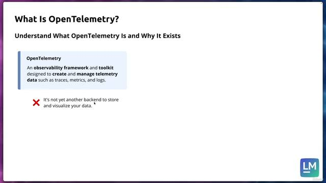
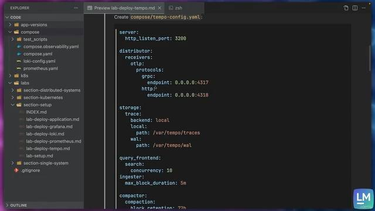
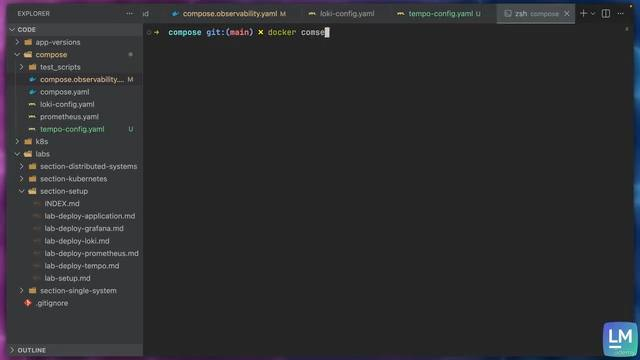
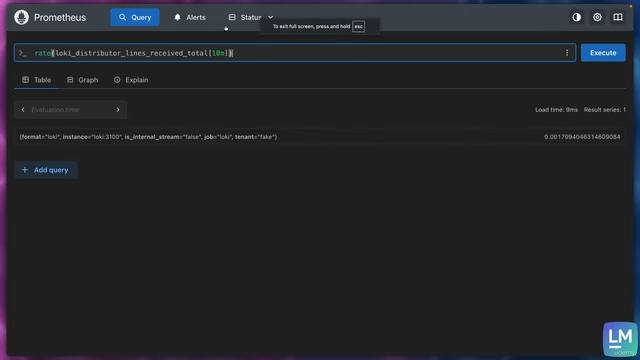
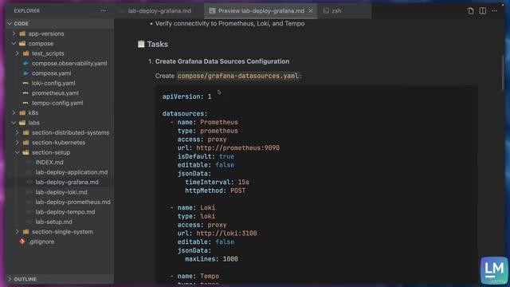
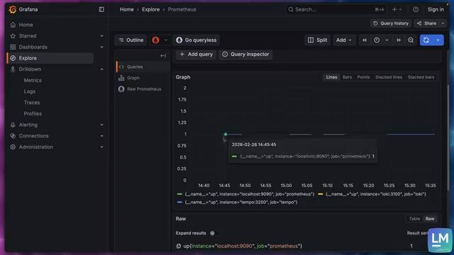
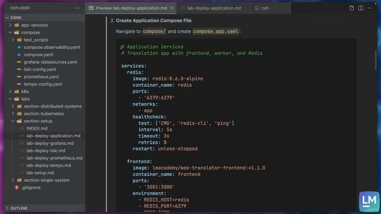
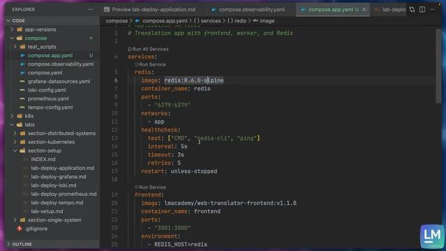
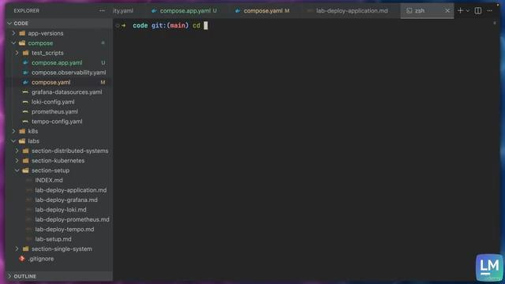
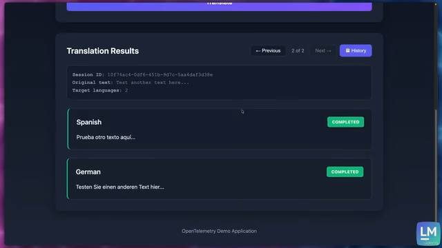

# OpenTelemetry 课程文档：从零搭建可观测性栈 + 分布式翻译应用（P31–P39）

> 课程：BV1yKX4BmEbT ｜ 覆盖 P31–P39
> 产出物：一套可直接 `docker compose up` 起来的本地栈，包含 **Tempo（链路后端）/ Loki（日志后端）/ Prometheus（指标后端）/ Grafana（查询与可视化）**，以及一个 **TypeScript 前端 + Python Worker + Redis 队列** 的分布式翻译应用。
> 读完你应该能做到：所有容器健康、Grafana 三个数据源全部 `Test` 通过、Prometheus target 页面全绿、浏览器打开 `localhost:3001` 能翻译并看到异步任务。

---

## 1. 这一节做什么

P31–P36 是「把可观测性栈和应用栈都部署起来」的实操段，P37–P39 是「讲清楚 OpenTelemetry 是什么、为什么这么设计」的理论段。两者合起来构成一个完整的起点：**先把数据的生产者和消费者都摆好，再讲数据怎么标准化**。

具体落地的四件事，按依赖顺序是：

1. **加 Tempo**。Tempo 是链路（trace）后端。这一步要在 Tempo 的配置文件里提前把 OTLP 接收端打开 —— 一个 gRPC 端点、一个 HTTP 端点。注意讲师是把接收端**提前配好**的，此时还没有应用在发数据，后面接上 OpenTelemetry Collector 之后才真正有流量进来。
2. **把 Tempo 挂进 Prometheus 的抓取列表**。Prometheus 是「拉」模型：它定期去 `/metrics` 端点抓数据，而不是等别人推给它。
3. **部署 Grafana**，用一份数据源配置文件把 Prometheus / Loki / Tempo 三个后端一次性注册进去，并关闭登录认证，方便本地开发。
4. **部署翻译应用**（`compose.app.yaml`），它跑在**独立的 app 网络**上，和可观测性网络隔离。应用本身是异步的：前端把翻译任务丢进 Redis 队列，Python Worker 捞任务、翻译、把结果写回队列，前端用 Server-Sent Events 把进度推给浏览器。

第五节会讲清楚一个后面必然要面对的架构事实：**应用网络和可观测性网络是隔离的**，所以后面上 OpenTelemetry Collector 时，Collector 必须成为这两张网之间的桥。这一步现在不做，但你现在就该知道它要来。


---

## 2. 讲师原话

先看 OpenTelemetry 到底解决什么问题。讲师用了一个很生活化的场景：过去你为某一家厂商（New Relic、Jaeger、Honeycomb、Datadog、CloudWatch、Grafana、Elastic 等）做埋点，几个月后公司要换供应商，你的代码库就要重做一遍。

> "OpenTelemetry 是一个可观测性框架和工具包，旨在创建和管理遥测数据，如 trace、metrics 和 logs。所以这并不是又一个后端。"
> —— p039 [01:29]

> "它实际上是一个标准化的、厂商中立的层，位于你的应用程序和你使用的任何后端之间。所以现在我们不需要显式地将应用程序插桩到特定的厂商或后端。"
> —— p039 [01:47]

讲师把它拆成四个组件：API、SDK、自动埋点库、Collector，其中 SDK 的职责是「批处理、采样、导出」这些脏活：

> "然后我们有实现这些 API 的 SDK，它们会处理批处理数据、采样数据和导出数据的所有复杂性。"
> —— p039 [02:11]


讲到价值时，讲师强调了三点：厂商中立（可以同时发给三家后端做评估）、行业标准化（连生成式 AI 和 AI Agent 也在用）、生态丰富（大量自动埋点库，让你只关注业务逻辑）。

> "如果你想在这里评估三个不同的后端或三个不同的追踪后端。没问题，你实际上可以同时将数据发送到所有这些后端。"
> —— p039 [03:35]



再回到实操。讲师在 P31 介绍 Tempo 配置时，明确说这一步是在**提前**给 Tempo 开 OTLP 入口：

> "我们说的是 tempo 将通过这两个端点接收来自 open telemetry 的 trace 数据，一个用于 gRPC，另一个用于 HTTP。"
> —— p031 [00:29]

> "现在我们将在课程后面部署 open telemetry collector，不会在这个初始设置期间进行，因为我们会先对应用程序进行插桩，然后再实际部署 collector。"
> —— p031 [00:29]

也就是说，顺序是：**先埋点应用 → 再把应用直连后端 → 最后才引入 Collector 优化中间链路**。这个顺序很重要，不要一上来就搭 Collector，否则你不知道 Collector 到底帮你省了什么。

P32 实操时，讲师提到一个会被很多人当成故障的现象：

> "与 Loki 类似，tempo 容器中的 ingester 启动可能需要一点时间。"
> —— p032 [01:50]

以及 Tempo 起来之后要验证的是 `3200` 端口的 `/ready`：

> "我们只需将核心请求发送到这里的 3200 端口……我们可以再发送一个请求到 ready，完美，是的。现在我们可以确认它已就绪并能够处理请求。"
> —— p032 [01:50]

P35 讲应用架构时，讲师解释了为什么用两张网络：

> "这将是 app 网络。从宏观角度来想，保持事物隔离是一个好做法，对吧？所以在 Kubernetes 中，你有多种方式可以将 pod、service 等彼此隔离。"
> —— p035 [02:35]

P36 观察日志时，讲师点出了这套应用的教学价值 —— 跨进程边界：

> "worker 和前端不直接通信。它们将通过这个红色 Q 通过消息进行通信。这就是这个设置的异步特性。"
> —— p036 [05:30]

P37 做架构鸟瞰时，讲师纠正了一个容易搞错的点 —— 指标不是被 Collector 推过去的：

> "所以 metrics 将被转发。实际上，这不完全正确。它们将被 Prometheus 抓取。所以 Prometheus 将在这里抓取 open telemetry collector 以获取 metrics。"
> —— p037 [01:31]

这句话值得记住：**traces / logs 是推的，metrics 是拉的**。

---

## 3. 从零复现

### 3.0 前置条件与目录结构

需要：Docker Engine + Docker Compose **v2.20 以上**（`include:` 顶层字段是 2.20 才稳定的，课里没提版本要求，但你会撞上，见第 7 节）。磁盘留 3GB 以上，因为 Python Worker 镜像是离线翻译库，讲师说约 500MB：

> "worker 服务的镜像相当臃肿，大约 500 兆字节。下载可能需要一点时间。"
> —— p035 [00:29]

在课程仓库的 `compose/` 目录下，最终结构是：

```
compose/
├── compose.yaml                  # 主文件：include 两个子文件 + 定义两张网络 + 命名卷
├── compose.observability.yaml    # Prometheus / Loki / Tempo / Grafana
├── compose.app.yaml              # redis / frontend / worker
├── prometheus.yml                # 抓取配置
├── loki-config.yaml              # 沿用前面 Loki 那一节的配置
├── tempo-config.yaml             # 本节点新增
├── grafana-datasources.yaml      # 本节点新增
└── test_scripts/                 # 讲师把 Loki 的测试脚本挪到了这里
```

关于最后那个目录，讲师开场专门交代了一句：

> "我确实把 low key 测试脚本移到了 compose 文件夹下的 test underscore scripts 文件夹下，只是为了不让我们这里混杂太多东西。"
> —— p032 [00:00]

如果你跟着前面的课做过，记得把 `test` 开头的脚本挪进 `test_scripts/`，否则 `compose up` 时目录会变得很乱。

### 3.1 第一步：写 `tempo-config.yaml`

讲师的操作是「新建一个文件叫 `tempo-config.yaml`，把配置粘进去」。核心是 `distributor.receivers.otlp` 这一段：

> "这里你可以看到我们正在添加一个分发配置。这已经向前迈了一步，我们在这里配置 open telemetry protocol。"
> —— p031 [00:29]



完整文件见第 4 节 4.1。要点：`server.http_listen_port: 3200`（这就是后面 curl 的端口），`distributor.receivers.otlp.protocols` 下同时开 `grpc:` 和 `http:`。

### 3.2 第二步：把 Tempo 服务加进可观测性 compose 文件

讲师强调文件名必须对上，否则 bind mount 会挂空：

> "这里的文件再次说明，不是 tempo.yaml，这实际上是 tempo-config.yaml，这样我们才能让绑定挂载正常工作。"
> —— p032 [00:46]

服务定义的字段和之前的 Loki 几乎一样（讲师原话："这里的配置，结构与 Loki 的那份非常相似"）：image、container_name、command、config 挂载、volumes、ports、observability network。**额外还要加一个 tempo 数据卷**：

> "我们还需要在 volumes 下添加 tempo 数据。"
> —— p032 [00:46]

### 3.3 第三步：启动并验证 Tempo

讲师给的流程是「先前台跑一次看日志，没问题再切后台」：

```bash
cd compose
docker compose up
```

看到 `tempo has started` 之类的日志、确认没有大错之后，`Ctrl+C`，再：

```bash
docker compose up -d
docker compose ps
```

三个容器（Prometheus / Loki / Tempo）都 Up 之后，验证 Tempo 能否处理请求：

```bash
curl -v http://localhost:3200/ready
```

第一次很可能不是你想要的返回 —— 讲师明确说了要等：

> "这需要一点时间。与 Loki 类似，tempo 容器中的 ingester 启动可能需要一点时间。"
> —— p032 [01:50]

等几分钟再打一次，直到 `/ready` 返回就绪。再打一下 metrics 端点确认 Tempo 本身能被抓：

```bash
curl -s http://localhost:3200/metrics | head -n 20
```



### 3.4 第四步：把 Tempo 加成 Prometheus 的抓取目标

在 `prometheus.yml` 的 `scrape_configs` 里加一个 job，指向 `tempo:3200`（容器名 + Tempo 的 HTTP 端口）。保存后重启 Prometheus：

```bash
docker compose restart prometheus
```

然后浏览器打开 Prometheus（默认 `localhost:9090`），进 **Status → Target health**。讲师说这里是「全部 target 应该最终变健康」，刚重启时 Grafana 那个 job 可能还在 down，刷新几次即可。



### 3.5 第五步：写 `grafana-datasources.yaml` 并加 Grafana 服务

数据源配置文件要表达三件事（讲师原文）：

> "它还将指定在哪里可以找到数据源以及该数据源是否为默认。"
> —— p033 [00:35]

即：连什么类型、URL 在哪、是否设为默认。Grafana 服务定义里有一个关键差异：

> "配置几乎相同，除了 depends on 将简单地说依赖于 Prometheus 或所有 Prometheus、Loki 和 tempo 服务。"
> —— p033 [00:41]

以及关闭认证：

> "我们将在这里看到我们会禁用身份验证，只是为了让事情更简单直接。"
> —— p033 [00:41]



同样别忘了挂载数据卷、确认文件名正确：

> "确认这里的 grafana data sources.yaml 文件名对于绑定挂载是正确的。我还将在 volumes 条目下添加 grafana 数据卷。"
> —— p034 [00:41]

启动：

```bash
cd compose
docker compose up -d
```

浏览器打开 `http://localhost:3000`，应该直接进到 Grafana，不需要登录。

### 3.6 第六步：验证数据源并顺手把 Grafana 自己抓进来

左侧 **Connections → Data Sources**，应该看到 Prometheus、Loki、Tempo 三个。逐个滚到底部点 **Test**，都要显示连接成功。

讲师在这里做了一件 lab 里没要求、但很有价值的事 —— 发现 `up` 指标里没有 Grafana：

> "我们在这里没有看到的一件事实际上是 Grafana 作业。所以我们实际上也可以将其添加到 Prometheus 配置中。我知道我在实验中没有提到这一点，但我们仍然可以抓取 Grafana 服务。"
> —— p034 [02:34]

于是往 `prometheus.yml` 再加一个 `job_name: grafana`，target 是 `grafana:3000`，然后：

```bash
docker compose up -d
docker compose restart prometheus
```

回 Grafana 的 Explore 重跑 `up`，这次应该能看到四条序列（Prometheus / Loki / Tempo / Grafana 各自一条）。



### 3.7 第七步：写 `compose.app.yaml` 并挂进主文件

应用侧三个服务：`redis`（直接跑官方镜像，不加料）、`frontend`、`worker`。讲师特别强调版本号：

> "重要的是我们在这里使用相同的标签。所以我将从版本 1.1.0 开始……所以确保你使用与这个实验描述中完全相同的版本。"
> —— p035 [02:05]

而且要用独立网络：

> "我还为服务使用了不同的网络。这将是 app 网络。"
> —— p035 [02:35]



然后是主文件 `compose.yaml` —— 用 `include:` 把应用文件拉进来，并在 `networks:` 里补一个 `app`：

> "我们确实需要回到我们的主 compose.yaml，让我们在这里包含我们的 compose.app.yaml 文件，并让我们也在这里创建我们的 app 网络。所以我只需复制可观测性配置，然后像这样改为 app。"
> —— p036 [01:18]



### 3.8 第八步：启动整栈并验证应用

```bash
cd compose
docker compose up
```

日志里应该依次出现：Redis 容器 healthy、frontend 起来、worker 打印 "已就绪，正在等待任务"。然后打开浏览器：

```
http://localhost:3001
```

**注意这里是 3001，不是 3000**。讲师当场纠正过这个坑：

> "那不是这里的端口 3000，那是一个小笔误，那是容器端口，这实际上应该是端口 3001。"
> —— p036 [02:07]

打开后输入一段英文，选 Spanish / French / German（只有三种语言，因为离线翻译模型是烤进镜像的），提交。你会看到任务先进入队列、几秒后逐个返回译文。



讲师解释了为什么要加人为延迟：

> "我确实测试了不添加任何人为延迟，它太快了。它立即完成。我们无法看到请求和翻译历史的这种异步特性。"
> —— p036 [03:32]

再加一条任务（只选 Spanish + German），观察前端日志里「入队」和 worker 日志里「收到 job / 用 Argos 翻译 / 发布结果」的完整往返。刷新页面历史会丢 —— 讲师自己也承认这不是生产级设计，教学取舍而已。



---

## 4. 完整代码

> **关于可信度**：逐字稿里讲师都是「把这个配置粘进去」，没有逐字念出 YAML 内容。下面文件里，**讲师明确说过的字段**（文件名、端口 3200 / 3000 / 3001、`depends_on` 三个服务、网络名、镜像 tag 1.1.0、`distributor`/OTLP 双端点、数据卷）我按原意写死；**讲师没念出的部分**（镜像仓库路径、Grafana 匿名访问的环境变量名、healthcheck 具体命令、数据源 URL 形式）我按各项目的官方默认写法补齐，并在注释里标了 `# 课里未念出`。镜像名这种绝对没法猜的，用 `<...>` 占位，必须从课程 lab 文件替换 —— **不要自己随便填，会拉不到镜像**。

### 4.1 `compose/tempo-config.yaml`

```yaml
# Tempo 单机配置
# 讲师在 p031[00:29] 明确说明：这里配置的是 OTLP 接收端，
# 一个给 gRPC、一个给 HTTP，让 Tempo 能接收任何走 OTLP 协议的服务发来的 trace。
server:
  http_listen_port: 3200     # p032[01:50] 讲师 curl 验证 /ready 用的就是这个端口

distributor:
  receivers:
    otlp:
      protocols:
        grpc:                # OTLP gRPC 端点（默认 4317，课里未念出端口号）
        http:                # OTLP HTTP 端点（默认 4318，课里未念出端口号）

# 以下存储段是 Tempo 单机模式跑起来的最小必需项，课里未逐行讲解
storage:
  trace:
    backend: local
    local:
      path: /var/tempo/traces   # 对应 compose 里挂的 tempo-data 卷
    wal:
      path: /var/tempo/wal

compactor:
  compaction:
    block_retention: 24h
```

### 4.2 `compose/compose.observability.yaml`

```yaml
# 可观测性栈：Prometheus / Loki / Tempo / Grafana
# 文件名课里只说是「observability compose file」，此处取名 compose.observability.yaml
services:

  prometheus:
    image: prom/prometheus        # 版本 tag 以课程 lab 文件为准
    container_name: prometheus
    command:
      - --config.file=/etc/prometheus/prometheus.yml
      - --web.enable-lifecycle     # 允许热重载，方便反复调 scrape 配置
    volumes:
      - ./prometheus.yml:/etc/prometheus/prometheus.yml
    ports:
      - "9090:9090"
    networks:
      - observability

  loki:
    image: grafana/loki           # 沿用前面 Loki 那一节的配置
    container_name: loki
    command: -config.file=/etc/loki/loki-config.yaml
    volumes:
      - ./loki-config.yaml:/etc/loki/loki-config.yaml
    ports:
      - "3100:3100"
    networks:
      - observability

  tempo:
    image: grafana/tempo          # 版本 tag 以课程 lab 文件为准
    container_name: tempo
    command: -config.file=/etc/tempo.yaml
    volumes:
      # p032[00:46] 讲师强调必须是 tempo-config.yaml，写错文件名 bind mount 会挂空
      - ./tempo-config.yaml:/etc/tempo.yaml
      - tempo-data:/var/tempo
    ports:
      - "3200:3200"               # Tempo HTTP：/ready 与 /metrics
      - "4317:4317"               # OTLP gRPC（课里未念出端口号，为 OTLP 默认值）
      - "4318:4318"               # OTLP HTTP（同上）
    networks:
      - observability

  grafana:
    image: grafana/grafana        # 版本 tag 以课程 lab 文件为准
    container_name: grafana
    depends_on:                   # p033[00:41] 讲师明确说要依赖这三个
      - prometheus
      - loki
      - tempo
    environment:
      # p033[00:41]「we will disable authentication」——具体变量名课里未念出，
      # 以下是 Grafana 官方关闭匿名/登录表单的标准写法
      - GF_AUTH_ANONYMOUS_ENABLED=true
      - GF_AUTH_ANONYMOUS_ORG_ROLE=Admin
      - GF_AUTH_DISABLE_LOGIN_FORM=true
    volumes:
      - ./grafana-datasources.yaml:/etc/grafana/provisioning/datasources/grafana-datasources.yaml
      - grafana-data:/var/lib/grafana    # p034[00:41] 讲师要求加 grafana 数据卷
    ports:
      - "3000:3000"
    networks:
      - observability

networks:
  observability:
    name: observability

volumes:
  tempo-data:
  grafana-data:
```

### 4.3 `compose/prometheus.yml`

```yaml
global:
  scrape_interval: 15s

scrape_configs:

  # 抓自己
  - job_name: prometheus
    static_configs:
      - targets: ["localhost:9090"]

  # 前面 Loki 那一节加过的 job（端口以你之前的 loki-config.yaml 为准）
  - job_name: loki
    static_configs:
      - targets: ["loki:3100"]

  # p032[02:20] 本节新增：把 Tempo 作为抓取目标
  - job_name: tempo
    static_configs:
      - targets: ["tempo:3200"]

  # p034[02:34] 讲师临时补充：把 Grafana 自己也抓进来
  - job_name: grafana
    static_configs:
      - targets: ["grafana:3000"]
```

### 4.4 `compose/grafana-datasources.yaml`

```yaml
# Grafana 数据源自动装配
# p033[00:35] 讲师说明该文件要表达三件事：
#   1) 连哪三个数据源  2) 数据源地址在哪  3) 哪个是默认
# 具体键名课里未逐字念出，以下为 Grafana provisioning 的标准 schema
apiVersion: 1

datasources:
  - name: Prometheus
    type: prometheus
    access: proxy
    url: http://prometheus:9090
    isDefault: true              # 指标作为默认数据源

  - name: Loki
    type: loki
    access: proxy
    url: http://loki:3100

  - name: Tempo
    type: tempo
    access: proxy
    url: http://tempo:3200
```

### 4.5 `compose/compose.app.yaml`

```yaml
# 翻译应用栈：redis / frontend / worker
# p035[02:05] 讲师强调版本 tag 必须与 lab 描述一致，这里统一 1.1.0
services:

  redis:
    image: redis                  # p036[00:49] 讲师说就是「plain image」，没加任何东西
    container_name: redis
    healthcheck:                  # p036[01:47] 日志里出现「Redis 容器 healthy」，说明配了健康检查
      test: ["CMD", "redis-cli", "ping"]
      interval: 5s
      timeout: 3s
      retries: 10
    networks:
      - app

  frontend:
    # 镜像仓库路径课里未念出，请从课程 lab 提供的 compose.app.yaml 复制
    image: <frontend-image>:1.1.0
    container_name: frontend
    ports:
      - "3001:3000"               # p036[02:07] 宿主 3001 → 容器 3000（讲师纠正的 typo 点）
    depends_on:
      - redis
    networks:
      - app

  worker:
    # 同上，镜像路径课里未念出
    image: <worker-image>:1.1.0
    container_name: worker
    depends_on:
      - redis
    networks:
      - app

networks:
  app:
    name: app
```

### 4.6 `compose/compose.yaml`（主文件）

```yaml
# 顶层 include：Compose 会把两个子文件的服务合并进来
# p036[01:18] 讲师的操作就是「include compose.app.yaml + 新建 app 网络」
include:
  - compose.observability.yaml
  - compose.app.yaml

networks:
  observability:
    name: observability
  app:                            # 讲师原话：copy 一份 observability 配置，改名成 app
    name: app
```

### 4.7 启动命令汇总

```bash
cd compose

# 1) 前台跑一次看日志（p032 讲师推荐的做法）
docker compose up

# 2) 确认无报错后切后台
docker compose up -d

# 3) 查看容器状态
docker compose ps

# 4) 验证 Tempo 就绪（ingester 需要等几分钟）
curl -v http://localhost:3200/ready
curl -s http://localhost:3200/metrics | head -n 20

# 5) 改了 prometheus.yml 之后只重启 Prometheus
docker compose restart prometheus

# 6) 改完镜像/服务定义后
docker compose up -d
```

---

## 5. 逐行解释

### 5.1 为什么 Tempo 要提前开 OTLP 端点

`tempo-config.yaml` 里 `distributor.receivers.otlp.protocols` 下面同时写 `grpc:` 和 `http:`，不是随手写的。讲师解释过**为什么不现在就接 Collector**：

> "我们会在实际部署 collector 之前对应用程序进行插桩。"
> —— p031 [00:29]

因为如果你先上 Collector，应用发数据失败时你分不清是「应用埋点错了」还是「Collector 配错了」。所以第一步是让应用能**直连** Tempo 并把链路打通，之后再插 Collector，出问题时边界清晰。

`http_listen_port: 3200` 这个端口同时承载 `/ready` 和 `/metrics` 两个端点，所以你能用一条 curl 验证「进程活着」，用另一条验证「能被 Prometheus 抓」。这就是为什么 P32 里讲师只打这两个 URL 就认为 Tempo 可用。

### 5.2 为什么 bind mount 的文件名必须一字不差

`- ./tempo-config.yaml:/etc/tempo.yaml` 左侧是**宿主机相对 compose 文件所在目录**的路径，右侧是容器内路径。Docker 的 bind mount 有个特性：如果左侧文件不存在，它**不会报错**，而是帮你创建一个空目录挂进去。然后容器启动时读 `/etc/tempo.yaml` 拿到一个目录，直接崩，报错信息还往往看不懂。

讲师连续两次强调文件名（"这不只是 tempo.yaml，实际上这是 tempo-config.yaml"、"confirm that the grafana data sources.yaml file name here is correct"），就是在防这个坑。**前端类比**：相当于 `import` 路径大小写写错了，Node 在某些文件系统上不报错、运行到那行才炸。

### 5.3 为什么 Prometheus 是「拉」不是「推」

讲师在 P37 特意纠正自己：

> "所以 metrics 将被转发。实际上，这不完全正确。它们将被 Prometheus 抓取。"
> —— p037 [01:31]

这个区别决定了配置形态：你不需要在 Tempo 或 Grafana 里写「往 Prometheus 发数据」，而是要在 `prometheus.yml` 里写「去哪个地址拉」。所以加一个监控目标 = 改 Prometheus 配置 + 重启 Prometheus，目标端完全不用动。这也是为什么讲师加 Grafana job 时，操作是「改 prometheus.yml → `docker compose restart prometheus`」，而不是重启 Grafana。

`job_name` 是这套抓取规则的标识，最终会以 `job="tempo"`、`job="grafana"` 这种 label 出现在指标里 —— 你在 Grafana 里查 `up` 看到四条线，就是靠 label 区分的。

### 5.4 为什么 Grafana 的 `depends_on` 要列三个

`depends_on` 只保证**启动顺序**（先起 Prometheus / Loki / Tempo，再起 Grafana），不保证被依赖的服务「已经能服务请求」。但对 Grafana 来说这通常够用，因为数据源是**查询时**才去连的，不是启动时连。真正的连接验证发生在你点 Data Sources 里的 **Test** 按钮 —— 这也正是讲师让你逐个点 Test 的原因。

**前端类比**：`depends_on` 相当于 `Promise.all` 里控制谁先 resolve，但前一个 resolve 不代表后一个的接口已经 ready。

### 5.5 为什么要关掉 Grafana 认证

`GF_AUTH_ANONYMOUS_ENABLED=true` + `GF_AUTH_ANONYMOUS_ORG_ROLE=Admin` 的效果是：任何人打开 `localhost:3000` 直接是 Admin。本地学习环境这样做很合理，省掉每次刷新都要登录的麻烦。**但这条绝对不能进生产**，因为你的 Grafana 一旦暴露在公网，等于把整个可观测性栈的查询和配置权限白送出去。

### 5.6 为什么要两张网络

`compose.app.yaml` 里三个服务全部只在 `app` 网络上，`compose.observability.yaml` 里四个服务全部只在 `observability` 网络上。结果是：**frontend 无法直接访问 tempo:3200**。

这不是 bug，是刻意设计。讲师说了理由：

> "保持事物隔离是一个好做法……在 Kubernetes 中，你有多种方式可以将 pod、service 等彼此隔离。"
> —— p035 [02:35]

这个隔离会在下一阶段成为你必须解决的问题：应用要发数据给后端，但两张网互不相通。**答案就是 OTel Collector** —— 它同时加入两张网络，成为唯一的通道。这也是 P37 架构图里 Collector 画在中间的原因。现在还没做，但你应该提前知道这个约束存在。

### 5.7 那个 `3200` 端口的 curl 到底在看什么

`curl -v http://localhost:3200/ready` 第一次很可能返回失败，原因讲师说得很直白：ingester 还在启动。Tempo 的写入路径依赖 ingester 就绪，之前 `/ready` 会主动报未就绪，这是**正确行为**而不是故障。判断标准是「等几分钟后再打一次能不能成功」，而不是「第一次就必须 200」。

### 5.8 端口 3001 与 3000 的映射

`ports: - "3001:3000"` 左边是宿主机端口、右边是容器端口。讲师的原话是「这是容器端口，宿主应该是 3001」。结果就是浏览器要输 `localhost:3001`。这里容易混是因为 Grafana 也占了宿主 3000 —— 两个服务用同一个容器内端口，靠宿主端口区分。改了映射之后别忘了 `docker compose up -d` 重建容器（`restart` 不会应用端口变更）。

### 5.9 应用为什么必须异步

讲师用日志演示了完整链路：frontend 把「翻译成 Spanish」「翻译成 German」拆成两个 job 分别入队；worker 一次捞一个，用 Argos 翻译，翻译完把结果写回队列；frontend 收到结果后用 SSE 推给浏览器。

> "作业在这里大约五秒内成功完成。然后它将结果发布到我们的队列。然后这里的前端正在接收结果。"
> —— p036 [05:00]

为什么不直接同步调用？因为一次翻译要 5 秒，多语言就是 5×N，HTTP 请求早就超时了。异步化之后前端可以**逐个**显示完成进度。

**给前端同学的对照**：
- Redis 队列 ≈ 你在 Node 里用的 BullMQ / Bull，任务进队、Worker 消费、结果回写
- SSE ≈ 浏览器端 `new EventSource('/events')`，服务端单向持续推送，比 WebSocket 轻，比轮询省
- worker 和 frontend「不直接通话」这件事，等价于你在 Node 里两个进程通过 Redis pub/sub 通信，而不是互相 `fetch`

### 5.10 为什么必须等 Redis healthy 才算起来

日志里出现「Redis 容器 healthy」说明配了 healthcheck。没有 healthcheck 的话，`depends_on` 只保证「容器进程已启动」，但 Redis 从进程起来到能接受命令之间有个窗口，frontend 在这个窗口里连过去就会报连接被拒。healthcheck + `depends_on` 才能保证「应用起来时 Redis 已经能 ping 通」。这是本地开发最常踩的启动顺序坑之一。

---

## 6. 复现检查清单

按顺序打勾，任何一项不过就停在那一项排查，别往下走。

**可观测性栈**

- [ ] `compose/tempo-config.yaml` 存在，且 `distributor.receivers.otlp.protocols` 下同时有 `grpc` 和 `http`
- [ ] `compose.observability.yaml` 里 tempo 服务的 volumes 左侧写的是 `./tempo-config.yaml`
- [ ] `docker compose ps` 里 prometheus / loki / tempo / grafana 四个容器都是 Up
- [ ] `curl http://localhost:3200/ready` 最终返回就绪（**允许等几分钟**）
- [ ] `curl http://localhost:3200/metrics` 有输出
- [ ] Prometheus 的 Target health 页面上，`tempo` job 状态为 UP
- [ ] `http://localhost:3000` 打开**不需要登录**
- [ ] Connections → Data Sources 里有 Prometheus / Loki / Tempo 三个
- [ ] 三个数据源分别点 **Test**，全部成功
- [ ] Grafana Explore 执行 `up`，能看到 prometheus / loki / tempo（以及补过 job 之后的 grafana）多条序列

**应用栈**

- [ ] `compose/compose.yaml` 的 `include:` 里同时有 observability 和 app 两个文件
- [ ] 主文件 `networks:` 下同时有 `observability` 和 `app`
- [ ] `compose.app.yaml` 里 frontend 与 worker 的 tag 都是 `1.1.0`
- [ ] frontend 的端口映射是 `3001:3000`
- [ ] `docker compose up` 日志里出现 Redis healthy → frontend 启动 → worker "已就绪，正在等待任务"
- [ ] `http://localhost:3001` 能打开翻译界面
- [ ] 输入英文、选 Spanish + German，能先出现 job 入队、几秒后返回两条译文
- [ ] frontend 日志里能看到「为每种语言分别入队」
- [ ] worker 日志里能看到收到 job → Argos 翻译 → 发布结果

**隔离性（可选但建议验证一次）**

- [ ] 进 frontend 容器 `docker compose exec frontend sh`，`curl tempo:3200/ready` 应当**失败** —— 这说明两张网确实隔离，为后面上 Collector 做准备

---

## 7. 课里没讲但你会撞上的

**1. `include:` 需要 Compose v2.20+。** 讲师直接用了 `include` 字段，没说版本要求。老版本 Compose 会报 unknown field。先 `docker compose version` 确认，低于 2.20 就升级 Docker Desktop / Compose 插件。降级方案是不用 include，把所有服务写进一个文件。

**2. 前端/worker 的镜像名必须从 lab 文件抄。** 讲师全程说的是「custom images with the application logic」，从来没念出仓库路径。这篇文档里我用 `<frontend-image>` / `<worker-image>` 占位，你如果自己乱填一个名字，`docker compose up` 会卡在 pull 阶段。这也是为什么第 3 节强调「版本 tag 必须是 1.1.0」—— 讲师专门警告过 1.0.0 已被删掉：

> "我删除了 1.0.0 标签只是为了避免任何混淆。"
> —— p035 [02:05]

**3. Worker 镜像 500MB，第一次拉会很久。** 讲师在 P35 就说了。如果卡在 pull 阶段，不是网络问题，是镜像真的大。提前 `docker compose pull` 会舒服一些。

**4. `/ready` 第一次失败是正常的。** 见 5.7。别急着重启容器，重启反而把 ingester 的启动进度清零。

**5. Grafana 的匿名访问环境变量名课里没念。** 讲师只说「disable authentication」。`GF_AUTH_ANONYMOUS_*` 是 Grafana 官方写法，但如果你的 Grafana 版本较新，行为可能有变化（比如新版本对匿名 Admin 有额外确认）。如果进不去，先 `docker compose logs grafana` 看有没有相关告警。

**6. 数据源 Test 失败，先查 URL 里的服务名。** `http://prometheus:9090`、`http://loki:3100`、`http://tempo:3200` —— 服务名必须和 compose 里的 `container_name` 或服务名一致，且 Grafana 必须和它们在**同一个 network** 上。两个网络隔离的设定在这里会咬你：如果哪天你把 Grafana 挪到 app 网络，三个数据源会全部 Test 失败。

**7. 刷新页面翻译历史就没了。** 讲师自己承认了：

> "如果你只是刷新这里的页面，那么历史记录就会消失。不是最优的，完全同意。但再次强调，简单易懂。"
> —— p036 [04:20]

因为翻译状态只存在浏览器内存里，没有落库。**不要试图把它当功能 bug 修**，这是教学取舍。

**8. 只有三种语言。** Spanish / French / German 是烤进镜像的离线模型，加语言 = 镜像体积暴涨。讲师明确说这不是生产做法：

> "这不是生产环境的最佳实践。我知道，但我们在这里是一个学习环境。"
> —— p036 [03:12]

**9. 应用网络和后端网络的隔离，下一阶段一定会挡在你面前。** 这是本文档最想让你提前知道的一条。现在应用发不出任何 telemetry 数据（因为它连不上 tempo），讲师也说了本阶段不需要发：

> "这里不会有太多 metrics……关于 logs 和 traces 的数据不多，因为我们实际上没有任何应用程序在向我们的后端发送这些数据。"
> —— p034 [04:26]

等你开始讲埋点时，解法是把 OTel Collector 同时接到两张网络上：应用 → Collector → 各后端。P37 的架构图已经画好了这个位置，P38 也预告了 Collector 会单独讲。

> "然后我们将介绍 open telemetry collector，并理解它如何融入 open telemetry 栈和我们的可观测性上下文。"
> —— p038 [00:41]

**10. 用 AI 生成测试数据这件事，讲师只是建议，没有给脚本。** P32 和 P34 都提到可以让 AI 帮忙造 trace 数据和 PromQL 查询，但**课里没有提供任何现成脚本**。如果你想让 Grafana 面板不那么空，这部分要自己写。

**11. Tempo 的数据卷和 Grafana 的数据卷在本文档里是命名卷（named volume）。** 讲师说「add the tempo data under the volumes here」，但没说用 bind mount 还是 named volume。用 named volume 的好处是 `docker compose down` 不会丢数据，坏处是你没法直接用编辑器翻文件。想清空重来就 `docker compose down -v`（小心，会连 Grafana 的仪表盘一起删）。