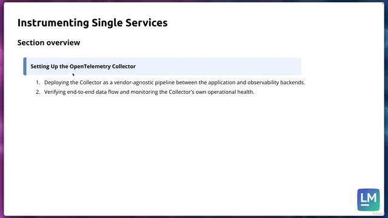
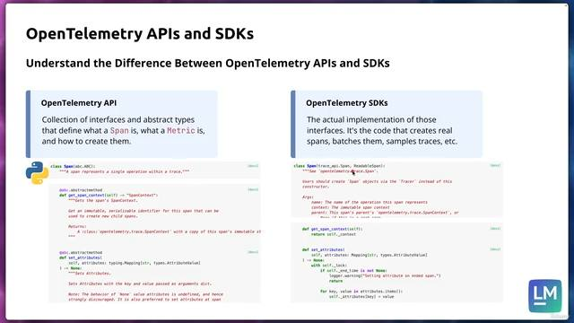
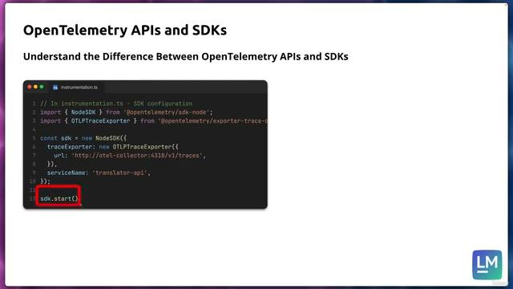
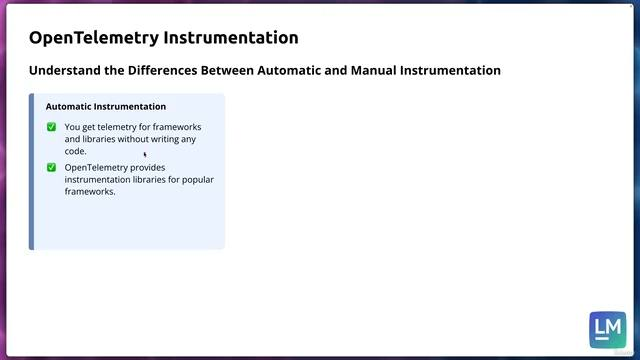
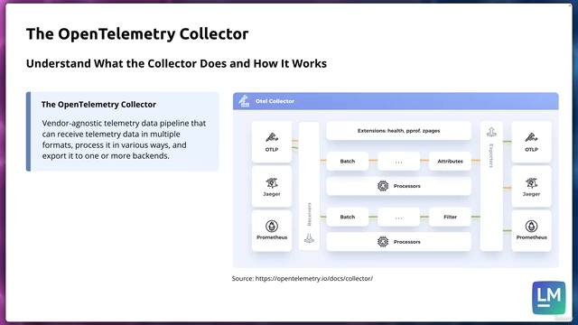
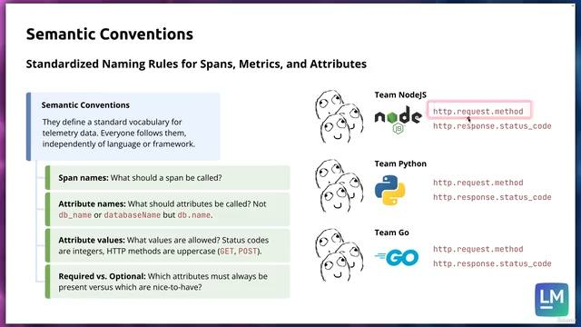
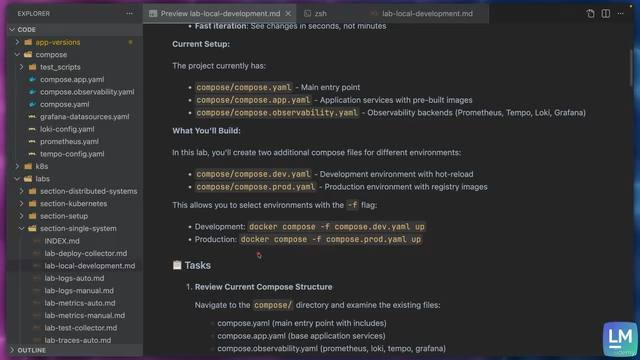
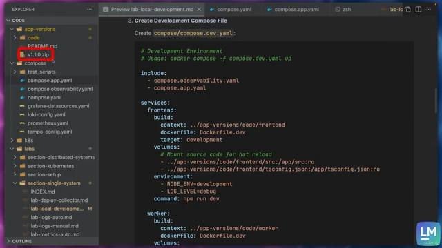

# OpenTelemetry P40–P45 复现文档：API/SDK 概念、Collector 与本地开发环境拆分

> **复现边界说明（先读）**  
> P40–P43 主要是概念讲解，P44 是章节路线图，P45 才进入本地开发环境改造实验。逐字稿里**没有给出完整的 `compose.app.yaml`、`compose.observability.yaml`、Collector 配置、Dockerfile、业务启动命令原文**。因此本文不会伪造这些文件；可确定的部分写成命令和可保存的新增文件，无法确定的部分明确标注“以课程 zip / 实际仓库为准”。这样你仍然可以按步骤复现 P45 的核心改造：拆出 `compose.dev.yaml` 与 `compose.prod.yaml`，删除基础文件里的 `image`，安装前后端依赖，并用 `-f` 选择环境启动。

---

## 1. 这一节做什么

这一段课程的目标不是先写业务代码，而是把 OpenTelemetry 的项目结构、依赖关系和本地运行方式搭好：

1. **理解 API 与 SDK 的分工**：应用代码和框架库依赖 API；SDK 在应用启动时配置一次，负责真正创建、批处理、采样 span，并决定数据发到哪里。
2. **理解自动插桩与手动插桩**：先用自动插桩拿到框架/库层面的 trace、metric、log，再在业务逻辑里补手动 span 和自定义属性。
3. **理解 Collector 的位置**：Collector 是应用和后端之间的数据管道，包含 receiver、processor、exporter；可以用 agent 模式，也可以用 gateway 模式。它不是应用的一部分，也不是后端的一部分。
4. **理解语义约定**：span 名、metric 名、属性名要遵循统一命名，例如数据库名用层级化属性名；自定义业务属性也要按层级和命名空间组织，避免和标准属性冲突。
5. **完成本地开发环境拆分**：把原来的 `compose.yaml`、`compose.app.yaml`、`compose.observability.yaml` 结构，改造成开发用 `compose.dev.yaml` 和生产用 `compose.prod.yaml`。开发模式使用源码 build context 和 bind mount，支持 hot reload；生产模式只定义远程镜像。
6. **跑通依赖安装**：前端 TypeScript 应用执行 `npm ci`；worker 的 Python 应用执行 `uv sync --all-extras`，或者手动建虚拟环境后 `pip install -r requirements.txt`。

最终产出物是：一个能启动 dev 环境的 Compose 配置、一个能切换到 prod 镜像的 Compose 配置、已经安装好依赖的 `frontend` 与 `worker` 目录，以及一个可以验证 hot reload 和 Collector 数据流的本地环境。



---

## 2. 讲师原话

> "APIs 是一组接口和抽象类型，用来定义 span 是什么……以及如何创建它们。"
> —— p040 [00:00]

> "OpenTelemetry SDKs……是这些接口的实际实现。它会是创建真实 span 的代码，会批量处理 span，会对 traces 进行采样……"
> —— p040 [00:29]

> "这里的 API 确实致力于长期稳定性……而 SDKs 则演进得更快。"
> —— p040 [01:06]



> "当我们编写 instrumentation 时……我们可能会从 API 中导入一些东西……因为这样我们就能让 SDK 的配置完全独立于这个 instrumentation。"
> —— p040 [02:47]

> "SDK 配置会在应用代码启动期间进行一次。"
> —— p040 [04:14]



> "我们配置导出器……处理器……采样器……以及资源属性。我们的遥测数据应该附带哪些元数据？服务名、版本、部署环境……"
> —— p040 [06:18]

> "Automatic instrumentation……意味着我们无需编写任何代码就能获得框架和库的 telemetry。"
> —— p041 [00:00]

> "Manual instrumentation……正是我们显式编写代码来创建 span、attributes 并记录 metrics 的地方。而这也正是我们的业务逻辑……进入应用的地方。"
> —— p041 [00:55]



> "通常你会从 auto instrumentation 开始……然后它会扩展你的代码库，为相关业务操作和领域知识加入 manual instrumentation。"
> —— p041 [03:06]

> "OpenTelemetry collector 是一个与厂商无关的 telemetry 数据管道……它可以用多种格式接收 telemetry 数据。它可以以各种方式处理这些数据，并可以将其导出到一个或多个 backends。"
> —— p042 [00:00]

> "我们有 receivers……processors……然后我们可以再次将这些数据导出到多个 providers。"
> —— p042 [00:38]



> "有两种部署模式……agent 部署……以及……gateway 部署。"
> —— p042 [01:38]

> "你并不是一定需要 collector……但有一些相当好的理由和用例。"
> —— p042 [02:24]

> "我们确实需要为 span、metrics 和 attributes 制定标准化的命名规则。"
> —— p043 [00:20]

> "例如，不是 `db_name`，也不是驼峰命名形式的数据库名，而是 `db.name`。"
> —— p043 [01:38]

> "例如，我们在 Node.js 里确实有 OpenTelemetry Semantic Conventions 包。它提供了我们可以使用的常量。"
> —— p043 [03:29]



> "如果我的业务逻辑没有被这些 conventions 覆盖……你可以创建自己的 attributes……最佳实践也是用你希望使用的任意前缀来做 namespace。"
> —— p043 [05:28]

> "我们将首先设置 OpenTelemetry collector，并将其部署到我们的 compose 应用中……验证端到端的数据流……监控 collector 自身的健康状况。"
> —— p044 [00:00]

> "我们目前有一个根级的 `compose.yaml`……然后我们有一个 `compose.app.yaml` 和一个 `compose.observability.yaml`。我们要把它迁移……到两个用途明确的文件，一个用于开发，一个用于生产。"
> —— p045 [00:00]

> "创建一个 `compose.dev.yaml`，它将同时包含 observability 和 app 文件。然后它会定义前端和 worker 的 overrides。"
> —— p045 [01:50]



> "然后你可以继续处理 `compose.prod.yaml`……然后你只需定义镜像。"
> —— p045 [02:17]

> "从 `compose.app.yaml` 中移除前端和 worker 的这个镜像。"
> —— p045 [03:04]

> "我们会先在前端运行 `npm ci`……然后……运行 `uv sync --all-extras`……或者你也可以使用 `pip install -r requirements.txt`。"
> —— p045 [05:37]



---

## 3. 从零复现

### 3.1 前置条件

你本机需要具备：

- Docker Engine 与 Docker Compose v2；本文的 `compose.dev.yaml` 使用 Compose 的 `include` 字段，若你的 Compose 版本不支持，改用第 3.4 节的 `-f` 叠加命令。
- Node.js 与 npm；前端是 TypeScript 应用，课程里执行的是 `npm ci`。
- Python 与 `uv`；如果不用 `uv`，也可以用 Python 虚拟环境加 `pip install -r requirements.txt`。
- `unzip` 或系统解压工具。

### 3.2 解压课程代码并安装依赖

课程 P45 说明代码在 `app-versions` 下，对应单服务章节的是 `version1.1.0.zip`。解压后应能看到 `code/frontend` 和 `code/worker`。下面命令以解压后得到 `app-versions/code` 为例；如果你的 zip 多套了一层目录，以实际路径为准。

```bash
mkdir -p ~/otel-course
cd ~/otel-course

# 把课程提供的 version1.1.0.zip 放到当前目录后执行
unzip version1.1.0.zip -d app-versions

# 先确认解压结果
ls -la app-versions
ls -la app-versions/code

# 前端：TypeScript / Node.js
cd app-versions/code/frontend
npm ci

# worker：Python
cd ../worker
uv sync --all-extras

# 如果你不用 uv，则改成：
# python3 -m venv .venv
# . .venv/bin/activate
# pip install -r requirements.txt
```

检查点：

```bash
test -d app-versions/code/frontend/node_modules && echo "frontend node_modules OK"
test -d app-versions/code/worker/.venv && echo "worker .venv OK"
```

### 3.3 修改 Compose 文件结构

P45 的核心任务是把“一个基础 app 文件 + 一个 observability 文件”改造成“开发环境文件 + 生产环境文件”。关键动作如下：

1. 保留课程原来的 `compose.app.yaml` 与 `compose.observability.yaml` 作为基础片段。
2. 在仓库根目录新增 `compose.dev.yaml`：包含 observability 与 app，并为 `frontend`、`worker` 写开发覆盖：`build.context`、bind mount、开发启动命令。
3. 在仓库根目录新增 `compose.prod.yaml`：包含 observability 与 app，只定义 `frontend`、`worker` 的远程镜像。
4. 打开 `compose.app.yaml`，删除 `frontend` 与 `worker` 两个服务里的 `image` 行。讲师明确说过：这个 `image` 字段将由 dev 或 prod 的最终文件定义，基础文件里不要写死。
5. 不要用“在根 `compose.yaml` 里加一个被注释的 dev 条目”的方式；讲师认为那会带来需要手动取消注释、merge 行为不可预期的问题，拆成两个文件更干净。

先备份原文件：

```bash
cd ~/otel-course
cp compose.app.yaml compose.app.yaml.bak
cp compose.observability.yaml compose.observability.yaml.bak
```

然后按第 4 节把新增文件保存到仓库根目录。

### 3.4 启动开发环境

先做配置校验：

```bash
docker compose -f compose.dev.yaml config
```

再启动：

```bash
docker compose -f compose.dev.yaml up --build
```

如果你的 Docker Compose 不支持 `include`，把 `compose.dev.yaml` 里的 `include` 去掉，改成显式叠加：

```bash
docker compose \
  -f compose.observability.yaml \
  -f compose.app.yaml \
  -f compose.dev.yaml \
  up --build
```

查看服务状态与日志：

```bash
docker compose -f compose.dev.yaml ps
docker compose -f compose.dev.yaml logs -f frontend worker
```

### 3.5 验证 hot reload

P45 要求前后端都支持 hot reload。逐字稿没有给出具体要改哪个业务文件，因此按下面方式验证即可：

1. 保持 `docker compose -f compose.dev.yaml up --build` 运行。
2. 修改 `app-versions/code/frontend` 下任意会被 dev server 监听的文件，例如路由、页面或日志文案；观察 `frontend` 日志是否自动重载。
3. 修改 `app-versions/code/worker` 下任意会被 Python 重载器监听的文件；观察 `worker` 日志是否自动重载。
4. 如果只重启不重载，说明容器里的启动命令不是课程 zip 预期的开发命令，回到第 4 节调整 `FRONTEND_DEV_COMMAND` / `WORKER_DEV_COMMAND`。

### 3.6 切换到生产模式

生产模式只使用远程镜像。先准备 `.env`：

```bash
cd ~/otel-course
cp .env.example .env
# 编辑 .env，把 FRONTEND_IMAGE / WORKER_IMAGE 换成你实际可拉取的镜像
```

启动：

```bash
docker compose -f compose.prod.yaml up -d
docker compose -f compose.prod.yaml ps
```

注意：逐字稿没有给出具体镜像仓库地址，也没有要求你现场构建并推送镜像。生产模式能跑起来的前提是 `.env` 里的镜像真实存在；否则 Compose 会在拉取阶段失败。

### 3.7 验证 Collector 数据流

P44 说本章会先部署 Collector，验证端到端数据流，并通过后端服务观察 Collector 自身健康。P45 只做了 Compose 拆分和依赖安装，没有给出 Collector 配置原文。因此你复现时按这个顺序检查：

1. `docker compose -f compose.dev.yaml ps` 确认 collector 与 observability 相关服务已启动。
2. 确认 `frontend`、`worker` 的 OpenTelemetry 初始化代码指向的 Collector 地址，与 `compose.observability.yaml` 中的服务名、端口一致。
3. 触发一次前端请求或 worker 任务，观察后端里是否出现对应 trace/metric。
4. 如果后端里没有数据，先查 Collector 日志，再查应用 SDK 初始化是否在应用启动时执行。

---

## 4. 完整代码

> 再次强调：下面新增的 Compose 文件是**按 P45 任务描述整理的可保存骨架**。课程逐字稿没有给出 `compose.app.yaml`、`compose.observability.yaml`、Dockerfile 和业务启动命令原文，所以不能伪造这些文件。请把新增文件与课程 zip 里的原文件放在同一仓库根目录，并按注释替换成本地实际值。

### 4.1 `compose.dev.yaml`

```yaml
# compose.dev.yaml
# 作用：开发环境。包含 observability 与 app 基础片段，并覆盖 frontend/worker 为源码构建 + hot reload。
# 注意：include 需要较新的 Docker Compose；不支持时改用 -f 叠加，见 README/第 3.4 节。

include:
  - compose.observability.yaml
  - compose.app.yaml

services:
  frontend:
    build:
      context: ./app-versions/code/frontend
      dockerfile: ${FRONTEND_DOCKERFILE:-Dockerfile}
    volumes:
      - ./app-versions/code/frontend:/app
      - /app/node_modules
    environment:
      NODE_ENV: development
      OTEL_SERVICE_NAME: frontend
      OTEL_EXPORTER_OTLP_ENDPOINT: ${OTEL_EXPORTER_OTLP_ENDPOINT:-http://otel-collector:4318}
    command: ${FRONTEND_DEV_COMMAND:-npm run dev}

  worker:
    build:
      context: ./app-versions/code/worker
      dockerfile: ${WORKER_DOCKERFILE:-Dockerfile}
    volumes:
      - ./app-versions/code/worker:/app
    environment:
      PYTHONUNBUFFERED: "1"
      OTEL_SERVICE_NAME: worker
      OTEL_EXPORTER_OTLP_ENDPOINT: ${OTEL_EXPORTER_OTLP_ENDPOINT:-http://otel-collector:4318}
    command: ${WORKER_DEV_COMMAND:-uv run python -m src.main}

networks:
  default:
    name: otel-course-dev
```

### 4.2 `compose.prod.yaml`

```yaml
# compose.prod.yaml
# 作用：生产/准生产环境。只定义远程镜像，不使用源码构建。
# 必须通过 .env 或 shell 环境提供 FRONTEND_IMAGE / WORKER_IMAGE。

include:
  - compose.observability.yaml
  - compose.app.yaml

services:
  frontend:
    image: ${FRONTEND_IMAGE:?set FRONTEND_IMAGE in .env}

  worker:
    image: ${WORKER_IMAGE:?set WORKER_IMAGE in .env}

networks:
  default:
    name: otel-course-prod
```

### 4.3 `.env.example`

```bash
# 复制为 .env 后按实际环境修改。
# 生产镜像：逐字稿没有给出仓库地址，请换成你实际能拉取的镜像。
FRONTEND_IMAGE=registry.example.com/otel-frontend:1.1.0
WORKER_IMAGE=registry.example.com/otel-worker:1.1.0

# Collector 地址：课里没有逐字给出这个环境变量名和端口，请以课程 zip 中 SDK 初始化代码为准。
OTEL_EXPORTER_OTLP_ENDPOINT=http://otel-collector:4318

# Dockerfile 名称：以课程 zip 中实际文件名为准。
FRONTEND_DOCKERFILE=Dockerfile
WORKER_DOCKERFILE=Dockerfile

# 开发启动命令：以课程 zip 中 package.json / worker 入口为准。
FRONTEND_DEV_COMMAND=npm run dev
WORKER_DEV_COMMAND=uv run python -m src.main
```

### 4.4 `compose.app.yaml` 必须修改的地方

逐字稿没有给出完整的 `compose.app.yaml` 原文，因此这里只给必须改的 diff。请直接打开课程 zip 中的原文件，删除 `frontend` 和 `worker` 下的 `image` 行：

```yaml
services:
  frontend:
    # image: <原来的镜像行>   # 删除这一行，按 p045 [03:04]
    # 其余配置保持课程 zip 原样

  worker:
    # image: <原来的镜像行>   # 删除这一行，按 p045 [03:04]
    # 其余配置保持课程 zip 原样
```

删除后，开发环境由 `compose.dev.yaml` 的 `build.context` 决定镜像来源，生产环境由 `compose.prod.yaml` 的 `image` 决定镜像来源。

---

## 5. 逐行解释

### 5.1 为什么应用代码依赖 API，而不是直接依赖 SDK

P40 的核心结论是：**API 是接口和抽象类型，SDK 是具体实现**。应用代码、Express/FastAPI/Flask/Spring Boot 这类框架库，应该依赖 API；SDK 只在应用启动时配置一次。这样做的原因是 API 长期稳定，SDK 演进更快。你把 `trace`、`tracer`、`span` 的创建写在业务代码里时，导入的是 API 包；真正把 span 批量、采样、导出的逻辑在 SDK 初始化里配置。对应到 Node.js：业务文件里 `import { trace } from '@opentelemetry/api'`，启动文件里再初始化 NodeSDK 和 exporter。这样以后换 exporter、改采样率，不需要动业务插桩代码。

### 5.2 `include` 与 `-f` 的选择

`compose.dev.yaml` 里的 `include` 表示把 `compose.observability.yaml` 和 `compose.app.yaml` 合并进来，再叠加本文件的 `frontend`、`worker` 覆盖。讲师在 P45 说的是“dev 文件包含 observability 和 app 文件”，但逐字稿没有给具体 Compose 语法；`include` 是落地方式之一。如果你本地 Compose 不支持 `include`，就用第 3.4 节的 `-f compose.observability.yaml -f compose.app.yaml -f compose.dev.yaml`，效果是显式按顺序叠加。不要把 dev 配置塞回根 `compose.yaml` 再靠注释切换，P45 明确说那会带来 merge 冲突和不可预期行为。

### 5.3 `build.context` 与 bind mount

`build.context: ./app-versions/code/frontend` 告诉 Compose 用哪个目录构建开发镜像。`volumes: - ./app-versions/code/frontend:/app` 把宿主机源码挂进容器 `/app`，这样你在编辑器里改文件，容器内 dev server 能看到变化。`- /app/node_modules` 是匿名卷，用来避免宿主机的 `node_modules` 覆盖容器内已经安装好的依赖。前端在宿主机执行 `npm ci` 是为了本地编辑和类型检查；容器内是否还需要安装依赖，取决于课程 Dockerfile 的实现，逐字稿没有展开。

worker 的 bind mount 同理：`./app-versions/code/worker:/app` 让 Python 源码变化直接进入容器。`PYTHONUNBUFFERED: "1"` 让 Python 输出不被缓冲，方便你立刻在 `docker compose logs` 里看到 hot reload 或异常。`WORKER_DEV_COMMAND` 默认写成 `uv run python -m src.main` 只是可替换的骨架；逐字稿没有给 worker 的具体入口，必须以课程 zip 中的实际模块名为准。

### 5.4 环境变量与 Collector 地址

`OTEL_SERVICE_NAME` 用于区分 frontend 与 worker；P40 提到 SDK 可配置 resource attributes，例如 service name、version、deployment environment。`OTEL_EXPORTER_OTLP_ENDPOINT` 是 OpenTelemetry 常见环境变量名，但**P45 逐字稿没有逐字给出这个变量名和端口**，所以本文标注为“以课程 zip 中 SDK 初始化代码为准”。如果课程代码里写的是别的变量名，或者 Collector 服务名不是 `otel-collector`，你需要同步改 `.env` 和 `compose.observability.yaml` 中的服务名。不要凭印象把端口写死成 4318；先看实际配置。

### 5.5 生产文件为什么只写 `image`

`compose.prod.yaml` 只定义 `image`，不写 `build`。这与 P45 的描述一致：生产模式使用 registry 里的远程镜像；开发模式才使用 Dockerfile 和源码目录。`${FRONTEND_IMAGE:?set FRONTEND_IMAGE in .env}` 里的 `:?` 表示变量缺失时 Compose 直接报错，避免你误用空镜像名启动。逐字稿没有给具体镜像地址，所以 `.env.example` 里的 `registry.example.com/...` 只是示例，必须替换。

### 5.6 为什么先 `config` 再 `up`

`docker compose -f compose.dev.yaml config` 只做配置解析和合并校验，不启动容器。它能在真正构建前发现 YAML 缩进、`include` 不支持、变量缺失、服务名冲突等问题。确认通过后再 `up --build`，构建开发镜像并启动。`ps` 看服务状态，`logs -f frontend worker` 看两个服务的实时日志。P44 还要求验证 Collector 端到端数据流和健康状态，这些要在服务启动后通过 observability 后端观察；逐字稿没有给具体查询语句，所以本文不伪造命令输出。

### 5.7 自动插桩与手动插桩在项目里的落点

P41 说自动插桩是“不写代码就拿到框架和库的 telemetry”，手动插桩是“显式创建 span、属性、metric，把业务语义加进去”。复现时先保证自动插桩库已接入，再在业务逻辑里补手动 span。比如自动插桩只能告诉你“发生了一次 POST /images”，手动插桩才能说明“这是文章图片上传”还是“用户头像上传”。语义约定部分则决定属性名怎么起：标准属性优先用 OpenTelemetry Semantic Conventions 包里的常量，避免手写错；业务自定义属性按层级命名并加命名空间前缀，避免和标准属性冲突。

---

## 6. 复现检查清单

- [ ] 已把 `version1.1.0.zip` 解压到 `app-versions`，能看到 `code/frontend` 与 `code/worker`。
- [ ] `frontend` 已执行 `npm ci`，存在 `node_modules`。
- [ ] `worker` 已执行 `uv sync --all-extras`，存在 `.venv`；或已建虚拟环境并 `pip install -r requirements.txt`。
- [ ] `compose.app.yaml` 中 `frontend`、`worker` 的 `image` 行已删除。
- [ ] 仓库根目录存在 `compose.dev.yaml`。
- [ ] 仓库根目录存在 `compose.prod.yaml`。
- [ ] `docker compose -f compose.dev.yaml config` 通过。
- [ ] `docker compose -f compose.dev.yaml up --build` 能启动 frontend、worker、collector 及 observability 相关服务。
- [ ] 修改 frontend 源码后，frontend 日志出现自动重载。
- [ ] 修改 worker 源码后，worker 日志出现自动重载。
- [ ] `.env` 中 `FRONTEND_IMAGE`、`WORKER_IMAGE` 已替换为真实镜像后，`docker compose -f compose.prod.yaml up -d` 能拉取并启动。
- [ ] 触发一次请求或任务后，observability 后端能看到对应 telemetry；若没有，已检查 Collector 地址与应用 SDK 初始化。
- [ ] `.env` 没有提交到公开仓库。

---

## 7. 课里没讲但你会撞上的

1. **`include` 的 Compose 版本要求**：P45 只讲了“dev 文件包含 app 和 observability”的概念，没有讲 `include` 语法和版本限制。你的 Docker Compose 如果报 `include` 不认识，直接用第 3.4 节的 `-f` 叠加。
2. **Dockerfile 文件名未知**：逐字稿没有说课程 zip 里叫 `Dockerfile` 还是 `Dockerfile.dev`。本文用 `${FRONTEND_DOCKERFILE:-Dockerfile}` 保留变量；如果实际文件名不同，在 `.env` 里改，不要改代码逻辑。
3. **worker 启动命令未知**：`uv run python -m src.main` 只是骨架。P45 没给 worker 入口模块名，也没有给 hot reload 具体命令。如果启动后 worker 立刻退出，先看课程 zip 里的 README、Dockerfile 或 `pyproject.toml` 的脚本入口。
4. **`npm ci` 需要 lockfile**：如果前端目录没有 `package-lock.json`，`npm ci` 会失败。此时临时用 `npm install`，但不要把它当成课程原步骤。
5. **宿主机依赖挂载覆盖容器依赖**：前端用匿名卷 `/app/node_modules` 避免宿主机 `node_modules` 覆盖容器；Python 侧不要把宿主机 `.venv` 直接挂进 Linux 容器，容易出现平台二进制不兼容。逐字稿没有展开这一点，但实际很容易撞上。
6. **Collector 服务名和端口未知**：`otel-collector:4318` 是示例。P42 只讲了 receiver/exporter 概念，P45 没给服务名和端口。以 `compose.observability.yaml` 与 SDK 初始化代码为准。
7. **环境变量名未知**：`OTEL_SERVICE_NAME`、`OTEL_EXPORTER_OTLP_ENDPOINT` 是常见写法，但 P45 没有逐字确认。若课程代码用别的变量名，以代码为准；不要为了“看起来标准”改坏原有配置。
8. **hot reload 在 Docker Desktop 上可能不触发**：尤其是 macOS/Windows 的 bind mount 文件事件。逐字稿没有讲文件监听器配置；如果改文件不重载，先看 dev server 是否启动在容器内，再考虑轮询模式，但不要伪造课程没讲的参数。
9. **生产镜像并不存在**：P45 说生产文件定义远程镜像，但没有给仓库地址。你必须自己构建并推送，或者使用课程提供的实际镜像；否则 `compose.prod.yaml` 只会在拉取阶段失败。
10. **Node SDK 初始化时机**：P40 说 SDK 配置发生在应用启动时。实际 Node 项目里，SDK 初始化通常要在业务模块被 import 之前执行；P45 没有展开这个顺序，但如果你发现 span 丢失，先检查初始化文件是否最早加载。
11. **语义约定常量包不是自动安装的**：P43 提到 Node.js 的 Semantic Conventions 包提供常量，但 P45 的 `npm ci` 只安装课程已有依赖。若你要在业务代码里使用这些常量，先确认 `package.json` 是否已包含对应包；没有就按项目依赖管理方式添加。