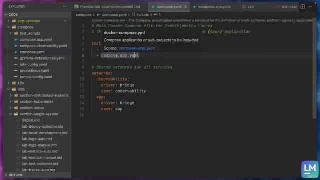
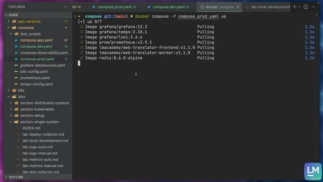
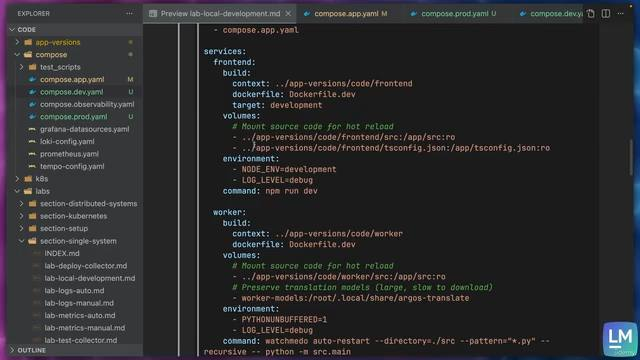
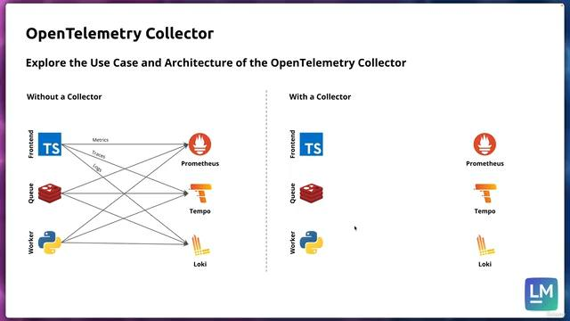
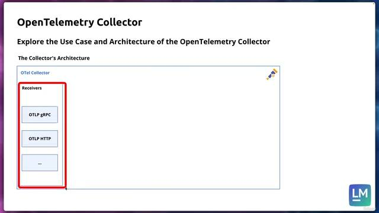
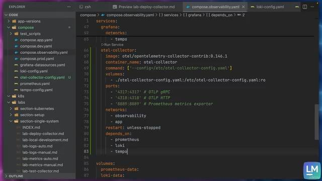
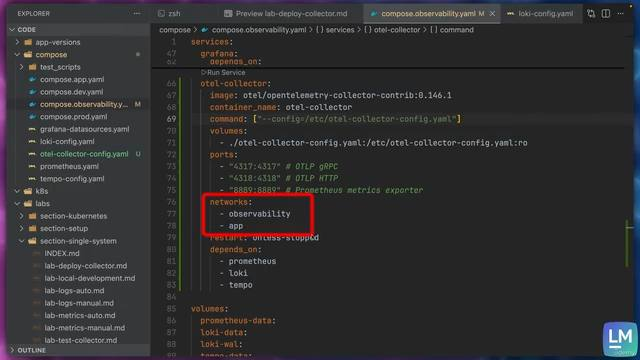
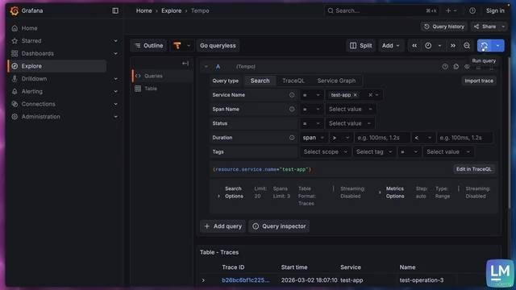
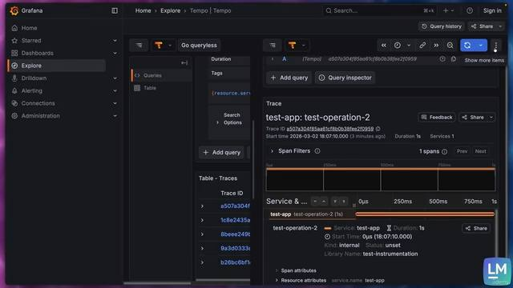

# OpenTelemetry 实战：拆分 Compose 环境并部署 Collector（P46–P51）

## 1. 这一节做什么

P46–P51 这六段课完成两件互相衔接的事。

第一件是**把本地开发环境的 Compose 拆成两套**。原来项目只有一个 `compose.yaml`，通过 `include` 把 `compose.observability.yaml` 和 `compose.app.yaml` 拼在一起。讲师把它拆成 `compose.prod.yaml` 和 `compose.dev.yaml`：生产文件只负责给 frontend 和 worker 指定镜像，开发文件负责 build context、Dockerfile、bind mount 和带热重载的启动命令。拆完之后用改一行代码的方式验证 frontend 和 worker 都能热重载。

第二件是**把 OpenTelemetry Collector 部署进这套 Compose 栈**。Collector 是应用和三个观测后端（Prometheus、Tempo、Loki）之间的中枢：应用只把 OTLP 数据发给 Collector，由 Collector 决定怎么处理、转发给谁。课里配置了三条 pipeline（traces / metrics / logs），每条都经过 `memory_limiter` 和 `batch` 两个 processor，再分别送到 Tempo、Prometheus、Loki。部署完成后用 `curl` 往 Collector 发一条测试 trace，在 Grafana 的 Tempo 数据源里确认这条 trace 确实走通了整条链路。

这一节的可交付物是：一套能 `docker compose up` 起来的本地环境，加上一个已经能接收 OTLP 数据的 Collector。应用侧的 SDK 埋点课里没有讲，这一节只做到“Collector 就绪、链路可验证”。

---

## 2. 讲师原话（带出处）

关于为什么要拆 Compose，讲师说得很直接：

> "我们会有一个 compose.prod.yaml，也会有一个 compose.dev.yaml……我会在这里拿 compose.yaml，基本上把这个文件复制到这两个文件里。你可能会冲我喊，说，嘿，Laura，你不该真的复制代码。但有时候，只保留应用的一小部分其实是有益的，因为它把两者解耦了。"
> —— p046 [00:43]–[01:13]

> "如果我们尝试只用一个 compose.yaml，那么我们就得开始在这里加注释，取消某些内容的注释，或者注释掉某个 compose 文件。而这实际上和只保留应用的一小部分一样复杂。"
> —— p046 [01:13]

关于生产文件和开发文件的分工：

> "我们需要做的就是为我们的 services 配置 image。所以我会在这里加上 services。我会配置 front end 的 image 和 worker services 的 image。"
> —— p046 [01:42]–[02:01]

> "我们会在这里使用 build context，而不是 image，也不是 image registry。我们会使用某个 Docker file。我们会在这里使用 bind mounts 来实现 hot reloading。我们还会修改 commands，让它们在这里以具备 hot reloading 能力的方式执行。"
> —— p046 [04:01]–[04:24]

> "volumes 是一个额外的 key，这样做只是为了保留 translation models，这样每当我们在本地重建 image 时，就不需要每次都下载它们。"
> —— p046 [04:24]–[04:54]

关于 Collector 存在的意义：

> "如果这里没有 collector，我们的应用，也就是 front end、queue service 和 worker，实际上就会……需要知道很多东西……metrics 的 endpoint 是什么？traces 的 endpoint 是什么？logs 的 endpoint 是什么？"
> —— p047 [00:17]–[00:47]

> "有了 collector，我们的架构确实会有轻微或相当大的不同，其中连接是通过 OpenTelemetry Collector 完成的……OpenTelemetry Collector 会在这里封装所有必要的知识，用来转发，或者实际上处理并转发这些 telemetry data 到多个 backends。"
> —— p047 [01:16]–[01:56]

关于 Collector 内部结构：

> "我们有 receivers。它们基本上会是这里的入口，也就是 telemetry data 流入 collector 的入口点。"
> —— p047 [01:57]–[02:24]

> "通过接收器流入的指标数据会被转发到指标管道。指标管道可以包含多个独立的处理器，例如内存限制器，然后是批处理器。"
> —— p047 [02:24]–[02:54]

> "一旦数据流过 pipeline，它就会在这里被重定向。它会被转发到一个 exporter，然后由这个 exporter 负责把这里的这些数据转发到相应的 backend。"
> —— p047 [03:38]–[04:07]

关于具体配置：

> "OpenTelemetryCollector 正在接收三种信号的数据，而这里的这个接收器配置为：gRPC 使用端口 4317，HTTP 使用端口 4318。"
> —— p049 [01:46]

> "对于这三个管道，我们都配置了一个内存限制器处理器和一个批处理器。"
> —— p049 [02:15]

> "我们有 OTLP 导出，也就是 Tempo 导出器、Prometheus 导出器和 Loki 导出器。"
> —— p049 [02:39]

关于网络和挂载：

> "这是唯一一个会同时连接到两者的 service，因为它确实需要从应用接收 telemetry data，而且它也需要能够把 telemetry data 发送到我们的 observability backends。"
> —— p048 [01:20]

> "只要确保这里 configuration file 的 path 与你本地机器上的 path 匹配。"
> —— p049 [04:53]

关于验证：

> "我们也可以在这里 crawl 这个 HTTP endpoint，它应该会返回 404。"
> —— p049 [07:37]

> "OpenTelemetry Collector 正在为指标暴露端口 8889。"
> —— p049 [08:06]

> "此时只是还没有 exported metrics……这里的 response 是正确的……这是 200 OK。这里的 content length 是零。"
> —— p049 [08:32]–[09:01]

最后，p051 里讲师指出了一个容易误判的点：

> "这里的这个 endpoint，也就是我们指定的这个 endpoint，并没有暴露来自我们的 OpenTelemetry Collector 的内部 metrics 或内部 telemetry data。它在这里被配置为一个 exporter，用于我们接收到的 metrics，而且只用于通过 OTLP receiver 接收到的 metrics。"
> —— p051 [02:58]–[03:27]



---

## 3. 从零复现

### 3.1 前置条件

- 已安装 Docker Engine 和 Docker Compose v2（命令行是 `docker compose`，不是老的 `docker-compose`）。
- 已经拿到课程项目代码，目录里至少有 `app-versions/code/frontend`、`app-versions/code/worker` 和 `compose/` 文件夹。P049 开头讲师描述过这个结构：`app-versions` 下是 `code/frontend`、`code/worker`，`compose` 文件夹放所有 compose 文件，`labs` 文件夹放每个 lab 的资料。
- 本地 3000、3100、4317、4318、8889、9090 这些端口没有被占用。

### 3.2 第一步：拆 Compose

原来的 `compose/compose.yaml` 长这样：

```yaml
include:
  - compose.observability.yaml
  - compose.app.yaml

networks:
  observability:
  app:
```

讲师的做法是把这个文件**复制两份**，分别改成 `compose.prod.yaml` 和 `compose.dev.yaml`，然后删掉原来的 `compose.yaml`。这不是“优雅”的写法，但讲师在 p046 [01:13] 明确解释过：如果再维护一个单文件，就要靠注释/反注释来切换环境，复杂度和复制一份差不多，不如让两套配置彻底解耦。



生产文件 `compose.prod.yaml` 只做一件事：给 `frontend` 和 `worker` 指定镜像。注意 `redis` 保留在 `compose.app.yaml` 里，因为开发和生产的 redis 镜像一样，不需要拆。

同时回到 `compose.app.yaml`，把 `frontend` 和 `worker` 下面的 `image:` 条目删掉。讲师在 p046 [02:04]–[02:30] 说得很清楚：`frontend` 和 `worker` 不该在 app 文件里写 image，image 由 `compose.prod.yaml` 提供，开发时则由 `compose.dev.yaml` 的 `build` 提供。

### 3.3 第二步：写开发 Compose

`compose.dev.yaml` 比生产文件多四样东西：

1. `build.context` 和 `build.dockerfile`：不用镜像仓库，直接用本地代码构建。
2. `volumes` 里的 bind mount：把本地源码目录挂进容器，改代码容器里立刻能看到。
3. `command`：换成带热重载的启动命令。
4. 顶层 `volumes`：给 translation models 一个持久化卷，避免每次重建镜像都重新下载模型。



### 3.4 第三步：写 Collector 配置

在 `compose/` 下新建 `otel-collector-config.yaml`。配置分四块：`receivers`、`processors`、`exporters`、`service.pipelines`。

`receivers` 开 OTLP，gRPC 监听 4317，HTTP 监听 4318。p049 [01:46] 明确说了这两个端口。

`processors` 配两个：`memory_limiter` 和 `batch`。p047 [04:37] 解释了它们的行为：memory_limiter 有一个 hard cap，超过就丢数据并返回错误，还可以设 soft cap 做 back pressure；batch 的 `timeout` 是 10 秒，即使没攒满也每 10 秒 flush 一次，另外还有 batch size 和 batch max size，攒够大小也 flush。

`exporters` 配三个：Tempo 用 OTLP gRPC（默认走 4317），Prometheus 用 prometheus exporter 把指标暴露出来等 Prometheus 来 scrape，Loki 用通用的 OTLP HTTP exporter 往一个 endpoint 发。p049 [02:39]–[03:39] 讲这段时特别强调：Tempo 走 gRPC，Loki 走 HTTP，所以 Tempo 那边要确认 4317 的 gRPC 是开着的。

`service.pipelines` 配三条：traces、metrics、logs。每条都用 `[otlp]` 作为 receiver、`[memory_limiter, batch]` 作为 processor，exporter 分别指向 tempo、prometheus、loki。p049 [01:09]–[01:46] 讲了一个关键点：pipeline 里写的 `otlp` 这个名字，必须在 `receivers:` 下面存在同名 key，这不是巧合，是配置的引用关系。





### 3.5 第四步：把 Collector 加进 observability Compose

打开 `compose/compose.observability.yaml`，加一个 `otel-collector` 服务。要点：

- 挂载配置文件：把本地 `./otel-collector-config.yaml` 挂到容器里 Collector 读取配置的路径。p049 [04:53] 提醒：这个路径必须和本地路径对上。
- 端口映射：4317、4318、8889 都映射出来，方便本地 curl 和 Prometheus 访问。
- 网络：同时加入 `observability` 和 `app` 两个网络。p048 [01:20] 说这是唯一一个同时连两个网络的服务，因为它要收应用的数据、又要往观测后端发数据。



### 3.6 第五步：让 Prometheus scrape Collector

在 Prometheus 的 scrape 配置里加一个 job，target 指向 `otel-collector:8889`。p049 [05:41] 说这一步只是“加一个简单的 job”。



同时确认 Tempo 的配置里 OTLP receiver 是开着的，gRPC 4317 和 HTTP 4318 都要能收。p049 [06:01] 说这个之前已经加过，现在只是确认。

### 3.7 第六步：启动

```bash
cd compose
docker compose -f compose.dev.yaml up --build
```

`--build` 是必须的，因为 dev 文件用的是 build context，不 build 就没有镜像。第一次会拉基础镜像、装依赖、下载翻译模型，可能要几分钟。起来之后 frontend、worker、redis、prometheus、tempo、loki、grafana、otel-collector 都应该是 running。

### 3.8 第七步：验证 Collector

先确认 Collector 的 HTTP 入口在监听：

```bash
curl -i http://localhost:4318/
```

p049 [07:37] 说这个请求应该返回 404，因为 Collector 的 OTLP HTTP receiver 没有配 GET 处理器。404 不代表坏了，只代表它在监听、但没有对应的 GET 路由。

再确认 metrics 端口：

```bash
curl -i http://localhost:8889/metrics
```

p049 [08:06]–[09:01] 说这个端口暴露 metrics，但此时还没有任何通过 OTLP receiver 进来的 metrics，所以返回 200、content-length 为 0。这是正常的，不是配置错了。

### 3.9 第八步：发一条 trace，在 Grafana 里看

用 curl 往 Collector 的 OTLP HTTP 入口发一条 trace：

```bash
curl -s -X POST http://localhost:4318/v1/traces \
  -H "Content-Type: application/json" \
  -d @test-trace.json
```

等几秒，打开 `http://localhost:3000`，进 Explore，数据源选 Tempo，点 Search，应该能看到 service name 和 `test-operation` 这条 trace。p051 [01:15]–[01:49] 演示的就是这个过程。





---

## 4. 完整代码

### 4.1 目录结构

```
.
├── app-versions/
│   └── code/
│       ├── frontend/
│       └── worker/
├── compose/
│   ├── compose.prod.yaml
│   ├── compose.dev.yaml
│   ├── compose.app.yaml
│   ├── compose.observability.yaml
│   ├── otel-collector-config.yaml
│   ├── prometheus.yml
│   └── tempo.yaml
└── labs/
```

### 4.2 `compose/compose.prod.yaml`

```yaml
include:
  - compose.observability.yaml
  - compose.app.yaml

services:
  frontend:
    image: myregistry/frontend:latest

  worker:
    image: myregistry/worker:latest

networks:
  observability:
  app:
```

> 说明：`myregistry/frontend:latest` 和 `myregistry/worker:latest` 是占位镜像名。讲师在 p046 只说“配置 frontend 和 worker 的 image”，没有在逐字稿里给出具体镜像地址。用你项目实际推送过的镜像替换。如果本地还没有推送镜像，先用 `compose.dev.yaml` 跑。

### 4.3 `compose/compose.dev.yaml`

```yaml
include:
  - compose.observability.yaml
  - compose.app.yaml

services:
  frontend:
    build:
      context: ../app-versions/code/frontend
      dockerfile: Dockerfile
    volumes:
      - ../app-versions/code/frontend:/app
      - frontend_node_modules:/app/node_modules
    command: npm run dev

  worker:
    build:
      context: ../app-versions/code/worker
      dockerfile: Dockerfile
    volumes:
      - ../app-versions/code/worker:/app
      - translation_models:/app/models
    command: python main.py --reload

volumes:
  frontend_node_modules:
  translation_models:

networks:
  observability:
  app:
```

> 说明：`build.context`、`dockerfile`、`command`、挂载路径这些具体值，逐字稿只说了“用 build context / 用某个 Dockerfile / 用 bind mount / 改 command 支持热重载 / 加一个 volumes 保住翻译模型”，没有逐字给出字段值。上面的路径按 p049 开头描述的目录结构推出来；`command` 和容器内工作目录请以你项目里 frontend、worker 的 Dockerfile 为准。

### 4.4 `compose/compose.app.yaml`（关键改动示意）

```yaml
services:
  redis:
    image: redis:7-alpine
    ports:
      - "6379:6379"
    networks:
      - app

  frontend:
    ports:
      - "3000:3000"
    environment:
      REDIS_URL: redis://redis:6379
    depends_on:
      - redis
    networks:
      - app

  worker:
    environment:
      REDIS_URL: redis://redis:6379
    depends_on:
      - redis
    networks:
      - app
```

> 说明：这一节对 `compose.app.yaml` 的**唯一必要改动**是删掉 `frontend` 和 `worker` 下的 `image:`。端口、环境变量、依赖关系逐字稿没有逐一展开，上面的值是按项目结构补的示意，实际请保留你原文件里的字段，只删 `image`。

### 4.5 `compose/otel-collector-config.yaml`

```yaml
receivers:
  otlp:
    protocols:
      grpc:
        endpoint: 0.0.0.0:4317
      http:
        endpoint: 0.0.0.0:4318

processors:
  memory_limiter:
    check_interval: 1s
    limit_mib: 512
    spike_limit_mib: 128

  batch:
    timeout: 10s
    send_batch_size: 1024
    send_batch_max_size: 2048

exporters:
  otlp/tempo:
    endpoint: tempo:4317
    tls:
      insecure: true

  prometheus:
    endpoint: 0.0.0.0:8889

  otlphttp/loki:
    endpoint: http://loki:3100/otlp

service:
  pipelines:
    traces:
      receivers: [otlp]
      processors: [memory_limiter, batch]
      exporters: [otlp/tempo]

    metrics:
      receivers: [otlp]
      processors: [memory_limiter, batch]
      exporters: [prometheus]

    logs:
      receivers: [otlp]
      processors: [memory_limiter, batch]
      exporters: [otlphttp/loki]
```

> 说明：`memory_limiter` 的 `check_interval`、`limit_mib`、`spike_limit_mib` 和 `batch` 的 `send_batch_size`、`send_batch_max_size` 具体数值逐字稿没有给，上面是可运行示例，`limit_mib` 按你机器内存调整。`tempo:4317` 和 `http://loki:3100/otlp` 的 endpoint 逐字稿也没逐字给出，是按“Tempo 走 gRPC 4317、Loki 走 HTTP”推的；Loki 的 OTLP 路径请以你用的 Loki 版本文档为准。

### 4.6 `compose/compose.observability.yaml` 里新增的 Collector 服务

```yaml
services:
  otel-collector:
    image: otel/opentelemetry-collector-contrib:0.100.0
    volumes:
      - ./otel-collector-config.yaml:/etc/otelcol-contrib/config.yaml
    ports:
      - "4317:4317"
      - "4318:4318"
      - "8889:8889"
    networks:
      - observability
      - app
```

> 说明：镜像名和版本、容器内配置路径 `/etc/otelcol-contrib/config.yaml` 逐字稿没有明确给出，这里用的是 contrib 镜像的标准路径；如果你用 core 镜像，路径通常是 `/etc/otelcol/config.yaml`，请以镜像文档为准。p049 [05:16] 明确说了这个服务要同时连两个网络，并且配置文件的 bind mount 路径必须和本地一致。

### 4.7 `com

## 5. 逐行解释

以下只解释「4. 完整代码」中已经给出的内容；4.7 在提供文档里只到 `### 4.7 \`com` 就截断了，缺失部分不逐行编造。

### 4.1 目录结构

- 为什么把应用代码放 `app-versions/code/frontend`、`app-versions/code/worker`：p049 开头讲师明确描述了这个结构，`app-versions` 下是 `code/frontend`、`code/worker`。
- 为什么把 compose 文件集中到 `compose/`：p049 说 `compose` 文件夹放所有 compose 文件。
- 为什么把每个 lab 的资料放 `labs/`：p049 说这是为了更好的分离，方便查找，不把所有东西都丢在同一个文件夹。
- 不这么写会怎样：文件会混在一起，查找和区分 lab 资料更困难；这是讲师在 p049 明确解释的设计理由。

### 4.2 `compose/compose.prod.yaml`

- `include:` 下保留 `compose.observability.yaml` 和 `compose.app.yaml`：p046 里讲师是从原 `compose.yaml` 复制出 `compose.prod.yaml` 和 `compose.dev.yaml`，原文件本来就有这两个 include。不保留 include，prod 文件只声明 frontend/worker 的 image，redis、Prometheus、Tempo、Loki、Grafana 等就不会被带进同一套 Compose。
- `services.frontend.image` 和 `services.worker.image`：p046 明确说 prod 文件“只需要配置 frontend 和 worker 的 image”。不这么写，prod 文件就没有给这两个服务提供镜像来源。
- 不在 prod 文件里写 build context：p046 说 build context 是开发文件 `compose.dev.yaml` 的事；prod 走镜像。若把 build 写进 prod，就破坏了两套文件的分工。
- `networks.observability` 和 `networks.app`：p046 说原 `compose.yaml` 里定义了 networks，拆分时被复制过来。不声明这两个网络，include 进来的服务在引用 `observability` / `app` 网络时就缺少顶层网络声明。
- `myregistry/frontend:latest`、`myregistry/worker:latest`：文档已说明这是占位镜像名；p046 只说“配置 image”，没有给出具体镜像地址。不要把它当成讲师给出的真实镜像。不替换成实际镜像，prod 启动时会拉不到镜像。

### 4.3 `compose/compose.dev.yaml`

- `include:` 同样保留 observability 和 app：dev 也要把观测后端和应用服务拼成一套栈。不保留 include，dev 起不完整套栈。
- `frontend.build.context: ../app-versions/code/frontend`、`build.dockerfile: Dockerfile`：p046 明确说开发文件要用 build context，而不是镜像仓库，并指定 Dockerfile。不写 build，dev 就只能找 image，无法用本地源码构建。
- `frontend.volumes` 把本地 frontend 源码挂到 `/app`：p046 说开发配置要有 bind mounts 用于 hot reloading。不挂源码，容器里跑的还是构建时复制进去的代码，本地改代码不会热重载。
- `frontend_node_modules:/app/node_modules`：文档给出了这个卷，但逐字稿没有解释它的具体原因。课里没讲这个卷为什么需要；不要把它解释成讲师原话。
- `frontend.command: npm run dev`：p046 说开发文件会改 command，让服务以热重载能力运行。不改成热重载命令，即使挂了源码，也不一定触发开发服务器的热重载。具体命令值文档说明要以项目 Dockerfile 为准；课里没逐字给出这个值。
- `worker.build.context`、`worker.build.dockerfile`：同上，dev 用本地 worker 源码构建。不写 build，worker 无法用本地代码起开发容器。
- `worker.volumes` 挂 worker 源码：p046 说 frontend 和 worker 都要 bind mount 做热重载。不挂源码，worker 改 `main.py` 不会在容器里立刻生效。
- `translation_models:/app/models`：p046 明确解释这个 volume 是为了保留 translation models，避免每次本地重建镜像都重新下载模型。不加这个持久化卷，重建时可能要反复下载模型，启动更慢。
- `worker.command: python main.py --reload`：p046 说 command 要改成带热重载的执行方式。不写开发 command，worker 可能不会 reload。具体命令值文档说明以项目 Dockerfile 为准；课里没逐字给出这个值。
- 顶层 `volumes.frontend_node_modules` 和 `translation_models`：Compose 里命名卷要在顶层声明。不声明，服务里引用命名卷会配置不完整。`translation_models` 的目的 p046 讲了；`frontend_node_modules` 的目的课里没讲。
- `networks.observability`、`networks.app`：和 prod 一样，保留原 Compose 的网络声明。不声明会导致服务引用网络时缺声明。

### 4.4 `compose/compose.app.yaml`（关键改动示意）

- `redis.image: redis:7-alpine`：p046 明确说 redis 保留 image，因为开发和生产的 redis 镜像一样，不需要拆。若把 redis 也拆成 prod/dev 两套，就增加了不必要的重复。
- `frontend` 和 `worker` 下删掉 `image:`：这是本节对 `compose.app.yaml` 的唯一必要改动。p046 明确说 frontend 和 worker 不应在 app 文件里写 image，image 由 `compose.prod.yaml` 提供，开发时由 `compose.dev.yaml` 的 build 提供。不删的话，prod/dev 的职责会重叠，dev 的 build 和 app 文件里的 image 也会冲突。
- `frontend.ports`、`frontend.environment`、`frontend.depends_on`、`worker.environment`、`worker.depends_on`：文档已说明这些不是本节要改的重点，逐字稿也没有逐一展开；上面的值是按项目结构补的示意。不按这些具体值写不一定错，实际应保留你原文件里的字段，只删 `image`。
- `networks: - app`：应用服务加入 app 网络。文档给出这个结构；p048/p049 强调 Collector 要同时连 app 和 observability，说明应用侧和观测侧存在网络区分。不保留 app 网络，服务和 redis、Collector 的服务名解析会受影响。

### 4.5 `compose/otel-collector-config.yaml`

- `receivers.otlp.protocols.grpc.endpoint: 0.0.0.0:4317`：p049 明确说 OTLP receiver 配置了 gRPC 4317。不写 gRPC receiver，Tempo 方向的 OTLP gRPC 和 curl 的 HTTP 入口不是同一协议，Collector 收不到对应协议的数据。
- `http.endpoint: 0.0.0.0:4318`：p049 明确说 HTTP 4318。不写 HTTP receiver，`curl http://localhost:4318/...` 无法验证。
- `0.0.0.0` 这个绑定地址：文档配置里写了，但逐字稿没有专门解释；课里没讲为什么是 `0.0.0.0`。不要把它当作讲师逐字强调的点。
- `processors.memory_limiter`：p047 解释它有 hard cap，超过限制会丢数据并返回错误，也可以设 soft cap 做 back pressure；p049 说三条 pipeline 都用了 memory_limiter。不配这个 processor，就缺少课里要求的限流保护。`check_interval`、`limit_mib`、`spike_limit_mib` 的具体数值逐字稿没给，文档说明是可运行示例，`limit_mib` 要按机器内存调整。
- `processors.batch.timeout: 10s`：p047 明确说 batch 每 10 秒 flush，即使没攒满也 flush。不配 batch，就没有课里说的按时间/大小批量转发行为。
- `send_batch_size`、`send_batch_max_size`：p047 说 batch size 和 batch max size 会在达到大小时 flush；具体数值逐字稿没给。文档给的是可运行示例，不要声称是讲师指定数值。
- `exporters.otlp/tempo.endpoint: tempo:4317`：p049 说 Tempo 走 gRPC，OTLP 默认 gRPC 用 4317，并要确认 Tempo 配置暴露 4317 的 gRPC。不确认 Tempo 的 OTLP receiver，trace 就送不到 Tempo。`tempo:4317` 这个具体 endpoint 文档说明是按“Tempo 走 gRPC 4317”推的，逐字稿没逐字给出。
- `exporters.otlp/tempo.tls.insecure: true`：课里没讲这个字段的作用和必要性；文档把它作为可运行示例。不要把它解释成讲师明确要求。
- `exporters.prometheus.endpoint: 0.0.0.0:8889`：p049 明确说 Collector 暴露 8889 端口给 metrics；p049 还强调 Prometheus exporter 不是主动发送数据，而是让 Prometheus 来 scrape。不配这个 exporter，Prometheus 没有 8889 可抓。
- `exporters.otlphttp/loki.endpoint: http://loki:3100/otlp`：p049 说 Loki 使用通用的 OTLP HTTP exporter 往一个预设 endpoint 发；具体 endpoint 逐字稿没逐字给出，文档说明是按“Loki 走 HTTP”推的，路径要以所用 Loki 版本文档为准。不确认 Loki 的 OTLP HTTP 路径，日志可能被拒收或 404。
- `service.pipelines.traces.receivers: [otlp]`、`processors: [memory_limiter, batch]`、`exporters: [otlp/tempo]`：p049 明确解释 pipeline 里的 `otlp` 必须和 `receivers:` 下的 `otlp` key 对应，`memory_limiter`、`batch` 也必须和 `processors:` 下的 key 对应；exporter 同理。名字不匹配，配置引用关系就断了。
- `metrics` pipeline 用 `[prometheus]` exporter：p049 说 Prometheus exporter 不主动发送，只把 metrics 暴露出来等 Prometheus scrape。不接 Prometheus scrape job，8889 即使有数据也没人抓。
- `logs` pipeline 用 `[otlphttp/loki]`：p049 说 Loki 走 HTTP。不按 HTTP exporter 配，和课里讲的 Loki 路径不一致。
- p051 特别提醒：8889 这个 endpoint 不是在暴露 Collector 自身内部 metrics，而是配置成 exporter，只暴露通过 OTLP receiver 收到的 metrics。若把 8889 空响应理解成“Collector 内部指标坏了”，就是误判；要看 Collector 内部 telemetry，p051 说还需要额外配置和额外的 Prometheus scrape job。

### 4.6 `compose/compose.observability.yaml` 里新增的 Collector 服务

- `image: otel/opentelemetry-collector-contrib:0.100.0`：文档说明镜像名和版本逐字稿没有明确给出，这是示例。不按实际可用镜像/版本替换，可能拉取失败。core 与 contrib 的配置路径不同，文档也提醒了。
- `volumes: - ./otel-collector-config.yaml:/etc/otelcol-contrib/config.yaml`：p049 明确提醒配置文件路径必须和本地路径匹配。不挂载或路径写错，Collector 读不到你写的 `otel-collector-config.yaml`。容器内目标路径文档说明是 contrib 镜像的标准路径；若换 core 镜像，路径通常不同，课里没讲 core 的路径。
- `ports: 4317:4317`、`4318:4318`：对应 p049 的 OTLP gRPC 4317、HTTP 4318。不映射，本地 curl 和宿主机访问不到。
- `ports: 8889:8889`：对应 p049 的 metrics 端口。不映射，本地无法 `curl localhost:8889/metrics`，Prometheus 也可能抓不到。
- `networks: observability, app`：p048 明确说这是唯一同时连接两个网络的服务，因为它既要从应用收数据，又要往观测后端发数据。只连一个网络，就会有一侧服务名不可达。
- p049 还提到这个 Collector 不需要额外加其他 volumes；这里只保留配置文件 bind mount。不要额外编造其他卷。

### 4.7 文档截断部分

- 提供文档在 `### 4.7 \`com` 处截断，具体文件名和 YAML 行无法从给定材料确认，因此不逐行解释，避免编造。
- 可确认的相关决策只有：Prometheus 需要新增一个 scrape job，target 指向 `otel-collector:8889`（p049 [05:41]）；Tempo 配置要确认 OTLP receiver 开启，gRPC 4317 和 HTTP 4318 都能收（p049 [06:01]）。具体配置行在文档中缺失，课里没讲的部分不补。

## 6. 复现检查清单

- [ ] 确认原来的 `compose.yaml` 已删除，只剩 `compose.prod.yaml` 和 `compose.dev.yaml`：运行 `ls compose`，应该看到两套文件；若仍有 `compose.yaml`，默认 Compose 行为可能和课里不一致。
- [ ] 确认 prod 文件只给 frontend/worker 配 image：查看 `compose.prod.yaml`，应在 `services.frontend`、`services.worker` 下看到 `image`；`compose.app.yaml` 的 frontend/worker 下不应再有 `image`。
- [ ] 确认 dev 文件有 build context、Dockerfile、bind mount、热重载 command：运行 `docker compose -f compose.dev.yaml config`，应能看到 frontend/worker 的 `build.context` 指向 `app-versions/code/...`，volumes 里有源码挂载和顶层命名卷。
- [ ] 确认 `translation_models` 卷存在：查看 `compose.dev.yaml` 顶层 `volumes`，应看到 `translation_models`；worker 的 volumes 应把它挂到模型目录。
- [ ] 启动 dev 栈必须带 `--build`：运行 `docker compose -f compose.dev.yaml up --build`；第一次应看到 frontend、worker 构建，可能下载依赖和翻译模型，耗时几分钟。
- [ ] 确认整套服务 running：启动后运行 `docker compose -f compose.dev.yaml ps`，frontend、worker、redis、prometheus、tempo、loki、grafana、otel-collector 都应为 running/up。
- [ ] 验证 frontend 热重载：按 p046 改 frontend 的日志行，然后运行 `docker compose -f compose.dev.yaml logs frontend`；应看到 frontend 重新初始化，并出现改动后的日志内容。
- [ ] 验证 worker 热重载：按 p046 改 worker `main.py` 的 initializing translator 行，然后运行 `docker compose -f compose.dev.yaml logs worker`；应看到 worker 日志反映改动。
- [ ] 验证 Collector 已就绪：运行 `docker compose -f compose.dev.yaml logs otel-collector`；应看到类似 “everything is ready / begin running and processing data” 的就绪日志。
- [ ] 验证 Collector HTTP 入口在监听：运行 `curl -i http://localhost:4318/`；应返回 404。404 表示在监听但没有 GET 路由，不是坏了。
- [ ] 验证 metrics 端口初始响应：在未发送 OTLP metrics 前运行 `curl -i http://localhost:8889/metrics`；应返回 200、content-length 为 0。此时为空是正常的，不代表 Collector 没起来。
- [ ] 确认 8889 不是 Collector 内部 metrics：查看 `otel-collector-config.yaml`，8889 应挂在 `prometheus` exporter 下；不要误以为它会自动展示 Collector 自身内部 telemetry。p051 明确说内部 metrics 要额外配置。
- [ ] 确认 Collector 同时连两个网络：运行 `docker compose -f compose.dev.yaml config` 或检查 `compose.observability.yaml`，`otel-collector` 的 networks 应同时包含 `observability` 和 `app`。
- [ ] 确认配置文件挂载路径匹配：检查 `compose.observability.yaml` 中 Collector 的 volumes 左侧 `./otel-collector-config.yaml` 与本地文件实际位置一致；不一致时 Collector 读不到配置。
- [ ] 确认 Prometheus 已加 scrape job：检查 Prometheus 配置中应有 target `otel-collector:8889` 的 job；课里只说要加一个简单 job，具体 UI 验证课里没讲。
- [ ] 确认 Tempo OTLP receiver 开启：检查 `tempo.yaml`，应能接收 OTLP，gRPC 4317 和 HTTP 4318 都要能收；否则 Collector 的 `tempo:4317` 导出会失败。
- [ ] 发送测试 trace：准备 `test-trace.json` 后运行文档中的 `curl -s -X POST http://localhost:4318/v1/traces ... -d @test-trace.json`；curl 不应报连接错误。注意文档没有给出 `test-trace.json` 的具体内容。
- [ ] 在 Grafana Tempo 中确认 trace：打开 `http://localhost:3000`，Explore 选 Tempo，点 Search；等几秒后应能看到 service name 和 `test-operation` 的 trace。
- [ ] 确认端口未被占用：启动前检查 3000、3100、4317、4318、8889、9090；若启动报 bind error，先释放对应端口。
- [ ] 确认 prod 镜像不是占位名：若用 `compose.prod.yaml` 启动并报 image not found，检查 `myregistry/frontend:latest`、`myregistry/worker:latest` 是否已替换成真实镜像；没有真实镜像时先用 dev 文件。

## 7. 课里没讲但你会撞上的

| 现象 | 原因 | 怎么办 |
|---|---|---|
| `docker compose up` 找不到默认 `compose.yaml` | 课里把原 `compose.yaml` 删掉并拆成 prod/dev，p046 中讲师也提到之后总要提供文件。 | 显式加 `-f`，例如 `docker compose -f compose.dev.yaml up --build`。这是课里讲过的行为。 |
| dev 栈启动时找不到 frontend/worker 镜像，或没有用本地代码 | dev 文件用 build context，不是镜像仓库；p046/p049 都体现 dev 要 build。 | 启动时加 `--build`：`docker compose -f compose.dev.yaml up --build`。课里讲了。 |
| 用 `compose.prod.yaml` 启动时报 image not found / denied | 文档里的 `myregistry/frontend:latest`、`myregistry/worker:latest` 是占位镜像名；p046 只说配置 image，没给具体地址。 | 替换成你实际推送过的镜像；没有镜像时先用 `compose.dev.yaml`。占位名是文档说明，具体镜像地址课里没讲。 |
| Collector 启动报配置引用错误或 pipeline 不生效 | p049 明确说 pipeline 里的 `otlp`、`memory_limiter`、`batch` 等名字必须和 `receivers`、`processors`、`exporters` 下的 key 匹配。 | 核对 `service.pipelines` 中的每个名字都能在对应配置块找到同名 key。课里讲了引用关系。 |
| `curl http://localhost:4318/` 返回 404，以为 Collector 挂了 | p049 明确说这个 HTTP endpoint 没有 GET 处理器，404 只代表在监听。 | 正常；改用 POST 到 `/v1/traces` 验证。课里讲了。 |
| `curl http://localhost:8889/metrics` 返回 200 但内容为空 | p049/p051 明确说此时还没有通过 OTLP receiver 进来的 metrics，所以 content-length 为 0 是正常；8889 也不是 Collector 内部 metrics。 | 先发送 OTLP metrics；若要看 Collector 内部 metrics，p051 说需要额外配置和额外 Prometheus scrape job。课里讲了。 |
| 发了 trace，但 Grafana Tempo 里搜不到 | p049 说要确认 Tempo 配置暴露 gRPC 4317、HTTP 4318；Collector 要能通过网络访问 Tempo；配置文件挂载路径也要匹配。 | 检查 `tempo.yaml` 的 OTLP receiver、Collector 的 `tempo:4317`、Collector 是否同时连 `observability` 和 `app`、挂载路径是否正确；等几秒再搜。课里讲了这些检查点，具体 endpoint 值文档说明是推出来的。 |
| Prometheus 看不到 Collector 的 metrics | 可能没加 target 为 `otel-collector:8889` 的 scrape job；也可能还没有 OTLP metrics 进来，8889 本来就是空。 | 先确认 Prometheus 配置有该 job；再发 OTLP metrics。课里讲了加 job 和空响应正常。 |
| Collector 读不到自定义配置，启动后行为不符合 `otel-collector-config.yaml` | p049 明确提醒 bind mount 的本地路径必须匹配。 | 检查 `compose.observability.yaml` 中 volumes 左侧路径与本地文件一致；路径错时改 compose 文件。课里讲了。 |
| 换成 core 镜像后 Collector 启动找不到配置文件 | 文档用了 contrib 镜像的标准路径 `/etc/otelcol-contrib/config.yaml`；文档说明 core 镜像通常不同。课里没讲 core 镜像的具体路径。 | 按你所用镜像文档改容器内挂载目标；这是补充提醒，课里没讲 core 路径。 |
| Loki 收不到日志或返回 404 | 文档中的 `http://loki:3100/otlp` 是按“Loki 走 HTTP”推的，逐字稿没逐字给出；不同 Loki 版本的 OTLP 路径可能不同。 | 查所用 Loki 版本的 OTLP HTTP 文档并改 endpoint；这是补充，课里没讲具体路径。 |
| 改了 frontend/worker 代码但热重载不生效 | p046 只说 dev 要 bind mount、改 command 支持热重载；具体 command 和容器工作目录要以 Dockerfile 为准。 | 对照 frontend/worker 的 Dockerfile 检查 `compose.dev.yaml` 的 `command` 和源码挂载目标；这是补充，课里没给具体值。 |
| 重建 dev 镜像时反复下载翻译模型，启动很慢 | p046 明确说 `translation_models` volume 是为了保留模型，避免每次重建都下载。 | 保留 `translation_models` 顶层卷和 worker 的挂载；课里讲了。 |
| 启动时报端口被占用 | 文档前置条件列了 3000、3100、4317、4318、8889、9090 不应被占用；逐字稿没有展开讲。 | 释放对应端口或改映射；这是补充提醒，课里没讲排障步骤。 |
| `curl -d @test-trace.json` 报文件不存在 | 文档命令引用了 `test-trace.json`，但完整代码没有给出该文件内容；p050/p051 只讨论 curl 请求和用 AI 改成五条 trace。 | 自己准备合法 OTLP JSON trace 请求体，或用课里给的 curl 请求体直接发；这是补充，课里没给该文件内容。 |
| 应用侧用服务名访问 Collector 失败，或 Collector 访问后端失败 | p048/p049 明确说 Collector 是唯一同时连 `observability` 和 `app` 的服务，少连一个网络就会有一侧服务名不可达。 | 检查 `otel-collector` 的 networks 同时包含 `observability` 和 `app`；课里讲了。 |
| 直接照抄文档中的 `0.0.0.0` 或 endpoint 后仍然连不上 | 逐字稿明确讲了 4317/4318/8889 和 Tempo gRPC、Loki HTTP 的方向，但 `0.0.0.0`、`tempo:4317`、Loki 具体路径等细节并非全部逐字给出。 | 先核对服务名、端口和容器网络；对文档标注“按推断/示例”的值以你项目实际配置为准。这些细节课里没讲全。 |
