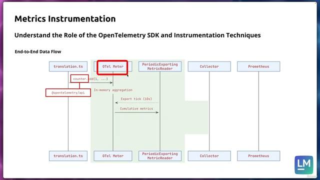
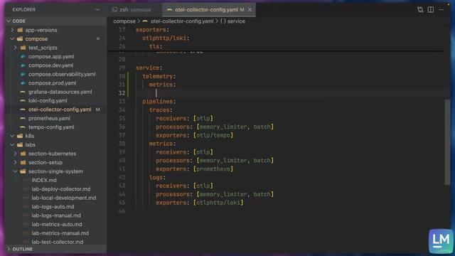
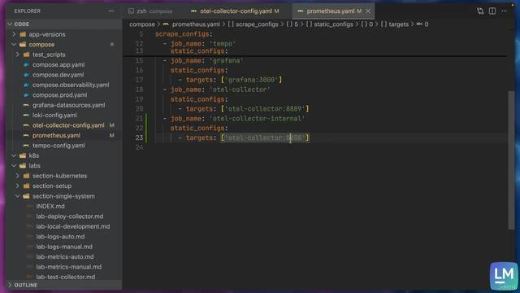
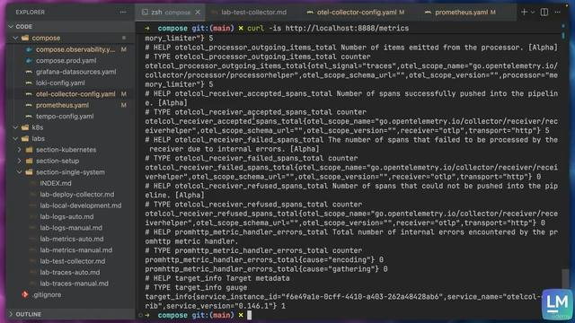
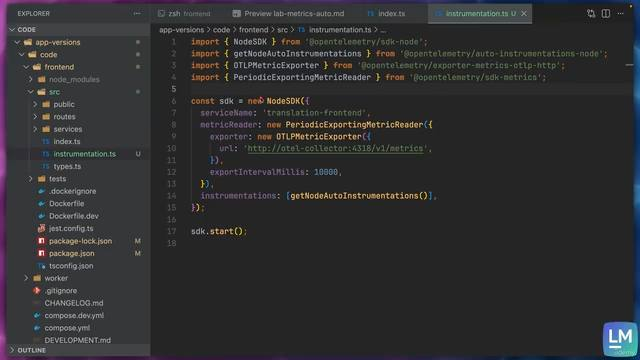
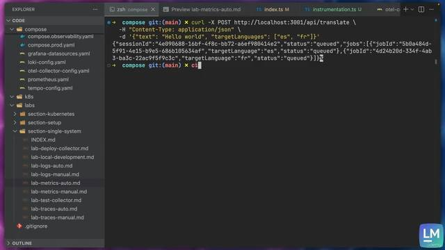
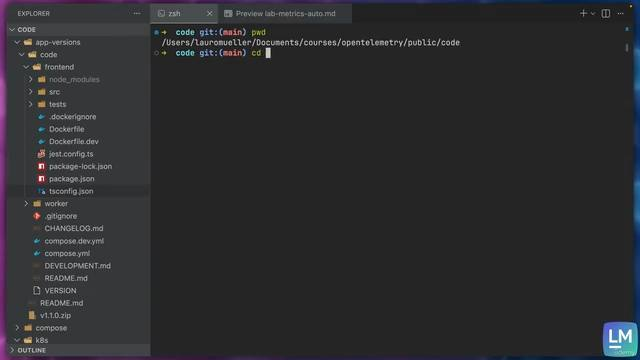
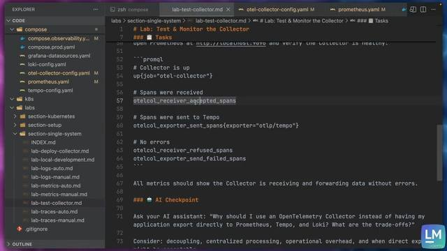
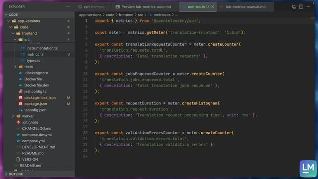
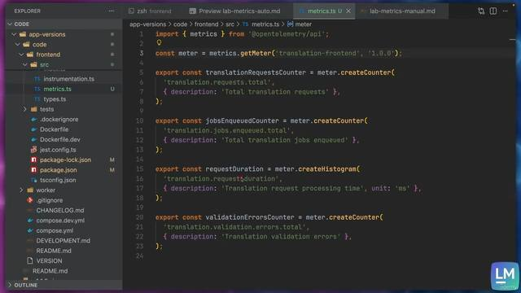

# OpenTelemetry 实战：暴露 Collector 内部指标 + 前端服务自动/手动插桩（P52–P57）

> 说明：本节覆盖 P52–P57。逐字稿是英文口述，本文引用讲师原话处均为中译，并保留原始时间戳。
> 注意一个诚实性前提：讲师在 P055 里说“copy the NPM command”“paste the code”，**具体包名、具体版本号并没有逐个念出来**（唯一明确念出的是 `@opentelemetry/api` 的 `1.9.0`）。本文给出的 `package.json` 依赖组合与 `instrumentation.ts`、`metrics.ts` 是按讲师口述的 API 形态复现的等价实现，凡是逐字稿没有逐字念出的标识符，我都会在正文里明确标出来。

---

## 1. 这一节做什么

这 6 节课串起来是一条完整的“指标上线链路”，目标有三个，缺一个都跑不通：

1. **P052**：让 OpenTelemetry Collector 把自己的内部指标暴露出来。前面几节里 `localhost:8889/metrics` 一直返回 200 但内容为空，讲师给的原因很明确：8889 上那个 prometheus exporter 暴露的是 **metrics pipeline 收到的数据**，也就是只包含从 OTLP receiver 进来的指标。你的应用还没插桩，所以它就是空的。想看到 Collector 自己的内部指标（收到多少 span、发出去多少 span），必须另开一个端点 8888。
2. **P053**：把“指标是怎么从一行 `counter.add(1)` 走到 Prometheus 的”这条链讲清楚：应用代码 → OpenTelemetry API 的 meter → 内存聚合 → PeriodicExportingMetricReader 每 10 秒推一次 → POST 到 Collector 的 `http://...:4318/v1/metrics` → Collector 在 `:8889/metrics` 上以 Prometheus 文本格式暴露 → Prometheus 抓取。
3. **P054–P057**：把上面这条链在前端服务上真的接起来。先做**自动插桩**（装包 + 写 `instrumentation.ts` + 在 `index.ts` 最顶上一行 import），再做**手动插桩**（新建 `metrics.ts` 定义 counter/histogram，然后在 `routes/translation.ts` 的 POST 处理器里埋点）。

产出物是：Collector 配置多一段 `telemetry`，Prometheus 多一个 scrape job，compose 多映射一个 8888 端口，前端多两个文件（`instrumentation.ts`、`metrics.ts`）和 `index.ts`、`translation.ts` 的若干行改动。做完之后，Grafana 里既能查到 `otelcol_*` 的 Collector 内部指标，也能查到 `translation_*` 的业务指标。

---

## 2. 讲师原话（带「—— pNNN [MM:SS]」）

关于“为什么 8889 是空的”：

> “即使它能工作、返回 200 OK，它也没有返回任何指标。原因是这个 exporter 暴露的指标，实际上只是通过 OTLP receiver 接收到的指标。” —— p052 [00:00]

> “如果我们要暴露 OpenTelemetry Collector 服务自身的内部指标，那就不能走这个 OTLP receiver。” —— p052 [00:29]

> “为了暴露它，我们实际上需要在这里加一个 Prometheus endpoint，用于我们的内部指标。” —— p052 [00:59]

关于配置的层级为什么这么啰嗦：

> “我会写 telemetry，然后下面有 metrics，再下面有 readers……是的，这有点啰嗦，但 schema 就是这样。” —— p052 [01:08]

> “host 用 0.0.0.0，端口是另一个端口，是 8888。” —— p052 [01:37]

关于“改了配置没生效”这个坑：

> “这是因为我们实际上没有重建或重启 Prometheus 服务本身。我们改了配置，但没有重启 Prometheus。” —— p052 [03:47]

> “因为它重启了 OpenTelemetry Collector 服务，而默认情况下这会重置指标。” —— p052 [05:23]

关于指标数据流（P053 的白板推导）：

> “这个 counter 来自 OpenTelemetry API 包，这是我们在定义指标时应该依赖的抽象。” —— p053 [00:49]

> “OpenTelemetry meter 会在内存里做一些聚合，不会立刻把指标数据转发出去……然后 periodic exporting metric reader 会在预设的间隔，比如 10 秒，触发一次导出。” —— p053 [00:49]

> “这些累计指标随后会通过 POST 请求发送到 collector 的 v1/metrics，然后 collector 让这些指标可以被 Prometheus 抓取，端口 8889，endpoint 是 /metrics。” —— p053 [01:19]



> “我们还有 getNodeAutoInstrumentations，它会为应用里的指标做自动插桩，几乎不用写代码就能拿到一批指标。” —— p053 [02:56]

关于自动插桩的顺序问题：

> “你应该更新 index.ts，在最顶部 import instrumentation 文件。这非常重要，因为自动插桩会对后续的 import 打补丁、做修改，所以它必须是第一个。” —— p054 [01:00]

关于自动插桩不提供 `/metrics`：

> “automatic instrumentation 并不像传统 Prometheus 插桩那样暴露一个 metrics endpoint。” —— p055 [04:35]

关于 `job` 变成 `exported_job`：

> “collector 会做一些数据转换。所以我们要找的其实不是 job 这个 key 本身……而是 exported job。一旦我们选中 exported job，就能看到 translation front end。” —— p055 [06:02]

关于为什么手动插桩要用 API 包：

> “第一行就是让你注意到，我们用的是 API 包，而不是 Node SDK。它提供了用于创建 metrics、traces、logs 的稳定标准化 API。” —— p057 [02:41]

> “API 的变化速度会明显慢于 SDK，所以只依赖 API 是明智的。” —— p057 [02:41]

> “这些 counter 是单调递增的，用来计数事件、错误、请求。我们不能减少它们的值，进程重启时它们会重置为零。” —— p057 [03:11]

关于标签基数（cardinality）：

> “这个数字 4 就是 error type 标签的基数。也就是说，如果我们有 20 种 error type，就可能仅凭这个标签产生 20 条时间序列……所以我们必须注意标签的基数，确保不要加一个无界基数的标签，那会让时间序列数量爆炸，拖慢我们的指标后端。” —— p057 [08:54]

---

## 3. 从零复现

假设你已经在前面几节把 `compose.observability.yaml`（含 Collector、Prometheus、Grafana、Tempo）跑起来了，Collector 的 4318 和 8889 也映射到了宿主机。

### 步骤 0：确认目录

```bash
# 观测栈（Collector / Prometheus / Grafana / Tempo）配置目录
cd <repo>/compose

# 前端服务代码目录（讲师在 P055 里 cd 的是 app-versions 下的 code/frontend）
cd <repo>/app-versions/code/frontend
```

路径以你仓库实际为准，课里只说了“app versions 下面的 front end”。

### 步骤 1：给 Collector 加 `telemetry` 段

打开 Collector 配置文件（前面几节你已经在这里配过 OTLP receiver 和 metrics pipeline），在**顶层**新增 `telemetry` 段。讲师的写法是 `telemetry` → `metrics` → `readers` → 列表里一个 `pull` 对象 → `exporter` → `prometheus` → `host` / `port`。



注意这里与 metrics pipeline 是**两个独立的东西**：pipeline 处理 OTLP 进来的数据（走 8889），`telemetry` 暴露 Collector 自身运行数据（走 8888）。

### 步骤 2：给 Prometheus 加一个 scrape job

在 `prometheus.yml` 的 `scrape_configs` 里新增一个 job，讲师给它取的名字是 `otel-collector-internal`，抓 8888：

```yaml
scrape_configs:
  - job_name: otel-collector-internal
    static_configs:
      - targets: ["otel-collector:8888"]
```

> 注意：`otel-collector` 这个主机名**课里没讲**，他只说了“8888 端口”。请换成你 compose 里 Collector 的服务名。



### 步骤 3：compose 里把 8888 暴露出去

讲师的原话是“在我们的 `compose.observability.yaml` 里需要暴露 8888 端口，好让其他服务能访问到”，他加的那行注释大意是 `otel internal metrics`：

```yaml
  otel-collector:
    ports:
      - "4318:4318"   # OTLP HTTP receiver（应用推指标到这里）
      - "8889:8889"   # metrics pipeline 的 prometheus exporter
      - "8888:8888"   # ← 本节新增：Collector 自身内部指标
```

### 步骤 4：重建 Collector，**并重启 Prometheus**

```bash
cd <repo>/compose
docker compose -f compose.observability.yaml up -d
```

然后——这一步是本节最容易踩的坑——**Prometheus 改了配置必须重启**：

```bash
docker compose -f compose.observability.yaml restart prometheus
```

讲师是在 Grafana 里查不到指标、去 Prometheus 的 targets 页面也没看到新 job，才反应过来“我们没重启 Prometheus”。

### 步骤 5：验证 8888 有数据、8889 仍然空

```bash
curl -s http://localhost:8888/metrics | head
curl -s http://localhost:8889/metrics | head
```

按讲师演示：8888 现在能看到指标了；8889 仍然是空的，因为应用还没插桩。



### 步骤 6：前端装依赖

```bash
cd <repo>/app-versions/code/frontend
npm install --save-exact \
  @opentelemetry/api@1.9.0 \
  @opentelemetry/sdk-node \
  @opentelemetry/sdk-metrics \
  @opentelemetry/exporter-metrics-otlp-http \
  @opentelemetry/auto-instrumentations-node
```

> `@opentelemetry/api@1.9.0` 是**逐字稿明确念出的版本**（讲师在 `node_modules/@opentelemetry/api` 里查到 1.9.0，并强调要用 `--save-exact` 精确锁定、不要 `^`）。其余四个包名课里没念，是按讲师描述的 SDK / metric reader / OTLP exporter / auto instrumentations 对应关系给的，请以 lab 页面给的 npm 命令为准。

### 步骤 7：写 `instrumentation.ts`，并在 `index.ts` 第一行 import

`instrumentation.ts` 放在与 `index.ts` **同级**的 `src/` 下。然后 `index.ts` 的**第一行**改成 `import './instrumentation';`。



### 步骤 8：重建前端、发流量

```bash
cd <repo>/compose
docker compose up -d --build
```

（讲师说的是“回到 compose 目录，跑 up build”。）

然后发请求：

```bash
# 触发一次翻译任务（讲师用的是 API 方式）
curl -X POST http://localhost:<前端端口>/api/translate \
  -H 'Content-Type: application/json' \
  -d '{"text":"hello","targetLanguages":["es","fr","de"]}'
```

再去 UI 上把三种语言各点一次翻译，制造更多流量。

### 步骤 9：确认 8889 终于有数据了

```bash
# 前端自己的 /metrics 会报错，这是预期行为
curl -s http://localhost:<前端端口>/metrics    # → Cannot GET /metrics

# 真正的指标在 Collector 的 8889
curl -s http://localhost:8889/metrics | grep http_server
```


### 步骤 10：在 Grafana 里用 `exported_job` 过滤

打开 Grafana → Prometheus 数据源 → Builder 模式 → 选 `http_server_duration_milliseconds_bucket` → 在 job 标签过滤器里你会发现只有 `open telemetry collector`；改成 **`exported_job`** 才能选到 `translation front end`。



### 步骤 11：手动插桩（P056–P057）

1. 新建 `src/metrics.ts`，定义 3 个 counter + 1 个 histogram，全部 export。
2. 在 `src/routes/translation.ts` 顶部 import 这些指标。
3. 在 POST 路由里，按讲师给的 4 个插入点埋点（见第 4 节）。
4. 再次 `docker compose up -d --build`。
5. 制造成功请求 + 空文本请求 + 非法语言请求，去 Prometheus 查 `translation_*`。

---

## 4. 完整代码

### 4.1 目录结构（本节涉及的文件）

```
<repo>/
├── compose/
│   ├── compose.observability.yaml      # 观测栈，新增 8888 端口映射
│   ├── otel-collector-config.yaml      # 新增顶层 telemetry 段
│   └── prometheus.yml                  # 新增 otel-collector-internal job
└── app-versions/code/frontend/
    ├── package.json                    # 新增 5 个依赖
    └── src/
        ├── index.ts                    # 第 1 行 import './instrumentation'
        ├── instrumentation.ts          # 【新文件，完整】
        ├── metrics.ts                  # 【新文件，完整】
        └── routes/
            └── translation.ts          # 新增 import + 4 处埋点
```

### 4.2 Collector 配置：新增的顶层 `telemetry` 段（完整片段）

```yaml
# compose/otel-collector-config.yaml
# 这段与 receivers / processors / exporters / service 平级，放在文件顶层
telemetry:
  metrics:
    readers:
      - pull:
          exporter:
            prometheus:
              host: 0.0.0.0
              port: 8888
```

其余内容（`otlp` receiver、metrics pipeline、`prometheus` exporter 监听 8889、tempo exporter 等）保持前面几节的写法不动。

### 4.3 `prometheus.yml`（完整文件，含新增 job）

```yaml
# compose/prometheus.yml
global:
  scrape_interval: 10s

scrape_configs:
  # 前面几节已有的：抓 Collector 的 metrics pipeline 输出（OTLP 进来的指标）
  - job_name: otel-collector
    static_configs:
      - targets: ["otel-collector:8889"]   # ← 主机名以你 compose 服务名为准

  # 本节新增：抓 Collector 自身的内部指标
  - job_name: otel-collector-internal
    static_configs:
      - targets: ["otel-collector:8888"]   # ← 主机名以你 compose 服务名为准
```

### 4.4 `compose.observability.yaml` 中 Collector 服务的端口（完整片段）

```yaml
services:
  otel-collector:
    # ... image / volumes / command 等保持原样
    ports:
      - "4318:4318"   # OTLP HTTP receiver
      - "8889:8889"   # metrics pipeline 的 prometheus exporter
      - "8888:8888"   # Collector 自身内部指标（本节新增）
```

### 4.5 `src/instrumentation.ts`（完整文件）

```ts
// src/instrumentation.ts
import { NodeSDK } from '@opentelemetry/sdk-node';
import { OTLPMetricExporter } from '@opentelemetry/exporter-metrics-otlp-http';
import { PeriodicExportingMetricReader } from '@opentelemetry/sdk-metrics';
import { getNodeAutoInstrumentations } from '@opentelemetry/auto-instrumentations-node';

/**
 * 1) 用 Node SDK 配置 OpenTelemetry
 * 2) metricReader 每 exportIntervalMillis 毫秒把指标推到 Collector 的 /v1/metrics
 * 3) instrumentations 打开 Node 自动插桩（HTTP 等指标开箱即用）
 */
const sdk = new NodeSDK({
  serviceName: 'translation-frontend',
  metricReader: new PeriodicExportingMetricReader({
    exporter: new OTLPMetricExporter({
      // 协议 http、端口 4318、路径 /v1/metrics；主机名换成你的 collector 服务名
      url: 'http://otel-collector:4318/v1/metrics',
    }),
    exportIntervalMillis: 10_000, // 10 秒导出一次
  }),
  instrumentations: [getNodeAutoInstrumentations()],
});

sdk.start();
```

> 两处“课里没讲”的细节：① Collector 的**主机名**课里没念，只说了 http / 4318 / `/v1/metrics`；② `serviceName` 这个字段名在不同 SDK 版本里可能叫别的（旧版走 `resource`），以你锁定的版本为准。

### 4.6 `src/index.ts` 顶部两行（完整片段）

```ts
// ⚠️ 必须是文件的第一条 import，不能挪到下面
import './instrumentation';

// ... 后面才是你原来的 express 初始化等代码
```



### 4.7 `src/metrics.ts`（完整文件）

```ts
// src/metrics.ts
// 注意：这里用的是 OpenTelemetry *API* 包，不是 SDK
import { metrics } from '@opentelemetry/api';

// 第二个参数是版本号，用于追踪指标定义是否发生过变化
const meter = metrics.getMeter('translation-frontend', '1.0.0');

/**
 * Counter：单调递增，用于计数请求 / 入队任务 / 校验错误
 * 命名规范：translation 前缀做命名空间 + 点分隔 + .total 后缀
 */
export const translationRequestsCounter = meter.createCounter(
  'translation.requests.total',
  {
    description: 'Total number of translation requests accepted',
    unit: '1',
  }
);

export const jobsQueuedCounter = meter.createCounter(
  'translation.jobs.queued.total',
  {
    description: 'Total number of translation jobs enqueued for workers',
    unit: '1',
  }
);

export const validationErrorsCounter = meter.createCounter(
  'translation.validation.errors.total',
  {
    description: 'Total number of request validation errors',
    unit: '1',
  }
);

/**
 * Histogram：记录请求时长的分布（在可配置的桶里）
 */
export const requestDurationHistogram = meter.createHistogram(
  'translation.request.duration',
  {
    description: 'Duration of the translation creation request in ms',
    unit: 'ms',
  }
);
```

> 说明：逐字稿只口述了这三个 counter 的**中文含义**（translation requests / jobs in queue / validation errors）和“还有一个 histogram 记录 request duration”，**没有逐字符念出指标标识符**。上面的名字是按讲师自己给出的命名规范（`translation.` 前缀、点分隔、counter 带 `.total`、histogram 带 `.duration`、写清 unit）构造的等价写法，你可以换成自己的名字。

### 4.8 `src/routes/translation.ts` 的改动（完整插入片段）

先加 import（放在文件顶部原有的 import 区域）：

```ts
import {
  translationRequestsCounter,
  jobsQueuedCounter,
  validationErrorsCounter,
  requestDurationHistogram,
} from '../metrics';
```

**插入点 1：body / text 校验（空文本 → 400）**

```ts
if (!req.body || typeof req.body.text !== 'string' || !req.body.text.trim()) {
  validationErrorsCounter.add(1, { error_type: 'empty_text' });
  return res.status(400).json({ error: 'Text is required' });
}
```

**插入点 2：targetLanguages 不是数组**

```ts
if (!req.body.targetLanguages || !Array.isArray(req.body.targetLanguages)) {
  validationErrorsCounter.add(1, { error_type: 'empty_languages' });
  return res.status(400).json({ error: 'targetLanguages must be an array' });
}
```

**插入点 3：存在不支持的语言（讲师把这一条放在文件下面一点）**

```ts
if (unsupportedLanguages.length > 0) {
  validationErrorsCounter.add(1, { error_type: 'invalid_languages' });
  return res.status(400).json({ error: 'Unsupported languages', unsupportedLanguages });
}
```

讲师在同一支路由里还额外演示了 `error_type: 'too_many_languages'`（他说这有点超出 lab 范围，属于“按项目需要决定要不要这么细”），所以 `error_type` 一共有 4 个取值。

**插入点 4：通过校验后计成功请求 + 请求时长 + 入队计数**

```ts
// 校验通过后，在创建 session 前后都可以，讲师的写法是在进入主流程时
translationRequestsCounter.add(1, {
  target_languages: req.body.targetLanguages.length.toString(),
});

// 记录本路由开始时间（只统计创建请求的耗时，不含后续异步翻译）
const start = Date.now();

// ... 原文件里已有的 session 创建逻辑保持不动 ...

// 对每个目标语言入队，入队成功后再计数
for (const targetLanguage of req.body.targetLanguages) {
  await queueService.enqueueJob(/* 原参数保持不动 */);
  jobsQueuedCounter.add(1, { language: targetLanguage });
}

// ... 原文件里已有的收尾逻辑保持不动 ...

// 在返回 201 之前记录耗时（注意 histogram 是 .record，不是 .add）
requestDurationHistogram.record(
  Date.now() - start,
  { target_languages: req.body.targetLanguages.length.toString() }
);

return res.status(201).json(/* 原响应体保持不动 */);
```

> `queueService`、`session` 的创建方式、201 的响应体都是**原文件已有的代码**，课里没逐个念，保持你仓库里的实现不动，只把上面标出来的几行插进去即可。

---

## 5. 逐行解释

### 5.1 为什么是 `telemetry` 而不是继续用 metrics pipeline

`receivers` / `processors` / `exporters` / `service.pipelines` 这套结构描述的是“**数据怎么流**”。你在 `service.pipelines.metrics` 里配了 `otlp` receiver 和 `prometheus` exporter（8889），含义是“把从 OTLP 端口 4318 收进来的 metrics，用 Prometheus 格式在 8889 上暴露”。应用没插桩 → 4318 没收到任何 metrics → 8889 就是空的，但它仍然返回 200，因为**端点本身是健康的，只是没有数据**。这就是讲师说的“它工作正常、返回 200，但没有返回任何指标”。

而 `telemetry` 段是 Collector **自身**的可观测性配置，属于 `service::telemetry` 语义下的独立子系统，不走 pipeline。所以它必须单开端口：8888。两个端口职责完全不同，别混：

| 端口 | 谁的指标 | 数据来源 | 谁抓它 |
|---|---|---|---|
| 8889 | 你应用的指标 | OTLP receiver 收到的 | Prometheus（job `otel-collector`） |
| 8888 | Collector 自己的指标 | Collector 内部运行时 | Prometheus（job `otel-collector-internal`） |

### 5.2 `readers` → `pull` → `exporter` → `prometheus` 这四层为什么这么深

`readers` 是“读取方式”的列表，`pull` 表示**被动拉取**（Prometheus 那种 scrape 模型），对应还有 push 型 reader。`exporter.prometheus` 指定了输出格式是 Prometheus 文本格式，`host` / `port` 是监听地址。讲师自己也说了“这有点啰嗦，但 schema 就是这样”——YAML 的嵌套深度是被 schema 决定的，不是可以简化的风格问题。

`host: 0.0.0.0` 而不是 `127.0.0.1`：因为 Prometheus 在**另一个容器**里，走的是容器网络。绑 `127.0.0.1` 就只有 Collector 自己能访问到。这一点在 JS/Node 里类比就是 `app.listen(port, '0.0.0.0')` 和 `app.listen(port, 'localhost')` 的区别——容器场景必须前者。

### 5.3 为什么 prometheus.yml 改完必须重启

Prometheus 默认不是热加载 `prometheus.yml` 的（除非你显式开了 `--web.enable-lifecycle` 并调 `/-/reload`，课里没讲这个）。讲师现场就撞上了：Grafana 里搜 `otel col` 什么都没有，去 Prometheus 的 targets 页面也看不到 internal 这个 job，原因就是“我们改了配置，但没重启 Prometheus”。`docker compose restart prometheus` 之后，targets 里立刻出现 `open telemetry collector internal`，状态变 UP。

顺带：`restart` 后 targets 页里原来的 `open telemetry collector` 会短暂显示 unknown，刷新一下就好——这是采集周期还没到的正常现象，不是配置错了。

### 5.4 `docker compose up -d` 会不会自动带上新配置

`up -d` 在检测到 service 配置或镜像变化时会重建容器，所以 Collector 会因为 compose 里多了一行端口映射而被重建。但**Prometheus 的配置文件是通过 volume 挂进去的**，文件内容变了容器本身没变，`up -d` 不会重建它——这就是为什么要单独 `restart prometheus`。

另外讲师特别提醒：**重启 Collector 会重置它的内部指标**。他先发了 5 个 span，重启后再发 5 个，Grafana 里 `accepted spans total` 只显示 5，不是 10。因为 Collector 内部指标是进程内存里的累计值，进程一重启就归零。这跟 Prometheus 的 counter 语义不一样（Prometheus 端会处理 counter reset）。



### 5.5 `instrumentation.ts` 逐行

- `new NodeSDK({...})`：讲师的原话是“配置 SDK”——对照 P053 讲的 API/SDK 分层，API 是抽象（你写业务代码时依赖它），SDK 是具体实现（负责聚合、导出）。这里配置的就是实现层。
- `serviceName`：给这批遥测数据打上服务身份，后面在 Grafana 里区分 `translation-frontend` 靠它。
- `new PeriodicExportingMetricReader({...})`：这就是 P053 白板上那个“每 10 秒触发一次导出”的组件。
- `new OTLPMetricExporter({ url: 'http://...:4318/v1/metrics' })`：P053 明确说了“通过 POST 请求发到 collector 的 v1/metrics”，4318 是 Collector 的 OTLP HTTP receiver 端口。这条数据进了 receiver 之后才会走 metrics pipeline，最后出现在 8889 上。
- `exportIntervalMillis: 10_000`：导出间隔，毫秒。讲师原话“就是数据导出到这个 metrics endpoint 的间隔（毫秒）”。
- `getNodeAutoInstrumentations()`：自动插桩集合，讲师说“几乎不用写代码就能拿到一批指标”。
- `sdk.start()`：讲师原话“启动 SDK，意味着真正开始产生遥测数据的逻辑”。

### 5.6 为什么 `import './instrumentation'` 必须在最顶上

P054 讲得很直接：自动插桩的原理是**对后续 import 的模块打补丁**（比如 patch `http` 模块来统计请求耗时）。ES Module 的 import 会被提升到模块顶部并按顺序执行，如果你的业务代码（比如 `express`）在 `./instrumentation` 之前被 import 并初始化了，补丁就打不上，或者打上了也统计不到最早的请求。在 Node 里这条规则等价于“instrumentation 必须是进程里第一个被 require 的业务模块”。

### 5.7 为什么前端 `/metrics` 报错、指标却在 8889

`getNodeAutoInstrumentations()` 走的是 **OTLP push** 模型：它不提供 HTTP endpoint 让人来抓，而是主动往 4318 推。所以访问前端自己的 `/metrics` 得到 `Cannot GET /metrics` 是**正确行为**，不是配置错误。你要看指标，只能去 Collector 的 8889（那是 Collector 帮你转成 Prometheus 拉取格式的）。

### 5.8 `job` 为什么变成了 `exported_job`

这是 Prometheus exporter 的 target 语义：这条时间序列是被 `otel-collector` 这个 job 抓到的，所以 `job="otel-collector"`；而指标**原始归属**的 job 会被挪到 `exported_job` 标签里，值就是你在 `serviceName` 里写的 `translation-frontend`。所以 Grafana 里按 `job` 过滤只能看到 collector，必须切到 `exported_job`。讲师原话：“这不太直观，但知道这一点是好事。”

### 5.9 `metrics.ts` 逐行

- `import { metrics } from '@opentelemetry/api'`：**只依赖 API 包，不依赖 SDK**。讲师强调 API 变化慢、SDK 变化快，业务代码绑 API 更稳。这也解释了为什么 P057 要单独装 `@opentelemetry/api@1.9.0`：它虽然作为传递依赖已经躺在 `node_modules` 里了，但你**自己的代码直接 import 了它**，就该写进 `package.json`。
- `--save-exact` 而不是 `--save`：讲师现场发现 `package.json` 里被写成了 `^1.9.0`（版本约束），他说“这不是我想要的，我想去掉它”，并回头把 lab 文档里的命令也改成了 `--save-exact`，保证大家版本一致。
- `metrics.getMeter('translation-frontend', '1.0.0')`：取一个 meter 实例，第一个参数通常是服务名或库名，第二个是版本。讲师说“可以有多个 meter”“版本字段在指标定义变化时有用，对我们这个项目不太重要，但知道它为什么存在是好事”。
- `createCounter` 的三个：counter 是**单调递增**的，不能减，进程重启归零。这是 Prometheus counter 的老规矩，在 JS 里你没法 `counter.sub(1)`，要表达“减少”得用 up-down counter 或 gauge（课里没做）。
- `createHistogram` + `unit: 'ms'`：histogram 记录的是**分布**（在可配置的桶里计数），不是单个值，所以后面用 `.record()` 而不是 `.add()`。讲师提到还有 gauge，但这个 lab 里没做。



### 5.10 命名规范（讲师专门花时间讲的一段）

- 用**点**做分隔符，导出到 Prometheus 时会自动替换成**下划线**（`translation.requests.total` → `translation_requests_total`）。
- counter 加 `.total` 后缀，histogram 加 `.duration` 这类后缀（讲师说也可以加 `.count`，看情况）。
- histogram 要写清 unit。
- **加命名空间前缀**（这里统一用 `translation.`），目的是降低和你自动插桩出来的指标（`http_server_duration_milliseconds_*` 之类）撞名的概率。
- “要具体，但不要啰嗦到过度”。



### 5.11 `translation.ts` 的 4 处埋点为什么放在这些位置

- **每次 `return res.status(400)` 之前加 counter**：讲师特别说明“我总是在发送响应之前递增计数器，这样我知道它不会再加第二次”。放在 return 之后永远执行不到，放在分支外面又会漏。
- **`translationRequestsCounter.add(1)` 放在校验通过之后**：因为它的语义是“被接受的翻译请求”，校验失败的请求已经计入 `validation_errors` 了，不该重复计。
- **`jobsQueuedCounter.add(1)` 放在 `await queueService.enqueueJob(...)` 之后**：只有真正入队成功才算“入队了一个任务”。放在循环外面会漏掉“每种语言一个任务”这个事实，放在 `await` 之前则会把入队失败也算进去。
- **histogram 的 `start = Date.now()` 放在主流程开始、`.record()` 放在返回 201 之前**：讲师明确说“这不是整个翻译过程的耗时，而是创建请求的耗时，因为我们只在插桩前端”。这个边界很重要——如果你把异步翻译的耗时也算进去，指标含义就变了。
- 属性值用了 `.length.toString()`：因为标签值要是字符串。`target_languages` 记的是“这次请求要翻几种语言”，是一个小基数（1、2、3……）的标签。
- **基数警告**：`error_type` 只有 4 个取值 → 基数 4。如果标签值来自用户输入（比如把 `sessionId` 当标签、把原始错误信息当标签），基数会无界增长，时间序列数量爆炸，Prometheus 会被拖死。这是本段最重要的工程约束，比代码本身重要。

---

## 6. 复现检查清单

按顺序打勾，任何一项不过就别往下走。

**阶段一：Collector 内部指标（P052）**

- [ ] Collector 配置文件顶层有 `telemetry.metrics.readers[0].pull.exporter.prometheus`，host `0.0.0.0`，port `8888`
- [ ] `prometheus.yml` 里有 `job_name: otel-collector-internal`，target 指向 `<collector 服务名>:8888`
- [ ] `compose.observability.yaml` 里 Collector 的 `ports` 有 `"8888:8888"`
- [ ] 执行过 `docker compose -f compose.observability.yaml up -d`（Collector 被重建）
- [ ] 执行过 `docker compose -f compose.observability.yaml restart prometheus`
- [ ] `curl -s localhost:8888/metrics` 有内容（不再是空的）
- [ ] `curl -s localhost:8889/metrics` 此时**仍然**没有应用指标（说明你还没插桩，符合预期）
- [ ] Prometheus UI → Status → Targets 里能看到新 job 且状态是 UP
- [ ] Grafana/Prometheus 里能查到 `otelcol_receiver_accepted_spans`（含 `_total` 版本，具体后缀以实际输出为准）
- [ ] 能查到 exporter 维度的 sent spans 指标，并可按 `exporter="tempo"` 过滤

**阶段二：自动插桩（P054–P055）**

- [ ] 在 `app-versions/code/frontend` 下装完依赖，`package.json` 里有 `@opentelemetry/api`（精确 `1.9.0`，无 `^`）
- [ ] `src/instrumentation.ts` 已创建，export 了 `sdk.start()`
- [ ] `src/index.ts` 的**第一条 import** 是 `import './instrumentation';`
- [ ] `docker compose up -d --build` 成功，前端容器起来
- [ ] 访问前端 `/metrics` 返回 `Cannot GET /metrics`（这是**预期**，不算失败）
- [ ] 发过至少一次翻译请求（curl 或 UI）
- [ ] `curl -s localhost:8889/metrics | grep http_server` 有输出
- [ ] 在 8889 输出里能看到 `job` 相关标签
- [ ] Grafana 里 `http_server_duration_milliseconds_bucket` 的标签过滤切成 `exported_job` 后能选到 `translation-frontend`

**阶段三：手动插桩（P056–P057）**

- [ ] `src/metrics.ts` 已创建，3 个 counter + 1 个 histogram，全部 `export`
- [ ] `metrics.ts` 从 `@opentelemetry/api` import，不是从 SDK
- [ ] `routes/translation.ts` 顶部 import 了这 4 个指标
- [ ] 4 个校验分支各自在 `return res.status(400)` **之前**调用了 `validationErrorsCounter.add(1, { error_type: ... })`
- [ ] 成功路径上调用了 `translationRequestsCounter.add(1, ...)`
- [ ] 入队循环里在 `await queueService.enqueueJob(...)` **之后**调用了 `jobsQueuedCounter.add(1, { language })`
- [ ] 请求耗时用的是 `.record()` 而不是 `.add()`
- [ ] 重新 `up -d --build` 后，发了 1 次成功请求 + 1 次空文本请求 + 1 次非法语言请求
- [ ] Prometheus 里能查到 `translation_requests_total`（点号已变下划线）
- [ ] 能按 `error_type` 过滤出不同的错误类型
- [ ] `error_type` 的取值数量是你预期的（讲师版本是 4 个），没有用户输入被当成标签值

---

## 7. 课里没讲但你会撞上的

1. **8888 只映射了没绑 0.0.0.0 的情况**。`telemetry` 里写 `0.0.0.0` 是对的，但如果你 compose 里只写了 `"8888:8888"` 却没重建容器，宿主机上照样 `curl` 不通。判断方法：`docker compose ps` 看端口那一列有没有 8888。

2. **Prometheus 的 target 里写了 `localhost:8888`**。Prometheus 本身跑在容器里，`localhost` 指的是 Prometheus 自己，不是 Collector。必须用 compose 里的**服务名**。课里从头到尾没念过 Collector 的服务名，只说了端口 8888，这一点务必按你的 compose 文件填。

3. **Collector 服务名和 8889 那个 job 的主机名必须是同一个**，否则你会以为“8889 有问题”，其实是两个 job 里有一个连不上。

4. **改了 `prometheus.yml` 但没重启**，这是课里已经踩过的坑，但它在实践中会反复出现：任何通过 volume 挂进去的配置文件（`prometheus.yml`、`otel-collector-config.yaml`、Grafana 的 provisioning 文件）改完都不一定生效。最稳的做法是 `docker compose restart <service>`，Collector 配置改动较大时直接 `up -d --force-recreate`。

5. **`otelcol_*` 指标名在 Grafana 里搜不到**。两个原因：一是 Collector 刚重启、还没到一个采集周期（Prometheus 的 `scrape_interval` 通常是 10–15 秒，课里没讲具体值）；二是这个 job 根本没起来（回去看 targets）。另外 Grafana 的 builder 补全有时候会缓存，讲师自己也在页面里刷新了好几次。

6. **Collector 重启后指标归零**。任何对 `otelcol_*` 的“总数”类指标的解读，都要先看 Collector 的启动时间，否则你会以为数据丢了。这是课里明确讲过的。

7. **`Cannot GET /metrics` 不是 bug**。`getNodeAutoInstrumentations()` 是 push 模型。如果你确实想让前端自己暴露 Prometheus 端点，需要额外加 `@opentelemetry/exporter-prometheus`（**课里没讲**，不在本节范围内）。

8. **自动插桩导致启动变慢 / 依赖体积暴涨**。`@opentelemetry/auto-instrumentations-node` 一次性带上大量 instrumentations，冷启动会明显变慢，容器内存占用也会上升。课里没讲怎么按需裁剪（`getNodeAutoInstrumentations({ '@opentelemetry/instrumentation-fs': { enabled: false } })` 这种写法是官方能力，但**讲师没提**，是否使用自行判断）。

9. **TypeScript 编译后 `import './instrumentation'` 的顺序**。如果你的 `tsconfig` 是 `module: commonjs`，`import` 会被编译成 `require`，顺序保留，没问题。但如果你的构建工具有 tree-shaking 或懒加载，`instrumentation.ts` 里那些“只为了副作用”的 import 有可能被摇掉。判断方法：看编译产物里 `require("./instrumentation")` 是不是第一条。

10. **`serviceName` 字段名随 SDK 版本变化**。讲师锁了 `@opentelemetry/api@1.9.0`，但没有锁 SDK 系列版本。如果你装到的 `@opentelemetry/sdk-node` 版本比较新/比较旧，`NodeSDK` 的构造参数名可能有差异（例如资源相关的配置方式）。报错信息通常会直接告诉你哪个字段不被识别。**课里只讲了“提供 service name”这件事，没讲版本兼容。**

11. **手动埋点和自动埋点的指标会并存**。你在 Grafana 里会同时看到 `http_server_duration_milliseconds_*`（自动）和 `translation_request_duration_*`（手动）。前者统计的是 HTTP 层，后者只统计 `/api/translate` 这一个路由的业务耗时，两者不是重复，是两个视角。讲师在 P057 结尾也说了“我只聚焦 POST /api/translate 这一条路由，因为它是业务上最有意义的”。

12. **标签基数失控是最容易埋的雷**。本节里 `target_languages` 是安全的（取值 1–3），`error_type` 是安全的（4 个枚举）。但如果你顺手把 `sessionId`、`jobId`、用户输入的语言字符串原样当标签，时间序列数量会随流量线性增长，Prometheus 内存直接顶到天花板。讲师在 P057 [08:54] 专门讲了这个，这是本节最值得带走的工程结论。