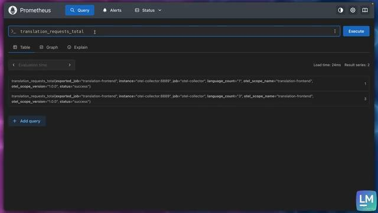
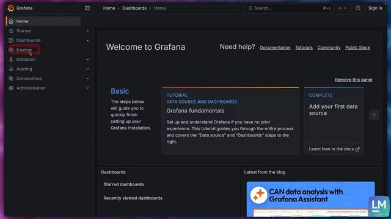
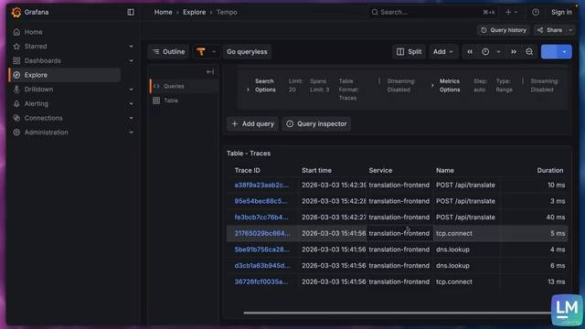
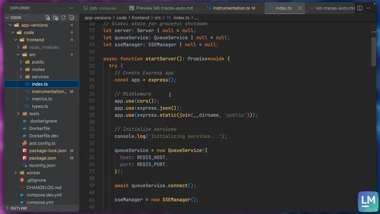
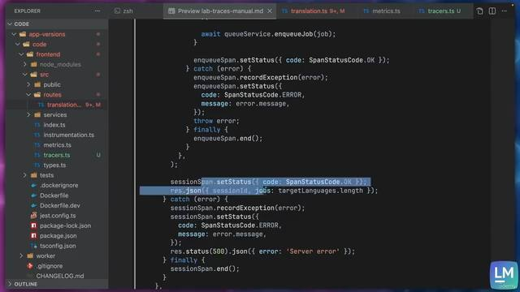
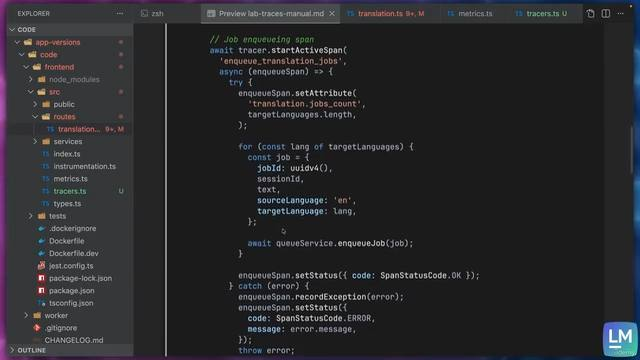

# OpenTelemetry 实战：前端服务接入 Traces（P058–P063）

> 适用读者：前端转 AI 应用工程师。本节涉及 Node/Express/TypeScript，Java 语法一律标注「知道即可」。涉及异步/并发的地方会补一句「在 JS/Node 里对应什么」。

---

## 1. 这一节做什么

这一节把前面已经跑起来的「翻译应用」（前端 Express 服务 + Redis 队列 + Worker + Prometheus + Grafana + Tempo + OpenTelemetry Collector）从**只有 Metrics** 推进到**有 Traces**。具体做三件事：

1. **P058**：验证上一节手工埋的 Metrics 是否真的进了 Prometheus，并在 Prometheus UI 里用 PromQL 查询 `translation_requests_total`、`translation_jobs_in_queue`、`translation_validation_errors_total` 等指标，理解「按 language_count / target_language / error_type 拆成多条时间序列」的基数（cardinality）概念。
2. **P059**：理论课，讲清楚一条 trace 从 client → Express → route handler → SDK → Collector → Tempo 的流转，以及 auto instrumentation 与 manual instrumentation 的分工。
3. **P060–P061**：给**前端服务**加 auto instrumentation 的 trace exporter（只改 4 行左右 + 装 1 个包），然后在 Grafana → Explore → Tempo 里看到 `translation-frontend` 的 span 树。
4. **P062–P063**：在 `translation.ts` 路由里做**手工埋点**：创建 `create translation session` 父 span，其下挂 `validate request` 和 `enqueue translation jobs` 两个子 span，设置业务属性（session id、target languages、text length 等），并在 `finally` 里确保 span 一定被 end。

这四步的顺序有依赖关系，不是随便排的：先在 Prometheus 里确认 Metrics 已经进库，等于验证了「SDK → exporter → collector → 后端」这条链路在 metrics 这一侧是通的；Trace 复用的是同一个 collector，所以后面 trace 不通时，基本可以排除 collector 本身的问题，把注意力放在 trace exporter 的配置上。P059 的理论课放在动手之前，是为了让你在改代码前就知道每个 span 应该长什么样。P060–P061 的 auto instrumentation 是「不改业务代码就能看到 HTTP / Redis 等框架层 span」，P062–P063 的手工埋点则是「在框架层之上补业务语义」，两者是叠加关系，不是替代关系。

最终产物：一个能在 Grafana Tempo 里看到「一次 POST /api/translate 请求内部到底做了哪些业务步骤」的可观测系统。

---

## 2. 讲师原话（带「—— pNNN [MM:SS]」）

关于 Metrics 验证：

> "As you can see here, we already have our metrics actually showing up in our UI. So if we were to say translation request totals, for example, and then we were to execute that... you will see that we now have here two time series and if you take a little bit of time to have a look at this you will see that the difference is actually in the language count" —— p058 [02:16]

> "if we want to actually get all of them, then we should just sum this like so... you will see that we get four in the end here." —— p058 [03:00]

关于 trace 数据流：

> "The client is going to send a post request to let's say port slash translate... The node HTTP auto instrumentation here is going to start to span for the post port slash translate request." —— p059 [00:29]

> "once these applications or once the logic here to actually enqueue the jobs and create the translation job is completed then the route handler will also end these specific spans here." —— p059 [01:44]

> "So basically starting the or calling the start active span automatically sets the new span as a child of the currently active" —— p059 [03:31]

关于 auto instrumentation 的最小改动：

> "This is just going to be the exporter trace OTLP HTTP." —— p061 [00:00]

> "we really did change about how many four lines of code plus one library that we had to install here. But with only that, we already start seeing traces in our tempo back end." —— p061 [07:00]

关于手工埋点的设计意图：

> "So we're going to create a create translation session span here and then within this span we're going to set some attributes to this span. We'll also create here within this span we're going to create child span." —— p062 [00:00]

> "I want to have a code that you can read and immediately understand what is doing what here within this logic" —— p062 [00:59]

> "we do need to actually wrap this in a try catch finally statement because independently of what happens within this here, we want to make sure that we execute that we end this validation span" —— p063 [07:12]

关于 tracer 单独抽文件：

> "I'm not going to create this tracer within our translation route file. And that's because we might want use this tracer for multiple purposes also outside of the translation.ts file" —— p063 [00:00]

---

## 3. 从零复现

### 3.1 前置状态确认

假设你已经完成了上一节（Metrics 埋点），目录结构大致如下（课里没给出完整树，以下按讲师操作路径推断，路径名以你实际项目为准）：

```
<repo>/
├── compose/
│   └── docker-compose.yml        # 前端、worker、redis、prometheus、grafana、tempo、otel-collector
├── code/
│   ├── frontend/                 # Express + TypeScript 前端服务
│   │   ├── package.json
│   │   ├── package-lock.json
│   │   ├── Dockerfile
│   │   └── src/
│   │       ├── instrumentation.ts
│   │       ├── traces.ts         # 本节新建
│   │       └── routes/
│   │           └── translation.ts
│   └── worker/
```

动手前先自查两件事：`ls code/frontend/src` 里必须能看到 `instrumentation.ts`，否则说明上一节的 SDK 初始化没有落地，本节的 trace exporter 无处可挂，必须先回去补；`compose/docker-compose.yml` 里必须存在 `otel-collector` 服务，否则后面配置 endpoint 时没有目标，不要跳过这一步直接往下写代码。

### 3.2 步骤一：验证 Metrics（P058）

1. 进入 `compose/` 目录，重建前端（因为上一节改了 `package.json` / `package-lock.json`）：

```bash
cd <repo>/compose
docker compose up --build -d frontend
```

命令里的三个参数各有作用：`--build` 强制重新执行 Dockerfile 的构建阶段，把 `package-lock.json` 里的新依赖装进镜像；`-d` 是 detached，把容器放后台；只写服务名 `frontend` 时，compose 会自动带上它 `depends_on` 的服务。重建后如果 `docker compose ps` 里 frontend 显示 `Exit` 或 `Restarting`，先看 `docker compose logs --tail=50 frontend`，最常见的原因是 lock 文件与 package.json 不一致（`npm ci` 失败）和端口被占用。

2. 确认所有服务在跑：

```bash
docker compose ps
```

课里看到的是 front-end、Grafana、Auto Collector、Prometheus、Redis、Tempo、worker 全部 running。

3. 用 curl 打几条请求制造数据（讲师在终端直接发 POST，具体 body 结构以你项目为准）：

```bash
# 正常请求
curl -X POST http://localhost:<前端端口>/api/translate \
  -H 'Content-Type: application/json' \
  -d '{"text":"hello","targetLanguages":["es","fr","de"]}'

# 空 text（触发 empty text 校验错误）
curl -X POST http://localhost:<前端端口>/api/translate \
  -H 'Content-Type: application/json' \
  -d '{"text":"","targetLanguages":["es"]}'

# 空 targetLanguages（触发 empty languages 校验错误）
curl -X POST http://localhost:<前端端口>/api/translate \
  -H 'Content-Type: application/json' \
  -d '{"text":"hello","targetLanguages":[]}'

# 不支持的语言（触发 invalid languages 校验错误）
curl -X POST http://localhost:<前端端口>/api/translate \
  -H 'Content-Type: application/json' \
  -d '{"text":"hello","targetLanguages":["pt"]}'
```

这四条分别覆盖：合法请求、空 text、空语言列表、不支持的语言。`-H 'Content-Type: application/json'` 不能省，否则 Express 的 `express.json()` 不会解析 body，`req.body` 是空对象，你会误触发 empty text 而不是你以为的那条校验。每条请求发完看 HTTP 状态码：合法请求 200，其余三条 400。

4. 打开 Prometheus UI（`http://localhost:<prometheus端口>`），依次执行：

```promql
translation_requests_total
sum(translation_requests_total)
rate(translation_requests_total[5m])
translation_jobs_in_queue
translation_validation_errors_total
```

这里有一个容易混的点：`translation_requests_total` 是 counter，直接查它看到的是进程启动以来的累计值；`rate(...[5m])` 才是每秒速率。窗口不要设得太小，低流量下 `[1m]` 会大部分时间为 0，看起来像「没数据」。如果 `sum()` 的结果比你发送的请求数少，先等 15 秒再刷新，Prometheus 默认 15 秒 scrape 一次。

讲师在 p058 [02:37] 观察到 `translation_requests_total` 有两条时间序列，差异在 `language_count` 标签（一条是 3，一条是 1）；`sum(...)` 得到 4。`rate(...[5m])` 在 p058 [03:42] 显示 language_count=3 的序列约 0.007 req/s，language_count=1 的序列为 0。




### 3.3 步骤二：给前端加 auto instrumentation 的 trace exporter（P060–P061）

1. 进入前端目录，安装 OTLP HTTP trace exporter：

```bash
cd <repo>/code/frontend
npm install @opentelemetry/exporter-trace-otlp-http
```

这个包只包含 OTLP/HTTP 的 trace 序列化与发送逻辑，不含 SDK 本体；SDK 的 `NodeSDK` 来自上一节已经装的 `@opentelemetry/sdk-node`。安装动作发生在宿主机，但运行时用的是镜像里的 `node_modules`，所以后面必须 `--build` 重建，否则容器里 `require` 不到新包，启动就会报 `Cannot find module`。

2. 打开 `src/instrumentation.ts`，加一行 import，并在 SDK 配置里挂上 trace exporter。改动量约 4 行（讲师原话 p061 [07:00]）。

3. 重建前端镜像（因为 `package.json` / `package-lock.json` 变了）：

```bash
cd <repo>/compose
docker compose up --build -d frontend
docker compose ps
```

4. 打几条请求（讲师在 p061 [01:43] 发了 2–3 条，其中一条把目标语言改成 German 以制造差异）。

5. 打开 Grafana（`http://localhost:<grafana端口>`）→ 左侧 **Explore** → 数据源选 **Tempo** → 用 Search 面板，Service Name 选 `translation-frontend` → Run Query。

如果 Service Name 下拉是空的，不要以为服务没上报——先在 Search 的输入框里手动敲 `translation-frontend` 再 Run Query。Tempo 的 Search 下拉依赖它已经索引到的 service 列表，刚启动或刚发第一条 trace 时可能还没刷新。还查不到，就去 `docker compose logs otel-collector` 看有没有收到 OTLP 请求。





6. 点开一条 `POST /api/translate` 的 trace，能看到：顶层是 HTTP server span，其下依次有 cors / json parser / serve-static 三个 middleware span，再往下进入路由，出现 Redis 相关 span（含 connection string、执行的语句等属性）。



### 3.4 步骤三：手工埋点（P062–P063）

1. 新建 `src/traces.ts`，导出一个 tracer（见第 4 节完整代码）。
2. 修改 `src/routes/translation.ts`：
   - 顶部 import tracer 与 `SpanStatusCode`；
   - 在 `router.post` 里用 `tracer.startActiveSpan('create translation session', ...)` 包住整个处理逻辑；
   - 在验证逻辑外包一层 `validate request` 子 span，用 `try/finally` 保证 end；
   - 在入队逻辑外包一层 `enqueue translation jobs` 子 span，同样 `try/catch/finally`；
   - 父 span 在 `finally` 里 end，`catch` 里 `recordException`。
3. 保存后重建前端：

```bash
cd <repo>/compose
docker compose up --build -d frontend
```

4. 发两条请求（一条合法、一条非法），在 Grafana Tempo 里刷新查询，应能看到：
   - 失败的那条：`create translation session` 标红（error），`validate request` 也标红；
   - 成功的那条：`create translation session` 下挂 `validate request`（OK）与 `enqueue translation jobs`（OK），后者内部有 3 条 Redis push span（对应 3 个目标语言）。

`traces.ts` 在 `src/` 下，`translation.ts` 在 `src/routes/` 下，所以 import 路径是 `../traces`。写成 `./traces` 会在编译期报找不到模块。另外 `startActiveSpan` 的回调如果是 `async`，记得把内部的 `await` 都放在这个回调里，不要把一个未 await 的 Promise 丢出去，否则 span 会在异步操作完成前就 end。





---

## 4. 完整代码

> 说明：以下代码基于逐字稿描述重建。逐字稿是口述+屏幕操作，部分细节（如 SDK 配置里 exporter 的确切字段名、`translation.ts` 里 Redis 调用的具体方法名）讲师未逐字念出。凡是不确定的，我在代码里用注释标注「以你项目实际为准」，并在第 7 节列出。**不要照抄不确定的字段名，先对照你上一节已跑通的代码。**

### 4.1 `code/frontend/src/traces.ts`（新建）

```ts
// code/frontend/src/traces.ts
// 讲师在 p063 [00:00] 明确：tracer 单独抽文件，因为可能在 translation.ts 之外复用
import { trace } from '@opentelemetry/api';

// 'translation-frontend' 这个名称与 instrumentation.ts 里 resource 的 service name 保持一致
// 具体 tracer 名称以你项目实际为准，课里未逐字念出
export const tracer = trace.getTracer('translation-frontend');
```

### 4.2 `code/frontend/src/instrumentation.ts`（修改，加 trace exporter）

```ts
// code/frontend/src/instrumentation.ts
// 本节只加与 trace 相关的两处：import + traceExporter 配置
// 其余 metrics 相关配置沿用上一节，不要删

import { NodeSDK } from '@opentelemetry/sdk-node';
import { getNodeAutoInstrumentations } from '@opentelemetry/auto-instrumentations-node';

// ↓↓↓ 本节新增：trace exporter
import { OTLPTraceExporter } from '@opentelemetry/exporter-trace-otlp-http';

// 上一节已有的 metrics exporter（保留，不要动）
// import { OTLPMetricExporter } from '@opentelemetry/exporter-metrics-otlp-http';
// import { PeriodicExportingMetricReader } from '@opentelemetry/sdk-metrics';

const traceExporter = new OTLPTraceExporter({
  // 讲师在 p059 [02:26] 说明：课上先硬编码 endpoint，后续 lab 再抽掉硬编码
  // 具体 URL 以你 compose 里 otel-collector 暴露的端口为准
  url: 'http://otel-collector:4318/v1/traces',
});

const sdk = new NodeSDK({
  // serviceName 决定 Grafana Tempo 里 Search 面板能选到的值
  serviceName: 'translation-frontend',
  traceExporter,
  // metricReader: <上一节已有的配置，保留>,
  instrumentations: [getNodeAutoInstrumentations()],
});

sdk.start();
```

> 注意：`url` 里的 `otel-collector` 是 docker compose 里的服务名，容器间通信用服务名而非 localhost。端口 `4318` 是 OTLP/HTTP 的常见端口，**以你 compose 文件里 collector 实际映射的端口为准**。

### 4.3 `code/frontend/src/routes/translation.ts`（修改，手工埋点）

下面给出**结构骨架 + 关键埋点代码**。业务逻辑（Redis 入队、session 存储）沿用你上一节的实现，我只在埋点位置插入 span 代码，并用 `// ...原有逻辑...` 标注。

```ts
// code/frontend/src/routes/translation.ts
import { Router } from 'express';
import { SpanStatusCode } from '@opentelemetry/api';   // p063 [01:20] 讲师 import 的就是这个
import { tracer } from '../traces';                     // p063 [00:50]

const router = Router();

router.post('/api/translate', async (req, res) => {
  // 父 span：整个请求的业务入口
  tracer.startActiveSpan('create translation session', async (sessionSpan) => {
    try {
      // 从 body 解构，后续不再用 body.xxx（p063 [03:44] 讲师明确做了这个清理）
      const { text, targetLanguages } = req.body;

      // 父 span 的业务属性（p063 [03:44] 讲师贴的 session span attributes）
      sessionSpan.setAttribute('translation.text_length', text?.length ?? 0);
      sessionSpan.setAttribute('translation.target_languages', targetLanguages ?? []);
      sessionSpan.setAttribute(
        'translation.target_language_count',
        Array.isArray(targetLanguages) ? targetLanguages.length : 0
      );

      // ---------- 子 span 1：validate request ----------
      // p063 [03:14] 讲师在这里开 validate request span
      tracer.startActiveSpan('validate request', (validationSpan) => {
        try {
          // 空 text 校验（p063 [05:43]）
          if (!text || !text.trim()) {
            // 上一节已有的 counter，保留
            // validationErrorsCounter.add(1, { error_type: 'empty_text' });
            validationSpan.setStatus({
              code: SpanStatusCode.ERROR,
              message: 'empty text',
            });
            res.status(400).json({ error: 'empty text' });
            return;
          }

          // 空 targetLanguages 校验（p063 [06:43]）
          if (
            !Array.isArray(targetLanguages) ||
            targetLanguages.length === 0
          ) {
            // validationErrorsCounter.add(1, { error_type: 'empty_languages' });
            validationSpan.setStatus({
              code: SpanStatusCode.ERROR,
              message: 'empty languages',
            });
            res.status(400).json({ error: 'empty languages' });
            return;
          }

          // 语言数量上限校验（p063 [06:43] 讲师提到 maximum number of languages）
          // 上限值以你项目实际为准，课里未念出具体数字
          const MAX_LANGUAGES = 3;
          if (targetLanguages.length > MAX_LANGUAGES) {
            // validationErrorsCounter.add(1, { error_type: 'too_many_languages' });
            validationSpan.setStatus({
              code: SpanStatusCode.ERROR,
              message: 'too many languages',
            });
            res.status(400).json({ error: 'too many languages' });
            return;
          }

          // 逐个语言合法性校验（p063 [07:12] invalid languages）
          // 支持语言列表以你项目实际为准，课里只提到 Portuguese 不支持
          const SUPPORTED = ['en', 'es', 'fr', 'de'];
          for (const lang of targetLanguages) {
            if (!SUPPORTED.includes(lang)) {
              // validationErrorsCounter.add(1, { error_type: 'invalid_languages' });
              validationSpan.setStatus({
                code: SpanStatusCode.ERROR,
                message: 'invalid languages',
              });
              res.status(400).json({ error: 'invalid languages' });
              return;
            }
          }

          // 全部通过（p063 [08:47]）
          validationSpan.setStatus({ code: SpanStatusCode.OK });
        } finally {
          // p063 [07:47] 讲师强调：无论走哪条分支，validation span 必须 end
          validationSpan.end();
        }
      });

      // 如果 validation 里已经 return 了响应，这里要判断是否已发送
      // 讲师在 p063 [17:59] 提到过「headers already sent」的异步问题，见第 7 节
      if (res.headersSent) {
        return;
      }

      // ---------- 子 span 2：enqueue translation jobs ----------
      // p063 [10:00] 讲师在这里开 enqueue span
      // jobs / jobsList 定义在 span 外，以便 span 结束后仍可访问（p063 [13:52]）
      const sessionId = /* 生成 session id，以你项目实际为准 */ 'sess-' + Date.now();
      const jobs: any[] = [];
      const jobsList: any[] = [];

      tracer.startActiveSpan('enqueue translation jobs', (enqueueSpan) => {
        try {
          // 上一节已有的 counter，保留
          // translationRequestsCounter.add(1, { language_count: targetLanguages.length });

          // p063 [11:10] 讲师设置 enqueue span 属性
          enqueueSpan.setAttribute(
            'translation.target_language_count',
            targetLanguages.length
          );

          for (const lang of targetLanguages) {
            // 原有入队逻辑，以你项目实际为准
            // await queueService.enqueue({ sessionId, text, targetLanguage: lang });
            jobs.push({ sessionId, targetLanguage: lang });
            jobsList.push(lang);
          }

          enqueueSpan.setStatus({ code: SpanStatusCode.OK });
        } catch (err) {
          // p063 [12:09] 讲师：catch 里 recordException
          const error = err as Error;
          enqueueSpan.recordException(
            error instanceof Error ? error : new Error('unknown error')
          );
          enqueueSpan.setStatus({
            code: SpanStatusCode.ERROR,
            message: error instanceof Error ? error.message : 'unknown error',
          });
        } finally {
          // p063 [10:40] finally 里 end enqueue span
          enqueueSpan.end();
        }
      });

      // 原有 session 存储逻辑（p063 [13:52] 讲师把它放在 enqueue span 之后）
      // await sessionStore.save(sessionId, { jobs, jobsList });

      // 父 span 标记成功（p063 [15:58]）
      sessionSpan.setStatus({ code: SpanStatusCode.OK });
      res.json({ sessionId, jobs });
    } catch (err) {
      // p063 [15:21] 父 span 的 catch：recordException
      const error = err as Error;
      sessionSpan.recordException(
        error instanceof Error ? error : new Error('unknown error')
      );
      sessionSpan.setStatus({
        code: SpanStatusCode.ERROR,
        message: error instanceof Error ? error.message : 'unknown error',
      });
      if (!res.headersSent) {
        res.status(500).json({ error: 'internal error' });
      }
    } finally {
      // p063 [14:51] 父 span 的 finally：必须 end
      sessionSpan.end();
    }
  });
});

export default router;
```

### 4.4 依赖清单（`code/frontend/package.json` 关键项）

```json
{
  "dependencies": {
    "@opentelemetry/api": "^1.x",
    "@opentelemetry/sdk-node": "^0.x",
    "@opentelemetry/auto-instrumentations-node": "^0.x",
    "@opentelemetry/exporter-trace-otlp-http": "^0.x",
    "@opentelemetry/exporter-metrics-otlp-http": "^0.x"
  }
}
```

> 版本号以你 `npm install` 实际写入的为准，课里未念版本号。`@opentelemetry/api` 的 `trace.getTracer` 与 `SpanStatusCode` 都来自这个包。

---

## 5. 逐行解释

**`traces.ts` 为什么单独抽文件**：讲师 p063 [00:00] 明确说「might want use this tracer for multiple purposes also outside of the translation.ts file」。如果你把 tracer 写在路由文件里，将来 worker 或别的路由要用就得复制。抽出来是单一实例，符合 OpenTelemetry 的 tracer 语义（tracer 本身无状态，可复用）。

**`trace.getTracer('translation-frontend')` 里的名字**：这是 tracer 的 instrumentation scope name，会出现在 span 的 instrumentation scope 字段里。它和 `instrumentation.ts` 里 `serviceName: 'translation-frontend'` 是两个不同概念——前者标识「哪个 tracer 创建的 span」，后者标识「哪个服务」。课里两者用了相近字符串，但不要混淆。

**`OTLPTraceExporter` 的 `url`**：p059 [02:26] 讲师说「configure the trace exporter to actually send the traces data to a specific URL」，并明确课上先硬编码。容器内访问 collector 用 compose 服务名，不是 localhost。端口以你 compose 为准。

**`startActiveSpan` 的父子关系**：p059 [03:31] 讲师原话「calling the start active span automatically sets the new span as a child of the currently active」。这是 OpenTelemetry 的 context 传播机制——不需要手动传 parent。**在 JS/Node 里对应什么**：它依赖 `AsyncLocalStorage` 做上下文传播，所以 `await` 之后 context 仍然有效；但如果你把逻辑丢进 `setTimeout` 且没被 auto instrumentation 覆盖，context 可能丢。这是 Node 特有的坑，Java 里对应 ThreadLocal + ContextStorage（知道即可）。

**为什么 `validate request` 用 `try/finally` 而不是 `try/catch/finally`**：p063 [07:12] 讲师说「independently of what happens within this here, we want to make sure that we execute that we end this validation span」。校验分支里都是 `return`，没有抛异常，所以 catch 不是必需；但 finally 必须有，否则提前 return 会导致 span 永不 end，Tempo 里会看到「未完成的 span」。

**为什么 `enqueue translation jobs` 用 `try/catch/finally`**：入队涉及 Redis 调用，可能抛异常。p063 [12:09] 讲师明确 catch 里要 `recordException`。`recordException` 会把异常作为 span event 记录（Tempo UI 里能在 Events 标签看到），同时讲师还手动 `setStatus(ERROR)`——两者要都做，因为 `recordException` 本身不改 status。

**`error as Error` 与 `instanceof Error`**：p063 [12:39] 讲师说「caught exceptions they are by default of type unknown」。TypeScript 4.4+ 的 `useUnknownInCatchVariables` 默认开启，所以 `catch (err)` 的 `err` 是 `unknown`。讲师的做法是强转 + `instanceof` 双保险。**知道即可**：这是 TS 类型体操，不影响运行时。

**父 span 的 `finally` 里 `sessionSpan.end()`**：p063 [14:51] 讲师说「we do need to end this here in the finally block」。父 span 不 end，Tempo 里整条 trace 不会闭合，UI 上会显示为未完成。

**`res.headersSent` 判断**：这不是讲师明确加的代码，是我根据 p063 [17:59] 讲师观察到的「headers already sent」错误补的防御。讲师当时说「It might be the case that these headers are popping up because of all the async logic」。见第 7 节。

**`jobs` / `jobsList` 定义在 span 外**：p063 [13:52] 讲师原话「we'll actually define our jobs and jobs list here outside of the span so that they are accessible to code also outside of this span」。如果定义在 `startActiveSpan` 回调内部，span end 之后外部代码拿不到。

**Metrics 的 cardinality**：p058 [02:37] 讲师看到 `translation_requests_total` 有两条序列，差异在 `language_count` 标签。这是 Prometheus 的 label 维度——每个不同的 label 组合是一条独立时间序列。`language_count` 可能取值 1/2/3，所以最多 3 条序列。`sum()` 把所有序列加总。`rate(...[5m])` 按 scrape interval（15s）采样后算每秒速率。cardinality 是 Prometheus 最容易被低估的成本项：label 的每个不同取值都会生成一条独立时间序列，如果拿 `session_id` 或 `user_id` 当 label，序列数会随请求量线性膨胀，内存和查询延迟都会恶化。讲师只按 `language_count`（有限枚举）拆，就是这个原因。Tempo 的 span 属性没有这个约束，可以放心写 `session_id`，这也是 metrics 与 traces 的分工：前者聚合，后者下钻。

**与前端的对照**：如果你之前用过浏览器 DevTools 的 Network 面板，一条 trace 相当于把 Network 里单个请求的 waterfall 扩展到了服务端内部，中间件 span 就像一层层「请求经过的钩子」；Metrics 则更像 Performance 面板里的聚合统计，看的是整体趋势而非单次请求。

---

## 6. 复现检查清单

按顺序打勾，任何一项不过就别往下走。每条后面附了「怎么验证」，不要凭感觉打勾：

- [ ] `docker compose ps` 显示 frontend、worker、redis、prometheus、grafana、tempo、otel-collector 全部 running
  —— 验证：看 STATE 列是否全为 `Up`；也可 `docker compose ps --services --filter status=running`，应列出七个服务。
- [ ] Prometheus UI 里 `translation_requests_total` 能查到至少 2 条时间序列，label 里有 `language_count`
  —— 验证：Table 视图下看行数，或执行 `count(translation_requests_total)` 应 ≥2。
- [ ] `sum(translation_requests_total)` 返回的数值等于你实际发的合法请求数
  —— 验证：发 N 条合法请求后等一个 scrape 周期（约 15s），`sum(...)` 应增加 N。
- [ ] `translation_validation_errors_total` 能查到多条序列，label 里有 `error_type`，且至少出现 `empty_text` / `empty_languages` / `invalid_languages` 中的两种
  —— 验证：分别发三类非法请求，再查 `translation_validation_errors_total{error_type="empty_text"}` 等，对应序列应各 +1。
- [ ] `code/frontend/package.json` 里有 `@opentelemetry/exporter-trace-otlp-http`
  —— 验证：`grep exporter-trace-otlp-http code/frontend/package.json` 有输出，并确认 `package-lock.json` 也更新了。
- [ ] `instrumentation.ts` 里 `OTLPTraceExporter` 的 url 指向 collector 的 OTLP/HTTP 端口
  —— 验证：url 的 host 是 compose 服务名而非 `localhost`；端口与 `docker compose ps` 里 otel-collector 的映射一致。
- [ ] 重建前端后 `docker compose logs frontend` 无启动报错
  —— 验证：`docker compose logs --tail=100 frontend | grep -iE 'error|Cannot find module'` 应为空。
- [ ] Grafana → Explore → Tempo → Search，Service Name 下拉里能选到 `translation-frontend`
  —— 验证：下拉能选到即证明 trace 已进 Tempo；下拉为空时手敲服务名再查，仍为空就查 collector 日志。
- [ ] 点开一条 `POST /api/translate` trace，能看到至少 3 个 middleware span（cors / json parser / serve-static）
  —— 验证：看 timeline 上 HTTP server span 的直接子 span 是否包含这三个名字。
- [ ] 手工埋点后，成功请求的 trace 里能看到 `create translation session` → `validate request` + `enqueue translation jobs` 的层级
  —— 验证：点开父 span，确认两个子 span 的 parent 都是 `create translation session`。
- [ ] `enqueue translation jobs` 下能看到与目标语言数量相同的 Redis push span
  —— 验证：数 `enqueue translation jobs` 的直接子 span 个数，应等于 `targetLanguages.length`。
- [ ] 失败请求的 trace 里 `create translation session` 和 `validate request` 都标红（error）
  —— 验证：列表页 Status 列显示 Error，点开 span 看 status message 是否为对应校验错误。
- [ ] `create translation session` span 的属性里有 `translation.text_length`、`translation.target_languages`、`translation.target_language_count`
  —— 验证：点 span 看 Attributes 面板，三个 key 都在，且值与请求一致。

---

## 7. 课里没讲但你会撞上的

下表按「你在 Tempo / Prometheus / 日志里看到什么」组织，可以拿它当排查索引，而不是从头逐条读：

| 现象 | 原因 | 怎么办 |
|---|---|---|
| 前端启动报 `Cannot find module '@opentelemetry/exporter-trace-otlp-http'` | 只在宿主机 `npm install`，镜像没重建 | `docker compose up --build -d frontend`，让镜像里的 `node_modules` 更新 |
| `OTLPTraceExporter` 构造时字段名飘红或运行时报 unknown option | 构造参数随 SDK 版本变化，讲师没逐字念字段名 | 查 `node_modules/@opentelemetry/exporter-trace-otlp-http/build/src/*.d.ts`，以安装版本的实际 API 为准 |
| Tempo 里完全搜不到 `translation-frontend` | exporter url 写成了 `localhost`，或 collector 没开 OTLP/HTTP receiver | url 用 compose 服务名；`docker compose logs otel-collector` 确认收到请求；端口以 `docker compose ps` 为准 |
| auto instrumentation 的 HTTP / Redis span 完全不出现 | `instrumentation.ts` 晚于 Express 加载 | 用 `node --require ./instrumentation.js` 启动，或在入口文件第一行 `import './instrumentation'` |
| 日志报 `ERR_HTTP_HEADERS_SENT` | 异步分支里某条路径已 `res.json()`，另一条又写响应 | 加 `if (res.headersSent) return;` 防御，或把响应收敛到一处；讲师课上只观察到未当场修 |
| `validate request` span 的 Attributes 为空 | 讲师 p063 [19:36] 自己承认没加属性 | 正常现象，不是你没做对；自己补 `setAttribute` 即可 |
| 编译报 `Cannot find module '@opentelemetry/api.js'` | import 时误带 `.js` 后缀（讲师编辑器里也出现过） | 从 `@opentelemetry/api` import，不带后缀 |
| `sum(translation_requests_total)` 比实际请求数少 | Prometheus 有 scrape 延迟，默认 15s 一次 | 等一个 scrape 周期再刷新，不要刚发完就下结论 |
| 照抄骨架后入队报 `queueService.enqueue is not a function` | 骨架里的方法名是猜测，讲师口述时没念方法名 | 用你上一节已跑通的入队调用替换，不要照抄注释里的示例 |
| 合法语言被校验拒绝，或非法语言被放过 | 骨架里 `SUPPORTED` 列表和 `MAX_LANGUAGES` 是猜测值 | 以你项目实际的常量 / 配置为准，讲师只明确提过 Portuguese 不支持 |
| 子 span 挂错父，或 context 丢失 | 裸 `setTimeout` / `setImmediate` 没被 auto instrumentation 覆盖，`AsyncLocalStorage` 断链 | 避免裸定时器；必要时用 `context.with(ctx, fn)` 显式绑定；Java 里对应 ThreadLocal + ContextStorage（知道即可） |
| Tempo 里 trace 一直显示未完成 | 某个 `startActiveSpan` 分支提前 return 没走到 `end()` | 逐个检查每个 `startActiveSpan` 都有 `finally { span.end() }` |