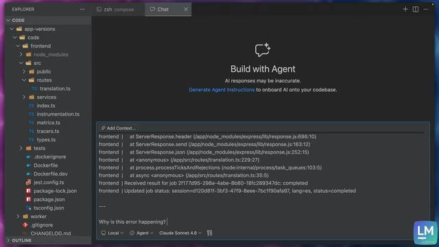
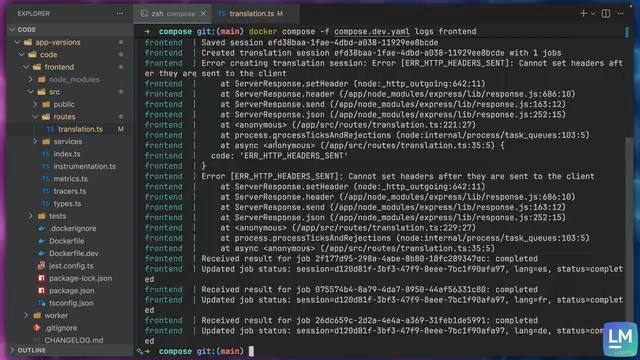
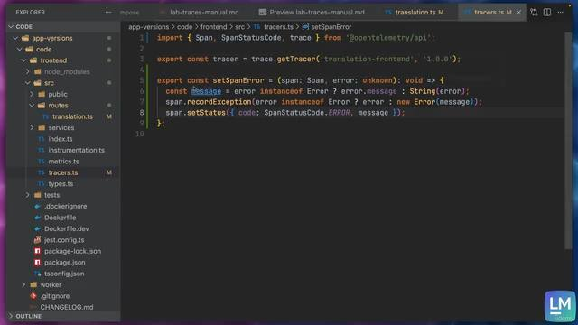
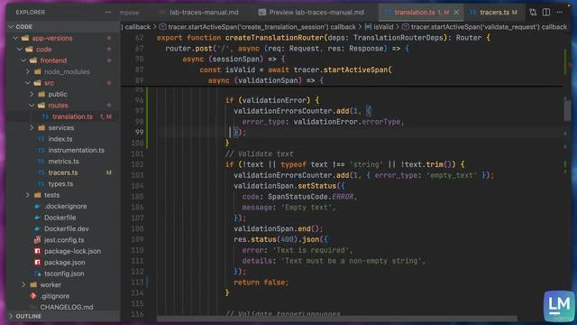
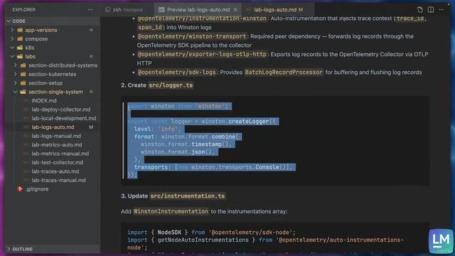
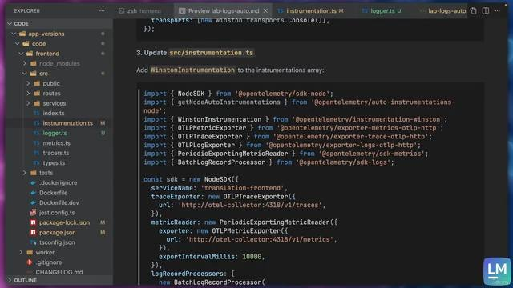
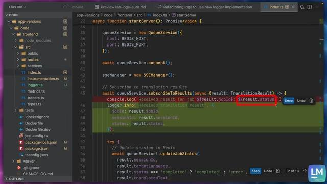
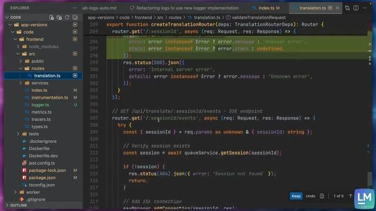
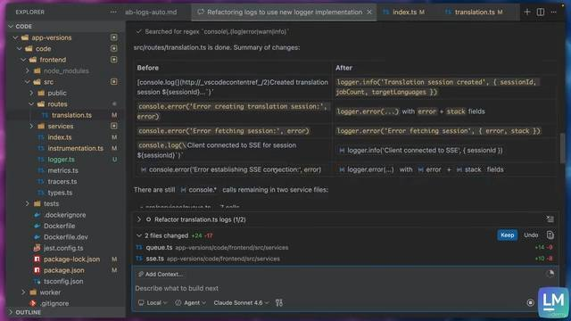

# OpenTelemetry 日志接入与代码重构（P64–P68）

> 适用读者：前端转 AI 应用工程师。本课项目是一个 Node.js/TypeScript 的「翻译服务」前端应用，已接入 OpenTelemetry 的 traces 与 metrics，本节把 **logs** 也接进来，并顺手修掉上一节手工埋点引入的 bug、把校验逻辑重构成纯函数。
>
> 说明：逐字稿里讲师没有逐字念出全部代码，部分代码块是根据讲师口述的操作步骤与截图还原的**等价实现**，凡是逐字稿没讲清的地方，文中都会标注「课里没讲，以下为等价实现」。命令输出里的字段名以你实际运行结果为准。

---

## 1. 这一节做什么

这一节（P64–P68）一共做四件事，按依赖顺序排列：

1. **修 bug（P64）**：上一节为了给 `validateRequest` 加 span，把校验逻辑包进了 `activeSpan` 的回调里，结果「校验失败后函数继续往下执行」，前端报错。修法是让回调返回布尔值 `isValid`，主流程根据它提前 `return`。
2. **重构（P65）**：把校验逻辑从路由处理器里抽成纯函数 `validateTranslationRequest(text, targetLanguages)`，返回 `ValidationError | null`；同时抽一个 `setSpanError(span, error)` 辅助函数，统一「记录异常 + 设置 span 状态」这两步。目标是让 span 成为「一等公民」，可以被当作参数传来传去。
3. **讲原理（P66）**：日志的自动埋点到底自动在哪——Winston 在写日志前向 OpenTelemetry SDK 要当前 active context，把 trace ID / span ID 注入日志属性，于是日志能和 trace 关联。
4. **动手接日志（P67–P68）**：装 5 个包 → 写 `logger.ts` → 改 `instrumentation.ts` 加 `BatchLogRecordProcessor` + `OTLPLogExporter` + `WinstonInstrumentation` → 把 `console.log` 全量迁移到 `logger.*` → 重新构建、在 Grafana 里看结构化 JSON 日志。

最终产物：前端服务的所有日志都是**结构化 JSON**，每条日志自带 `trace_id` / `span_id`，在 Grafana 里可以从一条日志直接跳到对应 trace。

从工程视角看，这四件事不是孤立的：P64 修的是「控制流」问题，P65 修的是「职责边界」问题，P66 讲的是「日志与 trace 为什么能关联」的机制，P67–P68 则是把机制落到代码和运行环境里。对前端工程师来说，可以这样类比：`activeSpan` 的回调类似一个异步请求包装器，如果包装器内部已经返回失败，但外层没有接收返回值，页面仍然会继续执行后面的提交逻辑；`validateTranslationRequest` 则像表单校验函数，输入是表单值，输出是错误对象或 `null`，它不直接发请求、不直接弹 toast，因此容易单测；`logger.info('message', { jobId, status })` 类似前端埋点里的「事件名 + 属性对象」，属性会进入结构化日志，而不是被拼进一段难以查询的字符串。完成本节后，你应该能同时从「代码是否可测」「日志是否可查」「日志是否能关联 trace」三个角度检查结果。

---

## 2. 讲师原话

> "这里的问题正如预期，在……之中，我们在 validation span 内部遇到了这个错误。然后这里发生的情况是，我们发送了一个响应，然后从这里这个函数返回。但一旦我们真正从函数返回，我们仍会继续执行代码。"
> —— p064 [01:32]

> "所以这里不是只 await active span，而是实际上把 active span 的返回值保存到一个变量里。我们会写成 is valid 等于 await …… 然后这里就可以直接检查，如果 not is valid，就直接提前返回。"
> —— p064 [02:13]

> "这个函数基本上是一个纯函数，对吧？所以现在它接收一个文本和目标语言，并返回 validation error 或 null。它不会递增任何类型的 counter，不会创建任何类型的 span，也不会修改任何类型的 span，而且只要我们想写多少 unit tests，它都是完全可测试的。"
> —— p065 [12:37]

> "我们实际上可以把 spans 当作一等公民，并在这里也创建辅助函数，这些函数会接收 spans 并在这里执行操作，这给我们的代码增加了一定程度的通用性和可用性。"
> —— p065 [14:47]

> "一旦这里产生一条新的日志行，Winston 和 Winston 自动插桩就会调用 OpenTelemetry SDK 获取当前活跃上下文。当前活跃的跨度是哪一个？当前活跃的追踪是哪一个？然后我们从 OpenTelemetry SDK 取回这些数据，它会将追踪 ID 和跨度 ID 注入到日志属性和标签中。"
> —— p066 [01:34]

> "我们确实只需要在这里创建一个新的日志记录处理器，也就是批量日志记录处理器，然后这里的 OTLP 日志导出器会把日志转发到我们的 OpenTelemetry Collector；接着，在这里的 instrumentations 数组中，我们可以……添加一个 Winston 插桩。"
> —— p066 [03:15]

> "通过使用 winstone.format.json，这会自动把我们的日志转换成结构化日志。这绝对是最佳实践，因为这样我们就能处理它们，借助我们的 lowkey backend 更轻松地查询它们。"
> —— p066 [04:09]

> "一次只处理一个文件。如果变更太多，就先实现少量，然后暂停并询问反馈。"
> —— p068 [05:09]（讲师给 AI agent 的提示词原话）

这些原话分别对应本节的关键动作：先承认 bug 的根因是「响应发送后继续执行」，再说明用返回值加提前 `return` 修复；随后把校验抽成纯函数，并把 span 当作参数传递；最后解释 Winston 自动注入 trace context 的原理，以及 `BatchLogRecordProcessor`、`OTLPLogExporter`、`WinstonInstrumentation` 三者在日志链路中的位置。阅读后续步骤时，可以随时回到这些原话对照，避免把「日志格式化」「日志导出」「日志与 trace 关联」混成一件事。

---

## 3. 从零复现

### 3.0 前置假设

你已经完成上一节（traces + metrics 手工埋点），项目目录大致是：

```
app-versions/code/
├── frontend/                 # 本节所有改动都在这里
│   ├── src/
│   │   ├── instrumentation.ts
│   │   ├── index.ts
│   │   ├── translation.ts
│   │   ├── queue.ts
│   │   ├── sse.ts
│   │   └── logger.ts         # 本节新建
│   ├── package.json
│   └── Dockerfile
└── compose/
    └── docker-compose.yml    # 含 frontend / collector / loki / grafana 等服务
```

> 课里没讲完整的 `docker-compose.yml` 内容，本节也不改动它。你只需要知道 `frontend` 服务由 compose 构建，collector 接收 OTLP HTTP，Loki 作为日志后端，Grafana 做展示。

在开始前，建议先确认上一节的状态仍然可用：`frontend` 能正常构建和启动，traces 与 metrics 已经能在 Grafana 里看到。如果上一节本身没有跑通，本节新增 logs 后会把问题叠加在一起，排查成本更高。前端对照可以理解为：先保证页面基础请求链路是通的，再接入埋点；否则你无法判断是业务请求失败，还是埋点导出失败。常见错误与排查：如果 `docker compose ps` 看不到 `frontend`，先回到 compose 目录检查服务名和启动命令；如果能看到容器但日志为空，先确认应用入口是否加载了 `instrumentation.ts`，再检查本节日志配置。

### 3.1 第一步：修 P64 的 bug

打开 `frontend/src/translation.ts`，找到 `validateRequest` 里包着 `activeSpan` 的那段。改法：

- 把 `await activeSpan(...)` 的**返回值**存进 `isValid`；
- 回调里每个校验失败分支 `return false`，全部通过 `return true`；
- 主流程 `if (!isValid) return;` 提前退出，不再继续创建 session。



改完后重新构建前端、发一次请求、看日志确认报错消失：

```bash
cd compose
docker compose build frontend
docker compose up -d frontend
docker compose logs -f frontend
```



命令完整解释：`cd compose` 进入存放 `docker-compose.yml` 的目录；`docker compose build frontend` 只重建 `frontend` 服务镜像，避免影响 collector、loki、grafana 等其他服务；`docker compose up -d frontend` 用新镜像以 detached 模式启动前端容器；`docker compose logs -f frontend` 持续跟踪前端日志，方便你发请求后立即观察是否还有「响应已发送后继续执行」一类错误。前端对照：这类似改完表单校验后重新打包页面并打开控制台，先确认没有重复提交、重复 toast 或二次跳转。常见错误与排查：如果构建失败，先看 TypeScript 报错是否来自 `isValid` 类型推断；如果启动后请求仍报错，检查是否所有失败分支都 `return false`，以及主流程是否真的在 `if (!isValid)` 后提前退出；如果日志里看不到新请求，确认请求确实打到了当前容器端口。

### 3.2 第二步：抽 `setSpanError` 辅助函数（P65）

在 `translation.ts`（或单独的工具文件）里新增：

```ts
import { Span, SpanStatusCode } from '@opentelemetry/api';

export function setSpanError(span: Span, error: unknown): void {
  const message = error instanceof Error ? error.message : String(error);
  span.recordException(error instanceof Error ? error : new Error(message));
  span.setStatus({ code: SpanStatusCode.ERROR, message });
}
```

要点（讲师原话 p065 [01:59]–[02:29]）：
- `recordException` 的参数类型是 `Exception`，直接传 `unknown` 会报 `Type error is not assignable to parameter of type Exception`，所以要先 `instanceof Error` 判断，否则 `new Error(message)` 包一层。
- `SpanStatusCode` 来自 `@opentelemetry/api`（**不是 SDK**），和 `translation.ts` 里已有的用法一致。

这个辅助函数的价值在于把「记录异常」和「设置 span 状态」绑定成一个动作。前端对照：类似把 `toast.error()`、上报错误、设置表单错误状态封装成一个 `handleError`，避免每个分支各写一遍导致遗漏。常见错误与排查：如果 TypeScript 报 `Span` 类型不匹配，检查 import 是否来自 `@opentelemetry/api`；如果运行后 Grafana 里只有 status 没有 exception 事件，检查是否只调用了 `setStatus` 而漏掉 `recordException`；如果 `error` 不是 `Error` 实例，当前实现会用 `String(message)` 包一层，保证 `recordException` 收到合法参数。

### 3.3 第三步：抽纯函数 `validateTranslationRequest`（P65）

新增接口与枚举，然后把原来散在路由处理器里的四段校验（空文本 / 语言数组非法 / 语言数量超限 / 含不支持语言）全部搬进这个函数，每个分支 `return` 一个 `ValidationError` 对象，全部通过 `return null`。



路由处理器里改成：

```ts
const validationError = validateTranslationRequest(text, targetLanguages);
if (validationError) {
  // 计数 + setSpanError + 返回 JSON + return false
}
```



这一步的关键是「纯函数只负责判断，不负责副作用」。`validateTranslationRequest` 接收 `text` 和 `targetLanguages`，返回 `ValidationError | null`；它不增加计数器、不创建 span、不修改 span，也不直接写响应。前端对照：类似把「表单是否合法」从提交函数里抽出来，提交函数只负责根据校验结果决定是否发请求。常见错误与排查：如果路由处理器里仍然重复写四段判断，说明抽取不彻底；如果纯函数内部调用了 `validationErrorsCounter.add` 或 `span.recordException`，就破坏了可测试性；如果返回对象字段和路由处理器使用处不一致，先统一 `statusCode`、`body`、`errorType`、`spanMessage` 的命名，再继续下一步。

### 3.4 第四步：装日志相关依赖（P67–P68）

```bash
cd app-versions/code/frontend
npm install winston \
  @opentelemetry/instrumentation-winston \
  @opentelemetry/winston-transport \
  @opentelemetry/exporter-logs-otlp-http \
  @opentelemetry/sdk-logs
```

> 版本号课里没讲，请以你项目里已有的 `@opentelemetry/*` 版本为准，保持同一大版本。`@opentelemetry/winston-transport` 是 `instrumentation-winston` 的 **peer dependency**，讲师特别强调要把它 pin 在 `package.json` 里（p067 [00:42]）。

命令完整解释：`cd app-versions/code/frontend` 进入前端包目录；`npm install` 后跟五个包，分别提供 Winston 日志器、Winston 自动埋点、Winston 传输适配、OTLP HTTP 日志导出、日志 SDK。常见错误与排查：如果 npm 报 peer dependency 冲突，先检查 `@opentelemetry/*` 是否混用了不同大版本；如果安装后锁文件变化很大，确认没有误装到仓库根目录；如果 CI 使用 `npm ci`，记得把更新后的 `package-lock.json` 一起提交。前端对照：这类似给前端项目同时安装日志库、上报适配器和导出器，缺一个都可能出现「本地能打印、远端看不到」或「远端有日志、没有 trace_id」的现象。

### 3.5 第五步：写 `logger.ts`（P68）

新建 `frontend/src/logger.ts`，内容见第 4 节。核心是 `level: 'info'`（低于 info 的 debug/verbose 被丢弃）、`format.combine(timestamp(), format.json())`、一个 `Console` transport 让本地也能看到。



这里要区分「产生日志」和「导出日志」：Winston 负责产生日志，`Console` transport 让本地终端可见；真正把日志通过 OTLP 发给 collector 的是 OpenTelemetry SDK 里的 `BatchLogRecordProcessor` 和 `OTLPLogExporter`。常见错误与排查：如果本地完全看不到日志，检查是否创建了 `Console` transport；如果日志不是 JSON，检查是否漏了 `format.json()`；如果 debug 日志不出现，这是 `level: 'info'` 的预期行为，不是 bug。前端对照：类似本地 `console.log` 和远端埋点平台的关系，本地打印方便开发，远端结构化字段方便查询。

### 3.6 第六步：改 `instrumentation.ts`（P68）

三处新增：
1. import `WinstonInstrumentation`、`OTLPLogExporter`、`BatchLogRecordProcessor`；
2. 在 `metricReader` 旁边加 `logRecordProcessor`；
3. 在 `instrumentations` 数组里 `new WinstonInstrumentation()`。



常见错误与排查：如果日志没有 `trace_id`，优先检查 `WinstonInstrumentation` 是否加入 `instrumentations`；如果 collector 收不到日志，检查 `OTLPLogExporter` 是否被 `BatchLogRecordProcessor` 包住；如果应用启动时报 SDK 初始化错误，检查 import 是否来自正确的包，尤其是 `BatchLogRecordProcessor` 来自 `@opentelemetry/sdk-logs`。前端对照：`instrumentation.ts` 像应用启动前的统一初始化文件，必须尽早执行，后续的 logger 才能拿到已 patch 的上下文。

### 3.7 第七步：迁移 `console.*` → `logger.*`（P68）

讲师的做法值得学：**不手改，写提示词让 AI agent 一个文件一个文件改，改完暂停等 review**。提示词原文（p068 [04:16]–[05:09]）：

```
In the labs/section-single-system.md file (actually labs/lab-logs-auto.markdown),
we have a few examples of refactoring that migrate from console.* to logger.*
and leverage the correct log level and attributes, and add relevant attributes
to the logs.

Please go through the code in the front-end folder under app-versions/code
and refactor existing logs to match the new version using the logger exported
from logger.ts.

Do one file at a time. If there are too many changes, implement few and pause
to ask for feedback.
```

迁移时注意两点（p068 [11:14]）：
- import 路径写成 `from './logger'`，**不要**带 `.js` 后缀（agent 容易写成 `logger.js`，要手动改回来）；
- 原来拼进字符串的变量（jobId、status、host、port、channel 等）要变成**结构化属性**，不要留在 message 里。



常见错误与排查：如果 agent 一次性改了很多文件，先缩小范围，按文件 review；如果 import 写成 `./logger.js`，按项目现有风格改回 `./logger`；如果日志 message 里仍然出现 `jobId=...` 这类拼接，把它移到第二个参数对象里。前端对照：类似把 `console.log('user ' + id + ' clicked')` 改成 `track('clicked', { userId: id })`，后者才能被检索和聚合。

### 3.8 第八步：重建、验证

```bash
cd compose
docker compose build frontend
docker compose up -d frontend
docker compose logs -f frontend
```

看到类似下面的结构化 JSON 就成功了（字段名以你实际输出为准）：

```json
{"level":"info","message":"...","timestamp":"...","host":"...","port":"...","channel":"..."}
```

讲师在 p068 [12:52] 特别指出：`host`、`port`、`channel` 这些是**日志属性**，不是 message 的一部分——这正是结构化日志的价值。



最后打开 Grafana，刷新 traces，能看到新的 trace；点开 `validate request` 失败的那条，`events` 里有 exception message 和 stack trace（p065 [16:17]）。



验证时建议分三层看：第一层看容器日志是否已经是 JSON；第二层看 JSON 里是否有 `trace_id` / `span_id`；第三层看 Grafana 里能否从日志跳到 trace，或从 trace 找到对应日志。常见错误与排查：如果日志是 JSON 但没有 trace 字段，回到 3.6 检查 `WinstonInstrumentation`；如果 Grafana 里延迟出现日志，考虑 `BatchLogRecordProcessor` 的批量导出延迟，稍等再刷新；如果非法请求没有产生预期日志，检查对应分支是否真的调用了 `logger.*`，以及 `error_type` 是否作为属性传入。

---

## 4. 完整代码

> 以下 4 个文件是本节的核心产物。`translation.ts` 只给出**改动后的关键片段**（完整文件很长，且大部分与上一节相同）；其余三个文件给完整内容。凡逐字稿未逐字念出的部分，标注「等价实现」。

### 4.1 `frontend/src/logger.ts`（完整文件）

```ts
// frontend/src/logger.ts
// 课里没讲完整代码，以下为按讲师口述（p068 00:26–01:03）还原的等价实现
import winston from 'winston';

export const logger = winston.createLogger({
  level: 'info', // 低于 info 的 debug/verbose 会被丢弃
  format: winston.format.combine(
    winston.format.timestamp(),
    winston.format.json() // 结构化日志，Loki 里可按字段查询
  ),
  transports: [
    // 本地控制台也能看到；OTLP 导出由 OpenTelemetry SDK 负责，不在这里配
    new winston.transports.Console(),
  ],
});

export default logger;
```

这个文件只做一件事：创建并导出 logger。`level` 控制最低输出级别，`format` 决定日志长什么样，`transports` 决定本地往哪里写。它不负责 OTLP 导出，因此不要把 `OTLPLogExporter` 配到这里；否则职责会混乱，也不符合讲师在 P68 演示的结构。

### 4.2 `frontend/src/instrumentation.ts`（完整文件，含本节新增）

```ts
// frontend/src/instrumentation.ts
// 课里没讲完整代码，以下为按讲师口述（p068 01:27–02:57）还原的等价实现
// 注意：上一节已有的 traces/metrics 配置保持不变，本节只加 logs 相关部分
import { NodeSDK } from '@opentelemetry/sdk-node';
import { getNodeAutoInstrumentations } from '@opentelemetry/auto-instrumentations-node';
import { PeriodicExportingMetricReader } from '@opentelemetry/sdk-metrics';
import { OTLPMetricExporter } from '@opentelemetry/exporter-metrics-otlp-http';
import { OTLPTraceExporter } from '@opentelemetry/exporter-trace-otlp-http';

// ---- 本节新增：logs 相关 import ----
import { BatchLogRecordProcessor } from '@opentelemetry/sdk-logs';
import { OTLPLogExporter } from '@opentelemetry/exporter-logs-otlp-http';
import { WinstonInstrumentation } from '@opentelemetry/instrumentation-winston';

const sdk = new NodeSDK({
  // traces（上一节已有）
  traceExporter: new OTLPTraceExporter(),

  // metrics（上一节已有）
  metricReader: new PeriodicExportingMetricReader({
    exporter: new OTLPMetricExporter(),
  }),

  // ---- 本节新增：logs ----
  logRecordProcessor: new BatchLogRecordProcessor(new OTLPLogExporter()),

  instrumentations: [
    getNodeAutoInstrumentations(),
    // ---- 本节新增：自动把 trace_id / span_id 注入日志 ----
    new WinstonInstrumentation(),
  ],
});

sdk.start();
```

> 环境变量（OTLP endpoint 等）课里没讲具体名字，请沿用你上一节 traces/metrics 已经配好的那套，本节不需要新增。

这个文件是日志链路的「总装」：`BatchLogRecordProcessor` 负责攒批，`OTLPLogExporter` 负责发送，`WinstonInstrumentation` 负责在 Winston 写日志时注入当前上下文。三者缺一不可，但职责不同。常见错误与排查：如果应用启动时提示找不到 `logRecordProcessor` 配置项，检查 SDK 版本是否支持该字段；如果 collector 没收到日志，检查 exporter 的 endpoint 是否沿用 traces/metrics 的配置；如果 trace 里有 span 但日志没有 trace_id，检查 instrumentation 是否在 logger 创建前完成初始化。

### 4.3 `frontend/src/translation.ts` 关键片段（改动后）

```ts
// frontend/src/translation.ts —— 只展示本节改动的部分
import { Span, SpanStatusCode } from '@opentelemetry/api';

// ---- 新增：setSpanError 辅助函数（p065 00:29–02:58）----
export function setSpanError(span: Span, error: unknown): void {
  const message = error instanceof Error ? error.message : String(error);
  span.recordException(error instanceof Error ? error : new Error(message));
  span.setStatus({ code: SpanStatusCode.ERROR, message });
}

// ---- 新增：校验错误类型（p065 03:28–06:50）----
export interface ValidationErrorBody {
  error: string;
  details?: string;
}

export enum ValidationErrorType {
  EMPTY_TEXT = 'empty_text',
  EMPTY_LANGUAGES = 'empty_languages',
  TOO_MANY_LANGUAGES = 'too_many_languages',
  INVALID_LANGUAGES = 'invalid_languages',
}

export interface ValidationError {
  statusCode: number;
  body: ValidationErrorBody;
  errorType: ValidationErrorType;
  spanMessage: string;
}

// ---- 新增：纯函数（p065 03:28–12:53）----
export function validateTranslationRequest(
  text: unknown,
  targetLanguages: unknown
): ValidationError | null {
  if (!text || typeof text !== 'string' || text.trim() === '') {
    return {
      statusCode: 400,
      body: { error: 'Text is required', details: 'Text must be a non-empty string' },
      errorType: ValidationErrorType.EMPTY_TEXT,
      spanMessage: 'empty text',
    };
  }

  if (!Array.isArray(targetLanguages) || targetLanguages.length === 0) {
    return {
      statusCode: 400,
      body: { error: 'Target languages are required' },
      errorType: ValidationErrorType.EMPTY_LANGUAGES,
      spanMessage: 'empty languages',
    };
  }

  if (targetLanguages.length > 3) {
    return {
      statusCode: 400,
      body: { error: 'Too many languages', details: 'Maximum 3 languages allowed' },
      errorType: ValidationErrorType.TOO_MANY_LANGUAGES,
      spanMessage: 'too many languages',
    };
  }

  const unsupported = targetLanguages.filter(
    (l) => !SUPPORTED_LANGUAGES.includes(l)
  );
  if (unsupported.length > 0) {
    return {
      statusCode: 400,
      body: {
        error: 'Unsupported languages',
        details: `Unsupported languages: ${unsupported.join(', ')}`,
      },
      errorType: ValidationErrorType.INVALID_LANGUAGES,
      spanMessage: 'invalid languages',
    };
  }

  return null;
}

// ---- 路由处理器里的 validateRequest（改动后，p065 06:50–13:54）----
async function validateRequest(text: unknown, targetLanguages: unknown): Promise<boolean> {
  return tracer.startActiveSpan('validate request', async (span) => {
    const validationError = validateTranslationRequest(text, targetLanguages);

    if (validationError) {
      validationErrorsCounter.add(1, { error_type: validationError.errorType });
      setSpanError(span, new Error(validationError.spanMessage));
      res.status(validationError.statusCode).json(validationError.body);
      span.end();
      return false;
    }

    span.setStatus({ code: SpanStatusCode.OK });
    span.end();
    return true;
  });
}
```

> 说明：`SUPPORTED_LANGUAGES`、`tracer`、`validationErrorsCounter`、`res` 都是上一节已有的变量，课里没重新讲，按你项目里现有的名字填。`startActiveSpan` 的异步回调返回 `Promise<boolean>` 是本节修 bug 的关键（p064 [02:13]）。

这段代码要重点看两个返回值：`validateTranslationRequest` 返回错误对象或 `null`，`validateRequest` 返回布尔值表示是否通过。前者让校验可单测，后者让路由主流程能提前退出。常见错误与排查：如果 `validateRequest` 的返回类型不是 `Promise<boolean>`，主流程的 `if (!isValid)` 就不可靠；如果失败分支忘记 `return false`，仍可能继续执行；如果成功分支忘记 `return true`，调用方会拿到 `undefined`。

### 4.4 迁移后的日志调用示例（`index.ts` / `translation.ts` / `queue.ts` / `sse.ts`）

```ts
// 迁移前
console.log('Translation job created', jobId, status);

// 迁移后（p068 07:47）
import logger from './logger';
logger.info('Translation job created', { jobId, status });
```

```ts
// 迁移前
console.error('Translation failed', error);

// 迁移后（p068 09:26）
logger.error('Translation failed', { error: error.message, stack: error.stack });
```

```ts
// SSE 连接（p068 09:50）
logger.info('Client connected to SSE');
```

迁移后的日志把「消息」和「属性」分开：消息保持稳定，属性用于查询。前端对照：类似埋点事件名保持稳定，业务字段放在 properties 里。常见错误与排查：如果属性没有出现在 JSON 顶层，检查是否误传成字符串拼接；如果 `error` 对象直接序列化后为空，改为传 `error.message` 和 `error.stack`；如果 import 路径带 `.js`，按项目风格改回 `./logger`。

---

## 5. 逐行解释

**`logger.ts` 的 `level: 'info'`**：Winston 的 level 是「阈值」，低于它的日志直接丢弃。讲师原话（p068 [00:26]）：「anything lower than info like debug or verbose, it is going to be dropped」。生产环境日志量大，debug 级别会把 Loki 撑爆，所以默认 info 是合理起点。前端对照：类似生产环境关闭详细 console，只保留关键事件；本地需要排查时可以临时调低级别，但不要默认打开。

**`format.combine(timestamp(), format.json())`**：`timestamp()` 给每条日志加时间戳；`format.json()` 把日志序列化成 JSON。讲师强调这是 best practice（p066 [04:09]），因为 Loki 是 label + 结构化查询的后端，纯文本日志只能全文搜索，JSON 日志可以按 `host="..."`、`channel="..."` 精确过滤。常见错误与排查：如果输出仍是 `[INFO] ...` 这种文本，检查 `format` 是否被其他 transport 覆盖；如果时间字段格式不符合预期，检查 `timestamp()` 的配置。

**`transports: [new Console()]`**：只配了 Console。讲师明确说「we don't really need to configure the OpenTelemetry exporter here. This is gonna be done in the OpenTelemetry SDK」（p068 [01:03]）。也就是说 Winston 只负责**产生**日志，**导出**由 SDK 的 `BatchLogRecordProcessor` 负责——职责分离。前端对照：类似 UI 层只负责触发埋点，真正上报由 SDK 统一处理。

**`instrumentation.ts` 里的 `logRecordProcessor`**：`BatchLogRecordProcessor` 把日志攒批再发，避免每条日志一次 HTTP 请求。它包着 `OTLPLogExporter`，后者把日志通过 OTLP HTTP 发给 collector（p066 [03:15]）。这跟 traces 的 `BatchSpanProcessor`、metrics 的 `PeriodicExportingMetricReader` 是同一套思路。常见错误与排查：如果日志延迟出现，先考虑批量导出间隔；如果完全不出现在 collector，检查 exporter endpoint 和网络。

**`new WinstonInstrumentation()`**：这是「自动埋点」的全部秘密。它 hook 了 Winston 的写日志流程，在日志真正 emit 之前向 SDK 要当前 active context，把 `trace_id` / `span_id` 注入日志属性（p066 [01:34]）。所以你在代码里**不需要手动传 trace ID**——只要这条日志发生在某个 span 的上下文里，ID 就自动带上。前端对照：类似请求拦截器自动给埋点加上当前页面或请求 ID。

**`setSpanError` 里的 `instanceof Error` 判断**：`span.recordException` 的签名要求 `Exception` 类型，`unknown` 不满足。讲师演示了直接传 `error` 会报 `Type error is not assignable to parameter of type Exception`（p065 [01:59]），所以要么传 `Error` 实例，要么 `new Error(message)` 包一层。`setStatus` 的 `message` 用同一个 `message` 变量，保证 exception 事件和 span status 描述一致。常见错误与排查：如果 Grafana 里 exception 事件没有 stack，检查传入的是否是真正的 `Error` 实例。

**`validateTranslationRequest` 返回 `null` 表示通过**：这是 Node/JS 里常见的「null 即无错误」约定。讲师强调它是**纯函数**（p065 [12:37]）：不计数、不建 span、不改 span，输入输出完全确定，所以可以写任意多单元测试。对比重构前——校验逻辑和 `validationErrorsCounter.add()`、`span.recordException()` 缠在一起，想单测就得 mock 一堆东西。前端对照：类似把表单校验规则抽成独立函数，UI 只负责展示错误。

**`if (!isValid) return;`**：这是 P64 bug 的根因修复。重构前 `await activeSpan(...)` 的返回值被丢弃，回调里 `res.status(400).json(...)` 之后函数继续往下走，又去创建 session、又去 `res.json(...)` 第二次，于是前端报「headers already sent」类错误。改成拿返回值 + 提前 return，执行流就和校验结果绑定了。常见错误与排查：如果仍出现重复响应，检查是否还有别的分支没有 `return`；如果成功请求被误拦截，检查 `isValid` 是否在成功分支返回 `true`。

**`logger.info('...', { jobId, status })` 第二个参数**：这是 Winston 的 metadata 参数，会变成日志 JSON 的顶层字段。讲师在 p068 [13:08] 指着输出说「This is actually an attribute that is added by the logger call here and it is not part of the message」——`host`、`port`、`channel` 都是这么来的。在 Loki 里就能写 `{channel="..."}` 这样的查询。前端对照：类似埋点属性对象，不要把属性拼进事件名。

**关于并发/锁**：本节没有涉及锁或事务。如果你从 JS/Node 视角类比，`BatchLogRecordProcessor` 的攒批发送类似于前端常见的「请求合并 / debounce」，它内部保证同一批日志按序发出，你不需要自己加锁。常见错误与排查：如果担心日志顺序，先确认是否依赖跨请求严格顺序；大多数可观测性场景只要求时间戳和 trace 关联，不要求全局严格顺序。

---

## 6. 复现检查清单

按顺序打勾，任何一项不过就别往下走：

- [ ] `frontend/package.json` 里有 `winston`、`@opentelemetry/instrumentation-winston`、`@opentelemetry/winston-transport`、`@opentelemetry/exporter-logs-otlp-http`、`@opentelemetry/sdk-logs` 五个包，且 `winston-transport` 版本已 pin。验证：打开 `package.json` 的 `dependencies` 或 `devDependencies` 逐项核对，并确认锁文件已更新。
- [ ] `frontend/src/logger.ts` 存在，`level: 'info'`，`format` 含 `timestamp()` + `json()`，有 Console transport。验证：阅读文件并启动应用，观察终端是否输出 JSON。
- [ ] `instrumentation.ts` 里 `logRecordProcessor: new BatchLogRecordProcessor(new OTLPLogExporter())` 已加。验证：搜索 `logRecordProcessor`，确认 import 来源正确。
- [ ] `instrumentations` 数组里有 `new WinstonInstrumentation()`。验证：搜索 `WinstonInstrumentation`，并确认它在 `sdk.start()` 之前被配置。
- [ ] `translation.ts` 里 `setSpanError` 已导出，`validateTranslationRequest` 返回 `ValidationError | null`。验证：查看函数签名，并用 TypeScript 编译检查。
- [ ] `validateRequest` 里 `const isValid = await ...` + `if (!isValid) return;` 已改。验证：搜索 `isValid`，确认主流程根据返回值提前退出。
- [ ] 全项目 `grep -r "console\." frontend/src` 无结果（或只剩确实不该迁移的）。验证：执行命令后逐条确认剩余项是否有意保留。
- [ ] 所有 `import ... from './logger'` 没有 `.js` 后缀。验证：执行 `grep -R "from './logger.js'" frontend/src`，应无结果。
- [ ] `docker compose build frontend` 成功。验证：看构建日志最后是否成功退出，TypeScript 是否无报错。
- [ ] `docker compose logs frontend` 输出是 JSON，含 `level`、`message`、`timestamp`，以及自定义属性（如 `host`、`port`、`channel`）。验证：发一次请求后观察最新日志行。
- [ ] 发一次**非法**请求（空 text 或 >3 语言），前端不再报错，日志里能看到对应 `error_type` 属性。验证：用 curl 或页面触发非法请求，检查响应只发送一次且日志字段正确。
- [ ] Grafana 里刷新 traces，能看到新 trace；点开失败的 `validate request`，`events` 里有 exception message + stack trace。验证：按时间排序找到最新失败 trace，展开 events。
- [ ] Grafana 里能按 `trace_id` 从日志跳到 trace（或反过来）。验证：复制日志中的 `trace_id` 到 trace 查询，或点击 derived field 跳转。

---

## 7. 课里没讲但你会撞上的

| 现象 | 原因 | 怎么办 |
| --- | --- | --- |
| `@opentelemetry/winston-transport` 安装时报 peer dependency 冲突 | 它是 `instrumentation-winston` 的 peer dependency，版本必须和 `@opentelemetry/*` 主版本对齐 | 以项目里现有 `@opentelemetry/*` 主版本为准，统一升级或降级；确认 `package-lock.json` 已更新；不要只改一个包导致版本漂移 |
| 日志里没有 `trace_id` / `span_id` | `instrumentation.ts` 没有在应用入口最前面加载，或 `WinstonInstrumentation` 没有加入 `instrumentations`，导致 logger 创建时上下文未被 patch | 检查入口 import 顺序；确认 `new WinstonInstrumentation()` 已配置；重启容器后重新发请求验证 |
| 刚发的日志在 Grafana 里看不到 | `BatchLogRecordProcessor` 是批量导出，存在 flush 延迟；讲师也提过数据不是实时 | 等几秒再刷新；确认 collector 和 Loki 正常；不要因为延迟立刻改代码 |
| 出现 `ERR_HTTP_HEADERS_SENT` 或响应重复发送 | P64 的 bug 本质是响应已发送后继续执行，某个分支漏了 `return` | 检查 `validateRequest` 所有失败分支是否 `return false`；主流程是否 `if (!isValid) return;`；用非法请求复现并看堆栈 |
| AI agent 把 import 改成 `from './logger.js'` | agent 容易按 ESM 习惯补后缀，但项目现有风格不带 `.js` | 全局搜索 `from './logger.js'` 并改回 `from './logger'`；确认 `tsconfig` 的模块解析设置 |
| 结构化日志「不好读」 | JSON 是给 Loki 查询用的，不是给人眼阅读的；讲师也提到可读性下降 | 本地可临时用 `winston.format.simple()` 提升可读性，但不要改掉 `format.json()`；生产保持 JSON |
| `ValidationErrorType` 用 enum 报错 | 某些 TypeScript 配置（如 `erasableSyntaxOnly`）不支持 enum | 改用 `as const` 对象加 union type；或调整 TS 配置；保持与项目其他代码一致 |
| 日志点不到 trace | Grafana 的 Loki datasource 没有配置 derived field，或日志字段名与正则不匹配 | 在 Loki datasource 中配置 `trace_id` 到 Tempo/Jaeger 的 derived field；确认日志 JSON 字段名与正则一致 |