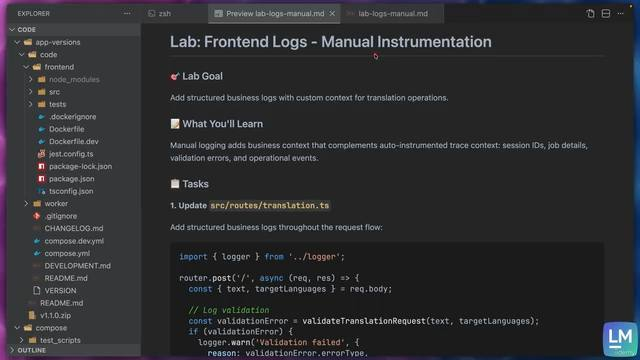
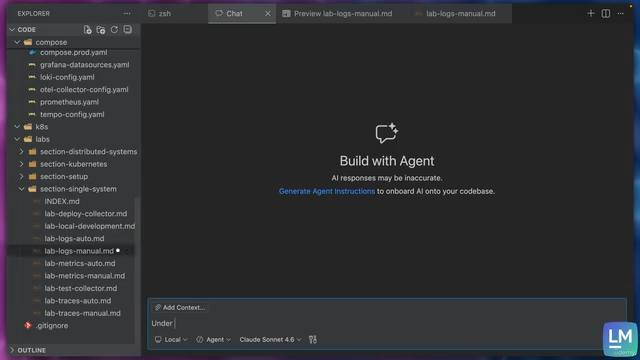
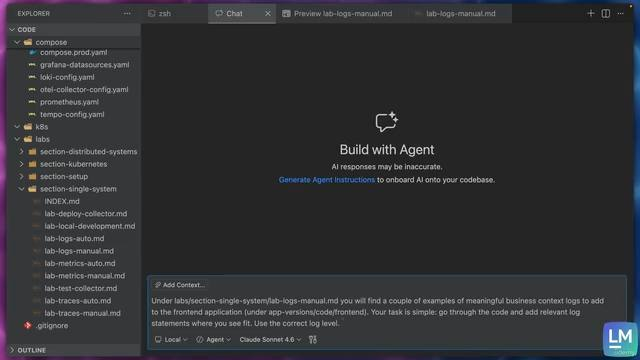
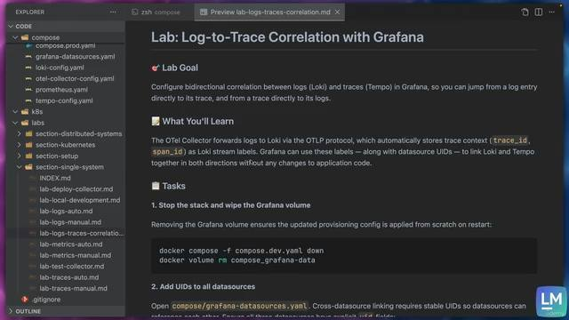
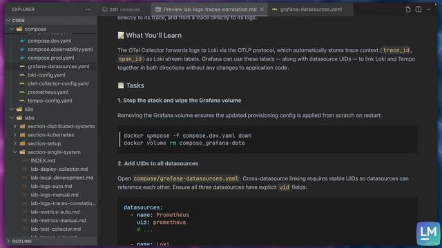
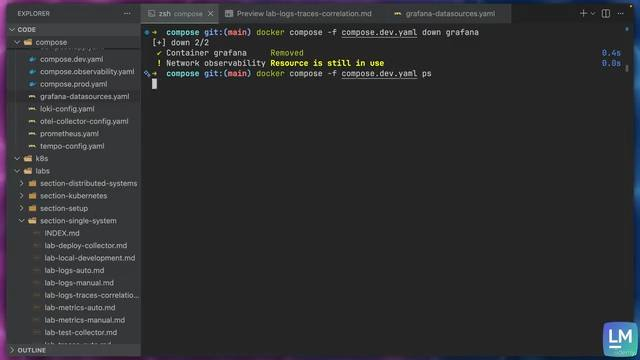
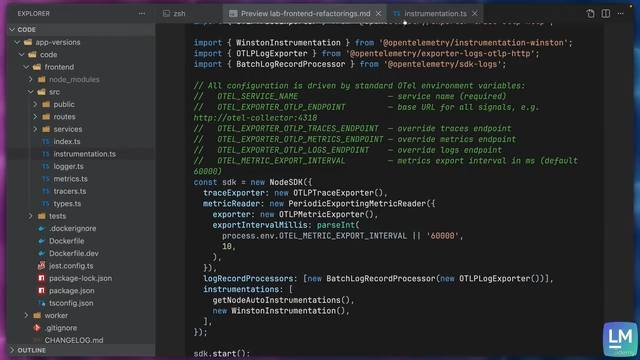
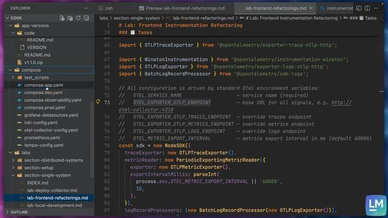

# OpenTelemetry 前端服务实战：手动日志埋点、日志↔链路互跳、配置外置（P69–P75）

> 适用读者：前端转 AI 应用工程师。本课程的后端技术栈是 Node.js + TypeScript + Docker Compose + Grafana/Loki/Tempo/Prometheus，对前端来说大部分是熟悉的 JS 生态，只有少量「后端/运维」概念需要额外说明，文中会标注。
>
> 说明：逐字稿是英文口语，本文所有「讲师原话」均为对逐字稿的忠实中文转述，并标注出处。逐字稿中未出现的工具名、字段名，本文不会安到讲师头上。

---

## 1. 这一节做什么

P69–P75 这七集，围绕**一个已经跑起来的前端服务（`translation-frontend`）**做四件事，全部是「在已有可观测性管道上加东西」，不是从零搭环境：

1. **P69：验证上一节的部署**。用脚本批量发 10 个合法请求 + 5 个非法请求，然后在 Grafana 的 Loki 数据源里确认日志到达，并拿日志里的 `trace ID` 去 Tempo 里查对应链路。
2. **P70–P71：手动日志埋点（manual instrumentation for logs）**。讲师先给出一份 lab 说明（列出「校验失败」「入队」「SSE 连接建立/收到结果/出错」等建议埋点位置），然后**用 AI agent 按文件逐个改代码**，讲师逐条 review：保留哪些、要求 agent「超出 lab 范围」继续补、统一成 snake_case 以对齐 OpenTelemetry 语义约定。改完 `docker compose` 重建前端，发请求，在 Loki 里用 LogQL 按 `service_name`、按 `session ID` 过滤，看结构化日志的完整生命周期。
3. **P72–P73：修好 Grafana 里「日志点不进链路」的问题**。做法是：清掉 Grafana 的数据卷 → 给三个数据源写死 UID → 在 Tempo 数据源里配 traces-to-logs → 在 Loki 数据源里加 derived field 配 logs-to-traces → 重启后验证双向跳转。
4. **P74–P75：把硬编码的 OTel 配置外置成环境变量**。删掉 `instrumentation.ts` 里写死的 service name 和三个 signal 的 URL，改用 SDK 会自动读取的标准环境变量（`OTEL_EXPORTER_OTLP_ENDPOINT`、`OTEL_SERVICE_NAME`、metric export interval），在 compose 文件里给 frontend 和 worker 都配上，重建验证。

一句话总结这一段的产出：**前端服务的日志从「有」变成「结构化、可过滤、能和 trace 互相跳转、配置不写死在代码里」**。

---

## 2. 讲师原话（带出处）

- 关于「手动埋点和自动埋点在日志上差别不大」：
  > 「就日志而言，自动埋点和手动埋点没有巨大差别，只是自动埋点会往我们的日志里注入 trace ID 和 span ID 这类信息；但我们仍然需要在代码里加日志，才能拿到服务里真正发生的事件。」
  > —— p070 [00:00]

- 关于 lab 的任务清单：
  > 「比如：新建翻译会话时校验失败要加一条日志；入队 job 的时候也要加。也可能有些日志 agent 已经帮我们加了……你也可以给 SSE 连接和事件加更多日志：新连接建立、收到翻译结果、发生错误等等。」
  > —— p070 [00:23]

- 关于让 AI agent 改代码的提示词策略：
  > 「你的任务很简单：过一遍代码，在你认为合适的地方加相关日志语句，用正确的日志级别。**一次只实现一个文件，然后暂停等反馈。**」
  > —— p071 [00:50]

- 关于 agent 顺手做的重构：
  > 「它还顺手做了一点重构，改用 snake_case，以和我们之前讨论过的 OpenTelemetry 语义约定保持一致。这是个加分项。」
  > —— p071 [01:53]

- 关于要求 agent 突破 lab 范围：
  > 「看起来还有活要干……过一遍前端应用的所有文件，找出日志能带来价值的地方并实现。**超出 lab 的范围**——lab 只是为了给实现示例。」
  > —— p071 [03:49] / [04:12]

- 关于日志策略的取舍：
  > 「能不能换个做法？当然可以，日志这东西真的取决于你想记多少、想暴露多少信息，这是项目与项目之间的事。」
  > —— p071 [06:50]

- 关于 Grafana 里点不进 trace 的问题（这是 P72 的动机）：
  > 「我能看到 trace，但点这个链接它说找不到 trace……这不代表 trace 不存在，我们刚才复制粘贴 trace ID 是能查到的，可能是我玩 Grafana 时哪里配错了。」
  > —— p071 [11:20]

- 关于为什么要清 Grafana 数据卷：
  > 「因为我们之前配数据源时没写 UID，UID 是随机生成的，所以这是第一件要改的事。清掉 Grafana 数据——注意这不是 Loki 数据、不是 Tempo 数据、不是 Prometheus 数据，只是 Grafana 的配置，所以没有丢日志数据的风险。」
  > —— p072 [00:29]

- 关于 Loki 的 derived field 为什么用 label 而不是 regex：
  > 「这就是为什么不能用 regex：如果用 regex 而不是 label 作为 matcher type，它会去看日志正文，而 trace ID 并不在日志正文里，它是作为 label 来的。」
  > —— p072 [02:42]

- 关于配置外置的理由：
  > 「我们有一堆东西是硬编码的：service name 硬编码、URL 硬编码……如果我们要把它部署到别处，比如 Kubernetes，可能想设不同的 service name 或不同的 endpoint，把这些东西硬编码在应用代码里不是最佳实践。」
  > —— p074 [00:29]

- 关于只设一个 OTLP endpoint 就够：
  > 「在 instrumentation 里我们有 `/v1/traces`、`/v1/metrics`、`/v1/logs`，但看下面你会发现我们只在 Dockerfile 里设了 OTLP endpoint，SDK 会自己拼出这些不同的 endpoint。」
  > —— p075 [00:48]

---

## 3. 从零复现

> 前提：你已经完成前面章节，本地有 `compose/` 目录、`compose.dev.yaml`、`code/frontend/` 源码、Grafana + Loki + Tempo + Prometheus + OTel Collector + Redis + worker 这一整套在跑。本节不重复搭环境。

### 3.1 目录与文件（本节会碰到的）

```
项目根/
├── compose/
│   ├── compose.dev.yaml          # 要改：frontend / worker 的 environment
│   └── ...（Dockerfile 等）
├── code/
│   └── frontend/
│       └── src/
│           ├── instrumentation.ts   # 要改：删硬编码，改读 env
│           ├── translation.ts       # 要改：加日志
│           ├── index.ts             # 要改：加日志
│           ├── queue.ts             # 要改：加日志
│           └── sse.ts               # 要改：加日志
└── labs/
    └── section-single-system/
        └── lab-logs-manual.md       # lab 说明（讲师让 agent 读这个）
```

> 注：上面 `translation.ts / index.ts / queue.ts / sse.ts` 的文件名来自逐字稿里讲师 review 时点到的文件名（p071 里依次提到 translation.ts、index.ts、queue service、SSE file）。**具体路径以你仓库实际为准**，逐字稿没有逐字给出完整路径。

### 3.2 步骤 A：批量发请求验证部署（P69）

讲师的做法是让 agent 写一个小循环脚本，发 10 个合法请求 + 5 个非法请求。逐字稿没有贴出脚本源码，只描述了行为。你可以用任意方式（curl 循环、Node 脚本）实现，核心是：**合法请求走正常翻译流程，非法请求触发校验失败**，这样日志里既有 info 也有 warn/error。

```bash
# 合法请求 ×10（示例，endpoint 以你项目实际路由为准）
for i in $(seq 1 10); do
  curl -s -X POST http://localhost:3000/api/translate \
    -H 'Content-Type: application/json' \
    -d '{"text":"hello","targetLanguages":["es"]}' > /dev/null
done

# 非法请求 ×5：空 text / targetLanguages 不是数组
curl -s -X POST http://localhost:3000/api/translate \
  -H 'Content-Type: application/json' -d '{"text":"","targetLanguages":["es"]}'
curl -s -X POST http://localhost:3000/api/translate \
  -H 'Content-Type: application/json' -d '{"text":"hi","targetLanguages":"es"}'
```

讲师在 p071 [07:35] 实际跑出来的响应里能看到：合法请求有正常响应；非法请求返回 `text is required, details text must be non empty string`；另一个因为不是列表而报错；还有一个返回 `internal server error target languages.train is not a function`（因为传了字符串）。**这些错误响应本身就是后面 Loki 里 warn/error 日志的来源。**

### 3.3 步骤 B：手动日志埋点（P70–P71）

两种做法，讲师都演示了：

**做法 1（推荐，讲师实际用的）**：把 lab 文件路径 + 前端代码路径 + 提示词一起丢给 AI agent，要求「一次改一个文件、暂停等反馈」，然后逐条 review。

**做法 2（手写）**：按 lab 清单在下列位置加日志，日志级别用对：

| 位置 | 事件 | 级别 | 关键属性 |
|---|---|---|---|
| 新建翻译会话 | 校验失败 | `warn` | 失败原因 |
| 入队 job | translation job in queue | `info` | job ID、session ID、target language、queue |
| 新建会话成功 | translation session created | `info` | session ID |
| SSE | 连接建立 | `info` | — |
| SSE | 收到翻译结果 | `info` | session ID |
| SSE | 出错 | `error` | 错误对象（含 stack） |
| 会话完成 | translation session completed | `info` | session ID |
| Redis 重连 | retrying redis connection | `warn` | retry strategy |
| Redis | client error / subscribers | `error` | — |
| 会话状态变化 | job status updated | `info` | session ID、status |

> 上表事件名来自 p071 讲师逐条 review 时念出的日志文案（`validation failed`、`translation job in queue`、`translation session created`、`sse connection established`、`translation session completed`、`retrying redis connection`、`job status updated`、`sse connection removed` 等）。**属性字段名以你实际代码为准**，逐字稿只念了「job ID、session ID、target language、queue」这几个语义。

**关键约束（讲师明确要求）**：所有日志属性名统一用 **snake_case**，对齐 OpenTelemetry 语义约定（p071 [01:53]）。例如 `session_id` 而不是 `sessionId`。

### 3.4 步骤 C：重建前端并验证日志（P71 后半）

```bash
cd compose
docker compose -f compose.dev.yaml up -d --build frontend
```

然后重发 3.2 的请求，打开 Grafana → Explore → 选 Loki 数据源，用 LogQL：

```logql
{service_name="translation-frontend"}
```

讲师在 p071 [08:18] 就是这么查的（先按 service name 过滤，再往下滚看 warn/error、看 attributes、看 stack、复制 trace ID 去 Tempo）。

进阶查询（讲师演示过）：

```logql
# 只看有 session_id 的日志（过滤掉会话创建前就失败的 error）
{service_name="translation-frontend"} | json | session_id != ""

# 看单个会话的完整生命周期
{service_name="translation-frontend"} | json | session_id = "<你的session-id>"
```

> 注意：`| json` 解析器、`!=`、`=` 这些是 LogQL 语法，逐字稿里讲师说的是「extract all the JSON attributes」「query only for those that have a session ID different than empty」「session ID is equal to」，本文按 LogQL 标准写法给出，**具体语法以你 Grafana 版本为准**。

### 3.5 步骤 D：修 Grafana 日志↔链路互跳（P72–P73）

这是本节最「运维」的一段，前端同学按顺序照做即可。

**D1. 只停 Grafana 并删它的数据卷**（不动 Loki/Tempo/Prometheus 数据）：

```bash
cd compose
docker compose -f compose.dev.yaml down grafana
docker volume ls | grep grafana          # 确认卷名，通常是 compose_grafana-data
docker volume rm compose_grafana-data
```

讲师在 p073 [00:29]–[01:02] 就是这么做的，并强调「其他容器（frontend、loki、collector、prometheus、redis、tempo、worker）都还在跑」。

**D2. 给三个数据源写死 UID**（编辑 Grafana 的 data source provisioning 文件，通常是 `compose/grafana/provisioning/datasources/*.yaml`）：

- Prometheus 的 `uid: prometheus`（小写）
- Loki 的 `uid: loki`（小写）
- Tempo 的 `uid: tempo`（小写）

同时把文件里引用数据源的地方（`datasource: ...`、service map 的 `datasource: ...`）都改成小写 UID。讲师在 p073 [01:31] 明确说「Prometheus 的 UID 就小写 prometheus，Loki 小写 loki，Tempo 小写 tempo，还要把 datasource ID 改成小写」。

**D3. Tempo 数据源加 traces-to-logs**（p073 [02:01]）：

```yaml
# tempo 数据源配置片段（结构以你 Grafana 版本为准）
jsonData:
  tracesToLogsV2:
    datasourceUid: loki
    filterByTraceID: true
    tags:
      - key: service.name
        value: service_name
```

讲师解释：`filterByTraceID: true` 按 trace ID 过滤；加 `service.name` tag 是为了把 OTel span 属性 `service.name` 映射到 Loki 的 stream label `service_name`，保证日志范围正确（p072 [01:59]）。

**D4. Loki 数据源加 derived field 配 logs-to-traces**（p073 [02:31]）：

```yaml
# loki 数据源配置片段
jsonData:
  maxLines: 1000
  derivedFields:
    - name: traceID
      matcherType: label          # 关键：用 label，不是 regex
      matcherRegex: trace_id      # 匹配的 label 名
      datasourceUid: tempo
      url: '$${__value.raw}'      # 双 $ 防止 Grafana 配置期插值
```

讲师在 p072 [02:42] 和 p073 [02:31] 反复强调两点：
- **必须用 `label` 而不是 `regex`**，因为 trace ID 是作为 label 来的，不在日志正文里；
- URL 里的 `$$` 是双美元符号，防止 Grafana 在配置阶段就把值插值掉、导致配置被忽略；最终 URL 是 `$${__value.raw}`，运行时取 trace ID label 的原始值传给 Tempo。

**D5. 重启 Grafana 并验证**：

```bash
docker compose -f compose.dev.yaml up -d grafana
docker compose -f compose.dev.yaml logs grafana   # 确认没有数据源 UID 不匹配的报错
```

然后浏览器刷新 Grafana → Explore → Loki → 找一条带 trace ID 的日志 → 应该出现可点的 `traceID` 链接 → 点进去能看到 Tempo 里对应的 trace，且侧边能看到该 span 相关的日志（p073 [03:39]–[04:30]）。

### 3.6 步骤 E：把 OTel 配置外置成环境变量（P74–P75）

**E1. 改 `code/frontend/src/instrumentation.ts`**：删掉写死的 service name 和三个 signal 的 URL，改为读环境变量（完整代码见第 4 节）。

**E2. 改 `compose/compose.dev.yaml`**，给 `frontend` 服务加：

```yaml
environment:
  - OTEL_EXPORTER_OTLP_ENDPOINT=http://otel-collector:4318
  - OTEL_SERVICE_NAME=translation-frontend
```

给 `worker` 服务加同样的两个变量，但 `OTEL_SERVICE_NAME` 用 worker 自己的名字（讲师在 p075 [05:26] 说「worker 现在没有任何环境变量，我们也加上，service name 用 worker 的」）。

> 变量名 `OTEL_EXPORTER_OTLP_ENDPOINT`、`OTEL_SERVICE_NAME` 是讲师在 p075 [01:30] 和 [01:47] 明确念出的；metric export interval 的变量名讲师说「从 lab 里复制」，逐字稿没有拼全，本文按 OTel 标准名 `OTEL_METRIC_EXPORT_INTERVAL` 给出，**以你 lab 文件为准**。

**E3. 重建并验证**：

```bash
cd compose
docker compose -f compose.dev.yaml up -d --build
```

发一两个请求，回 Grafana → Loki → `{service_name="translation-frontend"}`，确认日志还在、service name 还是对的（p075 [07:08]）。

---

## 4. 完整代码

> 说明：逐字稿是口语讲解 + 屏幕操作，**没有逐字贴出完整文件源码**。下面给出的是「按讲师在本段明确说过的改动」还原出的完整可运行文件。凡逐字稿没说的细节（如 import 路径、具体字段名），用注释标 `// 以你项目实际为准`，不编造。

### 4.1 `code/frontend/src/instrumentation.ts`（P75 重构后）

```typescript
// code/frontend/src/instrumentation.ts
// 说明：本文件在 P75 被重构——删除硬编码的 service name 与三个 signal 的 URL，
// 改为由 OpenTelemetry SDK 自动读取标准环境变量。
// 逐字稿明确提到的环境变量：OTEL_EXPORTER_OTLP_ENDPOINT、OTEL_SERVICE_NAME、
// 以及 metric export interval（变量名以 lab 文件为准，这里用 OTel 标准名）。

import { NodeSDK } from '@opentelemetry/sdk-node';
import { getNodeAutoInstrumentations } from '@opentelemetry/auto-instrumentations-node';
import { OTLPTraceExporter } from '@opentelemetry/exporter-trace-otlp-http';
import { OTLPMetricExporter } from '@opentelemetry/exporter-metrics-otlp-http';
import { OTLPLogExporter } from '@opentelemetry/exporter-logs-otlp-http';
import { PeriodicExportingMetricReader } from '@opentelemetry/sdk-metrics';
import { BatchLogRecordProcessor } from '@opentelemetry/sdk-logs';

// 注意：这里不再传 url，也不再传 serviceName。
// SDK 会从 OTEL_EXPORTER_OTLP_ENDPOINT 读取基础 endpoint，
// 并自动拼出 /v1/traces、/v1/metrics、/v1/logs（讲师 p075 [00:48] 明确说明）。
// service name 由 OTEL_SERVICE_NAME 自动填充（p075 [02:12]）。

const traceExporter = new OTLPTraceExporter();
const metricExporter = new OTLPMetricExporter();
const logExporter = new OTLPLogExporter();

// metric export interval：从环境变量读，缺省 10000ms。
// 讲师原话：如果完全不提供，SDK 默认 60 秒（60000ms）；这里保留 10000 作为本项目默认。
const metricExportInterval = parseInt(
  process.env.OTEL_METRIC_EXPORT_INTERVAL ?? '10000',
  10
);

const sdk = new NodeSDK({
  traceExporter,
  metricReader: new PeriodicExportingMetricReader({
    exporter: metricExporter,
    exportIntervalMillis: metricExportInterval,
  }),
  logRecordProcessor: new BatchLogRecordProcessor(logExporter),
  instrumentations: [getNodeAutoInstrumentations()],
});

sdk.start();

// 优雅关闭（逐字稿未展开，按 OTel Node SDK 常规写法补）
process.on('SIGTERM', () => {
  sdk.shutdown().finally(() => process.exit(0));
});
```

> 逐字稿里讲师说「这个我们不需要 parse 成 integer」然后又改口用了 `parseInt`（p075 [03:07]–[03:28]），最终代码是 `parseInt(process.env.xxx ?? '10000', 10)`。上面按最终版本写。

### 4.2 `compose/compose.dev.yaml` 片段（P75 改后）

```yaml
# compose/compose.dev.yaml（只展示本节改动的两个服务，其余保持原样）
services:
  frontend:
    build:
      context: ../code/frontend
    environment:
      - OTEL_EXPORTER_OTLP_ENDPOINT=http://otel-collector:4318
      - OTEL_SERVICE_NAME=translation-frontend
    # 其余配置（ports、depends_on 等）保持你项目原样

  worker:
    build:
      context: ../code/worker
    environment:
      - OTEL_EXPORTER_OTLP_ENDPOINT=http://otel-collector:4318
      - OTEL_SERVICE_NAME=translation-worker   # worker 用自己的名字
    # 其余配置保持原样
```

> `translation-worker` 这个名字逐字稿没念全，讲师只说「configured here to the worker service name」（p074 [01:04]），**以你项目实际为准**。

### 4.3 Grafana 数据源 provisioning（P73 改后）

```yaml
# compose/grafana/provisioning/datasources/datasources.yaml
# 说明：P73 给三个数据源写死小写 UID，并配置双向关联。
apiVersion: 1

datasources:
  - name: Prometheus
    uid: prometheus
    type: prometheus
    url: http://prometheus:9090

  - name: Loki
    uid: loki
    type: loki
    url: http://loki:3100
    jsonData:
      maxLines: 1000
      derivedFields:
        - name: traceID
          matcherType: label
          matcherRegex: trace_id
          datasourceUid: tempo
          url: '$${__value.raw}'

  - name: Tempo
    uid: tempo
    type: tempo
    url: http://tempo:3200
    jsonData:
      tracesToLogsV2:
        datasourceUid: loki
        filterByTraceID: true
        tags:
          - key: service.name
            value: service_name
```

> 字段名 `tracesToLogsV2`、`filterByTraceID`、`derivedFields`、`matcherType`、`matcherRegex`、`datasourceUid`、`url` 均来自讲师口述（p072/p073），**具体 schema 以你 Grafana 版本为准**；`maxLines: 1000` 是讲师说「我们已经有 maxLines 1000」时提到的。

### 4.4 日志埋点示例（P71 风格，snake_case）

逐字稿没有贴出完整日志代码，下面按讲师 review 时念出的事件名和属性，给出**示意实现**（标注「课里没有逐字代码，以下为示意」）：

```typescript
// code/frontend/src/translation.ts（示意，非逐字稿原文）
import { logger } from './logger'; // 以你项目实际 Winston 封装为准

// 校验失败
logger.warn('validation failed', {
  reason: 'text must be non empty string',
});

// 入队
logger.info('translation job in queue', {
  job_id: jobId,
  session_id: sessionId,
  target_language: targetLanguage,
  queue: queueName,
});

// 会话创建
logger.info('translation session created', { session_id: sessionId });

// 会话完成
logger.info('translation session completed', { session_id: sessionId });
```

```typescript
// code/frontend/src/sse.ts（示意）
logger.info('sse connection established');
logger.info('translation result received', { session_id: sessionId });
logger.error('sse error', { error: err }); // 讲师强调要带完整 stack
logger.info('sse connection removed');
```

```typescript
// code/frontend/src/queue.ts（示意）
logger.warn('retrying redis connection', { retry_strategy: strategy });
logger.error('redis client error', { error: err });
logger.error('redis subscribers error', { error: err });
```

> 关键：属性名全部 snake_case（`session_id` 不是 `sessionId`），这是讲师在 p071 [01:53] 和 [05:02] 反复确认的点。

---

## 5. 逐行解释

**`instrumentation.ts` 里为什么删掉 `url` 和 `serviceName`？**
OTel Node SDK 的约定是：如果你在 exporter 构造函数里传了 `url`，它就用你传的；不传，它读 `OTEL_EXPORTER_OTLP_ENDPOINT` 并自动拼 `/v1/traces` 等路径（讲师 p075 [00:48] 原话）。同理 `serviceName` 不传就读 `OTEL_SERVICE_NAME`。删掉硬编码后，同一份镜像可以在不同环境（本地 compose、K8s）用不同 service name 和 endpoint 跑，不用改代码——这就是 P74 说的「不是最佳实践」的反面。

**`parseInt(..., 10)` 的第二个参数 10 是什么？**
十进制基数。JS 的 `parseInt` 不加基数在某些历史实现里会把 `08` 当八进制，加 10 是防御性写法。讲师在 p075 [03:28] 说「provide here 10 as the base to use for processing so that we get actually a decimal back」。

**`PeriodicExportingMetricReader` 的 `exportIntervalMillis` 为什么默认 10000 而不是 60000？**
讲师说：如果这个环境变量完全不提供，SDK 默认 60 秒；但本项目保留之前用的 10000ms（10 秒），方便本地调试时更快看到指标（p075 [03:07]）。生产环境可以调大。

**Loki derived field 为什么 `matcherType: label` 而不是 `regex`？**
因为 trace ID 是作为 **stream label** 注入到日志里的（自动埋点干的活），不在日志正文。用 `regex` 会去正文里找，找不到。讲师 p072 [02:42] 原话：「如果用 regex 而不是 label，它会去看日志正文，而 trace ID 并不在正文里，它是作为 label 来的。」

**URL 里为什么是 `$${__value.raw}` 两个美元？**
Grafana 在加载 provisioning 配置时会做一次变量插值。如果写 `${__value.raw}`，配置阶段就被替换成空值，derived field 就废了。写 `$$` 是转义，让 Grafana 保留字面量 `${__value.raw}`，运行时才替换成实际 trace ID（p073 [02:31]）。

**Tempo 的 `tracesToLogsV2` 里为什么要 `service.name → service_name` 的 tag 映射？**
OTel span 上的属性叫 `service.name`（带点），Loki 的 stream label 叫 `service_name`（下划线）。不映射的话，从 trace 跳日志时按 `service.name` 过滤，Loki 里没有这个 label，查不到。讲师 p072 [01:59]：「这个很重要，它会把 OTel span 属性 service.name 映射到 Loki stream label service_name，保证日志范围正确。」

**为什么清 Grafana 卷是安全的？**
Grafana 卷只存 Grafana 自己的配置（数据源、dashboard、用户等），Loki/Tempo/Prometheus 的数据在各自卷里。讲师 p072 [00:29] 明确说「这不是 Loki 数据、不是 Tempo 数据、不是 Prometheus 数据，只是 Grafana 配置，没有丢日志数据的风险」。清卷的原因是之前数据源没写 UID，Grafana 随机生成，导致 Tempo 里引用的 `datasourceUid: loki` 对不上。

**日志属性为什么必须 snake_case？**
OpenTelemetry 语义约定（semantic conventions）用 snake_case 命名属性。日志里如果混用 `sessionId` 和 `session_id`，在 Loki 里 `| json | session_id = "..."` 就查不全。讲师在 p071 [01:53] 把 agent 主动改成 snake_case 称为「加分项」，在 [05:02] 又确认了 `session ID` 被 normalize 成 snake_case。

**在 JS/Node 里对应什么？**
本节没有锁/事务/并发。唯一沾边的是 `queue.ts` 里的 Redis 重连日志——Redis 客户端在断线时会按 retry strategy 重试，这是**客户端库内部行为**，不是你要写的并发控制。前端同学不用管。

---

## 6. 复现检查清单

按顺序打勾，任何一项不过就别往下走：

- [ ] `docker compose -f compose.dev.yaml ps` 显示 frontend、worker、loki、tempo、prometheus、otel-collector、redis、grafana 全部 Up。
- [ ] 发 10 个合法 + 5 个非法请求，终端能看到合法请求有响应、非法请求返回校验错误（如 `text must be non empty string`）。
- [ ] Grafana → Explore → Loki → `{service_name="translation-frontend"}` 能查到日志。
- [ ] 日志里能看到 `validation failed`（warn）、`translation job in queue`（info）、`translation session created`（info）、`translation session completed`（info）等事件。
- [ ] 日志属性名是 snake_case（`session_id` 而非 `sessionId`）。
- [ ] 某条 error 日志展开后能看到完整 stack。
- [ ] `docker volume ls | grep grafana` 确认卷已删；重启 Grafana 后 `docker compose logs grafana` 无数据源 UID 报错。
- [ ] Loki 日志行里出现可点的 `traceID` 链接，点进去能看到 Tempo 里对应 trace。
- [ ] Tempo trace 页面侧边能看到该 span 相关的日志（traces-to-logs 生效）。
- [ ] `instrumentation.ts` 里搜不到硬编码的 `http://...` 和 `serviceName: '...'`。
- [ ] `compose.dev.yaml` 里 frontend 和 worker 都有 `OTEL_EXPORTER_OTLP_ENDPOINT` 和 `OTEL_SERVICE_NAME`。
- [ ] 重建后 Loki 里 `{service_name="translation-frontend"}` 仍有日志（说明 env 被 SDK 正确读取）。

---

## 7. 课里没讲但你会撞上的

1. **`OTEL_METRIC_EXPORT_INTERVAL` 的确切拼写**。讲师说「从 lab 里复制这个变量名」，逐字稿没拼全。本文按 OTel 标准名给出，但你 lab 文件里可能是别的写法，**以 lab 为准**。撞上了就去 `labs/section-single-system/lab-logs-manual.md` 或对应 lab 文件里搜。

2. **Grafana 数据源 provisioning 文件的确切路径和 schema**。逐字稿只说「Grafana data source file」，没给路径。不同 Grafana 版本 `tracesToLogsV2` 的字段可能叫 `tracesToLogs`，`derivedFields` 的 `matcherType` 可能只接受 `regex`/`label` 两种。撞上了查你 Grafana 版本的 provisioning 文档。

3. **`compose_grafana-data` 卷名**。讲师说「normally prefixed with compose_」，但实际卷名取决于你的 compose 项目名（默认是目录名）。用 `docker volume ls` 确认，别照抄。

4. **worker 的 service name**。讲师只说「用 worker 的 service name」，没念全。本文写 `translation-worker` 是推测，**以你项目为准**。

5. **日志库封装**。讲师提到「correct Winston integration」（p070 [01:32]），说明项目用 Winston。但逐字稿没贴 logger 封装代码。你需要确认 `logger.info(msg, meta)` 的签名，以及 OTel 自动注入 trace ID 是否生效（这依赖 Winston 的 OTel instrumentation，课里没展开）。

6. **`target languages.train is not a function` 这个错误**。讲师在 p071 [08:00] 跑出来过，是传了字符串而非数组导致的运行时错误。这不是你要修的业务 bug，是故意构造的非法请求。但如果你复现时没看到这个错误，说明你的非法请求构造方式不同，不影响主流程。

7. **Grafana 里 trace 链接点不进去**。讲师自己在 p071 [11:20] 也遇到了，P72–P73 就是专门修这个。如果你按 P73 配完还是点不进去，检查：数据源 UID 是否真的写死并重启生效、derived field 的 `matcherRegex` 是否匹配你实际的 label 名（可能是 `trace_id` 也可能是 `traceID`）、URL 是否是 `$$` 双美元。

8. **K8s 部署时的 ConfigMap**。讲师在 p075 [04:39] 提到「可能得去看 K8s 集群里的 ConfigMap」，但课里没讲怎么建。这是后续章节的内容，本节不用管。

9. **`| json` 解析器的性能**。Loki 里对高流量日志用 `| json` 会慢，生产环境通常改用 `| logfmt` 或在采集端就结构化。课里没讲，但你会在大流量时撞上。

---

**参考截图（本节关键帧）**















