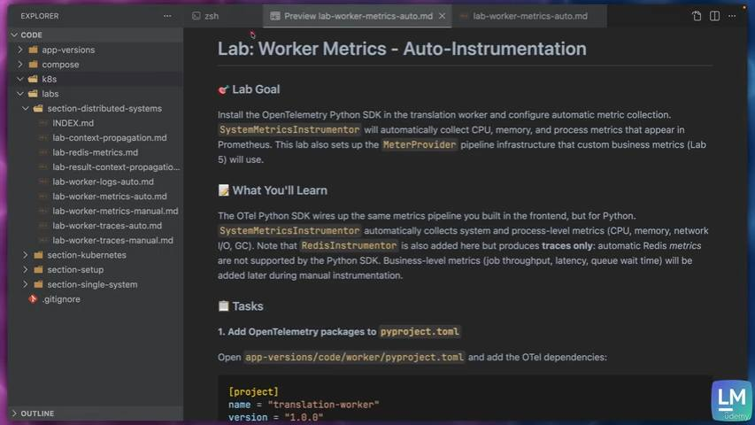
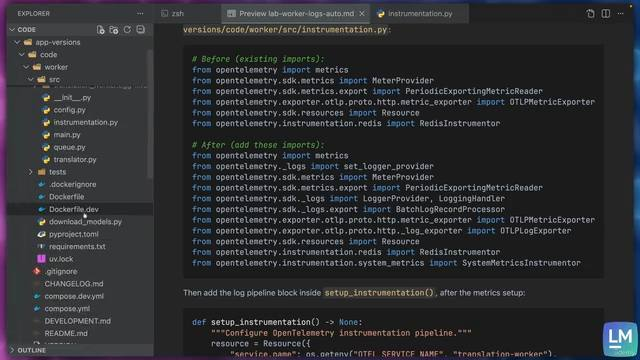
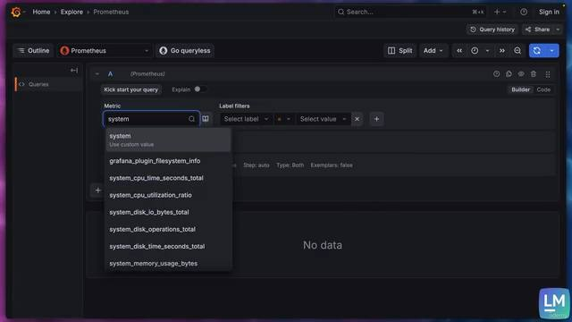
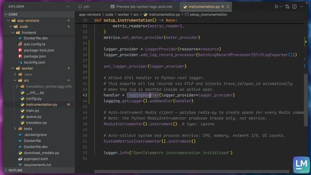
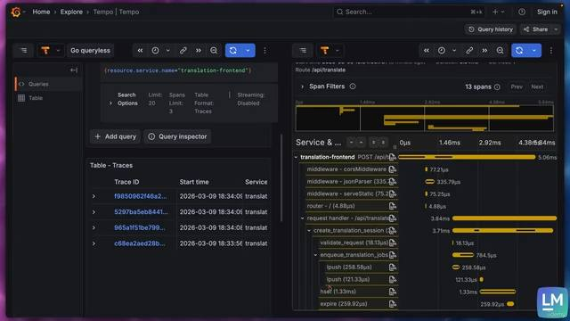
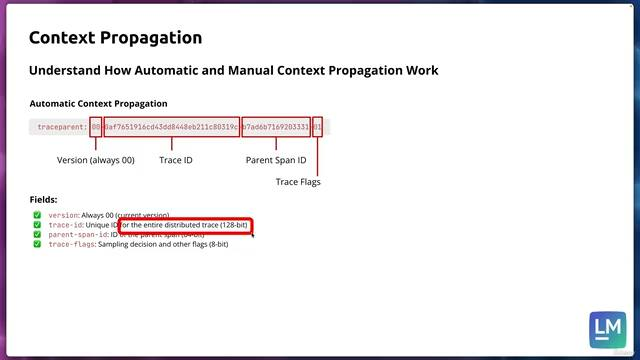

# OpenTelemetry 实战（P076–P083）：Python Worker 的 Metrics / Logs / Traces 自动插桩与上下文传播原理

> 本文只覆盖 P076–P083。讲师在这八讲里做的事情是：给已有的 Python 翻译 worker 加三套 OpenTelemetry 管线（Metrics → Logs → Traces），并在最后一讲把「上下文传播（context propagation）」的原理讲透。**真正的跨服务 trace 串联（把 worker 和前端接成一条 trace）课里只讲了原理和代码骨架，实现留到后面的实验**——这一点在第 7 章会明确标出来，别提前以为自己已经拿到了统一 trace。

---

## 1. 这一节做什么

这一段课程的起点是一个**已经在跑的双服务系统**：TypeScript 前端把翻译任务 `LPUSH` 进 Redis 队列，Python worker 从队列里 `BRPOP`/消费任务、调用 Argos Translate 做翻译。前端在更早的实验里已经做过 OpenTelemetry 插桩，worker 还是「裸」的。

所以 P076 一开始，讲师给出的路线图是（—— p076 [00:00]）：

1. **Worker 自动插桩**（Python auto instrumentation），把 metrics、logs、traces 三路信号从 worker 里采出来；
2. 亲眼观察「worker 的遥测数据和前端的遥测数据是**断开的**」这个基线状态；
3. 然后做**分布式上下文传播**，在异步消息队列里注入 / 提取 trace context，把前端→worker、worker→前端两个方向都补齐；
4. 再往后（不属于本节范围）才是自定义 metrics 与 span、用 exporter 模式监控 readiness、把 worker 日志迁移成结构化格式。

本文能带你复现的是 **1、2 和 3 的原理部分**：

- 你会得到一个 `worker/src/instrumentation.py` 文件，三套 pipeline 齐全，可以直接跑；
- Prometheus 里出现 CPython 进程级指标（`system_cpu_time_seconds_total` 一类）；
- Loki 里出现 `service_name = translation-worker` 的日志流，并且日志自动带上 `trace_id` / `span_id`；
- Tempo 里出现 Redis 操作产生的 span —— **但是是孤立 span**，没有 parent，和前端的 trace 接不上。这不是你配错了，这是讲师刻意留下的基线（—— p082 [02:23]）。

后两条（日志带 trace_id、span 是孤立的）是判断你到底跑对了没有的关键信号，第 6 章会做成检查清单。



---

## 2. 讲师原话（带出处）

关于「为什么要先做基线、再谈连通」：

> "We're going to start with worker auto instrumentation. Basically that's a Python auto instrumentation here. We're going to collect metrics logs and traces from our Python worker service, and we'll observe how disconnected the telemetry data coming from the worker is from telemetry data coming from the front end. Once we establish a baseline here, we're gonna move on to exploring distributed context propagation." —— p076 [00:00]

关于版本基线（这段非常重要，用错代码包会白折腾）：

> "If you have not been following with the previous labs and you do not have the code folder available here locally in your machine, then unzip the version 1.2.0 zip folder here... This is important because the 1.1.0 has no instrumentation whatsoever and in the 1.2.0 we already have instrumentation in the front end." —— p078 [00:00]

关于依赖装在哪一类：

> "So hopefully the names, they are self-explanatory here. I'm going to add them to our dependencies. So these are not dev dependencies, right? These are actual dependencies of our application. Because whenever the application is running, we do want to send telemetry data." —— p078 [01:18]

关于 `setup_instrumentation` 的调用时机，以及为什么 Python 和 TS 不一样：

> "This is very important that we do that actually before any kind of code runs here, because we want the setup instrumentation all the auto instrumentation to be run before any kind of code is run here. This was also similar to the front end code where we actually imported it at the very top of the file. Now with Python here, it is okay if we actually call the function after we do some imports; in our JavaScript code or the TypeScript front end here, we had to actually do it at the very top." —— p078 [05:04]

关于为什么日志要从**下划线开头**的 `_logs` 里导入：

> "Now Laura, why underscore logs here? Well, as it turns out, the Python SDK is under development for logs, right? So if we switch here to the Python SDK, we will see under status and releases that the traces is stable, metrics is stable, but logs is still under development." —— p079 [00:11]

关于加日志管线到底做了什么：

> "We will then create a logging handler and this is really the way that logs are handled in Python. They are handled via handlers so we can have a file handler, we can send the logs to multiple destinations. And what this does is it basically creates a handler that is going to use the provider which will send the logs to our open telemetry collector. So we're adding this handler here to the logging library." —— p080 [04:49]

关于「一旦配置了 tracer provider，RedisInstrumentor 就会自动产生 span」：

> "Just a note here: the moment we add the traces pipeline here we will see that the RedisInstrumentor.instrument it will actually pick up on this configured tracer provider. It will create a new span for every Redis command." —— p081 [00:21]

关于自动传播能覆盖什么、不能覆盖什么（这是 P083 的核心结论）：

> "This doesn't work in every scenario and the scenario we're actually working with here, the automatic context propagation doesn't work because message queues they don't have HTTP headers. So the way for us to tackle that is to actually embed this trace context in the message payload. And then in the consumer side, we actually need to extract this information." —— p083 [01:20]



---

## 3. 从零复现

整段实验可以切成 **3 个可独立验证的里程碑**。**每做完一个就部署一次、验证一次**，不要三个一起改完再排查——讲师本人就是一节实验只加一套管线（p078 加 metrics、p080 加 logs、p082 加 traces），每节都 rebuild。

### 3.1 环境与代码准备

```bash
# 1. 拿到课程代码包（讲师用的是 1.2.0，1.1.0 没有前端插桩，不要用）
unzip version-1.2.0.zip
cd code/worker        # 讲师口述为 "under our app versions, code ... the worker directory"
```

你需要确认的目录形态（路径以你解压后的实际结构为准）：

```
code/
├── worker/           ← 本节全部改动都在这里
│   ├── pyproject.toml
│   ├── uv.lock
│   └── src/
│       ├── main.py
│       └── instrumentation.py   ← 本节新建
└── compose/
    └── compose.dev.yaml         ← 环境变量写在这里
```

> 关于文件名：p077 [01:19] 讲师口述为 "compose.app.yaml"，p080 [05:48] 与 p082 [01:08] 口述为 `compose.dev.yaml`。以你仓库里实际存在的那个为准，下面的命令按 `compose.dev.yaml` 写，改名即可。

前置：本机需要 Docker + Docker Compose，以及 `uv`（讲师全程用 `uv sync` / `uv.lock`，不用 pip）。

### 3.2 里程碑一：Metrics 管线

**步骤 1｜改 `worker/pyproject.toml` 的 `[project].dependencies`**

讲师在这一步加了 5 个运行时依赖（p078 [00:48]），命名对应关系是「exporter OTLP HTTP」= `opentelemetry-exporter-otlp-proto-http`（因为后面所有导入路径都是 `opentelemetry.exporter.otlp.proto.http.xxx_exporter`）。

```toml
dependencies = [
    "redis",
    "argostranslate",
    "opentelemetry-api",
    "opentelemetry-sdk",
    "opentelemetry-exporter-otlp-proto-http",
    "opentelemetry-instrumentation-redis",
    "opentelemetry-instrumentation-system-metrics",
]
```

> **版本号**：逐字稿里讲师**没有给出任何具体版本号**，只反复强调「用和仓库一致的版本，保证依赖完全对齐」（—— p079 [01:02]）。所以版本真相在 `uv.lock` 里，**不要手写 pin**。你只需要保证 5 个包版本自洽。

**步骤 2｜同步依赖并写 lock**

```bash
cd code/worker
uv sync --all-extras
```

讲师的原话是 "在这里用 UV sync --all-apps --extras 安装，只是为了确保把所有包都装上……这基本上会更新我们的 UV 锁文件，然后把包安装到这里的虚拟环境中。"。如果输出里只装了 `opentelemetry-instrumentation-system-metrics` 一项，说明你之前已经装过其余几个（讲师本机就是这种情况，p078 [01:48]），不是失败。

> 在 JS/Node 侧对照：`uv sync` ≈ `pnpm install --frozen-lockfile` 的「锁文件驱动」思路，`uv.lock` ≈ `pnpm-lock.yaml`。

**步骤 3｜新建 `worker/src/instrumentation.py`**

完整内容见第 4 章 4.1。写完先别改 `main.py`，直接 `python -c "import src.instrumentation"` 级别地确认没有语法/导入错误（讲师没做这一步，但能省一次 5 分钟的 Docker 重建）。

**步骤 4｜在 `worker/src/main.py` 里接上**

加导入 + 在 signal handler 注册之后立刻调用（顺序很重要，p078 [05:04]）：

```python
from .instrumentation import setup_instrumentation

# ... signal handler 注册代码之后、进入消费循环之前 ...
setup_instrumentation()
```

注意：**不要**把它塞到 `if __name__ == "__main__":` 之外的花括号式结构里，Python 里就是模块顶部导入 + 函数内调用。讲师明确说了 Python 允许在若干 import 之后调用（这点和 TS 前端必须写在文件最顶端不同）。

**步骤 5｜确认环境变量在 `compose/compose.dev.yaml` 的 worker 服务下**

```yaml
services:
  worker:
    environment:
      - OTEL_SERVICE_NAME=translation-worker
      - OTEL_EXPORTER_OTLP_ENDPOINT=http://otel-collector:4318
```

- `OTEL_SERVICE_NAME`：Loki / Tempo 里按 `service_name` 过滤时用的值；
- `OTEL_EXPORTER_OTLP_ENDPOINT`：OTLP **HTTP** 端口（因为导入路径是 `proto.http`）。如果你本地 collector 暴露的是 gRPC 4317，这里要改成 gRPC 的端点并换 exporter 包——**课里只演示了 HTTP 这一条路径**，4317/4318 的具体取值请以你的 collector 配置为准。

**步骤 6｜重建并只起 worker**

```bash
cd code/compose
docker compose -f compose.dev.yaml up --build worker
```

要有心理准备：因为改了 `pyproject.toml`，这一步会重新下载 PyTorch 和 Argos Translate 的模型，**很慢**（讲师原话："这里确实会花一点时间……它会再次下载 PyTorch，还会下载 Argos Translate 模型。"，p078 [06:31]）。

**步骤 7｜打流量**

往队列里发几次翻译请求（正常语言对 + 一次非法语言数），讲师的做法是「run this one, also run with an invalid number of languages here and this should already be enough to generate some traffic」（p078 [07:28]）。

**步骤 8｜在 Prometheus 里验证**

查询（注意讲师在 p078 [08:14] 亲自纠了一个实验文档里的 typo）：

```
system_cpu_time_seconds_total{exported_job="translation-worker"}
```

> 关键坑：Prometheus 这里的标签是 **`exported_job`**，**不是** `service_name`。讲师原话：'I do have a typo that should not be service name that should actually be exported job... This is slightly different for Prometheus when in comparison to Loki and to Tempo where we actually have service name.'（—— p078 [08:14]）。指标名与标签名的最终形态**请以你 Prometheus 里的实际输出为准**——collector 的 Prometheus exporter 会改写标签名。



### 3.3 里程碑二：Logs 管线（转发到 collector，再由 collector 进 Loki）

**步骤 1｜在 `instrumentation.py` 顶部追加 `_logs` 相关导入**（`logs` 名字前有下划线，原因是 Python SDK 的 logs 仍是开发中状态，p079 [00:11]）。

**步骤 2｜顺便重构 metrics 部分（讲师在这一讲做的清理）**

- `Resource.create()`：**不带参数**调用，自动从 `OTEL_SERVICE_NAME` 这类环境变量里取资源属性；
- `OTLPMetricExporter()`：**不带参数**调用，自动从 `OTEL_EXPORTER_OTLP_ENDPOINT` 取端点；
- 环境变量 `OTEL_METRIC_EXPORT_MILLIS` → 改成 **`OTEL_METRIC_EXPORT_INTERVAL`**（讲师原话 "我认为毫秒后缀不对，所以我就把它去掉。"，p080 [01:43]）。默认 10000 毫秒 = 10 秒；若你想用 SDK 默认的 60 秒，这个 option 整个可以省略。

**步骤 3｜在 `setup_instrumentation` 里加日志管线**

位置：**metrics 管线之后、`RedisInstrumentor` 调用之前**（讲师原话 "把这个放到指标下面、这里 RedisInstrumentor 调用的上面。"，p080 [02:41]）。

**步骤 4｜把 handler 挂到 root logger**

```python
logging.getLogger().addHandler(handler)
```

这一步的作用是「所有 log records 都会经 OTLP 导出，并且自动注入 trace ID 和 span ID」（—— p079 [01:38]）。

**步骤 5｜重建 + 验证**

```bash
cd code/compose
docker compose -f compose.dev.yaml up --build worker
```

然后 Grafana → Loki → label `service_name` = `translation-worker` → Run query。讲师甚至说这一步不需要额外打流量，"我们这里已经有一些日志了，正在发送日志，正在发送日志。"（p080 [06:12]），因为 worker 自己会持续打日志。



### 3.4 里程碑三：Traces 管线

**步骤 1｜追加导入**：`from opentelemetry import trace`，以及 `TracerProvider` / `BatchSpanProcessor` / `OTLPSpanExporter`（p082 [00:24]）。

**步骤 2｜在 `setup_instrumentation` 的**日志管线下方**加 traces 管线**（p082 [00:53]），同样不显式写 endpoint，靠环境变量。

**步骤 3｜删掉 RedisInstrumentor 上的 metrics 开关**

讲师在这一讲把 Redis 的 metrics 采集去掉了：「I believe that in later versions of the Redis instrumentation, metrics are not provided anymore... this would be more precise. I think that now only spans are available. But once again, this might change in the future.」（—— p081 [00:48]）。所以 `RedisInstrumentor().instrument()` 不带参数调用即可，只产出 span。

**步骤 4｜重建 + 打流量 + Tempo 验证**

```bash
cd code/compose
docker compose -f compose.dev.yaml build worker
```

Grafana → 从 Loki 切到 **Tempo** → Search → service name = `translation-worker` → 你会看到一批 span。

**你会看到的现象（重要，别误判为 bug）**：这些 span 是**孤立的**，没有 parent、没有指向前端的 trace，只能看到「Redis 的 `pop` 操作发生在某处」。讲师原话：'these spans, they are actually just isolated spans here. The traces don't have any connection to the front end operations... the moment that these translation requests are added to the Redis queue, then the information about this trace is lost because we did not implement context propagation yet.'（—— p082 [02:23]）。这正是下一个实验要解决的问题。



### 3.5 里程碑四（原理，不出代码）：为什么队列必须手工注入

P083 是纯讲解 + 代码走读，没有让你改文件。你要带走的是这套判断逻辑：

1. **自动传播只在有「协议信封」的传输上生效**：HTTP 用 `traceparent` 头，gRPC 用 metadata；
2. **Redis 队列的消息体只有业务字段，没有 header 概念**，所以自动传播失效；
3. **解法 = 生产侧 inject（把当前 active context 序列化进 payload）+ 消费侧 extract（从 payload 反序列化出 remote context）**，两端各自起一个 span，消费端把 span kind 设成 `CONSUMER`。



---

## 4. 完整代码

> 说明清楚哪部分是「讲师逐字给过」、哪部分是「课里没给全、本文按口述重建」。这样你才能在出错时知道该怀疑谁。

### 4.1 `code/worker/src/instrumentation.py`（完整文件）

这一份是 p078 + p080 + p082 三次迭代后的**最终形态**，可以直接保存运行。

```python
"""
OpenTelemetry instrumentation for the translation worker.

Pipelines: metrics (OTLP/HTTP) + logs (OTLP/HTTP) + traces (OTLP/HTTP).
All three exporters pick up OTEL_EXPORTER_OTLP_ENDPOINT from the environment;
the resource picks up OTEL_SERVICE_NAME from the environment.
"""
import os
import logging

# OpenTelemetry API (the "facade" layer the app talks to)
from opentelemetry import metrics
from opentelemetry import trace
from opentelemetry import _logs  # logs still under development in the Python SDK

# Metrics SDK
from opentelemetry.sdk.metrics import MeterProvider
from opentelemetry.sdk.metrics.export import PeriodicExportingMetricReader
from opentelemetry.exporter.otlp.proto.http.metric_exporter import OTLPMetricExporter
from opentelemetry.sdk.resources import Resource

# Logs SDK
from opentelemetry.sdk._logs import LoggerProvider, LoggingHandler, BatchLogRecordProcessor
from opentelemetry.exporter.otlp.proto.http._log_exporter import OTLPLogExporter

# Traces SDK
from opentelemetry.sdk.trace import TracerProvider
from opentelemetry.sdk.trace.export import BatchSpanProcessor
from opentelemetry.exporter.otlp.proto.http.trace_exporter import OTLPSpanExporter

# Auto-instrumentation
from opentelemetry.instrumentation.redis import RedisInstrumentor
from opentelemetry.instrumentation.system_metrics import SystemMetricsInstrumentor

logger = logging.getLogger(__name__)


def setup_instrumentation() -> None:
    # Resource.create() reads OTEL_SERVICE_NAME (and other OTEL_RESOURCE_ATTRIBUTES)
    # from the environment, so we do not hard-code the service name here.
    resource = Resource.create()

    # ------------------------------------------------------------------ metrics
    metric_reader = PeriodicExportingMetricReader(
        OTLPMetricExporter(),  # endpoint comes from OTEL_EXPORTER_OTLP_ENDPOINT
        export_interval_millis=int(os.getenv("OTEL_METRIC_EXPORT_INTERVAL", "10000")),
    )
    meter_provider = MeterProvider(resource=resource, metric_readers=[metric_reader])
    metrics.set_meter_provider(meter_provider)

    # --------------------------------------------------------------------- logs
    logger_provider = LoggerProvider(resource=resource)
    logger_provider.add_log_record_processor(
        BatchLogRecordProcessor(OTLPLogExporter())
    )
    _logs.set_logger_provider(logger_provider)

    # Attach an OTel handler to the Python root logger: every log record is
    # exported over OTLP and gets trace_id / span_id injected automatically.
    handler = LoggingHandler(logger_provider=logger_provider)
    logging.getLogger().addHandler(handler)

    # ------------------------------------------------------------------- traces
    tracer_provider = TracerProvider(resource=resource)
    tracer_provider.add_span_processor(BatchSpanProcessor(OTLPSpanExporter()))
    trace.set_tracer_provider(tracer_provider)

    # -------------------------------------------------------- auto-instrument
    # RedisInstrumentor picks up the tracer provider set above and creates one
    # span per Redis command. In current versions it only emits spans (no metrics).
    RedisInstrumentor().instrument()   # type: ignore
    SystemMetricsInstrumentor().instrument()

    logger.info("OpenTelemetry instrumentation initialised")
```

关于 `# type: ignore`：讲师在 p078 [04:16] 说这里有个类型提示错误，「there is nothing that will implement or that will influence our application, so we can safely ignore this」。放在 `RedisInstrumentor().instrument()` 这行上即可。

**导入路径核对**：逐字稿只说了「from the SDK metrics, we're going to import the meter provider, the periodic exporting metric reader」（p078 [00:26]），没有逐字念出完整模块路径。上表的 `opentelemetry.sdk.metrics` / `opentelemetry.sdk.metrics.export` 是这两类对象在 SDK 里的常规归属；**如果你本地 `ImportError`，请按你的实际安装版本调整 import 来源**，逻辑不变。

### 4.2 `code/worker/src/main.py` 的改动位置（**非全文**）

> 课里没有展示 `main.py` 全文，只展示了这两处改动（p078 [05:04]）。下面只写改动，其余内容保持 1.2.0 原样。

```python
# ... 原有 imports ...
from .instrumentation import setup_instrumentation


def main() -> None:
    # ... 原有 signal handler 注册代码 ...

    # 必须在这里调用：在进入消费循环、处理任何消息之前
    setup_instrumentation()

    # ... 原有消费循环（从 Redis 取任务、翻译、写回结果）...
```

### 4.3 `code/compose/compose.dev.yaml` 的 worker 环境变量段（**非全文**）

> 课里只演示了「确认这两个变量存在」（p078 [06:13]），没有展示 compose 全文。

```yaml
services:
  worker:
    build:
      context: ../worker
    environment:
      - OTEL_SERVICE_NAME=translation-worker
      - OTEL_EXPORTER_OTLP_ENDPOINT=http://otel-collector:4318
      - OTEL_METRIC_EXPORT_INTERVAL=10000
```

前两个是必须的；第三个可选（不写就是代码里的默认 10000）。

### 4.4 P083 生产侧注入（TypeScript，**课里给的是片段，下面是补全后的可读版本**）

> 逐字稿在 [03:13]–[03:43] 之间对这段代码的讲解有 30 秒的画面空白，下面按讲师口述重建：新建空对象 → `propagation.inject` → spread 旧 job → 加 `_trace_context` 键。

```ts
import { context, propagation } from "@opentelemetry/api";

async function enqueueTranslation(job: TranslationJob): Promise<void> {
  // 1. 准备一个空 carrier —— 这就是会被塞进消息体的容器
  const traceContext: Record<string, string> = {};

  // 2. 把当前 active context 序列化进 carrier（HTTP 场景会写 traceparent 头）
  propagation.inject(context.active(), traceContext);

  // 3. 把业务字段原样保留，再挂上 _trace_context
  const enrichedJob = { ...job, _trace_context: traceContext };

  await redis.lpush(QUEUE_NAME, JSON.stringify(enrichedJob));
}
```

### 4.5 P083 消费侧提取（Python，**课里没有给完整文件，以下为按口述重建的示意代码**）

> 讲师在 [04:13]–[05:12] 讲了 `tracer.start_as_current_span` 要传 remote context、`kind=SpanKind.CONSUMER`、以及 attributes 来自业务消息而非 trace context；但没有逐字给出完整函数。下面是把它拼起来的最小实现，**仅供理解流程，不是课程原代码**。

```python
from opentelemetry import propagate, trace
from opentelemetry.trace import SpanKind

tracer = trace.get_tracer(__name__)


def handle_job(enriched_job: dict) -> str:
    # 1. 取出生产侧塞进来的 carrier，反序列化成 remote context
    carrier = enriched_job.get("_trace_context", {})
    remote_ctx = propagate.extract(carrier)

    # 2. 以 remote context 为父，在当前服务里起一个 CONSUMER span
    with tracer.start_as_current_span(
        "translation.job",
        context=remote_ctx,
        kind=SpanKind.CONSUMER,
        attributes={
            # attributes 来自业务消息本身，与是否 remote 无关
            "job.id": enriched_job["id"],
            "session.id": enriched_job["session_id"],
            "target.language": enriched_job["target_language"],
            "translation.text": enriched_job["text"],
        },
    ):
        return translate(enriched_job)
```

---

## 5. 逐行解释

### 5.1 `instrumentation.py`

- **`from opentelemetry import _logs`（下划线）**：这是本节最容易让人以为是拼写错误的一行。原因不是笔误，而是 SDK 的 logs 模块尚未 GA，只能用「私有」命名空间导入（—— p079 [00:11]）。这个下划线**会随版本消失**，如果哪天不加下划线也能 import，说明 logs 已转正。
- **`Resource.create()` 不带参数**：p078 的初版是显式构造带 service name 的 resource，p080 重构成 `create()`。差别在于 `create()` 会去读 `OTEL_SERVICE_NAME` 等环境变量，这样「配置留在 compose 里，代码里不重复」。**逐个服务手写 service name 的反面教材**就是配置漂移：代码里写死 `translation-worker`，compose 里写 `translation_worker`，你在 Grafana 就会查不到。
- **`OTLPMetricExporter()` 不带参数**：同理，端点由 `OTEL_EXPORTER_OTLP_ENDPOINT` 决定。这也是为什么两个环境变量缺一不可——缺了端点，导出器要么报错要么静默丢弃。
- **`export_interval_millis=int(os.getenv("OTEL_METRIC_EXPORT_INTERVAL", "10000"))`**：讲师在 p080 [01:43] 特别纠正过变量名，去掉 `MILLIS` 后缀。为什么是 10000 而不是 SDK 默认的 60000？因为要和前端对齐（—— p078 [04:46]，"我们默认设为 10,000 毫秒……只是因为前端里用的也是这个值。"）。这也解释了为什么他宁可保留这行也不删——**跨服务的采集节奏一致，图表才可比**。
- **`metrics.set_meter_provider(meter_provider)`**：这是「注册全局单例」的动作，不是「启动采集」。没有这一步，后面 `SystemMetricsInstrumentor` 拿不到 provider，指标就静默消失（不报错，最难查）。
- **`logger_provider.add_log_record_processor(BatchLogRecordProcessor(OTLPLogExporter()))`**：三层套娃，逐层对应「provider（管资源与生命周期）→ processor（管批量与重试）→ exporter（管协议与端点）」。用 batch 而不是 simple，是因为日志量大，逐条 HTTP 请求会把 collector 打满。
- **`_logs.set_logger_provider(logger_provider)`**：和 metrics 的 `set_meter_provider` 同构，作用是把「OpenTelemetry 内部的全局日志 provider」指向你刚建的这个。
- **`handler = LoggingHandler(logger_provider=...)`** + **`logging.getLogger().addHandler(handler)`**：这是本节唯一「侵入 Python 标准库」的地方。Python 的日志是 handler 模型（一个 logger 可以挂多个 handler，分别写文件 / 写 stdout / 发网络）。挂到 **root logger**（`logging.getLogger()` 无参数）意味着**整个进程所有 logger 的日志都会被导出**，而不只是你自己的模块。讲师在 p080 [03:26] 用一句话概括："这将确保所有日志记录都通过 OTLP 导出，并且还会自动注入 trace ID 和 span ID。"
  - 在 JS/Node 里对应什么：Node 没有「root logger」这个概念，等价做法是给 `winston` 加一个 transport，或给 `pino` 加一个 OTel stream。**Python 是「挂 handler」，Node 是「加 transport」，抽象层级完全对应**。
- **`TracerProvider` + `BatchSpanProcessor` + `OTLPSpanExporter`**：和日志管线同构，provider/processor/exporter 三层。顺序也重要——必须先 `set_tracer_provider`，再 `RedisInstrumentor().instrument()`，否则 Redis 仪器化拿不到 provider，就「每个 Redis 命令生成一个 span」这件事不会发生（p081 [00:21]）。
- **`RedisInstrumentor().instrument()` 不带 metrics 参数**：p081 [00:48] 讲师主动删掉了 metrics 部分，理由是较新版本的 Redis 仪器化只发 span。这行的收益极大——**一行代码换来每个 Redis 命令一个 span**；代价是你在 Tempo 里会看到大量低价值 span，这正是 p082 [03:22] 说的「these are not so useful traces or spans」。
- **`SystemMetricsInstrumentor().instrument()`**：产出的是**进程级**指标（CPU 时间等），不是业务指标。所以你在 Prometheus 里看到的是 `system_cpu_time_seconds_total` 这类名字，别指望看到「翻译次数」。

### 5.2 P083 的传播逻辑

- **`propagation.inject(context.active(), carrier)`**：两个参数，一个来源一个去向。`context.active()` 取的是「当前这一刻正在执行的 span 的上下文」，所以这行必须放在**已经处在某个 span 内部**的位置才有意义；如果前端根本没插桩，这里注入的就是空载体。
- **为什么要 `{ ...job, _trace_context }` 而不是替换整个消息体**：因为 worker 消费消息时还要读业务字段。注入只允许「新增一个键」，不能改动已有协议——这是跨服务改造的通用安全做法。
- **`kind=SpanKind.CONSUMER`**：语义标记。它告诉后端「这个 span 是在消费别人产生的工作，不是它自己发起的」。没有这个标记，链路展示会把消费端误当成发起端。
- **attributes 用点号命名（`job.id` / `session.id`）**：讲师在 p083 [04:42] 特意强调这些属性「不是通过 trace context 过来的」，是从消息的业务内容里取的。**这一点是排查属性缺失的判据**：如果 attribute 没了，先看消息体，不要去看 traceparent。
- **`propagation.extract(carrier)` 而不是手工解析 traceparent**：讲师原话是「we don't really need to go into the details of which field is the version or trace ID, pattern span ID and the flags and all that. This is handled behind the scenes by these functions.」（—— p083 [05:12]）。这解释了为什么 P083 花了一半时间讲 `00-{trace-id}-{parent-span-id}-{flags}` 的结构，然后告诉你**不用手写解析**——结构知识是用来读日志和排障的，不是用来写代码的。

---

## 6. 复现检查清单

按里程碑逐项打勾，**不要跳项**。

### 环境层

- [ ] 用的是 **1.2.0** 代码包（1.1.0 前端没插桩，会得到「什么都查不到」的结论）
- [ ] `cd code/worker` 能成功
- [ ] `uv sync --all-extras` 后 `uv.lock` 有变更
- [ ] `pyproject.toml` 里 5 个 OTel 包在 **`dependencies`**，不在 `dev-dependencies`
- [ ] compose 的 worker 服务下有 `OTEL_SERVICE_NAME` 和 `OTEL_EXPORTER_OTLP_ENDPOINT`

### 里程碑一：Metrics

- [ ] `docker compose -f compose.dev.yaml up --build worker` 构建成功（第一次要等 PyTorch / Argos 模型下载）
- [ ] worker 日志出现正常消费记录（说明应用起来了，不只是容器在跑）
- [ ] Prometheus 里能查到 `system_cpu_time_seconds_total{exported_job="translation-worker"}`
      → **拿不到**：先怀疑 `exported_job` 这个标签名在你环境里不叫这个，去 Prometheus 的 label 列表里确认，别急着改代码
- [ ] 若查的是 `service_name`：**这是错的**，Prometheus 用 `exported_job`（p078 [08:14] 讲师亲自纠过）

### 里程碑二：Logs

- [ ] `instrumentation.py` 里 `_logs` 相关导入有下划线
- [ ] `Resource.create()` / `OTLPMetricExporter()` 已改为无参调用
- [ ] 环境变量名是 `OTEL_METRIC_EXPORT_INTERVAL`（**没有** `MILLIS`）
- [ ] 日志管线插在 metrics 之后、`RedisInstrumentor` 之前
- [ ] `logging.getLogger().addHandler(handler)` 存在且**只加一次**（重启重载会重复挂，日志双份）
- [ ] Grafana → Loki → `service_name = translation-worker` → 有日志流
- [ ] 随便点开一条日志，能看到 `trace_id` / `span_id` 字段（这是 handler 生效的铁证）

### 里程碑三：Traces

- [ ] `trace.set_tracer_provider()` 在 `RedisInstrumentor().instrument()` **之前**
- [ ] Grafana → Tempo → service name = `translation-worker` → 有 span
- [ ] span 上能看到 Redis 的 `pop` 操作
- [ ] **预期异常**：这些 span **没有 parent**、**和前端的 trace 接不上**。确认这是 p082 [02:23] 描述的基线状态，不是你的配置错

### 里程碑四：概念

- [ ] 能说出 traceparent 的四个字段各是什么（版本 / trace ID / parent span ID / trace flags）
- [ ] 能说出为什么自动传播在 Redis 队列上失效（消息队列没有 HTTP header，p083 [01:20]）
- [ ] 能说出 inject 在哪一侧、extract 在哪一侧
- [ ] 知道 Redis 消息里新键叫 `_trace_context`（下划线开头，避免和业务字段撞名）

---

## 7. 课里没讲但你会撞上的

**① 版本号一个都没给。**
逐字稿里讲师从未念出 `opentelemetry-sdk==1.x.y` 之类的具体版本（p079 [01:02] 只是反复强调「保持一致」）。这意味着**唯一权威是 `uv.lock`**。如果你自己新建项目而不是用 1.2.0 代码包，`_logs` 下划线、`PeriodicExportingMetricReader` 的导入位置、Redis 仪器化是否还发 metrics，三件事都可能随版本变——遇到 `ImportError` 或指标缺失，先查版本，再改代码。

**② 完整的 `main.py` 和 compose 文件课里没有展示。**
本文 4.2 / 4.3 只给了改动片段，这是诚实的边界。如果你从零手搭（不用 1.2.0 代码包），需要自己保证：worker 启动时**先** `setup_instrumentation()` **再**进入消费循环。

**③ `exported_job` 这个标签名的来源没讲。**
p078 [08:14] 讲师只说了「Prometheus 这里是 `exported_job`，和 Loki/Tempo 的 `service_name` 不同」，但没解释为什么不同、也没讲这个标签是谁加上的（是 collector 的 Prometheus exporter，还是 compose 里的 job 配置）。**排障时请以 Prometheus 实际输出的标签名为准**，不要凭本文的字符串硬匹配。

**④ OTLP 端口 4318 是本文的写法，课里没念。**
讲师只说「exporter OTLP HTTP」和「endpoint 从环境变量来」，没有念出具体端口号。你的 collector 用哪个端口，就用哪个。

**⑤ Docker 构建耗时没有优化手段。**
讲师只说「会重新下载 PyTorch 和模型，需要等一会」（p078 [06:58]）。课里没讲 layer 缓存策略、也没讲如何避免每次改 `pyproject.toml` 就全量重装。你如果被卡在这一步，那属于「课里没讲」的部分。

**⑥ worker→前端 的反向传播只在路线图里出现过。**
p076 [00:21] 提到要「完成两个方向的传播：前端到 worker、worker 到前端」。但 P083 演示的 inject / extract 只覆盖了前端→worker 这一个方向，反向（worker 把结果写回队列或响应给前端时再注入 context）**课里没有给代码**。