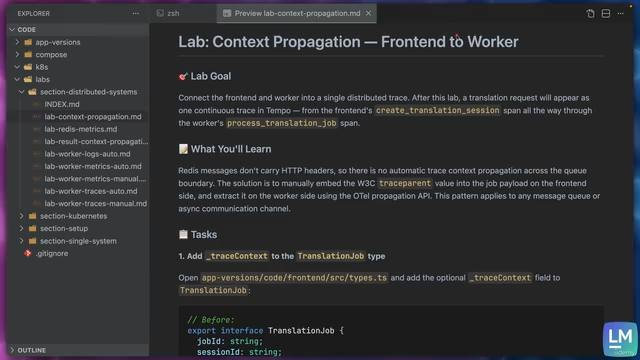
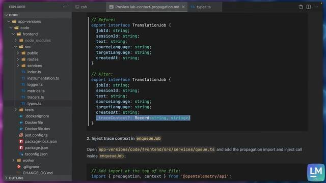
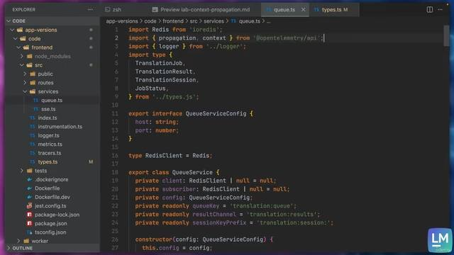
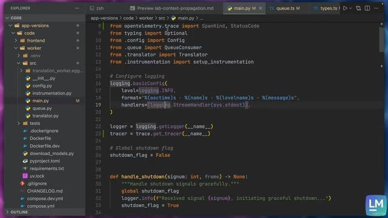
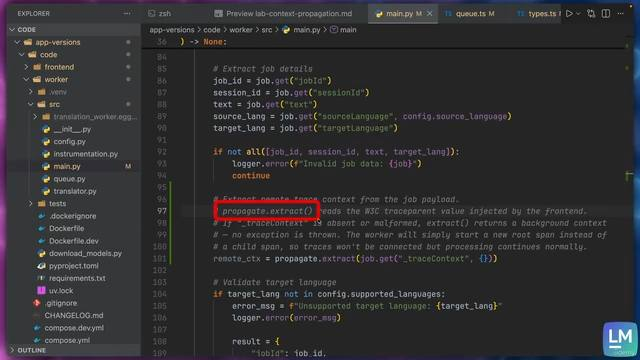
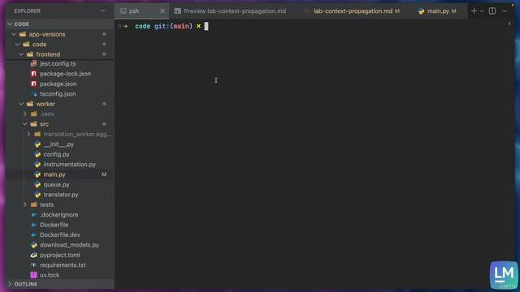
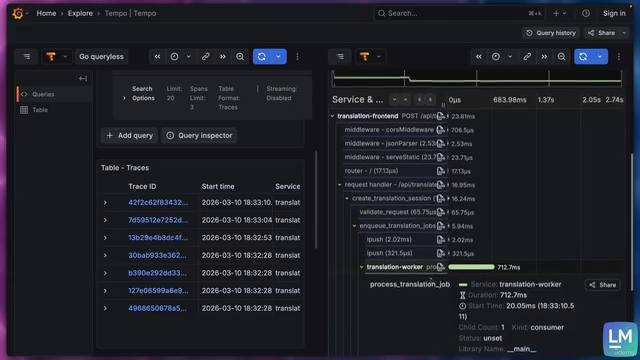
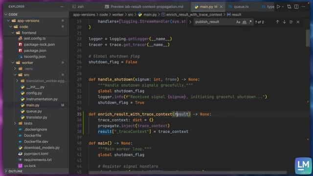
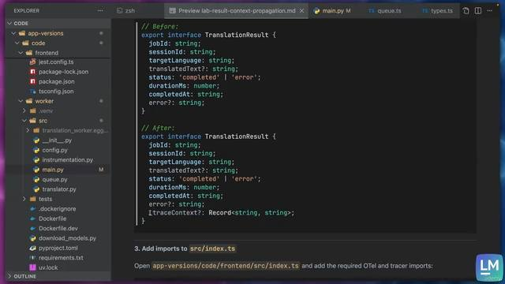
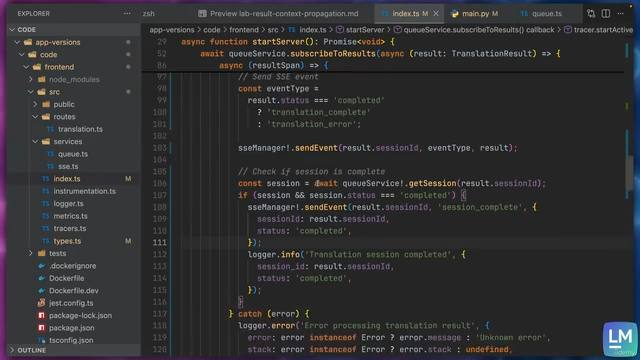

# OpenTelemetry：把前端与 Worker 串成一条分布式 Trace（P084–P089）

## 1. 这一节做什么

这几节课要解决的问题非常具体：**前端的 HTTP 请求和 Worker 里异步处理的任务，目前是两条互不相干的链路**。你在 Grafana 里点开前端 `/api/translate` 的 trace，看到的是"请求进队列就结束了"，后面的翻译过程完全没有出现在同一条瀑布图里。

根因也很具体：前端和 Worker 之间不是 HTTP 调用，而是通过 Redis 队列通信。讲师在 P084 里明确点出了这一点：Redis 不会携带 HTTP header，所以 W3C 的 `traceparent` 这类上下文信息**不会自动跟着消息走**。因此需要手工做两件事：

1. **前端注入（inject）**：在把 job 写进 Redis 之前，把当前活跃 span 的上下文序列化成一个普通字典，塞进 job payload 的 `_trace_context` 字段里。
2. **Worker 提取（extract）**：Worker 拿到 job 后，从这个 `_trace_context` 里把上下文还原出来，然后用它作为父上下文开一个 `SpanKind.CONSUMER` 的 span，继续这条 trace。

P084–P087 完成的是这半个往返（前端 → Worker）。P088–P089 完成反方向的半个往返（Worker → 前端）：Worker 把结果 publish 回 Redis 之前注入上下文，前端在订阅结果的回调里提取并开 `process-translation-result` span。两个方向都打通后，Grafana/Tempo 里才能看到一条从 `POST /api/translate` 一直到"结果回推给浏览器"的完整瀑布图。

这一节的产出物不是"知识点"，而是 4 个文件的改动：

| 文件 | 方向 | 改什么 |
| --- | --- | --- |
| `frontend/src/types.ts` | 两侧都要 | 给 `TranslationJob` 和 `TranslationResult` 加可选 `_trace_context` |
| `frontend/src/services/queue.ts` | 注入 | `enqueueJob` 里 `propagation.inject` 后重新组装 message |
| `worker/src/main.py` | 提取 + 注入 | `propagate.extract` + `start_as_current_span`；`inject_trace_context()` 挂到每个 `publish_result` 前 |
| `frontend/src/index.ts` | 提取 | `subscribeToResults` 里 `propagation.extract` + 四参数版 `startActiveSpan` |



## 2. 讲师原话（带「—— pNNN [MM:SS]」）

> "因为 Redis 不携带 HTTP headers，我们确实需要在前端侧手动把这条信息嵌入到我们的 job payload 中，然后在 worker 上把它提取出来。"
> —— p084 [00:35]

这句是整节的技术前提。注意讲师用的是 "把这些信息嵌入到我们的任务负载中"，不是"配置某个中间件"，因为队列消息本身就是普通 JSON，除了你自己塞进去的东西，没有任何元数据通道。

> "我们会创建一个新的 `_trace_context`，然后在这里把 active context 注入到 `_trace_context` 对象中。"
> —— p085 [01:23]

> "这个 propagator 在这里做 extract 时不会抛错……它基本上只会返回一个 background context，然后 worker 会启动一个新的 root span，而不是 child span。我们将无法把这些 trace 连接起来，但文本处理会继续正常进行。"
> —— p086 [03:02]

这是**故障模式**的说明，非常重要：extract 失败不是异常，是静默降级。你在 Grafana 里看到的不是报错，而是"链路断了但业务正常"，所以排查时不能靠看日志报错。

> "在 TypeScript 中，我们要么得立即结束 span，要么得手动结束 span。在 Python 中，当我们这里把这个 `with` 块作为一个 span 时，我们就不需要手动结束 span……这就是 Python 中所谓的 context manager。"
> —— p086 [04:56]

> "在这里添加一个空字符串作为默认值是安全的，因为这不会破坏我们当前的逻辑。"
> —— p086 [09:39]

配合前面 `all([...])` 的校验逻辑：空字符串在 Python 里是 falsy，所以补默认值不会让"缺字段就跳过"的判断失效。

> "`start active span` 函数有三个重载。其中一个接收四个参数，也就是我们关心的那个。它会依次接收 name、options、context，然后是 callback。"
> —— p088 [01:51]

前端要"既传 span 配置（kind、attributes），又传自定义父上下文"，只有四参数这个重载能做到。

> "我们需要反过来做。我们需要把这个加上——在 worker 侧注入这条信息，在前端 extract——并且每当它从 translation job 中拿到一个 result 时。"
> —— p087 [04:43]

> "这看起来是顺序的，因为在我们这个场景中，对 worker 来说，它实际上就是顺序的。基本上 worker 一次只能拿到一个 job。如果我们有两个 worker 在运行，那么这两个 worker 可以同时拿到两个 job，然后我们应该会在我们的 trace 中看到平行的线。"
> —— p089 [10:07]

## 3. 从零复现

### 3.0 前置条件（课里没展开，按你上一节的环境为准）

你需要在上一节结束时已经拥有：

- 一个前端服务（TypeScript/Node），暴露 `POST /api/translate`，并自带 `@opentelemetry/api` 与 Node SDK 初始化（讲师提到前端已经有 Winston 自动埋点）。
- 一个 Worker（Python + `opentelemetry-api` / `opentelemetry-sdk`），从 Redis 队列里取 job。
- Redis。
- Grafana + Tempo + Loki 观测栈（Grafana 里已能按 service name 查 trace、能关联 Loki 日志）。
- `compose/` 目录下的 `compose.dev.yaml`（**这个文件的具体内容课里没讲**，只讲了启动命令）。

> 课里没讲环境变量名、端口号、Redis 客户端库名、队列 key 名、服务名全称。下面凡是涉及这些的地方都标了「以你的项目为准」，不要照抄占位值。

### 3.1 第一步：给类型加上 `_trace_context`

1. 打开前端，进入 `source` 目录，找到 `types.ts`。
2. 给 `TranslationJob` 增加一个**可选**字段 `_trace_context?: Record<string, string>`。
3. 顺手也给 `TranslationResult` 加同样的可选字段（P088–P089 反向链路要用，先一起加上省一次改动）。

讲师对类型的解释：这是一个"标准字典"，键和值都是 string，具体形状由 OpenTelemetry 包来保证，TypeScript 这边不需要（也不应该）写死 shape。之所以是可选（`?`），因为"可能存在跟踪上下文，也可能完全没有跟踪上下文"。



### 3.2 第二步：在 `enqueueJob` 里注入上下文

1. 打开 `frontend/src/services/queue.ts`。
2. 在**文件最顶部**加 import：`context` 和 `propagation` 来自 `@opentelemetry/api`。
3. 在 `enqueueJob` 函数里，**在"没有 client 就 throw"的那段之后**，创建 `_trace_context` 空对象，调用 `propagation.inject(context.active(), _trace_context)`。
4. 用展开运算符把原 job 的所有键拷进新对象，再把 `_trace_context` 挂上去。
5. 入队的是这个**新对象**，不是原来的 `job`。



这里讲师花了将近两分钟讲展开运算符（spread operator），因为对不熟悉 TS 的人这段最容易懵：`{ ...job, _trace_context }` 等价于把 `job_id`、`created_at`、`session_id`、`text`、`target_language` 一个一个手写过去。手写的问题不是麻烦，是**不可扩展**——以后 job 加字段，所有拷贝点都要同步改，漏一个就是线上丢字段。所以用展开。

### 3.3 第三步：Worker 提取上下文并包住整个处理逻辑（`worker/src/main.py`）

1. 打开 `source` 目录下的 `main.py`。
2. 在文件顶部（`from datetime import ...` 附近）加两个 import：`from opentelemetry import trace, propagate` 和 `from opentelemetry.trace import SpanKind, StatusCode`。
3. 在"拿到 logger"之后，加模块级 tracer：`tracer = trace.get_tracer(__name__)`。
4. 在**校验完 job 字段齐全之后**，取 `remote_context = propagate.extract(job.get("_trace_context", {}))`。
5. 用 `with tracer.start_as_current_span("process-translation-job", context=remote_context, kind=SpanKind.CONSUMER) as span:` 包住从"语言是否支持"一直到"发布结果"的**全部逻辑**，整体缩进一级。
6. 在 try 成功路径末尾 `span.set_status(Status(StatusCode.OK))`；在 except 里 `span.record_exception(e)`、记日志、`span.set_status(Status(StatusCode.ERROR, str(e)))`。
7. 翻译成功后设置属性 `span.set_attribute("translation.duration_ms", duration_ms)`。
8. 修掉 Pylance 报的那一堆错：给 `job_id` / `session_id` / `target_language` 补默认值 `""`。



关于第 8 步，讲师特意开了 Python REPL 现场验证（这个 REPL 片段在截图清单里没有对应帧，所以这里用代码块记录）：

```python
>>> bool("")
False
>>> bool("ABCD")
True
```

也就是说 `all([job_id, session_id, text, target_language])` 这个判断，在字段缺失时依然会正确地走到 `continue`。补 `""` 只是为了让类型检查器（讲师说的是 pylons，指 Pylance）能收窄类型，不改变运行时行为。



### 3.4 第四步：部署并验证正向链路

```bash
cd compose
docker compose -f compose.dev.yaml up --build
```

讲师明确说：**不加 `-d`**，先看日志确认 worker 和 frontend 都起来了，再 detach。加了 `--build` 是因为两个服务都改了代码，必须重建镜像。

然后发几条请求打流量（讲师是从别处拷贝的 curl 命令，**具体 URL 和字段名课里没念全，以你的项目为准**）：

```bash
curl -X POST http://localhost:3000/api/translate \
  -H 'Content-Type: application/json' \
  -d '{"text":"another message","target_language":"german"}'
```

发 3 条左右就够看了。接着在 Grafana：

1. 选 service name（讲师口述为 "翻译前端……"，按你仪表盘里实际的服务名选）。
2. rerun query。
3. 看 duration 明显变大——讲师的原话是"以前，从开始到它真正进入队列本身只有几毫秒，随后我们就丢失了所有信息"。
4. 点 trace ID 进 Tempo，看瀑布图。





在 span 详情里能看到属性：`translation.duration_ms`、text length、target language。讲师还点开了这个 span 关联的 Loki 日志（"我们可以在这里看到这个跨度的日志"）。

### 3.5 第五步：反向链路——Worker 注入，前端提取

**Worker 侧（`main.py`）**

1. 新增一个小函数 `inject_trace_context(result)`：内部 `trace_context = {}`、`propagate.inject(trace_context)`、`result["_trace_context"] = trace_context`、return result。
2. 找到**所有** `publish_result(...)` 调用点（讲师说有两个），改成 `publish_result(inject_trace_context(result))`。

讲师在这里自己吐槽了一句：函数修改入参不是最佳实践（"这会修改这里的对象，也就是输入，这不是最佳实践"），但因为只是**新增**一个键、没有破坏已有数据，所以接受。同时他把函数名从 `inject_trace_context_into_result` 之类简化成了 `inject_trace_context`。

**前端侧**

3. `types.ts` 里给 `TranslationResult` 加 `_trace_context?: Record<string, string>`（3.1 步已经加过）。
4. 在 `frontend/src/index.ts` 顶部加 OTel import。讲师在这里顺手清理了 import 里多余的 `.js` 后缀——但保留了 `JSON` 相关的那个（"这里的这个 JSON 需要保留"）。
5. 在 `subscribeToResults` 函数**最开头**取 `remoteContext = propagation.extract(context.active(), result._trace_context ?? {})`。讲师说位置可以放在 `logger.info` / `logger.error` 之后、开 span 之前，"这实际上取决于你想把它放在哪里"。
6. 用四参数版 `startActiveSpan(name, options, remoteContext, async (resultSpan) => {...})` 包住原来的 try 逻辑，并在 `finally` 里 `resultSpan.end()`。
7. 成功 `setStatus({ code: SpanStatusCode.OK })`；失败调 `setSpanResult(resultSpan, err)`（这个 helper 就是前端翻译侧之前已经用过的那个）。





### 3.6 第六步：再次重建、发流量、看完整链路

```bash
docker compose -f compose.dev.yaml up --build
```

重建后发一批请求（讲师这次把 `sleep` 去掉了："我们这里不需要休眠，因为那只会增加一些我不希望增加的延迟"）。他发了 5 个 session，等了一会儿（约 20 秒）才刷新出数据——他自己也吐槽"这是一个非常糟糕的系统。"，但解释了原因：3 种语言 × 每次 0.5~2 秒的模拟延迟 × 5 个请求，最坏 30 秒，在预期区间内。

最终 Grafana 里能看到完整瀑布图：`POST /api/translate` → 多次 push 到 ready queue → worker 逐个 `process-translation-job` → publish → 前端 `process-translation-result` → 写 session 数据 → 推给浏览器。



## 4. 完整代码

> 说明：课程只逐段展示了"改动位置"，没有放出仓库全貌。下面的文件是**以讲师的改动为核心**写成的完整可保存文件；凡是课里没展示的外部依赖（Redis 客户端、helper 函数、compose 内容），都用注释标了「课里没讲，示意/脚手架」，请对齐你自己项目里的真实实现。

### 4.1 `frontend/src/types.ts`

```ts
// frontend/src/types.ts
// 课里只展示了新增的 _trace_context 字段；其余字段名按你的实际项目为准。

export interface TranslationJob {
  job_id: string;
  session_id: string;
  text: string;
  target_language: string;
  created_at: string;
  /**
   * 课里新增字段：W3C trace context 的载体。
   * 键值都是 string（例如 SDK 写入的 traceparent），
   * 具体 shape 由 OpenTelemetry 包负责，这里不写死。
   * 可选：可能没有上下文（比如本地手工造的 job）。
   */
  _trace_context?: Record<string, string>;
}

export interface TranslationResult {
  job_id: string;
  session_id: string;
  target_language: string;
  translated_text?: string;
  error?: string;
  /** 课里 P088/P089 为反向链路新增的同名字段 */
  _trace_context?: Record<string, string>;
}
```

### 4.2 `frontend/src/services/queue.ts`

```ts
// frontend/src/services/queue.ts
// 课里展示的核心是 enqueueJob 里的 inject + spread。
import { context, propagation } from "@opentelemetry/api";
import { redis } from "./redis"; // 课里没讲这个文件，见 4.3
import type { TranslationJob } from "../types";

// 队列 key 课里没讲，按你项目里的 key 填
const JOB_QUEUE_KEY = "translation:jobs";

export async function enqueueJob(job: TranslationJob): Promise<void> {
  // 讲师原话：inject 放在 "throw the error in case there is no client" 之后
  const client = redis;
  if (!client) {
    throw new Error("Redis client is not available");
  }

  // 1) 空字典作为 carrier，把当前活跃上下文注入进去
  const _trace_context: Record<string, string> = {};
  propagation.inject(context.active(), _trace_context);

  // 2) 展开原 job，再挂上 _trace_context（不要直接改 job 本身）
  const message: TranslationJob = { ...job, _trace_context };

  // 3) 入队的是新对象
  await client.lpush(JOB_QUEUE_KEY, JSON.stringify(message));
}
```

### 4.3 `frontend/src/services/redis.ts`（脚手架，课里没讲）

```ts
// frontend/src/services/redis.ts
// 课里没展示 Redis 客户端的创建方式，下面是示意脚手架。
// 换成你项目里已有的客户端即可（ioredis / node-redis 都行）。
import Redis from "ioredis";

export const redis = new Redis(process.env.REDIS_URL ?? "redis://redis:6379");
```

### 4.4 `frontend/src/services/span-result.ts`（复用 helper，课里没单独展示文件）

```ts
// frontend/src/services/span-result.ts
// 讲师说这个函数"就是我们在 translation.ts 里已经用过的那个"，
// 这里抽成独立文件方便 index.ts 复用。
import { SpanStatusCode, type Span } from "@opentelemetry/api";

export function setSpanResult(span: Span, err: unknown): void {
  span.recordException(err as Error);
  span.setStatus({
    code: SpanStatusCode.ERROR,
    message: err instanceof Error ? err.message : String(err),
  });
}
```

### 4.5 `frontend/src/index.ts`（`subscribeToResults` 部分）

```ts
// frontend/src/index.ts
import {
  context,
  propagation,
  trace,
  SpanKind,
  SpanStatusCode,
} from "@opentelemetry/api";
import { redis } from "./services/redis"; // 课里没讲，见 4.3
import { setSpanResult } from "./services/span-result"; // 见 4.4
import type { TranslationResult } from "./types";

const tracer = trace.getTracer("translation-frontend");

// 队列 key 课里没讲
const RESULT_QUEUE_KEY = "translation:results";

// 课里没讲这两个 helper 的实现，示意即可
async function markJobStatus(result: TranslationResult): Promise<void> {
  // 把 job 标记为 completed 或 error
}
async function sendEventToBrowser(result: TranslationResult): Promise<void> {
  // 把事件推给浏览器
}

export async function subscribeToResults(): Promise<void> {
  while (true) {
    const raw = await redis.brpop(RESULT_QUEUE_KEY, 0);
    if (!raw) continue;
    const payload = raw[1];
    const result: TranslationResult = JSON.parse(payload);

    // 1) 从 result payload 里还原父上下文（可能为空 → background context）
    const remoteContext = propagation.extract(
      context.active(),
      result._trace_context ?? {}
    );

    // 2) 四参数重载：name, options, context, callback
    tracer.startActiveSpan(
      "process-translation-result",
      {
        kind: SpanKind.CONSUMER,
        attributes: {
          "translation.job_id": result.job_id,
          "translation.target_language": result.target_language,
        },
      },
      remoteContext,
      async (resultSpan) => {
        try {
          await markJobStatus(result);
          await sendEventToBrowser(result);
          resultSpan.setStatus({ code: SpanStatusCode.OK });
        } catch (err) {
          setSpanResult(resultSpan, err);
        } finally {
          // 课里：TypeScript 必须手动 end
          resultSpan.end();
        }
      }
    );
  }
}
```

### 4.6 `worker/src/main.py`

```python
# worker/src/main.py
import json
import logging
import time
import random

from opentelemetry import trace, propagate
from opentelemetry.trace import SpanKind, StatusCode, Status

logger = logging.getLogger(__name__)

# 课里：在拿 logger 之后取模块级 tracer
tracer = trace.get_tracer(__name__)

# 课里没讲具体支持列表 / 队列 key，以下为示意
SUPPORTED_LANGUAGES = {"spanish", "german", "french"}
JOB_QUEUE_KEY = "translation:jobs"
RESULT_QUEUE_KEY = "translation:results"


def inject_trace_context(result):
    """课里 P089 新增：把当前上下文注入到 result payload。"""
    trace_context = {}
    propagate.inject(trace_context)
    result["_trace_context"] = trace_context
    return result


# ---- 下面几个函数课里没展示实现，是跑通所需的示意脚手架 ----
def consume_job():
    """从 Redis ready 队列取一条 job；没有就返回 None。"""
    # 你的项目里应该已有实现，这里只是占位
    return None


def publish_result(result):
    logger.info("publish result for job %s", result.get("job_id"))


class _Translator:
    def translate(self, text, target_language):
        time.sleep(random.uniform(0.5, 2.0))
        return f"[{target_language}] {text}"


translator = _Translator()
# ---- 脚手架结束 ----


def process_translation_jobs():
    shutdown_flag = False

    while not shutdown_flag:
        job = consume_job()
        if job is None:
            continue

        # 课里：给这三个字段补 "" 默认值，消掉 Pylance 的报错
        job_id = job.get("job_id", "")
        session_id = job.get("session_id", "")
        text = job.get("text", "")
        target_language = job.get("target_language", "")

        # 课里：这里不齐就跳过（"" 是 falsy，不会破坏原逻辑）
        if not all([job_id, session_id, text, target_language]):
            logger.error("Invalid job data")
            continue

        # 课里：校验通过之后再 extract remote context
        remote_context = propagate.extract(job.get("_trace_context", {}))

        # 课里：with 块 = context manager，退出时自动 end span
        with tracer.start_as_current_span(
            "process-translation-job",
            context=remote_context,
            kind=SpanKind.CONSUMER,
        ) as span:

            # 不支持的语言：publish 后继续下一条（仍在 span 内）
            if target_language not in SUPPORTED_LANGUAGES:
                result = {
                    "job_id": job_id,
                    "session_id": session_id,
                    "target_language": target_language,
                    "error": "unsupported language",
                }
                publish_result(inject_trace_context(result))
                continue

            # 模拟延迟，课里是 0.5~2 秒
            time.sleep(random.uniform(0.5, 2.0))

            try:
                assert text is not None if text is not None else True
                start = time.perf_counter()
                translated = translator.translate(text, target_language)
                duration_ms = round((time.perf_counter() - start) * 1000)

                # 课里：成功路径上设置属性 + OK 状态
                span.set_attribute("translation.duration_ms", duration_ms)
                logger.info("translated job %s in %d ms", job_id, duration_ms)

                span.set_status(Status(StatusCode.OK))

                result = {
                    "job_id": job_id,
                    "session_id": session_id,
                    "target_language": target_language,
                    "translated_text": translated,
                }
                publish_result(inject_trace_context(result))

            except Exception as e:
                # 课里：记录异常 + 记日志 + 设 ERROR 状态（带描述）
                span.record_exception(e)
                logger.exception("translation failed for job %s", job_id)
                span.set_status(Status(StatusCode.ERROR, str(e)))

                result = {
                    "job_id": job_id,
                    "session_id": session_id,
                    "target_language": target_language,
                    "error": str(e),
                }
                publish_result(inject_trace_context(result))


if __name__ == "__main__":
    process_translation_jobs()
```

> 提醒：`translation.duration_ms` 这个属性名是讲师口述的（"translation.duration_ms"）。若你项目里已有别的命名约定，以实际为准。
> `propagate.extract(job.get("_trace_context", {}))` 的 carrier 是一个普通 dict，`inject` 同理——**这两个函数的入参类型请以你安装的 SDK 版本为准**。

### 4.7 `compose/compose.dev.yaml`

课里**没有展示**这个文件的内容，只给了启动命令 `docker compose -f compose.dev.yaml up --build`。这个文件里至少需要包含 `frontend`、`worker`、`redis` 三个服务，以及你上一节已经搭好的 Grafana / Tempo / Loki 栈。请照你现有的文件，不要按本文档猜。

## 5. 逐行解释

**`const _trace_context: Record<string, string> = {};` + `propagation.inject(context.active(), _trace_context)`**

`context.active()` 拿的是"此刻正在执行的这个 span 的上下文"。`propagation.inject` 是它的反向操作——把内存里的上下文对象**序列化**成一组键值对，写进你给的那个 carrier（这里是空字典）。默认用 W3C 格式时，你会看到里面多出一个 `traceparent` 键（具体键名与格式以 SDK 实际输出为准，本文档不替你断言）。

为什么不能直接塞 `context.active()` 本身？因为它是一个运行时对象，里面有 span 引用、SDK 内部状态，`JSON.stringify` 之后就没意义了。队列里传的必须是可以序列化的纯数据。

**`const message: TranslationJob = { ...job, _trace_context };`**

展开再覆盖。讲师讲了两种等价写法，手写版本是 `job_id: job.job_id, created_at: job.created_at, ...`——看着啰嗦，真正的代价是"加了新字段就得回来改"的维护成本。用展开之后，job 加字段不用动这行代码。

注意顺序：`_trace_context` 放在展开**后面**，所以即使原 `job` 里已经有一个同名（脏的）字段，也会被新的覆盖。这正是期望行为。

**`propagate.extract(job.get("_trace_context", {}))`（Python）**

`extract` 是 `inject` 的逆运算：从普通 dict 里把上下文还原成一个可用的 Context 对象。这里用 `job.get(..., {})` 给了默认空 dict，是为了兼容"老消息没有这个字段"的情况——否则 `job["_trace_context"]` 会 KeyError。

讲师反复强调的**关键行为**是：extract 失败不抛异常，而是返回 background context。也就是说，如果消息里没有 `_trace_context`、或者格式不合法，Worker 仍然会继续处理文本，只是 `process-translation-job` 会变成一个没有父级的新 root span，Grafana 里就接不上前端那条 trace。这个行为对业务是安全的，但对观测是"静默断链"，所以排查时不能只盯着异常日志，而要看瀑布图是否被拆成了两段。

**`with tracer.start_as_current_span(..., context=remote_context, kind=SpanKind.CONSUMER) as span:`**

Python 的 `with` 是上下文管理器：进入块时把 span 设为当前 span，退出块时自动结束 span。这和 TypeScript 里必须手动 `span.end()` 形成对照——课里特别点出这一点，因为两侧语言习惯不同，容易在 JS 侧忘记 `end()` 导致 span 迟迟不上报。`context=remote_context` 指定父上下文；`kind=SpanKind.CONSUMER` 表示这是"消费消息"的 span，语义上比默认的 internal 更贴近队列消费。

**`span.set_attribute("translation.duration_ms", duration_ms)`、`span.set_status(...)`、`span.record_exception(e)`**

这三类调用分别对应三类可观测信息：属性（duration）、状态（OK/ERROR）、异常事件（record_exception）。课里在成功路径设 OK，在失败路径 record + ERROR，并带上 `str(e)` 作为状态描述。注意 `record_exception` 和 `set_status` 不是互斥的：只 record 不设 status，某些后端仍可能把 span 显示为未出错；只设 status 不 record，则异常堆栈信息丢失。

**`inject_trace_context(result)` 与 `publish_result(inject_trace_context(result))`**

这个函数做的是正向链路的镜像：在 Worker 当前 span 还活跃的时候，把上下文注入到 result payload 的 `_trace_context` 里，然后才 publish。之所以要包在每个 `publish_result` 调用点外面，是因为 publish 之后前端才能拿到父上下文；漏掉任何一个 publish 点，那条结果就会在前端变成新的 root span。讲师说有两个调用点，一个成功、一个失败，两边都要挂。

**前端四参数 `startActiveSpan(name, options, remoteContext, callback)`**

讲师说 `startActiveSpan` 有三个重载，四参数这个是"name、options、context、callback"。普通三参数版本只能传 name 和 options，拿不到自定义父上下文；四参数版本才能把 `propagation.extract` 出来的 `remoteContext` 作为父级。`options` 里放 `kind: SpanKind.CONSUMER` 和 attributes，callback 里包住原来的 try 逻辑，`finally` 里 `resultSpan.end()`。

**`result._trace_context ?? {}`**

空值合并：如果 `_trace_context` 是 `undefined` 或 `null`，就传空对象给 `extract`。这和 Python 侧 `job.get("_trace_context", {})` 是同一个意图——兼容没有上下文的消息，不让 extract 因为入参是 undefined 而报错。课里讲师说 extract 本身不会 throw，但这里给默认值仍然让调用意图更清晰。

**前后端对照**

| 关注点 | 前端（TypeScript） | Worker（Python） |
| --- | --- | --- |
| 注入 | `propagation.inject(context.active(), obj)` | `propagate.inject(obj)` |
| 提取 | `propagation.extract(context.active(), obj)` | `propagate.extract(obj)` |
| 开 span | `tracer.startActiveSpan(name, options, ctx, cb)` | `with tracer.start_as_current_span(name, context=ctx, kind=...)` |
| 结束 span | 手动 `span.end()` | `with` 退出自动结束 |
| 失败处理 | `setSpanResult(span, err)` | `span.record_exception(e)` + `set_status(ERROR)` |

## 6. 复现检查清单

- [ ] **类型字段已加**：`TranslationJob` 和 `TranslationResult` 都有 `_trace_context?: Record<string, string>`。验证：在 `types.ts` 里搜 `_trace_context`，两处都能搜到；前端编译不报"对象字面量缺少属性"。
- [ ] **前端注入位置正确**：`propagation.inject` 在"无 client 就 throw"之后、`lpush` 之前。验证：在 `enqueueJob` 里打断点或加临时日志，确认入队 JSON 里出现 `_trace_context`，且里面有 W3C 相关键（以 SDK 实际输出为准）。
- [ ] **前端入队的是新对象**：`const message = { ...job, _trace_context }`，`lpush` 用的是 `message`。验证：检查 `lpush` 的实参不是原始 `job`；用 Redis 客户端 `LRANGE` 看消息体里同时有业务字段和 `_trace_context`。
- [ ] **Worker extract 在字段校验之后**：`remote_context = propagate.extract(...)` 位于 `all([...])` 判断之后。验证：读代码缩进层级；故意发一条缺 `text` 的 job，确认它走 `continue` 而不会先 extract。
- [ ] **Worker span 包住全部处理逻辑**：从语言判断到 `publish_result` 都在 `with` 块内。验证：在 `with` 块首尾加日志，确认"不支持语言"分支也在块内；Grafana 里该分支的 publish 应挂在该 span 下。
- [ ] **Worker 成功/失败状态都设置**：成功 `StatusCode.OK`，失败 `record_exception` + `StatusCode.ERROR`。验证：构造一次翻译异常（或临时让 translator 抛错），在 Tempo 里看该 span 状态为 ERROR 且带异常事件。
- [ ] **Worker 所有 publish 都注入**：成功、失败、不支持语言等分支的 `publish_result` 都包了 `inject_trace_context`。验证：全局搜 `publish_result(`，逐个确认实参是 `inject_trace_context(...)`；在 Redis result 队列里抽查消息含 `_trace_context`。
- [ ] **前端 extract 在开 span 之前**：`remoteContext` 在 `startActiveSpan` 之前取得。验证：读 `subscribeToResults` 顺序；在 extract 后加日志打印 carrier 是否为空。
- [ ] **前端使用四参数重载**：`startActiveSpan` 调用有 name、options、remoteContext、callback 四个参数。验证：TypeScript 编译通过；若误用三参数，父上下文会丢失，瀑布图里 `process-translation-result` 会变成新 root。
- [ ] **前端 finally 里 end**：`resultSpan.end()` 在 `finally` 中。验证：制造一次 `markJobStatus` 抛错，确认 span 仍能结束并上报，而不是悬挂。
- [ ] **重建镜像**：`docker compose -f compose.dev.yaml up --build` 不带 `-d` 先看日志。验证：日志里 frontend 和 worker 都无启动异常；改动后的代码确实生效（可加临时日志确认）。
- [ ] **正向链路可见**：发 1–3 条 `POST /api/translate`，Grafana 中同一条 trace 里能看到前端入队 span 和 worker 的 `process-translation-job`。验证：点 trace ID 进 Tempo，瀑布图不是两段孤立 trace。
- [ ] **反向链路可见**：Worker publish 后，前端出现 `process-translation-result`，且它挂在同一条 trace 下。验证：看瀑布图末端是否有该 span；检查它的父 span 是否是 worker 的 publish/process span。
- [ ] **串行符合预期**：单 worker 时多个 job 在瀑布图里呈串行。验证：发多条请求，观察 `process-translation-job` 是否一个接一个；若看到并行，说明可能有多个 worker 实例，与课里解释一致。
- [ ] **日志关联**：span 详情里能跳到 Loki 日志。验证：在 Tempo span 详情点 logs 链接，确认能按 trace/span 过滤出对应 worker 日志。

## 7 课里没讲但你会撞上的（表格：现象 / 原因 / 怎么办）

| 现象 | 原因 | 怎么办 |
| --- | --- | --- |
| Grafana 里前端 trace 和 Worker trace 是两段，接不上 | 消息里没有 `_trace_context`，或 Worker extract 拿到空 carrier，静默返回 background context | 先在 Redis 里看 job/result 消息是否含 `_trace_context`；再确认 `inject` 在 publish/lpush 之前执行；最后确认 Worker 在 `with` 里用了 `context=remote_context` |
| 业务正常、日志无报错，但链路就是断的 | `extract` 失败不抛异常，只降级成新 root span | 不要只搜异常日志；直接看瀑布图父子关系，并在 extract 后临时打印 carrier 是否为空 |
| `process-translation-result` 每次都是新 root | 前端用了三参数 `startActiveSpan`，没传 `remoteContext` | 改成四参数重载：name、options、context、callback；确认 extract 结果传进去了 |
| Worker 的 `process-translation-job` 没有父级 | extract 在字段校验之前执行，或 `_trace_context` 字段名写错 | 确认 extract 在校验之后；前端注入和 Worker 读取的键名必须完全一致（`_trace_context`） |
| 前端 span 迟迟不结束/不上报 | TypeScript 侧忘记 `resultSpan.end()` | 把 `end()` 放进 `finally`；对照 Python 的 `with` 自动结束行为 |
| Worker 报 Pylance 类型错误 | `job.get(...)` 可能返回 `None`，与后续 `all([...])` 的类型收窄不一致 | 按课里给 `job_id`/`session_id`/`target_language` 补 `""` 默认值；`""` 是 falsy，不破坏原校验逻辑 |
| 老消息进 Worker 后 KeyError | 直接用了 `job["_trace_context"]` | 改成 `job.get("_trace_context", {})`；前端 result 侧同理用 `?? {}` |
| 某个失败分支的 result 接不上 trace | 只给成功路径的 `publish_result` 包了 `inject_trace_context` | 全局搜 `publish_result(`，所有调用点都改成 `publish_result(inject_trace_context(result))` |
| 入队消息丢了业务字段 | 手写拷贝字段，新增字段时漏改 | 用 `{ ...job, _trace_context }` 展开，而不是逐字段手写；注意 `_trace_context` 放后面以覆盖脏值 |
| 瀑布图里 worker 处理是串行的 | 单 worker 一次只取一个 job | 这是课里解释过的预期行为；要并行就起多个 worker 实例，再看是否出现并行线 |
| 刷新 Grafana 很久没数据 | 模拟延迟 0.5~2 秒 × 多语言 × 多请求，最坏可达数十秒 | 先等预期时长再 rerun query；用日志确认 job 是否已处理完，别把"还没上报"误判成"没埋点" |
| `docker compose up` 后改动没生效 | 只 up 没 `--build`，镜像还是旧的 | 用 `docker compose -f compose.dev.yaml up --build`；先不加 `-d` 看启动日志，确认无误再 detach |
| 不知道队列 key / 服务名，照抄本文档占位值后查不到 | 课里没讲这些项目特定值 | 以你项目里的真实 key、服务名为准；在 Redis 里 `KEYS`/`LRANGE` 抽查，在 Grafana 按实际 service name 过滤 |