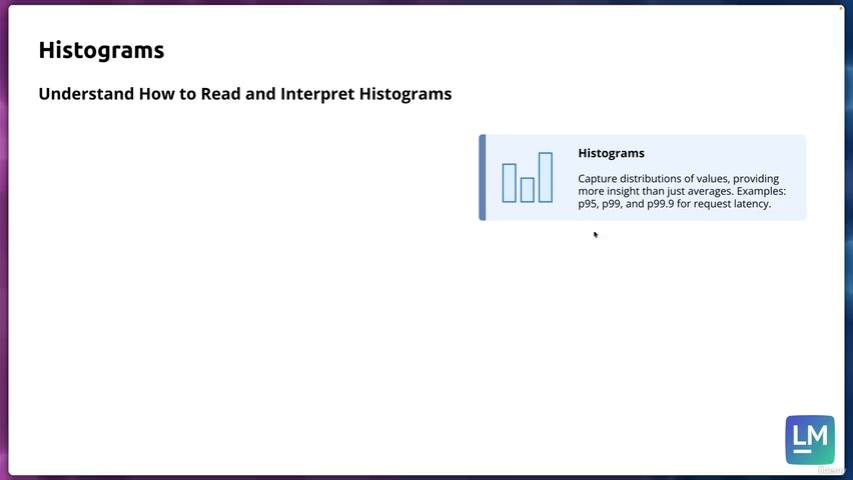
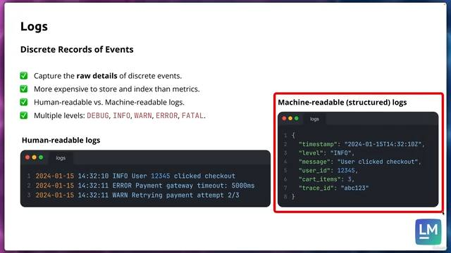
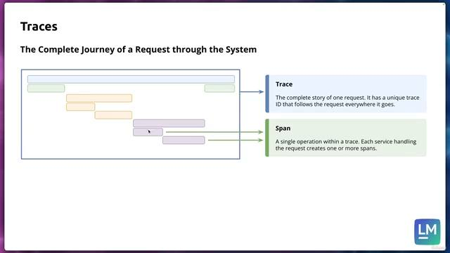
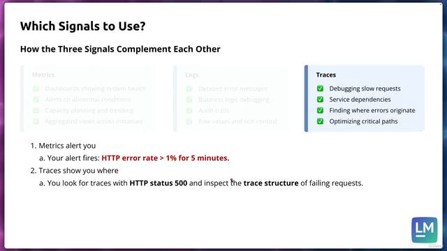
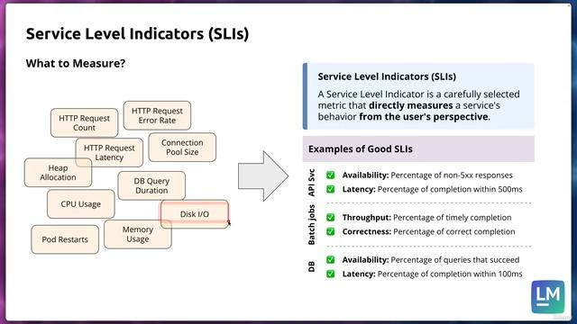
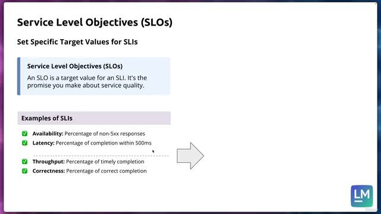
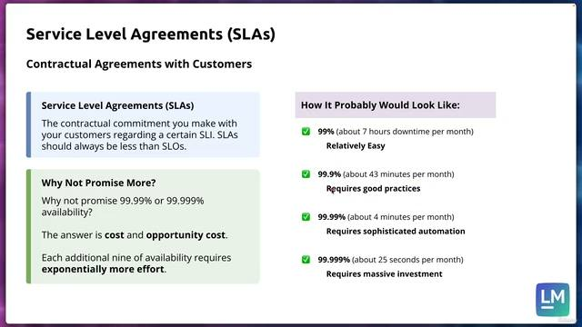
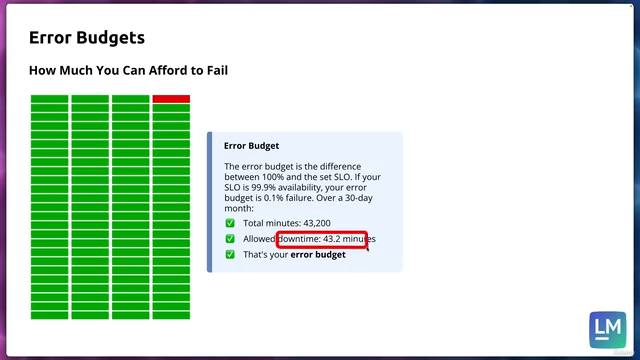

说明：P9–P16 的逐字稿是**纯概念讲解**，没有出现可运行代码、依赖版本、环境变量或启动命令。课程名虽是 OpenTelemetry，但这一段逐字稿主要讲可观测性概念：直方图/分位值、日志、Trace/Span、三信号协作、SLI/SLO/SLA、错误预算。因此本文按“纯讲解课”的方式复现：**不编造 SDK/Collector 实现**，而是把讲师给出的方案落成可直接保存、可评审、可验收的 observability 设计产物。下文凡涉及“课里没讲”的工程接入，统一放在第 7 节。

---

## 1. 这一节做什么

这一节覆盖 P9–P16，目标不是“听过概念”，而是把概念变成团队能直接用的产物：

1. 用**直方图桶**记录请求延迟分布，并能正确读出 P95、P99、P99.9。
2. 设计**结构化日志**和日志级别策略：debug / info / warn / error / fatal。
3. 建立 **Trace / Span** 数据模型：trace ID 贯穿请求，span 表示单个操作，parent span ID 还原调用关系。
4. 明确 **Metrics、Logs、Traces** 三信号各自回答什么问题，以及如何串起来排查。
5. 定义 **SLI**：从用户视角选“可用性、延迟”等少而关键的指标；再定义 **SLO** 内部目标；再定义 **SLA** 对外承诺。
6. 用 **Error Budget** 计算“还能失败多少”，并决定发布节奏：预算充足可加速，预算耗尽要冻结高风险发布、做可靠性改进和根因修复。

最终交付目录建议如下。它不依赖 Node/npm，不需要启动服务；用任意 Markdown 编辑器打开即可评审：

```text
observability/
├── README.md
├── 01-histograms-percentiles.md
├── 02-logs.md
├── 03-traces.md
├── 04-signals.md
├── 05-sli-slo-sla.md
├── 06-error-budget.md
├── capacity-plan.csv
├── trace-model.example.json
└── structured-log.example.jsonl
```

> 注意：上面的目录和文件是“复现产物”，不是讲师逐字稿里的仓库。P9–P16 没有给出代码仓库、依赖版本、环境变量名和启动命令。真正接入 OpenTelemetry SDK/Collector 的内容，这一段课里没讲。

---

## 2. 讲师原话（带「—— pNNN [MM:SS]」）

> "histograms……捕获值的分布。相比仅看平均值，它们能提供更多洞察。"
> —— p009 [00:00]

讲师强调直方图不是平均值，而是分布；平均值会把长尾用户掩盖掉。

> "px percentile……定义了一个单一值……有 X% 的观测值位于该值以下。"
> —— p009 [03:07]

P95 不是“第 95 个样本”，而是一条分界线：95% 的观测值在它下面或等于它。

> "机器可读日志例如是一个 JSON 对象，其中的键真正标识了该条信息。"
> —— p010 [00:48]

机器可读日志靠 key 标识信息，不靠空白符和固定顺序；这就是结构化日志。

> "通常我们不会在生产环境中启用 debug logging。"
> —— p010 [02:15]

生产默认不打开 debug；需要临时排查时才开。

> "trace 是一个请求的完整故事。它有一个唯一的 trace ID……"
> —— p011 [01:26]

Trace 是一次请求的完整故事，trace ID 会跟随请求跨服务传播。

> "各个单独元素被称为 spans……即 trace 中的单个操作。"
> —— p011 [01:50]

Span 是 trace 里的单个操作；每个服务处理请求时创建一个或多个 span。

> "这些 signals 并不是非此即彼……它们相互补充，而不是相互排斥。"
> —— p012 [00:12]

Metrics、Logs、Traces 不是三选一，而是互补。

> "service level indicators，它们是从用户视角直接衡量服务行为的、经过精心选择的一项指标或一组所选指标。"
> —— p013 [00:53]

SLI 是“从用户视角”精心挑选的指标，不是把所有能采集的东西都堆上仪表盘。

> "当我们为 SLIs 设置具体目标值时，就会使用 SLOs。"
> —— p014 [00:00]

SLO 是给 SLI 设具体目标值，是内部承诺，不直接对外。

> "你应当始终把 SLAs 设置得更低，也就是低于你的 SLOs。"
> —— p015 [00:29]

SLA 要低于 SLO，留缓冲；否则一破内部 SLO 就立刻违约。

> "error budget 真正告诉你的是 100% 与你设定的 SLO 之间的差值。"
> —— p016 [00:33]

错误预算 = 100% − SLO；它决定你还能承受多少失败。

> "在一个 30 天的月份里……总分钟数为 43,200……允许的 downtime 会是 43.2 分钟。"
> —— p016 [01:01]

30 天 = 43,200 分钟；SLO 99.9% 对应 0.1% 失败预算，即 43.2 分钟允许停机。

---

## 3. 从零复现

下面的命令是文档作者为复现产物补的，不是讲师逐字稿里的命令。逐字稿没有给任何启动命令。

```bash
mkdir -p observability
cd observability
touch README.md 01-histograms-percentiles.md 02-logs.md 03-traces.md 04-signals.md 05-sli-slo-sla.md 06-error-budget.md trace-model.example.json structured-log.example.jsonl
```

`capacity-plan.csv` 可以直接完整保存为下面内容：

```csv
slo,allowed_unavailable_ratio,days,total_minutes,allowed_downtime_minutes,lecture_rounding
0.99,0.01,30,43200,432,约7小时/月
0.999,0.001,30,43200,43.2,约43分钟/月
0.9999,0.0001,30,43200,4.32,约4分钟/月
0.99999,0.00001,30,43200,0.432,约25秒/月
```

### 步骤 1：先定义直方图桶和分位值口径

在 `01-histograms-percentiles.md` 里写清楚：

- 横轴是桶，纵轴是该桶内观测次数。
- 请求延迟用毫秒记录。
- 桶不要求等宽。讲师示例：`0–10ms`、`10–50ms`、`50–100ms`、`100–200ms`、`200–500ms`，再往后的桶可以更宽。
- 分位值要写业务解释：P95=980ms 表示“约 95% 的观测在 980ms 以下或等于 980ms，约 5% 更慢”。



### 步骤 2：定义日志级别和结构化日志

在 `02-logs.md` 写清楚：

- debug：最详细，生产默认关闭。
- info：正常操作和请求流。
- warn：意外但不一定是错误，比如接近限流、缓存未命中。
- error：失败且影响用户，比如超时、连接被拒、数据库查询出错。
- fatal：应用无法继续，比如内存耗尽、配置文件丢失导致无法启动。
- 日志优先机器可读：JSON object，key 标识信息；需要人看时再由处理机制打印人类可读版本。



### 步骤 3：建立 trace / span 模型

在 `03-traces.md` 写清楚：

- trace：一次请求的完整故事，有唯一 trace ID。
- span：trace 中的单个操作；服务每处理一段就创建一个或多个 span。
- span 关键元素：name、start/end timestamp、attributes（key-value 元数据）、parent span ID。
- 调用外部服务时，比如 Stripe API，只保留一个 span；因为拿不到对方内部细节，不能继续分解。



可把讲师举例的结算链路画成文本树：

```text
trace: checkout request
└── POST /checkout
    ├── validate cart items
    ├── inventory.check_availability
    │   └── sanitize input
    │   └── db select product
    ├── payment.execute
    │   ├── build invoice
    │   └── stripe API（外部调用，只保留一个 span）
    └── publish order to queue
```

### 步骤 4：定义三信号协作方式

在 `04-signals.md` 写清楚：

- Metrics：做仪表盘、告警、容量规划、跨实例聚合视图。
- Logs：看具体时间点的详细信息、调试业务逻辑、审计、补充上下文。
- Traces：定位慢请求、服务依赖、错误起源、关键路径优化。

讲师给的排查顺序是：**Metrics 告警 → Traces 定位哪个 span/服务 → Logs 按 trace ID 查原因**。例如 HTTP 错误率超过 1% 持续 5 分钟触发告警；看 5xx trace 找到 payment gateway；再按 trace ID 过滤日志，发现 payment gateway 返回 503 rate limit exceeded。



### 步骤 5：定义 SLI、SLO、SLA

在 `05-sli-slo-sla.md` 写清楚：

- SLI 要用户视角、可测量、能代表完整体验。
- API 服务示例：可用性 = 非 5xx 响应百分比；延迟 = 500ms 内完成请求的百分比。
- 批处理示例：按时完成百分比、正确完成百分比。
- 数据库示例：可用性、延迟。
- SLO 是内部目标：例如 99.95% 请求返回非 5xx；99% 请求在 500ms 内完成。
- SLA 是对外合同承诺，必须低于 SLO，留缓冲。讲师示例：内部 SLO 99.5%，对外 SLA 可设 99%；不同付费客户可以有不同 SLA。







### 步骤 6：计算 Error Budget 并写发布策略

在 `06-error-budget.md` 写清楚：

- Error Budget = 100% − SLO。
- 30 天 = 43,200 分钟。
- SLO 99.9% → 预算 0.1% → `43200 × 0.001 = 43.2` 分钟。
- SLO 99% → 预算 1% → `43200 × 0.01 = 432` 分钟，约 7 小时。
- 预算还有余量：可以更频繁部署、做实验、承担计算过的风险。
- 预算耗尽：冻结高风险发布，转向可靠性改进、偿还技术债、调查最近故障根因。



### 步骤 7：验收

不启动服务，直接检查文件是否包含以下内容：桶边界、分位值解释、日志级别、JSON 日志示例、trace ID/parent span ID、外部调用单 span 规则、三信号协作表、SLI/SLO/SLA 表、错误预算表。第 6 节给检查清单。

---

## 4. 完整代码

再次说明：P9–P16 没有代码。以下不是编造 SDK 实现，而是把讲师给出的方案落成可直接保存的产物。需要跑 `npm install` 的服务代码，**课里没有**。

### 4.1 设计决策表

把下面表格保存到 `observability/README.md`。

| 决策 | 本课依据 | 落地选择 | 不这样会怎样 |
|---|---|---|---|
| 延迟不只看平均值 | p009 [00:00] | 用直方图记录分布，同时输出 P95/P99/P99.9 | 平均值掩盖长尾，少量慢用户被忽略 |
| 分位值要给业务解释 | p009 [03:07] | 写明“95% 观测 ≤ 980ms，约 5% 更慢” | 只写 P95=980ms，团队不知道对用户意味着什么 |
| 日志优先结构化 | p010 [00:48] | JSON object，key 标识信息 | 按空白符解析，字段顺序一变就崩 |
| 生产默认 info 及以上 | p010 [02:15] | debug 只临时开启 | debug 量太大，存储和索引成本高 |
| 日志分五级 | p010 [01:45]–[03:38] | debug/info/warn/error/fatal | 所有日志一个级别，告警和排查都失效 |
| 用 trace ID 贯穿请求 | p011 [01:26] | trace_id 跨服务传递 | 跨服务慢请求无法串起来 |
| 用 span 表示单个操作 | p011 [01:50] | name/start/end/attributes/parent span ID | 只知道总耗时，不知道哪段慢 |
| 外部调用只留一个 span | p011 [02:34] | 标记外部服务调用 | 误以为能拆对方内部，数据不可得 |
| 三信号互补 | p012 [00:12] | Metrics 告警 → Traces 定位 → Logs 查因 | 只有指标会太晚，只有日志难定位，只有 trace 缺原因 |
| SLI 要用户中心、可测、完整 | p013 [00:53]–[03:40] | 选可用性、延迟等少而关键指标 | 仪表盘堆满指标，反而没有重点 |
| SLO 是内部目标 | p014 [00:00] | 例如 99.95% 非 5xx、99% ≤500ms | 把内部目标和外部合同混在一起 |
| SLA 低于 SLO | p015 [00:29] | 内部 99.9%，对外可承诺 99%/99.5% | 一破 SLO 立刻违约，没有缓冲 |
| Error Budget=100%−SLO | p016 [00:33] | 99.9% → 43.2 分钟/30 天 | 不知道风险余量，发布节奏拍脑袋 |

### 4.2 组件/信号职责表

| 信号/组件 | 负责回答 | 典型内容 | 什么时候用 |
|---|---|---|---|
| Metrics + Histograms | 系统整体健康吗？趋势如何？要不要告警？ | 请求延迟分布、错误率、请求数、容量趋势、聚合视图 | 仪表盘、告警、容量规划、跨实例聚合 |
| Logs | 这个时间点到底发生了什么？ | 结构化 JSON、级别、详细消息、trace_id、上下文 | 调试业务逻辑、审计、补上下文、查具体原因 |
| Traces | 这次请求走了哪些服务？哪段慢？错在哪？ | trace ID、span、parent span ID、start/end、attributes | 慢请求、依赖分析、错误起源、关键路径优化 |
| Error Budget 策略 | 现在还能承担多少失败？发布要不要减速？ | 100%−SLO、允许停机分钟、发布冻结规则 | 发布评审、可靠性改进、根因调查 |

### 4.3 数据模型草案

| 对象 | 字段 | 说明 |
|---|---|---|
| 结构化日志 | timestamp, level, message, trace_id, attributes | 字段名为落库草案；课里只讲 JSON key 标识信息，未给完整字段清单 |
| Trace | trace_id | 一次请求的唯一 ID，跨服务传播 |
| Span | span_id, parent_span_id, name, start_time, end_time, attributes | `span_id` 是本文草案字段名；课里明确提到 parent span ID，当前 span 自身 ID 的字段名课里没给，正式接入以实际输出为准 |
| Span attributes | key-value 元数据 | 讲师示例：request method、route、status code |

示意 JSON。**课里没有代码，以下为示意；字段名是落库草案，不是讲师给出的 SDK schema，实际字段以采集器输出为准。**

`trace-model.example.json`：

```json
{
  "trace_id": "trace-demo-001",
  "spans": [
    {
      "span_id": "span-001",
      "parent_span_id": null,
      "name": "POST /checkout",
      "start_time": "2026-01-01T00:00:00.000Z",
      "end_time": "2026-01-01T00:00:00.120Z",
      "attributes": {
        "http.method": "POST",
        "http.route": "/checkout",
        "http.status_code": 200
      }
    },
    {
      "span_id": "span-002",
      "parent_span_id": "span-001",
      "name": "inventory.select_product",
      "start_time": "2026-01-01T00:00:00.010Z",
      "end_time": "2026-01-01T00:00:00.050Z",
      "attributes": {
        "db.operation": "SELECT",
        "db.table": "products"
      }
    },
    {
      "span_id": "span-003",
      "parent_span_id": "span-001",
      "name": "stripe.payment",
      "start_time": "2026-01-01T00:00:00.060Z",
      "end_time": "2026-01-01T00:00:00.110Z",
      "attributes": {
        "service.external": true
      }
    }
  ]
}
```

`structured-log.example.jsonl`：

```jsonl
{"timestamp":"2026-01-01T00:00:00.120Z","level":"info","message":"checkout accepted","trace_id":"trace-demo-001","attributes":{"route":"/checkout","method":"POST"}}
{"timestamp":"2026-01-01T00:00:00.110Z","level":"error","message":"payment gateway returned 503 rate limit exceeded","trace_id":"trace-demo-001","attributes":{"service":"payment","status_code":503}}
```

### 4.4 容量估算表

`capacity-plan.csv` 完整内容见第 3 节。对应 Markdown 表：

| SLO | 允许不可用比例 | 30 天总分钟 | 允许停机分钟 | 讲师取整说法 |
|---|---:|---:|---:|---|
| 99% | 1% | 43200 | 432 | 约 7 小时/月 |
| 99.9% | 0.1% | 43200 | 43.2 | 约 43 分钟/月 |
| 99.99% | 0.01% | 43200 | 4.32 | 约 4 分钟/月 |
| 99.999% | 0.001% | 43200 | 0.432 | 约 25 秒/月 |

### 4.5 分位值解释表

| 指标 | 讲师示例值 | 解释 | 业务含义 |
|---|---:|---|---|
| P95 | 980ms | 95% 观测值 ≤980ms | 约 5% 用户请求超过 980ms |
| P99 | 1.3s | 99% 观测值 ≤1.3s | 约 1% 用户请求超过 1.3s |
| P99.9 | 3.4s | 99.9% 观测值 ≤3.4s | 约 0.1% 用户请求超过 3.4s |

这些数值是讲师举例，不是你项目的固定阈值。桶边界和分位值必须按你的业务延迟分布定。

---

## 5. 逐行解释

**直方图为什么用桶而不是只存平均值？** 讲师 p009 说直方图捕获分布，比平均值提供更多洞察。平均值会把“大多数快、少数极慢”压成一个数。桶的做法是：横轴分区间，纵轴记次数。请求延迟落在哪个桶，就把该桶计数加一。这样能看出长尾。若不这样，P95/P99 就没有基础数据。

**为什么桶不等宽？** 讲师示例里 0–500ms 用了 5 个桶，而 500ms 之后更宽的范围只用了 3 个桶。原因是延迟通常集中在低延迟侧，低延迟需要细粒度，高延迟可以粗粒度。若全部等宽，低延迟不够细，高延迟又浪费桶。

**P95=980ms 怎么读？** 不是“95% 的请求正好 980ms”，而是 95% 的观测值在 980ms 以下或等于 980ms，剩下约 5% 更慢。P99 增大到 1.3s，是因为要把更多观测纳入下侧；P99.9 到 3.4s 同理。若只看 P95，会漏掉更极端的慢用户；若只看平均值，会漏掉长尾。

**日志为什么优先 JSON？** 讲师 p010 说人类可读日志要靠空白符拆分，字段顺序一变机器就困惑；JSON 用 key 标识信息，更稳。结构化日志的代价是存储和索引更贵，但换来可解析性。若不结构化，后续按 trace_id、level、route 过滤会很痛苦。

**日志级别为什么这样分？** debug 最详细，生产默认关闭；info 记录正常操作；warn 是意外但不一定是错误，比如接近限流、缓存未命中；error 是失败且影响用户；fatal 是应用不能继续。若生产全开 debug，量和成本会失控；若只有 error，正常流程和 warn 趋势就看不到。

**Trace 和 Span 为什么分开？** trace 是一次请求的完整故事，trace ID 跟着请求跨服务走；span 是单个操作。没有 trace ID，跨服务调用无法串起来；没有 span，只知道总耗时，不知道是库存查询慢还是支付慢。parent span ID 用来还原父子关系。外部服务如 Stripe 只保留一个 span，因为拿不到对方内部细节。

**三信号为什么要串起来？** 讲师 p012 的例子是：Metrics 先告警“HTTP 错误率 >1% 持续 5 分钟”；Traces 看 5xx 请求结构，定位到 payment gateway；Logs 按 trace ID 过滤，发现 503 rate limit exceeded。只有 Metrics 会知道“出事了”但不知道“哪里”；只有 Traces 知道“哪里”但不一定知道“为什么”；只有 Logs 知道“为什么”但很难从海量日志里定位是哪次请求。

**SLI 为什么不能什么都测？** 讲师 p013 说仪表盘堆满信息反而什么都说明不了。SLI 要用户视角：API 可用性是非 5xx 百分比，延迟是 500ms 内完成百分比；批处理看按时/正确完成；数据库看可用性和延迟。还要可测量、完整。若异步系统只看“202 Accepted”，但后续处理全失败，SLI 会严重误导。

**SLO 和 SLA 为什么要留缓冲？** SLO 是内部目标，比如 99.95% 非 5xx、99% ≤500ms；SLA 是对外合同承诺。讲师 p015 明确说 SLA 要低于 SLO：内部 99.5%，对外可承诺 99%。若 SLO 和 SLA 一样，一次 buggy deployment 破了 SLO 就立刻违约。不同合同还可以有不同 SLA，例如低付费客户 95%，高付费客户 99%。

**为什么不是越接近 100% 越好？** 讲师 p015 给了成本曲线：99% 约 7 小时/月停机，99.9% 约 43 分钟，99.99% 约 4 分钟，99.999% 约 25 秒。越往上，成本、自动化、测试覆盖、回滚/回滚前进策略要求呈指数上升。不是所有团队都该追 99.999%。

**Error Budget 怎么算？** 公式是 `100% − SLO`。30 天 = `30 × 24 × 60 = 43200` 分钟。SLO 99.9% → 不可用比例 0.1% → `43200 × 0.001 = 43.2` 分钟。SLO 99% → 1% → 432 分钟，约 7 小时。预算为正时，可以更频繁部署、做实验、承担计算过的风险；预算耗尽时，要冻结高风险发布、做可靠性改进、偿还技术债、调查最近故障根因。若不设预算，发布节奏就没有刹车依据。

---

## 6. 复现检查清单

- [ ] `observability/` 目录和 8 个产物文件已创建。
- [ ] `01-histograms-percentiles.md` 写明了桶边界，且桶不等宽的理由已记录。
- [ ] 分位值不是只写数字，而是写清“P95=980ms → 95% ≤980ms，约 5% 更慢”这类业务解释。
- [ ] `02-logs.md` 覆盖 debug/info/warn/error/fatal 五级，并写明生产默认 info 及以上、debug 临时开。
- [ ] 日志示例是 JSON object/JSONL，key 能标识信息；没有依赖空白符拆分。
- [ ] `03-traces.md` 有 trace ID、span、parent span ID、name、start/end、attributes。
- [ ] 结算链路文本树里，外部 Stripe 调用只保留一个 span。
- [ ] `04-signals.md` 有三信号职责表，并写出“Metrics 告警 → Traces 定位 → Logs 查因”的排查顺序。
- [ ] SLI 至少覆盖 API 可用性、API 延迟，并满足用户视角、可测量、完整三条。
- [ ] SLO 示例包含 99.95% 非 5xx、99% ≤500ms。
- [ ] SLA 明确低于 SLO，并说明不同合同可有不同 SLA。
- [ ] `capacity-plan.csv` 的 99%、99.9%、99.99%、99.999% 四行计算正确。
- [ ] `06-error-budget.md` 写明预算充足和预算耗尽两种发布策略。
- [ ] 所有示意 JSON 都标注“课里没有代码，以下为示意；字段名以实际输出为准”。

---

## 7. 课里没讲但你会撞上的

1. **具体 OpenTelemetry