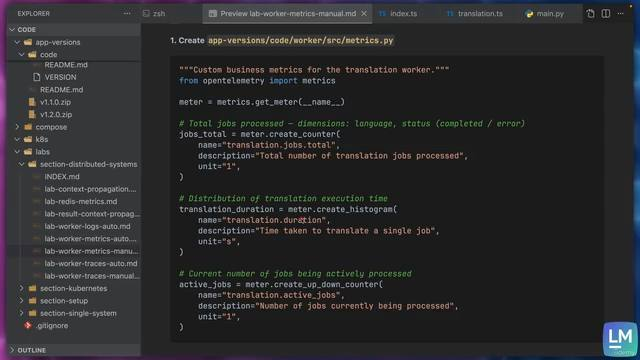
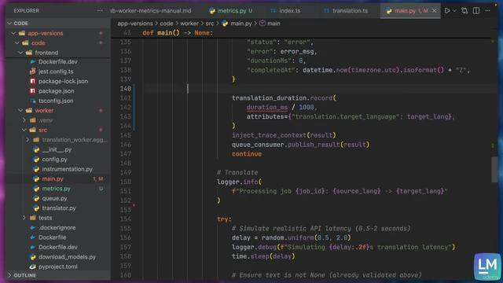
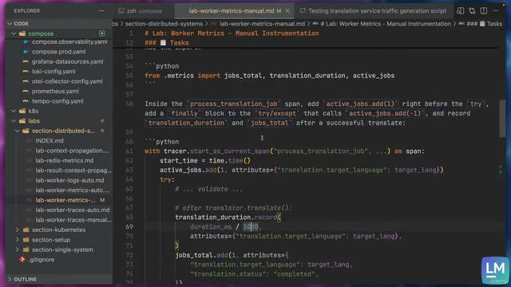
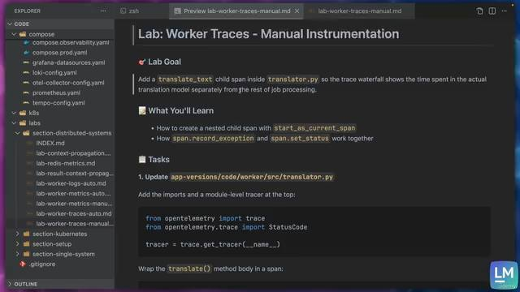
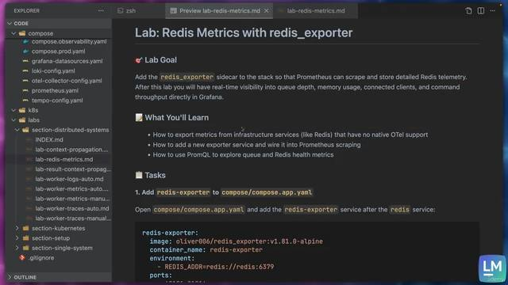
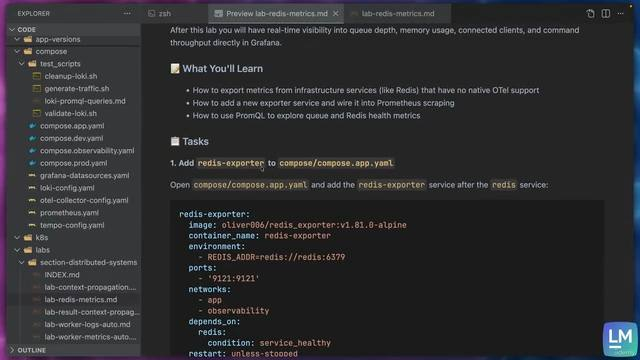
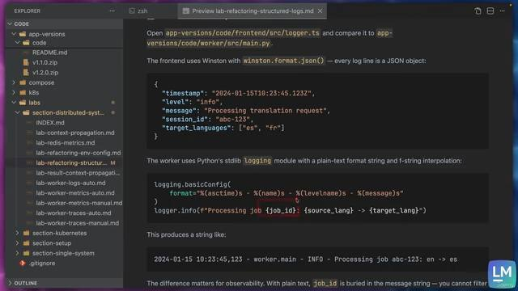
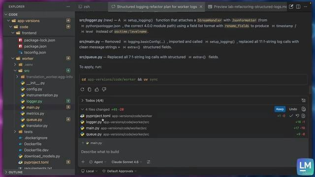

# OpenTelemetry 实战：Worker 手动埋点、Redis Exporter 与结构化日志（P090–P100）

> 读者定位：前端转 AI 应用工程师。本文档覆盖课程 P090–P100，主线是给 Python Worker 服务补上**业务指标（Metrics）**、**手动 Trace 埋点**、**Redis Exporter 旁车模式**，最后做**环境变量化重构**和**结构化日志迁移**。所有代码按文件给出，可直接保存运行。

---

## 1. 这一节做什么

这一段课程的核心是「把可观测性从框架自动埋点，推进到业务代码手动埋点」。前面几节已经让分布式追踪和上下文传播跑通了，这一节要解决三件事：

1. **给 Worker 加业务指标**：在 `metrics.py` 里定义三个自定义指标——`jobs_total`（计数器，累计处理的任务数）、`translation_duration`（直方图，单次翻译耗时）、`active_jobs`（UpDownCounter，当前正在处理的任务数，等价于 gauge），然后在 `main.py` 里把它们插到任务处理流程的关键位置。
2. **给翻译函数加子 Span**：在 `translator.py` 的 `translate` 方法体外面包一层 span，让 trace 瀑布图能区分「模拟延迟」和「真正翻译」各占多少时间。
3. **给 Redis 加指标**：Redis 本身不支持 OpenTelemetry 原生埋点，所以用 **exporter 模式**——起一个 sidecar 容器 `redis-exporter`，让它去抓 Redis 的指标，再暴露给 Prometheus 抓取。
4. **收尾重构**：把 Worker 里硬编码的配置（支持语言、队列 key、结果 channel、日志级别）改成环境变量；把 Worker 的日志从「字符串插值」改成「结构化 JSON 日志」，和前端保持一致。

最终验收方式：用 Grafana 查 Prometheus 指标、看 trace 瀑布图、看 Loki 里的 JSON 日志。

从学习路径上看，这一节不是孤立地「多写几个 API」，而是把前面已经跑通的三条链路接起来：Trace 链路解决「一次请求经过了哪些服务、哪一段慢」；Metrics 链路解决「一段时间内处理了多少任务、耗时分布如何、当前并发多少」；Logs 链路解决「某一条具体任务失败时，现场参数是什么、错误信息是什么」。前端侧此前已经有 `instrumentation.ts` 和 `logger.ts`，Worker 侧这一节要做的是把「只靠自动埋点」推进到「业务代码关键路径也能被指标和日志解释」。因此复现时不要只盯着代码能否启动，而要按验收顺序确认：指标有没有出现在 Prometheus，trace 瀑布图有没有 `translate_text` 子 span，Loki 里的日志是不是 JSON 行、能不能按 `job_id` 过滤。只要其中一条链路没通，就先回到对应步骤排查，不要继续往后堆改动。

与前端对照看，前端通过 NodeSDK 初始化 trace 和 metric exporter，日志用 pino 输出结构化 JSON；Worker 侧这一节对应做三件事：用 `metrics.get_meter(__name__)` 创建业务指标、用 `trace.get_tracer(__name__)` 创建手动 span、用 `python-json-logger` 把日志输出成 JSON。两边的共同点是「配置从环境变量来」「日志字段化」「trace 上带业务属性」；不同点是 Worker 是 Python 同步消费循环，`active_jobs` 在当前同步实现下通常只会在 0 和 1 之间变化，这一点在第 7 段会单独说明。

---

## 2. 讲师原话（带出处）

关于三个指标的定义，讲师说得很明确：

> "第一个是 jobs total。它会跟踪已处理的 jobs 总数。然后我们这里会有一个 histogram，用来跟踪 translation duration……接着我们有 active jobs，这里会是一个 up-down counter。这基本上就是我们讨论过的 gauge，对吧？所以它可以上升，也可以下降。"
> —— p090 [00:29]–[00:43]

关于「失败任务要不要记耗时」，讲师给了一个很关键的判断：

> "这可能会把我们这里的 metric 拉低到较小的值……这里 failed 的那个发生得非常快。所以也许我们实际上可以利用这一点，而不在这里跟踪它……也许我们这里可以加一个 label……比如 translation.status，然后把它设为 error……这样我们现在就能在 Prometheus 里区分了。"
> —— p091 [02:22]–[03:22]

关于直方图单位踩的坑：

> "OpenTelemetry SDK 确实会加上秒……这里的这些 buckets 是……来自 SDK 的默认值……也许对我们这里来说，更好的做法不是按秒记录，而是按毫秒记录。"
> —— p092 [07:56]–[08:37]

关于 Redis 为什么要用 exporter：

> "Redis 服务本身并不原生支持 OpenTelemetry。所以我们会看看如何在这里加入所谓的 exporter pattern，也就是让一个 sidecar container 或 service 运行在我们的 ready service 旁边，然后它会从这里提取数据信息、从 ready service 提取 metrics，再把这些 metrics 暴露出来，供 Prometheus 抓取。"
> —— p095 [00:28]–[00:57]

关于结构化日志的价值：

> "我们这里确实有更结构化的日志记录，其中我们实际上有一个 JSON 对象，里面包含 session ID、target languages 等信息，而不是把这些插值到我们的 message 里……这确实为日志消息提供了更好的过滤和搜索能力。"
> —— p099 [00:18]–[00:33]

读这些原话时要抓住三个判断：第一，`jobs_total`、`translation_duration`、`active_jobs` 的语义分别是累计计数、耗时分布、当前并发，不要把它们混成一个指标；第二，失败任务不记录耗时，而是通过 `translation_status` 之类的 label 区分成功和失败，避免失败路径的极短耗时把分位数拉低；第三，Redis 没有原生 OpenTelemetry 埋点，所以采用 exporter 旁车模式，由 sidecar 去抓 Redis 指标并暴露给 Prometheus。复现时如果发现 Grafana 查询结果和预期不一致，可以先回到这三条判断上核对：指标名和单位是否对、失败分支是否误记了 duration、Prometheus 是否真的抓到了 `redis-exporter:9121`。

---

## 3. 从零复现

### 3.1 前置条件

- 已完成前面章节：Worker 服务能消费 Redis 队列、能发 trace 到 collector、前端能发请求。
- 目录结构（本节涉及的部分）：

```
project/
├── compose/
│   ├── compose.app.yaml
│   ├── prometheus/
│   │   └── prometheus.yaml
│   └── test_scripts/
│       └── generate_traffic.sh
├── frontend/
│   └── src/
│       ├── instrumentation.ts
│       └── logger.ts
└── worker/
    ├── Dockerfile
    ├── pyproject.toml
    └── src/
        ├── main.py
        ├── config.py
        ├── metrics.py        # 本节新建
        ├── logger.py         # 本节新建（结构化日志）
        └── translator.py
```

前置条件里最重要的一条是「Worker 已经能消费 Redis 队列并发 trace」。如果这一步还没通，先不要加业务指标，否则你会在 Grafana 里同时面对「没有 trace」和「没有 metric」两类问题，排查成本会变高。复现前建议先确认 `docker compose -f compose.app.yaml ps` 中 worker、redis、otel-collector、prometheus、grafana 都处于运行状态；再执行一次 `generate_traffic.sh`，确认 Worker 日志里能看到任务处理记录。与前端对照，前端能发请求、能在 trace 里看到入口 span，是 Worker 手动 span 能挂到同一条 trace 上的前提。

### 3.2 步骤一：新建 `worker/src/metrics.py`

在 `worker/src/` 下新建 `metrics.py`，定义三个业务指标。注意 `translation_duration` 的单位用**毫秒**（这是讲师在 p092 里踩坑后改的结论）。

创建文件后先不要急着改 `main.py`，可以先确认 Python 能导入这个模块。常见错误是把 `meter.create_counter` 写成 `metrics.create_counter`，或者忘记 `from opentelemetry import metrics`。如果导入时报 `ModuleNotFoundError: No module named 'opentelemetry'`，说明依赖没有装进镜像，回到 `pyproject.toml` 检查 `opentelemetry-api`、`opentelemetry-sdk` 是否在依赖里，并重新 `docker compose -f compose.app.yaml up --build -d`。与前端对照，前端是 `meter.createCounter(...)`，Python 侧是 `meter.create_counter(...)`，命名风格不同但语义一致；`create_up_down_counter` 对应前端的 `createUpDownCounter`。

### 3.3 步骤二：改 `worker/src/main.py`

1. 顶部 `from .metrics import jobs_total, translation_duration, active_jobs`。
2. 在创建 span 之后、进入 try 之前：`active_jobs.add(1, {...})`，同时记录 `start_time`。
3. 在 try 成功分支：`translation_duration.record(duration_ms, {...})`、`jobs_total.add(1, {...})`。
4. 在 except 分支：`jobs_total.add(1, {...status: error})`，**不记 duration**（避免拉低分位数）。
5. 在 `finally` 块：`active_jobs.add(-1, {...})`。

改 `main.py` 时最容易错的位置是 `active_jobs.add(-1)` 放进了 try 的成功分支，而不是 `finally`。这样一来，一旦 `json.loads` 或 `translator.translate` 抛异常，活跃任务数就不会减回去，Grafana 里的 `active_jobs` 会一直上涨。验证方法是故意发一条坏消息，观察日志出现 error 后，`active_jobs` 是否回到 0。另一个常见错误是失败分支也调用了 `translation_duration.record`，这会违背讲师在 p091 里的判断；检查时直接搜索 `translation_duration.record`，确认它只在成功路径出现。与前端对照，前端如果做类似计数，也会把「进入处理」和「离开处理」放在 try/finally 语义里，保证异常路径也能释放计数。

### 3.4 步骤三：改 `worker/src/translator.py`

在 `translate` 方法体外面包 `with tracer.start_as_current_span("translate_text") as span:`，异常时 `span.record_exception(e)` + `span.set_status(Status(StatusCode.ERROR, str(e)))`，成功时 `span.set_attribute(...)` + `span.set_status(Status(StatusCode.OK))`。

这里的重点是「子 span 要能挂到父 span 下面」。如果 `translate_text` 在 trace 瀑布图里没有出现在 `process_translation_job` 下面，先检查 `translator.py` 里是否创建了 `tracer = trace.get_tracer(__name__)`，再检查是否用了 `start_as_current_span` 而不是只 `start_span`。`start_as_current_span` 会把新 span 设为当前上下文，后续自动埋点才会挂到它下面；讲师在 p093 也强调这里不需要额外设置 consumer span 类型，直接开当前 span 即可。常见错误是只在异常时 `record_exception`，却忘记 `set_status(ERROR)`，导致 span 有异常事件但状态不是红色；或者成功时忘记 `set_status(StatusCode.OK)`，导致状态不明确。

### 3.5 步骤四：加 Redis Exporter

在 `compose/compose.app.yaml` 里 Redis 服务旁边加一个 `redis-exporter` 服务，必须加入 `observability` 网络，暴露 9121 端口。然后在 `compose/prometheus/prometheus.yaml` 的 `scrape_configs` 里加一个 job 指向 `redis-exporter:9121`。

这一步的常见错误是只给 `redis-exporter` 加了 `observability` 网络，却忘了它还要访问 `redis` 所在的 `app` 网络。按课里的设计，`redis-exporter` 需要同时加入两个网络：一边通过 `app` 网络访问 `redis`，一边通过 `observability` 网络被 Prometheus 抓取。讲师在 p096 也明确说它要住在 observability 网络里，Prometheus 才能 scrape 到。另一个常见错误是 `REDIS_ADDR` 写成 `redis:6379`，而 `oliver006/redis_exporter` 期望 `redis://redis:6379` 这种带 scheme 的格式。改完后不要只看容器是否启动，要执行 `curl http://localhost:9121/metrics | grep redis_up`，确认返回 `redis_up 1`。

### 3.6 步骤五：环境变量化重构

- `frontend/src/instrumentation.ts`：把 collector endpoint 抽成变量，从 `process.env.OTEL_EXPORTER_OTLP_ENDPOINT` 读。
- `frontend/src/logger.ts`：日志级别从 `process.env.LOG_LEVEL` 读，默认 `info`。
- `worker/src/config.py`：`SUPPORTED_LANGUAGES` 从环境变量读并按逗号 split + strip；`QUEUE_KEY`、`RESULT_CHANNEL` 从环境变量读并保留原默认值。

环境变量化重构的验收标准不是「代码里出现了 `os.getenv`」，而是「改环境变量后行为真的变」。例如把 `SUPPORTED_LANGUAGES` 改成 `ES,FR`，重启 Worker 后日志或校验逻辑里不应再出现 `DE`；把 `QUEUE_KEY` 改掉后，Worker 订阅的队列名应与前端发布的一致。常见错误是改了 `compose.app.yaml` 的 `environment` 但没有重建容器，导致容器里仍是旧值；此时用 `docker compose -f compose.app.yaml up -d --force-recreate` 让环境变量生效。与前端对照，前端 `instrumentation.ts` 和 `logger.ts` 也是同样的原则：endpoint 和 level 不写死，而是从 `process.env` 读取并给默认值。

### 3.7 步骤六：结构化日志迁移

- `worker/pyproject.toml` 加 `python-json-logger==4.0.0`。
- 新建 `worker/src/logger.py`，用 `pythonjsonlogger.jsonlogger.JsonFormatter` 配置 handler。
- `main.py` 里删掉 `logging.basicConfig(...)`，改成调用 `setup_logging(config.log_level)`。
- 把所有 `logger.info(f"...{job_id}...")` 改成 `logger.info("...", extra={"job_id": ..., ...})`。

结构化日志迁移后，最直观的验证是 `docker compose -f ../compose.app.yaml logs -f worker` 的每一行是否以 `{` 开头。如果仍是纯文本，检查 `main.py` 里是否还残留 `logging.basicConfig(...)`，或者 `setup_logging` 是否在创建 logger 之前调用。另一个常见错误是在 `extra` 里用了 `message`、`levelname` 这类 `LogRecord` 内置字段名，Python 会抛 `KeyError: "尝试覆盖 LogRecord 中的 'message'"`；业务字段用 `job_id`、`source_language`、`target_language` 即可。与前端对照，前端 pino 输出 JSON，Worker 用 `JsonFormatter` 输出 JSON，Loki 里都可以按字段过滤，而不是只能全文搜索。

### 3.8 步骤七：部署与验证

```bash
cd compose
docker compose -f compose.app.yaml up --build -d
# 生成流量
cd test_scripts && ./generate_traffic.sh
# 看 worker 日志
docker compose -f ../compose.app.yaml logs -f worker
# 看 redis-exporter 指标
curl http://localhost:9121/metrics | grep redis_up
```

Grafana 里查 `translation_duration_milliseconds_bucket`、`rate(jobs_total[2m])`、`redis_up`。

这里把命令逐段解释一下：`cd compose` 进入 compose 文件所在目录；`docker compose -f compose.app.yaml up --build -d` 中 `-f` 指定 compose 文件，`up` 创建并启动服务，`--build` 在启动前重新构建镜像，`-d` 让容器在后台运行；`./generate_traffic.sh` 用来生成测试流量；`docker compose -f ../compose.app.yaml logs -f worker` 中 `logs` 查看日志，`-f` 持续跟随输出，`worker` 指定服务名；`curl http://localhost:9121/metrics | grep redis_up` 用来确认 Redis Exporter 已暴露指标。常见错误是 `cd test_scripts` 后仍用相对路径找 compose 文件，导致找不到文件；所以示例里日志命令用了 `../compose.app.yaml`。如果 `curl` 失败，先确认 `redis-exporter` 容器是否在运行、9121 端口是否映射、`REDIS_ADDR` 是否正确。

---

## 4. 完整代码

### 4.1 `worker/src/metrics.py`

```python
# worker/src/metrics.py
from opentelemetry import metrics

meter = metrics.get_meter(__name__)

# 累计处理的任务总数（计数器，只增不减）
jobs_total = meter.create_counter(
    name="jobs_total",
    description="Total number of translation jobs processed",
    unit="1",
)

# 单次翻译耗时（直方图）。单位用毫秒，避免 SDK 默认秒级 bucket 太粗
translation_duration = meter.create_histogram(
    name="translation_duration",
    description="Time taken to translate a single job",
    unit="ms",
)

# 当前正在处理的任务数（UpDownCounter，等价于 gauge）
active_jobs = meter.create_up_down_counter(
    name="active_jobs",
    description="Number of jobs currently being processed",
    unit="1",
)
```

这份文件只负责定义指标，不负责导出；导出仍由前面已经配置好的 OTel Collector / OTLP exporter 链路完成。复现时不要在这里手动创建 exporter，否则会偏离课里的结构。与前端对照，前端在 `instrumentation.ts` 里通过 `PeriodicExportingMetricReader` 配置 metric exporter，Python 侧沿用已有 SDK 初始化即可。

### 4.2 `worker/src/main.py`（关键片段，完整可运行）

```python
# worker/src/main.py
import json
import time
import logging

import redis
from opentelemetry import trace
from opentelemetry.trace import Status, StatusCode

from .config import config
from .logger import setup_logging
from .metrics import jobs_total, translation_duration, active_jobs
from .translator import Translator

setup_logging(config.log_level)
logger = logging.getLogger(__name__)
tracer = trace.get_tracer(__name__)

r = redis.Redis(host=config.redis_host, port=config.redis_port)
translator = Translator()


def process_job(raw: bytes) -> None:
    with tracer.start_as_current_span("process_translation_job") as span:
        # 进入处理流程：活跃任务 +1
        active_jobs.add(1, {"exported_job": "worker"})
        start_time = time.time()
        result = None

        try:
            job = json.loads(raw)
            job_id = job["job_id"]
            source_lang = job["source_language"]
            target_lang = job["target_language"]
            text = job["text"]

            span.set_attribute("job.id", job_id)
            span.set_attribute("job.source_language", source_lang)
            span.set_attribute("job.target_language", target_lang)

            logger.info(
                "processing translation job",
                extra={
                    "job_id": job_id,
                    "source_language": source_lang,
                    "target_language": target_lang,
                },
            )

            # 模拟延迟（课里 worker 里本来就有这段）
            time.sleep(0.5)

            translated = translator.translate(text, source_lang, target_lang)
            result = {"job_id": job_id, "status": "completed", "text": translated}

        except Exception as e:
            span.record_exception(e)
            span.set_status(Status(StatusCode.ERROR, str(e)))
            logger.error(
                "error processing job",
                extra={"error": str(e)},
            )
            # 失败任务也计入总数，但打上 error 标签
            jobs_total.add(
                1,
                {
                    "exported_job": "worker",
                    "translation_status": "error",
                },
            )
            result = {"job_id": job.get("job_id") if "job" in dir() else None,
                      "status": "error"}

        finally:
            # 无论成功失败，活跃任务 -1
            active_jobs.add(-1, {"exported_job": "worker"})

        # 成功路径：记录耗时 + 总数
        if result and result.get("status") == "completed":
            duration_ms = (time.time() - start_time) * 1000
            translation_duration.record(
                duration_ms,
                {
                    "exported_job": "worker",
                    "translation_status": "completed",
                },
            )
            jobs_total.add(
                1,
                {
                    "exported_job": "worker",
                    "translation_status": "completed",
                },
            )
            span.set_attribute("translation.duration_ms", duration_ms)
            span.set_status(Status(StatusCode.OK))

        # 发布结果
        try:
            r.publish(config.result_channel, json.dumps(result))
        except Exception as e:
            logger.error("failed to publish result", extra={"error": str(e)})


def main() -> None:
    pubsub = r.pubsub()
    pubsub.subscribe(config.queue_key)
    logger.info("worker started", extra={"queue_key": config.queue_key})
    for message in pubsub.listen():
        if message["type"] != "message":
            continue
        process_job(message["data"])


if __name__ == "__main__":
    main()
```

> 说明：课里 `main.py` 的完整结构比这里更长（含 Redis 连接日志、`logger.fatal` 等），上面保留了本节改动涉及的全部逻辑。`exported_job` 这个 label 名是讲师在 Grafana 里实际看到的（p092 [04:14] 提到 "exported_job 标签的值就是 worker"），照抄即可。

### 4.3 `worker/src/translator.py`

```python
# worker/src/translator.py
import logging

from opentelemetry import trace
from opentelemetry.trace import Status, StatusCode

logger = logging.getLogger(__name__)
tracer = trace.get_tracer(__name__)


class Translator:
    def __init__(self):
        # 课里这里会加载翻译模型，具体实现沿用你已有的版本
        logger.info("translator initialized")

    def translate(self, text: str, source_lang: str, target_lang: str) -> str:
        with tracer.start_as_current_span("translate_text") as span:
            span.set_attribute("translation.source_language", source_lang)
            span.set_attribute("translation.target_language", target_lang)
            span.set_attribute("translation.input_length", len(text))

            try:
                # 课里这里调用实际的翻译模型；示意实现：
                translated = f"[{target_lang}] {text}"
                span.set_attribute("translation.output_length", len(translated))
                span.set_status(Status(StatusCode.OK))
                logger.info(
                    "text translated successfully",
                    extra={
                        "source_language": source_lang,
                        "target_language": target_lang,
                        "input_length": len(text),
                        "output_length": len(translated),
                    },
                )
                return translated
            except Exception as e:
                span.record_exception(e)
                span.set_status(Status(StatusCode.ERROR, str(e)))
                logger.error("translation failed", extra={"error": str(e)})
                raise
```

`translator.py` 里的子 span 名字固定为 `translate_text`，检查清单里也是按这个名字查 trace。复现时不要随意改名，否则 Grafana 里按 span 名筛选会找不到。异常分支里 `raise` 不能漏，否则外层 `process_job` 收不到异常，失败任务就不会走 error 分支。

### 4.4 `worker/src/config.py`

```python
# worker/src/config.py
import os


class Config:
    log_level: str = os.getenv("LOG_LEVEL", "info")

    redis_host: str = os.getenv("REDIS_HOST", "redis")
    redis_port: int = int(os.getenv("REDIS_PORT", "6379"))

    queue_key: str = os.getenv("QUEUE_KEY", "translation_jobs")
    result_channel: str = os.getenv("RESULT_CHANNEL", "translation_results")

    # 支持语言：环境变量逗号分隔，去空格
    supported_languages: list[str] = [
        lang.strip()
        for lang in os.getenv("SUPPORTED_LANGUAGES", "ES,FR,DE").split(",")
        if lang.strip()
    ]


config = Config()
```

`config.py` 保留原默认值很重要：`QUEUE_KEY` 默认 `translation_jobs`、`RESULT_CHANNEL` 默认 `translation_results`，这样不设置环境变量时行为与之前一致。`SUPPORTED_LANGUAGES` 的列表推导里用 `if lang.strip()` 过滤空项，可以避免环境变量末尾多一个逗号时产生空字符串语言。

### 4.5 `worker/src/logger.py`

```python
# worker/src/logger.py
import logging
import sys

from pythonjsonlogger import jsonlogger


def setup_logging(level: str = "info") -> None:
    """配置结构化 JSON 日志。level 可以是字符串（'info'）或整数（20）。"""
    # 兼容字符串和整数：logging 库内部有 level_to_name / name_to_level 映射
    if isinstance(level, str):
        numeric_level = logging.getLevelName(level.upper())
        if not isinstance(numeric_level, int):
            numeric_level = logging.INFO
    else:
        numeric_level = level

    handler = logging.StreamHandler(sys.stdout)
    formatter = jsonlogger.JsonFormatter(
        "%(asctime)s %(levelname)s %(name)s %(message)s",
        rename_fields={"asctime": "timestamp", "levelname": "level"},
    )
    handler.setFormatter(formatter)

    root = logging.getLogger()
    root.handlers.clear()
    root.addHandler(handler)
    root.setLevel(numeric_level)
```

`setup_logging` 里先 `root.handlers.clear()` 是为了避免重复添加 handler，导致同一行日志输出多次。`rename_fields` 把 `asctime` 改成 `timestamp`、`levelname` 改成 `level`，方便 Loki 里按字段查询。`logging.getLevelName(level.upper())` 对 `"INFO"` 返回 `20`，如果传入无法识别的字符串会返回字符串，所以代码里再判断一次 `isinstance(numeric_level, int)` 并回退到 `INFO`。

### 4.6 `worker/pyproject.toml`（依赖片段）

```toml
[project]
name = "worker"
version = "0.1.0"
requires-python = ">=3.11"
dependencies = [
    "redis>=5.0.0",
    "opentelemetry-api>=1.24.0",
    "opentelemetry-sdk>=1.24.0",
    "opentelemetry-exporter-otlp>=1.24.0",
    "python-json-logger==4.0.0",
]
```

`python-json-logger==4.0.0` 锁版本是课里的做法，避免 3.x 和 4.x 的 API 差异导致代码跑不通。如果本地缓存了旧版本，构建镜像后仍可能用到旧包，必要时清理构建缓存或确认容器内 `pip show python-json-logger` 的版本。

### 4.7 `compose/compose.app.yaml`（Redis Exporter 片段）

```yaml
services:
  redis:
    image: redis:7-alpine
    ports:
      - "6379:6379"
    networks:
      - app
      - observability

  redis-exporter:
    image: oliver006/redis_exporter:latest
    environment:
      REDIS_ADDR: redis://redis:6379
    ports:
      - "9121:9121"
    networks:
      - observability
    depends_on:
      - redis

networks:
  app:
    driver: bridge
  observability:
    driver: bridge
```

`redis-exporter` 的 `depends_on` 只保证启动顺序倾向，不保证 Redis 已完全可连接；如果 exporter 启动时 Redis 还没 ready，重启一次 exporter 或等待重试即可。`ports` 里的 `9121:9121` 是为了本机 `curl` 验证方便，Prometheus 在容器网络内仍走 `redis-exporter:9121`。

### 4.8 `compose/prometheus/prometheus.yaml`（scrape 片段）

```yaml
scrape_configs:
  - job_name: prometheus
    static_configs:
      - targets: ["localhost:9090"]

  - job_name: otel-collector
    static_configs:
      - targets: ["otel-collector:8889"]

  - job_name: redis
    static_configs:
      - targets: ["redis-exporter:9121"]
```

这里新增的是 `job_name: redis` 这一段，target 写 `redis-exporter:9121`，不是 `localhost:9121`。因为 Prometheus 也在容器环境里，`localhost` 指向 Prometheus 容器自身，抓不到 exporter。改完 Prometheus 配置后要重启 Prometheus 服务，并在 Prometheus 的 Targets 页面确认 `redis` job 是 UP。

### 4.9 `frontend/src/logger.ts`

```typescript
// frontend/src/logger.ts
import pino from "pino";

const level = process.env.LOG_LEVEL ?? "info";

export const logger = pino({ level });
```

前端 logger 用 `??` 提供默认值，Worker 用 `os.getenv("LOG_LEVEL", "info")` 提供默认值，思路一致。常见错误是把 `LOG_LEVEL` 设成 `debug` 但容器没有重启，导致仍是旧级别；排查时在日志初始化后打印一次实际 level 或检查容器环境变量。

### 4.10 `frontend/src/instrumentation.ts`（关键片段）

```typescript
// frontend/src/instrumentation.ts
import { NodeSDK } from "@opentelemetry/sdk-node";
import { OTLPTraceExporter } from "@opentelemetry/exporter-trace-otlp-http";
import { OTLPMetricExporter } from "@opentelemetry/exporter-metrics-otlp-http";
import { PeriodicExportingMetricReader } from "@opentelemetry/sdk-metrics";

const otlpEndpoint =
  process.env.OTEL_EXPORTER_OTLP_ENDPOINT ?? "http://otel-collector:4318";

const metricReader = new PeriodicExportingMetricReader({
  exporter: new OTLPMetricExporter({ url: `${otlpEndpoint}/v1/metrics` }),
});

const sdk = new NodeSDK({
  traceExporter: new OTLPTraceExporter({ url: `${otlpEndpoint}/v1/traces` }),
  metricReader,
});

sdk.start();
```

前端这里把 `OTEL_EXPORTER_OTLP_ENDPOINT` 抽出来后，trace 和 metric 的 URL 分别拼 `/v1/traces`、`/v1/metrics`。如果拼错路径，前端 trace 或 metric 会导出失败；排查时先看 collector 日志有没有收到请求，再检查最终 URL。

---

## 5. 逐行解释

**`metrics.py` 为什么用 `create_up_down_counter` 而不是 `create_gauge`？**
OpenTelemetry 的 Metrics API 里没有 `create_gauge`（至少在课里用的 SDK 版本里没有），gauge 语义用 UpDownCounter 表达——它可以 `add(1)` 也可以 `add(-1)`。讲师原话："活跃任务数在这里会做成一个可增可减的计数器。这基本上就是我们之前讨论过的 Gauge 类型"（p090 [00:43]）。在 JS/Node 里对应 `meter.createUpDownCounter(...)`，语义完全一样。复现时如果看到 `active_jobs` 在 Grafana 里是 0/1 跳动，不要误以为指标没生效，先结合第 7 段的同步消费说明判断。

**为什么 `translation_duration` 单位是 `ms` 而不是 `s`？**
这是 p092 里最值钱的一段。SDK 默认直方图 bucket 是 `[0, 5, 10, 25, ...]`（秒），而实际翻译耗时都在 2 秒以内，所有样本全落在第一个 bucket，直方图失去分辨力。改成毫秒后 bucket 变成 `[0, 5, 10, 25, ...]` 毫秒级，分布才有意义。讲师在 Grafana 里看到 `translation_duration_seconds_bucket` 全是 0 和 5 之后才改的。**注意**：改单位后指标名会从 `translation_duration_seconds_*` 变成 `translation_duration_milliseconds_*`，旧查询会失效——讲师原话："如果你确实改动了指标定义中的某些内容，那么当然，由 Prometheus 服务或 OpenTelemetry SDK 在这里创建出来的指标，其名称就会不同"（p092 [10:15]）。排查时先确认 Grafana 查询面板用的是新名字，再确认 Prometheus 里确实出现了 `translation_duration_milliseconds_bucket`。

**为什么失败任务不记 duration？**
讲师在 p091 [02:22] 解释：失败路径"发生得非常快"，如果混进直方图会把 p95 拉低，掩盖真实延迟。所以失败只 `jobs_total.add(1, {status: error})`，不 `record` duration。这就是「用 label 区分成功/失败」的实践——查询时用 `translation_status="completed"` 过滤。与前端对照，前端做业务指标时也会避免把失败请求的极短耗时混入成功耗时分布；检查代码时直接看 except 分支是否只有 `jobs_total.add`。

**`active_jobs.add(1)` 和 `add(-1)` 为什么放在 try 外面和 finally 里？**
`add(1)` 放在 try 之前，保证「进入处理」这个动作一定被计数；`add(-1)` 放在 `finally`，保证无论成功、失败、异常都减回去。讲师原话："这个 finally 块基本上就是让我们给活跃任务数减一……无论任务成功与否，我们都会执行 finally 块"（p091 [07:34]）。在 JS 里对应 `try { ... } finally { activeJobs.add(-1) }`。验证方式是构造一条会抛异常的坏消息，确认 error 日志之后 `active_jobs` 不会持续累加。

**`translator.py` 里为什么用 `start_as_current_span` 而不是 `start_span`？**
`start_as_current_span` 会把新 span 设为当前上下文，这样 span 内部任何自动埋点（比如 HTTP 调用）都会挂到它下面。讲师在 p093 [00:29] 说："我们其实不需要提供额外的上下文，也不需要在这里把类型设成消费者跨度。直接在这里作为当前跨度启动就可以了"——因为父 span 已经由上游 context propagation 建立好了，这里只需要开子 span。如果 trace 图里子 span 和父 span 平级，通常就是这里用错或上下文没有正确传播。

**`Status(StatusCode.ERROR, str(e))` 和 `span.record_exception(e)` 为什么要一起调？**
`record_exception` 把异常堆栈作为 span event 记下来（给开发者看细节），`set_status(ERROR)` 把 span 状态标红（给聚合查询用）。两个作用不同，缺一不可。讲师在 p094 [01:20] 明确说 "我们在这里设置状态，基本上就是想确保：每当出现错误时，就为我们这段跨度设置状态"。复现检查时在 trace 详情里既要能看到 exception event，也要能看到 status 为 ERROR。

**Redis Exporter 为什么必须加入 `observability` 网络？**
Prometheus 在 `observability` 网络里，它只能抓同网络内的 target。`redis-exporter` 要同时能访问 `redis`（在 `app` 网络）和被 `prometheus` 访问（在 `observability` 网络），所以两个网络都要加。讲师原话："这个容器也需要位于可观测性网络中，这样 Prometheus 才能从 Redis exporter 抓取指标"（p096 [00:08]）。如果 Prometheus Targets 页面显示 redis job DOWN，先检查网络和 target 地址。

**`python-json-logger==4.0.0` 为什么锁版本？**
讲师在 p100 [03:10] 特意查了最新版是 4.0.0，并提醒 "从 3.x 到 4.x，这里有一些变化"。4.x 的 API 和 3.x 不兼容（`jsonlogger.JsonFormatter` 的导入路径和参数有变化），锁版本能保证代码和课里一致。如果你用更新的版本，需要对照 changelog 调整。排查日志格式异常时，先 `pip show python-json-logger` 确认容器内版本。

**`setup_logging` 里为什么同时接受字符串和整数 level？**
`config.log_level` 是字符串（`"info"`），但 `logging.Logger.setLevel` 接受整数（`20`）。`logging.getLevelName("INFO")` 返回 `20`，`logging.getLevelName(20)` 返回 `"INFO"`——这个函数是双向的。讲师在 p100 [09:24] 解释："对于登录库来说，你传入整数还是字符串其实都无所谓。只要遵循某种模式，两者都能正常工作"。所以 `setup_logging` 里做一次转换即可，函数体不用改。如果传入非法字符串，代码会回退到 `INFO`，避免启动失败。

**`extra={...}` 和 f-string 插值的区别？**
f-string 把变量拼进 message 字符串，日志变成 `"正在处理任务 abc-123，从 EN 到 ES"`，Loki 里只能全文搜索。`extra={...}` 把变量作为 JSON 字段附加，日志变成 `{"message": "processing job", "job_id": "abc-123", "source_language": "EN", "target_language": "ES"}`，Loki 里可以 `| json | job_id="abc-123"` 精确过滤。讲师在 p099 [00:18] 说这就是前端已经在做的事，Worker 要对齐。验证时在 Loki 查询里加 `| json` 后看字段是否展开，或用 `job_id` 直接过滤。

---

## 6. 复现检查清单

按顺序打勾，任何一项不过就别往下走：

- [ ] `worker/src/metrics.py` 存在，三个指标名分别是 `jobs_total`、`translation_duration`、`active_jobs`。验证：打开文件搜索 `create_counter`、`create_histogram`、`create_up_down_counter` 三处，并确认 `name=` 与这三个名字一致。
- [ ] `translation_duration` 的 `unit="ms"`（不是 `"s"`）。验证：搜索 `translation_duration` 定义处，确认 `unit="ms"`；再在 Grafana 里查 `translation_duration_milliseconds_bucket` 是否有数据。
- [ ] `main.py` 顶部能 `from .metrics import jobs_total, translation_duration, active_jobs` 不报错。验证：构建并启动 worker 后看日志是否有 ImportError；也可在容器内执行导入检查。
- [ ] `active_jobs.add(1)` 在 try 之前，`active_jobs.add(-1)` 在 `finally` 里。验证：阅读 `process_job` 缩进层级，确认 `+1` 在 `try` 前、`-1` 在 `finally` 内；再构造异常任务观察 `active_jobs` 是否回落。
- [ ] 失败分支只调 `jobs_total.add(1, {status: error})`，**没有**调 `translation_duration.record`。验证：搜索 `translation_duration.record`，确认只出现在成功分支；搜索 except 分支确认没有 record。
- [ ] `translator.py` 的 `translate` 方法体被 `with tracer.start_as_current_span("translate_text") as span:` 包住。验证：搜索 `translate_text`，确认它在 `translate` 方法内；在 Grafana trace 里确认该 span 出现在父 span 下面。
- [ ] `docker compose -f compose.app.yaml up --build -d` 后，`docker compose logs worker` 能看到 worker 启动日志。验证：执行命令后看 `worker started` 日志；若没有，检查容器是否退出、镜像是否构建成功。
- [ ] `curl http://localhost:9121/metrics | grep redis_up` 返回 `redis_up 1`。验证：本机执行该命令；若失败，检查 `redis-exporter` 容器状态、9121 端口映射、`REDIS_ADDR`。
- [ ] Grafana 里查 `translation_duration_milliseconds_bucket` 有数据（不是 `_seconds_bucket`）。验证：在 Grafana Explore 里分别查新旧名字，确认新名字有 series；若没有，确认 Worker 已处理成功任务。
- [ ] Grafana 里查 `rate(jobs_total[2m])` 能看到按语言分组的曲线。验证：执行 `generate_traffic.sh` 后等待至少两个 scrape 周期，再查该 PromQL；检查 label 里是否有 `translation_status` 和 `exported_job`。
- [ ] Grafana 里查 trace，能看到 `translate_text` 子 span，且它的耗时明显小于外层 `process_translation_job`。验证：在 trace 搜索里按 job_id 或服务名找到一条 trace，展开瀑布图看父子关系与耗时条。
- [ ] `worker/src/config.py` 里 `SUPPORTED_LANGUAGES`、`QUEUE_KEY`、`RESULT_CHANNEL` 都从 `os.getenv` 读。验证：搜索这三个名字，确认都有 `os.getenv`；再改一个环境变量重启，确认行为变化。
- [ ] `worker/src/logger.py` 存在，`main.py` 里没有 `logging.basicConfig(...)`。验证：搜索 `basicConfig`；确认 `main.py` 调用的是 `setup_logging(config.log_level)`。
- [ ] `docker compose logs worker` 输出是 JSON 行（每行以 `{` 开头），不是纯文本。验证：执行 `docker compose -f ../compose.app.yaml logs worker | tail`，观察行首；若不是 JSON，检查 handler 和 formatter 是否生效。
- [ ] Loki 里能按 `job_id` 字段过滤到 worker 的日志。验证：在 Loki 查询里加 `| json`，然后用 `job_id="..."` 过滤；若无字段，检查日志是否真的输出了 `extra` 内容。

---

## 7. 课里没讲但你会撞上的（表格：现象 / 原因 / 怎么办）

| 现象 | 原因 | 怎么办 |
| --- | --- | --- |
| `translation_duration` 改单位后旧 dashboard 全空。 | 课里讲师提了一句「名字会变」，但没给迁移方案。指标单位从秒改成毫秒后，Prometheus 里的指标名会从 `translation_duration_seconds_*` 变成 `translation_duration_milliseconds_*`。 | 实际做法：Grafana dashboard 里所有 `translation_duration_seconds_*` 的 panel 都要改成 `_milliseconds_*`，或者用 `label_replace` 做兼容。改之前先 `docker compose down` 清掉 Prometheus 的 TSDB（否则新旧指标混在一起，p092 [10:15] 讲师也看到了这个现象）。验证时在 Grafana Explore 里分别查新旧指标名，确认新名字有数据、旧名字不再被新样本写入。 |
| `python-json-logger` 4.x 的导入路径。 | 课里没贴完整 import。4.x 里 `from pythonjsonlogger import jsonlogger` 仍然可用，但 `JsonFormatter` 的参数名从 `fmt` 改成了位置参数。如果你 `pip install` 到 3.x，`rename_fields` 参数不存在，会报 `TypeError`。 | 锁 `==4.0.0` 最稳。排查时先在容器内执行 `pip show python-json-logger` 看版本；如果版本不对，重新构建镜像并确认依赖安装日志。如果必须用 3.x，就按 3.x 的参数方式改 `JsonFormatter`，不要混用课里的 4.x 写法。 |
| `redis-exporter` 的 `REDIS_ADDR` 格式。 | 课里只说「reach out to Redis under this address」，没给具体值。`oliver006/redis_exporter` 要求 `redis://host:port` 格式，写成 `redis:6379` 会启动失败。另外如果 Redis 设了密码，要加 `REDIS_PASSWORD` 环境变量。 | 把 `REDIS_ADDR` 写成 `redis://redis:6379`；有密码时补 `REDIS_PASSWORD`。验证时先 `docker compose logs redis-exporter` 看启动错误，再 `curl http://localhost:9121/metrics | grep redis_up` 确认返回 `redis_up 1`。 |
| Worker 是同步代码，`active_jobs` 永远是 0 或 1。 | 讲师在 p090 [00:57] 明确说了："我们的代码是同步的。这意味着，基本上不会有两个任务同时被处理"。所以你在 Grafana 里看到 `active_jobs` 在 0 和 1 之间跳是正常的，不是 bug。如果以后改成多线程/异步，这个指标才会真正有意义。 | 当前不要把 `active_jobs` 当成并发压力指标来解读；它只能说明「当前是否有一个任务正在处理」。验证方式是连续发多条任务，观察它是否在 0/1 之间跳动；若要观察更高并发，需要先把 Worker 改成多线程或异步消费。 |
| `extra={}` 里的 key 不能和 LogRecord 内置属性冲突。 | `logging` 的 `LogRecord` 已经有 `message`、`asctime`、`levelname`、`name` 等属性，`extra` 里如果放同名 key 会抛 `KeyError: "尝试覆盖 LogRecord 中的 'message'"`。 | 所以 `extra` 里用 `job_id`、`source_language` 这种业务字段名，别用 `message`。验证方式是本地触发一次带 `extra={"message": ...}` 的日志，确认会报错后改回业务字段名；再在 Loki 里确认字段能展开。 |
| 环境变量改了但容器没重启。 | `docker compose up --build` 会重建镜像，但如果你只改了 `compose.app.yaml` 里的 `environment` 段，需要 `docker compose up -d --force-recreate` 才会生效。课里讲师直接 `up --build` 所以没暴露这个问题。 | 改 `environment` 后执行 `docker compose -f compose.app.yaml up -d --force-recreate`；验证时进入容器执行 `env | grep LOG_LEVEL`（或对应变量名），确认容器内值已更新。 |
| `OTEL_EXPORTER_OTLP_ENDPOINT` 的路径拼接。 | 前端 `instrumentation.ts` 里如果直接把这个变量传给 `OTLPTraceExporter` 的 `url`，要自己拼 `/v1/traces`；如果传给 `OTLPTraceExporter` 的 `url` 不拼，SDK 会默认拼。课里没细讲，实际调试时先用 `console.log` 打出最终 URL 确认。 | 在 `instrumentation.ts` 里打印最终 trace/metric URL，确认是 `.../v1/traces` 和 `.../v1/metrics`；如果 collector 没收到请求，先检查 URL，再检查网络和 collector 端口。Worker 侧如果也用到 OTLP endpoint，同样按 SDK 要求确认是否需要补路径。 |















