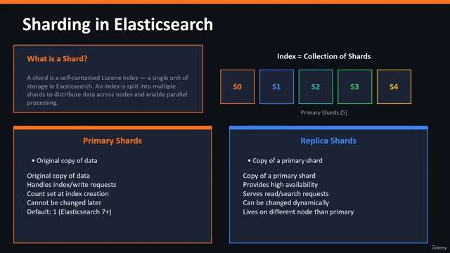
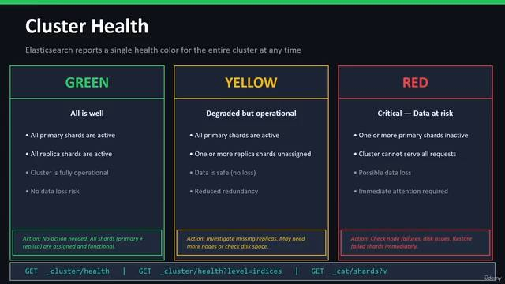
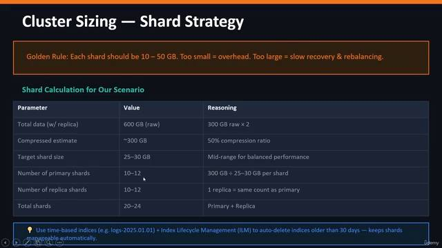
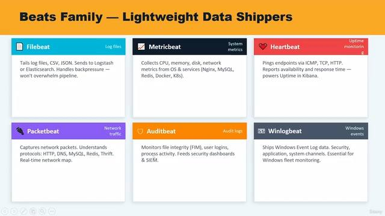
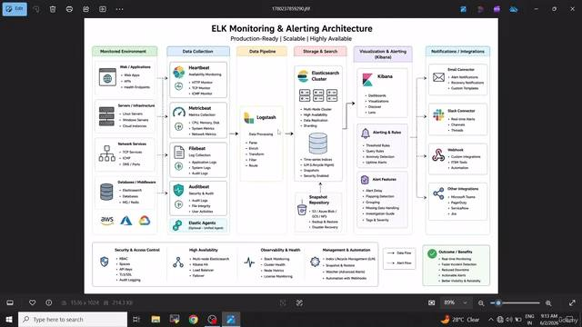
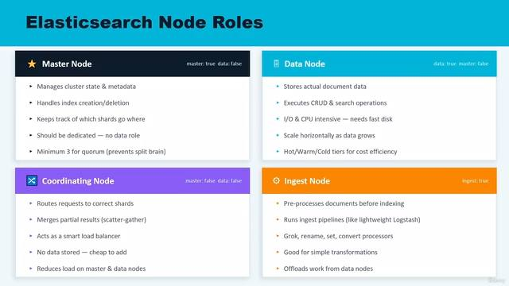
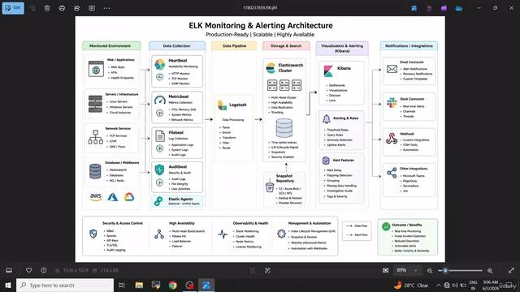

# ELK Stack 复现手册：从 10GB/天日志到一套可交付的集群（P1–P3）

## 1. 这一节做什么

这三节课不是零散的科普，它其实在回答一个很具体的问题：**客户每天产生 10GB 日志、要保留 30 天、要 1 份副本做高可用，你要给他交付一套什么样的 ELK 集群，并且怎么证明它是健康的。**

围绕这个目标，三节课各承担一块：

- **P1** 给出 ELK 的整体形状（Elasticsearch / Logstash / Kibana 各自干什么）、写入路径是怎么走的（Beats → Logstash → Elasticsearch → Kibana）、分片（primary / replica）在节点上怎么摆、`_cluster/health` 怎么读，最后落到容量估算与节点规格。
- **P2** 把 Elasticsearch 内部的词汇表补齐：index、shard、document、mapping、cluster、node，然后逐个讲节点角色（master / data / coordinating / ingest / ML），顺带讲清楚"为什么 master 必须是奇数"，以及 Elastic 官方提供的那一组 Beats 各自采什么数据。
- **P3** 从"被监控侧"往回看：一个 Web 应用 / API / 服务器，用哪个采集器收、走不走 Logstash、进 ES 之后用什么看、超期怎么删、删之前怎么备份、出问题怎么告警。

读完之后你应该能拿出四样东西：**一张架构图、一张节点清单（含 CPU/内存/磁盘）、一张分片规划表、一张告警规则表**。这一节里讲师**没有跑任何一条安装命令**，所以本文第 3、4 节把讲师的推导过程按"需求 → 约束 → 估算 → 方案 → 取舍"重排成可照着走一遍的步骤，并在需要落地成配置的地方标注哪些是课里原话、哪些是我补的示意。

---

## 2. 讲师原话

下面几条是这一节里信息密度最高、且后面要反复引用的原话，按主题归并，不按页码顺序：

> "ELK 分别代表 Elasticsearch、Logstash 和 Kibana。这是三个独立的开源工具，合在一起构成完整的数据管道和分析体系。"
> —— p001 [00:59]

> "Logstash 有三个阶段。输入阶段接收数据，过滤阶段解析、丰富并转换数据……输出阶段发送处理后的数据，通常发送到 Elasticsearch。"
> —— p001 [03:17]

> "主分片——它们是数据的原始副本……主分片数量在创建索引时设定，之后无法更改。这是一个关键限制，请在创建索引前规划好分片数量。"
> —— p001 [04:56]

> "当你为文档建立索引时，Elasticsearch 会获取文档 ID，对其进行哈希，并对主分片数量取模。结果会准确告诉 Elasticsearch 该文档属于哪个分片。这是确定性的：同一个文档始终会进入同一个分片。这也是为什么创建索引后无法更改主分片数量。"
> —— p001 [07:14]

> "绿色表示一切正常，所有主分片都已分配，所有副本分片也都已分配……黄色表示集群仍可运行但处于降级状态，所有主分片都处于活动状态，因此你仍然可以读写数据，并且没有发生数据丢失……红色表示存在严重问题，一个或多个主分片未分配，部分数据无法对外提供。"
> —— p001 [09:23]

> "黄金法则是每个分片应介于 10GB 到 50GB 之间。分片太小会带来额外开销；分片太大则恢复和再平衡会很慢。"
> —— p001 [18:41]

> "至少应有三台主节点，以防止脑裂问题。"
> —— p002 [02:21]

> "Elastic Agent 用单一软件包、单一二进制文件取代了所有旧的 Beats。"
> —— p003 [09:16]

> "索引生命周期管理策略……30 天后旧数据将被删除。删除这些数据之前，我们可以创建快照，并将快照存储到 S3、Azure Blob Storage、Google Storage 或 NFS 挂载点。"
> —— p003 [17:08]

> "我们收集三类遥测数据：日志、指标、追踪……我们可以关联这三类数据，分析应用性能不佳的原因。"
> —— p003 [22:33]

最后这条是整门课的价值主张：**ELK 不是"存日志的地方"，是把 logs / metrics / traces 放在同一个时间轴上做关联分析的平台。**



---

## 3. 从零复现（把讲师的推导按步骤走一遍）

这一节没有可执行命令，但讲师的推导是有严格顺序的。下面把它拆成 8 步，每一步给出**输入、约束、算式或判断依据、产出的决策**。你照着走一遍，就能得到第 4 节那张交付表。

### Step 1｜把客户的模糊需求量化成四条硬指标

讲师在 P1 后半段（[13:06] 起）给出的场景是：

- 应用每天产生日志：**10 GB/day**
- 保留期：**30 天**
- 副本数：**1**
- （隐含）需要高可用，节点挂了不能丢数据

这四条是后面所有计算的输入。**在真实项目里，你必须先和客户把"每天 10GB"问清楚是峰值还是均值**——讲师在 [14:29] 专门提醒：遇到大促或故障，日志量可能从 10GB 冲到 11、13、15GB，所以后面才要留 overhead。这一步如果含糊，后面 825GB 这个数字就没有意义。

### Step 2｜确定数据流形状，决定"哪里要停下做解析"

讲师在 P1 [02:23] 给的标准链路是：

```
数据源(应用/Web服务器/数据库/网络设备/syslog)
   → Beats(Filebeat / Metricbeat / Packetbeat …)
   → Logstash(Input → Filter → Output)
   → Elasticsearch(索引 + 可搜索)
   → Kibana(可视化)
```

但这只是**默认路径**，不是唯一路径。P3 [01:27] 和 [02:21] 补了两种例外，必须在这一步就定下来：

| 采集器 | 是否经过 Logstash | 讲师原话依据 |
|---|---|---|
| Heartbeat（探活） | **不经过**，直接进 ES | "Elasticsearch 支持由 Heartbeat 直接写入数据，因此这些数据无需经过 Logstash。" —— p003 [01:54] |
| Metricbeat（指标） | **不经过**，直接进 ES | "我们将 Metricbeat 配置为直接把数据发送到 Elasticsearch。" —— p003 [02:42] |
| Filebeat（原始日志） | **经过** Logstash 做 grok / csv / json 解析 | "我们只需用 Logstash 解析它，并将其存储到 Elasticsearch 中。" —— p003 [05:35] |

这个决定的后果很实际：如果你把 Metricbeat 也塞进 Logstash，就多了一个故障点和一个 JVM 在抢内存，而这批数据本来不需要文本解析。

### Step 3｜容量估算（讲师的核心算式）

这是 P1 最有价值的部分，逐步算：

**① 原始数据总量**
```
10 GB/day × 30 day = 300 GB   ← 主分片需要容纳的原始量
```

**② 乘上副本**
```
300 GB × (1 primary + 1 replica) = 600 GB
```
讲师原话："这里说的是主分片；我们把副本分片设为 1，所以需要按副本分片数量相乘，最终总存储将为 600 GB。" —— p001 [14:00]。

**③ 加大促 / 故障期间的突发开销**
讲师在 [14:29] 说："我们会预留 15% 到 20% 作为额外开销。"，但随即在 [14:58] 把实际取值定为 **10%**：
```
600 GB × 1.10 = 660 GB
```

**④ 加安全缓冲**
讲师在 [14:58] 又提了 "25% of safety storage space"：
```
660 GB × 1.25 = 825 GB
```

**⑤ 讲师给出的最终结论**
"total data storage we are requiring to store 10 GB per day logs for 30 days will be like **825 GB**" —— p001 [15:27]，和上面两步复合的结果完全吻合。

> ⚠️ 有一处讲师口述与数字对不上：他在 [15:27] 说 "我们考虑预留 **35%** 的富余存储。"，但 600 × 1.35 = **810 GB**，不是 825 GB。825 GB 对应的是 `1.10 × 1.25 = 1.375`（即 37.5%）的**复合**加成，不是 35% 的**单次**加成。复现时两种做法都合法：
> - **按数字走**：`600 × 1.1 × 1.25 = 825 GB`（推荐，这是讲师最终落地的值）
> - **按百分比走**：`600 × 1.35 = 810 GB`（更贴讲师后半句口语，但比 825 少 15GB）
> 二者差异很小，但采购磁盘时要写清楚你按哪条走，否则对不上账。

**⑥ 还有一条讲师提了但没算进去的杠杆**

讲师在 [19:38] 提到 Elasticsearch 的 **logsDB 索引模式**："它能降低存储占用并压缩数据，据称数据缩减率最高可达 **65%**。"。这个 65% 是 Elastic 官方的宣传值，**讲师并没有把它折进上面的 825GB**。所以你要区分两种口径：

- **规划口径（825 GB）**：不启用 logsDB，按原始体积买盘，最保守。
- **启用 logsDB 后**：理论上行空间可以按最高 65% 折减估算，但讲师没有给出折算后的具体数字，实际压缩率随日志内容差异很大，**不要拿 65% 直接去砍采购单**。

### Step 4｜分片规划（在 10GB–50GB 这个夹缝里选数）

分片规划的目标函数是讲师在 [18:41] 给的黄金规则：**每个分片 10GB–50GB**。太小 → 分片数暴涨、集群元数据开销大；太大 → 节点挂掉后从 primary 复制 replica 的恢复时间变长。

代入 Step 3 的主分片总量 **300 GB**：

| primary 分片数 | 每分片容量 | 是否落在 10–50GB | replica=1 时总 shard 数 |
|---|---|---|---|
| 10 | 300 ÷ 10 = **30 GB** | ✅ | 10 + 10 = **20** |
| 12 | 300 ÷ 12 = **25 GB** | ✅ | 12 + 12 = **24** |
| 6 | 300 ÷ 6 = 50 GB | ⚠️ 卡上限 | 12 |
| 30 | 300 ÷ 30 = 10 GB | ⚠️ 卡下限 | 60 |

讲师在 [20:06] 的结论很明确："为了兼顾均衡与性能，你可以把分片大小保持在 **25 GB 到 30 GB** 的中间范围，主分片数量设为 **10 到 12**。"。所以这里就是 10 或 12 二选一，两个都能过，**选 12 的理由是每片更小、单节点恢复更快；选 10 的理由是分片数更少、集群元数据更省**。

一旦定了，**primary 分片数就锁死了**。讲师在 [07:29] 给了原因：路由是 `hash(document_id) % number_of_primary_shards`，改了分片数，同一个文档就会路由到另一个分片，历史数据就"找不到"了。这一点和前端世界完全相反——你不能像改数组长度一样改它。**在 Node 里你操作的是 ES 客户端发一个请求，分片路由是 ES 内部的事，你无权干预，只能在建索引那一刻一次定对。**



### Step 5｜把节点角色拆开（谁是 master、谁是 data）

讲师在 P2 [02:21] 起逐个讲角色，P1 [15:56] 给了具体规格。整合成一张可采购的清单：

| 角色 | CPU | 内存 | 磁盘 | 数量 | 讲师依据 |
|---|---|---|---|---|---|
| master | 2 核 | 4 GB（最小配置） | 不需要大容量 | **3**（必须奇数） | p001 [15:56]、p002 [02:21] |
| data | 8 核或 8+ 核 | 32 GB，其中 **16 GB 给 JVM**、剩余给系统 | **SSD** | 3 | p001 [15:56] |
| coordinating | 4 核 | 16 GB | 小 | 至少 1（讲师称"optional 但建议有"） | p001 [16:26] |
| ingest | 4 核 | 8 GB | 小 | 跑 ingest pipeline 时配置 | p001 [17:21] |

关键细节：

- **master 为什么必须是 3 个（奇数）**：讲师在 P2 [05:06] 用"脑裂"（split brain）解释——网络分区时，如果 master 是偶数，两边可能各自选出一个 master，同一个集群被劈成两个。3 个 master 挂掉 1 个还剩 2 个，能选出唯一的新 master；挂掉的那台恢复后会发现"已经有 elected master 了"，于是乖乖加入，而不是自立门户（p002 [06:25]）。
- **data 节点的 32GB 里为什么划 16GB 给 JVM**：讲师在 [15:56] 明确说 "在这 32 GB 中，我们会分配 16 GB 作为 JVM 内存，其余分配给这台虚拟机。"。剩下的 16GB 留给操作系统做文件缓存——ES 的查询大量依赖 page cache，OS 缓存给不够会拖慢检索。
- **coordinating 节点的作用**（p001 [16:26] 起）：它不存数据，专门做"请求路由 + 结果合并 + 充当负载均衡器"。讲师特别强调：**第三方客户端应该把 endpoint 指向 coordinating 节点的 IP**，让它去扇出到各个 data 节点、收齐结果、合并后返回。这样客户端不用知道数据分布在哪儿。
- **省钱选项**：讲师在 [17:45] 明确说 "与其分别创建独立的 master 节点和 data 节点，不如把它们合并到同一个节点中。"，也就是 master 和 data 合设，减少 VM 数量。**但代价是：一旦这台机器挂掉，你同时损失了一个 master 票和一个 data 分片，恢复窗口变小。** 生产上建议至少 3 台独立 master，业务量小时 data 可以合并。



### Step 6｜建立集群健康基线（部署完第一天就要做的检查）

讲师在 P1 [09:23] 起把三色状态讲得很清楚，落到执行层面就是三步：

**第一层：看颜色。**
- 🟢 **green**：所有 primary + 所有 replica 都已分配，可以收工。
- 🟡 **yellow**：所有 primary 都在（读写正常、不丢数据），但有 replica 没分配。**讲师的原话是"可运行但已降级。"**——不是故障，是降级。常见诱因是节点数不够（比如 5 个 primary + 5 个 replica 但只有 3 个节点，总会有 replica 排不下）。
- 🔴 **red**：**有 primary 分片未分配**，意味着那部分数据不可读写。讲师在 [10:47] 给的典型诱因是"多节点集群里多台同时挂掉"。

**第二层：读响应字段。** 讲师在 [11:12] 起逐项解释了他那次 DevTools 执行的结果（不是标准输出模板，是他现场的实例）：

| 讲师描述的含义 | 现场值 | 讲师原话 |
|---|---|---|
| 集群名 | `my cluster` | "我们首先获取到的是集群名称。" |
| 状态 | green | "根据具体场景，它也可能处于黄色状态或红色状态。" |
| 节点数 | 3 | "共有三个节点。" |
| 数据节点数 | 3 | "这意味着每个节点都同时具有 master 和 data 角色。" |
| active primary shards | 5 | "there are total five primary shards" |
| active shards | 10 | "why we are having 10 shards? because we have primary shards of five and each primary has one replica" |
| 重分配中的分片 | 视情况 | "假设有一些分片正在重新分配。" |
| 初始化中的分片 | 视情况 | "假设有一些分片正处于初始化状态。" |
| 未分配分片 | 视情况 | "假设某个节点宕机……我们就会看到未分配分片数量。" |

> 上面左列是**讲师口述的含义**，不是他从屏幕上念出的字段名。实际 API 响应里的字段名请以你的实例输出为准，不要按这张表去 `grep`。

**第三层：yellow 时查什么。** 讲师在 [12:37] 给的排查路径是："如果你遇到集群健康状态为黄色的情况，此时就需要检查 **未分配分片** 状态。"。先数一数有几个 unassigned，再看它们为什么分配不出去（节点数不足？磁盘水位？分配规则？）。**"看 unassigned 数量"这一步是讲师给的，后面的具体原因排查课里没讲。**



### Step 7｜把数据落成索引，并且认领文件

这一步对应 P2 的词汇表落地。你需要为每个数据源建一个 index，并且**在建索引时就把 mapping 定下来**。

讲师在 P2 [00:56] 解释 mapping 的动机时说："当从任何服务器收集原始日志时，我们使用 Logstash 来提取有意义的字段……有时是状态码字段或某个 URL 字段，这些字段都需要正确映射。这样，当你借助这些数据创建任何可视化时，它才能显示正确的结果。"

翻译成动作：**Logstash 用 grok 把一行非结构化日志切成 `status_code`、`url`、`timestamp` 这样的字段之后，这些字段的类型必须提前声明**，否则 ES 会自己猜（比如把 URL 当 `text` 做全文分词），后面在 Kibana 里按 URL 精确聚合就会出问题。

讲师列出的可用 mapping 类型（p002 [01:25]）：`ip`、`text`、`keyword`、`date`、`long`。这五个是原话，够用，但**不是全集**。

还有一个讲师强调过的硬规则：**index 名字必须小写**（p002 [00:00]："创建索引时，其名称始终应使用小写。"）。这条不遵守会直接建索引失败。

### Step 8｜接上生命周期、备份和告警（否则 825GB 会撑爆）

**ILM（Index Lifecycle Management）**：讲师在 P3 [16:13] 说得很直白："客户希望将这些指标保留 30 天，因此 30 天就是保留期。我们这样设置 ILM 策略，使得 **30 天后旧数据将被删除**。"。**这就是 Step 3 里"保留 30 天"的机器执行版本**——容量估算和 ILM 策略必须是同一个 30，不能一处写 30 天一处写 90 天。

**Snapshot**：讲师在 [17:08] 补了"删之前先备份"："before deleting this data, we can take a snapshot and we can store that snapshot on **S3, Azure Blob Storage, Google Storage or NFS mount point**... during disaster recovery we can restore that snapshot and recover the data"。

**告警**：讲师在 P3 [19:25] 起把 Kibana 的告警拆成三层：

1. **规则类别**：security 相关 / stack 相关 / observability 相关（p003 [19:25]）
2. **规则形态**：threshold 阈值型 / query 查询型 / anomaly detection 异常检测型 / uptime 探活型（p003 [19:51]）
3. **连接器（connector）**：讲师明确点名的是 **email** 和 **Slack**（p003 [20:18]）；这句话后半段在逐字稿里被转录成一长串 `OOOO`，**其他连接器类型无法确认，不要凭印象补**。



---

## 4. 完整代码

> **本节说明**：P1–P3 是纯架构讲解课，讲师**没有在课上跑任何安装、建索引或写配置的命令**。所以下面不给"可直接运行的代码"，而给讲师在这三节里推导出的**可交付产物**：节点清单、容量表、分片表、角色表、采集器选型表、告警规则表。凡是需要落到配置文件的，我会用 `>` 标注"课里没有代码，以下为示意"，示意内容仅用于帮你把讲师的口头描述翻译成能填进部署单里的字段。

### 4.1 节点规格清单（可直接拿去询价 / 提资源申请）

| 角色 | 数量 | CPU | 内存 | 磁盘 | 关键配置 |
|---|---|---|---|---|---|
| master | 3 | 2 核 | 4 GB | 小容量 SSD | 奇数，防脑裂 |
| data | 3 | 8 核+ | 32 GB（16 GB JVM + 16 GB OS） | SSD | 存 primary + replica |
| coordinating | ≥1 | 4 核 | 16 GB | 小容量 | 对客户端暴露的唯一 endpoint |
| ingest | 按需 | 4 核 | 8 GB | 小容量 | 跑 ingest pipeline |

> 4 GB 这个值是逐字稿 [15:56] 处音译作 "whole GB"，按 4GB 理解；2 核处音译作 "2 port CPU"，按 2 core 理解。**采购前请以 Elastic 官方对当前版本的推荐配置为准**，讲师给的是"最小配置"口径。

### 4.2 容量估算表（对应 Step 3，逐行可核对）

| 步骤 | 算式 | 结果 | 依据 |
|---|---|---|---|
| ① 原始日志总量 | 10 GB/day × 30 day | **300 GB** | p001 [14:00] |
| ② 加 1 份副本 | 300 GB × 2 | **600 GB** | p001 [14:00] |
| ③ 加 10% 突发开销 | 600 GB × 1.10 | **660 GB** | p001 [14:58] |
| ④ 加 25% 安全缓冲 | 660 GB × 1.25 | **825 GB** | p001 [15:27] |
| ⑤ 讲师最终口径 | — | **825 GB** | p001 [15:27] |

**两个必须写进交付文档的脚注：**

- 讲师在 [15:27] 口头说的是"35% surplus"，但 600 × 1.35 = **810 GB**，与 825 GB 不符。825 GB 对应的是 **复合增长 37.5%**（1.10 × 1.25）。交付时二选一并写明。
- 讲师在 [19:38] 提到 logsDB 模式官方宣称最高可减 **65%** 存储，但**没有把它折进上面的 825 GB**。这属于"另开的优化口径"，不要混入基础采购量。

### 4.3 分片规划表

| 方案 | primary 数 | 每分片容量 | replica | 总 shard 数 | 适用 |
|---|---|---|---|---|---|
| A | 10 | 30 GB | 1 | 20 | 分片数更少，元数据更省 |
| B | 12 | 25 GB | 1 | 24 | 单分片更小，恢复更快（讲师推荐区间内） |

- 目标函数：**每分片 10 GB – 50 GB**（p001 [18:41]）
- 讲师倾向的舒适区：**25 GB – 30 GB**（p001 [20:06]）
- **建索引之后 primary 数不可改**（p001 [04:56]），所以在建之前就要定死。

### 4.4 节点角色职责表

| 角色 | 干什么 | 什么时候必须独立部署 | 讲师依据 |
|---|---|---|---|
| master | 管理集群状态与元数据、处理索引与删除、记录分片位置 | 集群规模起来后必须独立，且 ≥3 | p002 [02:21] |
| data | 存数据、执行 CRUD 与 search，IO/CPU 密集 | 数据量上来后独立 | p002 [02:51] |
| coordinating | 路由请求、合并部分结果、充当负载均衡 | 有第三方客户端接入时建议保留 | p002 [03:21] |
| ingest | 跑 ingest pipeline（grok / date / convert 等 processor） | 用 ingest pipeline 而非 Logstash 做解析时必须配 | p002 [03:49] |
| ML | 承载机器学习任务，需高 CPU / 高 IO / 高内存 | 用 ES 的 ML 功能时才需要 | p002 [04:44] |

> **配置技巧（讲师原话）**：coordinating 节点要把 `node.roles` **留空**（p002 [03:21]："我们有一个名为 node.roles 的设置，你需要将它留空，这样它就会开始充当协调节点。"）；配 master 时 `node.roles` 设为 master；配 data 时设为 data；配 ingest 时设为 ingest（p002 [03:49]）。
>
> 课里没给出完整的 `elasticsearch.yml` 写法，上面的 role 名是讲师口述的概念名。



### 4.5 采集器选型表（P3 的落地形态）

| 数据对象 | 采集器 | 采集内容 | 落地路径 | 依据 |
|---|---|---|---|---|
| 应用日志 / 系统日志 / 审计日志 | Filebeat | 原始文本（日志 / CSV / JSON） | **经 Logstash 解析**后入 ES | p003 [05:06]、[06:57] |
| API / 端口 / URL 可用性 | Heartbeat | HTTP / TCP / ICMP 探测 | **直接入 ES**，不经 Logstash | p003 [00:57]、[01:54] |
| CPU / 内存 / 磁盘 / 网络 | Metricbeat | time series 指标，30s 或 10s 一采 | **直接入 ES** | p003 [02:21]、[02:51] |
| 网络包 | Packetbeat | HTTP / DNS / MySQL / RADIUS 协议解析 | 视场景 | p002 [08:00] |
| 文件完整性 / 用户登录 / 进程活动 | Auditbeat | 安全审计事件 | 视场景 | p002 [08:00]、p003 [07:24] |
| Windows 事件日志 | Winlogbeat | Security / Application / System 频道 | 视场景 | p002 [08:30] |

> **另外一条讲师明确给出的"未来态"**：Elastic Agent 已经把上面这些 Beats 合并成单一包（p003 [08:19]："一个统一包，包含所有类型的 Beats。"），支持 fleet-managed 与 standalone 两种管理模式；原来 Filebeat 的采集能力在 Elastic Agent 里对应两个 integration——custom logs（**已被讲师标为 deprecated**）和 file stream（**新**）（p003 [09:16]）。新项目优先用 Elastic Agent。

### 4.6 索引与 Mapping 草案

> **课里没有代码，以下为示意**。仅用于把讲师 [00:56] 讲的"字段要 map 对"落成一个可讨论的骨架。字段类型取自讲师点名的 `ip` / `text` / `keyword` / `date` / `long`。

```
索引名（必须小写）：app-logs-000001      ← 讲师 p002 [00:00]：index 名必须小写
primary shards：12                        ← 见 4.3 方案 B
replica：1
mapping（示意）：
  @timestamp : date          ← Logstash 的 date filter 归一化后的时间
  client_ip  : ip
  method     : keyword       ← 精确匹配用 keyword，不要用 text
  url        : keyword       ← 要按 URL 聚合，必须是 keyword
  status     : long          ← HTTP 状态码，数值比较
  message    : text          ← 需要全文检索的原始行
```

**这里最容易踩的坑**（讲师在 [00:56] 已点出、但没展开）：`url` 如果建成 `text`，ES 会把 `/api/user/123` 拆成 `api`、`user`、`123` 三段，Kibana 里按完整 URL 做 terms 聚合就会碎成无数条。**用 `keyword`。**

### 4.7 Logstash 管线草案

> **课里没有代码，以下为示意**。三段结构取自讲师 p001 [03:17] 与 p003 [11:31] 的原话：input → filter → output，filter 里可用 grok / csv / json / xml / kv / mutate。

```
input  { beats { port => 5044 } }              ← 接收 Filebeat 送来的原始日志
filter {
  grok { match => { "message" => "%{IP:client_ip} ..." } }   ← 讲师点名 grok：非结构化→结构化
  date { match => [ "log_timestamp", "ISO8601" ] }           ← 讲师点名 date：归一化时间戳
  mutate { ... }                                             ← 讲师点名 mutate
}
output { elasticsearch { hosts => ["http://<coordinating-node-ip>:9200"] } }
```

> 三个 filter 插件是讲师原话点名的（p001 [03:17]、p003 [12:24]），但**具体的 grok pattern 和 mutate 操作，课里没有给出**，上面的省略号不是我偷懒，是原文没有。

### 4.8 告警规则清单（P3 的落地形态）

| 维度 | 规则族 | 讲师点名的规则形态 | 依据 |
|---|---|---|---|
| Security | 安全类告警 | — | p003 [19:25] |
| Stack | 平台自监控告警 | — | p003 [19:25] |
| Observability | 可观测性告警 | threshold / query / anomaly detection / uptime | p003 [19:51] |

**讲师给的完整告警例子**（p003 [20:44] 起）：应用延迟超过 10ms 就触发一条规则 → 规则命中后执行一个 action → 该 action 通过 email 连接器通知对应负责人"你的应用出现延迟尖峰"。**这条链路是整门课里唯一一条端到端讲完的告警示例，复现时可以直接照抄它的结构，只换阈值和收件人。**

---

## 5. 逐行解释

这一节对应第 4 节每个数字/每条决策"为什么这么定、不这么定会怎样"。

**`10 GB/day × 30 day = 300 GB`**：这是主分片必须实打实装下的原始体积。为什么先算主分片而不是直接算总容量？因为后文的分片规划是按**主分片**去切的——每片 25–30GB 这个判断只对 primary 有效。先算 primary，再乘副本，顺序反了会在分片规划那一步卡住。

**`× 2`（1 primary + 1 replica）**：讲师在这一步只说了"将 replica 设为 1 是为了实现高可用性。"，但在 P1 [05:21] 讲 replica 的两大作用时给全了：一是**高可用**（primary 所在节点挂了，另一个节点上的 replica 会被提升为 primary），二是**读扩展**（search 请求可以同时打到 primary 和 replica 上分摊负载）。**只为了高可用，replica = 1 就够；如果你有大量并发查询，replica 数往上加，但每一份都要算进 825GB 里。**

**`× 1.10`（10% 突发开销）**：讲师在 [14:29] 自己讲反过一次——先说"预留 15% 到 20% 作为额外开销。"，[14:58] 又定成 10%。**按 10% 取值是因为他要落到 825 这个数**。实操建议：如果你的业务有明确的大促日历，15–20% 更安全；没有的话 10% 也够。

**`× 1.25`（25% 安全缓冲）**：讲师 [14:58] 的措辞是"为了留出安全缓冲，我们保留 25% 的安全存储空间。"，[15:27] 又说"当数据量增加时，我们的处理器不应耗尽存储空间。"。**注意这不是冗余副本，是纯粹的余量**——ES 集群默认有磁盘水位线，data 节点磁盘快满时 ES 会拒绝写入或者把分片往别的节点搬。留 25% 是为了让水位线报警响了之后你还有反应时间。

**为什么最终是 825 而不是 810**：第 3 节 Step 3 已经算过，`600 × 1.10 × 1.25 = 825` 与 `600 × 1.35 = 810` 差 15GB。**这不是小事**——采购单上差 15GB 可能刚好卡在某个磁盘规格的档位上。**建议按 825 报，并把这个差额写进脚注。**

**`primary shards = 10 或 12`**：这不是随便挑的。上限来自"每片不超过 50GB"（300/50 = 6，所以分片数不能少于 6）；下限来自"每片不低于 10GB"（300/10 = 30，所以分片数不能多于 30）。**10–12 落在这个区间的中段**，是讲师 [20:06] 明确说的 "兼顾均衡与性能的中间范围。"。**为什么不选刚好 6？** 因为那意味着每片 50GB 卡在上限，节点挂了以后从 primary 复制出 50GB 的 replica 会非常慢。**为什么不选 30？** 因为那意味着 60 个分片，集群元数据和分片管理开销会吃掉一部分性能。

**为什么 primary 数不可改**：讲师 [07:14] 给的机制是 `hash(document_id) % number_of_primary_shards`。**这个公式是确定性的**——同一个文档 ID 在 `% 10` 和 `% 12` 下会算出不同的分片号，所以改分片数就等于"历史文档全部查找失败"。**在 Node 里你会觉得不可思议**（改个配置值而已），但在 ES 里这就是底线，没有迁移方案之前不要碰。

**为什么 master 必须是奇数**：讲师在 P2 [05:06] 起用"脑裂"场景把这件事讲透了——A、C 两台 master，网络一分区，两边各自认为自己是主，于是同一个集群被拆成两个独立集群，两边都在写，数据就分裂了。**3 台 master 挂 1 台还剩 2，多数派还在；如果只有 2 台 master，1 台挂掉就剩 1 台，剩的那台也没法确认自己是不是"多数派"，集群直接没有可用 master。** 所以讲师 [02:21] 才说 "至少需要三个 master 节点。"。

**data 节点 32GB 内存为什么对半劈 16/16**：讲师在 [15:56] 说 "16 GB of JVM memory and the remaining will be assigned for VM"（原文实为 VM，语境指操作系统）。**JVM 堆给太多反而不好**：堆越大，GC 停顿越长，集群会出现"卡一下"的尖峰；堆给太少，查询和聚合会在堆内排队。16GB 加 16GB OS 缓存的组合是讲师给的**最小配置**建议，不是通用最优解。

**coordinating 节点为什么要存在**：讲师 [16:26] 起描述得很具体——客户端把请求打到 coordinating，coordinating 扇出到各个 data 节点，收齐结果、**合并后再返回给客户端**。**如果没有它，每个客户端都要自己知道数据分布在哪些分片上，还要自己合并结果**，客户端代码没法写。**这就是为什么讲师说它"虽然是可选项，但必须存在。"**——技术上能省，但省了以后所有客户端都得自己当 coordinating。

**Filebeat 为什么必须经 Logstash、Metricbeat 为什么不必**：Filebeat 采的是**原始文本行**（讲师在 P3 [09:42] 说"日志是原始格式。"），必须经过 grok/csv/json 解析才能变成可搜索的字段；Metricbeat 采的是**已经是结构化指标**，直接进 ES 就能用。**这就是 P3 [06:28] 里讲师说的"Metricbeat 和 Filebeat 是可观测性领域的两大主要参与者。"却走两条路径的原因。**

**Filebeat 的 offset 机制**：讲师在 P3 [09:42] 起讲得很清楚——Filebeat 的 harvester 一行一行读文件，同时记录 offset（读到第几行了）；过一段时间文件被追加了新内容，它从 offset 处继续读，**不重读，不丢行**。**如果你误删了 Filebeat 的注册表文件（讲师没点名具体文件名），offset 会重启，整个文件会被重读一遍，ES 里就会出现重复日志。**



---

## 6. 复现检查清单

拿着这份清单，你可以验收"是否把讲师这一节的内容真正落地了"。

**容量与规划**

- [ ] 客户日增量已确认是日均还是峰值（讲师提醒的大促场景）
- [ ] 保留天数已与 ILM 策略对齐（**必须是同一个数字**）
- [ ] 主分片容量算出来是 `10 GB/day × 30 day = 300 GB`
- [ ] 副本数已确认（讲师用的是 1）
- [ ] 加 10% 突发 + 25% 缓冲后得出 **825 GB**（或按 1.35 口径得出 810 GB，并在文档里注明用哪条）
- [ ] 已明确是否启用 logsDB（讲师提的 65% 减容**未折入 825GB**）

**分片**

- [ ] primary 分片数在 10–12 之间
- [ ] 每分片容量落在 25–30 GB 区间（讲师推荐区）
- [ ] 已确认每分片不低于 10 GB、不高于 50 GB（黄金规则）
- [ ] 建索引之前就锁死 primary 数（之后不可改）
- [ ] 总 shard 数 = primary × (1 + replica)

**节点**

- [ ] master 数量为 3（奇数，防脑裂）
- [ ] data 节点 32 GB 内存中划出 16 GB 给 JVM
- [ ] data 节点磁盘为 SSD
- [ ] coordinating 节点已部署，客户端 endpoint 指向它
- [ ] 如使用 ingest pipeline，已创建独立的 ingest 角色节点
- [ ] 是否合设 master + data 已做取舍决策（省 VM vs 容灾）

**采集链路**

- [ ] Filebeat 经 Logstash 解析（grok / csv / json）
- [ ] Metricbeat / Heartbeat **直连 ES**，未串 Logstash
- [ ] Filebeat 的 offset 注册表已在备份策略里
- [ ] 若走 Elastic Agent，已确认使用 file stream integration 而非已废弃的 custom logs

**索引与 Mapping**

- [ ] 索引名全部小写
- [ ] `url` 这类需要精确聚合的字段建成 `keyword` 而非 `text`
- [ ] `@timestamp` 经 Logstash 的 date filter 归一化

**健康与告警**

- [ ] 集群上线后 `cluster_name` / `status` / `number_of_nodes` / `number_of_data_nodes` / `active_primary_shards` / `active_shards` 各项已确认
- [ ] 状态为 green；若为 yellow，已查 unassigned shard 数量
- [ ] ILM 策略已配，30 天后自动删除
- [ ] Snapshot 已配（S3 / Azure Blob / GCS / NFS）
- [ ] 告警规则至少有一条走通：规则触发 → connector（email 或 Slack）→ 收件人

---

## 7. 课里没讲但你会撞上的

这一节是补丁，**不是讲师的原话**。列出来的都是你在照着上面复现时，会在真实环境里遇到而这三节课没有覆盖的点。

**1）安装与版本。"ELK Stack" 三个组件用什么版本、怎么装、容器还是裸机——课里完全没讲。** 这是这一节最大的空白。讲师只在 P1 [00:59] 说了三个工具"open source"，没有给任何版本号、仓库地址、镜像名。你实际动手时必须自己从 Elastic 官方文档确定一条版本线，并确保 Elasticsearch / Kibana / Logstash / Beats **版本一致**——跨大版本混搭经常连不上。

**2）集群健康那条请求的具体写法。** 讲师只说了"用 DevTools 执行 cluster health API"，没有逐字给出请求。你复现时用 ES 的标准写法即可（有一条 `_cluster/health` 的路由），**字段名以你的实例输出为准**，不要拿第 3 节 Step 6 那张表去 `grep`——那张表写的是讲师口述的**含义**，不是字段名。

**3）分片数超过集群承受范围。** 讲师反复强调"每分片 10–50GB"和"分片数不可改"，但**没有给出集群层面的分片总数上限**。当你的日志索引按天滚动（每天一个新索引）时，分片总数会按天累加，很快就会撞到集群能管理的上限。**这是讲师 [04:56] 那句"创建索引前，请先规划分片数量。"最容易被忽略的后果**——你计划的不是 12 个分片，而是 12 × 保留天数 个分片。

**4）MAPPING 爆炸（field explosion）。** 讲师讲了 mapping 的重要性（P2 [00:56]），但没讲如果你的日志里带了动态 key（比如 JSON 里 key 是用户 ID），ES 会为每个新 key 自动建字段，字段数会失控。**这就是为什么生产上必须显式声明 mapping、关掉不需要的动态推导。**

**5）多行日志。** 讲师在 P3 [09:42] 讲 Filebeat 是"逐行读"的。**Java 的异常栈是一个事件占多行**，逐行读会把一个异常拆成几十条文档，Kibana 里根本读不出来。Filebeat 有 multiline 配置，但**课里没提**。

**6）时区。** 讲师在 P1 [03:17] 说 Logstash 的 date filter 用来 "规范化时间戳。"，但**没说 normalize 到哪个时区、ES 内部统一存 UTC**。你如果不显式处理，Kibana 上看到的时间会跟你本机差 8 小时，排查故障时会直接排错方向。

**7）JVM 堆的上限经验规则。** 讲师给的"32GB 物理内存划 16GB 给 JVM"是**针对 data 节点这个规格**的。当你要往上扩（比如 64GB 内存的节点）时，业界有一条"堆不超过某个阈值"的经验规则（超过后 JVM 的压缩指针失效，实际可用内存反而缩水）。**这条讲师完全没讲，是你在升级规格时会撞上的坑。**

**8）SNAPSHOT 的仓库要先注册。** 讲师在 P3 [17:08] 说了快照可以存到 S3 / Azure Blob / GCS / NFS，但**没有讲 ES 侧需要先注册仓库、也涉及凭证配置**。你按字面理解成"打开开关就能备份"会卡住。

**9）告警的连接器配置。** 讲师点名了 email 和 Slack 两种 connector，但**没有给 SMTP 参数或 Slack token