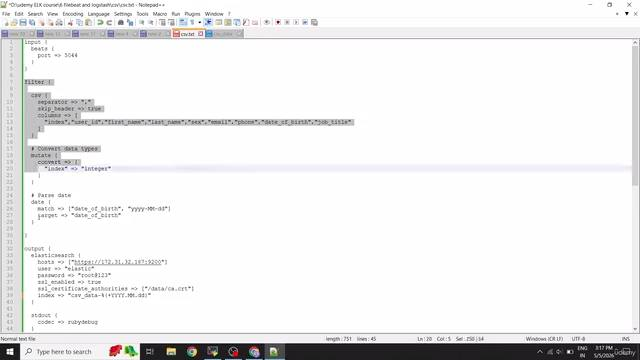
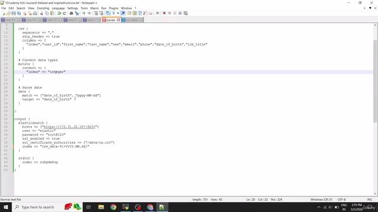
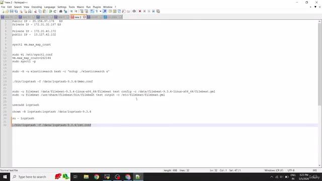
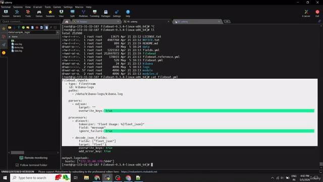
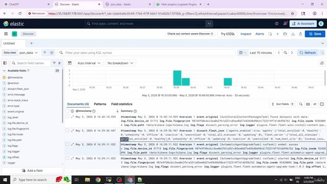
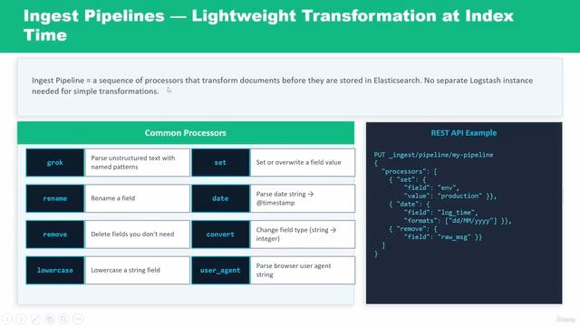
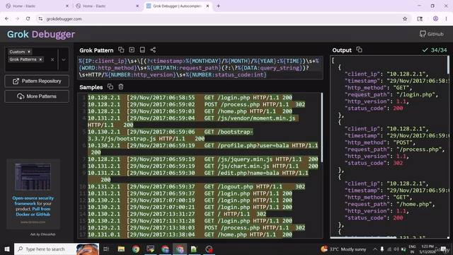

# ELK Stack 实战：CSV/JSON 日志、Ingest Pipeline 与 Fleet Server（P15–P20）

## 1. 这一节做什么

这一节不是从零安装 ELK，而是在你已经有一台能跑的 Elasticsearch + Kibana + Logstash + Filebeat 的机器上，完成四条可复现的日志链路，并最后把采集端升级成 Fleet 集中管理：

1. **CSV 日志链路**：Filebeat 读取 CSV 文件 → Logstash 用 `csv` filter 拆列 → 写入 Elasticsearch 索引 `csv_data` → Kibana 建 Data View 查看。
2. **JSON 日志链路**：Filebeat 读取 JSON 行日志 → Logstash 用 `json` filter 解析 → 写入索引 `json_data` → Kibana 查看。
3. **Ingest Pipeline 链路**：Filebeat **不经过 Logstash**，直接写 Elasticsearch，并在 Filebeat 配置里指定 `pipeline: sample-log-pipeline`；由 Elasticsearch 的 ingest node 在写入时用 `grok` + `date` processor 解析访问日志。
4. **Fleet Server + Elastic Agent**：在 Kibana Fleet 里创建 agent policy、添加 Fleet Server integration、生成 service token、执行安装命令；然后为每台被监控服务器创建独立 policy，安装 Elastic Agent，查看 System / Syslog / Host metrics 仪表盘。

课里没有讲具体版本号。复现时请保证 **Elasticsearch、Kibana、Logstash、Filebeat、Elastic Agent 使用同一大版本**，否则配置字段和 UI 名称可能对不上。下面代码按 8.x 常见写法给出；如果你的版本较旧，`filestream` 可能要换成 `log`，以你的实际版本为准。

这一节的关键不是“把四条链路各点一次”，而是理解每条链路里“谁负责解析、谁负责传输、谁负责落库”。CSV 和 JSON 链路主要让你看清 Logstash filter 的位置；Ingest Pipeline 链路让你把轻量转换前移到 Elasticsearch 写入阶段；Fleet 链路则把“单机手写 filebeat.yml”升级成“Kibana 下发 policy、Agent 自动领取配置”。复现时建议每完成一条链路就停下来验证索引和字段，不要四条链路同时开，否则端口、输出方向、索引名很容易混在一起。

本节涉及的文件和目录建议如下：

```text
/etc/logstash/conf.d/csv.conf
/etc/logstash/conf.d/json.conf
/etc/filebeat/filebeat.yml
/var/log/demo/users.csv
/var/log/demo-json/app.json
/var/log/sample_logs/demo.log
```

启动顺序很重要：**先确认 Elasticsearch/Kibana 正常 → 启 Logstash → 启 Filebeat → 再往目录里放日志文件 → 最后去 Kibana 建 Data View**。如果先放文件再启 Filebeat，通常也能读到，但排查时容易把“没数据”误判成配置错误。更稳的做法是每次只改一条链路：先停掉上一条链路的 Logstash 和 Filebeat，再启动下一条；验证完 Elasticsearch 里确实出现目标索引后，再切到下一条。这样一旦没有数据，你只需要检查当前这一套配置，而不是同时怀疑四个组件。



## 2. 讲师原话（带「—— pNNN [MM:SS]」）

> "我们已经把分隔符设为逗号……跳过表头意味着不会读取第一行……然后我们再指定列名。"
> —— p015 [00:29]

讲师在 CSV 这一节明确说了三件事：分隔符是逗号、`skip_header` 跳过第一行表头、`columns` 按顺序给列名。后面又用 `mutate` 把序号列转成整数。复现时最容易错的是 `columns` 的顺序：你以为只是“给字段起名”，实际上 Logstash 是按数组位置把 CSV 的每一列映射到对应字段名，顺序错一位，后面所有字段都会错位。`skip_header` 只负责跳过第一行，不会自动帮你推断列名，所以 `columns` 仍然要手写完整。

> "每个文件都有这个情况：Logstash 用户能访问所有文件，但唯独这个文件访问不了……因此我们设置了文件权限……现在没问题了。"
> —— p015 [02:26]

这里说的是文件权限：Filebeat/Logstash 运行用户必须能读到日志文件，否则启动或采集会报错。课里只说了“做权限”，没有给出具体 `chmod/chown` 命令，下面我会给通用写法并标注。排查权限时不要只看文件本身，还要看父目录是否有执行/进入权限；Linux 下目录没有 `x` 权限时，里面的文件即使 `644` 也读不到。可以用 `namei -l /var/log/demo/users.csv` 看整条路径权限，也可以用 `sudo -u filebeat test -r /var/log/demo/users.csv` 验证运行用户是否真的可读。

> "我们已经在 Filebeat 中解析这些数据了……这里只是做些小调整，比如把这个字段重命名为另一个名称、再新增一个字段。"
> —— p016 [01:54]

JSON 这一节，讲师提到可以在 Filebeat 侧先解析 JSON，也可以在 Logstash 侧用 `json` filter 解析；他演示的是 Filebeat 已解析后，Logstash 只做重命名、加字段这类轻量 `mutate`。下面为了让你能独立复现 `json` filter，我给出“Logstash 侧解析”的完整版本，并注明如果你按讲师原样把解析放 Filebeat，应删掉哪一段。这个区别很重要：如果 Filebeat 已经把 JSON 解析成结构化字段，Logstash 再对 `message` 做 `json {}` 可能解析不到，因为 `message` 已经不是完整 JSON 字符串；反过来，如果 Filebeat 只原样收集、Logstash 才解析，那么 `json` filter 的 `source` 要指向真正包含 JSON 的字段。

> "摄取管道不过是在索引时执行的轻量转换……简单转换不需要单独部署 Logstash 实例。"
> —— p017 [00:00]

这是 Ingest Pipeline 的核心定位：轻量转换放在 Elasticsearch 写入时做，不需要单独维护一个 Logstash 实例。重处理仍然用 Logstash。可以把它理解成“写入前的最后一道字段整理”：适合 `grok` 拆字段、`date` 改时间、`remove` 删临时字段、`set` 补常量；不适合做跨索引关联查询、复杂条件分支、外部系统调用，这些仍然放 Logstash 或应用侧更稳。

> "我们已经把这个管道设为示例日志管道。"
> —— p018 [01:20]

Filebeat 直连 Elasticsearch 时，关键配置就是 `pipeline: sample-log-pipeline`。名字必须和 Elasticsearch 里创建的 pipeline 完全一致。注意是 `pipeline`，不是 `index`；pipeline 是“写入时执行哪套处理器”，index 是“最后落到哪个索引”。两者可以同时存在，但不要混淆。

> "我们只定义了管道，没有定义任何索引名，因此所有数据都会进入 Filebeat 的默认索引。"
> —— p018 [06:10]

讲师故意没有在 Filebeat 输出里写 `index`，所以数据进入默认的 `filebeat-*` 索引。你在 Kibana 建 Data View 时要用 `filebeat-*`，不要去找一个叫 `sample-log-pipeline` 的索引。很多人第一次复现会去搜索 `sample-log-pipeline`，结果发现没有这个索引，其实 pipeline 只是处理器名字，不是索引名字。

> "首先创建一个 Fleet Server 策略……进入代理策略……创建代理策略。"
> —— p019 [00:00]

Fleet Server 部署的第一步不是敲命令，而是在 Kibana 里创建 policy，再添加 Fleet Server integration。先建 policy 的好处是：后面生成的安装命令里会带 policy ID，Fleet Server 启动后自动领取这套配置；如果你先手写命令再补 policy，很容易出现 Agent 已安装但 Fleet 里看不到、或者 policy 对不上的情况。

> "要创建服务令牌，只需点一下那个选项……然后它就会给出要执行的命令。"
> —— p019 [03:24]

Fleet Server 的安装命令由 Kibana 生成，里面包含 Elasticsearch 地址、service token、policy ID 等。不要手写猜参数，复制 UI 生成的命令最稳。service token 是一次性/敏感凭证，不要贴到公开仓库；如果 token 丢了或失效，重新在 Kibana 生成，不要自己拼一个。

> "每台服务器都应各自创建一个策略。"
> —— p020 [00:29]

讲师建议每台被监控服务器建一个 agent policy，这样以后给某台机器加 integration 时，直接选那台机器的 policy 即可。这个做法的实际好处是隔离：A 机器要加 Nginx 日志，B 机器只采集系统指标，就不要共用同一个 policy；否则你改 A 的 integration，B 也会跟着变，排查时很难判断“数据为什么多出来”。

> "在这个命令中加上 insecure 之后……我们就成功安装了 Elastic Agent。"
> —— p020 [04:19]

Elastic Agent 安装时如果 Fleet Server 用的是自签/无证书，命令里要加 `--insecure` 跳过证书校验。课里就是第一次没加失败，加上后成功。生产环境不要长期这样。更稳的做法是把自签 CA 放到 Agent 信任链里，或者给 Fleet Server 换正式证书；`--insecure` 只适合实验环境快速打通。

## 3. 从零复现

### 3.1 前置检查与目录准备

先确认 Elasticsearch 和 Kibana 能访问。课里没有给检查命令，下面用通用命令，按你的端口和地址替换：

```bash
curl -k https://127.0.0.1:9200
curl -k https://127.0.0.1:5601
```

`curl -k` 是跳过证书校验，适合实验环境自签证书；如果生产有正式 CA，去掉 `-k` 并配置 `--cacert`。第一个命令返回 JSON，里面能看到 `cluster_name`、`version.number`；第二个命令通常返回 Kibana 的 HTML 或登录页。两个都不通时，不要继续装 Filebeat/Logstash，先解决 Elasticsearch/Kibana 本身。

创建本节要用的日志目录：

```bash
sudo mkdir -p /var/log/demo
sudo mkdir -p /var/log/demo-json
sudo mkdir -p /var/log/sample_logs
```

权限处理：课里只说“做了文件权限”，没有给具体命令。下面给通用做法；如果你的 Filebeat 以 `filebeat` 用户运行，就把目录和文件给该用户读权限：

```bash
# 课里没讲具体命令，下面为通用权限处理，按你的运行用户调整
sudo chown -R filebeat:filebeat /var/log/demo /var/log/demo-json /var/log/sample_logs
sudo chmod 755 /var/log/demo /var/log/demo-json /var/log/sample_logs
sudo chmod 644 /var/log/demo/*.csv /var/log/demo-json/*.json /var/log/sample_logs/*.log 2>/dev/null || true
```

如果你的 Filebeat 以 root 运行，通常不需要这一步；但如果你看到 “permission denied”，先查运行用户和目录权限。验证时不要只 `ls -l` 看文件，还要看父目录：`namei -l /var/log/demo/users.csv` 会逐级列出权限；`sudo -u filebeat test -r /var/log/demo/users.csv && echo readable` 能直接验证运行用户可读。若 Filebeat 是 systemd 服务，运行用户可以用 `systemctl cat filebeat` 或 `ps -o user= -C filebeat` 查。

### 3.2 CSV 链路：Filebeat → Logstash → `csv_data`

**第 1 步：准备 CSV 样例。** 讲师原始 CSV 没有在逐字稿里逐行给出，下面按他口述的 10 列构造等价样例。列名和顺序必须与 `columns` 数组一致。

```csv
index,user_id,job_title,first_name,last_name,sex,email,phone,dob,password
1,U001,Engineer,Ada,Love,F,ada@example.com,13800000001,1990-01-01,pass1
2,U002,Designer,Bob,Smith,M,bob@example.com,13800000002,1991-02-02,pass2
3,U003,Analyst,Cara,Jones,F,cara@example.com,13800000003,1992-03-03,pass3
```

保存到 `/var/log/demo/users.csv`。如果你的 CSV 有引号包裹、逗号在字段值内部，`csv` filter 需要额外处理引号；上面的样例是最简单的无引号逗号分隔。真实业务里字段值可能带逗号，这时不能只靠 `separator => ","` 硬切，要确认 CSV 是否使用双引号转义，必要时先用应用侧导出标准 CSV。

**第 2 步：写 Logstash 配置 `/etc/logstash/conf.d/csv.conf`。** 完整内容见第 4 节。注意：`csv.conf` 和后面的 `json.conf` 都监听 5044，**不要同时启动**，否则端口冲突。课里也是分别演示。验证端口是否被占用可以用 `ss -lntp | grep 5044`；如果已经有 Logstash 在跑，先停掉旧的，再启新的。不要用两个 Logstash 同时抢 5044，否则 Filebeat 连上哪个不确定，数据可能进错索引。

**第 3 步：写 Filebeat 配置 `/etc/filebeat/filebeat.yml`。** 让 Filebeat 读 `/var/log/demo/*.csv`，输出到 Logstash 的 5044。写完先做配置测试：`sudo filebeat test config -c /etc/filebeat/filebeat.yml`，再测输出：`sudo filebeat test output -c /etc/filebeat/filebeat.yml`。前者检查 YAML 语法和字段名，后者会尝试连 Logstash 的 5044；如果 Logstash 还没启动，输出测试失败是正常的，但配置语法错误必须先修掉。

**第 4 步：启动 Logstash。** 讲师说“切到 logstash 用户运行”，课里没给完整路径。常见命令如下，路径按你的安装方式替换：

```bash
sudo -u logstash /usr/share/logstash/bin/logstash -f /etc/logstash/conf.d/csv.conf
```

如果不想前台占用终端，可以先用 `--config.test_and_exit` 做语法检查：`sudo -u logstash /usr/share/logstash/bin/logstash -f /etc/logstash/conf.d/csv.conf --config.test_and_exit`。通过后再正式启动。正式启动后日志里应能看到 pipeline 启动、监听 5044 的信息；如果没有，先看 Logstash 日志里的 `Could not find configuration`、`Permission denied`、`Address already in use`。

**第 5 步：启动 Filebeat。**

```bash
sudo filebeat -e -c /etc/filebeat/filebeat.yml
```

`-e` 表示把日志输出到 stderr，方便前台观察；`-c` 指定配置文件。生产环境通常用 systemd 启动，不要长期前台跑。观察 Filebeat 日志时重点看两类：一类是 harvester 是否启动并读到文件，另一类是 output 是否成功连到 Logstash。若出现 `Failed to connect to backoff`，先确认 Logstash 5044 是否在监听。

**第 6 步：往目录里写/复制 CSV 文件。** 如果启动前文件已存在，Filebeat 也会读；但如果想观察“新文件被采集”，可以在 Filebeat 启动后再复制一份：

```bash
sudo cp /var/log/demo/users.csv /var/log/demo/users-2.csv
```

复制后注意权限：`cp` 出来的新文件属主可能是 root，如果 Filebeat 以 `filebeat` 用户运行，要再 `chown filebeat:filebeat` 或确保目录默认权限正确。否则会出现“旧文件能读，新文件读不到”的假象。

**第 7 步：Kibana 建 Data View。** 打开 Kibana → Stack Management → Data Views → Create data view，名称填 `csv_data`，index pattern 填 `csv_data`。然后去 Discover 选这个 Data View，检查 `index` 是否为数字、`email`、`phone`、`dob` 等字段是否拆开。如果 `index` 在 Kibana 里显示为 `text` 或 `keyword` 而不是数字，先回看 Logstash 的 `mutate convert` 是否生效；如果字段名全是 `column1`、`column2`，说明 `columns` 没写或顺序不对。





### 3.3 JSON 链路：Filebeat → Logstash → `json_data`

**第 1 步：准备 JSON 行日志。** 每行一个完整 JSON，不要用 JSON 数组包多行。保存为 `/var/log/demo-json/app.json`：

```json
{"@timestamp":"2026-05-13T10:00:00.000Z","log":{"level":"INFO"},"message":"login ok","user":"ada"}
{"@timestamp":"2026-05-13T10:01:00.000Z","log":{"level":"ERROR"},"message":"db timeout","user":"bob"}
{"@timestamp":"2026-05-13T10:02:00.000Z","log":{"level":"WARN"},"message":"slow query","user":"cara"}
```

这里每行必须能独立被 `JSON.parse` 解析；如果文件是 `[ {...}, {...} ]` 这种数组，Filebeat 按行读时第一行是 `[`，Logstash 的 `json` filter 会解析失败。真实应用打 JSON 日志时，也要保证“一行一条 JSON”，不要 pretty print 成多行，否则采集端会按行切断。

**第 2 步：写 Logstash 配置 `/etc/logstash/conf.d/json.conf`。** 用 `json` filter 把 `message` 解析到 `json` 目标字段，再用 `mutate` 把 `[json][log][level]` 重命名为 `log_level`，并加一个 `pipeline_name` 字段。完整内容见第 4 节。这里要注意：`json` filter 的 `source` 默认是 `message`，但如果你在 Filebeat 侧已经解析过，`message` 可能只剩原始文本或已被改写，Logstash 侧再解析就会失败。先确认“解析责任”到底在 Filebeat 还是 Logstash，不要两边都解析又互相覆盖。

**第 3 步：写 Filebeat 配置。** 这里给的是“Filebeat 只收集、Logstash 解析”的版本，方便你单独验证 `json` filter。课里也说过可以让 Filebeat 先解析；如果你按讲师原样在 Filebeat 里加 `processors`/`ndjson`，就把 Logstash 里的 `json {}` 段删掉，只保留 `mutate`。判断方法很简单：看 Elasticsearch 里的文档字段，如果已经有 `log.level` 这种嵌套字段，说明 Filebeat 已经解析；如果只有一整条 `message` 字符串，说明还需要 Logstash 解析。

**第 4 步：先停掉 CSV 那套 Logstash/Filebeat，再启动 JSON 这套。**

```bash
sudo -u logstash /usr/share/logstash/bin/logstash -f /etc/logstash/conf.d/json.conf
sudo filebeat -e -c /etc/filebeat/filebeat.yml
```

启动前建议先 `sudo filebeat test config -c /etc/filebeat/filebeat.yml`，并确认 Filebeat 的 paths 指向 `/var/log/demo-json/*.json`，不是还指着 `/var/log/demo/*.csv`。如果两套配置共用一个 `filebeat.yml`，每次切换都要改 paths；更稳的做法是给不同链路准备不同配置文件，启动时 `-c` 指定对应文件。

**第 5 步：Kibana 建 Data View。** 名称 `json_data`，index pattern `json_data`。去 Discover 检查 `log_level`、`user`、`message` 是否存在。如果 `log_level` 是 `text`，在 Kibana 里过滤不方便；可以在索引模板里把它设成 `keyword`，或者先用 `mutate` 重命名后确认字段映射。实验环境先看字段是否出现，再考虑 mapping 优化。





### 3.4 Ingest Pipeline：Filebeat 直连 Elasticsearch

**第 1 步：准备访问日志样例 `/var/log/sample_logs/demo.log`。** 每行一条，日期用 2017 年，和讲师演示一致：

```text
192.168.1.10 - - [29/Nov/2017:10:15:32 +0000] "GET /index.html HTTP/1.1" 200 1043
192.168.1.11 - - [29/Nov/2017:10:16:10 +0000] "POST /api/login HTTP/1.1" 304 0
192.168.1.12 - - [29/Nov/2017:10:17:45 +0000] "GET /health HTTP/1.1" 200 12
```

这个格式对应常见的 Apache/Nginx combined 访问日志。`grok` pattern 里会用到 `IPORHOST`、`HTTPDATE`、`URIPATHPARAM` 等内置 pattern；如果日志格式和样例差一个空格、少一个 `-`，grok 就可能匹配失败。先用 `_simulate` 验证 pattern，再让 Filebeat 写入，能少走很多弯路。

**第 2 步：在 Kibana DevTools 创建 pipeline。** 完整请求见第 4 节 `sample-log-pipeline.json`。执行后返回 `acknowledged: true`。然后可以去 Stack Management → Ingest Pipelines 看到 `sample-log-pipeline`。创建后不要急着改名字：Filebeat 里写的是 `pipeline: sample-log-pipeline`，两边必须完全一致，大小写、连字符都不能差。





**第 3 步：写 Filebeat 配置。关键是在 `output.elasticsearch` 的 `pipeline` 字段写 `sample-log-pipeline`，并且不要同时启用 `output.logstash`。** Filebeat 的主要输出通常只启用一种；如果你从 CSV/JSON 那套配置复制过来，记得把 `output.logstash` 注释掉或删掉。否则 Filebeat 仍然把数据发给 Logstash，Elasticsearch 的 ingest pipeline 根本不会执行，你会看到 Logstash 索引里有数据、`filebeat-*` 里却没有。配置里还要写 Elasticsearch 地址、用户名密码或 API key，以及实验环境的证书策略。

**第 4 步：启动 Filebeat 并观察直连结果。**

```bash
sudo filebeat -e -c /etc/filebeat/filebeat.yml
```

启动前先 `sudo filebeat test config -c /etc/filebeat/filebeat.yml`，再 `sudo filebeat test output -c /etc/filebeat/filebeat.yml`。输出测试会实际连 Elasticsearch；如果证书、用户名密码、地址有错，这里就会报出来。启动后往 `/var/log/sample_logs/` 里追加一行日志，观察 Filebeat 是否成功 bulk 写入。若 Filebeat 日志出现 `failed to publish events`，先看 Elasticsearch 是否可达、pipeline 是否存在、`grok` 是否匹配失败。

**第 5 步：验证索引和字段。** 因为课里没有在 Filebeat 输出里写 `index`，数据会进入默认的 `filebeat-*` 索引。去 Kibana 建 Data View 时 index pattern 填 `filebeat-*`，不要填 `sample-log-pipeline`。查询时重点看 `client_ip`、`http_method`、`request_path`、`response_status`、`bytes` 是否被 grok 拆出来，`@timestamp` 是否被 date processor 改成日志里的 2017 年时间。如果字段都在 `message` 里没拆开，说明 pipeline 没执行或 grok 未匹配；如果 `@timestamp` 还是采集时间而不是日志时间，说明 date processor 的字段名或格式不对。

### 3.5 Fleet Server + Elastic Agent：先建 policy，再复制 Kibana 命令

**第 1 步：在 Kibana 创建 Fleet Server policy。** 进入 Kibana → Fleet → Agent Policies → Create agent policy，命名建议 `fleet-server-policy`。按课里顺序，先建 policy，再添加 Fleet Server integration。实验环境可以先只选 Fleet Server 必需项，不要一次加太多 integration，否则安装后排查“到底是 Fleet Server 没起来还是某个 integration 没起来”会混在一起。

**第 2 步：生成 service token 和安装命令。** 在 Fleet 的 Add Fleet Server 流程里生成 service token，Kibana 会给出完整安装命令。不要手写猜 `--fleet-server-es`、`--fleet-server-policy` 这些参数，直接复制 UI 生成的命令，再按你的环境决定是否加 `--insecure`。service token 不要贴到公开文档；下面的代码只是占位模板，真实值以 Kibana 显示为准。

**第 3 步：安装 Fleet Server。** 在准备作为 Fleet Server 的机器上执行 Kibana 生成的命令。实验环境如果使用自签证书，通常需要加 `--insecure`；课里就是第一次没加失败，加上后成功。安装完成后用 `systemctl status elastic-agent` 看服务状态，再回 Kibana Fleet 看 Fleet Server 是否 Healthy。如果 Fleet 里一直显示离线，先看 Agent 日志里的证书、token、Elasticsearch 地址。

**第 4 步：为每台被监控服务器创建独立 policy。** 按讲师建议，每台服务器建一个 agent policy，例如 `server-a-policy`、`server-b-policy`。这样以后给 A 机器加 Nginx integration，不会影响 B 机器。policy 建好后，在 Add Agent 页面生成 enrollment token 和安装命令。

**第 5 步：安装 Elastic Agent。** 在被监控服务器上执行 Kibana 生成的 Agent 安装命令；自签环境同样可能需要 `--insecure`。安装后在 Fleet 里应能看到该 Agent enrolled，并且对应 policy 显示 Healthy。然后到 Dashboards 里查看 System / Syslog / Host metrics 仪表盘，确认有数据。若仪表盘没数据，先看 Agent 是否领取到 policy、对应 integration 是否启用，再看数据是否进入 `metrics-*` 或 `logs-*` 索引。

## 4. 完整代码

下面按链路给出完整配置。密码、地址、证书路径按你的环境替换；不要把真实密码和 token 提交到公开仓库。实验环境可以用 `ssl.verification_mode: none` 或 `--insecure` 快速打通，生产环境应换成 CA 校验。

**CSV 链路：`/etc/logstash/conf.d/csv.conf`**

```ruby
input {
  beats {
    port => 5044
  }
}

filter {
  csv {
    separator => ","
    skip_header => true
    columns => ["index","user_id","job_title","first_name","last_name","sex","email","phone","dob","password"]
  }

  mutate {
    convert => { "index" => "integer" }
  }
}

output {
  elasticsearch {
    hosts => ["https://127.0.0.1:9200"]
    index => "csv_data"
    user => "elastic"
    password => "${ES_PASSWORD}"
    ssl_certificate_verification => false
  }
}
```

**CSV 链路：Filebeat 配置片段**

```yaml
filebeat.inputs:
- type: filestream
  id: csv-input
  enabled: true
  paths:
    - /var/log/demo/*.csv

output.logstash:
  hosts: ["127.0.0.1:5044"]
```

**JSON 链路：`/etc/logstash/conf.d/json.conf`**

```ruby
input {
  beats {
    port => 5044
  }
}

filter {
  json {
    source => "message"
    target => "json"
  }

  mutate {
    rename => { "[json][log][level]" => "log_level" }
    add_field => { "pipeline_name" => "json-logstash" }
  }
}

output {
  elasticsearch {
    hosts => ["https://127.0.0.1:9200"]
    index => "json_data"
    user => "elastic"
    password => "${ES_PASSWORD}"
    ssl_certificate_verification => false
  }
}
```

**JSON 链路：Filebeat 配置片段**

```yaml
filebeat.inputs:
- type: filestream
  id: json-input
  enabled: true
  paths:
    - /var/log/demo-json/*.json

output.logstash:
  hosts: ["127.0.0.1:5044"]
```

**Ingest Pipeline 链路：Filebeat 直连 Elasticsearch**

```yaml
filebeat.inputs:
- type: filestream
  id: sample-log-input
  enabled: true
  paths:
    - /var/log/sample_logs/*.log

output.elasticsearch:
  hosts: ["https://127.0.0.1:9200"]
  username: "elastic"
  password: "${ES_PASSWORD}"
  pipeline: "sample-log-pipeline"
  ssl.verification_mode: "none"
```

> 实验环境用 `ssl.verification_mode: none` 跳过证书校验；生产环境应配置 `ssl.certificate_authorities`，不要把 `none` 带进生产。

**Ingest Pipeline：Kibana DevTools 请求**

```json
PUT _ingest/pipeline/sample-log-pipeline
{
  "description": "Parse demo access log",
  "processors": [
    {
      "grok": {
        "field": "message",
        "patterns": [
          "%{IPORHOST:client_ip} - - \\[%{HTTPDATE:timestamp}\\] \"%{WORD:http_method} %{URIPATHPARAM:request_path} HTTP/%{NUMBER:http_version}\" %{NUMBER:response_status:int} %{NUMBER:bytes:int}"
        ]
      }
    },
    {
      "date": {
        "field": "timestamp",
        "target_field": "@timestamp",
        "formats": ["dd/MMM/yyyy:HH:mm:ss Z"]
      }
    },
    {
      "remove": {
        "field": ["message", "timestamp"],
        "ignore_failure": true
      }
    }
  ]
}
```

**Fleet Server 安装命令模板（真实值从 Kibana 复制）**

```bash
sudo ./elastic-agent install \
  --fleet-server-es=https://127.0.0.1:9200 \
  --fleet-server-service-token=<从Kibana复制的service token> \
  --fleet-server-policy=fleet-server-policy \
  --fleet-server-port=8220 \
  --insecure
```

**被监控服务器 Elastic Agent 安装命令模板（真实值从 Kibana 复制）**

```bash
sudo ./elastic-agent install \
  --url=https://FLEET_SERVER_IP:8220 \
  --enrollment-token=<从Kibana复制的enrollment token> \
  --insecure
```

## 5. 逐行解释

**CSV 的 Logstash 配置。** `input { beats { port => 5044 } }` 表示 Logstash 监听 Filebeat 的 beats 协议，Filebeat 输出到 5044 就连到这里。`csv { separator => "," }` 指定逗号分隔；`skip_header => true` 跳过 CSV 第一行表头，避免把 `index,user_id,...` 当成一条数据；`columns => [...]` 按数组位置给每一列命名，顺序必须和 CSV 列顺序一致。`mutate { convert => { "index" => "integer" } }` 把名为 `index` 的字段转成整数，这样 Kibana 里能按数值排序、范围过滤；如果不转，它通常是字符串，排序会出现 `10` 排在 `2` 前面。`output.elasticsearch` 里 `index => "csv_data"` 固定写普通索引；`user`/`password` 是认证；`ssl_certificate_verification => false` 是实验环境跳过证书校验，生产应改成 CA 校验。常见错误是 `columns` 少写一列导致字段错位、`skip_header` 没开导致表头变成文档、密码用错导致 401。排查时先看 Logstash 日志有没有 `Failed to install template` 或 `401 Unauthorized`，再用 `GET csv_data/_search` 看第一条文档字段。

**JSON 的 Logstash 配置。** `json { source => "message" target => "json" }` 表示把 `message` 字段里的 JSON 字符串解析后放到 `json` 对象下；`target` 不是必须，但加上后字段会集中在 `[json]` 下，便于后面重命名。`rename => { "[json][log][level]" => "log_level" }` 把嵌套字段 `json.log.level` 提升为顶层 `log_level`，这样 Kibana 过滤更方便；`add_field` 加一个标记字段，便于确认这条文档经过哪套 pipeline。常见错误是 `source` 指错：如果 Filebeat 已经把 JSON 解析成结构化字段，`message` 可能不再是完整 JSON，`json` filter 会解析失败并在 `tags` 里加 `_jsonparsefailure`。排查时看文档是否有 `_jsonparsefailure`，如果有，先决定解析放 Filebeat 还是 Logstash，不要两边重复解析。

**Filebeat 三种输出。** CSV/JSON 链路用 `output.logstash`，表示 Filebeat 只负责收集和传输，解析在 Logstash 做；Ingest Pipeline 链路用 `output.elasticsearch`，表示 Filebeat 直接写 Elasticsearch，解析在写入时由 pipeline 做。Filebeat 的主要输出一般只启用一种；如果同时留着 `output.logstash` 和 `output.elasticsearch`，行为会取决于版本和配置，但最常见的结果是数据仍走 Logstash，pipeline 不执行。`paths` 决定采集目录，`id` 是 filestream 的输入标识，改 `id` 会让 Filebeat 认为是一个新输入，可能重新读旧文件；实验时改 paths 可以，生产不要随意改 `id`。`pipeline: "sample-log-pipeline"` 必须和 Elasticsearch 里的 pipeline 名字完全一致；`username`/`password` 是 Filebeat 连 Elasticsearch 的认证，注意 Filebeat 用 `username`，Logstash 的 elasticsearch output 用 `user`，不要混。

**Ingest pipeline 的 JSON。** `grok` processor 对 `message` 字段应用 pattern，把 IP、时间、方法、路径、状态码、字节数拆出来；`%{IPORHOST:client_ip}` 表示匹配主机/IP 并命名 `client_ip`，`%{HTTPDATE:timestamp}` 匹配访问日志时间，`%{NUMBER:response_status:int}` 把状态码转整数。`date` processor 把 `timestamp` 按 `dd/MMM/yyyy:HH:mm:ss Z` 解析，并写入 `@timestamp`；如果不做这一步，`@timestamp` 会是 Filebeat 采集时间，和日志真实时间对不上。`remove` processor 删除临时字段 `message` 和 `timestamp`，避免索引里保留重复内容；`ignore_failure: true` 表示字段不存在时不要报错。常见错误是 grok 不匹配导致 processor 失败，文档可能带 `_ingest.failed` 或字段没拆开；用 `POST _ingest/pipeline/sample-log-pipeline/_simulate` 先模拟一条日志，比直接让 Filebeat 写更快定位。

**Fleet 安装命令。** `--fleet-server-es` 指定 Fleet Server 连哪个 Elasticsearch；`--fleet-server-service-token` 是 Kibana 生成的服务 token；`--fleet-server-policy` 指定 Fleet Server 使用哪套 policy；`--fleet-server-port=8220` 是 Fleet Server 监听端口，Agent 之后通过这个端口来 enroll；`--insecure` 跳过证书校验。被监控服务器的 Agent 安装用 `--url` 指向 Fleet Server 地址，`--enrollment-token` 是 enroll token。真实 token 不要手写，复制 Kibana 生成的命令最稳；如果安装失败，先看 `--insecure` 是否漏了、8220 是否可达、service token 是否过期。与前端的对照可以这样理解：CSV 的 `columns` 像前端表格的列 schema，顺序错就错位；Logstash filter 像后端中间件，负责解析和字段整理；Ingest pipeline 像 API 写入前的 DTO 转换，轻量且靠近存储；Fleet policy 像配置中心，每台机器领取自己的配置，避免“改一台影响全部”。

## 6. 复现检查清单

- [ ] **Elasticsearch/Kibana 可访问**：`curl -k https://127.0.0.1:9200` 返回 cluster JSON；`curl -k https://127.0.0.1:5601` 返回 Kibana 页面。验证不通过时先不要启动 Filebeat/Logstash。
- [ ] **日志目录和权限正确**：`namei -l /var/log/demo/users.csv` 逐级看权限；`sudo -u filebeat test -r /var/log/demo/users.csv && echo readable` 返回 readable。若 Filebeat 以 root 运行，这一步可跳过但仍建议确认目录存在。
- [ ] **Logstash 配置语法通过**：`sudo -u logstash /usr/share/logstash/bin/logstash -f /etc/logstash/conf.d/csv.conf --config.test_and_exit` 无语法错误。验证通过后再正式启动。
- [ ] **5044 监听正常**：`ss -lntp | grep 5044` 能看到 Logstash 监听。若被占用，先停旧 Logstash；不要同时启 csv.conf 和 json.conf。
- [ ] **Filebeat 配置语法通过**：`sudo filebeat test config -c /etc/filebeat/filebeat.yml` 返回 Config OK。再 `sudo filebeat test output -c /etc/filebeat/filebeat.yml` 检查输出连通性。
- [ ] **CSV 数据进入 `csv_data`**：`curl -k -u elastic:${ES_PASSWORD} https://127.0.0.1:9200/csv_data/_search?pretty` 能看到 hits；在 Kibana Discover 看 `index` 是数字、`email`/`phone` 已拆开。若字段名不对，回看 `columns` 顺序。
- [ ] **JSON 数据进入 `json_data`**：查询 `json_data/_search` 能看到 `log_level`、`user` 字段；若出现 `_jsonparsefailure`，检查解析放 Filebeat 还是 Logstash，避免重复解析。
- [ ] **Ingest pipeline 存在**：DevTools 执行 `GET _ingest/pipeline/sample-log-pipeline` 返回定义；用 `POST _ingest/pipeline/sample-log-pipeline/_simulate` 模拟样例日志，确认 grok/date 输出字段正确。
- [ ] **Filebeat 直连生效**：Filebeat 配置只启用 `output.elasticsearch`，`pipeline` 名字一致；写入后查询 `filebeat-*` 能看到 `client_ip`、`response_status`。若没有，先看 Filebeat 日志是否仍连 Logstash。
- [ ] **Fleet Server Healthy**：安装 Fleet Server 后 `systemctl status elastic-agent` 正常；Kibana Fleet 页面显示 Fleet Server Healthy。若离线，检查 `--insecure`、service token、Elasticsearch 地址。
- [ ] **Agent enrolled 且 policy 正确**：每台被监控服务器在 Fleet 里显示 enrolled，policy 名称对应该机器；Dashboards 的 System/Syslog/Host metrics 有数据。若没数据，检查 integration 是否启用、Agent 是否领取到 policy。

## 7. 课里没讲但你会撞上的（表格：现象 / 原因 / 怎么办）

| 现象 | 原因 | 怎么办 |
|---|---|---|
| Logstash 启动报 `Address already in use` | 5044 已被另一个 Logstash 占用，csv.conf 和 json.conf 同时启动 | `ss -lntp \| grep 5044` 找进程，停掉旧 Logstash，只保留当前链路 |
| Filebeat 报 `permission denied` | Filebeat 运行用户不可读日志文件或父目录没有执行权限 | `namei -l` 看整条路径；`chown/chmod` 给运行用户读权限；用 `sudo -u filebeat test -r` 验证 |
| CSV 字段错位、`email` 里是姓名 | `columns` 顺序和 CSV 列顺序不一致，或少写/多写列 | 按 CSV 表头顺序重写 `columns`；`skip_header => true`；用第一条文档核对 |
| CSV 表头变成一条日志 | 没开 `skip_header`，或 CSV 第一行