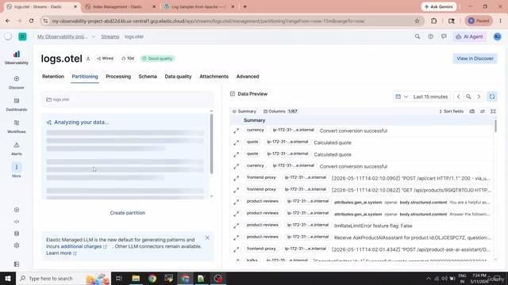
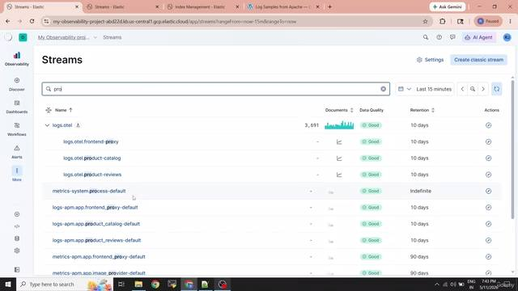
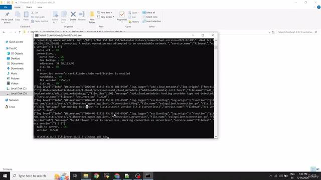
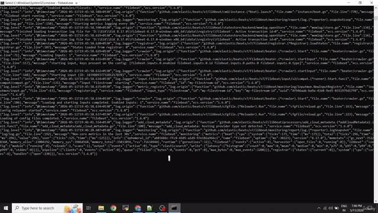
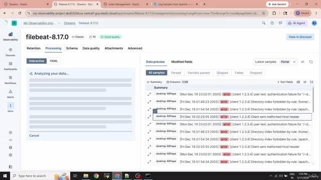
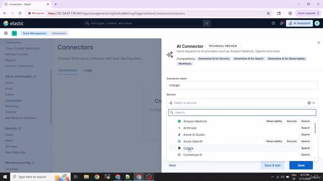
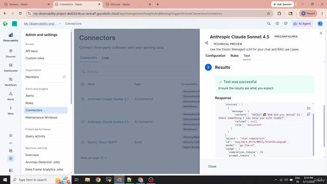
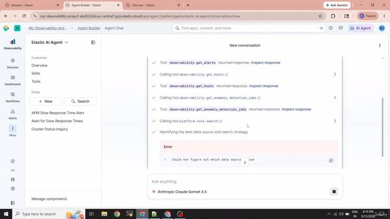

# ELK Stack（BV1AzJM67Ewx）P21–P22 实操文档：用 Streams + AI 把日志收进 Elasticsearch

> 读者定位：前端转 AI 应用工程师。本文所有操作都可照着点、照着敲。涉及并发/事务的地方会补一句「在 JS/Node 里对应什么」。

---

## 1. 这一节做什么

这两节课是**一个连贯的项目**：把一台 Windows 机器上的应用日志，用 Filebeat 8.17 推到 Elasticsearch Cloud，然后在 Kibana 里借助 Streams 的 AI 能力，把「一坨原始日志」变成「结构化字段 + 按微服务拆分的子数据流」。

具体产出物有四件：

1. **一条能跑通的数据链路**：本地 `C:\ELK\8.17\logs\*.log` → Filebeat 8.17.1 → Elastic Cloud（API Key 认证）→ 自动生成的 data stream → backing index。
2. **一组按微服务拆分的子数据流**：用 Streams 的 AI partition 建议，把混在一个 data stream 里的 14 个微服务日志，拆成 14 个 child data stream（讲师实际跑出 12 个成功、2 个 failed）。
3. **一个 AI 生成的 ingest pipeline**：把纯文本日志 grok 出 `log.level`、`source.ip`、`@timestamp`、`message` 四个字段，并用 date processor 把 `@timestamp` 覆盖成日志里 2005 年的真实时间。
4. **一个能对话的 AI Agent**：配好 LLM connector 之后，用自然语言问「我的集群健康吗」「我有哪些 data stream」，以及让 AI 指导你写 alert 条件。

要特别说清楚一件事：这节课的 Elasticsearch 是**讲师自己的 Elastic Cloud 试用集群**，不是本地 Docker 起的。所以文档里所有「去 Menu 点某个菜单」的路径，在自建集群上位置会不一样——我会两条路径都写。

---

## 2. 讲师原话（带「—— pNNN [MM:SS]」）

关于 Streams 的两种模式，讲师开篇就给了定义：

> "in streams there are two operation modes one is classic and another is wired"（Streams 有两种操作模式，一种是 classic，一种是 wired）—— p021 [00:00]

两者的分流规则，讲师讲得很明确：

> "whenever you are ingesting any data from any beats which export data in ECS format which is nothing but elastic common schema, then you should assign this endpoint. and if you are using otel collector to export data logs, so you should use the logs.otel"（从 beats 来的、ECS 格式的数据走 `logs.ecs`；从 OTel Collector 来的走 `logs.otel`）—— p021 [06:30]

为什么 Streams 值得用，讲师给的理由是「不用再手动管 ILM 和 mapping template」：

> "previously if you ingest data you have to use the ILM policy to manage the data, so in streams that is not the case, every stream has its backing indices"（以前要自己用 ILM 策略管数据，在 Streams 里不是这样，每个 stream 有自己的 backing indices）—— p021 [01:47]

改 mapping 这件事的差别，是这节课最实用的一个点：

> "whenever you change the mapping over here it is applied for the new incoming data, for previous the mapping remains the same"（在这里改 mapping，只对新的流入数据生效，老数据的 mapping 保持不变）—— p021 [04:07]

AI 生成 pipeline 的入口：

> "so how do we make an ingest pipeline with the help of AI, so what elastic has provided, elastic pro has provided this AI feature, suggest a pipeline"（怎么借 AI 做 ingest pipeline？Elastic 提供了 suggest a pipeline 这个 AI 功能）—— p021 [27:55]

关于那个必勾的开关：

> "after this you just enable this ignore failure, because if this is not enabled and all the logs which are not matching to this grok will be failed"（一定要打开 ignore failure，不然所有匹配不上 grok 的日志都会失败）—— p021 [30:13]

Filebeat 认证这一步，讲师踩过一个很典型的坑：

> "the API key which is generated by Kibana is base 64 encoded. So you need to decode that... you get this api id then after that colon then you get this key"（Kibana 生成的 API Key 是 base64 编码的，要解码；解码后是「id + 冒号 + key」）—— p021 [18:24]

时间戳的问题，讲师是在 Discover 里当场发现的：

> "all the logs which are previously stored are stored on current time zone, but as you can see we have this 2005 date over here, so logs should be stored on that time period"（之前入库的日志都存成了当前时间，但这里明明是 2005 年的日期，日志应该按那个时间存）—— p021 [33:01]

P22 讲 AI Agent Builder 时，讲师对 connector 的定义：

> "select a service, so there are various cloud LLM service providers"（选一个服务，这里有一堆云上的 LLM 服务商）—— p022 [01:22]

Agent 能干什么，讲师有一句总纲：

> "LLM which has access to your data stored in Elasticsearch, so you can get all the insights from this chatbot"（这个 LLM 能访问你存在 ES 里的数据，所以你能从聊天里拿到各种洞察）—— p022 [06:36]

但边界也讲清了：

> "this is AI chatbot only, so it will guide you but it cannot create alert itself, this is the limitation so far from elastic"（这只是个 AI 聊天框，它会指导你，但没法自己把 alert 建出来，这是 Elastic 目前的限制）—— p022 [13:11]

---

## 3. 从零复现

### 3.0 前置条件清单

| 项 | 讲师用的 | 说明 |
|---|---|---|
| Elasticsearch / Kibana | Elastic Cloud 试用版（讲师说是 cloud trial） | 云端 UI 和自建 UI 菜单位置不同 |
| Filebeat | 8.17.1（Windows 版） | 解压即用，无需安装 |
| 操作系统 | Windows（全程用 `cmd`） | 命令是 `.\filebeat.exe` 形式 |
| LLM Connector | Cloud trial 预置了 Anthropic 的 connector | 自建集群要自己填 API Key |
| 日志来源 | Apigee 风格的示例应用日志 | 里面是 2005 年的时间戳 |

> 需要说明：课里**没有**演示用 Docker 起本地 Elasticsearch 集群，也没给 `docker-compose.yml`。如果要用本地集群，那部分内容课里没讲。

### 3.1 建好目录骨架

在 Windows 上建出这个结构（讲师把 Filebeat 解压到 `C:\ELK\8.17`）：

```
C:\ELK\
└─ 8.17\                        <- filebeat-8.17.1-windows-x86_64 解压目录
   ├─ filebeat.exe
   ├─ filebeat.yml              <- 我们要改的就是这个文件
   ├─ data\                     <- filebeat 自动生成，存 registry
   └─ logs\                     <- 我们手动建的日志目录
      ├─ sample.log
      ├─ demo.txt
      └─ new.txt
```

### 3.2 在 Kibana 里找到 Streams 入口

- **Elastic Cloud 版**（讲师用的）：右上角 `more`（九个点的更多菜单）→ `Streams`。
- **自建 / 自托管版**：左侧 Menu → `Elasticsearch` 分类下就有相关入口。

进去之后你会看到当前集群所有 data stream 的列表，每条能点进去，里面有 `Retention` / `Partitioning` / `Processing` / `Schema` / `Data Quality` / `Advanced` 这几个 Tab。


### 3.3 先看一个 classic stream：改 retention

讲师演示的是一个 nginx 相关的日志流，点进 `Retention` Tab，能看到：

- **Operation mode**：`classic`
- **Data retention**：当前是 `indefinite`（无限期）

改法：点 `Edit retention method` → 选 `Custom` → 选 `Custom period` → 填 `7` → 单位选天 → 点 `Set`。

这一步背后发生的事：Streams 帮你改了 ILM policy，你不用再自己去 `Stack Management → Index Lifecycle Policies` 里手写。

>`换到 JS/Node 视角`：这就是日志文件的 TTL。Node 里你会用 `logrotate` 或写个定时任务删 7 天前的文件；ES 里是 ILM 按 backing index 的年龄做 rollover + delete。概念完全一样，只是粒度从「文件」变成了「index」。

### 3.4 改 mapping（Schema Tab）

在 `Schema` Tab 里能看到当前 data stream 的字段列表。讲师的说法是：以前 ingest 的时候要先在 `Stack Management → Index Templates` 建好 mapping template，字段类型对不上就完蛋；现在在 Streams 里直接点 `Edit field` → 选类型 → `Stage changes` 就能改。

关键认知（讲师在 [04:07] 反复强调）：

- 改动**只对之后新流入的数据生效**；
- 老数据不会自动重映射（除非 reindex，而讲师说这正是 Streams 帮你绕开的麻烦）；
- 因为 logs 类型有 rollover 策略，旧 backing index 会随时间被淘汰，新的 backing index 用新 mapping。

### 3.5 看 Wired 模式的两个入口

在 Streams 列表里找 `logs.otel` 和 `logs.ecs`（讲师在视频里念成 "logs.otel / logs.ecs"，具体显示以你的 UI 为准）。点进 `logs.otel`，你会发现和 classic 那个相比，多了一个 `Partition` Tab，Tab 结构变成了 `Retention` / `Partitioning` / `Processing` / `Schema` / `Data Quality` / `Advanced`。

讲师解释了这两个入口的分工：

- `logs.ecs`：给 Beats 系列（Filebeat / Metricbeat 等）用，数据是 ECS（Elastic Common Schema）格式；
- `logs.otel`：给 OpenTelemetry Collector 用。

他当时打开 `logs.otel` 是因为他的数据都从 OTel 那条路进来了，能看到 ingest 速率和失败数（0 failure）。

### 3.6 用 AI 做 Partition（把 14 个微服务拆开）

这是 P21 最有意思的一段。讲师的场景是：Hotel 官方 demo 应用（一个 Web 电商）有 ad service、catalog service、checkout、cart、currency、fraud detection、load generator、product review、recommendation、frontend proxy 等一堆微服务，**所有日志都进了同一个 data stream**。

操作路径：

1. 进入 `logs.otel`（wired 的那个）→ `Partitioning` Tab
2. 点 `Get partition suggestions`（讲师提醒：这一步会调用 Anthropic 的 Sonnet 模型，Cloud trial 是预置好的；自建要企业 license + 自己配 AI connector）
3. 等 AI 扫完数据，它会列出建议：比如 `resource.attributes.service.name == "kafka"` 的日志归到一个子流，值是 add 的归另一个……一共给出 **14 条**建议
4. 讲师先开了个新 Tab 去 `Streams` 列表确认这些子流还不存在（"目前还没有流。"）
5. 回到建议页，点 `Accept selected 14`



6. 创建过程是一个一个建的，UI 上会显示 `creating stream 1 of 14`。讲师这次跑的结果是**部分失败**——有的显示 failed，但去列表里刷新发现 data stream 其实已经建出来了，只是当时没有匹配的日志流进去。


7. 点进任意一个子流（比如 cart service 那个），在 `Partitioning` Tab 里能看到已经有一点点 documents 了。

>`换到 JS/Node 视角`：partition 本质是「按字段值路由到不同目的地」。你在 Node 里写 logger 时，如果按 `service` 拆成 `logs/cart.log`、`logs/checkout.log` 若干个文件，就是同一件事。ES 把这个动作下推到了 ingest 层，还免费送你一套 UI 和 rollover。

### 3.7 配 Filebeat（本节最关键的一步）

讲师的 Filebeat 配置在 `C:\ELK\8.17\filebeat.yml`。他口述的要点：

1. `filebeat.inputs` 里用 `filestream` 类型，`enabled: true`
2. `paths` 指向日志目录
3. `output.elasticsearch.hosts` 填 Elastic Cloud 的地址
4. 认证方式用 **API Key**
5. API Key 从 Kibana 生成后是 **base64 编码**的，必须解码，得到 `id:key` 形式再填进去



生成 API Key 的位置：Kibana → `Stack Management` → `Security` → `API Keys` → `Create API key`。生成后把那一串 base64 拿去解码（讲师说他用了在线的 base64 decode 工具），解出来形如 `AbCdEf123:XYZ789...`，前半段是 id，后半段是 key，中间用冒号连接。

完整的 `filebeat.yml` 见第 4 节。

### 3.8 先测配置，再启动

讲师在 `C:\ELK\8.17` 目录下开 `cmd`，依次跑：

```bat
cd C:\ELK\8.17

REM 1. 校验配置文件语法
.\filebeat.exe test config

REM 2. 校验能不能连上 Elasticsearch、证书对不对、认证过不过
.\filebeat.exe test output

REM 3. 前台带日志启动
.\filebeat.exe -e
```

`test output` 这一步讲师的输出是「能连上服务器、安全证书验证已启用」，也就是 `talk to server... OK` 这一类信息。这一步非常值得跑——它能在你还没产生任何日志之前，就把 URL 写错、API Key 填错、证书问题全部暴露出来。



### 3.9 造日志、验证数据流

启动 Filebeat（`-e`）后，讲师在 `C:\ELK\8.17\logs` 里新建 `sample.log`，粘贴一段 Apigee 的示例日志并保存。然后回 Kibana：

1. `Stack Management` → `Index Management` → 刷新，找形如 `filebeat-8.17.1` 的条目（讲师看到的是带 filebeat 版本号的 index）
2. 一开始文档数是 0，讲师反复刷新、反复保存文件，等了一会儿才看到 `11 documents` → `31 documents`



3. 再去 `Streams` 里查这个新 data stream，能看到：
   - Operation mode 是 `classic`（因为没往 `logs.otel` 端点写）
   - 存储量 `25 kb`、`31 documents`
   - `Advanced` Tab 里能看到 backing indices、template 名、pipeline 名

### 3.10 用 AI 生成 ingest pipeline

此时 31 条日志是「生的」——整行文本塞在 `message` 里，没有 `log.level`，没有 `source.ip`，`@timestamp` 是入库时间。

操作：

1. 在那个 filebeat data stream 的 `Processing` Tab（或者日志详情页），点 `Suggest a pipeline`
2. AI 会分析已有的文档，给出一个含 grok + date + remove 的 pipeline
3. 点 `Accept` 之前，先点 `Edit` 看 grok 到底长什么样、`Data preview` 看解析结果
4. 讲师看到的是 `parse 100%`（全部解析成功）；如果只是部分匹配，这里会显示 failed 之类的状态
5. **勾上 `ignore failure`**（对应 YAML/JSON 里的 `ignore_failure: true`），否则所有匹配不上 grok 的日志都会被丢弃
6. 点 `Save changes` / `Confirm`



保存后，讲师看到四个字段的类型被定下来：

| 字段 | 类型 |
|---|---|
| `log.level` | keyword |
| `message` | text |
| `source.ip` | ip |
| `@timestamp` | date |

### 3.11 建 Data View，去 Discover 验证

1. `Stack Management` → `Kibana` → `Data Views` → `Create data view`
2. Name 填 `filebeat-8.17`
3. Index pattern 填 `filebeat-8.17*`（讲师特别提醒：Index Management 里带 `.ds-` 前缀的是 backing index，别把它当 pattern，去掉 `.ds-` 再加星号）
4. Save

然后去 `Discover`，选这个 data view。**关键动作**：把右上角时间范围从默认的 Last 15 minutes 改成 **25 years ago → now**。因为日志里是 2005 年的日期，而 `@timestamp` 已经被 date processor 改写成 2005 年了，用默认时间窗什么都看不到。

验证三件事：

- 搜 `log.level`，能搜到字段，值是 `error` 之类 → grok 生效
- 搜 `source.ip`，能看到 IP → grok 生效
- 时间轴上出现 2005-12-16 / 2005-12-19 / 2005-12-20 的尖峰 → date processor 生效

而**之前那 31 条老文档**，搜 `log.level` 是搜不到的——pipeline 只对保存之后新流入的文档生效。讲师用这个对比，把「pipeline 是流式的、不回填历史」这件事讲透了。

### 3.12 P22：配一个 LLM Connector

进入 `Menu` → `Stack Management` → `Connectors` → `Create connector` → 选 `AI connector`。



表单里三件事：

1. **Name**：随便起，讲师说「叫 anthropic 或 chat GPT 都行」
2. **Service**：下拉里有 AWS Bedrock、Azure OpenAI、Anthropic、OpenAI、Contextual.ai、DeepSeek 等等
3. **API Key**：填你对应服务商的 key

填完点 `Save and test`，它会发一句 hello 出去，看能不能收到回复。



讲师自己没订阅，所以他用的是 Cloud trial 预置的 Anthropic connector（在 Cloud 版里路径是 `Settings` → `Alerts and insights` 区域的 `Connectors`）。他点 `Test connector`，UI 回了一段「hello，你好，有什么可以帮你」，并显示了模型名和总 token 数（具体字段名以你的实际输出为准）。

> 如果你在自建集群上：`Menu` → `Stack Management` → `Connectors` 是标准路径。

### 3.13 设默认 Connector 并打开 Agent

讲师说，如果配了多个 connector，要去 AI 设置里选一个默认的：

- 找 `GenAI settings`（讲师念作 "JNAI settings"）→ 里面有个 selector，选默认 connector
- 因为 Streams 里那些 AI 功能（partition 建议、suggest pipeline）都从这里取配置

打开 Agent 的入口，两个版本位置不同：

- **自建**：`Menu` → `Elasticsearch` 分类下 → `Agents`
- **Cloud**：`more`（更多）→ `Agents`

点进去就是一个聊天窗，顶部能选模型（讲师那边能选 sonnet 4.5 / 4.6 之类），还能选 `Tools`——ES 自带一堆工具（告警相关、可观测性相关），需要哪个就 enable 哪个，enable 之后这些工具会被加进你的集群。

### 3.14 拿自然语言问你的集群

讲师依次问了三个问题，这是他演示的节奏：

**问题一**：`how is my cluster health`
AI 说它先去查了数据源、查了集群状态，然后回答：集群整体健康、没有 active alerts、数据摄取健康、主机稳定；CPU 利用率 77.5%；活跃的 data stream 有 APM traces、application logs、stream metrics、elastic agent monitoring 等。



**问题二**：`how my APM services are performing`
AI 查出 22 个微服务，20 个健康，`checkout` 和 `frontend-proxy` 需要关注。讲师补了一句解释：这是因为他的 demo 环境里跑着一个 `load generator`，专门造流量和造错误，所以高延迟和报错是「故意的」。

**问题三**：`what data streams I am having in my cluster`
AI 回答：总共 46 个 stream，其中 application log 类 21 个（classic）、application metrics 24 个、APM 若干、`logs.otel` 类（wired）15 个，并说明主 stream 是 `logs.hotel`，下面是各个子服务的 child stream。

这一段是整个 P22 的价值所在：**你不需要会写 DSL 查询，用自然语言就能把集群问明白。**

### 3.15 让 AI 指导你建 alert（注意它建不了）

讲师最后试了一条边界用例，prompt 是：

```
create an alert for slow response time on logs
- event duration > 1 second
- notify via email every 5 seconds
```

AI 先去校验了这条 data stream 存不存在、有没有可用的 duration 字段，然后给出的答复大意是：**这个 alert 的配置需要你自己去 Alerting 里建**。

讲师的结论（[13:11]）就是前面引的那句：目前 Elastic 的 agent 只能指导，不能代建，未来可能会支持。

---

## 4. 完整代码

### 4.1 `C:\ELK\8.17\filebeat.yml`

> 说明：讲师在视频里逐项口述了 input 的 `enabled` / `paths`、output 的 `hosts` / `api_key`，但**没有把整个文件完整念出来**。下面这份是按他的口述 + Filebeat 8.17 的标准结构补全的完整可运行文件，除了标注的三处，其余都是默认结构。

```yaml
###################### Filebeat Configuration #########################
# 文件路径：C:\ELK\8.17\filebeat.yml
# 版本：Filebeat 8.17.1 (Windows)

# ============================== Inputs ===============================
filebeat.inputs:
  - type: filestream
    id: elk-course-logs
    enabled: true
    paths:
      - C:\ELK\8.17\logs\*.log
      - C:\ELK\8.17\logs\*.txt
    # 讲师没有配置任何 parser，日志以整行原始文本进入 message 字段。
    # 结构化交给后面的 ingest pipeline 做。

# ============================== Output ===============================
output.elasticsearch:
  # 讲师填的是 Elastic Cloud 的部署地址
  hosts: ["https://YOUR-DEPLOYMENT-ID.es.YOUR-REGION.aws.elastic-cloud.com:443"]
  # 讲师强调：Kibana 生成的 API Key 是 base64，解码后是「id:key」的形式
  api_key: "YOUR_DECODED_API_KEY_ID:YOUR_DECODED_API_KEY_SECRET"

# ============================== Logging ==============================
logging.level: info
logging.to_files: true
logging.files:
  path: C:\ELK\8.17\logs
  name: filebeat
  keepfiles: 7
  permissions: 0644
```

三处必须改的地方：

| 位置 | 改成什么 |
|---|---|
| `hosts` | 你自己 Elastic Cloud 部署的地址（Kibana 里 `Manage this deployment` 能看到），或者自建集群的 `https://ip:9200` |
| `api_key` 前半段 | 解码后的 API Key **id** |
| `api_key` 后半段 | 解码后的 API Key **secret** |

> 注意一个坑：`api_key` 的值是 `id:secret` 这种带冒号的字符串，**要整体加引号**，否则 YAML 会解析错。

### 4.2 示例日志：`C:\ELK\8.17\logs\sample.log`

> 说明：讲师在视频里用的是「Apigee server sample logs」，内容没有逐行念出来。下面这份是按他口述的四个待提取字段（时间戳 / 级别 / 客户端 IP / 正文）以及他验证时出现的 2005-12-16、2005-12-19、2005-12-20 这几个日期重建的示例，格式对齐、可直接跑。

```
2005-12-16T04:23:11.905Z error 10.0.0.123 upstream connect error or disconnect/reset before headers
2005-12-16T04:24:02.118Z warn 10.0.0.124 request exceeded latency budget for catalog service
2005-12-16T04:25:47.660Z info 10.0.0.125 currency service responded in 12ms
2005-12-19T09:11:44.372Z error 10.0.0.131 payment gateway returned 502 for checkout
2005-12-19T09:12:03.981Z info 10.0.0.132 cart service call completed in 87ms
2005-12-20T18:02:09.640Z warn 10.0.0.140 product review lookup timeout
2005-12-20T18:03:55.207Z error 10.0.0.141 recommendation service unreachable
2005-12-20T18:04:31.830Z info 10.0.0.142 frontend proxy served 214 requests
```

`demo.txt` 和 `new.txt` 用同样的行格式，内容随便换 IP 段即可——讲师当时就是靠「新建文件 + 重新保存」来触发 Filebeat 采集新数据的。

### 4.3 AI 生成的 ingest pipeline（重建版）

> 说明：课里 AI 生成的 pipeline 讲师只展示了「有 grok、有 date、有 remove」这个结构，**完整 JSON 没有逐字给出**。下面这份是按他口述的处理器顺序与四个目标字段重建的，语义等价、可直接提交。

```json
{
  "description": "解析 Apigee 风格应用日志：时间戳 / 级别 / 客户端 IP / 正文",
  "processors": [
    {
      "grok": {
        "field": "message",
        "ignore_failure": true,
        "patterns": [
          "%{TIMESTAMP_ISO8601:log.timestamp} %{WORD:log.level} %{IP:source.ip} %{GREEDYDATA:message}"
        ]
      }
    },
    {
      "date": {
        "field": "log.timestamp",
        "formats": ["ISO8601"],
        "target_field": "@timestamp",
        "ignore_failure": true
      }
    },
    {
      "remove": {
        "field": "log.timestamp",
        "ignore_missing": true
      }
    }
  ]
}
```

字段类型映射（讲师在 [31:07] 明确说过，保存 pipeline 后由 ES 自动落到 mapping）：

| 字段 | ES 类型 |
|---|---|
| `log.level` | `keyword` |
| `message` | `text` |
| `source.ip` | `ip` |
| `@timestamp` | `date` |

### 4.4 附：一个往日志文件追加内容的 Node 脚本

> **课里没有代码，以下为示意。** 讲师是手动「新建文件 / 粘贴 / 保存」来造日志的，这在实操时不容易触发采集。用 Node 追加行更稳，也顺手验证一下「前端视角」的写法。

```javascript
// append-log.js  —— 课里没有这段，仅为复现时造日志用
// 用法：node append-log.js
const fs = require('node:fs');
const path = require('node:path');

const LOG_DIR = 'C:\\ELK\\8.17\\logs';
const file = path.join(LOG_DIR, 'new.txt');

const levels = ['info', 'warn', 'error'];
const services = ['cart', 'checkout', 'catalog', 'currency', 'recommendation'];

function line(i) {
  const ts = new Date().toISOString(); // 注意：这里用真实时间，想复刻 2005 年请手写字符串
  const level = levels[i % levels.length];
  const ip = `10.0.0.${100 + (i % 50)}`;
  const svc = services[i % services.length];
  return `${ts} ${level} ${ip} ${svc} service request handled in ${20 + i}ms\n`;
}

fs.mkdirSync(LOG_DIR, { recursive: true });
let i = 0;
setInterval(() => {
  fs.appendFileSync(file, line(i++), 'utf8');
  console.log('appended line', i);
}, 2000);
```

> **注意**：这个脚本用的是真实当前时间。如果你想复刻讲师那个「2005 年的日志被 @timestamp 改写」的验证效果，日志行必须手写成 `2005-12-16T...` 开头，不能让 Node 生成。

---

## 5. 逐行解释

### 5.1 `filebeat.yml` 逐项

**`type: filestream`**
Filebeat 8.x 的唯一推荐输入类型。老版本叫 `log`，8.x 已废弃。`filestream` 会在 `data\registry` 目录里记住「每个文件读到第几行了」，所以重启 Filebeat 不会重复采集（除非你删掉 registry）。

**`id: elk-course-logs`**
这一条 input 的唯一标识。**一旦跑起来就别改**，改了 Filebeat 会认为是新 input，从头再读一遍文件（等于把日志重复写进 ES）。同理，同一台机器上跑多个 Filebeat 实例时，`id` 必须不同。

**`paths` 里同时写 `*.log` 和 `*.txt`**
这是从逐字稿里推出来的一个必须有、但很容易漏的细节：讲师实际创建了 `sample.log`、`demo.txt`、`new.txt` 三种文件。如果 `paths` 只写 `*.log`，那两个 `.txt` 一个字都不会被采。讲师在视频里没专门讲这点，但他反复说「没数据、刷新还是没数据」，很可能就跟他改的文件有关。

**`hosts`**
Elastic Cloud 的地址必须带 `https://` 和端口 `:443`。自建集群如果是 http，写 `http://127.0.0.1:9200`。

**`api_key: "id:secret"`**
这是整节课最容易卡住的一行。Kibana 生成 API Key 时给你的是一个 base64 字符串（形如 `QWJjZGVmZzpYWVotMTIz`），直接原样填进去能不能用要看版本；讲师的做法是**先 base64 解码**，解出来是 `AbCdEf:XyZ-123` 这种带冒号的形式，再整体加引号填进来。

为什么带冒号要加引号？YAML 里冒号加空格是键值分隔符，`api_key: AbCdEf:XyZ` 会被解析成怪东西；加引号就没事。

>`换到 JS/Node 视角`：这就是 `process.env.ES_API_KEY`。千万别把真实 key 提交进 git，讲师也是填在本地文件里的。

**`logging.files.path`**
顺手把 Filebeat 自己的运行日志也写进 `logs` 目录。注意一个副作用：`paths` 是 `*.log`，如果 Filebeat 的日志叫 `filebeat`（无扩展名）就没问题；一旦你改成 `filebeat.log`，Filebeat 就会**自己采自己的日志**，无限套娃。这是经典事故。

### 5.2 grok 那一行

```
%{TIMESTAMP_ISO8601:log.timestamp} %{WORD:log.level} %{IP:source.ip} %{GREEDYDATA:message}
```

逐段拆：

| 片段 | 匹配什么 | 存到哪个字段 |
|---|---|---|
| `%{TIMESTAMP_ISO8601:log.timestamp}` | `2005-12-16T04:23:11.905Z` | `log.timestamp` |
| `%{WORD:log.level}` | `error` / `warn` / `info` | `log.level` |
| `%{IP:source.ip}` | `10.0.0.123` | `source.ip` |
| `%{GREEDYDATA:message}` | 剩下的全部 | `message`（覆盖原值） |

>`换到 JS/Node 视角`：grok 就是带命名捕获组的正则。`%{IP:source.ip}` 展开后大致相当于 `(?<source.ip>(?:[0-9]{1,3}\.){3}[0-9]{1,3})`。你写 `str.match(/(?<level>\w+)/)` 得到的 `groups.level` 和这里是一个意思。grok 的好处是有一堆现成的命名模式（IP、TIMESTAMP、LOGLEVEL）不用自己写正则。

**注意 `field: "message"` 这个设置**：grok 是去 `message` 字段里匹配的，而不是去 `_source` 根上。因为 Filebeat 采进来的整行文本就落在 `message` 里。你在 `Data preview` 里看到 `parse 100%`，说明这条正则吃下了整行。

**注意 `%{GREEDYDATA:message}` 把结果写回了 `message`**：等于「把 message 里除时间/级别/IP 之外的正文留下来，前缀部分丢掉」。所以最终 `message` 里只剩 `upstream connect error or disconnect/reset before headers` 这段。

### 5.3 date processor 为什么必须存在

这是整节课**最容易被忽略但最重要**的一块。

Filebeat 和 Elasticsearch 都会给每条文档自动生成 `@timestamp`（= 入库时刻）。所以如果你什么都不做，那批 2005 年的日志，`@timestamp` 会是「你导入的那天」。

date processor 干的事就是：把 grok 抓到的 `log.timestamp`（字符串 `2005-12-16T04:23:11.905Z`）解析成日期，**覆盖**到 `@timestamp` 上。

讲师的验证非常漂亮：改完 pipeline 后去 Discover，把时间范围拉到 25 年前，时间轴上出现 2005-12-16 和 2005-12-20 两个尖峰——这就证明日志的「业务时间」被正确还原了。

>`换到 JS/Node 视角`：这是流处理里经典的 **event time vs processing time** 的区别。`@timestamp` 该存事件发生时间（event time），Filebeat 自动加的入库时间是 processing time。你的日志系统要支持「按业务时间查」，就必须做这个改写。前端埋点上报也是同一个道理：不要在服务端盖时间戳，要带上客户端的事件时间。

### 5.4 remove processor

`log.timestamp` 只是个中间变量，已经有 `@timestamp` 了，留着就是冗余字段。删掉它能省存储、也能避免 query 时误用。

`ignore_missing: true` 是防御性的：万一某条日志 grok 没匹配上（`log.timestamp` 不存在），remove 也不会报错。

### 5.5 `ignore_failure: true` 为什么非勾不可

讲师在 [30:13] 讲得最直白：不勾的话，**所有匹配不上 grok 的日志会直接失败**。

一个生产环境的日志流里必然有格式不一致的行：堆栈信息的多行续行、启动横幅、空行、某个服务升级后格式变了。如果 grok 不 ignore failure，这些行要么被丢进失败队列、要么整个 pipeline 报错

## 6. 复现检查清单
- [ ] **目录骨架**：验证 `C:\ELK\8.17` 下能看到 `filebeat.exe`、`filebeat.yml`、`logs\`；应看到 `logs\sample.log`、`demo.txt`、`new.txt` 这类文件（文件名可不同，但扩展名要覆盖你准备采集的）。
- [ ] **`paths` 覆盖扩展名**：打开 `filebeat.yml`，确认 `filebeat.inputs[].paths` 同时包含 `*.log` 和 `*.txt`；应看到 `C:\ELK\8.17\logs\*.log` 与 `C:\ELK\8.17\logs\*.txt` 两行，否则 `.txt` 不会被采集。
- [ ] **API Key 已解码**：确认 `output.elasticsearch.api_key` 填的是解码后的 `id:secret`，不是 Kibana 生成的整串 base64；应看到值形如 `"AbCdEf:XyZ-123"`，并且整体有引号。
- [ ] **`test config`**：在 `C:\ELK\8.17` 下执行 `.\filebeat.exe test config`；应看到配置语法通过、没有 YAML 解析错误。
- [ ] **`test output`**：继续执行 `.\filebeat.exe test output`；应看到能连上 Elasticsearch、`talk to server... OK`、安全证书验证已启用这类成功信息。
- [ ] **Filebeat 前台启动**：执行 `.\filebeat.exe -e`；应看到终端持续输出处理/连接信息，而不是启动即退出或反复报认证失败。
- [ ] **Index Management 出现索引**：在 Kibana 的 `Stack Management → Index Management` 刷新，找 `filebeat-8.17.1` 一类条目；应看到该条目出现，文档数从 0 逐步变成 11、31 或更多。
- [ ] **Streams 里能看到 classic Filebeat 流**：在 Streams 列表打开刚生成的 `filebeat-*` data stream；应看到 Operation mode 为 `classic`，有存储量、文档数，`Advanced` 里有 backing indices/template/pipeline。
- [ ] **AI partition 的操作对象正确**：如果要验证 partition，确认你打开的是已有 OTel 数据的 `logs.otel`，`Partitioning` Tab 有 ingestion 数据；应看到 `Get partition suggestions` 能给出建议列表（讲师环境是 14 条）。如果只跑了本文 Filebeat 配置，不要期望在 `logs.otel` 看到自己的日志。
- [ ] **子数据流创建结果**：点 `Accept selected 14` 后等待创建；应看到 UI 逐个创建子流，可能部分显示 failed，但刷新 Streams 列表后子流已出现；点 `cart` 一类子流，`Partitioning` 里应能看到少量 documents。
- [ ] **AI pipeline 的预览**：在 filebeat data stream 的 `Processing` 里点 `Suggest a pipeline`，点 `Edit` 看 grok/date/remove，点 `Data preview`；应看到讲师示例格式下 `parse 100%`，四个待提取字段出现在预览里。
- [ ] **`ignore failure` 已勾选**：保存 pipeline 前确认勾上 `ignore failure`；应看到 UI 上该开关为开启状态，避免不匹配 grok 的日志直接失败。
- [ ] **字段 mapping 正确**：保存 pipeline 后查看字段类型；应看到 `log.level` 为 `keyword`、`message` 为 `text`、`source.ip` 为 `ip`、`@timestamp` 为 `date`。
- [ ] **Data View 的 pattern 正确**：在 `Stack Management → Kibana → Data Views` 新建，Index pattern 用 `filebeat-8.17*`；应看到能匹配 data stream，而不是把 `.ds-` 开头的 backing index 当 pattern。
- [ ] **Discover 时间范围覆盖 2005 年**：进 Discover 选该 Data View，把时间范围改成 `25 years ago → now`；应看到 2005-12-16、2005-12-19、2005-12-20 附近的尖峰，而不是空白。
- [ ] **新文档字段被解析**：在 pipeline 保存后新建/追加日志，等 Filebeat 采集；在 Discover 搜 `log.level` 应看到 `error/warn/info`，搜 `source.ip` 应看到示例 IP，`@timestamp` 应显示 2005 年。
- [ ] **老文档不回填**：在 Discover 搜 pipeline 保存前那批老文档的 `log.level`、`source.ip`；应搜不到这些字段，证明 pipeline 只对之后新流入文档生效。
- [ ] **Connector 可用**：在 Cloud 的 `Settings → Alerts and insights → Connectors` 或自建 `Stack Management → Connectors` 里测试预置 Anthropic connector；应看到 `Test connector` 成功、返回 hello 回复、模型名和 token 数。
- [ ] **默认 Connector 已设置**：进 GenAI settings 选默认 connector；应看到 selector 已选中你测试成功的 connector，Streams 的 AI 功能会从这里取配置。
- [ ] **Agent 能打开并回答**：从 Cloud 的 `more → Agents` 或自建 `Menu → Elasticsearch → Agents` 打开聊天窗，问 `how is my cluster health`、`what data streams I am having in my cluster`；应看到基于你集群数据的回答，具体数字和服务名会随你的数据变化。
- [ ] **Alert 边界符合预期**：输入 `create an alert for slow response time on logs...`；应看到 AI 先校验 data stream 和 duration 字段，然后让你自己去 Alerting 建，而不是直接创建 alert。

## 7. 课里没讲但你会撞上的
| 现象 | 原因 | 怎么办 |
|---|---|---|
| Filebeat 启动后 Index Management 一直 0 文档，`demo.txt`/`new.txt` 也不进来 | `paths` 只写了 `*.log`，漏掉 `*.txt`。课里没专门讲这点，文档 5.1 是根据讲师实际创建了 `.log` 和 `.txt` 推出来的补充 | 在 `paths` 同时加 `C:\ELK\8.17\logs\*.txt`，保存/新建日志文件触发采集，再看 `-e` 终端和 Index Management 刷新结果 |
| `test config` 通过但 `test output` 认证失败 | Kibana 生成的 API Key 是 base64，没解码成 `id:secret`；或 `api_key: id:secret` 没整体加引号导致 YAML 解析异常。base64 解码课里讲了；YAML 冒号加引号课里没讲，属补充 | 先 base64 decode 得到 `id:secret`，再整体写成 `api_key: "id:secret"`，重新跑 `test output` |
| 在 `logs.otel` 点 `Get partition suggestions` 没有建议，也看不到自己 Filebeat 的日志 | 本文 Filebeat 配置实际生成的是 classic `filebeat-8.17*` 流；partition 演示用的是讲师已有 OTel 写入的 `logs.otel`。Filebeat 如何把输出打到 `logs.otel`/`logs.ecs` 的具体 output 配置课里没讲，属补充 | 分开验证：只跑 Filebeat 就看 classic `filebeat-*` 流；要复现 partition，先确认 `logs.otel` 里已有 OTel 数据，或按课里已有环境操作。不要拿刚生成的 classic 流去 `logs.otel` 找数据 |
| AI partition 显示 failed，以为子流没建出来 | 子流创建时可能还没有匹配日志流入，UI 显示 failed，但 data stream 实际已创建。课里讲了 | 刷新 Streams 列表确认子流是否存在；存在就不用重复创建，等待/产生对应 service 的日志后再看 documents |
| 保存 AI pipeline 后，Discover 搜 `log.level`、`source.ip` 还是没有 | pipeline 只对保存后新流入文档生效，之前 31 条老文档不回填；也可能没有新日志流入，或 `ignore failure` 没勾导致不匹配日志失败。课里讲了 | 保存后继续追加/新建日志，等 Filebeat 采集；确认 `Data preview` 是 `parse 100%`、`ignore failure` 已开，再用新文档搜字段 |
| Discover 默认时间窗看不到任何 2005 年日志 | date processor 把 `@timestamp` 覆盖成 2005 年，默认 Last 15 minutes 不覆盖该时间。课里讲了 | 把时间范围改成 `25 years ago → now`，再搜 `log.level`、`source.ip`，看时间轴 2005-12-16/19/20 的尖峰 |
| Data View 建完 Discover 没数据 | Index pattern 填成了 `.ds-...` 开头的 backing index，而不是 data stream pattern。讲师提醒过去掉 `.ds-` 加星号，课里讲了 | Index pattern 改成 `filebeat-8.17*`，保存后重新在 Discover 选该 Data View |
| 用 Node 脚本追加日志后，时间轴始终不是 2005 年 | 文档 4.4 的脚本用 `new Date().toISOString()` 生成当前时间；这段 Node 代码课里没讲，属补充 | 想复刻 2005 年验证，就手写 `2005-12-16T...` 开头的日志行，或把脚本改成固定写 2005 年字符串 |
| Filebeat 文档数异常增长，像在“自己采自己” | `logging.files.path` 和 `paths` 同目录，且 Filebeat 自身日志文件名扩展名被 `*.log` 匹配。课里没讲，属补充 | 让 Filebeat 自身日志名不带 `.log`（文档配置是 `name: filebeat`），或把 Filebeat 自身日志目录移出 `paths` 覆盖范围 |
| 自建集群找不到 Streams/Agents/Connectors，或 AI 按钮不可用 | Cloud trial 和自建 UI 路径不同；AI partition、suggest pipeline 依赖 AI connector/企业 license，Cloud trial 预置 Anthropic。课里讲了 Cloud trial 和企业 license 差异，但自建具体菜单路径没演示，属补充 | 按文档两条路径分别找；自建先配 Connector 并确认 license，否则先只复现 Filebeat → classic data stream → Discover 这条链路 |
| 问 Agent `how my APM services are performing`，回答没有数据或数字对不上 | Agent 只基于你集群里已有的数据回答；讲师有 hotel demo、APM、load generator 数据，自建环境通常没有。课里没讲没有 demo 数据时的预期，属补充 | 不要期望复现讲师的具体 22 个服务、CPU 77.5% 等数字；改问 `what data streams I am having in my cluster`，或先导入对应 APM/日志数据 |
| 让 AI 直接建 alert，它只给指导 | 课里明确讲了限制：当前 Agent 是 AI chatbot，只能指导，不能自己创建 alert | 按它给出的条件去 Alerting 手动建；先确认目标 data stream 和 duration 字段存在 |
