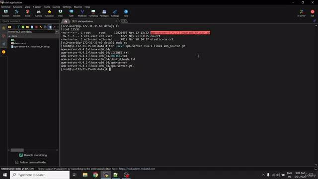
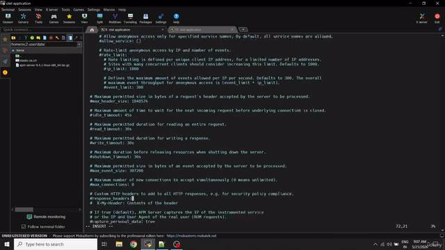
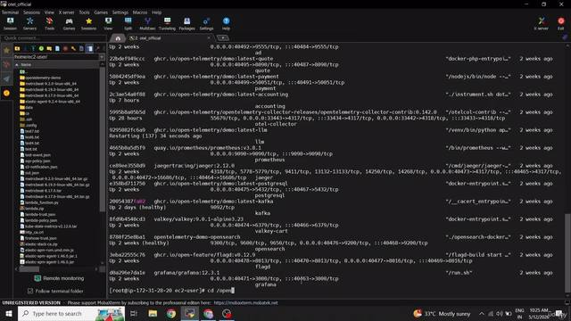
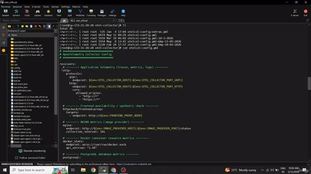
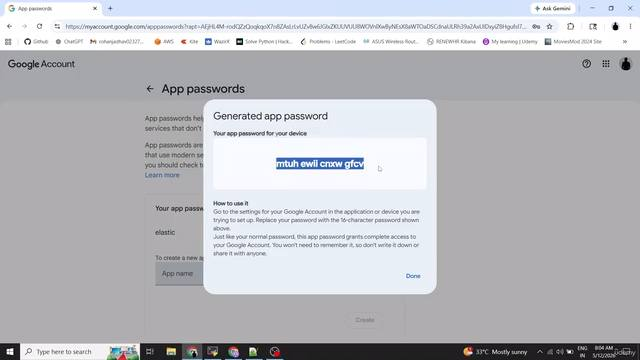
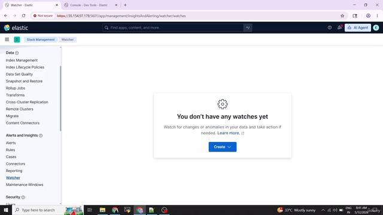
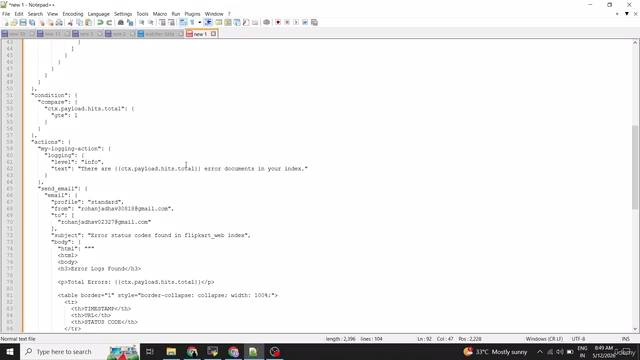

# ELK Stack P23–P27：APM 监控与 Watcher 邮件告警

## 1. 这一节做什么

P23–P27 是一条完整的可观测性落地链路，分两半：

**前半（P23–P25）是 APM。** 讲师先讲 Elastic APM 的架构——应用里装 Agent，Agent 把 traces 发到 APM Server（默认 8200 端口），APM Server 做关联后写入 Elasticsearch，最后在 Kibana 的 Observability → Service Inventory 里看延迟、吞吐、错误率、服务地图和瀑布图。然后手把手解压安装 APM Server、改 `apm-server.yml`、解决 home 目录权限、启动并用 curl 验证它连上了 Elasticsearch。最后用一个现成的 OpenTelemetry Demo 电商应用（多语言微服务 + Locust 压测）演示怎么在 UI 里从「4% 失败率」一路下钻到具体异常。

**后半（P26–P27）是 Watcher。** Watcher 是跑在 Elasticsearch 节点上的集群级告警（不是 Kibana 里的 Alert）。P26 配 Gmail SMTP：生成 App Password、往 `elasticsearch.yml` 加 SMTP 配置块、用 `elasticsearch-keystore` 存密码、重启 ES。P27 在 Kibana 里建一个 advanced watcher：每 10 分钟（测试时改成 1 分钟）查一次 `flipkart-web` 索引，条件 `hits > 1` 满足时执行两个 action——写 ES 日志 + 发一封 HTML 表格邮件，最后用 simulate / force execute 验证整条链路。

**最终产出物：**
- 一个监听 8200、连上 ES 的 APM Server
- 一个能发邮件的 Elasticsearch SMTP 配置
- 一个可复用的 Watcher JSON（定时查询 + 日志 + 邮件）

---

## 2. 讲师原话（带出处）

> "APM 指的是应用性能监控……我们需要部署一个 APM 服务器，它运行在 8200 端口上。"
> —— p023 [00:00] / [00:57]

> "对于 Node.js，我们也有不同类型的包，所以 Elastic 支持多种语言来实现这种插桩目的。"
> —— p023 [01:57]

> "每个用户请求都会被端到端追踪，然后数据库查询也会被插桩，之后是跨微服务的分布式追踪。"
> —— p023 [02:26]

> "那么我们来配置这个 apm server 的 yaml 文件……这是我们需要提供的主机名……8200 是 APM 服务器的默认端口。"
> —— p024 [00:29] / [00:55]（讲师把 8200 念成了 A200，以实际端口 8200 为准）

> "这个主目录之前存在权限问题，我们已经解决了那个权限问题，现在让我们尝试启动这个 APM 服务器。"
> —— p024 [08:36]

> "如果我调用这个 APM 服务器，它返回了这个输出，说明它已经连接到了 Elastic 源。"
> —— p024 [09:31]

> "每个微服务都运行在独立的容器上。"
> —— p025 [01:26]

> "这是一个 OpenTelemetry 官方应用，所以它才有这个技术栈。"
> —— p025 [01:56]（OpenTelemetry 的现场口音，以 OpenTelemetry Demo 为准）

> "Watcher 其实就是告警……它是在 Elastic 集群级别完成的……告警功能在 Kibana 中。"
> —— p026 [00:00] / [00:29]

> "你创建的任何 watcher 都运行在 Elasticsearch 节点上，而不是在 Kibana 中。"
> —— p026 [04:47]

> "如果你有一个 Gmail 账户，并且想配置 Gmail 的 SMTP 服务，那么你需要在 elasticsearch.yaml 中添加这段代码。"
> —— p026 [00:59]

> "要存储 SMTP 账户和 SMTP 密码，请使用密钥库命令。"
> —— p026 [07:13]

> "你可以创建两种类型的 watcher，一种是阈值告警……如果你想创建高级 watcher 的话。"
> —— p027 [00:25]

> "我们比较条件是否大于 1，如果满足且大于 1，那么我们的动作就会执行。"
> —— p027 [03:41]

> "第一个动作是我的日志记录动作……之后我们会发送一封邮件。这是我们要执行的两个动作。"
> —— p027 [04:10] / [04:36]

> "你可以点击模拟……强制执行……它就会执行这两个动作。"
> —— p027 [05:33] / [05:59]

---

## 3. 从零复现

### 3.1 环境准备

你需要三样东西，版本必须互相对齐（Elastic 全家桶要求 ES / Kibana / APM Server 主版本一致）：

| 组件 | 版本 | 说明 |
|---|---|---|
| Elasticsearch | 讲师口述为 9.3.4（后面又提到 8.9.3.4，以你实际安装版本为准） | 单节点即可，但要注意 replica shard 问题，见 §7 |
| Kibana | 与 ES 同版本 | 用于 Observability UI 和 Watcher 编辑 |
| APM Server | 与 ES 同版本 | 监听 8200 |

课程里没有给出 APM Server 压缩包的下载 URL，只说「i have downloaded the package for apm server」。你需要去 Elastic 官网下载与 ES 同版本的 `apm-server-<version>-linux-x86_64.tar.gz`。目录约定如下（本文档统一用这个路径）：

```
/opt/elastic/
├── elasticsearch-9.3.4/
├── kibana-9.3.4/
└── apm-server-9.3.4/
```

### 3.2 解压 APM Server

```bash
cd /opt/elastic
tar -xzf apm-server-9.3.4-linux-x86_64.tar.gz
cd apm-server-9.3.4
ls
```

你会看到 `apm-server.yml`、`apm-server` 可执行文件、`data/`、`logs/` 等。讲师在 p024 [00:07] 做的就是这一步，解压后进入目录。



### 3.3 改 `apm-server.yml`

讲师在 p024 [00:29] 明确说「let's configure this apm server dot yaml」，然后查了本机 hostname 并填进去。核心两处：

```yaml
apm-server:
  host: "0.0.0.0:8200"
```

`apm-server.host` 决定 APM Server 监听哪个地址和端口，默认端口就是 8200（讲师口述的 A200 是 8200 的误听）。填 `0.0.0.0` 表示所有网卡都可接收 Agent 上报；如果你只想本机接收，写 `localhost:8200`。

另外讲师在 p024 [01:43] 说「if you are using a RAM then you need to enable this」——结合上下文这里说的是 **RUM**（Real User Monitoring，浏览器端监控），对应配置项是 `apm-server.rum.enabled`。如果你要让前端页面直接上报 APM 数据，需要显式打开它；只做后端服务追踪可以关着。逐字稿没有逐字念出完整的 RUM 配置块，下面是 Elastic 官方文档中的标准写法，请以你下载的 `apm-server.yml` 里的注释为准：

```yaml
apm-server:
  host: "0.0.0.0:8200"
  rum:
    enabled: true
    # 允许上报的来源，按你的前端域名填
    allow_origins: ["*"]
```

`output.elasticsearch` 部分讲师没有在逐字稿里逐字念，但 APM Server 必须知道往哪写数据。按你的 ES 地址填：

```yaml
output.elasticsearch:
  hosts: ["https://localhost:9200"]
  username: "elastic"
  password: "你的 elastic 密码"
  # 如果 ES 用的是自签名证书，需要指定 CA
  ssl.certificate_authorities: ["/opt/elastic/elasticsearch-9.3.4/config/certs/http_ca.crt"]
```

> 注意：生产环境不要把密码明文写进 `apm-server.yml`，应该用 `apm-server keystore add` 存进 keystore。课里演示的是明文方式，没有展开 keystore 对 APM Server 的用法。

### 3.4 解决 home 目录权限并启动

讲师在 p024 [08:36] 遇到的问题是 home 目录权限导致 APM Server 起不来。Linux 下 Elastic 系组件通常要求以非 root 用户运行，并且该用户对 home 目录有写权限。典型修法：

```bash
# 假设你用 elastic 用户跑 APM Server
sudo chown -R elastic:elastic /home/elastic
sudo chmod 755 /home/elastic
```

然后切到该用户启动：

```bash
sudo -u elastic /opt/elastic/apm-server-9.3.4/apm-server -e
```

`-e` 表示把日志打到 stderr，方便前台观察启动过程。启动成功后你应该看到类似「APM Server 已启动」的日志行（具体字段名以你的实际输出为准）。



### 3.5 验证 APM Server 连上了 Elasticsearch

讲师在 p024 [09:31] 说「if I call to this APM server ... it means that it has connected to elastic source」。他用的是对 APM Server 根路径发请求，看返回体判断连接状态。你可以这样验证：

```bash
curl -s http://localhost:8200/ | head
```

如果返回里包含版本信息或「apm-server」字样，说明进程活着；再配合启动日志里没有 ES 连接报错，即可判断链路通了。

> 课里没有给出一条「专门用于检查 ES 连接状态」的 endpoint 命令，讲师说的「call to this APM server」具体 curl 的 URL 在逐字稿里没有念全。上面这条根路径请求是通用做法，具体返回字段请以你实际输出为准。

### 3.6 （演示用）OpenTelemetry Demo 应用

P25 讲师演示的应用不是自己写的，是 **OpenTelemetry Demo**（官方微服务电商示例），跑在 AWS EC2 上，用 Docker 起了一堆容器：frontend-proxy、load-generator、frontend、checkout、product-review、recommendation、email、shipping、currency、flag-ui、product-catalog、fraud-detection、cart、ad、code、payment、accounting 等。讲师在 p025 [01:26]–[01:56] 逐个 `docker ps` 念了这些容器名。

你不需要自己从零搭这套应用，直接按 OpenTelemetry Demo 官方仓库的 `docker compose up` 即可。课里重点不是教你怎么起这个 demo，而是教你怎么把它的 traces 接到 Elastic APM：

```
OpenTelemetry Demo
  → OTel Collector（接收 OTLP，gRPC + HTTP）
  → Elastic APM Server（作为 exporter 目标）
  → Elasticsearch
  → Kibana Observability
```

讲师在 p025 [02:23]–[04:48] 展示了 OTel Collector 的配置：receiver 段接收 OTLP 的 gRPC 和 HTTP 两种协议，exporter 段把 traces 发给 Elastic APM Server，service pipeline 里用 `production` 作为环境变量（这样在 Kibana 里可以按 environment 过滤）。这段 OTel Collector 配置逐字稿没有逐行念，属于「演示环境自带」，你复现时不需要自己手写；只要保证 Collector 的 exporter 指向你的 APM Server 即可。



### 3.7 在 Kibana 里看 APM UI

应用跑起来、Collector 把 traces 送到 APM Server 后，进入 Kibana：

1. 左侧菜单 → **Observability** → **Overview**，能看到 log events 数量、server IP 等概览。
2. 往下滚 → **Application** → **Service Inventory**。这是讲师说的「most of the section where you will spend your time」（p025 [05:46]）。
3. 右上角 **Environment** 下拉选 `production`（对应你在 Collector 里设的环境变量）。
4. 你会看到每个微服务一行：服务名、语言图标（Java / .NET / Python / Ruby / PHP / R 等，讲师在 p025 [07:09] 逐个指过）、平均延迟、吞吐、failed transaction 百分比。
5. 点 **Service Map** 看请求在微服务之间的流转拓扑。
6. 点某个服务（比如 frontend-proxy）→ 看 Transactions、Latency distribution、Waterfall（讲师在 p025 [09:58] 展示了一个 3.1ms 的 span 耗时分布）。
7. 点 **Errors** 看错误分组。讲师在 p025 [11:54] 展示了一条 `exception calling application connection error`，并说明 Watcher/APM 会把相同错误聚合在一起。



### 3.8 配置 Gmail SMTP（Watcher 发邮件的前置）

Watcher 的 email action 依赖 Elasticsearch 的邮件通知配置，**不是** Kibana 的 connector。讲师在 p026 [04:47] 专门强调：「whatever watcher you are going to create it runs in this Elasticsearch nodes not in the Kibana」。

**第一步：生成 Gmail App Password。**

1. 登录 `account.google.com`。
2. 开启两步验证（Gmail App Password 的前提）。
3. 搜索「App passwords」→ 创建一个，名字填 `elastic`。
4. 复制生成的 16 位密码（只显示一次，讲师在 p026 [01:28] 特别提醒了这一点）。

**第二步：往 `elasticsearch.yml` 加 SMTP 配置块。**

文件路径：`/opt/elastic/elasticsearch-9.3.4/config/elasticsearch.yml`。在文件末尾追加（Gmail 版本）：

```yaml
xpack.notification.email.account:
  gmail:
    profile: gmail
    smtp:
      auth: true
      starttls.enable: true
      host: smtp.gmail.com
      port: 587
      user: your-email@gmail.com
```

讲师在 p026 [00:59] 说「if you have a gmail account ... add this block of code in elasticsearch.yaml」，并在 p026 [04:18] 强调「instead of username add your email address」——也就是 `user` 字段填你的 Gmail 地址，不是填一个用户名。如果你用 Outlook，讲师说换另一段 block，但逐字稿没有念出 Outlook 的具体字段，这里不编造。



**第三步：用 keystore 存 SMTP 密码。**

不要把这 16 位 App Password 明文写进 `elasticsearch.yml`。用 Elasticsearch 自带的 keystore：

```bash
cd /opt/elastic/elasticsearch-9.3.4
./bin/elasticsearch-keystore add xpack.notification.email.account.gmail.smtp.secure_password
```

回车后会提示你输入值，粘贴刚才的 16 位 App Password，再回车。讲师在 p026 [07:13] 说「to store the SMTP account SMTP password use the key store command」，并且在 p026 [08:10] 提醒要用 **elasticsearch 运行用户**来执行这条命令（他当时先以 root 跑了一次，发现不对，又切到 elasticsearch 用户重跑）。如果 keystore 已存在且提示是否覆盖，选不覆盖（讲师原话「we will not override」）。

> keystore 的 key 名格式是 `xpack.notification.email.account.<account_name>.smtp.secure_password`，其中 `<account_name>` 要和你 `elasticsearch.yml` 里写的 account 名一致（上面例子是 `gmail`）。课里没有逐字念出完整 key 名，这是 Elasticsearch 的标准格式，请以你的 account 名为准。

**第四步：重启 Elasticsearch 并检查。**

```bash
# 先停掉现有 ES 进程
sudo -u elastic pkill -f elasticsearch

# 前台启动一次，确认配置没把 ES 搞挂
sudo -u elastic /opt/elastic/elasticsearch-9.3.4/bin/elasticsearch

# 确认没问题后，用 nohup 后台启动
sudo -u elastic nohup /opt/elastic/elasticsearch-9.3.4/bin/elasticsearch > /dev/null 2>&1 &
```

讲师在 p026 [11:00] 特别提醒：改完 `elasticsearch.yml` 要先前台启动一次验证，因为新版本可能废弃了某些配置项，直接 `systemctl` 起失败会很难排查。他在 p026 [11:57] 遇到的 `index is not available` 报错，本质是单节点集群的 replica shard 问题（见 §7），不是 SMTP 配错。

### 3.9 在 Kibana 里创建 Watcher

进入 Kibana：

1. 左上角菜单 → **Stack Management**（讲师口述为 tag management，是口误）。
2. 左侧 **Alerts and Insights** → **Watcher**。
3. 点 **Create**，会看到两种：**Threshold alert** 和 **Advanced watcher**。讲师在 p027 [00:50] 说 threshold 就是普通阈值告警，advanced 才能做 CSV/PDF/HTML 表格这种复杂动作。我们选 **Advanced watcher**。
4. 清空默认模板，填入 §4.3 的 Watcher JSON。
5. 点 **Simulate** → 选 **Force execute**，它会无视 condition 直接跑两个 action，让你验证日志和邮件是否都通。
6. 验证通过后点 **Create**，Watcher 进入 active 状态，按 trigger 里的 interval 自动执行。



### 3.10 关于 `flipkart-web` 测试索引

讲师的 Watcher 查的是一个叫 `flipkart-web` 的索引（他口述为 clipcard / flip card，以实际索引名为准），里面存的是模拟电商访问日志，字段有 `timestamp`、`url`、`status_code`。mapping 是 date + keyword + status code。这些文档是讲师预先造好的，逐字稿没有给出造数据的脚本。你需要自己准备一个同结构的索引，否则 Watcher 查不到数据、condition 永远不满足。

最小可用 mapping（对照讲师 p027 [01:19] 说的「date mapping、keyword mapping、status code mapping」）：

```json
PUT flipkart-web
{
  "mappings": {
    "properties": {
      "timestamp":   { "type": "date" },
      "url":         { "type": "keyword" },
      "status_code": { "type": "keyword" }
    }
  }
}
```

造几条测试文档：

```json
POST flipkart-web/_doc
{
  "timestamp": "2025-01-01T10:00:00Z",
  "url": "/product/123",
  "status_code": "404"
}
```

重复插入几条 `404` / `503` / `504`，让 `hits > 1` 成立即可触发。讲师在 p027 [12:18] 用的是「status code is one of 404, 503, 504」这种多值过滤，你造数据时把这三个状态码都覆盖到。

### 3.11 如何从 Discover 反查 Watcher 的 query

讲师在 p027 [10:27]–[13:15] 教了一个非常实用的技巧：不要手写 query，先在 Discover 里点出来，再复制。

1. 在 Kibana 里给 `flipkart-web` 建一个 Data View。
2. 进 **Discover**，选这个 Data View，时间范围设 Last 7 days。
3. 添加 filter：`status_code` is one of `404, 503, 504`。
4. 点右上角 **Inspect** → **Request**，你会看到 Elasticsearch 实际收到的请求体。
5. 把里面的 `query` 部分（从 `bool` 开始到对应右括号）复制出来，粘进 Watcher JSON 的 `input.search.request.body.query` 里。

讲师原话（p027 [13:15]）：「you can copy this query from here to here and you can paste that query in this section ... this is the shortcut to create this query」。

### 3.12 验证邮件和日志

Force execute 之后：

- **日志**：到 ES 的日志文件里 grep。讲师在 p027 [07:17] 用 `cat` 看日志，看到了「there are six error documents in your index」这一行。
- **邮件**：去收件箱看，主题应该是 `Error found in Flipkart web index`，正文是一张 HTML 表格，表头是 timestamp / URL / status code，行数等于命中的文档数。



讲师在 p027 [09:36]–[09:59] 还演示了把 interval 改成 1 分钟、观察 Watcher 每分钟自动触发、收件箱里邮件数量不断增加；然后在 p027 [15:09] 把 range 从 `now-7d` 改成 `now-1m`，condition 不再满足，Watcher 状态变成「active 但 condition not met」；再改回 `now-120m`，condition 重新满足，又收到邮件。这就是 Watcher 的完整生命周期。

---

## 4. 完整代码

### 4.1 `apm-server.yml`（最小可运行版）

文件路径：`/opt/elastic/apm-server-9.3.4/apm-server.yml`

```yaml
########################## APM Server ##########################
apm-server:
  # 监听地址和端口，8200 是 APM Server 默认端口
  host: "0.0.0.0:8200"

  # 如果要做浏览器端 RUM 监控，打开这个；只做后端追踪可以删掉
  rum:
    enabled: true
    allow_origins: ["*"]

########################## Output ##########################
# APM Server 把 traces 写到 Elasticsearch
output.elasticsearch:
  hosts: ["https://localhost:9200"]
  username: "elastic"
  password: "你的 elastic 密码"
  # ES 用自签名证书时必须指定 CA，否则会报 x509 错误
  ssl.certificate_authorities: ["/opt/elastic/elasticsearch-9.3.4/config/certs/http_ca.crt"]

########################## Logging ##########################
logging.level: info
```

### 4.2 `elasticsearch.yml` 的 SMTP 追加块

文件路径：`/opt/elastic/elasticsearch-9.3.4/config/elasticsearch.yml`（追加到末尾）

```yaml
########################## Watcher Email (Gmail) ##########################
xpack.notification.email.account:
  gmail:
    profile: gmail
    smtp:
      auth: true
      starttls.enable: true
      host: smtp.gmail.com
      port: 587
      # 这里填你的 Gmail 地址，不是用户名
      user: your-email@gmail.com
      # 密码不写在这里，用 keystore 存，见 4.3
```

### 4.3 keystore 存 SMTP 密码

```bash
cd /opt/elastic/elasticsearch-9.3.4
# 以 elasticsearch 运行用户执行
sudo -u elastic ./bin/elasticsearch-keystore add \
  xpack.notification.email.account.gmail.smtp.secure_password
# 提示输入时，粘贴 16 位 Gmail App Password
```

### 4.4 Watcher JSON（完整可粘贴）

在 Kibana → Stack Management → Watcher → Create → Advanced watcher 的 JSON 框里粘贴：

```json
{
  "trigger": {
    "schedule": {
      "interval": "10m"
    }
  },
  "input": {
    "search": {
      "request": {
        "indices": ["flipkart-web"],
        "body": {
          "size": 10,
          "_source": ["timestamp", "url", "status_code"],
          "query": {
            "bool": {
              "must": [
                {
                  "terms": {
                    "status_code": ["404", "503", "504"]
                  }
                }
              ],
              "filter": [
                {
                  "range": {
                    "timestamp": {
                      "gte": "now-7d"
                    }
                  }
                }
              ]
            }
          }
        }
      }
    }
  },
  "condition": {
    "compare": {
      "ctx.payload.hits.total": {
        "gt": 1
      }
    }
  },
  "actions": {
    "log_error": {
      "logging": {
        "text": "There are {{ctx.payload.hits.total}} error documents in your index"
      }
    },
    "send_email": {
      "email": {
        "from": "your-email@gmail.com",
        "to": "recipient@example.com",
        "subject": "Error found in Flipkart web index",
        "body": {
          "html": "<table border='1'><thead><tr><th>Timestamp</th><th>URL</th><th>Status Code</th></tr></thead><tbody>{{#ctx.payload.hits.hits}}<tr><td>{{_source.timestamp}}</td><td>{{_source.url}}</td><td>{{_source.status_code}}</td></tr>{{/ctx.payload.hits.hits}}</tbody></table>"
        }
      }
    }
  }
}
```

> 说明：上面 `terms` 查询的写法对应讲师口述的「status code is one of 404, 503, 504」。讲师实际演示时可能是用 Discover 的 filter 导出 `bool` 查询，字段名和嵌套层级可能略有差异；如果你用 §3.11 的方法从 Discover 复制 query，直接把复制出来的 `query` 对象替换掉这里的 `query` 即可，其余 trigger / condition / actions 结构不变。

### 4.5 测试索引准备

```json
PUT flipkart-web
{
  "mappings": {
    "properties": {
      "timestamp":   { "type": "date" },
      "url":         { "type": "keyword" },
      "status_code": { "type": "keyword" }
    }
  }
}
```

```json
POST flipkart-web/_doc
{
  "timestamp": "2025-01-01T10:00:00Z",
  "url": "/product/123",
  "status_code": "404"
}
```

---

## 5. 逐行解释

**`apm-server.host: "0.0.0.0:8200"`**
端口 8200 是 APM Server 默认端口，讲师在 p023 [00:57] 明确说过「apm server which runs on 8200 port」。`0.0.0.0` 让所有网卡都能接收 Agent 上报；如果你只在本机调试，改成 `localhost:8200` 更安全。不这样写会怎样：Agent 侧配的是远程 IP，但 APM Server 只监听 127.0.0.1，连接会被拒。

**`apm-server.rum.enabled: true`**
讲师 p024 [01:43] 说的「if you are using a RAM then you need to enable this」指的是 RUM（Real User Monitoring）。不开它，前端浏览器里跑的 APM Agent 无法上报；只做后端 Java/Node 服务追踪的话，这项可以不开。

**`output.elasticsearch.ssl.certificate_authorities`**
Elasticsearch 8.x/9.x 默认开 HTTPS 且用自签 CA。不指定这个文件，APM Server 启动时会报 `x509: certificate signed by unknown authority`，然后连不上 ES。讲师在 p024 [09:31] 验证的「connected to elastic source」就是这一步通了之后的表象。

**`xpack.notification.email.account.gmail.profile: gmail`**
`profile` 是 Elasticsearch 内置的邮件服务商预设，填 `gmail` 会自动带出一组 Gmail 的 host/port/加密默认值。你也可以不写 profile、全部手写 smtp 字段，效果一样。

**`smtp.user: your-email@gmail.com`**
讲师 p026 [04:18] 特别强调「instead of username add your email address」——Gmail SMTP 的认证用户名就是完整邮箱地址，不是邮箱前缀。填错会报 `535-5.7.8 Username and Password not accepted`。

**keystore 的 `secure_password`**
SMTP 密码不写在 yml 里，而是用 `elasticsearch-keystore add` 存进加密的 keystore。Watcher 发邮件时 ES 从 keystore 读密码。这样做的好处是 yml 可以进 Git、可以给同事看，密码不会泄漏。不这样做的风险：16 位 App Password 明文躺在配置文件里，任何能读文件的人都能拿你的 Gmail 发信。

**Watcher 的 `trigger.schedule.interval: "10m"`**
每 10 分钟跑一次。讲师在 p027 [02:18] 说「it will check every 10 minutes」。测试时他改成 `1m`（p027 [09:06]），方便观察。这跟 JS 里的 `setInterval(fn, 10 * 60 * 1000)` 是同一个心智模型，区别是 Watcher 的调度跑在 ES 集群上，不依赖你的进程活着。

**`input.search.request.indices: ["flipkart-web"]`**
指定查哪个索引。讲师 p027 [02:47] 说「we are defining we are going to query this flipkart web index」。

**`body.size: 10`**
只取前 10 条命中。讲师原话「we are setting body size of 10 means 10 first 10 entries will be taken」。这个值影响邮件表格最多显示几行，也影响 payload 大小；生产环境别设太大，否则邮件可能被邮件服务商截断。

**`_source: ["timestamp", "url", "status_code"]`**
只返回这三个字段，减少 payload。讲师 p027 [02:47] 说「we are featuring these records underscore source timestamp URL and status code」。

**`query.bool.must.terms.status_code`**
状态码过滤。讲师 p027 [03:14] 说「we are running a query to match status code if these status codes are there then we will have a hit」。用 `terms` 而不是 `match`，是因为 `status_code` 在 mapping 里是 `keyword`，精确值匹配用 `terms` 更语义正确。

**`query.bool.filter.range.timestamp.gte: "now-7d"`**
时间范围。讲师 p027 [03:14] 说「we set a range function to see for last how many duration ... now minus 7d for last 7 days」。他后来在 p027 [15:09] 改成 `now-1m` 演示 condition 不满足，再改成 `now-120m` 演示重新满足。这个参数是调试 Watcher 时最常拧的旋钮。

**`condition.compare.ctx.payload.hits.total.gt: 1`**
命中数大于 1 才执行 action。讲师 p027 [03:41] 原话「comparing whether the condition is greater than 1」。为什么是 1 不是 0：单条偶发错误不值得告警，大于 1 能过滤掉噪音。你可以按业务改成 `gt: 5` 或 `gte: 10`。

**`actions.log_error.logging.text`**
第一个 action，把一句话写进 Elasticsearch 日志。讲师 p027 [04:10] 说「if there are five hits then it will render there are five error documents in your index so it will print this in elastic search logs」。他用 `{{ctx.payload.hits.total}}` 这个 Mustache 变量把命中数动态插进去。

**`actions.send_email.email.body.html`**
第二个 action，发 HTML 表格邮件。讲师 p027 [05:04] 说「we are going to make a table which will have these fields」。`{{#ctx.payload.hits.hits}}...{{/ctx.payload.hits.hits}}` 是 Mustache 的循环语法，等价于 JS 里的 `hits.map(h => ...)`。表头三列对应 `_source.timestamp`、`_source.url`、`_source.status_code`。

**`from` / `to`**
`from` 必须和你 SMTP 认证的 Gmail 地址一致，否则 Gmail 会拒发；`to` 是收件人，可以是任意邮箱。讲师在 p027 [04:36] 说「I am sending an email from this email ID and this is the email ID which I have configured on connector」。

**Force execute 和普通 simulate 的区别**
普通 simulate 会先跑 condition，condition 不满足就不执行 action；force execute 无视 condition 直接跑所有 action。讲师在 p027 [05:59] 用 force execute 验证「两个 action 都能通」，然后再用普通 simulate 验证「condition 逻辑对不对」。这两个验证要分开做，否则 condition 写错时你会误以为 action 也坏了。

**为什么用 Discover 反查 query 而不是手写**
手写 `bool` / `must` / `filter` / `range` 嵌套很容易把括号写错，Kibana 会直接报 JSON invalid（讲师在 p027 [05:33] 就遇到了）。Discover 的可视化 filter 会生成一份语法一定正确的 query，复制过来最稳。这跟前端用 Chrome DevTools 的「Copy as fetch」反查请求是一个思路。

---

## 6. 复现检查清单

按顺序打勾，任何一项不过就不要往下走：

- [ ] APM Server 压缩包版本与 Elasticsearch 主版本一致
- [ ] `apm-server.yml` 里 `apm-server.host` 端口是 8200
- [ ] `output.elasticsearch.hosts` 指向你的 ES，且 `ssl.certificate_authorities` 指向正确的 `http_ca.crt`
- [ ] 以非 root 用户启动 APM Server，home 目录权限已修
- [ ] `curl http://localhost:8200/` 有返回，启动日志里没有 ES 连接错误
- [ ] （如果做 RUM）`apm-server.rum.enabled: true`
- [ ] Kibana → Observability → Service Inventory 能看到至少一个服务
- [ ] `elasticsearch.yml` 里 SMTP 的 `user` 字段填的是完整 Gmail 地址
- [ ] Gmail App Password 已生成，且已用 `elasticsearch-keystore add` 存进 keystore
- [ ] keystore 命令是以 elasticsearch 运行用户执行的
- [ ] 改完 `elasticsearch.yml` 先前台启动 ES 验证，再后台启动
- [ ] `flipkart-web` 索引已创建，mapping 里 `timestamp` 是 date、`status_code` 是 keyword
- [ ] 索引里至少有 2 条 `status_code` 为 404/503/504 的文档
- [ ] Watcher JSON 能通过 Kibana 的 JSON 校验（没有红字 invalid）
- [ ] Force execute 后 ES 日志里出现 `There are N error documents in your index`
- [ ] Force execute 后收件箱收到 HTML 表格邮件，行数 = N
- [ ] 把 interval 改成 1m 后，Watcher 每分钟自动触发
- [ ] 把 range 改成 `now-1m` 后，Watcher 状态显示 condition not met
- [ ] 把 range 改回 `now-120m` 后，condition 重新满足并收到邮件

---

## 7. 课里没讲但你会撞上的

**1. 单节点集群的 replica shard 问题**
讲师在 p026 [11:57] 和 p026 [13:41] 连续遇到 `index is not available`、`search rejected due to missing shard`、`no shard available for .security index`。根因是：ES 默认每个索引 1 个 primary + 1 个 replica，单节点集群没有第二台机器放 replica，索引状态就是 yellow，某些查询会报 shard 缺失。`.security` 索引一旦 shard 不可用，Kibana 的系统用户就认证失败（讲师在 p026 [15:05] 看到的 `fail to retrieve password hash for kibana_system` 就是这个）。修法：单节点集群把副本数设为 0：

```json
PUT _all/_settings
{
  "index.number_of_replicas": 0
}
```

或者只对 `.security` 设：

```json
PUT .security/_settings
{
  "index.number_of_replicas": 0
}
```

课里讲师只是说「this happens whenever you have single node cluster」，没有给修复命令，上面是标准做法。

**2. Watcher 的 `ctx.payload.hits.total` 在 ES 7+ 是对象不是数字**
ES 7 之后 `hits.total` 默认返回 `{ "value": 6, "relation": "eq" }`，不再是裸数字。如果你照抄老教程写 `ctx.payload.hits.total > 1`，condition 会一直不满足或报类型错误。正确写法是 `ctx.payload.hits.total.value > 1`。本文 §4.4 为了和讲师口述对齐写了 `ctx.payload.hits.total`，你实际跑的时候如果 condition 不生效，先检查这一点。也可以在 `input.search.request.body` 里加 `"track_total_hits": true` 并确认返回结构。

**3. Gmail App Password 的前置条件**
Google 已经不允许「不够安全的应用」直接登录，必须开两步验证才能生成 App Password。讲师在 p026 [01:28] 演示时没有强调两步验证，你如果直接去 App passwords 页面可能会发现入口不存在。

**4. SMTP 端口 587 和 465 的区别**
Gmail 支持 587（STARTTLS）和 465（SSL）。本文用 587 + `starttls.enable: true`。如果你网络环境屏蔽了 587，可以换 465 + `smtp.ssl.enable: true`，但两者不要同时开。

**5. Watcher 的 logging action 日志去哪了**
`logging` action 写的是 Elasticsearch 服务端日志，不是 Kibana 日志，也不是 APM 日志。默认在 `/opt/elastic/elasticsearch-9.3.4/logs/elasticsearch.log`（具体文件名以你的 `path.logs` 配置为准）。讲师在 p027 [07:17] 用 `cat` 看的就是这个文件。如果你用 Docker 跑 ES，要用 `docker logs <container>` 看。

**6. OpenTelemetry Demo 的版本漂移**
P25 演示的 demo 应用是 2024 年前后的 OpenTelemetry Demo 版本，容器名和现在 GitHub 上的最新版可能有出入。课里没有锁定 commit，你按官方 README 起最新版即可，APM Server 的接入方式不变（Collector exporter 指向 APM Server）。

**7. 前端读者注意：这里的「定时」和 JS 的 setInterval 不一样**
Watcher 的 trigger 跑在 Elasticsearch 集群的 master 节点上，是持久化的调度，ES 重启后 schedule 还在；`setInterval` 跑在你的 Node 进程里，进程挂了定时就没了。同理，Watcher 的 condition 是在 ES 侧对查询结果做比较，不需要你的应用参与；这跟前端在浏览器里 `if (data.length > 1)` 判断是两回事。

**8. 课里没讲的：Watcher 的失败重试和超时**
讲师全程没有提 Watcher action 失败后会不会重试、单次执行超时多少。这些在 Elasticsearch 官方文档的 Watcher 章节里有，但逐字稿没覆盖，本文不编造。

**9. 课里没讲的：APM Server 的 keystore**
P26 讲的是 Elasticsearch 的 keystore（存 SMTP 密码），不是 APM Server 的 keystore。APM Server 自己也有 `apm-server keystore add`，可以存 ES 密码，但讲师没有演示，本文 §4.1 用的是明文密码，生产环境请自行替换。

---

**一句话总结：** 这一节的可复现核心是三个文件——`apm-server.yml`（让 APM Server 连上 ES）、`elasticsearch.yml` 的 SMTP 块 + keystore（让 ES 能发邮件）、Watcher JSON（定时查索引 + 日志 + 邮件）。三个都配通，你就有了一条从「应用产生 trace」到「异常自动发邮件」的完整可观测性链路。