# ELK Stack（P28–P31）Kibana 告警与 Discover 数据探索复现文档

> 课程覆盖：P28–P31。  
> 本文目标：照着做完三件事——① 认清 Kibana 三类告警入口；② 配好邮件连接器并创建一个基于日志状态码的 Observability 自定义阈值告警；③ 用 Discover 建/选 Data View、看字段、加过滤、保存探索会话。  
> 重要说明：这四段课里，讲师全程在 Kibana UI 里点击，没有给出程序源码、安装命令或 Elasticsearch API 命令。本文不会伪造“讲师源码”。第 4 节给出的是**可直接保存照着执行的复现清单文件**，以及一个**仅用于检查占位输入的辅助脚本**；辅助脚本不是讲师内容，已明确标注。

---

## 1. 这一节做什么

这一节不是讲 Elasticsearch 底层原理，而是把 Kibana 里两条最容易混的操作链路跑通：

1. **告警链路**：日志数据在 Elasticsearch 里形成索引/Data View → 在 Kibana 里建规则（Rule）→ 规则按查询条件和阈值判断 → 触发后生成 Alert → 通过 Connector 发邮件/建 Case。  
2. **数据探索链路**：在 Stack Management 看 Index 状态 → 创建/选择 Data View → 在 Discover 里选时间范围、看字段、展开文档、加 filter、写 KQL、保存 Discover 会话，甚至从字段快捷生成可视化。

P28 先建立“告警有三类入口”的认知：Observability、Security、Stack Management。P29 把 Observability 告警从 Connector 到 Rule 到 Alert 到邮件完整走一遍。P30 快速过 Kibana 的组件：Discover、Dashboard、Visualize Library、Alerts and Actions、APM UI、DevTools。P31 重点讲 Discover：Index Management、Data View、字段类型图标、时间范围、文档展开、filter in/out、KQL、保存会话、从字段生成可视化。

**本节结束你应当得到：**  
- 一个可用的邮件 Connector（或确认 Elastic Cloud 已预置 SMTP Connector）；  
- 一个 Observability 自定义阈值规则，能对 `status code > 200` 的日志计数并在超过阈值时发邮件；  
- 一个可保存的 Discover 探索会话，例如 “sample table”；  
- 一张“规则建在哪个入口、告警去哪个页面看”的对照脑图。

**课里没讲：** Elasticsearch/Kibana 的安装、版本号、本地启动命令、Filebeat/Metricbeat/Elastic Agent 的安装配置、告警 API、告警静默/去重策略、Security detection rules 的完整细节。遇到这些不要在本节里硬找。

---

## 2. 讲师原话

下面只摘关键原话，保留英文原句，后面写中文意思。

- “elastic search has three types of alerting one is for observatory second is for security and third is for stack monitoring.”  
  —— p028 [00:28]  
  意思是：Kibana 里告警至少有三类入口：Observability、Security、Stack Monitoring。

- “whenever you are configuring alerts it should have any connector so where that alert will go.”  
  —— p029 [00:00]  
  配告警前先想清楚：告警触发后发到哪里，所以要先有 Connector。

- “we will select this custom threshold rule.”  
  —— p029 [02:24]  
  演示用的是自定义阈值规则，不是默认规则。

- “all the status codes means apart from 200 any greater value will be there that will be filtered out with our query.”  
  —— p029 [04:46]  
  查询思路是过滤出状态码大于 200 的文档，也就是把非 200 的异常响应纳入统计。

- “this rule will be triggered every one minute.”  
  —— p029 [06:12]  
  规则调度是每分钟检查一次条件是否满足。

- “our threshold is 10 and current count is 21 and it is checking for last 15 minutes.”  
  —— p029 [08:31]  
  最终演示页显示：阈值 10，当前计数 21，时间窗口最近 15 分钟。注意讲师前面口述过 100，最终规则页是 10；以你实际规则页为准。

- “Discover is loose to explore the raw data.”  
  —— p030 [00:00]  
  Discover 用来探索原始数据。

- “to create a data wave just copy this name…”  
  —— p031 [04:38]  
  创建 Data View 时，索引名/索引模式要按实际索引复制或写通配符。

- “if you don’t want the null entries… filter out.”  
  —— p031 [17:45]  
  不想要空值就用 filter out；只想要某个值就用 filter in。

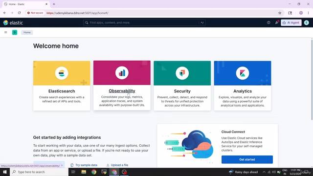

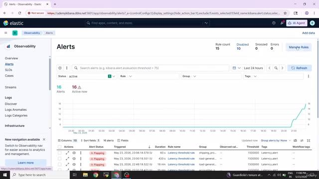

---

## 3. 从零复现

### 3.1 先认清三类告警入口

打开 Kibana 后，按讲师 P28 的路径先走一遍，不要急着建规则：

1. 左侧菜单找 **Observability**，进入后找 **Alerts**。这里看应用/可观测性相关告警。  
2. 左侧菜单找 **Security**，进入后找 **Rules** 或 **Alerts**。这里看安全检测相关规则和告警。  
3. 进入 **Stack Management**，找 **Alerts and Insights**，里面再分 **Rules**、**Alerts**、**Cases**。这里看集群/基础设施/Stack 相关告警。

讲师反复强调的核心不是“有三个菜单”，而是：**规则建在哪个区域，触发后的 Alert 就在哪个区域看**。  
- 在 Observability 里建规则，去 Observability 的 Alerts 看；  
- 在 Security 里建 detection rules，去 Security 的 Alerts 看；  
- 在 Stack Management 里建集群规则，去 Stack Management 的 Alerts 看。  
Cases 也按同样区域走：告警可以转成 Case，Case 是 Kibana 内的工单式对象；讲师把它类比成 ServiceNow 的 ticketing tool。

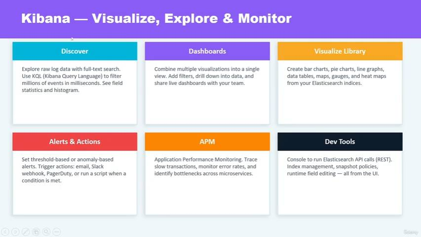

### 3.2 创建或确认邮件 Connector

P29 的第一步不是建规则，而是去 **Settings / Alerts and Insights / Connectors**。  
如果你用的是 Elastic Cloud，讲师说环境里可能已经有一个预配置的 SMTP connector。若没有，自己建：

1. 进入 **Connectors**，点 **Create connector**。  
2. 搜索框输入 `email`。  
3. 讲师提到两种：一个是较新的、technical preview 的 Gmail 连接器；演示建议用 **generic email connector**。  
4. 给 Connector 一个唯一名称。  
5. 填收件/发件相关邮箱地址，选择邮件服务商（Gmail、Outlook 等）。  
6. 如果选 Gmail，讲师说 hostname 和 port 会自动填充；然后填邮箱地址和密码。  
7. 点 **Save and test**，确认 Connector 配置成功。

注意：课里没有给 SMTP host、port、账号密码的具体值，也没有讲 OAuth。你实际环境如果是企业邮箱，host/port/加密方式要以邮件服务商为准。不要把邮箱密码写进前端代码，Connector 的密钥应保存在 Kibana 服务端。

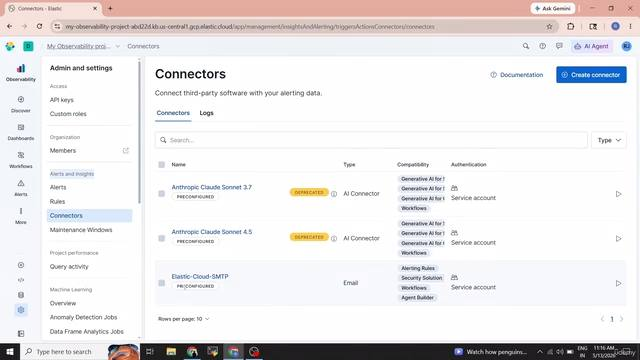

### 3.3 准备 logs Data View 和状态码字段

P29 讲师切到 Discover，选择 `logs` Data View，确认里面有状态码字段。逐字稿转写里这个字段被念成 `stdp status code` / `HTTP status code` / `response status code`，**不要照着拼写手打**。正确做法是：

1. 在 Discover 左侧字段列表里找到状态码字段。  
2. 看它前面的图标：讲师说出现 `#` 号说明是 integer 数值类型；如果是 `t` 是 text；如果是 key 图标是 keyword；日历图标是 date；IP 图标是 IP。  
3. 点字段名旁边的复制按钮，复制真实字段名。  
4. 观察字段值：讲师看到有 `200`、`500`、`308` 等；200 表示请求成功，其他错误码表示异常。

这一步很关键：如果状态码字段是 keyword/text，你写数值比较可能不生效；如果它是 integer，才适合做 `> 200` 这类数值过滤。课里没有讲字段映射（mapping）怎么改，只讲了从图标判断类型。


### 3.4 创建 Observability 自定义阈值告警

按 P29 的路径：

1. 回到 **Observability → Alerts**。  
2. 点 **Manage rules**，再点 **Create rule**。  
3. 选择 **Custom threshold**。  
4. **Data view** 选 `logs`。  
5. **Query / filter**：用刚才复制的真实状态码字段，写类似 `<STATUS_CODE_FIELD> > 200`。讲师的意思是：保留大于 200 的响应，统计异常状态码数量。  
6. **Threshold**：选择 count 类阈值。讲师演示中先说超过 100 触发，后来规则页显示阈值 10、当前 21；你应按业务定，不要盲目抄 10 或 100。  
7. **Time window**：演示用最近 15 分钟；也可以切 5 分钟、15 分钟等。  
8. **Schedule**：讲师说规则每分钟触发一次检查。  
9. **Actions**：点 **Add action**，选 email，选之前配好的 SMTP connector，填收件邮箱；主题可保留默认，默认会带规则名、是否 active、来自哪个 Data View 等信息。  
10. 保存规则。  
11. 去 **Observability → Alerts** 刷新，看是否生成 Alert。讲师演示中看到当前计数 21、阈值 10、窗口 15 分钟。  
12. 去邮箱查收，讲师说发件人类似 `no-reply@alerts.elastic.co`，正文会写 documents count 21 above threshold 10、duration last 15 minutes、data view logs。

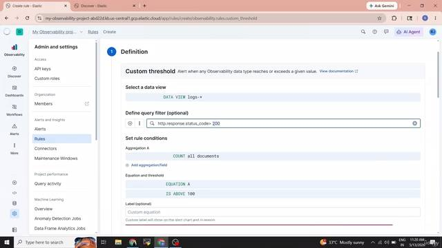

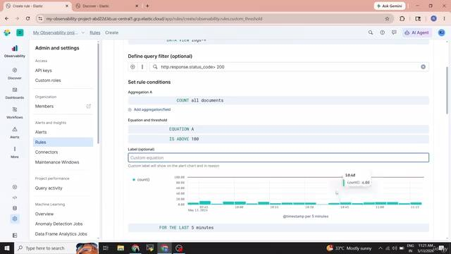

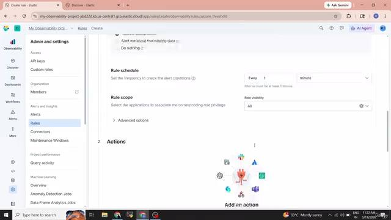

### 3.5 用 Index Management 确认索引状态

P31 讲师进入 **Stack Management → Index Management**。这里要会看：

- **Index name**：索引名。  
- **Health**：绿色表示 primary 和 replica 都分配好了。  
- **Status**：`open` 表示可搜索；也有 `close` 状态；索引可以删除。  
- **Primary / Replica**：讲师演示是 primary 1、replica 1。  
- **Documents**：文档数，例如 4000。  
- **Storage size**：存储大小。  
- 页面上的 **Include indexes / Include roll-up indices** 选项可以把数据流背后的索引、rollover 出来的索引也显示出来。

如果索引没有文档，Discover 里选对应 Data View 也会是空的。讲师演示里 `app` 相关索引当时没有文档，所以后面切回 `logs`。

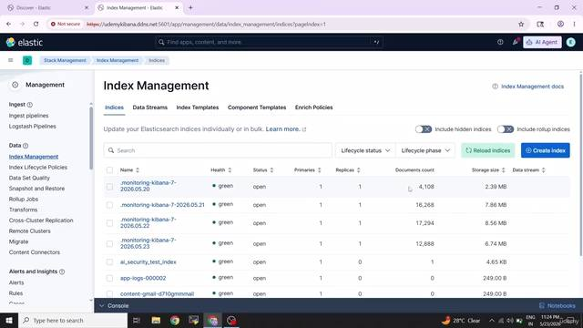

### 3.6 创建 Data View

P31 的 Data View 创建路径：

1. **Stack Management → Kibana → Data Views**。  
2. 点 **Create data view**。  
3. 填名称，例如 `logs` 或业务含义明确的名字。  
4. 填 **Index pattern**。  
   - 如果只匹配一个固定索引，就写完整索引名。  
   - 如果索引会 rollover，例如 `app-logs-002`、`app-logs-003`，就写通配符，例如 `app-logs-*`。讲师说 `*` 可以放在末尾，也可以放在前面/中间，只要匹配你的索引名。  
5. 选 **Timestamp field**，讲师强调日志到达时间要落到时间戳字段，例如 11:27 的日志就按 11:27 存储。  
6. 点 **Save data view**。  
7. 回 Discover，在左上角 Data View 下拉里选刚创建的 Data View。若没刷新出来，刷新页面或重新进入 Discover。

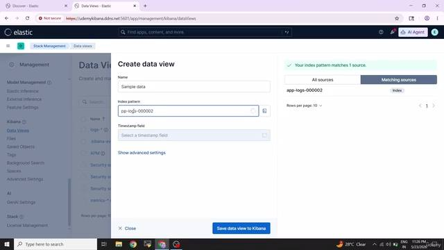

### 3.7 在 Discover 里探索日志

进入 **Discover** 后，按 P31 的顺序操作：

1. 左上角选 Data View，例如 `logs`。  
2. 左侧是字段列表：`agent id`、`agent name`、`agent version`、`client IP`、`client port`、`container ID`、`error id`、`event type`、`error message`、`host IP`、`host name`、`message`、状态码字段、请求方法字段、响应 body bytes 等。具体字段以你的数据为准。  
3. 看字段图标判断类型：日历是 date，key 是 keyword，`#` 是 integer，`t` 是 text，IP 是 IP。  
4. 点字段名可以看该字段的值分布，例如点 `client IP` 看有哪些 IP，点 `error id` 看有哪些错误 ID。  
5. 时间范围：右上角选 **Last 15 minutes**；讲师演示最近 15 分钟有 79000 条日志，默认展示前 100 条，可改 500。也可以点日历图标选最近 90 天、1 年或自定义区间。  
6. 刷新按钮可刷新数据；如果选了 Data View 但柱状图没有 bar，说明该时间段没有数据。  
7. 展开文档：每条记录左侧有展开按钮，点开后可在 **Tabular view** 和 **JSON view** 之间切换；能看到文档 ID、索引名、timestamp 和所有字段。讲师还演示了用上下按钮逐条浏览不同日志。  
8. 添加字段到表格：在左侧字段列表点字段旁的加号，例如加 `message`、状态码、请求方法、响应 body bytes。空值会显示 null。  
9. 过滤空值：鼠标悬停在字段值上，点 **filter out** 的减号，Kibana 会自动加一个“字段存在”的 filter，把 null 排除。  
10. 只看 200：对状态码字段点 **filter in** 的加号，生成 `status code is 200` 一类过滤条件；讲师演示总 109 条，过滤 500 后剩 5 条。  
11. KQL：在搜索栏写 `字段名:*` 表示“该字段存在”；可以用 `and`、`or` 组合条件。  
12. 用 **Add filter** 图形化建过滤器：选字段、选操作符（is、is not、is one of、exists 等），输入 200、500 等值。  
13. 保存探索会话：加好字段和过滤后点 **Save**，命名如 `sample table`，可写描述；保存的是 Discover session，包括过滤条件和设置。之后可在 Dashboard 里用这个表。  
14. 从字段快速生成可视化：点字段值分布，点 **Create visualization**，Kibana 会自动生成图表；讲师演示了 service name、client IP 的图表，并保存到 library。

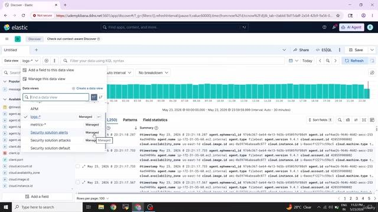

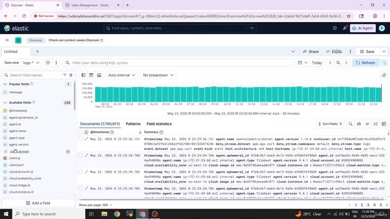

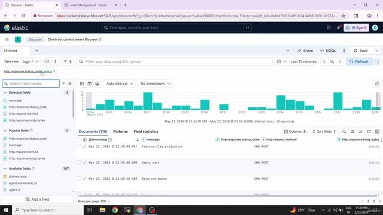

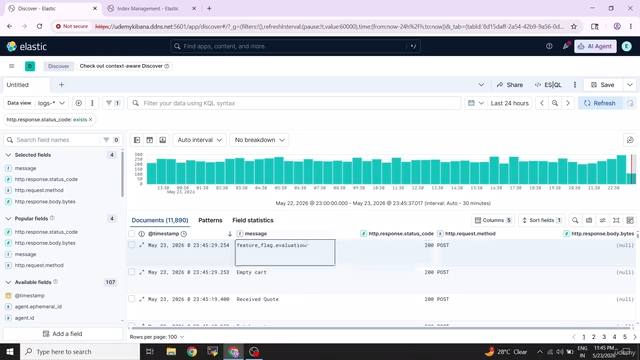

---

## 4. 完整代码

> 再次说明：P28–P31 没有讲师源码。下面第一个文件是**完整复现清单文件**，可保存为 `elk-kibana-repro/elk-kibana-repro.md`，按顺序执行即可。第二个文件是**辅助检查脚本**，用于防止占位变量漏填；它不是讲师内容，但可直接保存运行。

### 4.1 复现清单文件：`elk-kibana-repro/elk-kibana-repro.md`

```markdown
# ELK Kibana 告警与 Discover 复现清单

## 0. 输入占位符（操作前先写成你自己的值）

- KIBANA_URL: <你的 Kibana 地址>
- DATA_VIEW_NAME: logs
- STATUS_CODE_FIELD: <从 Discover 字段列表复制的真实状态码字段名>
- ALERT_EMAIL_TO: <接收告警的邮箱>
- SMTP_CONNECTOR_NAME: <邮件连接器唯一名称>
- SMTP_SERVICE: <Gmail / Outlook / 其他邮件服务商>
- SMTP_USER: <发件邮箱>
- SMTP_PASSWORD: <邮箱密码或应用专用密码>
- RULE_THRESHOLD: 10
- RULE_WINDOW: 15m
- RULE_SCHEDULE: 1m

## 1. 认清三类告警入口

- [ ] Observability -> Alerts：看应用/可观测性告警。
- [ ] Security -> Rules / Alerts：看安全检测规则与告警。
- [ ] Stack Management -> Alerts and Insights -> Rules / Alerts / Cases：看集群/Stack 告警。
- [ ] 记住：规则建在哪个区域，Alert 就去哪个区域看；Case 也按区域走。

## 2. 创建或确认邮件 Connector

- [ ] 进入 Settings / Alerts and Insights / Connectors。
- [ ] 若已有 Elastic Cloud 预配置 SMTP connector，记录其名称并跳到第 3 步。
- [ ] 否则点 Create connector。
- [ ] 搜索 email。
- [ ] 选择 generic email connector。
- [ ] 填唯一名称 SMTP_CONNECTOR_NAME。
- [ ] 填 SMTP_USER。
- [ ] 选择 SMTP_SERVICE。
- [ ] 若选 Gmail，确认 hostname 和 port 自动填充。
- [ ] 填 SMTP_PASSWORD。
- [ ] 点 Save and test，确认测试邮件成功。

## 3. 准备 logs Data View

- [ ] 进入 Discover。
- [ ] 左上角选择 DATA_VIEW_NAME=logs。
- [ ] 在左侧字段列表找到状态码字段。
- [ ] 看图标：`#` 表示 integer；`t` 表示 text；key 表示 keyword；日历表示 date；IP 表示 IP。
- [ ] 复制真实字段名，填入 STATUS_CODE_FIELD。
- [ ] 观察字段值，确认存在 200、500、308 等状态码。

## 4. 创建 Observability 自定义阈值规则

- [ ] 进入 Observability -> Alerts。
- [ ] 点 Manage rules。
- [ ] 点 Create rule。
- [ ] 选择 Custom threshold。
- [ ] Data view 选择 logs。
- [ ] Query/filter 写：STATUS_CODE_FIELD > 200。
- [ ] Threshold 类型选 count。
- [ ] Threshold 填 RULE_THRESHOLD=10（按业务调整）。
- [ ] Time window 选 RULE_WINDOW=15m。
- [ ] Schedule 设为 RULE_SCHEDULE=1m。
- [ ] 点 Add action。
- [ ] 选择 email。
- [ ] 选择 SMTP_CONNECTOR_NAME。
- [ ] To 填 ALERT_EMAIL_TO。
- [ ] 主题保留默认，或按团队规范修改。
- [ ] 保存规则。

## 5. 检查告警与邮件

- [ ] 进入 Observability -> Alerts。
- [ ] 点刷新。
- [ ] 确认出现刚创建的规则告警。
- [ ] 确认页面显示当前计数、阈值、时间窗口。
- [ ] 去 ALERT_EMAIL_TO 邮箱查收。
- [ ] 确认邮件包含 documents count、threshold、duration、data view 等信息。

## 6. 用 Index Management 确认索引

- [ ] 进入 Stack Management -> Index Management。
- [ ] 记录 Index name。
- [ ] 确认 Health 为 green（primary 和 replica 已分配）。
- [ ] 确认 Status 为 open。
- [ ] 记录 Primary / Replica 数量。
- [ ] 记录 Documents 数量。
- [ ] 记录 Storage size。
- [ ] 必要时打开 Include indexes / Include roll-up indices。

## 7. 创建 Data View

- [ ] 进入 Stack Management -> Kibana -> Data Views。
- [ ] 点 Create data view。
- [ ] Name 填业务可读名称。
- [ ] Index pattern 填索引名；若 rollover，用通配符，例如 app-logs-*。
- [ ] Timestamp field 选日志时间字段。
- [ ] 点 Save data view。
- [ ] 回 Discover，左上角选择新 Data View。

## 8. Discover 探索

- [ ] 左上角选择 Data View。
- [ ] 左侧查看字段列表。
- [ ] 看字段类型图标：日历/date、key/keyword、#/integer、t/text、IP/IP。
- [ ] 点字段名查看值分布。
- [ ] 右上角时间范围选 Last 15 minutes。
- [ ] 点刷新。
- [ ] 确认柱状图有数据；没有 bar 表示该时间段无数据。
- [ ] 展开一条文档。
- [ ] 切换 Tabular view 和 JSON view。
- [ ] 用上下按钮浏览相邻文档。
- [ ] 点字段加号，把 message、状态码、请求方法、响应 body bytes 加到表格。
- [ ] 对 null 字段点 filter out。
- [ ] 对状态码 200 点 filter in。
- [ ] 在 KQL 搜索栏写 STATUS_CODE_FIELD:* 验证字段存在。
- [ ] 用 and / or 组合条件验证。
- [ ] 点 Add filter，选字段和操作符，组合 200 与 500。
- [ ] 点 Save，命名 sample table，保存 Discover session。
- [ ] 点字段值分布里的 Create visualization，保存一个示例可视化到 library。

## 9. 记录结果

- [ ] Connector 名称：
- [ ] Data View 名称：
- [ ] 状态码字段真实名称：
- [ ] 规则名称：
- [ ] 阈值：
- [ ] 时间窗口：
- [ ] 调度间隔：
- [ ] 告警触发时间：
- [ ] 邮件主题：
- [ ] 保存的 Discover session 名称：
```

### 4.2 辅助检查脚本：`elk-kibana-repro/check-inputs.sh`

```bash
#!/usr/bin/env bash
set -euo pipefail

required_vars=(
  "KIBANA_URL"
  "DATA_VIEW_NAME"
  "STATUS_CODE_FIELD"
  "ALERT_EMAIL_TO"
  "SMTP_CONNECTOR_NAME"
  "SMTP_SERVICE"
  "SMTP_USER"
  "SMTP_PASSWORD"
)

missing=0
for name in "${required_vars[@]}"; do
  if [[ -z "${!name:-}" ]]; then
    echo "缺少环境变量: ${name}" >&2
    missing=1
  else
    echo "已设置: ${name}"
  fi
done

if [[ "$missing" -ne 0 ]]; then
  echo "请先导出缺失变量，再按 elk-kibana-repro.md 操作。" >&2
  exit 1
fi

echo "输入项齐全。Kibana 地址: ${KIBANA_URL}"
echo "下一步：按 elk-kibana-repro.md 的 2. 创建或确认邮件 Connector。"
```

运行方式：

```bash
chmod +x elk-kibana-repro/check-inputs.sh

export KIBANA_URL="https://你的-kibana-地址"
export DATA_VIEW_NAME="logs"
export STATUS_CODE_FIELD="从字段列表复制的真实字段名"
export ALERT_EMAIL_TO="你的收件邮箱"
export SMTP_CONNECTOR_NAME="elk-alert-email"
export SMTP_SERVICE="Gmail"
export SMTP_USER="你的发件邮箱"
export SMTP_PASSWORD="你的邮箱密码或应用专用密码"

./elk-kibana-repro/check-inputs.sh
```

---

## 5. 逐行解释

第 4 节的清单不是“装饰性步骤”，每一步都对应 P28–P31 里讲师的操作逻辑：

- **先认三类入口**：因为 Kibana 的规则、告警、Case 是按区域组织的。你在 Observability 建规则，却跑去 Stack Management 找 Alert，就会以为“告警没触发”。讲师 P28 反复演示三个入口，就是在避免这个坑。
- **先配 Connector 再建 Rule**：P29 开头讲师先去 Connectors。原因是 Rule 的 Action 必须绑定 Connector；没有 Connector，规则即使触发也没有出口。邮件 Connector 的 `name` 要唯一，`SMTP_SERVICE` 决定 hostname/port 是否自动填，`SMTP_PASSWORD` 属于敏感信息，不应写进前端。
- **`STATUS_CODE_FIELD > 200`**：讲师在 Discover 先确认字段存在，并看到 `#` 图标说明是 integer，才写数值比较。如果字段是 keyword，`> 200` 可能不按数值语义工作。所以清单要求“从字段列表复制真实字段名”，不要照逐字稿转写拼写手打。
- **Threshold 用 count、窗口 15m、调度 1m**：这是讲师演示值。阈值 10 是最终规则页显示的值；早期口述 100 是演示过程中的调整。实际生产要按日志量和误报率定，不能无脑抄。
- **Action 选 email、To 填收件邮箱**：讲师没有讲邮件模板高级变量，只保留了默认主题。默认主题会带规则名、active 状态、Data View 等信息。若要自定义，属于课里没讲的扩展。
- **Index Management 看 health/status/primary/replica/documents/storage**：这是 P31 讲师逐项解释的字段。绿色 health 表示 primary 和 replica 已分配；open 才可搜索；documents 是文档数。若 Data View 没数据，先回这里确认索引是否存在、是否有文档、时间字段是否正确。
- **Data View 的 Index pattern 用通配符**：讲师解释 rollover 后会出现 `002`、`003`、`005` 等索引，所以用 `app-logs-*` 才能覆盖后续索引。固定写一个索引名会漏数据。
- **Timestamp field 必须选对**：Discover 的时间范围过滤依赖 timestamp 字段；选错字段会导致“明明有日志但时间窗口内看不到”。
- **Discover 字段图标**：`#` 是 integer，`t` 是 text，key 是 keyword，日历是 date，IP 是 IP。这个判断决定你后面能不能做数值比较、能不能做聚合。
- **filter out 空值**：讲师对 null 字段点减号，Kibana 自动生成“字段存在”的 filter。这样表格里只保留该字段有值的文档。
- **filter in 200**：讲师点加号生成 `status code is 200` 一类条件；再配合 filter out 500，就能验证计数变化。课里演示总 109 条，过滤 500 后剩 5 条，说明过滤生效。
- **KQL 的 `字段:*`**：讲师用 `colon star` 表示“存在”。这等价于检查字段非空。`and` / `or` 可以组合条件；但要注意 `or` 会放宽结果，`and` 会收窄结果。
- **Add filter 图形化过滤器**：和 KQL 目的一样，只是用 UI 选字段、操作符和值。讲师用 `is one of` 组合 200 和 500，说明一个过滤器可以包含多个允许值。
- **Save Discover session**：保存的不是一条日志，而是当前 Data View、时间范围、字段列、过滤条件等探索状态。讲师命名为 `sample table`，后续可在 Dashboard 里复用。
- **Create visualization**：从字段值分布一键生成图表，是 Discover 的快捷入口；但正式 Dashboard 仍建议在 Visualize Library 里精细配置。课里只演示了快捷生成和保存到 library。

辅助脚本 `check-inputs.sh` 的解释：

- `set -euo pipefail`：遇到错误退出、未定义变量报错、管道错误不吞掉。  
- `required_vars` 数组：把本文档要求的占位输入列出来，防止你漏填。  
- `${!name:-}`：bash 的间接变量展开，检查对应环境变量是否为空。  
- 缺变量时返回非 0，避免你带着空字段去点 UI。  
- 这个脚本**不调用 Kibana API**，因为课里没讲 API；它只做本地输入检查，不会被误认为讲师内容。

---

## 6. 复现检查清单

按下面顺序自查，任何一项不通过就先停下修：

- [ ] 能说出 Observability、Security、Stack Management 三类告警分别在哪里建、在哪里看。  
- [ ] Connector 页面能看到一个邮件 Connector，且 Save and test 成功。  
- [ ] `logs` Data View 在 Discover 可选，左侧字段列表能看到状态码字段。  
- [ ] 状态码字段图标是 `#`（integer）；如果不是，先确认字段类型，不要硬写数值比较。  
- [ ] Observability 里已创建 Custom threshold 规则，Data View 选的是 `logs`。  
- [ ] 查询条件是真实字段名 `> 200`，没有手打错字段。  
- [ ] 阈值、时间窗口、调度间隔与你的业务预期一致；演示值阈值 10、窗口 15m、调度 1m。  
- [ ] Rule 的 Action 绑定了邮件 Connector，收件邮箱正确。  
- [ ] Observability → Alerts 能看到触发告警，计数和阈值符合预期。  
- [ ] 收件箱收到告警邮件，正文包含 documents count、threshold、duration、data view。  
- [ ] Index Management 里目标索引 health 为 green、status 为 open、documents 不为 0。  
- [ ] Data View 的 Index pattern 能覆盖 rollover 后的索引，timestamp 字段选对。  
- [ ] Discover 时间范围选 Last 15 minutes 后柱状图有数据。  
- [ ] 能展开文档并在 Tabular view / JSON view 之间切换。  
- [ ] 能对 null 做 filter out，对 200 做 filter in，计数变化符合预期。  
- [ ] 能写 `字段:*` 的 KQL 并点 Update。  
- [ ] 能用 Add filter 组合 200 和 500。  
- [ ] 已保存 Discover session（例如 `sample table`）。  
- [ ] 已从字段值分布生成一个示例 visualization 并保存到 library。

---

## 7. 课里没讲但你会撞上的

1. **版本和 UI 名称差异**：课里没给 Elastic/Kibana 版本号。不同版本里 `Data Views` 可能叫 `Index Patterns`，`Alerts and Insights` 的位置也可能变化。以你环境实际菜单为准，不要因为名称不同就以为课错了。  
2. **权限**：课里没讲 RBAC。实际环境里你可能没有创建 Connector、Rule、Case 的权限；如果按钮灰色，先找管理员开权限。  
3. **SMTP 被限制**：Gmail 可能要求应用专用密码，企业邮箱可能限制外发；课里只演示了保存和测试，没有讲失败排查。测试邮件失败先查 host/port/加密方式和账号授权。  
4. **状态码字段类型不是 integer**：如果字段是 keyword/text，`> 200` 可能不按数值比较。课里用 `#` 图标判断 integer；你环境如果不同，需要改查询方式或找正确数值字段。  
5. **Data View 没数据**：常见原因是 index pattern 写错、rollover 后没加 `*`、timestamp 字段选错、时间范围不对。课里演示了“选了 app 索引但 0 documents”的情况，正好说明要先回 Index Management 确认。  
6. **规则归属搞混**：在 Observability 建规则，却去 Security 的 Alerts 找，当然找不到。课里反复强调“哪个区域建、哪个区域看”。  
7. **阈值 10 还是 100**：讲师口述里出现过 100，最终规则页是 10。这不是你环境坏了，是演示调整。生产阈值要按日志量、误报成本、值班流程定。  
8. **告警重复与静默**：课里没讲告警去重、静默、维护窗口、SLO 燃烧率。真实项目一定会遇到“同一问题每分钟发一封邮件”的情况，需要后续补规则调度和通知策略。  
9. **Security 检测规则细节**：P28 只带过 Security 有默认规则、可 AI/手动创建、可配 connector 和 case，没有展开 detection rule 的查询语法、MITRE 映射、异常检测。不要在本节里深挖。  
10. **Cases 的完整流程**：讲师把 Case 类比成 ServiceNow 工单，讲了可命名、分配、严重级别、描述、connector；但课里没讲 Case 模板管理、关闭流程、与外部工单系统双向同步。  
11. **DevTools/API 没讲命令**：P30 只提到 DevTools 可以跑 Elasticsearch API calls、建 index、pipeline、snapshot policy、看 cluster health，但没有给具体 API 命令。本文不伪造这些命令。  
12. **前端/Node 对应关系**：Kibana 规则调度不是浏览器里的 `setInterval`，而是 Kibana 服务端按 schedule 执行；Discover 的 filter 也不是前端数组 `filter()`，而是发到 Elasticsearch 的查询条件。SMTP 密码、Connector 密钥不要放前端，放服务端配置。  
13. **安装与启动**：课里没讲 Elasticsearch/Kibana 本地安装、Docker 启动、Filebeat/Metricbeat/Agent 安装。你如果环境还没起来，需要先按课程其他章节或官方文档搭环境；本文只覆盖 P28–P31 的 Kibana 操作。