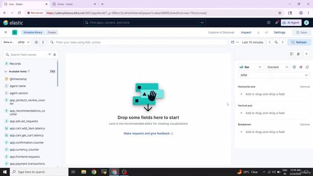
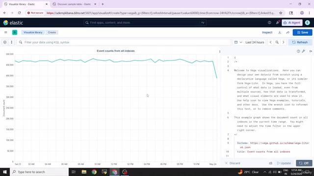
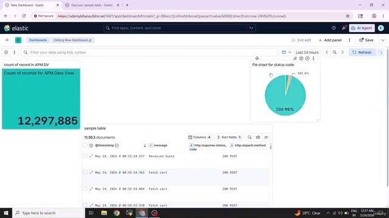
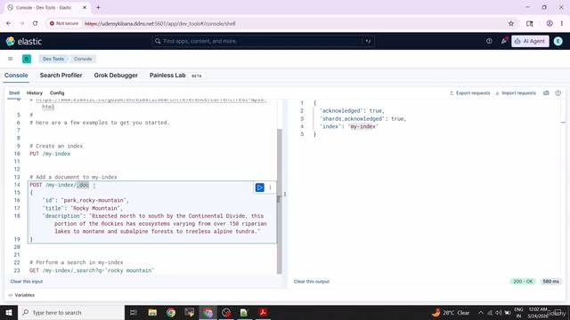
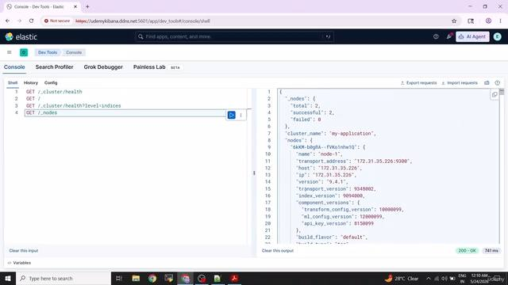
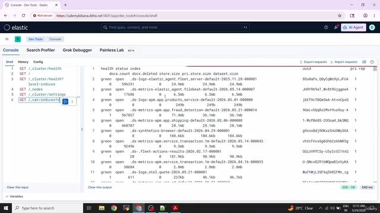
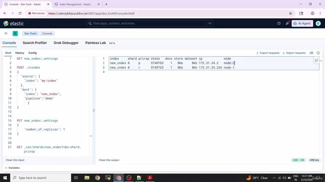
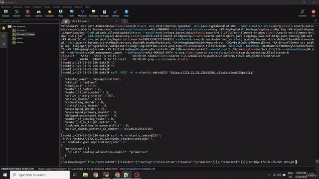
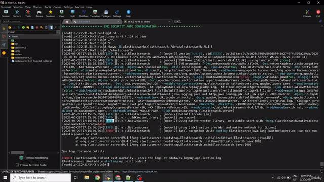
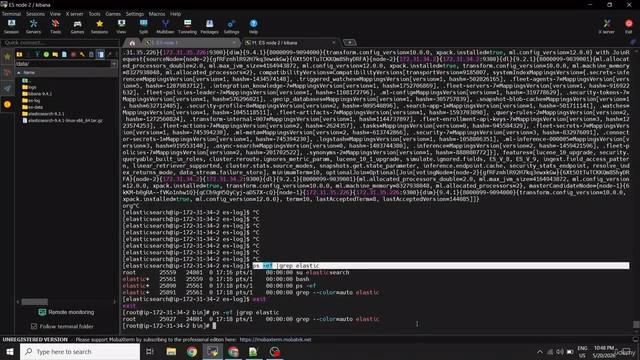

# ELK Stack 实战：Kibana 可视化与 Dashboard、DevTools 诊断 API、Elasticsearch 集群升级（P032–P034）

## 1. 这一节做什么

P032–P034 三集连起来是一条完整的「从用起来到运维起来」的链路，覆盖三个可独立交付的产物：

1. **一个能用的 Kibana 动态 Dashboard**（P032）。用 Lens 建可视化 → 存进 Visualization Library → 在 Dashboard 里拼版 → 加 Control 过滤器，让整块看板随 `service.name` 联动。产出物是 Kibana 里的 Saved Objects，不是磁盘上的代码文件。
2. **一份 Elasticsearch 运维 API 手册**（P033）。全部在 Kibana 的 **DevTools → Console** 里执行，覆盖：建索引、写文档、搜索、集群健康、节点信息、索引列表、Settings、Mapping、关闭/打开索引、Reindex、分片分布、分片分配开关、延迟分配超时。另外顺带看了 Search Profiler 和 Grok Debugger 两个调试面板。
3. **一次真实的两节点集群升级**（P034）。把 9.2.1 升级到 9.4.1，包含「升级前降级分片分配 → 备份并迁移配置 → 改权限 → 停旧进程 → 启动新版本 → 恢复分配 → 验证集群变绿」这一整套动作，以及过程中踩到的两个真实报错。

读者跟着本文做完，应该得到：一个能按服务过滤的看板、一套可以直接粘进 DevTools 的请求集合、一个能在自己机器上跑通的双节点升级流程。

需要先说明一个前提：P032 的 Kibana 部分**没有源码文件**——它是在浏览器里点出来的。所以第 4 节给的是「请求集合 + Shell 脚本 + UI 操作清单」三种可执行产物，而不是某个 `.js` 文件。

## 2. 讲师原话

关于可视化的定位：

> "创建仪表板时，应该包含可视化内容。我们有一个可视化库，可以在其中创建多个可视化，然后用这些可视化组成仪表板。"
> —— p032 [00:26]

关于 Lens 里能选哪些图：

> "首先有柱状图，然后有折线图、面积图、指标图。还有表格、饼图、仪表图、热力图、华夫图、区域地图、矩形树图、标签云、马赛克图、旧版指标图。"
> —— p032 [03:15]

关于 Metric 图上的数字为什么会一直跳：

> "我们无法得到精确数量，因为当前仍在接收数据，再刷新一次这个计数就会变化。如果你查看的是某个特定时间段，那么它会是稳定的，因为我们正在进行数据摄取。"
> —— p032 [05:13]

关于 DevTools 是什么：

> "要打开 DevTools，只需点击菜单并向下滚动；在管理区域中可以看到 DevTools，点击它就能看到控制台。"
> —— p033 [00:00]

关于 `_cat` 系列加不加 `?v` 的区别：

> "如果我想包含标题，就要加上 ?v 然后回车……如果再把它去掉，就得不到标题了。"
> —— p033 [10:18]

关于索引默认的双份 mapping（这是全课最容易踩的坑之一）：

> "如果没有为 description 设置任何映射，Elasticsearch 默认会保留两个映射：一个把 description 存为会进行分词的 text 类型；另一个映射类型就是 keyword，不会进行分词。"
> —— p033 [13:02]

关于升级前必须先做的事：

> "理想情况下，当你准备对任意集群中的任意节点进行操作时，务必确保集群处于绿色状态，这是首先要检查的事情。"
> —— p034 [02:18]

关于 Kibana 版本必须对齐：

> "如果运行的是 Elasticsearch 9.2.1，就应该使用相同版本的 Kibana；否则，如果使用新版 Kibana 搭配旧版 Elasticsearch，它就无法启动，也就是说 Kibana 不会加载，我们会看到报错。"
> —— p034 [17:24]

关于启动失败时的排查方法：

> "如果是信息级别或警告级别，那没问题；但如果看到这样的错误，就必须阅读它，这是最重要的事情……启动 Elasticsearch 时出现致命异常。"
> —— p034 [23:07]

## 3. 从零复现

### 3.0 前置环境

- 一个 Elasticsearch 集群（课里是两台 EC2 组成的双节点集群，节点角色分别是 `data/master/ingest` 和 `data/ml`）。
- 一个与 Elasticsearch **主版本完全一致**的 Kibana（p034 明确要求同版本，否则 Kibana 起不来）。
- 一份 APM 数据（课里用的是 APM demo 数据，`service.name` 有 `frontend`、`product`、`product_reviews`、`ad` 等取值）。
- 一台 Linux 机器上有 `sudo` 权限，能 `su` 到 `elasticsearch` 用户（p034 里讲师反复强调不能用 root 启动）。

目录约定（p034 讲师的做法，值得照抄）：安装目录、`data` 目录、`logs` 目录**三者分离**。

```
/data/
├── elasticsearch-9.2.1/        # 旧版本
├── elasticsearch-9.4.1/        # 新版本
│   ├── bin/
│   └── config/
├── path.data/                  # 所有索引数据
└── path.logs/                  # 所有日志
```

> "因此，部署 Elasticsearch 集群时这是关键步骤。如果有独立的目录，操作起来就会很容易。"
> —— p034 [00:28]

### 3.1 阶段一：Kibana 可视化与 Dashboard（P032）

**步骤 1：进入 Analytics。** 左侧 Menu → Analytics（就是菜单第一项）。Analytics 下并列着 Discover、Dashboard、Map、Machine Learning、Graph、Visualize Library。

**步骤 2：建第一个 Metric。** Visualize Library → `Create visualization` → 选 **Lens**。左侧选数据视图（课里是 APM 的数据视图）。右上角有 KQL 输入框（和 Discover 里一样）。中间是画布，右侧是可拖拽的字段列表。

选 Metric 类型，指标设为 `count`，时间范围保持默认的 last 15 minutes，存盘名 `count of record`，`Add to dashboard` 选 `none`，Tag 填 `apm`。



**步骤 3：验证数字。** 新开一个标签页进 Discover，选 APM 数据视图，清掉所有 filter，刷新。课里读到 123800 条。讲师特别提醒这个数会一直变，因为数据还在持续写入。

**步骤 4：建 Pie。** 回 Lens 选 Pie，`Slice by` 选响应状态码字段（讲师口述为 "响应状态码"，具体字段名以你的 APM 数据视图为准），`Fill` 也选同一字段。课里结果：94% 是 200，另有 404、504、308。存盘名 `pie chart for status`，同样打 `apm` 标签。

**步骤 5：建 Map。** Analytics → Map → `Add layer` → 选 Elasticsearch documents（课里说 "我可以使用这些文档"）→ 选带 geo IP 的数据视图 → 图层命名为 `APM`，保存到 library。课里因为有两台跑在荷兰区域的 EC2，地图上出现了两个点。

**步骤 6：看 Vega。** Create visualization → Custom visualization，右侧是 Vega 代码窗口。讲师说这个主要用于 SVG 类定制（比如把一条业务旅程画成若干圆圈，按失败情况改颜色），但**这一课不实际做**，只看了一眼。



**步骤 7：拼 Dashboard。** Dashboard → `Create dashboard` → `Add from library`，把 `count of record`、`pie chart for status`、之前的 sample table 逐个加进来。拖右上角手柄可以移动和缩放面板；点面板的齿轮图标可以 `hide title` / `show title`。



**步骤 8：加 Control。** Dashboard 右上 `Add panel` → 选 Control。课里加的是 `service.name` 字段的控制。保存后，选择 `frontend` 时，Metric 的 count、Pie 的成功/失败分布、Table 里的文档，全部只显示 frontend 的数据；切到 `product_reviews` 时全部联动。讲师强调：如果某个服务在这个时间窗内没有成功/失败数据，Pie 就是空的，这是正常的，不是配置错了。

> 注意 Control 只对**有这个字段的**可视化生效。讲师说 frontend 之所以能看到状态分布，是因为 "在前端，我们有这个状态，它表示状态码字段"。

最后保存为 `demo dash`。

### 3.2 阶段二：DevTools 诊断 API（P033）

Menu → 滚到底 → Management → **DevTools**。默认打开的是 Console，里面预置了一条 `PUT /myindex`。

执行方式二选一：点绿色三角播放键，或者 `Ctrl + Enter`。

以下是课里实际跑过的请求，按用途分组（完整可粘贴版本见第 4 节）：

| 用途 | 请求 |
|---|---|
| 建索引 | `PUT /myindex` |
| 写文档 | `POST /myindex/_doc/<id>` + JSON body |
| 搜索 | `GET /myindex/_search` |
| 集群健康 | `GET _cluster/health` |
| 索引级健康 | `GET _cluster/health?level=indices` |
| 版本信息 | `GET /` |
| 节点清单 | `GET _nodes` |
| 集群设置 | `GET _cluster/settings` |
| 索引清单 | `GET _cat/indices?v` |
| 索引设置 | `GET <index>/_settings` |
| 索引 mapping | `GET <index>/_mapping` |
| 关闭索引 | `POST <index>/_close` |
| 打开索引 | `POST <index>/_open` |
| 分片明细 | `GET <index>/_shards` |
| 重建索引 | `POST _reindex` |
| 改副本数 | `PUT <index>/_settings` |



几个关键输出，照着手上的集群核对：

- `GET _cluster/health` 返回集群名（课里是 application cluster）、`status`、节点数、data 节点数、`active_primary_shards`（课里 750）、`active_shards`、`relocating_shards`、`initializing_shards`、`unassigned_shards`。讲师说状态是 yellow 就意味着有未分配/迁移中/初始化中的分片。


- `GET /` 返回节点名、集群名、`version.number`（课里从 9.2.1 升到了 9.4.1）、构建包类型（tar）、build hash、build date，以及向后兼容的最低版本 8.0.0。
- `GET _nodes` 返回每个节点的名字、私网 IP、节点间通信端口、版本、角色（课里 node1 是 master + data + ingest，node2 是 data + ml）、data 路径、logs 路径、discovery seed hosts、安全相关配置。



- `GET _cat/indices?v` 带表头；去掉 `?v` 就只有数据行。列是 health、status、index、uuid、pri、rep 等。



- `GET <index>/_mapping`：如果建索引时没显式指定 mapping，`description` 这类字符串字段会被 Elasticsearch **同时**建成 `text` 和 `keyword` 两份。想只留一份，要在建索引之前配好 index template。
- `POST <index>/_close` 之后，在 Stack Management → Index Management 里能看到该索引 status 变成 `closed`、document count 变成空；`POST <index>/_open` 再打开。右侧还能看到响应状态码 200 和耗时。
- `POST _reindex`：把 source 索引的全部文档搬到 dest 索引。课里源索引有 1 条文档，目标索引原本 0 条，执行后目标索引变成 1 条。讲师补充：可以在请求里加 `pipeline` 指定 ingest pipeline 名，让原始数据在搬运过程中被解析清洗。
- `PUT <index>/_settings` 改副本数：副本数随时可改；**主分片数只能在建索引时定**。

> "设置分片数量时，应该在创建新索引时设置好……但副本数量可以随时设置。"
> —— p033 [22:23]

- `GET <index>/_shards`：能看到每个分片的编号、primary 还是 replica、落在哪个节点、占多大空间。课里的关键结论是：**同一个分片的 primary 和 replica 不会落在同一个节点上**，所以 0 号 primary 在 node1、0 号 replica 在 node2。分片编号从 0 开始，副本数为 N 时编号到 N-1。



- 分片分配开关：`cluster.routing.allocation.enable` 设为 `primaries` 时只分配主分片；设为 `all` 全部分配；设为 `none` 停止一切分片迁移。这个设置在第 3.3 节的升级流程里是核心。
- `index.unassigned.node_left.delayed_timeout`：节点下线后，集群等多久才把它的分片迁走。课里设 30 分钟，作用是给打补丁留出窗口——30 分钟内节点回来，分片原地复活，不产生迁移。
  > "if you want your cluster to wait for 30 minutes to see whether the node is coming back or not so the meanwhile in that 30 minutes your cluster will remain in hello state"
  > —— p033 [30:50]
- Refresh interval：默认 1s，意味着新写入的数据 1 秒后可被搜到。`-1` 表示关闭。讲师建议生产上设 `1s` 或 `1h`。

> "如果把这个值设得太小，Elasticsearch 每次刷新索引都会耗时。因此在生产环境中，我们通常把它设为 1R 1H。"
> —— p033 [28:05]

另外两个面板：**Search Profiler**（选数据视图、贴查询、执行，看总耗时和哪个子句最慢）和 **Grok Debugger**（贴日志样本 + Grok pattern，点 Simulate 预览解析后的文档）。讲师说明这两个面板在 DevTools 顶部切换。

### 3.3 阶段三：两节点集群升级（P034）

升级顺序（课里是停机升级，不是严格的滚动升级）：

1. **查健康**：`curl -X GET http://<host>:9200/_cluster/health`。课里升级前是 yellow（78 个 unassigned shards，因为是 R&D 集群），讲师说生产上必须先绿。
2. **降级分片分配**：把 `cluster.routing.allocation.enable` 设为 `primaries`，用 `persistent` 而不是 `transient`。区别是 `persistent` 重启后仍在，`transient` 重启即失效。
3. **解压新版**：`tar -xzf` 到 `/data/`，删掉压缩包。
4. **备份新包的默认配置**：把新版 `config/elasticsearch.yml` 改名成 `new.yml`，腾位置。
5. **迁移配置**：从旧版 `config/` 复制四样东西到新版 `config/`——
   - `certs/`（证书目录，整个目录 `cp -R`）
   - `elasticsearch.keystore`（存密码等敏感值，课里 Watcher 发 Gmail 用的密码就在里面）
   - `elasticsearch.yml`（集群名、节点名、角色、路径、discovery seed hosts、安全配置）
   - `jvm.options.d` / `jvm.options`（**只有改过才需要复制**，课里没改，堆内存还是默认 4GB，所以跳过）
6. **改权限**：`chown -R elasticsearch:elasticsearch /data/elasticsearch-9.4.1`。
7. **停旧进程**：`kill <PID>`，然后确认 `ps` 里没有残留 elasticsearch 进程。
8. **切用户前台启动一次**：`su - elasticsearch` 后直接跑 `./bin/elasticsearch`，**不挂 nohup**，这样报错能直接看屏幕。课里的原话是：

   > "this is the best way whenever you are operating anything... after this start is successfully started then you can start with the nohub command. Otherwise, you will not find the issue why your elastic search is not running"
   > —— p034 [14:03]

9. **确认无错后改 nohup 后台启动**，用 `GET /` 确认版本已是 9.4.1。
10. **对 node2 重复 3–9 步**。
11. **恢复分配**：`cluster.routing.allocation.enable` 改回 `all`。课里状态从 red → yellow（有 relocating / initializing / unassigned）→ 稳定后 green。
12. **验收**：`GET _cluster/health` 显示 `number_of_nodes: 2`；`GET _nodes` 看两个节点角色；再查一次各节点版本，两个都应是 9.4.1。



课里在这一段踩了两个真实的坑，必须写进检查清单：

**坑一：不能以 root 启动。**

> "启动 Elasticsearch 时出现致命异常，Java 代码行……不能以 root 用户运行 Elasticsearch，这就是我们遇到的问题。"
> —— p034 [23:07]

**坑二：权限残留。**

> "Elasticsearch 的数据和日志目录出现权限被拒绝……它没有权限……只有一个日志文件具有 root 权限。"
> —— p034 [26:11]



讲师的排查动作是：去 `logs/` 目录 `ls -l`，发现有一个 JSON 文件属主是 root，`chown` 给 elasticsearch 用户后重启成功。



## 4. 完整代码

### 4.1 `es-basic.http` —— 建索引 / 写文档 / 查询（对应 P033 前半段）

DevTools Console 不支持 `.http` 文件的分隔符，但下面的 `###` 块可以直接一段一段粘进 Console 执行。

```http
### 0. 确认连的是哪个集群、什么版本
GET /

### 1. 建索引（课里第一条默认查询）
PUT /myindex

### 2. 写入一条文档
### 课里口述的文档 ID 听写为 "park rocky mountains"，
### 字段为 title 和 description，以你实际输入为准
POST /myindex/_doc/park-rocky-mountains
{
  "title": "park rocky mountains",
  "description": "demo document created in the ELK course DevTools section"
}

### 3. 搜索
GET /myindex/_search
{
  "query": {
    "match_all": {}
  }
}

### 4. 看这个索引的默认 mapping
### 关键点：description 会同时出现 text 和 keyword 两份
GET /myindex/_mapping

### 5. 看这个索引的 settings
GET /myindex/_settings
```

### 4.2 `es-cluster-ops.http` —— 集群诊断与运维（对应 P033 后半段）

```http
### ---------- 健康 ----------

### 6. 集群整体健康
GET _cluster/health

### 7. 索引级健康
GET _cluster/health?level=indices

### ---------- 节点与版本 ----------

### 8. 所有节点
GET _nodes

### 9. 集群级设置
GET _cluster/settings

### ---------- 索引清单 ----------

### 10. 带表头
GET _cat/indices?v

### 11. 不带表头（对比用）
GET _cat/indices

### ---------- 关 / 开索引 ----------

### 12. 关闭
POST /myindex/_close

### 13. 打开
POST /myindex/_open

### ---------- 分片 ----------

### 14. 某个索引的分片分布：编号 / primary 或 replica / 所在节点 / 占用空间
GET /myindex/_shards

### 15. 全集群分片视图（含 node 列，可用来做 node-wise 统计）
GET _cat/shards?v

### ---------- Reindex ----------

### 16. 建目标索引
PUT /newindex

### 17. 全量重建索引
### 可选：加 "pipeline": "<你的 ingest pipeline 名>" 让数据在搬运时被解析
POST _reindex
{
  "source": {
    "index": "myindex"
  },
  "dest": {
    "index": "newindex"
  }
}

### 18. 确认搬过来了
GET /newindex/_count

### ---------- Settings ----------

### 19. 改副本数（随时可改）
PUT /newindex/_settings
{
  "index": {
    "number_of_replicas": 2
  }
}

### 20. 主分片数只能在建索引时定，这里会因为索引已存在而报错
### 课里原话：「number of shards ... during that creation of new index only you can set」
PUT /newindex/_settings
{
  "index": {
    "number_of_shards": 2
  }
}

### 21. Refresh interval：1s 是默认，-1 表示关闭
PUT /myindex/_settings
{
  "index": {
    "refresh_interval": "1s"
  }
}

### 22. 单节点集群把副本设为 0，可以让集群从 yellow 变 green
PUT /myindex/_settings
{
  "index": {
    "number_of_replicas": 0
  }
}

### ---------- 分片分配开关 ----------

### 23. 索引级：只分配主分片
PUT /myindex/_settings
{
  "index": {
    "routing": {
      "allocation": {
        "enable": "primaries"
      }
    }
  }
}

### 24. 集群级（升级时用的是这个），persistent = 重启后仍生效
PUT _cluster/settings
{
  "persistent": {
    "cluster.routing.allocation.enable": "primaries"
  }
}

### 25. 升级完成后恢复全部分配
PUT _cluster/settings
{
  "persistent": {
    "cluster.routing.allocation.enable": "all"
  }
}

### 26. 停机维护窗口：节点下线后等 30 分钟再迁分片
PUT /myindex/_settings
{
  "index": {
    "unassigned": {
      "node_left": {
        "delayed_timeout": "30m"
      }
    }
  }
}
```

> 说明：上面每条请求的**端点**都来自讲师在 P033 里的操作或口述；`PUT /newindex/_settings` 中 `number_of_shards` 那条在课里只讲了「应该在建索引时设」这个结论，讲师没有实际执行这条会报错的请求，此处是为了让你亲手验证结论。

### 4.3 `upgrade-es-node.sh` —— 单节点升级脚本（对应 P034）

> **课里没有这个脚本。**讲师全程是手工敲命令的，下面是我按他的操作顺序整理的等价脚本，路径和用户名请按你的环境改。跑之前务必先在测试集群验证一遍。

```bash
#!/usr/bin/env bash
# 单节点 Elasticsearch 版本升级（停机升级）
# 用法：sudo bash upgrade-es-node.sh
set -euo pipefail

# ===== 按你的环境修改 =====
ES_HOST="127.0.0.1"
ES_PORT="9200"
ES_USER="elasticsearch"
OLD_HOME="/data/elasticsearch-9.2.1"
NEW_TARBALL="/data/elasticsearch-9.4.1-linux-x86_64.tar.gz"
NEW_HOME="/data/elasticsearch-9.4.1"
DATA_DIR="/data/path.data"      # 与 elasticsearch.yml 里的 path.data 一致
LOG_DIR="/data/path.logs"       # 与 elasticsearch.yml 里的 path.logs 一致
BASE_URL="http://${ES_HOST}:${ES_PORT}"

echo ">>> [1/8] 升级前集群健康"
curl -s -X GET "${BASE_URL}/_cluster/health?pretty"

echo ">>> [2/8] 降级分片分配：只分配 primary（persistent，重启后仍生效）"
curl -s -X PUT "${BASE_URL}/_cluster/settings" \
  -H 'Content-Type: application/json' \
  -d '{
        "persistent": {
          "cluster.routing.allocation.enable": "primaries"
        }
      }'
echo

echo ">>> [3/8] 解压新版本"
tar -xzf "${NEW_TARBALL}" -C /data/
rm -f "${NEW_TARBALL}"

echo ">>> [4/8] 迁移配置（证书 / keystore / yml）"
# 新版自带的 yml 先备份改走，避免被覆盖
if [ -f "${NEW_HOME}/config/elasticsearch.yml" ]; then
  mv "${NEW_HOME}/config/elasticsearch.yml" "${NEW_HOME}/config/new.yml"
fi

cp -R "${OLD_HOME}/config/certs" "${NEW_HOME}/config/"
cp    "${OLD_HOME}/config/elasticsearch.keystore" "${NEW_HOME}/config/"
cp    "${OLD_HOME}/config/elasticsearch.yml" "${NEW_HOME}/config/"

# jvm.options 只有改过（比如调过堆）才复制；课里没改，所以跳过
# cp "${OLD_HOME}/config/jvm.options" "${NEW_HOME}/config/"

echo ">>> [5/8] 修正文件属主（root 属主的文件会导致启动时报 permission denied）"
chown -R "${ES_USER}:${ES_USER}" "${NEW_HOME}" "${DATA_DIR}" "${LOG_DIR}"

echo ">>> [6/8] 停止旧进程"
OLD_PID="$(pgrep -u "${ES_USER}" -f 'org.elasticsearch.bootstrap.Elasticsearch' || true)"
if [ -n "${OLD_PID}" ]; then
  kill "${OLD_PID}"
  # 等进程真正退出，最多 60 秒
  for _ in $(seq 1 60); do
    if ! kill -0 "${OLD_PID}" 2>/dev/null; then break; fi
    sleep 1
  done
fi
pgrep -u "${ES_USER}" -f 'org.elasticsearch.bootstrap.Elasticsearch' \
  && { echo "旧进程还在，终止脚本"; exit 1; } \
  || echo "旧进程已退出"

echo ">>> [7/8] 以 elasticsearch 用户前台启动一次，确认没有 fatal 报错后 Ctrl+C，再用 nohup 起"
echo "    手动执行："
echo "      su - ${ES_USER}"
echo "      cd ${NEW_HOME} && ./bin/elasticsearch"
echo "    无报错后改用："
echo "      su - ${ES_USER} -c \"cd ${NEW_HOME} && nohup ./bin/elasticsearch > /dev/null 2>&1 &\""

echo ">>> [8/8] 等集群起来后，恢复分配并验收"
echo "      curl -X PUT '${BASE_URL}/_cluster/settings' -H 'Content-Type: application/json' \\"
echo "        -d '{\"persistent\":{\"cluster.routing.allocation.enable\":\"all\"}}'"
echo "      curl -X GET '${BASE_URL}/_cluster/health?pretty'"
echo "      curl -X GET '${BASE_URL}/_nodes'"
echo "      curl -X GET '${BASE_URL}/'"
```

### 4.4 Kibana 侧操作清单（替代「代码」，因为没有源文件）

| # | 操作 | 验收点 |
|---|---|---|
| 1 | Analytics → Visualize Library → Create visualization → **Lens** | 左侧出现你的数据视图（如 APM） |
| 2 | 选 Metric，指标 `count`，时间 last 15 minutes | 数字与实际文档量级一致 |
| 3 | 存为 `count of record`，Add to dashboard = none，Tag = `apm` | 在 Visualize Library 里能按 `apm` 标签过滤到它 |
| 4 | 新建 Lens → Pie，`Slice by` 选响应状态码字段，`Fill` 同字段 | 200 占绝大多数，另有 404 / 504 / 308 |
| 5 | 存为 `pie chart for status`，Tag = `apm` | 同上 |
| 6 | Analytics → **Map** → Add layer → Elasticsearch documents → 选带 geo 字段的数据视图 | 地图上出现数据点（课里是荷兰区域的两个 EC2 点） |
| 7 | 存为 `APM map` | Map 列表中可见 |
| 8 | Dashboard → Create dashboard → Add from library → 依次加入上面 3 个 | 三个面板都出现在画布上 |
| 9 | 拖面板手柄调整位置和大小；齿轮图标可 hide/show title | 布局整齐，标题按需显示 |
| 10 | Add panel → **Control** → 绑定 `service.name` 字段 | 出现下拉控件 |
| 11 | 选 `frontend` | Metric / Pie / Table 三个面板同时只显示 frontend 数据 |
| 12 | 切到 `product_reviews` | 全局面板联动切换；若该服务在该时段没有状态数据，Pie 为空属正常 |
| 13 | 保存 Dashboard 为 `demo dash` | Dashboard 列表中可见 |

## 5. 逐行解释

**`GET /` 与 `GET _cluster/health` 的分工。** 这两个不是一回事：`/` 只返回**当前连上的那一个节点**是谁、什么版本、集群叫什么；`_cluster/health` 返回**整个集群**的状态和分片计数。升级过程中这两条要配合看——`/` 告诉你「我连的这一台已经是 9.4.1 了」，`_cluster/health` 告诉你「整个集群现在是什么颜色、还有多少分片没落位」。

**`_cluster/health?level=indices` 里 `?level=` 的作用。** 不加参数返回的是集群汇总；加 `level=indices` 会把汇总拆到每个索引一行。课里就是靠这个看到 APM 那个索引是 green、1 个 primary + 1 个 replica 全部 active。排查「到底是哪个索引在拖后腿」就看这个。

**`_cat/indices?v` 里的 `?v`。** `_cat` 系列默认是给人看的裸数据、无表头。`?v` = verbose，加表头。课里讲师专门演示了加与不加的对比。记不住列含义的时候永远带 `?v`。

**`PUT /myindex` 的返回里 `acknowledged: true` 和 `shards_acknowledged: true`。** 前者表示集群已经接受了「创建索引」这个请求，后者表示分片已经分配到位。两个都是 true 才算真正建好。

**`GET /myindex/_mapping` 里 `description` 出现两份的原因。** Elasticsearch 在没显式指定 mapping 时会做动态映射，字符串字段默认同时建成 `text`（分词，适合全文检索）和 `keyword`（不分词，适合精确匹配和聚合）。代价是**索引体积翻倍**。讲师给的解法是在建索引之前配好 index template，把 mapping 显式写死。

**`POST /myindex/_close` 之后为什么 document count 变空。** 关闭索引会把该索引的分片从内存卸载、释放资源，元数据还在，所以 Index Management 里能看到它、状态是 `closed`，但文档数读不到。开发环境里用不到的历史索引可以这样挂起，再 `_open` 唤醒。

**`POST _reindex` 的 `source` / `dest` / `pipeline`。** `source.index` 是源，`dest.index` 是目标，`pipeline` 可选。它的价值不在「复制一份」，而在**搬运的过程中用 ingest pipeline 把原始数据解析成结构化文档**——课里讲师说原始数据是 unpatched / raw 的时候就用这个办法。注意：`_reindex` 不删除源索引，源和目标都在。

**`number_of_replicas` 能改、`number_of_shards` 不能改的原因。** 主分片数决定了哈希路由的模数（文档落到哪个分片是 `hash(id) % shards` 算的），改了模数，所有既有文档的路由都会失效，所以只能在建索引时定死。副本只是主分片的拷贝，加一份减一份都是在复制数据，随时可做。前端类比：主分片数像数组的分区数，副本数像备份的份数——分区数定了就改不了，备份想加几份加几份。

**`GET /myindex/_shards` 为什么 primary 和 replica 永远不在同一节点。** 这是 Elasticsearch 的硬约束，不然节点一挂两份同时丢。课里 0 号 primary 在 node1、0 号 replica 在 node2，就是这个原因。分片编号从 0 开始，副本数为 N 时编号到 N-1，所以副本数 10 就是 0 到 9 共 10 个分片。

**`cluster.routing.allocation.enable` 的三个值。** `all` = 全部分配（正常状态）；`primaries` = 只分配主分片，副本不分配（升级过程中用，避免白白搬数据）；`none` = 完全停止分片迁移（打补丁、做维护时用，防止集群把下线节点的分片到处乱搬）。

**`persistent` vs `transient`。** 写在 `persistent` 里的设置重启后仍在；写在 `transient` 里的设置重启就没了。升级场景必须用 `persistent`，否则你一重启，分片分配开关自动恢复成 `all`，迁移又开始了。

**`index.unassigned.node_left.delayed_timeout` 的 30 分钟。** 节点下线后集群默认会立刻开始把它的分片迁到别的节点。打补丁时这是灾难：迁一轮分片要花大量时间和 IO，节点 10 分钟后回来了又开始往回迁。设成 30m 就是告诉集群「先等着，30 分钟内回来的话就当地没掉线」。讲师说这期间集群会保持 yellow，是这个设置的正常副作用，不是故障。

**Refresh interval 的 `1s` 与 `-1`。** `1s` 是默认值，表示写入后 1 秒内可被搜索到；`-1` 表示关闭自动刷新，只在大批量灌数据时用（灌完手动刷一次，性能高一个数量级）。讲师建议生产上设 `1s` 或 `1h`，看业务对实时性的要求。

**升级脚本里「先前台启动一次」这一步不能省。** `nohup` 会把 stdout 重定向到 `/dev/null` 或者指定文件，启动阶段的关键报错很容易被吞掉。讲师的做法是先在 `su - elasticsearch` 的会话里裸跑一次 `./bin/elasticsearch`，看到 `started` 了再 `Ctrl+C`，然后换成 nohup。课里正是靠这一步才看清 `can not run elasticsearch as root` 和 `permission denied` 两个报错。

**`chown -R` 顺手把 data 和 log 目录一起改掉。** 课里的坑就出在这里：只有 `logs/` 下一个 JSON 文件属主是 root，其他都是 elasticsearch。只改安装目录不够，必须连数据目录和日志目录一起改。

## 6. 复现检查清单

**阶段一：Kibana 可视化**

- [ ] `count of record` 这个 Metric 在 last 15 minutes 下的数字，与 Discover 里同数据视图同时间窗的命中数在**同一量级**（精确值不等是正常的，数据在持续写入）。
- [ ] `pie chart for status` 里 200 的占比在 90% 以上，并且能看到若干 4xx / 5xx / 3xx 的切片。
- [ ] Map 在 Add layer → Elasticsearch documents 之后，图上出现**至少一个**数据点；如果一个点都没有，先确认数据视图里有 geo 字段且时间窗内有数据。
- [ ] 保存可视化时 `Add to dashboard` 选 `none`，Visualize Library 里能看到条目，Tag `apm` 可过滤。
- [ ] Dashboard 里加入 Control（`service.name`）后，切换服务名，**至少两个**面板同时变化。
- [ ] 切到某个在该时段没有状态数据的服务时，Pie 为空——这是预期行为，不是配置错误。

**阶段二：DevTools**

- [ ] `GET /` 返回的 `version.number` 与你在 `ps` / 安装目录看到的版本一致。
- [ ] `PUT /myindex` 返回 `acknowledged: true`，`GET _cat/indices?v` 里能看到 `myindex`。
- [ ] `POST /myindex/_doc/<id>` 后，`GET /myindex/_search` 能搜到它。
- [ ] `GET /myindex/_mapping` 里 `description` 同时有 `text` 和 `keyword` 两个类型。
- [ ] `POST /myindex/_close` 后，Stack Management → Index Management 里该索引 status = `closed`、document count 为空。
- [ ] `POST /myindex/_open` 后状态恢复成 `open`。
- [ ] `POST _reindex` 前后对比 `GET /newindex/_count`：从 0 变成与源索引相同的条数。
- [ ] `PUT /newindex/_settings` 把副本从 1 改成 2，`GET /newindex/_settings` 和 Index Management 两处都能看到变化。
- [ ] `GET /myindex/_shards` 里，同一个分片编号的 primary 和 replica 落在**不同节点**。
- [ ] `PUT _cluster/settings` 设 `cluster.routing.allocation.enable = primaries`，返回体里能看到 `acknowledged: true`；改回 `all` 同样有确认。

**阶段三：集群升级**

- [ ] 升级**前**的 `_cluster/health` 已存档（截图或日志），升级后能对比。
- [ ] 升级**前**确认过 `cluster.routing.allocation.enable` 已设为 `primaries` 且用的是 `persistent`。
- [ ] 启动前 `pgrep -u elasticsearch` 为空（旧进程真的停了）。
- [ ] 启动时**不是** root 用户，且没有出现 `can not run elasticsearch as root`。
- [ ] 启动时没有出现 `permission denied`；如果出现，`ls -l` 检查 `path.data` 和 `path.logs` 下是否有 root 属主的文件。
- [ ] 新版 `config/` 下 `certs/`、`elasticsearch.keystore`、`elasticsearch.yml` 三样都已就位，旧的 `elasticsearch.yml` 已改名为 `new.yml` 或已删除。
- [ ] 两台节点都升级完成后，`GET _nodes` 里两个节点的版本**都是** 9.4.1。
- [ ] 恢复 `cluster.routing.allocation.enable = all` 后，`_cluster/health` 在若干分钟内从 red/yellow 收敛到 green；如果一直是 yellow，检查 `unassigned_shards` 是否为 0（单节点集群副本无法分配时会永久 yellow，需要把副本设为 0）。
- [ ] Kibana 版本与 Elasticsearch 一致，Kibana 能正常加载。

## 7. 课里没讲但你会撞上的

**1. 认证。** 课里的 curl 全程没带用户名密码，也没带 `-k`。如果你的集群开了 security（`certs/` 和 `elasticsearch.keystore` 的存在本身就暗示开了），裸 curl 会直接 401。真实环境里要么用 `-u elastic` 交互输入密码，要么在 `/etc/elasticsearch/curlrc` 里配。课里没讲怎么给 API 加认证。

**2. 证书信任。** 讲师提到 `elasticsearch.yml` 里有证书路径、`certs/` 里有 CA cert 和节点 cert，"我们现有的安全相关设置"——但没讲这些证书怎么签发、怎么续期、怎么配 truststore。升级时复制 `certs/` 之所以够用，是因为证书本身没变；如果证书也到期要换，流程会更长，课里没讲。

**3. 严格意义的滚动升级。** 课里是先 `kill` 旧进程再起新版，这是**停机升级**。Elasticsearch 官方推荐的滚动升级顺序是「先升级非 master 节点，最后升级 master 节点」，且节点要一台一台来、每台升级完等集群变绿再动下一台。课里因为只有两个节点、且讲师自己说是 R&D 集群，省掉了等待变绿这一步。生产上不能这么干。

**4. 750 个主分片意味着什么。** `_cluster/health` 里 `active_primary_shards: 750`，`_nodes` 里只有 2 个节点——平均一个节点要扛 375 个主分片加对应副本。分片不是越多越好，分片元数据本身要占堆内存，小集群上这个数量级会明显拖慢集群状态更新。课里没评判这个配置，但你复现时如果照着建，很可能会遇到 master 节点 GC 频繁。

**5. ILM 与 hot / warm / cold 分层。** 讲师在讲 `GET myindex/_settings` 时提到「tier preference is data content，如果你有多个 ILM 基于的数据节点，它会显示数据落在 hot / warm / cold / frozen 哪一层」——但只提了一句就过去了，没讲 ILM policy 怎么写、rollover 怎么配。这是生产环境绕不开的一块。

**6. Saved Objects 的导出与迁移。** 课里的 Dashboard 是一步步点出来的，关掉浏览器数据还在（存在 Kibana 的 `.kibana` 索引里），但怎么把一个 Dashboard 从测试环境搬到生产环境、怎么版本化、怎么避免手抖点错——课里没讲。Kibana 有 Stack Management → Saved Objects 的导出导入，可以 `.ndjson` 文件形式管理，这是团队协作的标配。

**7. Control 的边界。** 讲师演示了 Control 只对「有这个字段的可视化」生效（frontend 有状态码字段所以 Pie 有数据，没有这个字段的服务 Pie 就空）。但 Control 的另一个限制课里没说：它只对绑定到**同一个 Dashboard**、且数据视图**包含该字段**的面板生效；跨数据视图的 Control 需要额外配置。

**8. Grok 的调试闭环。** 课里演示了 Grok Debugger 能贴日志样本 + pattern 看解析结果，但没说这个 pattern 拿到手之后怎么落到 ingest pipeline 里、怎么用 `_simulate` 端点批量验证、解析失败的行会怎么处理（默认是 `on_failure` 丢进死信还是直接抛错）。从「调试面板能跑通」到「生产 pipeline 不丢数据」之间还有一段路。

**9. 前端视角的一个类比。** DevTools 的 Console 本质上就是一个内置的 HTTP Client，行为和你用 Postman / `fetch` 发请求没有区别——左边写请求，右边看响应状态码（课里右侧就显示 `200`）和耗时。区别在于它自动带上 Kibana 的认证，且 `_cat/*` 这类端点返回的是纯文本表格而不是 JSON。你在前端写 `await fetch('/api/xxx')` 的那套心智模型可以直接搬过来。