# ELK Stack 之 Elasticsearch 单节点落地（P004–P005）

> 适用环境：AWS EC2 + RHEL 系 Linux，Elasticsearch 9.3.4，单节点集群
> 读者前提：会用 SSH、会看终端报错。不需要后端经验。
> 说明：本篇所有命令和配置项都来自课堂演示；凡是逐字稿没有交代清楚的地方，文中会明确写「课里没讲」，并给出安全做法。

---

## 1. 这一节做什么

这两节课**只做一件事**：把一个能对外提供 HTTPS 访问、带自签证书、带账号密码、能后台常驻的 Elasticsearch 单节点，从一台空的 Linux 机器上装出来。

拆开看，一共是 9 个动作，按顺序谁也跳不过去：

1. **规划目录**：ES 的「程序」「数据」「日志」必须分三处放，不能混在解压目录里。
2. **下载并解压 tar.gz**：拿到 `elasticsearch-9.3.4` 这个目录。
3. **建 CA 根证书**：整簇只有一份，将来所有节点、Kibana 都用它签发。
4. **用 CA 签本节点的证书**：证书记录了「这台机器叫什么名字、IP 是多少」，名字必须和后面配置文件里的 `node.name` 一模一样。
5. **改 JVM 堆内存**：默认 4GB，32GB 是上限。
6. **写 `elasticsearch.yml`**：集群名、节点名、数据/日志路径、监听地址、9200 端口、发现种子、初始 master、安全开关。
7. **建运行用户并授权**：ES 不允许用 root 跑，必须有一个普通用户对数据目录和日志目录有写权限。
8. **前台起来、设密码、浏览器验证**：访问 `https://<公网IP>:9200`，用 `elastic` 超级用户登录。
9. **改成后台常驻**：关掉终端 ES 就死，所以要用 `nohup`；并且学会用 PID + `kill -9` 停掉它。

**这节课没做的事**（后面章节才有，别在这里找）：Logstash 怎么装、Kibana 怎么装、索引怎么建、集群多节点怎么扩容、systemd 服务怎么写。P005 结尾也只停在「日志目录里都有什么文件」，没有进入数据写入环节。

**对前端同学的一句换算**：这一节你可以类比成「在一台干净的服务器上部署一个 Node 服务」——只不过这个服务自带 JVM、自带 TLS、自带账号体系、还要求你先把证书链自己签一遍。`nohup ./elasticsearch &` 就是你熟悉的 `nohup node server.js &`，`kill -9 <PID>` 就是 `kill -9`，`jvm.options` 里的 `-Xmx4g` 就是 Node 的 `--max-old-space-size=4096`。

---

## 2. 讲师原话

下面这几句是整节课的「设计依据」，后面所有步骤都是为了满足它们。

> "最好新建一个目录，用来存放所有 Elasticsearch 文件。"
> —— p004 [00:29]

> "数据路径和锁路径应当分开，因为更新 Elasticsearch 时，数据有可能会被删除。"
> —— p004 [04:45]

这是本节最重要的一条经验：升级 ES 版本时，如果你把数据目录放在解压目录里面，覆盖解压会连数据一起带走。

> "这个节点名称应当与你在 elasticsearch.yaml 中配置的节点名称一致，这里也要与之匹配。"
> —— p004 [10:54]

指的是 `instance.yml` 里的 `name` 与 `elasticsearch.yml` 里的 `node.name` 必须一致，否则启动时证书校验不过。

> "你必须仔细阅读产生的错误，比如这个“找不到文件”异常，问题就出在路径位置上。"
> —— p004 [13:45]

讲师在 `bin` 目录下用相对路径找 `ca.crt`，报 `NoSuchFileException`，然后当场改成正确路径重跑。这段排错过程是课里的真实内容，第 3 节会复刻。

> "默认是 4GB，最高可以设置到 32GB；Elasticsearch 建议该值应低于 32GB。"
> —— p004 [17:05]

> "重置密码时，集群应处于绿色状态；如果处于黄色或红色状态，重置密码时就会出问题。"
> —— p004 [38:01]

> "如果我关闭它，如你所见，Elasticsearch 就会停止运行，所以要么使用服务文件让它作为服务运行，要么用 nohup 来运行。"
> —— p005 [00:00]

这就是 P005 开篇的动机：前台进程随终端一起死，必须转后台。

> "如果低于这个值，Elasticsearch 就无法启动，因为这是最大内存映射计数。"
> —— p004 [41:24]

指 `vm.max_map_count`，ES 启动前的系统级硬门槛。

---

## 3. 从零复现

下面每一步都可以直接照抄。`<尖括号>` 里的是你要替换成自己环境的真实值。

### 3.1 先看一眼机器

```bash
# 确认系统版本、内存、当前用户名
cat /etc/os-release
free -h
whoami
```

讲师用的是 EC2 上的 RHEL 系实例，16GB 内存。内存这一项很关键，因为它决定第 3.7 步 JVM 堆怎么定。

### 3.2 建程序目录并进去

```bash
sudo mkdir -p /data
cd /data
pwd
```


讲师特意强调**不要**解压到家目录或 `/tmp`，统一放一个专门的目录，后续升级、迁移、备份都好处理。

### 3.3 下载 9.3.4 的 tar.gz

打开 `https://www.elastic.co/downloads/elasticsearch`，页面上能看到当前最新版本号（课程录制时是 **9.3.4**），下载框有一个平台下拉菜单（Windows / Mac / Linux），因为目标机是 RHEL，选 Linux 的 tar.gz，右键「复制链接地址」。

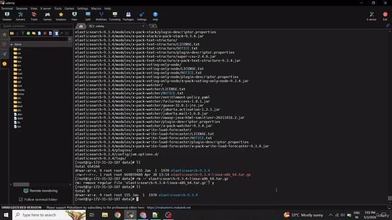

回到服务器：

```bash
cd /data
# 把刚才复制的链接粘到这里，形如：
sudo curl -O https://artifacts.elastic.co/downloads/elasticsearch/elasticsearch-9.3.4-linux-x86_64.tar.gz
ls -lh
```

> 链接以你从官网复制到的为准，不同时间点 CDN 路径可能不同。课里演示的就是「浏览器复制链接 → 服务器 curl 下载」这个流程。

讲师在这里补了一段生产环境注意事项：**线上机器通常没有外网**，做法是找一台能上网的机器下载好，放到 NFS 共享挂载点，再分发到每台节点手动安装。

### 3.4 解压、删包

```bash
cd /data
sudo tar -zxvf elasticsearch-9.3.4-linux-x86_64.tar.gz
sudo rm -f elasticsearch-9.3.4-linux-x86_64.tar.gz
ls
```

解压后 `/data` 下应该只剩一个 `elasticsearch-9.3.4` 目录。

### 3.5 建数据目录和日志目录

```bash
sudo mkdir -p /data/es_data
sudo mkdir -p /data/es_logs
ls -l /data
```

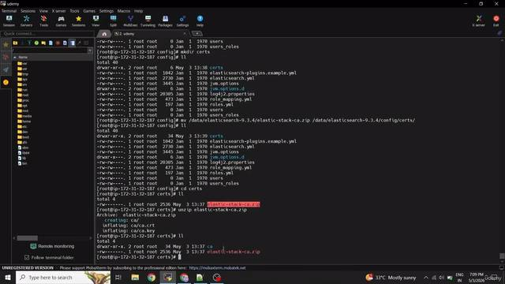

这就是第 2 节那句「separate data path and separate lock path」的落地。**到这一步为止，两个目录都还是空的**，P005 [06:13] 会回来验证它们被写满了。

### 3.6 生成 CA 根证书

```bash
cd /data/elasticsearch-9.3.4
ls
# 只看 bin 和 config 两个目录就够了
sudo ./bin/elasticsearch-certutil ca
```

它会问两个问题：

- `Please enter the desired output file [elastic-stack-ca.p12]:` —— 直接回车，用默认名；讲师是手动输入了文件名，效果一样。
- `Enter password for elastic-stack-ca.p12 :` —— 课里没有给这个密码设值，直接回车即空密码。

生成完，把 `elastic-stack-ca.p12` 移到 `config/certs` 下并解压：

```bash
sudo mkdir -p config/certs
sudo mv elastic-stack-ca.p12 config/certs/
cd config/certs
sudo unzip elastic-stack-ca.p12 -d ca
ls -l ca
```

`ca` 目录里会得到两个文件：`ca.crt`（根证书，要分发给每个节点）和 `ca.key`（根私钥，**只留在这台机器上，不要外传**）。

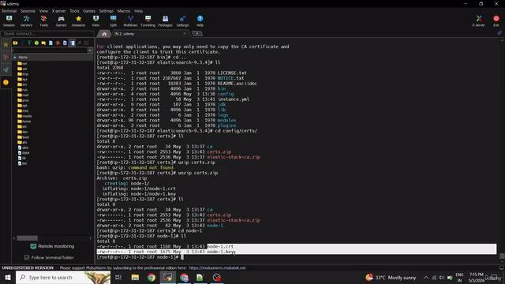

### 3.7 写 `instance.yml` 并签节点证书

先在 ES 根目录建文件：

```bash
cd /data/elasticsearch-9.3.4
sudo vi instance.yml
```

内容（完整文件）：

```yaml
instances:
  - name: "node1"
    ip:
      - "172.31.0.10"
```

两个字段的含义，讲师说得很直白：

- `name` 必须和马上要写的 `elasticsearch.yml` 里的 `node.name` **完全一致**，否则 `node1` 的证书对不上 `node1` 这个节点，直接起不来。
- `ip` 填这台 EC2 的**私有 IP**（不是公网 IP）。公网 IP 是给浏览器访问用的，证书里签的是内网地址。

拿私有 IP 的方法：

```bash
hostname -I
# 或者在 EC2 控制台看实例详情里的 Private IPv4 address
```

然后签节点证书：

```bash
cd /data/elasticsearch-9.3.4
sudo ./bin/elasticsearch-certutil cert \
  --ca-cert /data/elasticsearch-9.3.4/config/certs/ca/ca.crt \
  --ca-key  /data/elasticsearch-9.3.4/config/certs/ca/ca.key \
  --in      /data/elasticsearch-9.3.4/instance.yml
```

> **这里就是课里翻车又修好的地方。** 讲师第一次在 `bin` 目录下用相对路径引用 `ca.crt`，终端报 `NoSuchFileException`；原因是他写的路径相对于 `bin` 而不是 ES 根目录。改成上面这种**绝对路径**就不会再犯。课里原话：「you must read the error」。
>
> 另外，`elasticsearch-certutil cert` 的默认输出文件名以你终端打印的为准（通常是一个 zip 包），课里随即用 `unzip` 解开了它。

解开之后：

```bash
cd /data/elasticsearch-9.3.4/config/certs
sudo unzip <上一步打印的 zip 文件名> -d .
ls -R
```

目录结构会变成：

```
config/certs/
├── ca/
│   ├── ca.crt
│   └── ca.key
├── node1/
│   ├── node1.crt
│   └── node1.key
└── (那个 zip 文件，可以删掉)
```

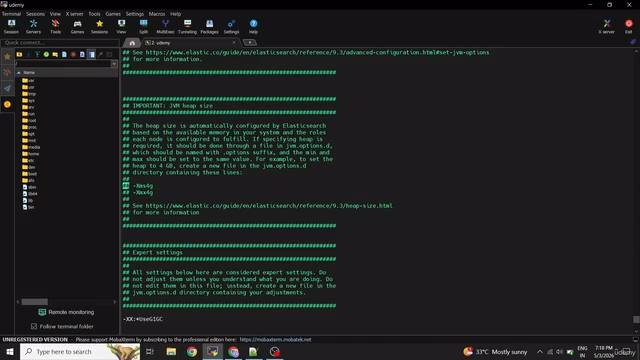

到这里证书体系就齐了：**一份根证书管全簇，一份节点证书管这一台**。后面再加 node2、node3，做法是把 `ca.crt` 拷过去，重复 3.7 即可。

### 3.8 看 `jvm.options`，决定堆大小

```bash
cd /data/elasticsearch-9.3.4/config
sudo vi jvm.options
```

找到这两行（完整文件里它们在文件靠前的位置）：

```
-Xms4g
-Xmx4g
```

讲师这台机器 16GB 内存，他**没有改**，保持 4GB。他给的规则是：

- 默认 4GB，上限 32GB（超过 32GB 会失去 JVM 指针压缩优势）。
- 机器 32GB → 堆给 16GB；机器 64GB → 堆给 32GB。
- 他自己补一句「我这边建议给总内存的 50%」。

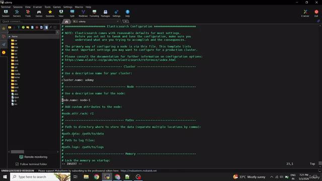

**前端换算**：`-Xmx4g` 就是 `node --max-old-space-size=4096`，一个意思，都是给运行时划一块固定的堆上限。

### 3.9 写 `elasticsearch.yml`

这是整节课的核心。路径 `/data/elasticsearch-9.3.4/config/elasticsearch.yml`，完整内容见第 4 节。讲师是一项一项边讲边改的，顺序是：

1. 取消 `cluster.name` 注释 → 填集群名
2. 取消 `node.name` 注释 → 填 `node1`
3. `node.attr.rack_id`（他说「no need to focus on this setting」，本节用不到，但留在文件里）
4. `path.data` / `path.logs` → 指向 3.5 建的两个目录
5. `network.host` → 填私有 IP
6. `http.port` → 保持 9200
7. `discovery.seed_hosts` → 填私有 IP
8. `cluster.initial_master_nodes` → 填 `node1`
9. `xpack.security.*` 那一组 → 开安全、开 transport SSL、挂三份证书


关于 `discovery.seed_hosts`，讲师解释得很清楚：单节点时就填自己；将来三节点集群，就把三台机器的 IP 用逗号隔开全部列进去，节点之间才能互相发现。

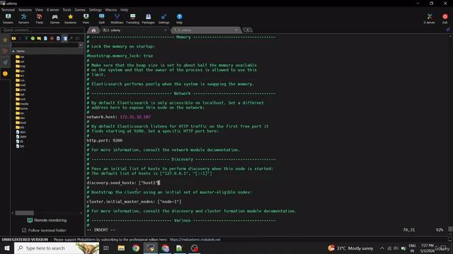

关于 `cluster.initial_master_nodes`，他强调两件事：

- 只在**第一次组建集群**时写，用来告诉集群「谁是初始 master」。
- 集群跑起来之后（重启时），**要把这一行注释掉**。P005 [03:20] 他专门回来做了这一步并重启验证。

关于安全配置，讲师原话是「security enabled ... 然后我们设置 SSL 层做节点间通信，这里挂三份证书：节点证书、节点私钥、CA 的 crt」。对应到 yml 里就是 `key` / `certificate` / `certificate_authorities` 三行。

### 3.10 建运行用户、授权

ES 不允许以 root 启动。讲师演示的流程是：

```bash
# 建用户（如果已存在会提示，讲师环境里已经有，所以他直接跳到下一步）
sudo useradd elasticsearch

# 递归改属主：程序目录、数据目录、日志目录都要给
sudo chown -R elasticsearch:elasticsearch /data/elasticsearch-9.3.4
sudo chown -R elasticsearch:elasticsearch /data/es_data
sudo chown -R elasticsearch:elasticsearch /data/es_logs

# 验证
ls -ld /data/es_data /data/es_logs
```

他特别强调：**只改数据目录不够**，日志目录不给权限，ES 起不来，因为它要往里写日志。

### 3.11 第一次启动（前台）

```bash
su - elasticsearch
cd /data/elasticsearch-9.3.4/bin
./elasticsearch
```

会看到一大段启动日志。成功的话，日志里能看到集群健康状态从 yellow 变 green（单节点无业务索引时通常是 green）。

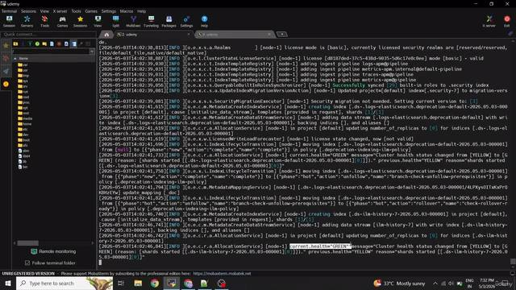

### 3.12 设置 `elastic` 用户的密码

**另开一个终端**（因为前台那个被启动日志占住了），同样切到 `elasticsearch` 用户：

```bash
su - elasticsearch
cd /data/elasticsearch-9.3.4/bin

# 方式一：让它生成一个随机强密码
./elasticsearch-reset-password -u elastic

# 方式二（讲师最终用的）：交互式自己输入
./elasticsearch-reset-password -i -u elastic
```

`-i` 就是 interactive，会提示你输入两遍密码、并确认是否重置。讲师把密码设成了一个自己记得住的字符串（他演示时用的是简短可读的密码），而不是那串随机字符。

⚠️ 讲师反复提醒：**执行这一步时集群必须是 green**，yellow / red 状态下重置密码会失败。

### 3.13 浏览器验证

拿到这台 EC2 的**公网 IP**，访问：

```
https://<公网IP>:9200
```

因为只给 transport 层挂了自签证书、HTTP 层用的是 ES 默认自签证书，浏览器一定会弹「您的连接不是私密连接」——点「高级」→「继续前往」即可。然后输入用户名 `elastic` + 刚才设的密码。

登录后返回一个 JSON，里面能看到 `cluster_name`、`node_name`、`version.number` 为 9.3.4，以及一段兼容性信息（讲师读到的是「从 8.x 的某个版本起可以恢复索引」这类字段，具体字段名请以你实际输出为准）。

### 3.14 改成后台常驻：`nohup`

关掉终端 / Ctrl+C，ES 就死了——这是 P005 开篇演示的现象。

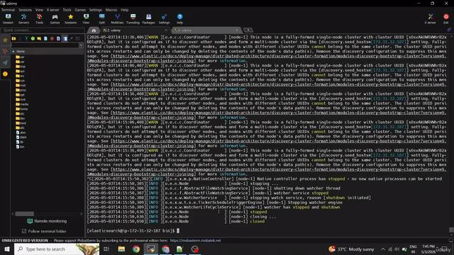

正确做法：

```bash
su - elasticsearch
cd /data/elasticsearch-9.3.4/bin
nohup ./elasticsearch > /data/es_logs/nohup.out 2>&1 &
```

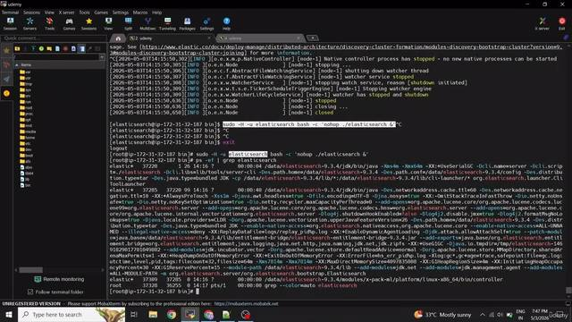

> 课里演示的就是 `nohup ./elasticsearch &` 这个形式；把 stdout/stderr 重定向到文件是本文补的收尾动作（讲师说的是「要么写成 service，要么 nohup」，没展开重定向细节）。

### 3.15 停止进程：PID + `kill -9`

```bash
ps -ef | grep elasticsearch
# 或者
jps -l
```

拿到 PID 后：

```bash
sudo kill -9 <PID>
```

再确认一下：

```bash
ps -ef | grep elasticsearch
```

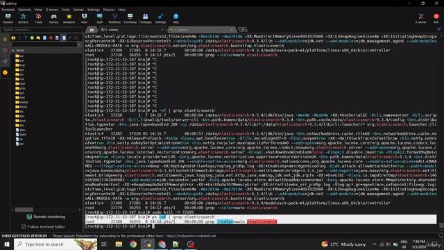

### 3.16 回填：注释掉 `cluster.initial_master_nodes` 再重启

P005 [03:20] 讲师回到 `elasticsearch.yml`，把 `cluster.initial_master_nodes` 那一行注释掉，然后 `kill -9` 重启，验证还能正常起来。这是「首次组建」和「日常重启」的分界线。

### 3.17 验证数据/日志真的落到独立目录了

```bash
ls -l /data/es_data
ls -l /data/es_logs
```

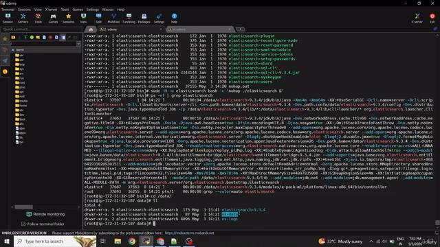

`/data/es_data` 下会出现 ES 自己建的子目录（索引数据、快照等）；`/data/es_logs` 下会出现主日志、GC 日志、慢查询日志、弃用日志、审计日志等一堆文件。**只要这两个目录里有东西，就证明第 3.9 步的 `path.data` / `path.logs` 写对了。**

---

## 4. 完整代码

### 4.1 `instance.yml`（完整文件）

路径：`/data/elasticsearch-9.3.4/instance.yml`

```yaml
instances:
  - name: "node1"
    ip:
      - "172.31.0.10"
```

> `172.31.0.10` 换成你自己的私有 IP。`node1` 必须和下面 `elasticsearch.yml` 的 `node.name` 一字不差。

### 4.2 `elasticsearch.yml`（完整文件）

路径：`/data/elasticsearch-9.3.4/config/elasticsearch.yml`

```yaml
# ---------------------------------- Cluster -----------------------------------
cluster.name: udemy

# ------------------------------------ Node ------------------------------------
node.name: node1

# 机架感知相关，本节单节点用不到，保留占位
node.attr.rack_id: rack1

# ----------------------------------- Paths ------------------------------------
path.data: /data/es_data
path.logs: /data/es_logs

# ---------------------------------- Network -----------------------------------
network.host: 172.31.0.10
http.port: 9200

# ------------------------------- Discovery ------------------------------------
discovery.seed_hosts: ["172.31.0.10"]

# 仅首次组建集群时保留，集群跑起来后请注释掉
cluster.initial_master_nodes: ["node1"]

# -------------------------------- Security ------------------------------------
xpack.security.enabled: true

xpack.security.transport.ssl.enabled: true
xpack.security.transport.ssl.key: certs/node1/node1.key
xpack.security.transport.ssl.certificate: certs/node1/node1.crt
xpack.security.transport.ssl.certificate_authorities: certs/ca/ca.crt
```

几点必须说明：

- `cluster.name`：讲师在演示里用的名字，页面上显示为 `Udemy` 形态；你写小写 `udemy` 也完全可以（讲师自己也说过「推荐小写」）。**全簇所有节点必须一致。**
- `node.attr.rack_id`：讲师明确说「no need to focus on this setting」，具体值课里没给，这里填 `rack1` 只是为了让文件结构完整，不影响本节任何功能。
- `node-to-node` 的 9300 端口：讲师说默认就是 9300，「keep it as is」，所以 yml 里不需要写。只有同一台机器跑两个 ES 实例时才需要改。
- **HTTP 层 SSL 课里没有单独配置**，用的是 ES 默认行为，所以浏览器会报证书不受信任，这是预期现象。
- 证书路径是相对于 `config/` 目录写的（`certs/node1/node1.key`），这是 ES 的默认解析基准，不用写绝对路径。

### 4.3 `jvm.options` 中要关心的两行（完整片段）

路径：`/data/elasticsearch-9.3.4/config/jvm.options`

```text
-Xms4g
-Xmx4g
```

16GB 机器保持原样。要改就同时改这两行，两个值必须相等（否则会频繁 GC）。

### 4.4 `vm.max_map_count` 配置（完整文件）

路径：`/etc/sysctl.d/99-elasticsearch.conf`

```conf
vm.max_map_count=262144
```

生效并验证：

```bash
sudo sysctl -p /etc/sysctl.d/99-elasticsearch.conf
sysctl vm.max_map_count
```

> 课里讲师只说了「值低了 ES 起不来」以及「配置在系统的 sysctl 配置目录里、加一行、然后执行命令生效」，没有逐字给出文件名和具体数值。上面是这门课语境下的标准落地写法。

### 4.5 一键脚本 `install-es.sh`（把 3.4–3.11 串起来）

路径：`/data/install-es.sh`

```bash
#!/usr/bin/env bash
# 说明：本脚本是课程 P004 中逐条手敲的命令按顺序整理而成。
# set -euo pipefail 是整理时加的保护，课里没有讲。
set -euo pipefail

ES_VERSION="9.3.4"
ES_HOME="/data/elasticsearch-${ES_VERSION}"
ES_DATA="/data/es_data"
ES_LOGS="/data/es_logs"
PRIVATE_IP="172.31.0.10"   # 换成你的私有 IP
ES_USER="elasticsearch"

echo "==> 1. 准备目录"
sudo mkdir -p /data
sudo mkdir -p "${ES_DATA}" "${ES_LOGS}"

echo "==> 2. 下载并解压（需外网）"
cd /data
sudo curl -O "https://artifacts.elastic.co/downloads/elasticsearch/elasticsearch-${ES_VERSION}-linux-x86_64.tar.gz"
sudo tar -zxvf "elasticsearch-${ES_VERSION}-linux-x86_64.tar.gz"
sudo rm -f "elasticsearch-${ES_VERSION}-linux-x86_64.tar.gz"

echo "==> 3. 生成 CA 根证书（空密码直接回车）"
cd "${ES_HOME}"
sudo ./bin/elasticsearch-certutil ca

echo "==> 4. 解出 ca.crt / ca.key"
sudo mkdir -p config/certs
sudo mv elastic-stack-ca.p12 config/certs/
cd config/certs
sudo unzip -o elastic-stack-ca.p12 -d ca

echo "==> 5. 写 instance.yml 并签发节点证书"
cd "${ES_HOME}"
sudo tee instance.yml > /dev/null <<EOF
instances:
  - name: "node1"
    ip:
      - "${PRIVATE_IP}"
EOF

sudo ./bin/elasticsearch-certutil cert \
  --ca-cert "${ES_HOME}/config/certs/ca/ca.crt" \
  --ca-key  "${ES_HOME}/config/certs/ca/ca.key" \
  --in      "${ES_HOME}/instance.yml"

echo "==> 6. 手动解压上一步产出的证书 zip，确认得到 node1/node1.crt 与 node1/node1.key"
ls -l "${ES_HOME}"

echo "==> 7. 建用户并授权"
sudo useradd "${ES_USER}" || true
sudo chown -R "${ES_USER}:${ES_USER}" "${ES_HOME}"
sudo chown -R "${ES_USER}:${ES_USER}" "${ES_DATA}"
sudo chown -R "${ES_USER}:${ES_USER}" "${ES_LOGS}"

echo "==> 8. 完成。请手动编辑 config/elasticsearch.yml（见文档第 4.2 节），然后启动："
echo "    su - ${ES_USER}"
echo "    cd ${ES_HOME}/bin && ./elasticsearch"
```

### 4.6 启动 / 停止 / 验证 三条命令

```bash
# 后台启动（以 elasticsearch 用户）
su - elasticsearch -c 'cd /data/elasticsearch-9.3.4/bin && nohup ./elasticsearch > /data/es_logs/nohup.out 2>&1 &'

# 停止
ps -ef | grep elasticsearch
sudo kill -9 <PID>

# 验证（-k 跳过自签证书校验）
curl -k -u elastic 'https://<公网IP>:9200'
```

---

## 5. 逐行解释

### 5.1 `elasticsearch.yml` 每一行为什么这么定

**`cluster.name: udemy`**
一个集群只有一个名字，所有节点必须相同。写成不一样会变成两个互不相干的集群。这是 ES 的「逻辑分组名」，不是主机名。

**`node.name: node1`**
集群内唯一。讲师举的例子很形象：10 个节点不能全叫 `node1`，第二台就叫 `node2`，或者 `data-node-1`、`data-node-2`。建议全小写。
**这一行和 `instance.yml` 里的 `name` 是强绑定的**——证书是按名字签的，名字对不上，节点间 TLS 握手时校验不过，启动直接失败。这是本节最容易踩的坑，没有之一。

**`node.attr.rack_id: rack1`**
机架感知用的自定义属性。ES 在分配分片时会参考它，尽量把主分片和副本放到不同「机架」上。单节点集群完全用不到，讲师原话「no need to focus on this setting」，后续视频才专门讲。

**`path.data: /data/es_data`**
所有索引数据、文档数据都写在这里。**必须独立于程序目录**——原因就是第 2 节那句：升级时覆盖解压，如果数据在解压目录里，数据一起没了。这是运维级别的红线。

**`path.logs: /data/es_logs`**
主日志、GC 日志、慢查询日志、弃用日志、审计日志全在这里。P005 [07:08] 讲师专门列了一遍这些日志文件，并说「节点起不来、运行不正常时，先看这些日志」。同样必须独立，否则程序目录变巨大且权限混乱。

**`network.host: 172.31.0.10`**
监听地址。讲师说单机 demo 可以写 `localhost` 或 `0.0.0.0`，但**生产上写本机私有 IP**：写 `0.0.0.0` 会监听所有网卡（包括你不希望暴露的），写 `localhost` 则外部访问不进来。本机私有 IP 是「只让内网能连」的最稳做法。公网 IP 用来给浏览器访问，不写进配置文件。

**`http.port: 9200`**
默认值。只有同一台机器装多个 ES 实例时才需要改（9201、9202…）。一台机器一个实例就保持默认。

**`discovery.seed_hosts: ["172.31.0.10"]`**
「我要去找哪些人去组集群」。三节点集群时这里写三个 IP，节点启动时会挨个去连，从而知道「集群一共有几个人」。

**`cluster.initial_master_nodes: ["node1"]`**
只在**第一次组建集群**时生效，告诉集群「候选 master 是谁」。讲师强调两点：master 数量建议为奇数（避免脑裂，后续视频讲）；集群跑起来之后要注释掉。P005 里他真的回来注释并重启验证了。

**`xpack.security.enabled: true`**
打开安全模块（认证 + 授权）。关掉的话，任何能连到 9200 的人都能读写删你的数据——生产环境绝不可接受。

**`xpack.security.transport.ssl.enabled: true`**
节点间通信（9300 端口）走 TLS。讲师说的「SSL 层、节点间通信」就是这一行。

**`xpack.security.transport.ssl.key` / `.certificate` / `.certificate_authorities`**
三份证书，正好对应讲师说的「三份证书」：

| 配置项 | 文件 | 作用 |
|---|---|---|
| `.key` | `node1/node1.key` | 本节点私钥，证明「我是 node1」 |
| `.certificate` | `node1/node1.crt` | 本节点证书，内含 node1 的名字和 IP |
| `.certificate_authorities` | `ca/ca.crt` | 根证书，用来验证对方证书是不是我信任的 CA 签的 |

**前端换算**：这跟你跑 Node HTTPS 服务时传 `{ key, cert, ca }` 是一模一样的结构，只不过 ES 把它拆成 yml 里的三行，而且**根证书要自己签**（`elasticsearch-certutil ca` 就相当于自己当了一次 CA）。

### 5.2 证书流程每一步在干什么

1. `elasticsearch-certutil ca` → 生成 `elastic-stack-ca.p12`，里面封着根证书 + 根私钥。
2. `unzip` 它 → 拆出 `ca.crt`（公开，发给每台机器）和 `ca.key`（私钥，**绝不能流出这台机器**）。
3. `instance.yml` 声明「我要签一个叫 node1、IP 是 x.x.x.x 的证书」。
4. `elasticsearch-certutil cert --ca-cert --ca-key --in` → 用根私钥给 node1 签一张证书。
5. 解开产出的 zip → 得到 `node1.crt` + `node1.key`。
6. 把 `ca.crt`、`node1.crt`、`node1.key` 三个路径写进 `elasticsearch.yml`。

**为什么讲师第一次跑失败？** 他在 `bin` 目录里执行，命令里的 `config/certs/ca/ca.crt` 会被解析成 `bin/config/certs/ca/ca.crt`，不存在 → `NoSuchFileException`。改法是三种任选：① 回到 ES 根目录执行；② 用绝对路径；③ 用 `../config/...`。本文统一用绝对路径，最不容易错。

### 5.3 为什么必须单独建一个用户

ES 从很早的版本开始就硬性拒绝以 root 运行（安全设计），启动时会直接报错退出。所以：

- `useradd elasticsearch` 建用户；
- `chown -R elasticsearch:elasticsearch` 把程序目录 + 数据目录 + 日志目录全部给他；
- `su - elasticsearch` 切过去再启动。

讲师特别点出：**很多人只改了数据目录权限，忘了日志目录，结果启动到一半卡在写日志失败。**

**前端换算**：你在公司服务器上部署 Node 也不会用 root 跑（`pm2` 默认也建议用普通用户），道理一样。

### 5.4 `-Xms4g / -Xmx4g` 怎么定

- 两个值必须相等，否则 JVM 会不停地扩缩堆，性能抖动。
- 不超过物理内存的一半，且不超过 32GB。
- 16GB 机器 → 4GB 或 8GB 都行，讲师选了 4GB（因为这台机器还要跑 Kibana）。
- 32GB 机器 → 16GB；64GB 机器 → 32GB。

### 5.5 为什么关终端就死 / 为什么 `nohup` 能活

前台运行 `./elasticsearch` 时，进程是终端会话的子进程，终端退出会发送 SIGHUP，进程跟着死。`nohup` = no hang up，让进程忽略 SIGHUP；末尾 `&` 让它进后台；`> file 2>&1` 把输出接到文件，否则退出终端后 stdout 无处可去。

讲师也提了另一条正路：**写 systemd service 文件**（`systemctl start elasticsearch`），但他没展开写，课里没给 service 文件内容。

### 5.6 `kill -9` 的含义

`9` 是 SIGKILL，强杀，进程没机会做清理。对 ES 来说强杀有丢数据的理论风险（尤其在大量写入时），生产上更推荐 `systemctl stop` 让它优雅退出。课里用 `kill -9` 只是为了演示「停掉再重启」这个循环。

### 5.7 重置密码为什么要求 green

`elasticsearch-reset-password` 需要向集群写入安全索引。集群 yellow / red 时部分分片不可用，写入会失败，命令直接报错。所以顺序必须是：**先把集群跑健康 → 再重置密码 → 再用新密码登录**。

---

## 6. 复现检查清单

按顺序打勾，任何一项没勾上，后面一定出问题。

**环境与目录**
- [ ] `cat /etc/os-release` 确认是 RHEL 系
- [ ] `free -h` 看到内存总量，据此决定 `-Xmx`
- [ ] `/data` 存在
- [ ] `/data/elasticsearch-9.3.4` 解压完成，tar.gz 已删
- [ ] `/data/es_data`、`/data/es_logs` 存在且为空

**证书**
- [ ] `config/certs/ca/ca.crt` 与 `ca.key` 都存在
- [ ] `config/certs/node1/node1.crt` 与 `node1.key` 都存在
- [ ] `instance.yml` 里的 `name` == `elasticsearch.yml` 里的 `node.name`
- [ ] `instance.yml` 里的 IP 是**私有 IP**，不是公网 IP

**配置**
- [ ] `path.data` / `path.logs` 指向 `/data/es_data` / `/data/es_logs`
- [ ] `network.host` 是本机私有 IP
- [ ] `discovery.seed_hosts` 里包含本机私有 IP
- [ ] `cluster.initial_master_nodes` 第一次启动时存在，重启前已注释
- [ ] `xpack.security.enabled: true`
- [ ] transport ssl 三行路径都能 `ls` 到

**权限与系统参数**
- [ ] 三个目录的属主都是 `elasticsearch:elasticsearch`
- [ ] `vm.max_map_count` ≥ 262144
- [ ] 用 `elasticsearch` 用户（不是 root）启动

**运行验证**
- [ ] 前台 `./elasticsearch` 能起到日志出现 green
- [ ] `https://<公网IP>:9200` 能打开登录框
- [ ] `elastic` 密码重置成功并登录进去
- [ ] 关掉终端后 ES 仍存活（`nohup` 生效）
- [ ] `/data/es_data` 下出现了 ES 自动创建的子目录
- [ ] `/data/es_logs` 下出现了日志文件（主日志 / gc 日志 / 慢日志 / 弃用日志 / 审计日志）

---

## 7. 课里没讲但你会撞上的

**1）EC2 安全组没开 9200**
课里没提安全组配置。如果你浏览器连不上，先查 AWS 控制台安全组的入站规则有没有放行 9200。这是新手最常卡的一步。

**2）浏览器「您的连接不是私密连接」**
课里只给 transport 层挂了证书，HTTP 层是 ES 默认生成的自签证书，浏览器一定报警。点「高级 → 继续前往」。想彻底消除告警，需要给 HTTP 层也配正式证书（课里没讲）。

**3）`curl` 访问 https 会报证书错误**
必须加 `-k`：`curl -k -u elastic https://<ip>:9200`。课里没演示 curl，只演示了浏览器。

**4）`vm.max_map_count` 太低，ES 直接拒绝启动**
课里在 P004 结尾提了这个点，但没给完整配置文件。见第 4.4 节。报错关键词是 `max virtual memory areas vm.max_map_count [65530] is too low`。

**5）用 root 启动会直接报错退出**
报错大意是「can not run elasticsearch as root」。必须 `su - elasticsearch` 或 `sudo -u elasticsearch`。

**6）`cluster.initial_master_nodes` 忘了注释**
第一次启动没问题，但每次重启都带着它，多节点场景下会导致集群起不来。P005 讲师自己演示了「注释掉再重启」这一步，但没讲不注释的后果——建议养成「起来之后就注释」的习惯。

**7）没有 systemd service，机器重启后 ES 不会自己起来**
讲师在 P005 [00:00] 提了「要么写成 service 文件，要么用 nohup」，但**service 文件内容课里没给**。`nohup` 只能保证终端关闭不挂，**保证不了机器重启后自启**。生产环境必须自己补一个 `elasticsearch.service`。

**8）密码重置失败**
90% 的原因是集群不是 green。先访问 9200 看一眼 `status` 字段，或者看 `/data/es_logs` 里的主日志。

**9）单节点集群健康状态是 yellow**
如果建了带副本的索引，副本无处分配，状态会一直是 yellow。这是单节点的必然现象，不是故障。课里演示时是 green，因为当时没有业务索引。

**10）磁盘和快照**
P005 提到 `es_data` 下有「存快照的目录」，但**备份/恢复怎么做，课里没讲**。生产上这是必做项。

**11）时间同步**
证书校验依赖系统时间。机器时间偏差过大时 TLS 握手会失败，报证书过期或未生效。课里没提，但云主机建议开 NTP。

**12）多节点扩容时最容易忘的两件事**
把 `ca.crt` 拷到新机器；`instance.yml` 里改 `name` 和 `ip`，并保证新名字和那台机器 `elasticsearch.yml` 的 `node.name` 一致。讲师在 P004 结尾说「配 node2 就是把 ca.crt 拷过去，重复同样的流程」，但具体命令没展开。

---

**到这里，你已经拥有一台能对外提供 HTTPS 访问、带账号密码、能后台常驻、数据和日志都落在独立目录的 Elasticsearch 9.3.4 单节点。** 下一节才会开始往里灌数据、装 Kibana 和 Logstash——那部分不在 P004–P005 的范围内。