# ELK Stack 实战（P006–P008）：配置 Kibana、开启 Stack Monitoring、部署 Metricbeat

> 版本说明：逐字稿中讲师反复口述的安装包版本为 `9.3.4`（"kibana 9.3.4""metricbeat of version 9.3.4"）。下文所有命令与文件名按该版本写；若你下载页上已无该小版本，请用同一大版本内的可用小版本替换，**文件名里的版本号要同步改**，其余步骤不变。
>
> 路径说明：课里讲师的 ES / Kibana 都落在同一个 `data` 目录下（`elasticsearch`、`kibana` 两个子目录平级）。下文统一写成 `/data`，你的机器上如果是 `/opt` 或别的位置，把路径整体替换即可，**但 `kibana.yml` 里所有绝对路径必须跟着改**，否则日志和证书都会找不到。

---

## 1. 这一节做什么

P006–P008 这三节把 ELK 从"只有 Elasticsearch"推进到"一套能自己监控自己的栈"。目标是完成三件事：

1. **P006**：在已经跑着 Elasticsearch 的那台机器上，装好 Kibana，给它签证书、配 `kibana.yml`、设置 `kibana_system` 用户的密码、把日志落到指定目录，最后用 `nohup` 常驻。做完的判定标准很明确：浏览器能打开 Kibana 登录页，用 `elastic` 账号登进去看到 Home。
2. **P007**：Kibana 能登录不等于能看到监控。默认 `xpack.monitoring.collection.enabled` 是关的，所以 Stack Monitoring 页面是 "没有监控数据"。这一节要打开 ES 侧的采集开关、重启 ES、再解决 Kibana 侧因为缺加密密钥导致 "无法创建告警" 的报错。
3. **P008**：换第二台机器（课里是第二台 EC2，私有 IP 段 171 那台）装 Metricbeat，用 `modules enable / disable` 管模块，把 `metricbeat.yml` 指向第一台机器上的 Kibana 和 ES，把 CA 证书拷过去解决 x509 报错，最后在 Kibana 里看到自动安装的默认仪表盘和真实的主机指标。

最终拓扑是这样的（课里的叫法）：

| 角色 | 机器 | 跑什么 |
|---|---|---|
| 节点 A | 第一台 EC2（课里口述 "171 这台"，实际以你的私有 IP 为准） | Elasticsearch + Kibana |
| 节点 B | 第二台 EC2 | Metricbeat（`system` 模块采集主机指标） |

---

## 2. 讲师原话

关于 Kibana 的定位：

> "Kibana is a paper tag UI through which you can see what stored in elastic search" —— p006 [00:00]
> （ASR 把 "a web UI" 识别成了 "paper tag UI"，意思是 Kibana 本身不存业务数据，只是一个看 Elasticsearch 里有什么的 Web 界面。）

关于生产环境装包的现实约束：

> "in production environment, there will be no internet connection. So in that also case, you will get an NFS storage mounted on same VM and the infra will provide that the package" —— p006 [02:24]

关于证书必须从 Elasticsearch 侧签发：

> "you cannot generate certificates from Kibana setup we need to generate this certificate through elastic search only" —— p006 [07:08]

关于 `kibana_system` 这个用户是干什么的：

> "Kibana also needs to authenticate with Elasticsearch, so it should have its username and password... for kibana we have another user which is kibana_system" —— p006 [14:20]

关于日志配置里踩的坑（这一条非常重要，是本节唯一一个"启动失败→定位→修好"的完整闭环）：

> "the mistake which we have made so to see in this login method we need to give the file name also which we have not given over here... That's why it is not able to start." —— p006 [21:52]

关于监控默认是关的：

> "as of now when I open this it's showing to no monitoring data found" —— p007 [00:26]

关于 Stack Monitoring 报错的原因：

> "I am getting issue when I am seeing the monitoring data. So, for that also we need to generate some extract and script in case... go to bin directly of Kibana... generate... you will get these three keys" —— p007 [05:39]

关于 Metricbeat 是什么：

> "metricbeat is used to collect all the metrics which are like CPU utilization, memory utilization, disk utilization, network utilization" —— p008 [02:25]

关于 x509 报错和为什么不要图省事关掉校验：

> "we have Recruiting error as you can see x509 signed by unknown authority... first thing is you can add the ca.cert path to both the locations otherwise you can set SSL verification mode as a none. During production it is better to set this path rather than using this as a none because it exposes our data." —— p008 [14:13]

---

## 3. 从零复现

### 3.0 前置条件

- 节点 A 上 Elasticsearch 已经在跑，`https://<节点A私有IP>:9200` 能通，`elastic` 用户的密码你知道。
- 节点 A 上已经有 Elasticsearch 的 CA 文件，课里它在 Elasticsearch 的 `config/certs` 目录下（`ca.crt`）。如果 `certs` 目录还不存在，先建。
- 节点 A 和节点 B 在同一个私有网络里，**9200 和 5601 两个端口对彼此放通**（安全组 / 防火墙）。
- 后续所有"启动服务"的命令，都必须在安装目录的 **`bin`** 目录里执行，不要在 `config` 目录里执行——课里就因为这个白等了一会儿：

> "Because I was able to do this in config directory, which is wrong. So we need to go to bin directory." —— p006 [26:08]

### 3.1 下载并解压 Kibana（节点 A）

进入 `/data`，下载 OSS 包（课里是从 Elastic 官网的产品下载页选 ELK Stack 那一栏，选 Linux 的 tar 包）：

```bash
cd /data
# 课里是在浏览器下载页拿到链接后 wget 的，这里以 9.3.4 为例，链接以你下载页为准
wget https://artifacts.elastic.co/downloads/kibana/kibana-9.3.4-linux-x86_64.tar.gz
tar -xzf kibana-9.3.4-linux-x86_64.tar.gz
rm -rf kibana          # 删掉旧目录（课里说 "we will delete older one"）
mv kibana-9.3.4-linux-x86_64 kibana
```

然后建日志目录（课里明确说 Kibana 也在这台机器上，所以要单独给它一个日志目录）：

```bash
mkdir -p /data/kibana/logs
```

> 生产环境里没网怎么办，讲师给的做法是：把包放在 NFS 挂载点上，从挂载点拷到本地再解压。课里只是描述了这个流程，**没有给出具体的 `mount` 命令**，所以这里不写。

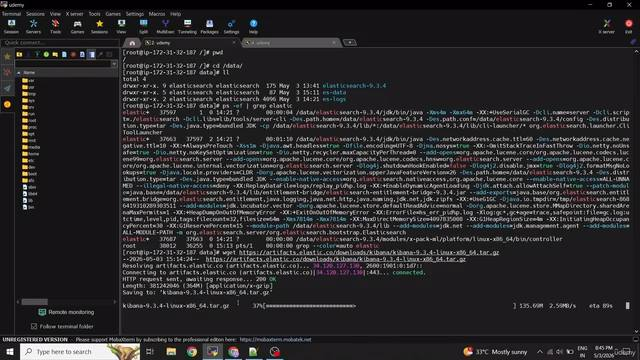

### 3.2 先给 Kibana 签发证书，再动配置

顺序不能反。证书要从 **Elasticsearch 的目录**里签，不能在 Kibana 目录里签。做法是写一个 `instance.yml` 描述"我要给谁签、它的 IP 是什么"，再调 `elasticsearch-certutil`。

在 Kibana 目录下建一个 `instance.yml`：

```yaml
instances:
  - name: kibana
    ip: ["172.31.x.x"]      # 换成节点 A 的私有 IP；讲师说如果 Kibana 装在别的机器上，这里要填那台机器的私有 IP
    dns: ["kibana"]         # 课里给出的主机名，签出来的证书里会带上它
```

然后在 **Elasticsearch 的安装目录**下（`cd /data/elasticsearch`）执行签发。讲师口述这条命令时只讲了"它是从默认路径取 CA、`-in` 指向 Kibana 目录下的 `instance.yml`、`-out` 指向 Kibana 的 `certs` 目录"，**没有逐字念出完整参数**。下面是按该描述重组的写法，参数名以 `./elasticsearch-certutil cert --help` 的实际输出为准：

```bash
cd /data/elasticsearch
# 先建好输出目录
mkdir -p /data/kibana/config/certs

./bin/elasticsearch-certutil cert \
  --ca-cert config/certs/ca.crt \
  --ca-key  config/certs/ca.key \
  --in      /data/kibana/instance.yml \
  --out     /data/kibana/config/certs/certs.zip \
  --pass    ""
```

> 课里讲师在 Elasticsearch 的 `bin` 目录下执行 `./elasticsearch-certutil ...`，如果你的当前目录是安装根目录，路径要写成 `./bin/elasticsearch-certutil`。生成的 zip 里包含 `kibana/kibana.crt`、`kibana/kibana.key` 和 CA，解压后按课里说的把 `kibana.crt` / `kibana.key` 放到 `config/certs/` 下备用。

```bash
cd /data/kibana/config/certs
unzip certs.zip
rm -f certs.zip
# 解压后目录是 kibana/，里面是 kibana.crt / kibana.key
```

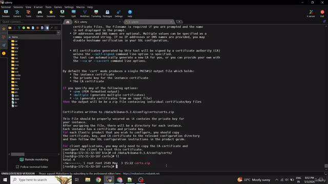

### 3.3 改 `kibana.yml`

`kibana.yml` 在 `/data/kibana/config/` 下。课里改动的地方一共五组，按顺序：

1. `server.port`（默认 5601，如果一台机器要跑两个 Kibana 实例才需要改）
2. `server.host`（填私有 IP，有域名就填域名）
3. `server.ssl` 三项（`enabled` / `certificate` / `key`）
4. `elasticsearch.hosts` + 账号密码 + `elasticsearch.ssl.certificateAuthorities`
5. `logging`（日志文件路径 + 按大小滚动的 appender）

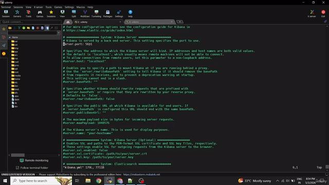

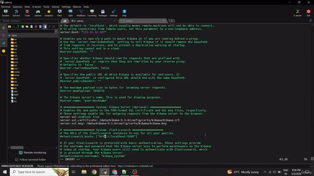

### 3.4 给 `kibana_system` 设置密码

`kibana_system` 是内置用户，不能自己"创建"，只能重置密码。课里用的是 Elasticsearch 自带的密码重置工具，在 **Elasticsearch 的 `bin` 目录**下执行，交互模式：

```bash
cd /data/elasticsearch
./bin/elasticsearch-reset-password --username kibana_system -i
```

> 讲师口述时说的是"在 print 目录中""dot slash"，这里是 `bin` 目录下的 `elasticsearch-reset-password`。密码课里设的是 `Kibana@012`（口述成 "Kibana at 0.12"），你设自己的即可，**但一定要和 `kibana.yml` 里 `elasticsearch.password` 一字不差**，YAML 里建议整个用引号包起来。

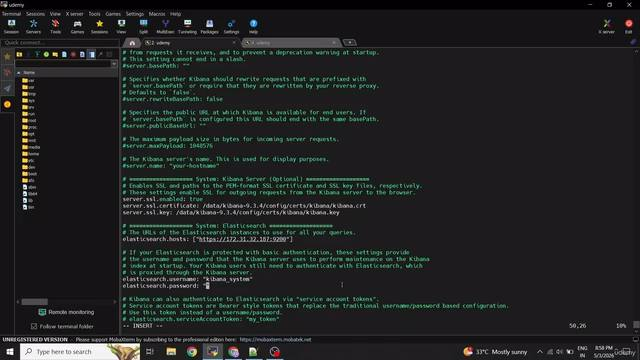

### 3.5 前台启动排错，再转后台

第一次**不要**直接 `nohup`。课里的做法是：先前台跑一遍，报错能立刻看到，修好之后再转后台。

```bash
cd /data/kibana/bin
./kibana
```

课里第一次启动就挂了，原因是 `logging` 配了目录但没配文件名：

> "we need to give the file name also which we have not given over here" —— p006 [21:52]

加上 `fileName` 之后重新启动，直到日志里不再有新报错：

```bash
# 前台验证没问题后，Ctrl+C 停掉，再转后台
cd /data/kibana/bin
nohup ./kibana &
```

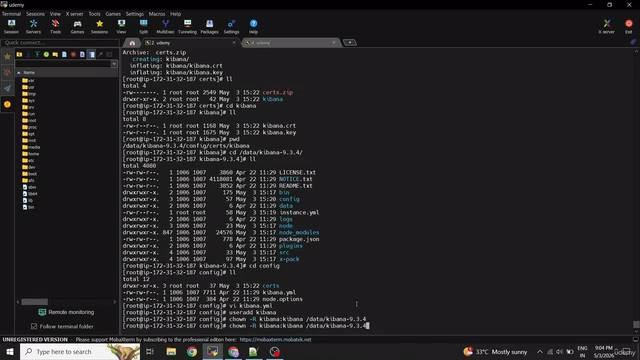

### 3.6 验证 Kibana 与日志落盘

浏览器打开 `https://<节点A公网IP>:5601`。自签证书会报"证书不受信任"，课里说直接继续（"继续操作即可"）。用 `elastic` 账号登录，能看到 Home 页就算 P006 完成。

验证日志确实落在你配的目录里，并且是 JSON 格式：

```bash
tail -n 100 -f /data/kibana/logs/kibana.log
```

> 课里还提到日志会按 **256MB** 滚动（"如果 coil 大小为 256 MB，那么它就会触发 rollover"），滚动出来的文件会有编号后缀。排查启动问题时，看最新的那个文件；`level` 字段出现 `error` 的那一行就是根因。

### 3.7 打开 Elasticsearch 的监控采集并重启

这一步在**节点 A** 上做。编辑 `/data/elasticsearch/config/elasticsearch.yml`，在文件末尾追加两行：

```yaml
xpack.monitoring.collection.enabled: true
xpack.monitoring.history.duration: 7d
```

改完必须重启 Elasticsearch：

```bash
# 停
pkill -f 'org.elasticsearch.bootstrap.Elasticsearch'

# 确认停了（课里说的是 "check whether elastic search is still running，let's kill"）
ps -ef | grep -i elasticsearch

# 启（务必在 bin 目录）
cd /data/elasticsearch/bin
nohup ./elasticsearch &
```

判断生效的标准：去 Kibana 的 **Stack Management → Index Management**，勾选 "包含隐藏索引"，能看到名字以 `monitoring` 开头的索引，日期是当天。


### 3.8 生成 Kibana 加密密钥，修掉 Stack Monitoring 的报错

打开 Stack Monitoring 时会报 "无法创建告警"。课里的解法是在 **Kibana 的 bin 目录**下生成三个密钥，粘到 `kibana.yml` 末尾，再重启 Kibana：

```bash
cd /data/kibana/bin
./kibana-encryption-keys generate
```

> 讲师口述时说成"加密密钥"，实际是 **encryption keys**。命令名以 `bin/` 目录下实际存在的可执行文件为准，可能是 `kibana-encryption-keys` 或 `kibana-encryption-keys.bin`，`ls` 一下就知道。它会打印三项（加密已保存对象、报表、安全会话各一把），**原样复制三行**到 `kibana.yml` 末尾，不要改 key 的值。

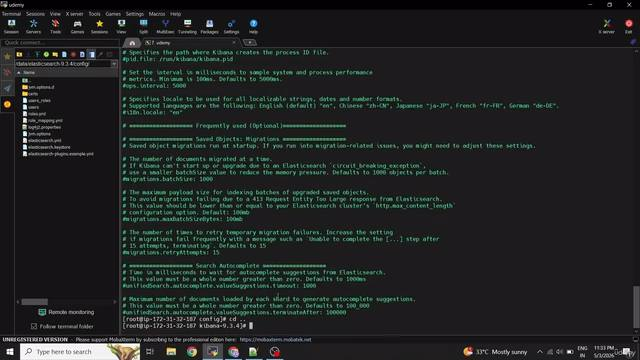

粘好后重启 Kibana，回到 Stack Monitoring，能看到 Overview 里的集群健康、节点数、索引数、JVM 内存、文档总数、数据量、搜索速率、索引速率、索引延迟等图表。

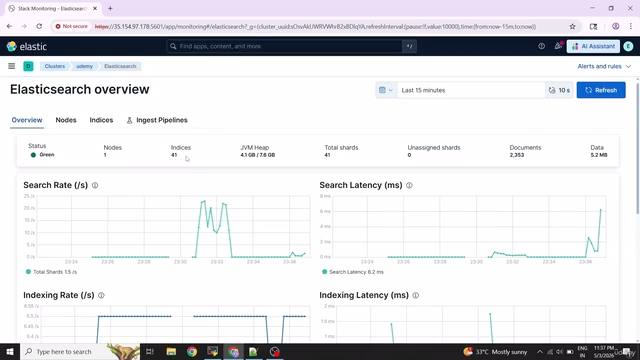

### 3.9 在节点 B 上装 Metricbeat

节点 B 只跑采集器，不跑 ES 和 Kibana。

```bash
# 建目录（课里说和节点A一样建三级目录）
mkdir -p /data
cd /data
wget https://artifacts.elastic.co/downloads/beats/metricbeat/metricbeat-9.3.4-linux-x86_64.tar.gz
tar -xzf metricbeat-9.3.4-linux-x86_64.tar.gz
rm -rf metricbeat
mv metricbeat-9.3.4-linux-x86_64 metricbeat
```

### 3.10 用命令管理模块（不要手动改文件名）

课里重点演示了 `modules enable / disable / list`。**不要**自己手动把 `xxx.yml.disabled` 改名成 `xxx.yml`，用命令：

```bash
cd /data/metricbeat

# 列出所有模块和启用状态（默认只有 system 是 enabled）
./metricbeat modules list

# 启用 sql 模块作为演示
./metricbeat modules enable sql

# 再 list，确认 sql 已 enabled
./metricbeat modules list

# 关掉
./metricbeat modules disable sql
```

`enable` 之后 `modules.d/` 下的文件名会从 `sql.yml.disabled` 变成 `sql.yml`，这就是"启用了"。默认的 `system` 模块采集周期是 10 秒，改 `modules.d/system.yml` 里的 `period` 可以调。

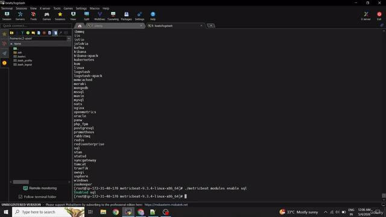

### 3.11 配置 `metricbeat.yml`

编辑 `/data/metricbeat/metricbeat.yml`，一共四组：

1. `setup.dashboards.enabled: true` + `setup.kibana.host`（让 Metricbeat 启动时自动装仪表盘）
2. `output.elasticsearch.hosts` + `protocol: https` + 账号密码
3. `output.elasticsearch.ssl.certificate_authorities`（解决 ES 方向的 x509）
4. `setup.kibana.ssl.certificate_authorities`（解决 Kibana 方向的 x509）

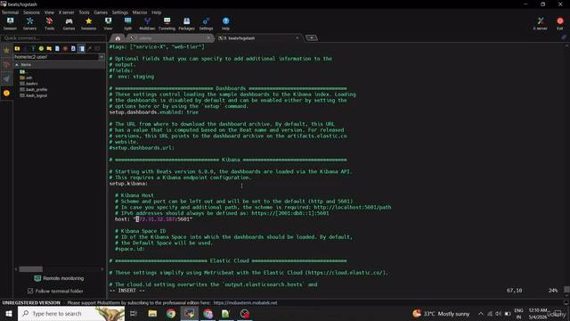

### 3.12 把 CA 拷到节点 B 并重启 Metricbeat

课里第一次启动就报了 `x509: certificate signed by unknown authority`。原因是节点 B 上没有 CA 文件，无法验证节点 A 的自签证书。解法是把节点 A 的 `ca.crt` 拷到节点 B，然后在**两个地方**都写上路径：

```bash
# 在节点 B 上执行（scp 的具体写法课里没给，只给了 cat 出来的效果）
mkdir -p /data/metricbeat/certs
scp root@<节点A私有IP>:/data/elasticsearch/config/certs/ca.crt /data/metricbeat/certs/ca.crt
```

课里明确说了另一条路是 `ssl.verification_mode: none`，但**生产别用**，因为"它会暴露我们的数据"。另外，改完 YAML 后如果还报同样的错，先检查缩进——课里就遇到过一次"当时存在缩进问题，这就是我们遇到该问题的原因"。

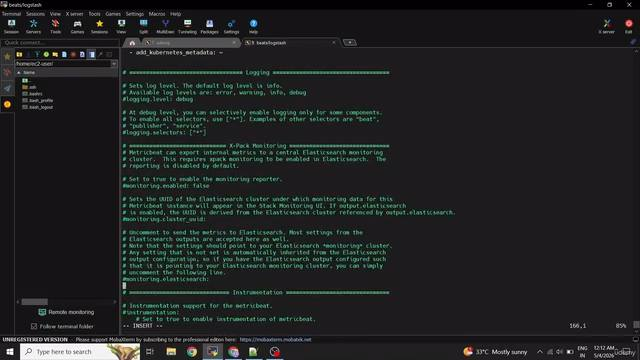

### 3.13 验证数据流与仪表盘

判断 Metricbeat 是否真的在写数据，最直接的办法是看文档数是否在涨：

```bash
# 在 Kibana 里：Stack Management → Index Management → 搜 metricbeat → 看文档数
# 或者用 curl 查（账号密码换成你自己的）
curl -k -u elastic:'你的密码' \
  'https://<节点A私有IP>:9200/metricbeat-*/_count?pretty'
```

计数在涨（课里从 264 涨到 285）就说明链路通了。然后去 Kibana 的 Dashboard 找 `[Metricbeat System] Host overview`，能看到单台主机的 CPU / 内存 / 磁盘当前利用率、入站出站流量、按 CPU 分组的 Top 主机列表。

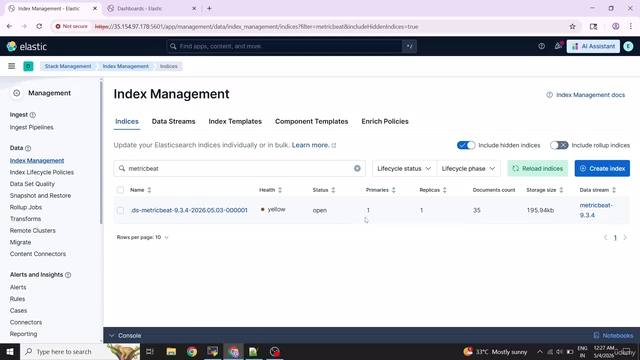

最后给 Metricbeat 建专用系统用户，用 `nohup -u <用户>` 方式后台跑，避免用 root 跑采集器。

---

## 4. 完整代码

### 4.1 `/data/kibana/instance.yml`（新增）

```yaml
instances:
  - name: kibana
    ip: ["172.31.x.x"]
    dns: ["kibana"]
```

### 4.2 `/data/kibana/config/kibana.yml`（按课里改动项整理出的完整最小可用版）

> 说明：这是把课里讲到的每一项都写全、其余保持默认的版本，可直接覆盖原文件。**所有 `172.31.x.x` 换成节点 A 的私有 IP。**

```yaml
# ---------- 服务监听 ----------
server.port: 5601
server.host: "172.31.x.x"

# ---------- 浏览器 <-> Kibana 的 SSL ----------
server.ssl.enabled: true
server.ssl.certificate: /data/kibana/config/certs/kibana.crt
server.ssl.key: /data/kibana/config/certs/kibana.key

# ---------- Kibana -> Elasticsearch ----------
elasticsearch.hosts: ["https://172.31.x.x:9200"]
elasticsearch.username: "kibana_system"
elasticsearch.password: "Kibana@012"
elasticsearch.ssl.certificateAuthorities: ["/data/kibana/config/certs/ca.crt"]

# ---------- 日志 ----------
logging:
  appenders:
    file:
      type: rolling-file
      fileName: /data/kibana/logs/kibana.log
      policy:
        type: size-limit
        size: 256mb
      strategy:
        type: numeric
        max: 10
      layout:
        type: json
  root:
    appenders: ["file"]
    level: info

# ---------- Stack Monitoring 所需的三把密钥（用 kibana-encryption-keys generate 生成后粘到这里） ----------
# xpack.encryptedSavedObjects.encryptionKey: "<生成的第一把>"
# xpack.reporting.encryptionKey: "<生成的第二把>"
# xpack.security.encryptionKey: "<生成的第三把>"
```

> `rolling-file` 这个 appender 类型的名字，讲师口述为 "roll over login"，实际写法请以安装包里自带 `kibana.yml` 的注释为准；如果你这个版本仍然用 `type: file` 配 `rolling policy` 的形式，按自带注释写即可，**关键是 `fileName` 必须有值**，这是课里踩过的坑。

### 4.3 `/data/elasticsearch/config/elasticsearch.yml` 末尾追加

```yaml
xpack.monitoring.collection.enabled: true
xpack.monitoring.history.duration: 7d
```

### 4.4 `/data/metricbeat/metricbeat.yml`（完整最小可用版）

```yaml
# ---------- 自动安装默认仪表盘 ----------
setup.dashboards.enabled: true
setup.kibana.host: "https://172.31.x.x:5601"
setup.kibana.ssl.certificate_authorities: ["/data/metricbeat/certs/ca.crt"]
setup.kibana.username: "elastic"
setup.kibana.password: "你的elastic密码"

# ---------- 输出到 Elasticsearch ----------
output.elasticsearch:
  hosts: ["172.31.x.x:9200"]
  protocol: "https"
  username: "elastic"
  password: "你的elastic密码"
  ssl.certificate_authorities: ["/data/metricbeat/certs/ca.crt"]
  # 课里提到的下策，生产别开：
  # ssl.verification_mode: "none"

# ---------- 日志 ----------
logging.level: info
logging.to_files: true
logging.files:
  path: /data/metricbeat/logs
  name: metricbeat
  keepfiles: 7
```

### 4.5 全部启动 / 验证命令（可存成 `runbook.sh` 按段执行）

```bash
# ===== 节点 A：Elasticsearch =====
cd /data/elasticsearch/bin
pkill -f 'org.elasticsearch.bootstrap.Elasticsearch' || true
ps -ef | grep -i '[e]lasticsearch'
nohup ./elasticsearch &

# ===== 节点 A：给 kibana_system 重置密码（只需做一次） =====
cd /data/elasticsearch
./bin/elasticsearch-reset-password --username kibana_system -i

# ===== 节点 A：Kibana 前台排错 =====
cd /data/kibana/bin
./kibana
# Ctrl+C 后转后台：
nohup ./kibana &

# ===== 节点 A：生成 Kibana 加密密钥（只需做一次） =====
cd /data/kibana/bin
./kibana-encryption-keys generate

# ===== 节点 A：看 Kibana 日志 =====
tail -n 100 -f /data/kibana/logs/kibana.log

# ===== 节点 B：Metricbeat =====
cd /data/metricbeat
./metricbeat modules list
./metricbeat modules enable sql
./metricbeat modules disable sql
./metricbeat test config
./metricbeat test output
nohup ./metricbeat -e -c metricbeat.yml &

# ===== 节点 B：确认数据在涨 =====
# 在 Kibana 的 Index Management 里搜 metricbeat，看文档数是否变化
```

### 4.6 节点 B 的专用运行用户

```bash
# 建用户
useradd -r -s /sbin/nologin metricbeat
chown -R metricbeat:metricbeat /data/metricbeat

# 用该用户启动
nohup runuser -u metricbeat -- /data/metricbeat/metricbeat -e -c /data/metricbeat/metricbeat.yml &

# 确认进程
ps -ef | grep '[m]etricbeat'
```

---

## 5. 逐行解释

**`server.host: "172.31.x.x"`**
填私有 IP 而不是 `localhost`，是因为 Kibana 的登录页是从你的浏览器发起的，如果只监听 `localhost`，外部访问不到。课里说"如果有域名就填域名"，道理一样——填的是**别人访问你时用的那个地址**。这一点和 Node 里 `app.listen(port, '0.0.0.0')` 是一个意思，绑到 `127.0.0.1` 外部就连不上。

**`server.ssl.*` 三项要一起改**
课里说"取消这三行的注释，并把 `server.ssl.enabled` 设为 true"。只开 `enabled` 不配 cert/key，Kibana 直接起不来；只配 cert/key 不开 `enabled`，浏览器还是走 HTTP，而浏览器到 Kibana 这段如果不加密，登录密码就是明文。

**`elasticsearch.hosts` 用 `https://` 且用私有 IP**
课里原话是把默认的 `http://localhost:9200` 里的 `http` 改成 `https`、`localhost` 改成私有 IP。用私有 IP 而不是 `localhost`，是因为课里后续要让节点 B 的 Metricbeat 也连过来——虽然 Metricbeat 连的是 ES 不是 Kibana，但同一套证书的 SAN 里写的是那个私有 IP，用别的地址访问会证书不匹配。

**`elasticsearch.username: "kibana_system"` 而不是 `elastic`**
`elastic` 是超级用户，Kibana 只用它来读写自己的系统索引和查数据，给它超级权限没必要，权限越大泄露面越大。`kibana_system` 是专门给 Kibana 用的内置角色。

**`elasticsearch.ssl.certificateAuthorities` 必须指到 `ca.crt`**
课里说得很直白：不配这个，"Kibana 不会再遇到 X509 自签名证书错误"。因为 ES 用的是自签证书，Kibana 作为客户端必须知道"我该信任谁"。这就是 Node 里 `https.request({ ca: fs.readFileSync('ca.crt') })` 那件事。

**`logging.appenders.file.fileName` 为什么是本节最大的坑**
课里第一次启动失败，唯一原因就是配了日志目录却没给文件名。Kibana 启动时第一件事就是初始化日志 appender，拿不到文件名直接抛错退出。所以"先前台跑、看报错、再转后台"这个顺序不能省——直接 `nohup` 的话，错误全进了 `nohup.out`，很容易看漏。

**`xpack.monitoring.collection.enabled: true`**
ES 默认**不采集**自身的监控指标，只把接口留着。所以 Stack Monitoring 页面打开是空的不是 Bug，是没开开关。改完必须重启 ES，这个设置不是动态的。

**`xpack.monitoring.history.duration: 7d`**
监控数据的保留期。课里说"7 天后旧数据会被滚动删除，你可以根据存储容量加大"。这个值太小会导致历史曲线断档，太大则监控索引本身占满磁盘。

**三把 encryption keys 分别管什么**
课里只说"这三把 key 是解决这个问题的"，没细讲。按 Elastic 的通用设计：一把加密已保存的告警/连接器配置，一把加密报表，一把加密会话。**三把都必须有，缺任何一把，Stack Monitoring 里创建告警就会失败**。生成一次即可，之后所有 Kibana 节点共用同一组，不要每次重启都重新生成（重新生成会导致旧的已保存对象解不开）。

**`setup.dashboards.enabled: true`**
Metricbeat 启动时自动把自带的仪表盘 JSON（就是课里在 `kibana/` 目录下看到的那些）POST 到 Kibana。所以课里"仪表盘装好了但没数据"这个中间状态是正常的——装仪表盘和采数据是两件独立的事。

**`protocol: "https"` 和 `ssl.certificate_authorities` 要成对出现**
只改协议不加 CA，就是课里第一次启动看到的 `x509: certificate signed by unknown authority`。`ssl.verification_mode: none` 能绕过，但等于放弃校验，中间人可以伪造 ES 骗走你的密码——课里明确说生产别这么干。

**Kibana 方向和 ES 方向要各配一次 CA**
这是课里最容易漏的一步。Metricbeat 同时连两个服务：往 ES 写数据、往 Kibana 装仪表盘。**两个方向是两条独立的 TLS 连接**，`setup.kibana.ssl.certificate_authorities` 和 `output.elasticsearch.ssl.certificate_authorities` 必须都写。课里就是先修好了 Kibana 方向，还在报 x509，才回头补 ES 方向的。

**`./metricbeat modules enable sql` 到底做了什么**
把 `modules.d/sql.yml.disabled` 重命名成 `modules.d/sql.yml`，同时更新配置。手动改名也能达到同样效果，但容易漏改、也不方便脚本化。启用后**还要编辑那个 yml 填连接信息**，只 enable 不配等于没开。

**`./metricbeat -e` 里的 `-e`**
把日志输出到 stderr 而不是只写文件，前台调试必加。课里后来用 `nohup` 时也带着 `-e`，这样 `nohup.out` 里能看到实时日志。

**`-u` 的进程归属**
课里最后给 Metricbeat 建了专用用户。因为 Metricbeat 要读 `/proc`、网络接口等信息，用 root 跑风险太大。给 `metricbeat` 用户对 `/data/metricbeat` 的属主权限就够了。

---

## 6. 复现检查清单

| # | 检查项 | 怎么验 | 课里对应 |
|---|---|---|---|
| 1 | Elasticsearch 在跑 | `ps -ef \| grep elasticsearch` 有进程 | p006 [00:29] |
| 2 | Kibana 包解压到 `/data/kibana` | `ls /data/kibana/bin` 有 `kibana` | p006 [03:48] |
| 3 | 证书签出来了，CN 是 `kibana` | `openssl x509 -in kibana.crt -noout -subject` | p006 [09:04] |
| 4 | `kibana_system` 密码已重置 | 命令退出码 0 | p006 [15:42] |
| 5 | `kibana.yml` 里日志有 `fileName` | `grep fileName kibana.yml` | p006 [21:52] |
| 6 | Kibana 能打开登录页 | 浏览器 `https://<IP>:5601` | p006 [23:46] |
| 7 | 用 `elastic` 能登进去 | 看到 Home 页 | p006 [24:12] |
| 8 | Kibana 日志落在配置目录且是 JSON | `tail -f /data/kibana/logs/kibana.log` | p006 [28:03] |
| 9 | ES 的 monitoring 开关已开 | `grep xpack.monitoring elasticsearch.yml` | p007 [02:20] |
| 10 | 重启后能看到 monitoring 索引 | Index Management 勾选 hidden | p007 [04:42] |
| 11 | Stack Monitoring 无 "无法创建告警" | 打开该页面不报错 | p007 [05:11] |
| 12 | 三把 encryption key 已粘到 `kibana.yml` | `grep encryptionKey kibana.yml` 有 3 行 | p007 [07:04] |
| 13 | Metricbeat 解压到 `/data/metricbeat` | `ls metricbeat` | p008 [02:50] |
| 14 | `modules list` 中 `system` 为 enabled | 命令输出 | p008 [06:41] |
| 15 | `metricbeat test config` 通过 | 命令输出 | p008（讲师用启动日志代替） |
| 16 | 不再报 x509 | 启动日志无 `unknown authority` | p008 [22:36] |
| 17 | 默认仪表盘已装 | Kibana Dashboard 列表里有 Metricbeat 仪表盘 | p008 [20:23] |
| 18 | 文档数在涨 | 264 → 285 这类变化 | p008 [29:42] |
| 19 | Host overview 能看到主机指标 | 打开仪表盘 | p008 [24:32] |
| 20 | Metricbeat 用专用用户后台跑 | `ps -ef \| grep metricbeat` 属主正确 | p008 [26:28] |

---

## 7. 课里没讲但你会撞上的

**1. 浏览器访问不到 5601，先怀疑安全组/防火墙，不是 Kibana 没起来。**
课里是在云上，直接拿公网 IP 访问就通了，所以完全没提安全组。你在本地虚机或内网复现时，5601 和 9200 都需要放通，`firewalld` / `ufw` 也要开。

**2. 自签证书会根据"你用的访问地址"报错。**
证书 SAN 里签的是 `172.31.x.x` 和 `kibana` 两个名字，你用公网 IP 访问时浏览器一定报不受信任。课里说"直接忽略继续"，这是唯一能绕过的办法；想让浏览器不报，就得把公网 IP 也加进 `instance.yml` 的 `ip` 列表里重签一次。课里没讲这个。

**3. `vm.max_map_count` 这个内核参数课里一个字没提。**
Elasticsearch 在 Linux 上启动时如果这个值小于 262144，会直接拒绝启动。这是所有自己装 ES 的人必踩的坑，`sysctl -w vm.max_map_count=262144` 并写进 `/etc/sysctl.conf`。课里没讲，不代表你不会遇到。

**4. 内存不够会导致 ES 或 Kibana 被 OOM 杀掉。**
课里两台 EC2 的规格没提。ES 默认 JVM 堆是 1G 起，Kibana 也要几百兆。小规格机器上同时跑 ES + Kibana 很容易被 kill。`jvm.options` 里 `-Xms` / `-Xmx` 要调，课里没讲。

**5. 节点 A 和节点 B 的时间不同步，会导致 Metricbeat 写入被拒。**
ES 对带时间戳的写入有容忍窗口。两台机器各跑各的 NTP 就可能差几分钟。课里没讲，但在跨机器部署时几乎一定会碰上。

**6. 密码里带 `@`、`#`、`:` 时，YAML 不加引号会被解析成别的东西。**
课里设的 `Kibana@012` 建议整体加双引号。这一点课里没强调，但 YAML 解析报错时很难往这上面想。

**7. `metricbeat modules enable` 之后不配连接信息，等于没启用。**
课里只演示了 enable/disable，没演示改 `sql.yml` 里的 host/user/password。真实场景下 enable 完必须进去改。课里演示的 `sql` 模块最后也是被 disable 掉的，全程没真正采过 MySQL 数据。

**8. 给前端同学的类比：Kibana 是无状态的。**
它不存业务数据，所有状态都在 ES 里（系统索引）和 `kibana.yml` 里。所以重启 Kibana 不会丢数据，可以随便重启。这一点和 Node 里的 Express 服务很像——进程重启不影响数据库。**这门课不涉及锁、事务、并发控制**，所以没有"在 JS/Node 里对应什么"的问题；如果以后你在 Node 里直接调 ES 的 REST API 写入，才需要关心 ES 的版本号并发控制（`_seq_no` / `_primary_term`），那是另一个话题。

**9. 讲师口述里"在 print 目录中"实际是 `bin` 目录。**
这个 ASR 错误课里没纠正，但如果你照着字面去 `config` 目录执行，一定会找不到命令——课里后面自己也踩了这个坑（"我之前在 config 目录中完成了这个操作，但这是不对的"）。所有启动脚本、`elasticsearch-certutil`、`elasticsearch-reset-password`、`kibana-encryption-keys` 都在 `bin` 下。

**10. Stack Monitoring 页面里的字段名以实际 UI 为准。**
逐字稿只提到了"集群健康状态 / 节点数量 / 索引数量 / JVM 内存 / 文档总数 / 数据大小 / 搜索速率 / 索引速率 / 索引延迟"这些概念，**具体字段标签和图表命名的确切文字课里没有逐字念出**，你在自己这套版本上看到的名字可能略有差异，以页面实际显示为准。