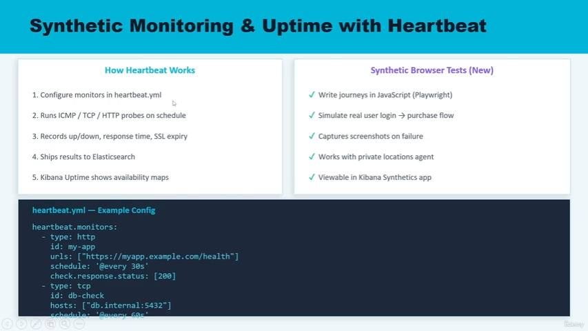
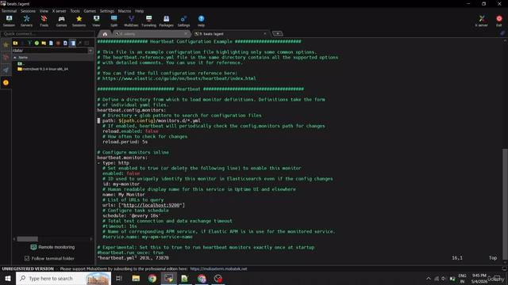
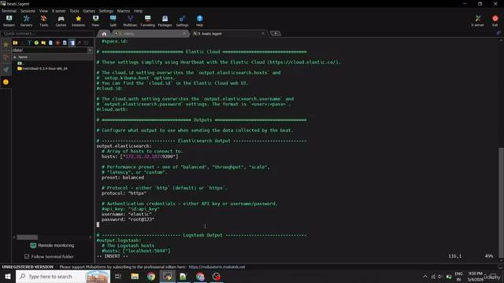
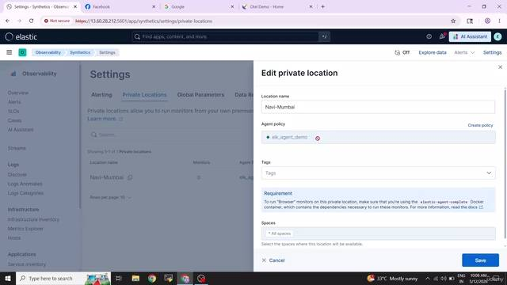
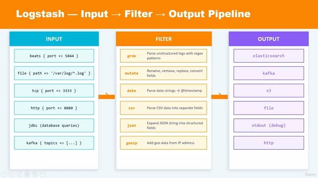
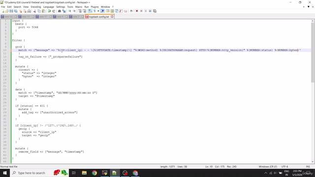
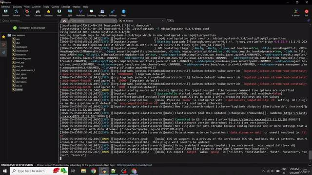

# ELK Stack 实战：Heartbeat 可用性监控、Synthetic Monitoring 与 Filebeat→Logstash→Elasticsearch 日志管道（P009–P014）

> 适用读者：前端转 AI 应用工程师。本文所有命令都在 Linux（AWS EC2）上执行；涉及 Java 语法的地方会标注「知道即可」。
> 版本基准：课里实际下载的是 **9.3.4** 版本的 Filebeat / Logstash 包（—— p014 [00:29]），Elasticsearch / Kibana 为同版本栈。

---

## 1. 这一节做什么

这 6 节课（P009–P014）做两件互相独立的事，但都围绕同一个目标：**把「外部世界发生了什么」变成 Elasticsearch 里的可查询数据**。

**第一件事（P009–P011）：可用性监控。**
- P009 讲概念：老方案是 Heartbeat（手写 `heartbeat.yml` + 手写 monitors，轮询 ICMP/TCP/HTTP），新方案是 Synthetic Monitoring（在 Elastic Agent 上跑监控脚本，在 Kibana 的 Observability → Synthetics UI 里点选创建）。
- P010 是 Heartbeat 的**动手实验**：下载解压 → 复制 CA 证书 → 改 `heartbeat.yml` → 建专用用户 → 启动 → 在 Kibana 里看到 `heartbeat` 索引有文档 → 打开 Uptime 界面 → 故意写错域名造一个 down 的监控 → 改成 facebook.com 造一个 up 的监控。
- P011 是 Synthetic Monitoring 的**动手实验**：先在 Settings → Private Locations 里绑定「Agent Policy + 地理位置」，再创建 HTTP ping 监控（facebook.com、google.com），看 up/down、看 TLS 证书有效期，故意改错 URL 制造 down，再改回来观察恢复。

**第二件事（P012–P014）：日志管道。**
- P012 讲架构：Server A 上跑 Elasticsearch + Kibana + Filebeat（采集 `sample_logs` 目录里的 `.log`、`.csv`、`.json`），Server B 上跑 Logstash（监听 5044，做 grok/csv/json/mutate/date 过滤），Logstash 再把结果写回 Server A 的 Elasticsearch。
- P013 讲 Logstash 的三段式插件模型：input（beats/file/tcp/http/jdbc/kafka）→ filter（grok/mutate/date/csv/json/geoip）→ output（elasticsearch/s3/文件/stdout）。
- P014 是**完整动手实验**：下载 9.3.4 的 Filebeat 和 Logstash → 造一份 Apache 样例日志 `demo.log` → 配 `filebeat.yml` 指向 Logstash 的 5044 → 配 `demo.conf`（beats input + grok + mutate + date + elasticsearch output）→ 一路踩坑（权限、`ssl` 弃用、证书路径、grok 不匹配、Filebeat 读不到文件）→ 最终在 Kibana 里建 Data View 看到结构化字段。

一句话总结：**P009–P011 让你知道「服务活着没有」，P012–P014 让你知道「服务刚才说了什么」。**

---

## 2. 讲师原话（带出处）

关于 Heartbeat 的定位：

> "Elastic 推出了 Heartbeat，它原本是轻量级的，用来检测任何服务的可用性……我们需要配置 heartbeat.yml……然后需要配置 Heartbeat 中提供的监视器，比如 ICMP、TCP 和 HTTP 监视器。"
> —— p009 [00:00]

> "在最新版本的 Elasticsearch 或较新的版本中，它已被 Synthetic Monitoring 取代……我们需要在任意服务器上部署 Elastic Agent。所以这种 Synthetic 监视器是与 Elastic Agent 配合工作的。"
> —— p009 [00:53]

关于 Heartbeat 的多监控拆分方式：

> "我们有一个 monitors.d 目录，在其中可以创建多个监控 YAML 配置……每当 heartbeat 运行时，它会读取所有这些配置文件，并每隔 5 秒检查这些 URL 是否可用。"
> —— p010 [03:14]

关于三种 monitor 类型：

> "第一种是 HTTP 监视器，HTTP 意味着你可以监控任何网站……或者也可以检查 API 的健康状况……第二种是 ICMP 监视器，它其实就是检查服务器是否可达，属于网络层监视器……我们还有 TCP 监视器，用于检查端口是否开放。"
> —— p010 [04:40]

关于证书路径这个坑（这是 P010 里最有价值的一句）：

> "前面提到的路径是 metricbeat 的路径，而我们创建的是 metricbeat 用户，所以会遇到问题——它无法读取证书。因此我们没有那样做，而是把新证书复制到这里来解决这个问题。"
> —— p010 [08:20]

关于 Synthetic Monitoring 的前置条件（很多人卡在这）：

> "在配置任何监视器之前，我先展示一下你需要配置什么。进入右上角的 Settings，然后进入 Private Locations……你需要在那些实例上部署 Elastic Agent，并在这里配置你要在哪个区域进行测试……否则你的 Synthetic Monitoring 将无法工作。"
> —— p011 [00:28]

关于 Synthetic 与 Heartbeat 的关系：

> "Synthetic Monitoring 可以说是 Heartbeat 的高级版本。"
> —— p011 [00:57]

关于 Logstash 的三段式：

> "Logstash 有三种类型的插件：输入插件、过滤插件和输出插件……对于 Beats，我们默认使用 5044 端口。"
> —— p013 [00:00]

> "这就是 Logstash 的工作方式。这是 Logstash 的主要配置。我们知道 Logstash 用于解析数据，也就是做修改。"
> —— p014 [14:45]

关于 grok 的作用：

> "在 grok 过滤器中，我们定义日志的匹配模式，从而将非结构化日志拆分为结构化格式并填充键值对……如果 grok 无法匹配日志行，或者日志与该模式不匹配，我们就会得到 grok 解析失败标签。"
> —— p014 [15:43]

关于 date filter 为什么必须配（这条决定了你在 Kibana 里能不能看到日志）：

> "假设你有 spread 日期，并且希望在存储到 Elastic 时按 spread 时间范围传递这些日志，那时就需要使用 date 过滤器……这是 Elasticsearch 使用的默认时间戳字段。"
> —— p014 [16:40]

关于版本升级带来的配置弃用（P014 后半段的核心踩坑）：

> "这里有一个已弃用的设置，就是这个 SSL Pro……出现这种情况是因为我运行的是最新版本的 Logstash。"
> —— p014 [25:04]

> "它再次提示，不要用 SSL，而要用 SSL enabled……所以在你的版本中也会遇到这个问题。我以前用 Logstash 时用的是旧版本。现在我也是第一次尝试这段代码，就遇到了这些问题。"
> —— p014 [37:24]

---

## 3. 从零复现

### 3.0 环境与目录约定

两台机器（课里是两台 EC2，你也可以用一台机器开两个目录来模拟，但**端口不能冲突**）：

| 角色 | 课里叫法 | 跑什么 | 关键端口 |
|---|---|---|---|
| Server A | udm server / EC2 instance first | Elasticsearch、Kibana、Filebeat、Heartbeat | 9200、5601 |
| Server B | bit server / EC2 instance second | Logstash | 5044 |

统一约定（下文所有路径都按这个来，照抄即可）：

```
/data/                          # 所有下载包和运行目录都放这里
/data/sample_logs/              # Filebeat 要采集的日志目录
/data/sample_logs/demo.log      # 手工造的 Apache 样例日志
/data/filebeat-9.3.4-linux-x86_64/
/data/logstash-9.3.4-linux-x86_64/
/data/heartbeat-9.x-linux-x86_64/
```

> 课里没有给出 Heartbeat 的具体版本号（—— p010 [00:00] 只说「select the package which you want」），下载页面上按你 ES 的版本选即可，下文统一写 `heartbeat-<你的版本>`。

### 3.1 阶段一：Heartbeat 可用性监控（P010）

**Step 1｜在 Server A 下载并解压 Heartbeat**

到 elastic 官网下载页（课里说「search for download hardbit，we are getting this first link from elastic itself」—— p010 [00:00]），右键 Download 按钮复制链接地址，然后在 EC2 上：

```bash
cd /data
# 把下面 URL 换成你从下载页复制到的真实链接
wget https://artifacts.elastic.co/downloads/beats/heartbeat/heartbeat-<你的版本>-linux-x86_64.tar.gz
tar -xzf heartbeat-<你的版本>-linux-x86_64.tar.gz
cd heartbeat-<你的版本>-linux-x86_64
ls
```

你会看到 `heartbeat.yml`（主配置）、`heartbeat`（启动脚本）、`kibana/`（默认 dashboard 目录）——课里原话是「this is the Kibana directory which will hold the by default dashboard for this hardbit. This is the batch file which will be used to run this okay and this is the configuration file which we need to configure」—— p010 [01:47]。

**Step 2｜复制 CA 证书（关键一步，不复制必挂）**

课里明确说：证书原来在 metricbeat 目录下，但运行 Heartbeat 的是另一个用户，读不到，所以要复制一份到 heartbeat 目录（—— p010 [08:20]）。

```bash
# 假设你的 ES 证书在 metricbeat 目录下（课里就是这么来的）
cp /data/metricbeat-<版本>-linux-x86_64/ca.crt /data/heartbeat-<版本>-linux-x86_64/ca.crt
ls -l /data/heartbeat-<版本>-linux-x86_64/ca.crt
```

如果你没有 metricbeat 目录，直接从 ES 的 `config/certs/` 里拿 `ca.crt` 也一样。

**Step 3｜改 `heartbeat.yml`**

课里逐段讲了要改哪些地方，按顺序：

1. `heartbeat.monitors` 里把 `enabled: false` 改成 `true`，给 `id`、`name`，填 `hosts`（—— p010 [03:41]）。
2. 三种 monitor 的写法（HTTP / ICMP / TCP）课里都给了（—— p010 [04:40] 起）。
3. `setup.kibana.host` 填 Kibana 的地址（—— p010 [06:33]）。
4. `output.elasticsearch` 打开，填 `hosts`、`username`、`password`（—— p010 [07:26]）。
5. `ssl.certificate_authorities` 指向**你刚复制过来的那份** `ca.crt`（—— p010 [08:20]）。

完整文件见第 4 节。

**Step 4｜建一个专用用户**

课里说「let's create a new user for this okay so I have this ... Let's skew this permissions. After that we will switch to this arbitrary user」—— p010 [09:15]。在 Kibana 的 Stack Management → Users 里建一个用户，给 `heartbeat_writer` 之类的写权限角色，然后用这个用户跑 Heartbeat（不要用 root，P014 里 Logstash 就因为 root 报过 `cannot run as a super loser`—— p014 [22:46]）。

**Step 5｜启动并验证**

```bash
cd /data/heartbeat-<版本>-linux-x86_64
./heartbeat -c heartbeat.yml
```

课里启动后第一件事是「check whether we are getting any errors or what x509 or anything else」—— p010 [10:13]。没有 x509 报错就说明证书通了。

然后去 Kibana 验证：Stack Management → Index Management，搜 `heartbeat`，课里看到「I am getting this hard bit index over here so which has this four documents as of now」—— p010 [11:06]。

**Step 6｜打开 Uptime 界面**

课里踩了一个坑：默认看不到 Uptime，要开 trial 才出现（—— p010 [11:55] 到 [12:43]）。开启后路径是：Kibana 首页 → Observability → 往下滚 → Uptime。

**Step 7｜造一个 down 的监控**

课里做法是复制一段 monitor 配置，把 `google.com` 故意拼错（—— p010 [14:37]），保存后重启 Heartbeat，等 10 秒，Uptime 里就出现一 up 一 down 两个监控（—— p010 [15:34]）。

**Step 8｜改成 facebook.com 验证恢复**

课里把拼错的域名换成 `facebook.com`，保存重启，Uptime 里旧的 down 记录还在、新的 up 记录出现（—— p010 [16:30] 到 [16:58]）。

### 3.2 阶段二：Synthetic Monitoring（P011）

**Step 1｜先配 Private Locations（不配就创建不了监控）**

Kibana → Observability → Synthetics → 右上角 Settings → Private Locations。课里说得很清楚：你要有一个已经部署了 Elastic Agent 的 Agent Policy，并且这个 Agent 所在的地理位置就是「从哪儿 ping」（—— p011 [00:28] 到 [02:23]）。

课里已经有一个跑在 Navi Mumbai 区域的 Agent Policy，编辑 Private Location 时选中它（—— p011 [01:54]）。

**Step 2｜创建第一个 HTTP ping 监控**

Synthetics → Create monitor → 选 HTTP ping → URL 填 `https://facebook.com` → 选刚配的 location → Create。课里说默认频率是 10 分钟（—— p011 [03:21]）。

**Step 3｜创建第二个监控并调频率**

再建一个 `https://google.com` 的 HTTP ping，名字叫 Google monitor，频率改成 3 分钟（—— p011 [06:11] 到 [06:40]）。

**Step 4｜看 TLS 证书**

Synthetics 页面往下滚有 TLS certificate 区块，课里看到 google.com 有效期到 2026-07-13、facebook.com 还剩 83 天（—— p011 [10:24]）。

**Step 5｜制造 down 并观察恢复**

课里把 google 的 URL 故意加一个字母拼错，并把频率降到 10 秒以便快速看到错误（—— p011 [11:21] 到 [12:18]）。看到 down 后点进去能看到 URL、location、last run duration。改回正确 URL 后，error 区块里 down 计数归零、up 计数上升（—— p011 [13:42] 到 [14:11]）。

### 3.3 阶段三：Filebeat → Logstash → Elasticsearch（P012–P014）

**Step 1｜造样例日志**

课里从某个网站抄了一段 Apache 访问日志，粘到 `demo.log`（—— p014 [03:19] 到 [03:49]）。日志行格式是经典的 combined log：

```
127.0.0.1 - - [10/Oct/2000:13:55:36 -0700] "GET /apache_pb.gif HTTP/1.0" 200 2326
```

课里特别提到这份日志的年份是 2006（—— p014 [63:08]），这直接导致后面 date filter 必须配，否则 Kibana 里按时间筛选会看不到数据。

```bash
mkdir -p /data/sample_logs
cd /data/sample_logs
vi demo.log
# 粘贴若干行 Apache 日志，保存
```

**Step 2｜下载解压 Filebeat（Server A）**

课里下载的是 9.3.4（—— p014 [00:29]）：

```bash
cd /data
wget https://artifacts.elastic.co/downloads/beats/filebeat/filebeat-9.3.4-linux-x86_64.tar.gz
tar -xzf filebeat-9.3.4-linux-x86_64.tar.gz
```

**Step 3｜改 `filebeat.yml`**

课里逐段说明（—— p014 [05:17] 起）：

1. `filebeat.inputs` 里 `enabled: true`，`paths` 填 `/data/sample_logs/*.log`（课里原话「any name ending with dot locks extension will be captured by this file bit」—— p014 [05:46]）。
2. `setup.dashboards` 那段：课里最后是**关掉**的（「instead of installing default dashboard we can disable this」—— p014 [42:54]），因为要用自定义 dashboard。
3. `output.elasticsearch` 整段注释掉。
4. `output.logstash` 打开，`hosts: ["<Server B 私网IP>:5044"]`（—— p014 [07:39]）。

**Step 4｜测试 Filebeat 配置**

课里用 `test config` 子命令验证（—— p014 [09:03]），并且踩了一个坑：命令拼错导致 `unknown command`（—— p014 [09:28]），最后发现是路径写错。正确写法：

```bash
cd /data/filebeat-9.3.4-linux-x86_64
./filebeat test config -c /data/filebeat-9.3.4-linux-x86_64/filebeat.yml
```

课里此时会报连接失败，因为 Logstash 还没起（—— p014 [10:55]），这是**预期行为**。

**Step 5｜下载解压 Logstash（Server B）**

```bash
cd /data
wget https://artifacts.elastic.co/downloads/logstash/logstash-9.3.4-linux-x86_64.tar.gz
tar -xzf logstash-9.3.4-linux-x86_64.tar.gz
```

课里提到解压需要 sudo 权限（—— p014 [12:19]）。

**Step 6｜写 `demo.conf`**

课里在 `config/` 下新建 `demo.conf`（—— p014 [13:18]），三段式：beats input（5044）+ grok/mutate/date filter + elasticsearch output。完整内容见第 4 节。

**Step 7｜复制 CA 证书到 Logstash 目录并给权限**

课里两次因为证书权限失败（—— p014 [33:09] 到 [34:27]）：

```bash
cp /data/elasticsearch-<版本>/config/certs/ca.crt /data/logstash-9.3.4-linux-x86_64/ca.crt
chown logstash_user:logstash_user /data/logstash-9.3.4-linux-x86_64/ca.crt
chmod 644 /data/logstash-9.3.4-linux-x86_64/ca.crt
```

**Step 8｜建专用用户跑 Logstash**

课里因为 root 报 `cannot run as a super loser`（—— p014 [22:46]），于是新建了一个用户并给目录权限（—— p014 [23:12] 到 [23:39]）：

```bash
useradd -m logstash_user
chown -R logstash_user:logstash_user /data/logstash-9.3.4-linux-x86_64
su - logstash_user
```

**Step 9｜启动 Logstash**

```bash
cd /data/logstash-9.3.4-linux-x86_64
./bin/logstash -f config/demo.conf
```

课里第一次启动报 `lock set agent executioner in no longer available`（—— p014 [24:35]），原因是 `ssl => true` 这个旧写法已弃用，要换成 `ssl_enabled => true`（—— p014 [37:24]）。改完再启动，看到「clock says output connected to ES instance ... it has started the pipeline ... the starting the input listener is also started」—— p014 [38:21]，并且监听 5044（—— p014 [38:50]）。

**Step 10｜启动 Filebeat，观察数据流**

```bash
cd /data/filebeat-9.3.4-linux-x86_64
./filebeat -c filebeat.yml
```

课里此时 Filebeat 起来了但 Kibana 里没数据（—— p014 [43:52] 到 [46:15]），排查过程很长，最终发现两个问题：
- Filebeat 的 `paths` 写成了 `*.log` 但实际文件名是 `demo.log` 之外的 `new.log`，需要确认 glob 能匹配（—— p014 [48:32]）；
- 日志文件是 root 写的，Filebeat 用户读不到，要 `sudo` 写或改权限（—— p014 [45:46]）。

课里最后的做法是往 `demo.log` 里追加几行（—— p014 [55:17]），Filebeat 立刻读到（—— p014 [56:06]），Logstash 的 stdout 也打印出来，Kibana 里出现 `apache_logs` 索引（—— p014 [56:34]）。

**Step 11｜在 Kibana 建 Data View**

Stack Management → Data Views → Create，name 填 `Apache lock`，index pattern 填 `apache_logs*`，时间字段选 `@timestamp`（—— p014 [57:03] 到 [57:33]）。然后在 Discover 里就能看到结构化字段：`client_ip`、`method`、`request`、`status`、`bytes`、`httpversion`（—— p014 [65:01] 到 [65:31]）。

**Step 12｜修正 IP 字段类型（课里最后留的尾巴）**

课里发现 `client_ip` 被映射成 text 而不是 ip（—— p014 [66:28]），说「that also we can correct」，但**课里没讲具体怎么改**。见第 7 节。

---

## 4. 完整代码

### 4.1 `/data/heartbeat-<版本>-linux-x86_64/heartbeat.yml`（P010 最终可用版）

```yaml
################### Heartbeat Configuration ####################

# ============================== Monitors ==============================
# 课里把 enabled 从 false 改成 true，并给了 id / name / hosts
heartbeat.monitors:
  - type: http
    enabled: true
    id: my-google
    name: my monitor
    urls: ["https://www.google.com"]
    schedule: '@every 10s'

  # 课里演示的第二个监控：故意拼错域名，制造 down
  - type: http
    enabled: true
    id: google-check
    name: Google check
    urls: ["https://www.gogle.com"]
    schedule: '@every 10s'

  # 课里讲的 ICMP 监控写法（网络层可达性）
  - type: icmp
    enabled: false
    id: my-icmp
    name: my icmp monitor
    hosts: ["8.8.8.8"]
    schedule: '@every 10s'

  # 课里讲的 TCP 监控写法（端口是否开放）
  - type: tcp
    enabled: false
    id: my-tcp
    name: my tcp monitor
    hosts: ["8.8.8.8:53"]
    schedule: '@every 10s'

# ================================ Kibana ================================
# 课里说：要装默认 dashboard 就配这段
setup.kibana:
  host: "http://<Server A 私网IP>:5601"

# ============================== Elasticsearch ==============================
output.elasticsearch:
  hosts: ["https://<Server A 私网IP>:9200"]
  username: "heartbeat_user"
  password: "<你的密码>"
  ssl:
    # 课里强调：这里必须指向你复制过来的那份 ca.crt，不是 metricbeat 目录里的
    certificate_authorities: ["/data/heartbeat-<版本>-linux-x86_64/ca.crt"]
```

> 说明：`setup.dashboards.enabled` 课里没在 Heartbeat 段明确写值，只说要配 Kibana host 才能装默认 dashboard（—— p010 [06:33]）。默认是 `false`，需要就加 `setup.dashboards.enabled: true`。

### 4.2 `/data/filebeat-9.3.4-linux-x86_64/filebeat.yml`（P014 最终可用版）

```yaml
###################### Filebeat Configuration #########################

# ============================== Filebeat inputs ==============================
filebeat.inputs:
  - type: filestream
    enabled: true
    id: my-apache-logs
    paths:
      - /data/sample_logs/*.log

# ============================== Filebeat modules ==============================
filebeat.modules: []
# 课里没启用任何 module，全部靠 Logstash 的 grok 解析

# ======================= Elasticsearch template setting =======================
setup.template.settings:
  index.number_of_shards: 1

# ================================== General ===================================
name: "server-a"

# ================================= Dashboards =================================
# 课里最后把默认 dashboard 关掉了（p014 [42:54]）
setup.dashboards.enabled: false

# ================================== Kibana =====================================
# 课里填了 Kibana 地址，但因为 dashboards 关了，这段实际不生效
setup.kibana:
  host: "http://<Server A 私网IP>:5601"

# ---------------------------- Elasticsearch Output ----------------------------
# 课里明确注释掉了这一段（p014 [07:10]）
#output.elasticsearch:
#  hosts: ["https://<Server A 私网IP>:9200"]
#  username: "elastic"
#  password: "<你的密码>"

# ------------------------------ Logstash Output -------------------------------
output.logstash:
  hosts: ["<Server B 私网IP>:5044"]
  # 课里说「we will not configure AD certificate for lockstas so let's keep only the port number and the IP address」（p014 [08:09]）
  # 所以这里没有 ssl 配置

# ================================= Processors =================================
processors:
  - add_host_metadata:
      when.not.contains.tags: forwarded

# ================================== Logging ===================================
logging.level: info
logging.to_files: true
logging.files:
  path: /data/filebeat-9.3.4-linux-x86_64/logs
  name: filebeat
  keepfiles: 7
  permissions: 0644
```

### 4.3 `/data/logstash-9.3.4-linux-x86_64/config/demo.conf`（P014 最终可用版）

```ruby
# ======================== INPUT ========================
input {
  beats {
    port => 5044
    # 课里没配 ssl，Filebeat 端也没配，所以这里保持明文
  }
}

# ======================== FILTER ========================
filter {
  # 1) grok：把非结构化 Apache 日志拆成字段
  grok {
    match => {
      "message" => "%{IPORHOST:client_ip} %{USER:ident} %{USER:auth} \[%{HTTPDATE:timestamp}\] \"%{WORD:method} %{URIPATHPARAM:request} HTTP/%{NUMBER:httpversion}\" %{NUMBER:status} %{NUMBER:bytes}"
    }
    # 课里说：匹配不上就打 grokparsefailure tag（p014 [15:43]）
    tag_on_failure => ["_grokparsefailure"]
  }

  # 2) mutate：类型转换 + 加 tag + 删原始字段
  mutate {
    convert => {
      "status" => "integer"
      "bytes"  => "integer"
    }
    # 课里：status 401 时加 unauthorized tag（p014 [17:07]）
    add_tag => ["method_%{method}"]
    # 课里：删掉原始 message 和 timestamp（p014 [17:36]）
    remove_field => ["message", "timestamp"]
  }

  # 3) date：把日志里的时间写进 @timestamp
  # 课里强调：不配这个，Kibana 按时间筛会看不到数据（p014 [16:40]）
  date {
    match => ["timestamp", "dd/MMM/yyyy:HH:mm:ss Z"]
    target => "@timestamp"
  }
}

# ======================== OUTPUT ========================
output {
  elasticsearch {
    hosts => ["https://<Server A 私网IP>:9200"]
    user  => "logstash_user"
    password => "<你的密码>"
    # 课里：索引名带时间戳（p014 [20:03]）
    index => "apache_logs-%{+YYYY.MM.dd}"
    # 课里踩坑：旧写法 ssl => true 已弃用，必须用 ssl_enabled（p014 [37:24]）
    ssl_enabled => true
    # 课里踩坑：旧写法 ssl_certificate_authorities 已弃用，必须用 ssl_certificate_authorities
    ssl_certificate_authorities => ["/data/logstash-9.3.4-linux-x86_64/ca.crt"]
  }

  # 课里用来调试：把收到的数据打到终端（p014 [51:06]）
  stdout {
    codec => rubydebug
  }
}
```

> 注意：上面 `ssl_certificate_authorities` 这个键名，课里在 [35:15] 提到「setting CA dot cert in Plavinelastic cert is observed, no longer available, set SSN certificate or certificate」，但**没有念出完整键名**。如果你启动时仍报弃用，请以 Logstash 9.3.4 实际启动日志里的提示为准（该字段名请以实际输出为准）。

### 4.4 `/data/sample_logs/demo.log`（样例日志）

```
127.0.0.1 - - [10/Oct/2000:13:55:36 -0700] "GET /apache_pb.gif HTTP/1.0" 200 2326
127.0.0.1 - - [10/Oct/2000:13:55:37 -0700] "GET /index.html HTTP/1.0" 200 1024
192.168.1.10 - - [10/Oct/2000:13:55:38 -0700] "POST /login HTTP/1.1" 401 512
192.168.1.11 - - [10/Oct/2000:13:55:39 -0700] "GET /style.css HTTP/1.1" 200 2048
```

> 课里没给出完整日志内容，只展示了「IP、timestamp、URL、status code、bytes」这几个字段（—— p014 [03:49]）。上面是按 combined log 格式补的，字段顺序与课里 grok 模式一致。

---

## 5. 逐行解释

### 5.1 Heartbeat 配置

- `heartbeat.monitors` 下的每一项就是一个独立监控。课里说「if you want to monitor whether the multiple applications or APIs are up or not at that time you can use this」—— p010 [03:41]。在 JS/Node 里，这相当于你写了一个 `setInterval` 数组，每个元素是一个 `fetch` 探针；Heartbeat 帮你把「定时 + 发请求 + 记录结果 + 写 ES」全包了。
- `type: http` + `urls`：HTTP 层探针，课里说「you can check the API health also」—— p010 [04:40]。对前端来说这就是一个 `fetch(url)` 看返回码。
- `type: icmp` + `hosts`：网络层探针，课里说「check whether the server is reachable or not」—— p010 [05:08]。Node 里没有原生 ICMP，通常要 `ping` 子进程，所以 Heartbeat 帮你省了这层。
- `type: tcp` + `hosts: ["ip:port"]`：课里说「check if the port is open or not」—— p010 [05:36]。Node 里对应 `net.connect({host, port})`。
- `schedule: '@every 10s'`：课里每个 monitor 都写「every 10 seconds it will check」—— p010 [05:08]。
- `setup.kibana.host`：课里说「if you want to install the by default dashboard so you need to configure this」—— p010 [06:33]。
- `output.elasticsearch.ssl.certificate_authorities`：这是 P010 最大的坑。课里原话是证书路径原来指向 metricbeat 目录，换了用户读不到，所以复制了一份—— p010 [08:20]。**如果你跳过 Step 2，启动时必报 x509。**
- `username` / `password`：课里说「password is rooted there it won't be free」—— p010 [07:26]，意思是密码是明文写在配置里的，别提交到 git。

### 5.2 Synthetic Monitoring

- Private Locations 的本质：课里说「you will have AWS instances running on those regions ... you will deploy a elastic agent on those instances」—— p011 [00:57]。所以「从哪个地区 ping」= 「哪台机器上的 Agent 在跑」。这解释了为什么没配 Private Location 就创建不了监控。
- 频率：课里第一个监控默认 10 分钟（—— p011 [03:21]），第二个改成 3 分钟（—— p011 [06:40]），调试时降到 10 秒（—— p011 [12:18]）。**频率越低，ES 里 heartbeat 索引增长越快**，生产上别学调试时的 10 秒。
- TLS certificate 区块：课里说「apart from Only monitoring whether it is available or not it gives you TLS certification details also」—— p011 [09:57]。这是 Synthetic 比 Heartbeat 多出来的实用功能，证书快过期时能提前发现。
- down 的判定：课里故意拼错 URL 来模拟（—— p011 [11:21]），并说「This is to mimic the error. It is not the correct procedure」—— p011 [11:49]。真实场景下是 API 挂了或域名解析失败才会 down。

### 5.3 Logstash 三段式

- `input { beats { port => 5044 } }`：课里说「for that beats we have a default port 5044」—— p013 [00:00]。5044 是 Beats 协议专用端口，Filebeat 默认就往这发。Node 类比：这就是你 `http.createServer().listen(5044)`，只不过协议是 Beats 私有的（基于 Lumberjack）。
- `grok { match => { "message" => "..." } }`：课里说「which will break those unstructured logs into structured format and fill key value pair」—— p014 [15:43]。`%{IPORHOST:client_ip}` 的意思是「匹配一个 IP 或主机名，存到 client_ip 字段」。这等价于 JS 里的 `const m = line.match(/^(\S+) .../)` 然后 `{ client_ip: m[1] }`。
- `tag_on_failure => ["_grokparsefailure"]`：课里说「if this grog is not able to match the log lines ... we will get this grog pass failure tag」—— p014 [15:43]。这是排查神器：Kibana 里搜 `tags: _grokparsefailure` 就能找到所有没解析成功的日志。
- `mutate { convert => { "status" => "integer" } }`：课里说「we are converting the status as a integer ... and this bytes as a integer」—— p014 [16:11]。不转的话 Kibana 里 `status` 是字符串，`status > 400` 这种范围查询会失效。
- `mutate { remove_field => ["message", "timestamp"] }`：课里说「we are using this muted field to remove this original message field and the timestamp」—— p014 [17:36]。删 `message` 是为了省存储（原始行已经拆成字段了），删 `timestamp` 是因为它已经被 date filter 消费掉了。
- `date { match => ["timestamp", "dd/MMM/yyyy:HH:mm:ss Z"] target => "@timestamp" }`：课里说「this is the default timestamp file which is used by elasticsers」—— p014 [16:40]。**这是 P014 里最容易漏的一步**：不配的话 `@timestamp` 是 Logstash 收到日志的当前时间，而你的日志是 2006 年的，Kibana 默认按 `@timestamp` 筛最近 15 分钟，你会看到「一条数据都没有」。课里在 [63:08] 专门解释了这个现象。
- `output { elasticsearch { index => "apache_logs-%{+YYYY.MM.dd}" } }`：课里说「we will name our index as well this will be our index name and yeah it will have the timestamp for each an index」—— p014 [20:03]。按天分索引是 ES 的常规做法，方便按时间范围删旧数据。
- `ssl_enabled => true`：课里踩坑记录——旧版写 `ssl => true`，9.x 报 `no longer available`（—— p014 [37:24]）。这是版本升级的典型破坏性变更。
- `stdout { codec => rubydebug }`：课里说「whenever we receive any kind of incoming data, it will print in this terminal also」—— p014 [51:06]。调试期必开，生产上关掉。

### 5.4 Filebeat 配置

- `type: filestream`：课里没明确说 type 名，但从 Kibana 里看到的 `input type is PerlStream`（—— p014 [58:50]）可以推断是 filestream（讲师口音把 filestream 念成了 PerlStream）。这是 Filebeat 7.x 之后替代 `log` 输入的新类型。
- `paths: ["/data/sample_logs/*.log"]`：课里说「any name ending with dot locks extension will be captured by this file bit」—— p014 [05:46]。glob 匹配，所以 `demo.log`、`new.log` 都会被采。
- `output.logstash.hosts`：课里说「we will set up lockstress.host so it will be running on another server so let's mention its IP address」—— p014 [07:39]。填 Server B 的**私网 IP**（同 VPC 内走内网，别填公网）。
- `setup.dashboards.enabled: false`：课里最后关掉了（—— p014 [42:54]），因为「we used logs to create custom dashboards」。开着的话 Filebeat 启动时会尝试连 Kibana 装 dashboard，连不上就报错卡住。

---

## 6. 复现检查清单

按顺序打勾，任何一项不过就别往下走：

**Heartbeat（P010）**
- [ ] `/data/heartbeat-<版本>/ca.crt` 存在，且属主是跑 Heartbeat 的用户
- [ ] `heartbeat.yml` 里 `ssl.certificate_authorities` 指向上面这份，不是 metricbeat 目录
- [ ] `./heartbeat -c heartbeat.yml` 启动后**没有 x509 报错**（—— p010 [10:13]）
- [ ] Kibana → Stack Management → Index Management 能搜到 `heartbeat` 索引，且文档数 > 0（—— p010 [11:06]）
- [ ] Observability → Uptime 能看到监控（若看不到，检查是否开了 trial，—— p010 [11:55]）
- [ ] 故意拼错域名后，Uptime 里出现 down 状态（—— p010 [15:34]）
- [ ] 改回正确域名后，出现 up 状态（—— p010 [16:58]）

**Synthetic Monitoring（P011）**
- [ ] Settings → Private Locations 里至少有一个 location，绑定了已部署 Agent 的 Policy（—— p011 [01:54]）
- [ ] 创建 HTTP ping 监控时能选到 location（选不到说明上一步没配好）
- [ ] 监控创建后状态从「未 ping」变成 up（—— p011 [03:50]）
- [ ] TLS certificate 区块能看到有效期（—— p011 [10:24]）
- [ ] 改错 URL 后状态变 down，改回后 down 计数归零（—— p011 [13:42]）

**Filebeat → Logstash → ES（P012–P014）**
- [ ] `/data/sample_logs/demo.log` 存在，且 Filebeat 用户可读（`ls -l` 看权限）
- [ ] `./filebeat test config -c filebeat.yml` 通过（—— p014 [09:03]）
- [ ] Logstash 启动日志里出现 `output connected to ES instance` 和 `input listener is also started`（—— p014 [38:21]）
- [ ] Logstash 监听 5044（`ss -lntp | grep 5044`）
- [ ] Filebeat 启动后，Logstash 的 stdout 能打印出解析后的字段（—— p014 [56:06]）
- [ ] Kibana → Stack Management → Index Management 能搜到 `apache_logs-*`（—— p014 [56:34]）
- [ ] Data View 建好后，Discover 里能看到 `client_ip`、`method`、`request`、`status`、`bytes`、`httpversion` 字段（—— p014 [65:01]）
- [ ] `status` 和 `bytes` 是数字类型（Kibana 里显示为 `#`），不是字符串（—— p014 [65:59]）
- [ ] `@timestamp` 是日志里的 2000 年时间，不是当前时间（—— p014 [63:08]）

---

## 7. 课里没讲但你会撞上的

**1. `client_ip` 字段类型是 text 不是 ip。**
课里在 [66:28] 发现了这个问题（「only this mapping is incorrect which is for IP it should be IP not the text」），但**没讲怎么改**。实际做法是在 Logstash 的 output 里加 `template` 或 `index_template`，或者在 Kibana 的 Index Management 里对 `apache_logs-*` 的 template 修改 mapping，把 `client_ip` 改成 `ip` 类型。注意：**已经写入的旧索引不会变**，要重建索引或等新索引生效。

**2. `ssl_certificate_authorities` 的准确键名。**
课里在 [35:15] 只念了「set SSN certificate or certificate」，没念全。Logstash 9.x 的 output elasticsearch 插件里，这个键的正确写法请以启动日志的弃用提示为准（该字段名请以实际输出为准）。如果你照抄旧教程写 `ssl_certificate_authorities` 仍报弃用，就按日志提示改成新键名。

**3. Filebeat 读不到文件的两个常见原因。**
课里排查了很久（—— p014 [48:03] 到 [56:06]），但没系统总结。实际就两条：
- **权限**：日志文件属主是 root，Filebeat 用非 root 用户跑就读不到。解决：`chown` 或让写日志的进程用 Filebeat 用户。
- **glob 不匹配**：`paths` 写 `*.log` 但文件叫 `demo.log.txt` 就匹配不上。用 `./filebeat test input -c filebeat.yml` 可以验证。

**4. 时间字段不匹配导致「看不到数据」。**
课里在 [63:08] 解释了现象但没给排查步骤。标准排查：在 Discover 里把时间范围改成 `Jan 1, 2000 - Now`，如果数据出现了，就说明 `@timestamp` 是日志时间而不是当前时间，date filter 生效了，只是默认时间窗太窄。

**5. Logstash 不能以 root 跑。**
课里报 `cannot run as a super loser`（—— p014 [22:46]），然后建了新用户。这是 Logstash 的硬性限制（安全设计），不是配置问题。Node 类比：类似某些 npm 包拒绝在 root 下运行。

**6. 两台机器的私网 IP vs 公网 IP。**
课里全程用私网 IP（「this is the private ip of that server」—— p010 [06:33]）。如果你两台机器不在同一 VPC，私网 IP 不通，要改用公网 IP + 安全组放行 5044 / 9200 / 5601。课里没讲跨 VPC 的情况。

**7. Heartbeat 的 `monitors.d/` 目录。**
课里提到可以「create multiple monitoring yaml configurations」放在 `monitors.d/` 下（—— p010 [03:14]），但**没演示具体怎么建**。实际做法是在 `heartbeat.yml` 里写 `heartbeat.config.monitors: path: ${path.config}/monitors.d/*.yml`，然后每个文件放一个 monitor 定义。适合监控目标很多、需要按团队拆文件的场景。

**8. Synthetic Monitoring 的「script」模式。**
课里提到 synthetic recorder 工具（—— p011 [04:45] 到 [05:42]），可以录浏览器操作生成脚本、导出 JS 文件再导入。但**课里没实际演示导入流程**，只演示了 HTTP ping 模式。如果你要做「登录后点三个按钮再检查页面元素」这种多步监控，需要另外学 script 模式。

**9. 索引生命周期（ILM）。**
课里的 `apache_logs-%{+YYYY.MM.dd}` 会每天新建索引，但**课里没讲怎么删旧索引**。生产上要配 ILM policy，否则磁盘会被日志撑爆。这是 P014 之后必然要补的一课。

---

## 附：关键截图索引

| 截图 | 说明 |
|---|---|
|  | Heartbeat 老方案的步骤：下载 → 配 yml → 配 monitors → 启动 |
|  | `heartbeat.monitors` 的 enabled/id/name/hosts 结构 |
|  | P010 最大的坑：`ssl.certificate_authorities` 指向哪 |
|  | Synthetic 前置条件：Agent Policy + 地理位置 |
|  | input / filter / output 三段式总览 |
|  | grok 拆字段 + mutate 转类型 + date 改时间戳 |
|  | `ssl => true` 在 9.x 报弃用，要换新键名 |
|  | 数据流打通后的验证画面 |