# GitLab CI/CD（BV182JX6nEjh）课程文档：从注册账号到跑通 build → test 流水线

## 1. 这一节做什么

这一节覆盖 P1–P6，目标不是背概念，而是把一条最小可用的 GitLab CI/CD 流水线跑起来：

1. 在 gitlab.com 注册免费账号，完成邮箱和手机号验证；
2. 创建一个 `test` 项目，用 Web IDE 写第一个 `.gitlab-ci.yml` 作业；
3. 再创建 `car assembly` 项目，用 YAML 定义 `build_car` 和 `test_car` 两个作业；
4. 用 `stages` 把两个作业拆成 `build` → `test` 两个阶段；
5. 用 `artifacts` 把 `build/` 目录从 `build_car` 传给 `test_car`；
6. 最后修掉 `grep` 路径问题，让流水线变绿。

课里反复用“汽车装配线”类比流水线：有些步骤必须按顺序做，有些步骤可以并行做；软件构建也一样，先 build，再 test，最后才谈部署。这里的最小练习并不追求覆盖 GitLab CI/CD 的全部能力，而是先形成一个可观察、可复现、可排错的闭环：改 YAML、提交到 main、看 Pipeline、进 Job 日志、定位失败命令、修正后重跑。只要这个闭环跑通，后续再学 cache、environment、deploy、runner 等概念时，就不容易迷失在界面和术语里。  
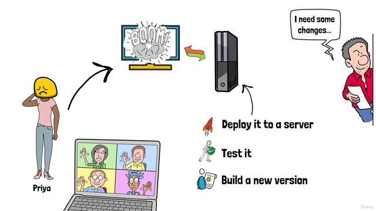

学习时建议把注意力放在四个最关键的观察点上：第一，文件名必须是 `.gitlab-ci.yml`；第二，YAML 用缩进表达层级，缩进错了不是“格式问题”，而是语法问题；第三，job 默认运行在各自隔离的 Docker 容器里，上一个 job 的临时文件不会自动出现在下一个 job；第四，失败时先看日志最后执行的命令和退出码，再倒推是命令本身失败、路径不对、阶段顺序不对，还是 artifact 没有传过去。下面所有步骤和检查清单，都是围绕这四个观察点展开的。

---

## 2. 讲师原话（带「—— pNNN [MM:SS]」）

> "GitLab 是一个开发运维一体化平台，提供一系列丰富功能，用于管理软件开发的整个流程。"
> —— p001 [00:28]

> "GitLab CI/CD 就像一位机器人助手，可以在计算机上自动完成特定任务，尤其是与构建、测试和部署软件相关的任务。"
> —— p001 [01:23]

> "使用免费账户时，你可以获得 400 分钟流水线时长，足以用来学习 GitLab 并构建小型项目。"
> —— p002 [00:55]

> "我们仍然需要用手机号验证账户。"
> —— p003 [00:00]

> "它从 .gitlab-ci.yml 开始。这个文件名怎么写非常重要。"
> —— p003 [02:20]  
> 注意：逐字稿里讲师口播是 `.gitlab-ci.yaml`，但 GitLab 实际识别的是 `.gitlab-ci.yml`。如果你真的建成 `.yaml`，流水线不会触发。下面一律用 `.gitlab-ci.yml`。

> "你在 GitLab CI 文件里写的内容采用 YAML 语法……在 GitLab 中，这是我们定义流水线的唯一方式。"
> —— p005 [02:47]

> "GitLab 默认使用 Docker 容器来运行作业。"
> —— p005 [03:41]

> "每个作业都隔离在自己的 Docker 容器中。"
> —— p006 [07:09]

> "作业产物是在构建过程中生成的内容。"
> —— p006 [08:36]

> "如果你不用 cd 把当前目录切换到另一个目录，就需要指定这个相对路径。"
> —— p006 [10:30]

这些原话分别对应课程里的几个关键行为：先理解 GitLab 是平台，CI/CD 是自动执行任务的“机器人助手”；再确认免费额度和手机号验证；接着注意 CI 文件名，不要把口播里的 `.yaml` 当成实际文件名；最后理解 YAML 是定义流水线的入口、job 默认跑在 Docker 容器里、artifact 用于把构建产物交给后续 job。读这些原话时，重点不是记英文句子，而是把每句话落到后面的具体操作上：文件名、YAML、容器隔离、artifact、相对路径，任何一个点没对上，都会在流水线日志里表现为具体错误。

---

## 3. 从零复现

### 3.1 准备环境

你只需要一个浏览器，不需要在本地安装 GitLab Runner，也不需要本地装 Docker。课里明确说：不覆盖“在自己的机器上安装和配置 GitLab Runner”，因为那更容易出问题；课程只支持跑在 gitlab.com 上的项目。也就是说，这一节练习的重点不是运维环境，而是把代码仓库、CI 配置文件、流水线执行和日志排查串起来。项目推送到 gitlab.com 后，由平台侧提供的执行环境跑 job；你在本地不需要准备 Linux 虚拟机，也不需要手动启动容器。  
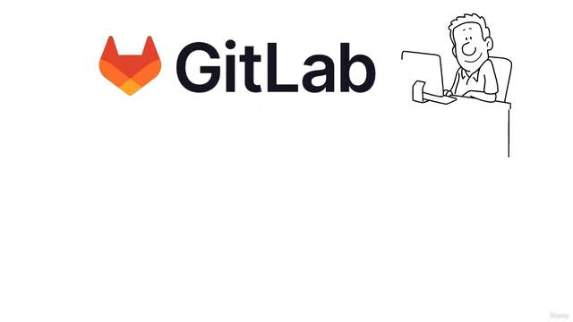

注册时可以用 Google 或 GitHub 账号登录，也可以从零填资料。免费账号有 400 pipeline minutes；注册后会自动进入 Ultimate 计划试用，30 天后回到免费版。课里说不需要信用卡。学习阶段 400 分钟通常够用，但也要养成立即查看日志、少做无意义重复提交的习惯：每提交一次、每次触发流水线，都会消耗执行时间。这个环境准备和前端项目使用云端 CI 的体验类似：本地只要能编辑和提交，真正的构建、测试在远端机器上跑，因此本地“我这里能跑”不等于流水线“远端一定能跑”，还要看远端镜像、命令和路径。

### 3.2 注册、验证手机号、创建第一个项目

1. 打开 `https://gitlab.com`，注册并登录。
2. 完成邮箱验证、验证码、手机号验证。课里特别说明：必须验证手机号，否则不能跑流水线。
3. 创建 group 时，讲师建议用“你的用户名-project”这种形式，避免和别人的 group 重名。
4. 创建项目，项目名写 `test`。
5. 创建完成后，关掉或忽略弹窗。

进入项目后，点 GitLab 左上角图标回到 start page，再点进 `test` 项目。这个过程看起来只是点菜单，但它对应后面两个关键入口：项目的 `Edit` 菜单用于打开 Web IDE，项目的 `Build → Pipelines` 用于看流水线。如果注册后页面提示验证账号，不要先怀疑 YAML 写错；手机号未验证时，流水线可能根本跑不起来，或者只在页面提示需要验证。先完成账号验证，再回到项目提交，是更省时间的排错顺序。  
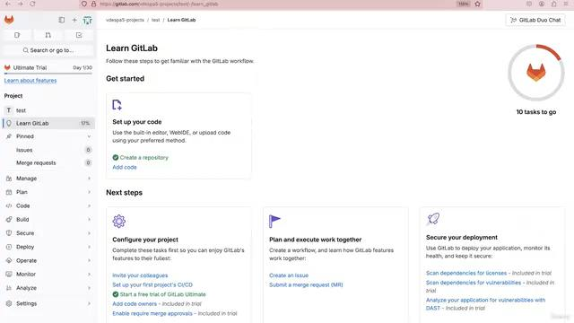

### 3.3 写第一个最小作业

在 `test` 项目里，点 `Edit` 菜单，选择 `Web IDE`。Web IDE 是浏览器里的 VS Code 版本。用 Web IDE 的好处是文件修改、提交、查看变更都在一个页面完成，不需要本地 Git 和编辑器配合；但也要注意，Web IDE 提交时仍然是在向仓库提交 commit，提交到哪个分支、提交信息是什么，都会影响后面的流水线是否按预期触发。  
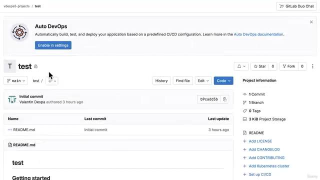

课里建议先设置两件事：

- 主题：`Settings → Themes → Color Theme`，讲师用的是 `GitLab Dark`；
- 空白字符渲染：在设置里搜索 `white space`，把 `render white space` 设为 `all`。这样你能清楚看到 YAML 的缩进。  
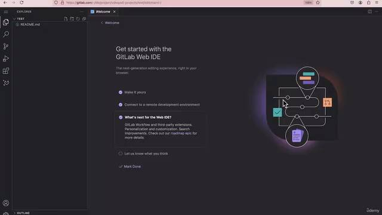

新建文件，文件名必须是：

```text
.gitlab-ci.yml
```

第一个最小作业内容如下：

```yaml
test:
  script:
    - echo "hello"
```

注意：

- `test:` 是作业名；
- `script:` 是作业里的命令列表；
- 列表项用 `- ` 开头；
- 缩进用空格，不要用 Tab。

这里的 `test` 是 job 名，不是 stage 名；`script` 下面的每一项都会交给运行环境执行。`echo "hello"` 不依赖额外工具，所以适合作为第一条最小流水线。常见错误是文件名少了开头的点、写成了 `.gitlab-ci.yaml`、`script` 后面少了冒号、列表短横线缩进不一致，或者用 Tab 代替空格。提交时选择 `Commit to main`，不要新建分支。提交后去 `Build → Pipelines` 看流水线。如果流水线是红色，点进去，按提示验证手机号；验证完成后再提交一次，流水线就会跑起来。日志里应该能看到 `hello`，最后显示 job passed。验证时不要只看顶层流水线状态，要点进具体 job，在日志靠近底部的位置找到你写的 `echo "hello"` 输出；如果连流水线都没有创建，优先检查文件名和提交分支。

### 3.4 创建 car assembly 项目并写 build_car

回到 start page，新建空白项目，项目名写 `car assembly`。可见性可以保持 private；如果想让别人看到代码和配置，就改成 public。勾选初始化 README，这样仓库里至少有一个文件。项目名里有空格不影响练习，重点是能在项目列表里找到它，并且后面的 `.gitlab-ci.yml` 放在项目根目录。  
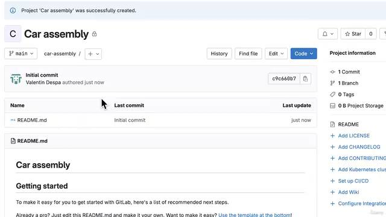

打开 Web IDE 有两种方式：

- `Edit → Web IDE`；
- 在项目页面直接按键盘上的 `.` 键，课里说这个快捷键很容易被忽略。

新建 `.gitlab-ci.yml`。文件名仍然要准确，不要因为项目名是 `car assembly` 就以为 CI 文件名也跟着改；CI 配置文件名在项目根目录固定为 `.gitlab-ci.yml`。  
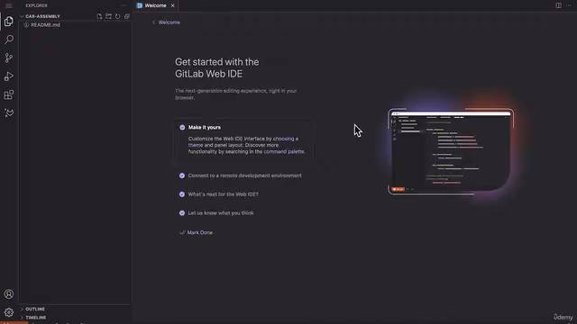

先写 `build_car` 作业：

```yaml
build_car:
  image: alpine
  script:
    - echo "building the car"
    - mkdir build
    - cd build
    - touch car.txt
    - echo "chassis" > car.txt
```

这里用 `alpine` 作为 Docker 镜像。课里说 Alpine 是轻量 Linux 发行版，适合这个练习。`script` 是命令列表：先打印一句话，再创建 `build` 目录，进入目录，创建 `car.txt`，最后把 `chassis` 写进文件。逐条看，`mkdir build` 在当前工作目录创建目录；`cd build` 改变当前目录；`touch car.txt` 创建文件；`echo "chassis" > car.txt` 把字符串重定向写入文件。命令按列表顺序执行，如果中间某条命令返回非零退出码，后续命令通常不会继续正常跑完，job 会以失败结束。常见排查是：如果 `mkdir build` 报目录已存在，说明命令在当前环境里重复创建了同名目录；如果 `cd build` 失败，先看前一条 `mkdir` 是否成功；如果 `echo` 写文件失败，看当前目录和权限。  
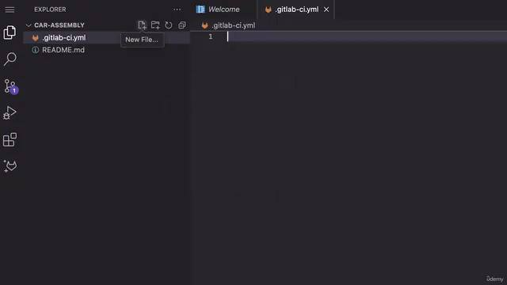  
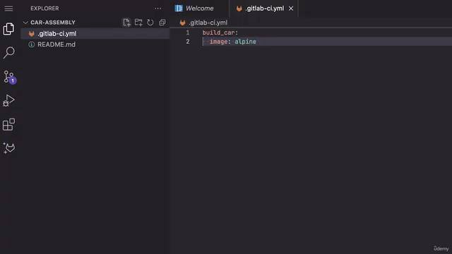

提交到 main 后，去 `Build → Pipelines` 看结果。点进作业日志，能看到你写的命令和输出。课里提醒：日志上面有很多技术细节，初学可以先只看最后你写的命令部分。只要没有报错，最后会显示 `Job succeeded`。如果日志里能看到 `building the car`，说明 job 已经开始执行你的脚本；如果这一步就失败，优先检查 `image`、缩进、短横线和命令拼写，而不是继续看后面的 artifact。

### 3.5 为什么仓库里看不到 build/car.txt

回到项目仓库，你会看到 `.gitlab-ci.yml` 和 `README.md`，但看不到 `build` 目录，也看不到 `car.txt`。这是学习 CI 时很常见的疑惑：日志里明明创建了文件，为什么仓库里没有？原因要从 job 的运行方式理解，而不是从 Git 提交理解。  
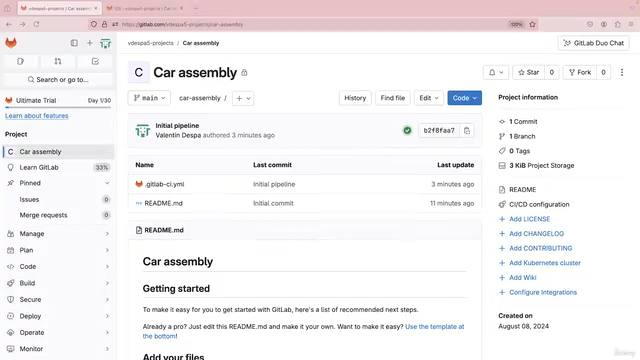

课里解释：GitLab 不会自动保存作业里生成的文件；而且通常也不应该在流水线运行时把文件 commit 回仓库。想验证文件内容，可以在 `build_car` 的 `script` 里临时加一行：

```yaml
    - cat car.txt
```

因为前面已经 `cd build`，所以这里直接 `cat car.txt` 就能看到内容。提交后看日志，会输出 `chassis`。这里的 `cat` 只是调试用，帮助你在日志中确认文件真的写进去了；它不是流水线成功的必要条件，最终代码里可以保留也可以删掉。  
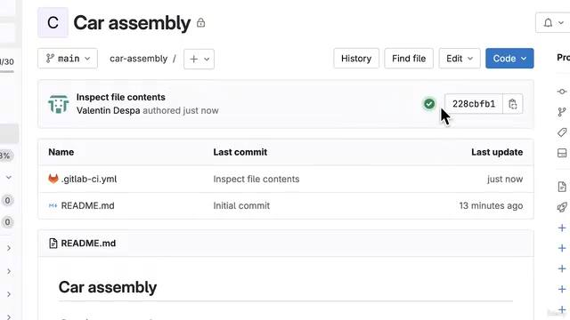

从排查角度看，这一步验证的是“build_car 脚本内部能否正确创建并读取文件”。如果 `cat car.txt` 能输出 `chassis`，说明 `mkdir`、`cd`、`touch`、`echo >` 这一串命令没问题；后面 `test_car` 找不到文件，就更可能是 job 之间容器隔离或 artifact 没有配置，而不是 build 本身没生成文件。如果你在前端项目里看到 `dist/`、`coverage/` 不在仓库里，逻辑是类似的：这些通常是构建产物，不应该和源代码混在一起提交，而是由 CI 生成、上传、传递或发布。

### 3.6 新增 test_car，并观察第一次失败

新增 `test_car` 作业，用 Linux 的 `test -f` 检查文件是否存在，用 `grep` 检查内容：

```yaml
test_car:
  image: alpine
  script:
    - test -f build/car.txt
    - grep chassis build/car.txt
```

课里先写的是 `grep chassis car.txt`，后来发现路径不对才改成 `build/car.txt`。这里 `test -f build/car.txt` 的含义是检查指定路径是否为一个存在的普通文件；成功时它不打印内容，只返回成功退出码，失败时返回非零退出码。`grep chassis build/car.txt` 则在文件中搜索 `chassis`，匹配到会返回成功，匹配不到会返回非零退出码。  
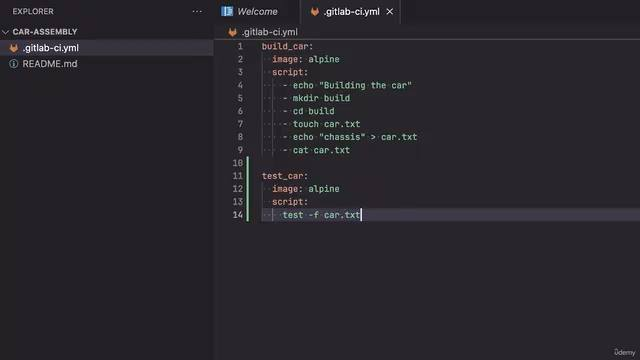

第一次提交后，流水线会出现失败标记。点进失败的作业，看日志最后：`Job failed - exit code 1`。这时不要只看红色图标，也不要猜“是不是 GitLab 坏了”，而要顺着日志找到最后执行的那条命令。日志会告诉你 job 在哪一步停下，退出码是多少。  
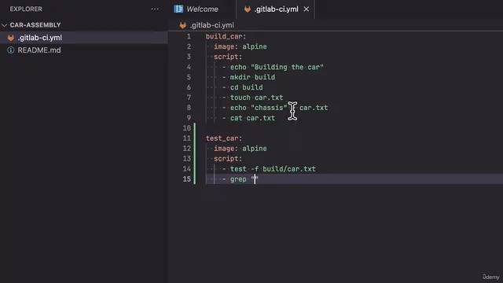  
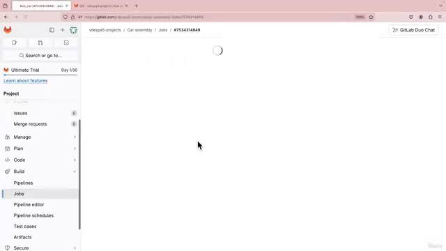

课里教了一个排查方法：看最后执行的是哪条命令。日志里最后执行的是 `test` 命令，`grep` 没执行，说明 `test -f build/car.txt` 没通过。原因不是文件没生成，而是两个作业默认在同一个 `test` stage 里并行执行，而且每个作业都在自己的 Docker 容器里，`build_car` 结束后容器被销毁，`test_car` 自然找不到文件。排查顺序可以固定为：先看失败 job 的最后几条日志，确认最后执行的命令；再看退出码；如果是 `test -f` 失败，检查文件路径和 artifact；如果 `test -f` 通过但 `grep` 失败，检查 `grep` 的路径和匹配内容；如果两个 job 并行，检查 `stages` 和每个 job 的 `stage`。这个顺序比盲目修改 YAML 更稳。

### 3.7 用 stages 拆顺序，用 artifacts 传文件

在 YAML 顶部加 `stages`：

```yaml
stages:
  - build
  - test
```

然后给两个作业分别加 `stage`：

```yaml
build_car:
  stage: build
  # ...

test_car:
  stage: test
  # ...
```

这样 `build_car` 先跑，`test_car` 后跑，不再并行。`stages` 列表的顺序就是阶段顺序，作业的 `stage` 值要和列表中的名称对应。常见错误是 `stages` 里写 `build`、`test`，但 job 的 `stage` 拼错或大小写不一致；这会导致 GitLab 无法按预期归类作业。另一个错误是只改了 job 的 `stage`，却忘了在顶层声明 `stages`。  
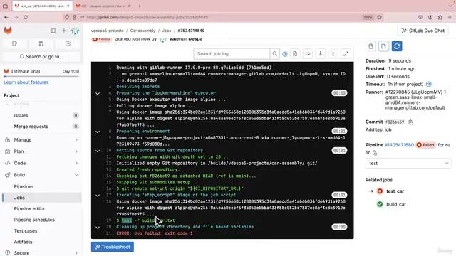

但只加 `stages` 还不够，因为容器隔离仍然存在。需要告诉 GitLab 保留 `build/` 目录，这就是 artifact：

```yaml
  artifacts:
    paths:
      - build/
```

`artifacts` 和 `script` 同级；`paths` 缩进在 `artifacts` 下面；`- build/` 表示保留整个 `build` 目录。artifact 的含义是：job 结束后，把指定路径从该 job 的容器工作区保留下来，并交给后续阶段使用。注意 `artifacts` 要写在生成文件的 `build_car` 作业下，而不是写在 `test_car` 下；否则 `test_car` 之前并没有东西可保留。`paths` 下的路径按项目工作目录理解，`build/` 对应 build 作业里创建的目录。  
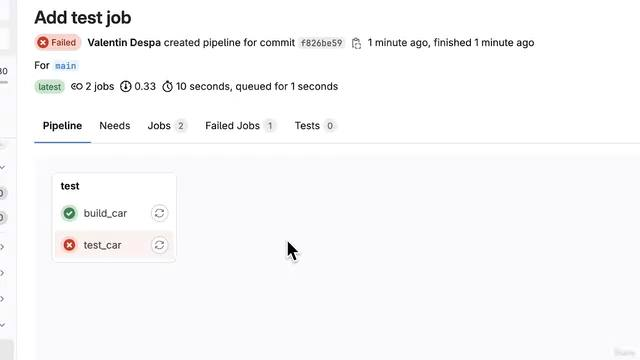

最后修 `grep` 路径：因为 `test_car` 没有 `cd build`，所以要写相对路径 `build/car.txt`：

```yaml
    - grep chassis build/car.txt
```

再次提交，流水线会按 `build` → `test` 顺序执行，最后变绿。如果仍然失败，优先检查三处：`build_car` 的 `artifacts.paths` 是否包含 `build/`；`test_car` 的 `stage` 是否是 `test`；`grep` 是否写成 `build/car.txt`。如果 `build_car` 成功、`test_car` 的 `test -f` 仍然失败，就点开 `build_car` 的 job 页面看 artifact 是否上传成功，再看 `test_car` 日志里当前目录和报错信息。  
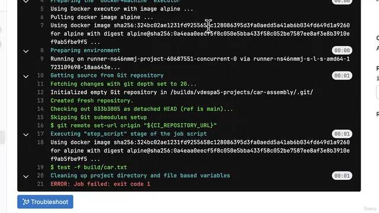

---

## 4. 完整代码

文件路径：项目根目录 `.gitlab-ci.yml`

```yaml
stages:
  - build
  - test

build_car:
  image: alpine
  stage: build
  script:
    - echo "building the car"
    - mkdir build
    - cd build
    - touch car.txt
    - echo "chassis" > car.txt
    - cat car.txt
  artifacts:
    paths:
      - build/

test_car:
  image: alpine
  stage: test
  script:
    - test -f build/car.txt
    - grep chassis build/car.txt
```

如果你不想在日志里多打印一次 `chassis`，可以删掉 `- cat car.txt`，不影响流水线结果。  
课里没有要求写 `README.md` 的内容；创建项目时勾选初始化 README 即可。

这段完整代码可以当作最小模板，但阅读时不要只看“最后能跑”的状态，要能还原出它是怎么从失败修过来的：一开始没有 `stages`，两个 job 默认在同一阶段，可能并行；`build_car` 在容器里生成文件，job 结束后容器销毁；`test_car` 在另一个容器里找不到文件；加入 `stages` 后顺序有了，但还需要 artifact 把文件传过去；最后 `grep` 的路径要从项目根目录出发写成 `build/car.txt`。理解这条修复链，比单纯复制代码更有用。

---

## 5. 逐行解释

- `stages:`：定义流水线有哪些阶段。课里只有 `build` 和 `test`，顺序就是执行顺序。写成列表后，GitLab 会按列表顺序推进阶段；同一个阶段内的多个 job 默认可以并行，后一个阶段要等前一个阶段完成。验证方式是看 Pipeline 图是否按 `build`、`test` 从左到右或从上到下排列，而不是两个 job 混在同一列。
- `- build`、`- test`：YAML 列表项。`build` 在前，`test` 在后，所以先 build 再 test。这里的名称要和每个 job 的 `stage` 对上；如果 job 写了 `stage: build`，但顶层列表里没有 `build`，或者拼写不一致，就要检查阶段定义。
- `build_car:`：作业名。课里说 job 就是让 GitLab 做的一个任务。作业名是 YAML 的键，下面缩进的内容属于这个 job。作业名可以和 stage 名不同，例如 `build_car` 是 job，`build` 是 stage。
- `image: alpine`：告诉 GitLab 用哪个 Docker 镜像跑这个作业。课里用 Alpine，因为它是轻量 Linux 发行版。镜像决定了容器里预装了哪些命令，所以本课用到的 `echo`、`mkdir`、`cd`、`touch`、`cat`、`test`、`grep` 都要在这个镜像里可用。排查时如果出现 `command not found`，先确认镜像和命令是否匹配。
- `stage: build`：把这个作业放进 `build` 阶段。如果不写 `stage`，课里说 GitLab 默认会把作业放进 `test` 阶段，这就是为什么一开始两个作业会并行。验证时可以看流水线页面中 job 卡片所属的 stage 名称，或者看 YAML 里是否每个 job 都显式写了 `stage`。
- `script:`：作业里要执行的命令列表。YAML 里用 `- ` 表示列表项，缩进必须一致。`script` 是这个 job 的核心，日志里会按顺序打印每条命令及其输出。常见错误是 `script` 后忘记冒号、短横线没有对齐、某一行用了 Tab，导致 YAML 解析失败。
- `- echo "building the car"`：打印一句话，方便在日志里确认作业开始执行。它没有创建文件，也不依赖当前目录，所以很适合作为 job 的第一步“心跳”输出。如果日志里没有这句话，说明 job 还没进入你写的脚本，问题可能在 YAML 解析、镜像拉取或 runner 分配阶段。
- `- mkdir build`：创建 `build` 目录。它相对当前工作目录执行；在 GitLab job 的默认工作目录下，会在项目工作区里创建 `build`。验证方式是在后续命令或日志里看到该目录存在；如果这里失败，后面的 `cd build` 通常也会失败。
- `- cd build`：进入 `build` 目录。后面的命令都在这个目录里执行。注意它只影响当前 job 的 shell 会话，不会影响其他 job，也不会改变仓库结构。验证方式是结合下一行 `touch car.txt`，如果文件出现在 `build` 下，就说明 `cd` 生效了。
- `- touch car.txt`：创建 `car.txt`。课里解释 `touch` 本来用于更新文件时间戳，文件不存在时会创建文件。它默认创建在当前目录，所以因为上一行已经 `cd build`，文件实际位置是 `build/car.txt`。验证时可以用 `cat car.txt` 或后续 artifact 路径确认。
- `- echo "chassis" > car.txt`：把 `chassis` 写入 `car.txt`。`>` 是重定向操作符，把输出写进文件，而不是打印到终端。它会覆盖文件内容；如果写成 `>>` 才是追加。这里的目的只是让文件里有一个 `grep` 能匹配的字符串。
- `- cat car.txt`：课里用来验证文件内容。因为前面已经 `cd build`，所以直接 `cat car.txt` 就能看到 `chassis`。它通常是调试用，不是业务必需；如果你删除这一行，只要 artifact 和后面的测试路径正确，流水线仍然可以成功。
- `artifacts:`：告诉 GitLab 保留作业产物。课里说 artifact 就是构建过程中生成、需要留给后续作业使用的东西。它和 `script` 同级，表示这是 `build_car` 作业的产物配置，不是 `test_car` 的配置。
- `paths:`：artifact 的路径列表。这里的路径按 job 工作区/项目目录理解，用来告诉 GitLab “job 结束后保留哪些路径”。常见错误是缩进不对，把 `paths` 写到 `artifacts` 外面，或者写成 `path` 这种错误键名。
- `- build/`：保留整个 `build` 目录。末尾的 `/` 表示目录。artifacts 上传成功后，后续阶段的 job 会自动拿到这些文件，因此 `test_car` 可以在自己的容器里看到 `build/car.txt`。验证方式是看 `build_car` job 页面是否有 artifact 下载入口，以及 `test_car` 日志里 `test -f build/car.txt` 是否通过。
- `test_car:`：第二个作业，负责测试。它的名字说明职责是测试，真正的阶段由下面的 `stage: test` 决定。作业名和阶段名不要混为一谈。
- `image: alpine`：测试作业也用 Alpine。因为两个 job 都用同一个基础镜像，所以命令环境比较一致；但这不代表它们共享文件系统，文件系统仍然是隔离的，需要 artifact 来传递。
- `stage: test`：放进 `test` 阶段，所以会在 `build` 阶段之后执行。验证方式是看 Pipeline 中 `test_car` 是否排在 `build_car` 之后，而不是和它同时开始。
- `- test -f build/car.txt`：检查 `build/car.txt` 是否存在。`-f` 表示检查文件。成功时没有输出，失败时返回非零退出码。没有输出不代表没执行，而是 `test` 成功时本来就不打印内容。验证时看 job 是否继续执行下一条 `grep`；如果这里就停，说明文件检查失败。
- `- grep chassis build/car.txt`：在 `build/car.txt` 里搜索 `chassis`。课里第一次写成 `grep chassis car.txt`，因为当前目录不是 `build`，所以找不到；改成 `build/car.txt` 才对。`grep` 没匹配到内容时不是“静默成功”，而是返回非零退出码，job 会因此失败。验证时可以临时在日志里看 grep 的输出，或先用 `cat build/car.txt` 确认内容。

在 JS/Node 里可以这样类比：`stages` 的顺序像 `await build(); await test();`；同一个 stage 里的多个 job 像 `Promise.all([...])` 并行执行；artifact 像把上一个函数的返回值传给下一个函数；容器隔离像每个 job 都有独立作用域，上一个 job 的临时文件不会自动出现在下一个 job 里。再细一点说，`script` 里的一条条命令像按顺序执行的语句，某一条返回非零退出码就相当于抛出一个错误，后面逻辑不会继续按成功路径走；`test -f` 像检查文件是否存在的前置断言，`grep` 像检查文件内容是否包含目标字符串的断言。前端的 `npm run build` 产物通常放在 `dist/`，测试任务要消费这个产物时，也需要先保留产物再交给后续任务，而不是假设另一个独立环境里自动存在它。

---

## 6. 复现检查清单

- [ ] 已注册 gitlab.com 免费账号，并完成邮箱验证。验证方法：登录后打开账号设置，查看邮箱状态；能正常进入项目并创建仓库，说明基本登录流程完成。
- [ ] 已完成手机号验证；否则流水线会提示需要验证账号。验证方法：先跑一次最小流水线，如果页面出现验证提示，就按提示完成；验证后再提交一次，确认 Pipeline 能创建并进入 job 日志。
- [ ] 已创建 group，名称类似“你的用户名-project”，避免重名。验证方法：在 group 页面能看到该 group，并且创建项目时能选择它；如果创建失败，先换一个包含用户名的唯一名称。
- [ ] 已创建 `test` 项目，并能打开 Web IDE。验证方法：从项目页点击 `Edit → Web IDE`，或在项目页按 `.` 键，确认浏览器能打开 Web IDE 编辑器。
- [ ] Web IDE 里已把 `render white space` 设为 `all`，能看见缩进点。验证方法：打开设置搜索 `white space`，设置后回到 YAML 文件，确认行首空格有可视标记，Tab 和空格能区分。
- [ ] 第一个最小作业文件名为 `.gitlab-ci.yml`，不是 `.yaml`。验证方法：在仓库文件列表和 Web IDE 文件标签中逐字检查文件名，尤其是开头的点和结尾的 `yml`。
- [ ] 第一个作业内容是 `test: script: - echo "hello"`，提交到 main 后能看到 `hello`。验证方法：提交后进入 `Build → Pipelines`，点进最新 pipeline 的 job 日志，在日志底部找到 `hello`，并确认 job 状态为成功。
- [ ] 已创建 `car assembly` 项目，并初始化 README。验证方法：项目首页能看到 `README.md`，仓库文件列表至少有一个初始文件，`.gitlab-ci.yml` 放在根目录。
- [ ] `build_car` 作业成功，日志里能看到 `building the car`。验证方法：点开 `build_car` job 日志，确认命令逐行执行，出现 `building the car`，最后显示作业成功。
- [ ] `build_car` 里加了 `artifacts.paths: - build/`。验证方法：检查 YAML 中 `artifacts` 是否与 `script` 同级，`paths` 是否在 `artifacts` 下，列表项是否为 `- build/`；提交后看 `build_car` job 页面是否有 artifact 可下载。
- [ ] `test_car` 作业成功，日志里能看到 `chassis`。验证方法：点开 `test_car` job 日志，确认 `test -f build/car.txt` 没有让 job 提前失败，并且 `grep chassis build/car.txt` 能匹配到内容；如果日志没有直接打印 `chassis`，看 grep 是否成功返回。
- [ ] 流水线视图显示 `build` → `test` 两个 stage，而不是两个 job 并行。验证方法：打开 Pipeline 图，确认 `build_car` 在 `build` 阶段、`test_car` 在 `test` 阶段，`test_car` 等待 `build_car` 完成后再开始。
- [ ] 如果 `test_car` 报 `Job failed - exit code 1`，先看最后执行的是不是 `test -f build/car.txt`。验证方法：进入失败 job 的日志底部，从最后一条命令向上看，确认失败发生在 `test -f`、`grep` 还是更早的步骤。
- [ ] 如果 `test -f` 通过但 `grep` 失败，检查是不是写成了 `grep chassis car.txt`，应改成 `grep chassis build/car.txt`。验证方法：对照 `test_car` 的 `script`，确认当前目录没有 `cd build`，所以路径必须从项目根目录写成 `build/car.txt`。
- [ ] 如果 `build_car` 成功但 `test_car` 找不到文件，检查 `artifacts` 是否写在 `build_car` 下、`paths` 是否有 `build/`。验证方法：看 `build_car` 的 YAML 层级，确认 `artifacts` 属于 `build_car`；看 artifact 上传记录，确认 `build/` 被保留。
- [ ] 如果两个 job 并行，检查是否写了 `stages` 和每个 job 的 `stage`。验证方法：顶层必须有 `stages: - build - test`，并且 `build_car` 写 `stage: build`、`test_car` 写 `stage: test`；Pipeline 图上应体现先后顺序。
- [ ] 如果流水线完全不触发，检查文件名是否为 `.gitlab-ci.yml`，以及 YAML 是否用了 Tab 缩进。验证方法：看仓库根目录文件名，打开 Web IDE 显示空白字符，确认缩进是空格；再提交一次，看 `Build → Pipelines` 是否出现新记录。

---

## 7 课里没讲但你会撞上的

| 现象 | 原因 | 怎么办 |
| --- | --- | --- |
| 文件名写成 `.gitlab-ci.yaml` 后流水线不触发 | 逐字稿里讲师口播是 `.gitlab-ci.yaml`，但 GitLab 实际识别的是 `.gitlab-ci.yml`；如果照着口播建成 `.yaml`，流水线不会触发。这是本课最容易卡住的地方。 | 在项目根目录把文件重命名为 `.gitlab-ci.yml`，注意开头有点、结尾是 `yml`；提交后再看 `Build → Pipelines` 是否创建新流水线。 |
| YAML 看起来缩进差不多，但 job 报解析错误或行为异常 | 在 JS 里缩进只是好看；在 YAML 里缩进决定层级。课里反复强调缩进和空格，建议在 Web IDE 里打开空白字符渲染，用 2 个空格，不要用 Tab。 | 打开 Web IDE 的 `render white space`，逐行检查 `script`、`stage`、`artifacts`、`paths` 的缩进层级；把 Tab 替换为空格，保证同一层级对齐。 |
| `build_car` 和 `test_car` 看起来像同时跑、并行执行 | 课里说如果不写 `stage`，GitLab 会把作业放进 `test` 阶段。所以一开始 `build_car` 和 `test_car` 会并行，看起来像“构建和测试同时跑”，逻辑上不合理。 | 在 YAML 顶部写 `stages: - build - test`，并给 `build_car` 写 `stage: build`、给 `test_car` 写 `stage: test`；看 Pipeline 图确认顺序。 |
| `build_car` 里生成了 `car.txt`，但 `test_car` 找不到文件 | 课里明确说每个 job 在自己的 Docker 容器里执行，job 结束容器销毁。所以 `build_car` 里创建的 `car.txt` 不会自动出现在 `test_car` 里，必须用 `artifacts` 保留。 | 在 `build_car` 下添加 `artifacts.paths`，内容为 `- build/`；确认它和 `script` 同级，提交后看 artifact 是否上传、`test_car` 是否拿到文件。 |
| 仓库文件列表里看不到 `build/` 或 `car.txt` | 课里说通常不会在流水线运行时把文件 commit 回仓库。artifact 是给后续 job 用的，不是仓库文件。仓库里看不到 `build/` 是正常的。 | 不要在仓库里找构建产物；去 `build_car` 的 job 页面看 artifact，或者临时在 `script` 里加 `cat car.txt` 在日志中验证内容。 |
| `grep` 找不到内容后 job 失败，显示 `exit code 1` | `grep` 没匹配到内容时不是“静默成功”，而是返回非零，GitLab 会认为 job 失败。课里看到 `Job failed - exit code 1`，最后执行的是 `test` 命令，说明 `test -f` 没通过；后来 `grep` 路径不对也会失败。 | 先看日志最后执行的是 `test` 还是 `grep`；如果是 `test -f`，检查 artifact 和路径；如果是 `grep`，检查匹配字符串和文件路径，尤其是不要漏掉 `build/`。 |
| `test -f` 执行后没有任何输出，但 job 继续了 | 课里说第一条命令后没有消息，第二条命令才有消息，这是正常的。`test` 成功时不打印内容，只返回退出码。 | 不要因为没有输出就判断命令没执行；看下一条命令是否继续执行，或者临时用 `ls`、`cat` 辅助观察，成功后可以删掉调试命令。 |
| 本地或 bash 里能跑的命令，在 job 里报 `command not found` 或语法错误 | 课里没展开讲，但 Alpine 镜像默认 shell 是 `sh`。本课用的 `echo`、`mkdir`、`cd`、`touch`、`test`、`grep`、`cat` 都是 POSIX 命令，能跑；如果你写 bash 特有语法，可能会失败。 | 尽量使用本课用到的 POSIX 命令；如果确实需要 bash，先确认镜像里是否有 bash，或者改用在 Alpine 中可用的写法。 |
| 学习到一半发现流水线分钟数不够用，或者试用期结束 | 课里说免费账号有 400 pipeline minutes，注册后 Ultimate 试用 30 天，不需要信用卡。学习够用，但不要拿它跑大项目。 | 学习阶段减少无意义重复提交，先改好 YAML 再提交；跑通最小流水线后，不要用免费额度做长时间、重依赖的构建。 |
| 想在自己公司或自己的机器上跑，结果卡在 runner 配置 | 课里明确说不会讲如何在自己的硬件上安装和配置 GitLab Runner，只支持 gitlab.com 上的项目。如果你在公司自建 GitLab 上跑，runner 配置、网络、权限都可能额外出问题。 | 课程练习优先在 gitlab.com 项目里复现；如果必须自建，请按 GitLab Runner 官方文档单独配置，不要把 runner 问题和本课的 YAML 问题混在一起排查。 |
| 不知道 `Commit to main` 到底在做什么，或者提交到了别的分支 | 课里说 Git 的使用稍微超出课程范围，但会提供 resources 文件夹里的教程。你至少要知道 commit 到 main 是什么意思。 | 提交时选择 `Commit to main`，不要新建分支；提交后在项目页确认当前分支是 main，再看 Pipeline 是否由这次提交触发。 |
| 视频里的菜单和当前 GitLab 页面不一样 | 课里提醒 GitLab 经常改 UI，你看到的菜单可能和视频不一样。 | 找 `Build → Pipelines`、`Edit → Web IDE` 这类入口即可；如果位置变了，用项目左侧菜单或页面搜索功能定位，不要因为菜单位置变化就认为课程失效。 |
| 不理解 Docker 为什么能让 job 隔离 | 课里把 Docker 容器类比成轻量虚拟机，没有深入讲镜像、容器、网络。你只需要知道 job 在容器里跑，容器之间默认隔离。 | 先接受本课的最小模型：每个 job 在自己的容器里执行，job 结束后临时文件不保留；需要跨 job 的东西用 artifact 传递。镜像、网络和 runner 细节另查文档。 |
| 想知道 artifact 会不会一直保留、能不能加速流水线 | 课里只讲了 `artifacts.paths`，没讲 artifact 过期时间、缓存 `cache`、依赖缓存。实际项目里这些会影响流水线速度和磁盘占用。 | 本课先把 artifact 用于 `build/` 传递；实际项目再单独查 GitLab 文档中的 artifacts 过期时间和 `cache` 配置，不要在最小练习里提前引入复杂配置。 |