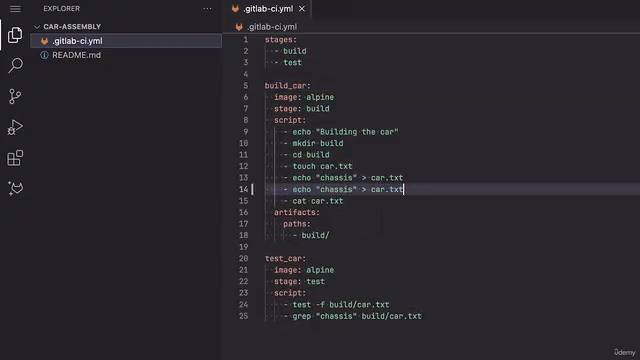
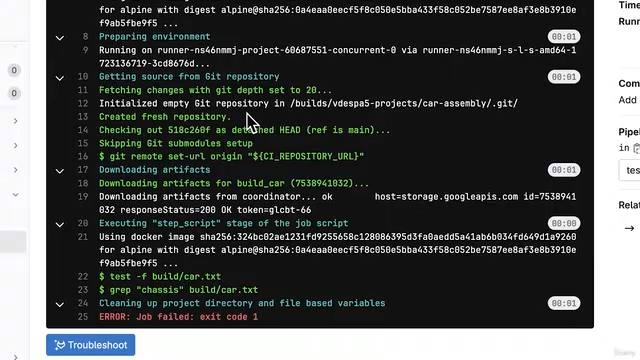
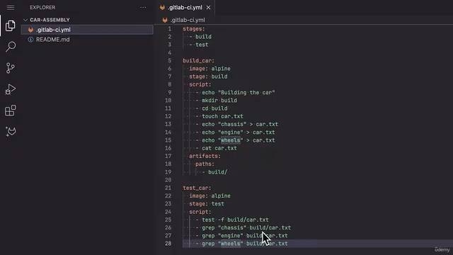
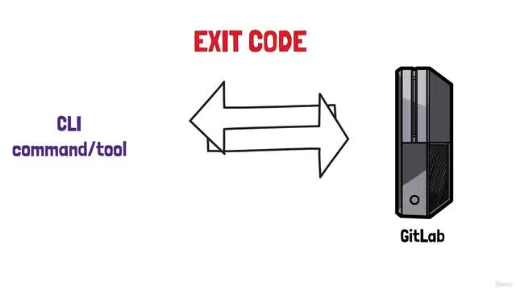
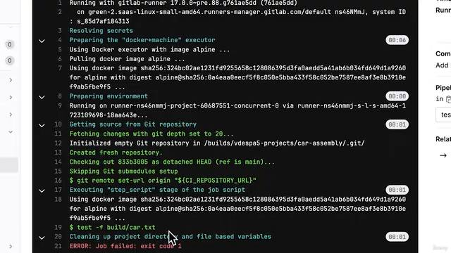
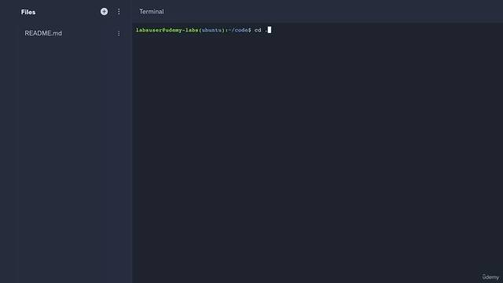
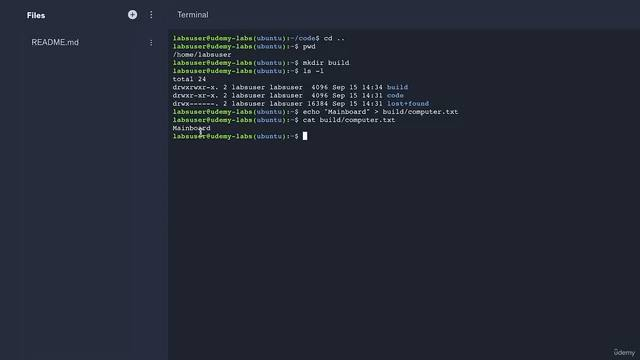

# 1. 这一节做什么

这一节（P14–P20）的主线只有一句话：**把一条“能跑”的 pipeline，变成一条“跑对了才算过”的 pipeline**。

P14 从车间的比喻开始——前面的课程里我们已经在 `build car` 这个 job 里用 `echo` 往 `car.txt` 里写零件，但写进去的是“轮子”还是“底盘+发动机+轮子”，pipeline 本身并不检查。讲师在这一节里先故意把测试补上，然后引入一个真实的 bug（用 `>` 而不是 `>>`），让 `test car` 这个 job 失败；接着带我们**从日志定位、到手动复现、再到修复**走一遍完整调试链路。P15 把失败背后的机制拆开：GitLab 判断 job 成败靠的是每条命令的 **exit code**，0 成功、1–255 失败，任何一个非零退出码会立刻中断当前 job 以及后续 stage。P16 是一门纯命令的 lab：`mkdir / cd / pwd / ls -al / echo / cat / test -f / grep / echo $?`，用同一套命令在终端里复现课程里 pipeline 正在做的事。P17–P19 是心态与概念回顾（调试、DevOps、章节总结），P20 是下一节的引子：从“玩具车”过渡到真实项目的 CI。

对前端转 AI 应用工程师来说，这一节真正的价值不是记住几条 Linux 命令，而是建立一个条件反射：**pipeline 失败时，先看最后一条执行的命令和它的退出码，再判断问题出在测试还是构建**。这套思路在你以后接 LLM 应用的 CI（跑评测、跑 lint、跑 RAG 回归）时完全通用。

---

# 2. 讲师原话（带出处）

> 讲师在开头点出这一节的核心矛盾：“一条 pipeline 可以一路跑完、不报任何错误，却仍然产出一个有缺陷的构建。我们的任务就是阻止这种情况发生。”—— p014 [00:00–00:28]

> 补完 `build car` 和 `test car` 之后，pipeline 失败。讲师的第一反应不是改代码，而是：“当 pipeline 的测试失败时，我们该做什么？首先去看日志，弄清楚是哪条命令导致的失败。”—— p014 [01:26–01:43]

> 在 `test car` 的日志里定位到最后一条命令是搜索 chassis，讲师说：“我们知道文件是存在的，因为上一条 `test` 命令成功了。但现在它找不到 chassis，执行到这里就停了。”—— p014 [01:43–02:12]

> 然后他给了一个关键判断：“如果日志里看不出问题、配置本身也看起来没问题，那我们要做的就是一个**手动测试**。”—— p014 [02:12–02:42]

> 真正的原因在 `build car` 里：“在 `cat` 之前最后执行的那条命令，是往文件里写 wheels。这里的 `>` 操作符会**覆盖**文件内容。每次运行这条命令，内容都会被覆盖掉，这不是我们想要的。我们想追加，用的是 `>>`，两个大于号。”—— p014 [04:19–04:49]

> P15 解释失败的底层机制：“exit code 0 表示程序执行成功；任何其他退出码，1 到 255，都表示失败。如果所有命令都返回 0，GitLab 就把 job 标记为成功。”—— p015 [00:58–01:26]

> “如果 GitLab 拿到一个非零的退出码，它会**立刻中断 job 的执行**，后面的命令一条都不再执行。”—— p015 [02:13–02:24]

> 他还演示了如何人为制造失败：“我们用一个叫 `exit` 的命令，写 `exit 1`，提交、跑 pipeline，然后看日志……注意，`exit` 之后的 echo 和 cat 都没有再执行。”—— p015 [03:12–04:16]

> P16 在终端里复现 `>` 与 `>>` 的区别：“如果我直接回车，它会覆盖文件内容……看，文件里只剩 display 了。换成追加操作符，再 cat，mainboard 和 display 都在。”—— p016 [02:35–03:19]

> 关于 grep 的退出码：“搜一个不存在的词，我们不会看到报错，但看退出码是 1。在 CI/CD pipeline 里，这就会失败。”—— p016 [05:13–05:42]

> P20 明确这一节用浏览器操作 GitLab：“整节我们都在浏览器里用 GitLab 平台完成，不需要在本地装任何软件，除非你特别想装。”—— p020 [01:24–01:42]

---

# 3. 从零复现

## 3.0 前置条件

- 一个 GitLab 账号（免费版即可）。
- 一个空项目（public 或 private 都行，后文调试时用 public 更方便分享）。
- 一台能打开浏览器的电脑；**不需要**本地安装 GitLab Runner、Docker 或 Node。
- 如果你想在本地跟着 P16 敲命令：Linux/macOS 直接开终端；Windows 建议开 WSL，或者 `docker run -it --rm alpine sh` 进容器。

> 讲师在 P20 明确说全程在浏览器里完成，所以“本地不装东西”是课程的原设定，不是我们偷懒。

## 3.1 创建项目与第一版 pipeline

1. 登录 GitLab，新建一个空项目，例如 `car-assembly`。
2. 进入项目，点 **New file**，文件名写 `.gitlab-ci.yml`（注意前面有个点，不要写成 `gitlab-ci.yml`）。
3. 把下面 **3.1 的正确版本**（后续第 4 节会再给一遍完整文件）粘进去，提交到 `main` 分支。
4. 提交后 GitLab 会自动触发 pipeline（CI/CD → Pipelines）。你会看到两个 stage：`build` → `test`，两个 job：`build car`、`test car`。
5. 第一次应该是**绿的**。点进 `build car` 的日志，找到 `cat car.txt` 的输出，应该看到三行：chassis / engine / wheels。



## 3.2 故意把 pipeline 改坏（复现 P14 的 bug）

现在把 `build car` 里的两行 `>>` 改回 `>`，也就是让 engine 和 wheels 都**覆盖**写入：

```yaml
    - echo "chassis" > car.txt
    - echo "engine"  > car.txt   # 故意写坏
    - echo "wheels"  > car.txt   # 故意写坏
    - cat car.txt
```

提交。观察结果：**`build car` 是绿的，`test car` 是红的**。这就是讲师说的“pipeline 可以跑完不报错，但产出有缺陷”——如果没有测试，这个只装了轮子的车就会被发出去。



## 3.3 读日志定位

1. 点进失败的 `test car` job。
2. 从日志**从下往上**看。最后一条真正执行并导致失败的命令是 `grep chassis car.txt`，日志末尾会出现 `Job failed` 和 `exit code 1`（讲师用的就是这个表述，不要脑补其他字段名）。
3. 到这一步，你已经知道“哪条命令失败、为什么失败（grep 没匹配到）”，但**还不知道是测试写错了还是构建写错了**。
4. 按讲师的做法：打开 `build car` 的日志，找到 `cat car.txt` 的输出——只有一行 `wheels`。
5. 如果连日志都不信，回到 `build car` 页面的 **Browse artifacts**（或 job 页右侧的 artifacts 区域），下载 `car.txt` 手动打开，确认里面真的只有 wheels。



## 3.4 修复并验证

把 `build car` 里的两行改回 `>>`：

```yaml
    - echo "chassis" > car.txt
    - echo "engine"  >> car.txt
    - echo "wheels"  >> car.txt
    - cat car.txt
```

提交，pipeline 应该恢复绿色。再点进 `test car`，看 `grep` 的三行是否都通过；再进 `build car`，看 `cat` 输出是否三行齐全。这一步是讲师强调的“手动再验证一次”——测试通过不等于你想的那样通过。

## 3.5 用 exit 1 人为制造失败（复现 P15）

在 `build car` 的脚本中间插入一行 `- exit 1`：

```yaml
  script:
    - touch car.txt
    - echo "chassis" > car.txt
    - exit 1
    - echo "engine"  >> car.txt
    - echo "wheels"  >> car.txt
    - cat car.txt
```

提交后观察：

- `build car` 变红，`test car` **根本没有运行**（因为前一个 stage 失败，后续 stage 被跳过）。
- 点进 `build car` 日志，`exit 1` 之后的 `echo` 和 `cat` 一行都没有出现。
- 日志末尾同样是 `Job failed` + `exit code 1`。





验证完**务必把 `- exit 1` 删掉**，否则后面所有 pipeline 都会挂在这里。讲师在 P15 里明确说这行只是演示，不会保留。

## 3.6 移除 touch，验证测试的“防线”

讲师在 P14 末尾做了一次反向验证：删掉 `touch car.txt` 这一行，提交，pipeline **仍然成功**。原因是第一条 `echo ... > car.txt` 本身就会创建文件，`touch` 是冗余的。

这一步的意义不是让你删 `touch`，而是让你体会：**当测试足够好时，你可以放心地对 pipeline 做小改动**，改错了测试会报警，改对了测试会放行。

## 3.7 在本地终端复现 P16 的 Linux 命令

打开终端（或 `docker run -it --rm alpine sh`），逐条执行：

```bash
cd "$HOME"
pwd
mkdir -p build
ls -al

echo "mainboard" >  build/computer.txt
cat  build/computer.txt            # mainboard

echo "display"   >  build/computer.txt
cat  build/computer.txt            # 只剩 display —— 覆盖

echo "mainboard" >  build/computer.txt
echo "display"   >> build/computer.txt
cat  build/computer.txt            # mainboard + display —— 追加

test -f build/computer.txt
echo "test -f 存在文件退出码: $?"    # 0

test -f build/nope.txt
echo "test -f 不存在文件退出码: $?"  # 1

grep display build/computer.txt
echo "grep 命中退出码: $?"          # 0

grep dislay  build/computer.txt
echo "grep 未命中退出码: $?"        # 1
```





---

# 4. 完整代码

## 4.1 最终版 `.gitlab-ci.yml`（保存到项目根目录）

```yaml
# .gitlab-ci.yml
# 车体组装 pipeline：build 阶段造车，test 阶段验车
# 课程 P14–P16 的最终可运行版本

stages:
  - build
  - test

build car:
  stage: build
  image: alpine
  script:
    # 1) 创建（或更新）车体文件；即使文件已存在也不会报错
    - touch car.txt
    # 2) 写入底盘 —— 首次创建用 > 覆盖写是安全的
    - echo "chassis" > car.txt
    # 3) 追加发动机 —— 必须用 >>，否则会覆盖掉 chassis
    - echo "engine"  >> car.txt
    # 4) 追加轮子 —— 同样必须用 >>
    - echo "wheels"  >> car.txt
    # 5) 把成品打印到日志，方便人工核对
    - cat car.txt
  artifacts:
    # 把 car.txt 交给下游 test job 使用
    paths:
      - car.txt

test car:
  stage: test
  image: alpine
  script:
    # 1) 文件必须存在且是普通文件，否则返回非零
    - test -f car.txt
    # 2) 三个零件一个都不能少
    - grep chassis car.txt
    - grep engine   car.txt
    - grep wheels   car.txt
```

> 说明：`artifacts` 的 YAML 写法在逐字稿里**没有展开**，但讲师在 P14 里明确提到“browse the artifacts、download the car.txt”，说明这个 pipeline 里 artifacts 是配着的。上面这段是按 GitLab 标准 artifacts 语法补全的；如果你不写 `artifacts`，`test car` 会找不到 `car.txt`（详见第 7 节）。

## 4.2 复现 bug 用的“坏版本”（仅用于 3.2 步，验证完改回 4.1）

```yaml
# .gitlab-ci.yml（坏版本，仅用于复现 P14 的 bug）
stages:
  - build
  - test

build car:
  stage: build
  image: alpine
  script:
    - touch car.txt
    - echo "chassis" > car.txt
    - echo "engine"  > car.txt   # BUG：覆盖，应改为 >>
    - echo "wheels"  > car.txt   # BUG：覆盖，应改为 >>
    - cat car.txt
  artifacts:
    paths:
      - car.txt

test car:
  stage: test
  image: alpine
  script:
    - test -f car.txt
    - grep chassis car.txt
    - grep engine   car.txt
    - grep wheels   car.txt
```

## 4.3 P16 本地实验脚本 `linux-lab.sh`（可选，直接 `bash linux-lab.sh` 运行）

```bash
#!/usr/bin/env bash
# linux-lab.sh —— 复现 P16 的 Linux 命令 lab
# 运行方式：bash linux-lab.sh
# 注意：故意不加 set -e，否则 test -f 失败会中断整个脚本，不利于观察退出码

cd "$HOME"
pwd

mkdir -p build
ls -al

echo "mainboard" >  build/computer.txt
cat  build/computer.txt

echo "display"   >  build/computer.txt
cat  build/computer.txt            # 只剩 display

echo "mainboard" >  build/computer.txt
echo "display"   >> build/computer.txt
cat  build/computer.txt            # mainboard 和 display 都在

test -f build/computer.txt
echo "test -f 存在文件退出码: $?"

test -f build/nope.txt
echo "test -f 不存在文件退出码: $?"

grep display build/computer.txt
echo "grep 命中退出码: $?"

grep dislay  build/computer.txt
echo "grep 未命中退出码: $?"
```

---

# 5. 逐行解释

## 5.1 `.gitlab-ci.yml` 的结构层

- `stages: [build, test]`：声明两个阶段，GitLab 会**按这个顺序**执行。同 stage 内的多个 job 会并行；后一个 stage 只在前一个 stage 全部成功后才开始。这就是 3.5 里 `exit 1` 导致 `test car` 完全不跑的原因。
- `build car:` 与 `test car:`：job 名（可以有空格）。**job 名和 stage 名是两回事**，`build car` 是 job，`build` 是 stage。
- `stage: build`：告诉 GitLab 这个 job 属于哪个 stage。
- `image: alpine`：每个 job 在一个 Docker 容器里跑 `script`。讲师 P19 说 Alpine 是“一个非常轻量的 Docker 镜像”。**具体 tag 课里没讲**，`alpine` 默认等价于 `alpine:latest`；想锁版本可以写 `alpine:3.20` 之类，但要自己确认版本号。
- `script:`：真正要执行的 shell 命令列表，**按顺序逐条执行**。任意一条返回非零退出码，job 立刻停止。

## 5.2 `build car` 的每一行

- `touch car.txt`：如果文件不存在就创建一个空文件，如果存在就更新它的时间戳。**它是冗余的**，因为下一条 `echo ... > car.txt` 会创建文件。讲师在 P14 末尾专门演示过：删掉 `touch` 后 pipeline 仍然成功。
- `echo "chassis" > car.txt`：`echo` 打印字符串，`>` 把标准输出**重定向并覆盖**到 `car.txt`。第一次运行等于“创建并写入”。用在第一行是安全的，因为此时文件里没有别的东西。
- `echo "engine" >> car.txt`：`>>` 是**追加**，写在文件末尾，不动原有内容。这就是 P14 里那个“小错误、大后果”的修复点。
- `echo "wheels" >> car.txt`：同上，追加轮子。
- `cat car.txt`：把文件内容打印到日志。**这一步很关键**——它让你在 GitLab 的 job 日志里直接看到成品，而不只是“命令没报错”。讲师在 P14 里就是靠这一步看到“只有 wheels”的。
- `artifacts: paths: [car.txt]`：把 `car.txt` 标记为 job 产物。下游 `test car` 会下载它；在 UI 里你能 **Browse / Download**。**YAML 写法课里没展开**，但“下载 artifacts”这个动作讲师明确提过。

## 5.3 `test car` 的每一行

- `test -f car.txt`：检查 `car.txt` 存在**且是普通文件**。成功返回 0，失败返回 1（P16 与 P15 都解释了）。在 Node 里没有“退出码”这个日常概念，对应的是 shell 的 `$?`；如果你在 Node 里要表达类似语义，可以用 `process.exitCode = 1` 让脚本以非零码结束。
- `grep chassis car.txt`：在文件里搜索字符串。命中打印匹配行并返回 0；**没命中时不会打印错误、但返回 1**（P16 原话：“我们不会看到报错，但退出码是 1，在 CI/CD pipeline 里这就会失败”）。
- 后两条 `grep` 同理，分别检查 engine 和 wheels。
- 为什么这三条要分行写？因为 shell 和 GitLab 都是“**第一条非零就停**”，分成三条你能从日志一眼看出是哪个零件缺失；如果写成 `grep -E 'chassis|engine|wheels' car.txt` 就只剩一个笼统结果。

## 5.4 关于 `exit 1` 与退出码

- `exit 1`：显式地让当前 shell 以退出码 1 结束。P15 里讲师把它插在 `build car` 中间，用来演示“非零退出码 = job 失败 + 后续命令不跑 + 后续 stage 不跑”。
- 退出码范围：0 成功；1–255 失败（P15 原话）。**不要**把 1 理解成“警告”——在 GitLab 里 1 就是失败。
- 日志里你能看到的字段：`Job failed` 和 `exit code 1`（讲师原话）。**其他字段名以你实际 UI 为准**，不同 GitLab 版本措辞可能略有差异，不要照抄网上文章里的字段名。
- 前端类比：Node 里 `process.exit(1)` 或 `process.exitCode = 1` 就是同样的语义；`cmd1 && cmd2` 的“前一条失败就不跑后一条”与 GitLab 的“失败即停”是同一个逻辑。

## 5.5 关于 `>` 与 `>>` 的对照表

| 操作符 | 含义 | 在 P14 里的后果 |
| --- | --- | --- |
| `>` | 覆盖写入（文件不存在则创建） | engine 覆盖 chassis，wheels 再覆盖 engine，最后只剩 wheels |
| `>>` | 追加写入（文件不存在则创建） | chassis、engine、wheels 依次累积 |

讲师的 bug 就出在这里：**命令本身都成功（退出码 0），但语义错了**。这正是“pipeline 绿了不等于产出对”的活教材。

## 5.6 本地脚本 `linux-lab.sh` 的解释

- `cd "$HOME"` + `pwd`：P16 的第一件事就是回到用户主目录，用 `pwd` 确认位置。
- `mkdir -p build`：`-p` 表示父目录不存在时一并创建、已存在也不报错。P16 里用的是 `mkdir build`，这里加 `-p` 是为了脚本可重复运行。
- `ls -al`：列出所有文件（含隐藏文件）和详细信息。讲师原话是“LS with a flag alt”，对应 `ls -al`（`-a` 显示隐藏，`-l` 长格式）。
- 后面的 `echo / cat / test -f / grep / echo $?` 与 5.2、5.3 完全对应，只是从 GitLab 搬到了本地终端。
- 脚本故意**不加** `set -e`：因为我们要连续演示“失败”的退出码（`test -f` 失败、`grep` 未命中），加了 `set -e` 脚本会在第一个非零码处退出，反而看不到后面的输出。

---

# 6. 复现检查清单

按顺序勾，全绿说明你复现成功：

- [ ] 项目里 `.gitlab-ci.yml` 文件名拼写正确（前导点 + 全小写）。
- [ ] 第一次提交后，Pipelines 页面能看到 `build` 和 `test` 两个 stage。
- [ ] `build car` 日志里 `cat car.txt` 输出三行：chassis / engine / wheels。
- [ ] `test car` 日志里三条 `grep` 都通过。
- [ ] 把 `>>` 改成 `>` 后，`build car` 仍绿、`test car` 变红——bug 复现成功。
- [ ] 红的时候，`test car` 日志最后一条执行命令是 `grep chassis car.txt`，末尾可见 `Job failed` 与 `exit code 1`。
- [ ] 红的时候，`build car` 的 `cat` 输出只有 wheels；下载 artifacts 里的 `car.txt` 内容一致。
- [ ] 改回 `>>` 后 pipeline 变绿。
- [ ] 插入 `- exit 1` 后，`build car` 变红、`test car` 没跑、`exit 1` 之后的命令都没执行。
- [ ] 删掉 `- exit 1` 后 pipeline 恢复。
- [ ] 删掉 `touch car.txt` 后 pipeline 仍然绿。
- [ ] 本地跑 `bash linux-lab.sh`，四个 `$?` 依次输出 `0 / 1 / 0 / 1`。

如果某一条卡住：

- pipeline 根本没触发 → 看 `.gitlab-ci.yml` 是否在默认分支根目录、YAML 缩进是否用了 Tab（必须用空格）。
- `test car` 报 `car.txt: No such file` → 检查 `build car` 是否配了 `artifacts`，且 `test car` 与 `build car` 不在同一 stage。
- YAML 解析报错 → 用 GitLab 的 **CI Lint**（项目左侧 CI/CD → Editor 或 Pipeline editor）先校验再提交。

---

# 7. 课里没讲但你会撞上的

1. **`artifacts` 的 YAML 具体写法课里没讲。** 讲师只说了“browse the artifacts、download car.txt”，但没展开 `artifacts:` 段。GitLab 的 job **不共享工作目录**，`build` 里的 `car.txt` 不会自动出现在 `test` 里；不写 `artifacts`，`test car` 必然报“文件不存在”，而你会误以为是 `test -f` 写错了。上面 4.1 的写法是标准语法，照抄即可。

2. **`image: alpine` 的 tag 课里没指定。** 不写 tag 等于 `latest`，能跑，但上游 Alpine 更新后行为可能变。生产里建议锁 `alpine:3.x` 并在项目里记录版本。

3. **`test -f` 在 macOS / Linux / Alpine 上行为一致，但 `ls -al` 的输出格式略有差异**（macOS 多显示 `@`、owner 列不同）。这不是 bug，不要按输出格式写断言。

4. **Windows 原生 CMD/PowerShell 跑不了 `bash linux-lab.sh`。** 用 WSL，或 `docker run -it --rm -v "$PWD:/work" -w /work alpine sh linux-lab.sh`。P16 的 lab 本身是在课程平台内置的 Linux 终端里做的。

5. **`grep` 未命中返回 1、`test -f` 文件不存在返回 1，这两个“1”就是 pipeline 变红的直接原因。** 不要在日志里找“Error”字样——`grep` 没命中时**不会有任何错误输出**，只有退出码。这也是讲师反复强调“看退出码、不要只看文字”的原因。

6. **GitLab 的 UI 一直在改。** 讲师 P20 自己也提醒了：troubleshoot 按钮的位置、AI 解释的措辞、artifacts 的入口都可能和你看到的版本不一样。找不到入口就去 CI/CD → Pipelines 里点 job 名，artifact 一般在 job 页右侧或日志上方。

7. **P15 提到的 AI troubleshoot 不能替代你自己读日志。** 讲师的原话大意是：AI 现在还不理解 job 之间的关系，会把“test 失败”归因成“文件不该存在”“路径写错”，给出的修复建议可能是错的。把它当“第二双眼睛”，不要当“结论”。

8. **`exit 1` 演示完一定要删。** 这是新手最容易踩的坑：跟着视频插了一行 `exit 1`，忘了删，之后所有提交都红，然后怀疑人生。讲师 P15 里也专门说了这行不会保留。

9. **YAML 缩进错误和“job 失败”是两回事。** 缩进错会导致 pipeline **创建不出来**，报 configuration error；job 失败是 pipeline 创建成功、命令返回非零。分不清这两类问题，会浪费很多时间。

10. **在前端/Node 语境里建立映射**：shell 的 `$?` ≈ Node 的 `process.exitCode`；`cmd1 && cmd2` ≈ GitLab 的“失败即停”；`>` / `>>` ≈ `fs.writeFileSync(path, data)`（覆盖）与 `fs.appendFileSync(path, data)`（追加）。把这几组对应关系记住，你以后写 Node 的 CI 脚本时不会再把“追加”写成“覆盖”。

---

**本节一句话总结**：讲师用一辆“只装了轮子的车”，把 CI 里最重要的三件事串了起来——**测试要能抓住语义错误、失败要先看最后一条命令和它的退出码、`>` 和 `>>` 差一个字符但结果完全不同**。把 4.1 的文件放进项目、按第 3 节走一遍红绿切换，这一节就算真正跑通了。