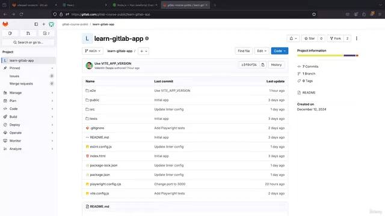
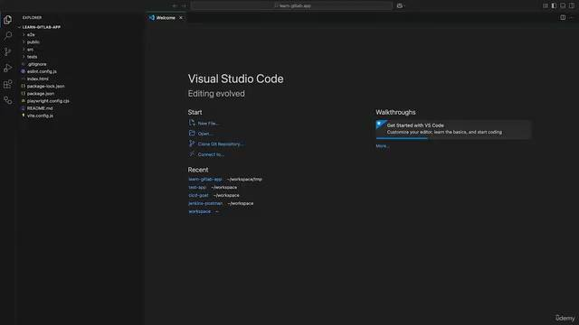
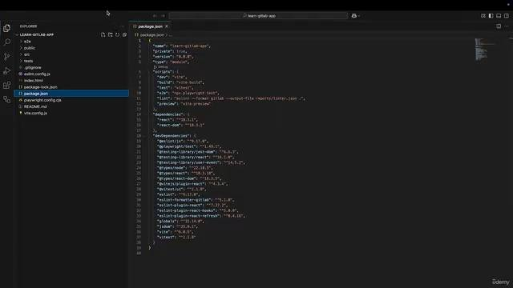
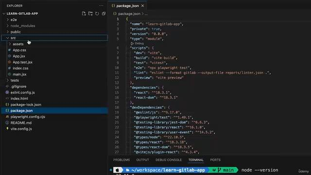
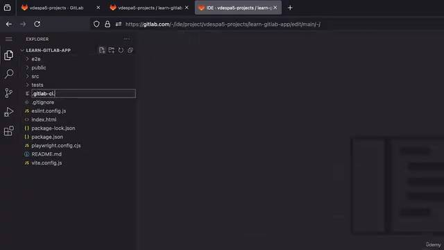
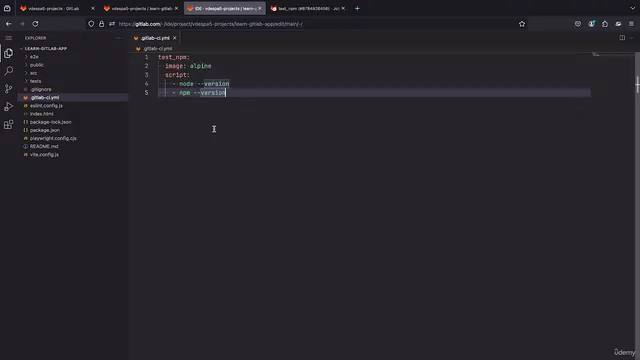
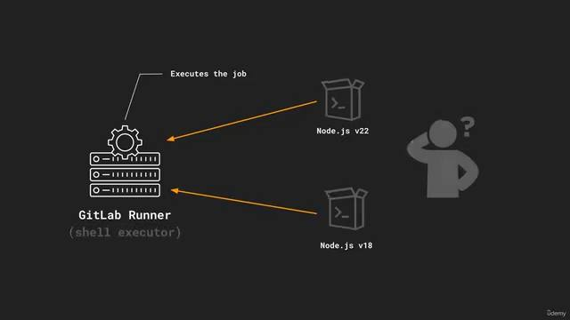
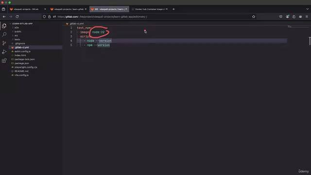
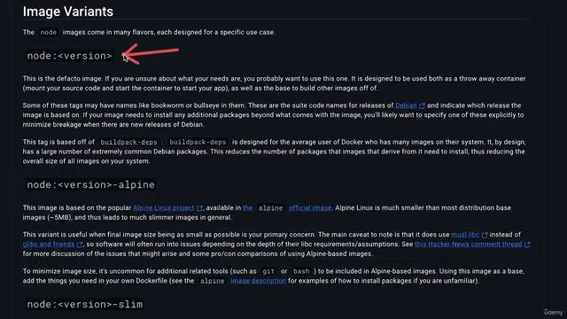
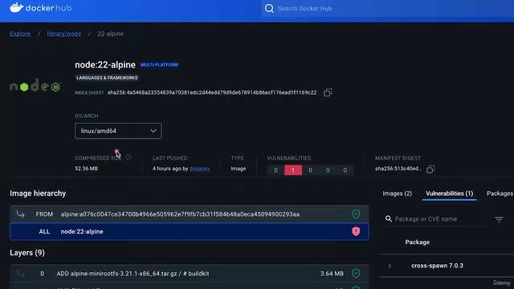

# GitLab CI/CD 实操文档：从本地命令到第一条 Node.js Pipeline（P21–P25）

## 1. 这一节做什么

这一节的目标不是“听懂 GitLab CI/CD 的概念”，而是把一个真实项目从本地手动流程，推进到 GitLab 上的第一条可执行 Pipeline。

课程使用的是一个 React.js + Node.js 的 Web 应用。讲师明确说，你不需要熟悉 React 或 Node，因为重点不是这门语言，而是“如何把本地已经验证过的命令搬进 GitLab Pipeline”。—— p021 [00:00]

P21–P25 实际完成的事情可以拆成四步：

1. 在 GitLab 上 fork 课程仓库，得到一份只有你能改的个人副本。
2. 在本地克隆仓库，安装 Node.js 22、VS Code、Git，并手动跑通依赖安装、构建、本地预览。
3. 在仓库根目录新增 `.gitlab-ci.yml`，用 Docker 镜像作为 job 的运行环境。
4. 先故意用 `alpine` 镜像观察 `node not found`，再换成 `node:22` 成功，最后优化成 `node:22-alpine`，对比执行时间。

这一节结束时，你会得到一条能跑通的 GitLab Pipeline：

```text
push 代码
  -> GitLab Runner 拉取 node:22-alpine 镜像
  -> 在容器里执行 node --version
  -> 在容器里执行 npm --version
  -> job 成功
```

注意：P21–P25 的 Pipeline 还只是“验证运行环境”，并没有在 CI 里执行 `npm install`、`npm run build`、`npm test`。讲师在 P22 末尾说的是：依赖安装、构建、测试都属于 CI Pipeline 的一部分，后面会用 GitLab 自动化这些步骤。—— p022 [11:30] 所以本文不会假装这一节已经完成了完整 CI；本文只复现 P21–P25 真实出现的内容。

---

## 2. 讲师原话

下面抽取和“复现”直接相关的原话。英文是逐字稿原文，中文是帮助理解的解释。

> “This is what is known as a fork.” —— p021 [01:53]  
> 中文：这就是所谓的 fork。你不是直接改原仓库，而是复制一份到自己的命名空间里改。

> “we cannot jump into automation before we understand what we are trying to do.” —— p022 [02:42]  
> 中文：在理解自己要做什么之前，不能直接跳进自动化。GitLab 不是读心工具，必须先知道手动步骤。

> “installing project dependencies, building or compiling the project, and testing the application.” —— p022 [03:11]  
> 中文：大多数应用的工作流是安装项目依赖、构建或编译项目、测试应用。

> “make sure that this file is created at the root of the repository” —— p023 [00:24]  
> 中文：`.gitlab-ci.yml` 必须放在仓库根目录，不能放到某个子目录里。

> “the error that we're getting is node not found.” —— p023 [01:48]  
> 中文：用 `alpine` 镜像执行 `node --version` 时，报错是找不到 `node`。

> “All we need is a Docker image with Node.js already installed and we're gonna replace here Alpine with Node column 22.” —— p023 [04:12]  
> 中文：只需要一个已经装好 Node.js 的 Docker 镜像，把 `alpine` 换成 `node:22`。

> “For CI CD pipelines, lightweight images are the way to go.” —— p025 [00:55]  
> 中文：CI/CD Pipeline 应该优先使用轻量镜像。

> “Now we have 15 seconds at pretty much half of what we had previously.” —— p025 [03:21]  
> 中文：换成轻量镜像后，这次 job 大约 15 秒，差不多是之前的一半。

---

## 3. 从零复现

这一节按真实操作顺序写。你可以从 fork 开始，一步一步做到 Pipeline 成功。

### 3.1 准备环境

课程要求的环境如下：

- GitLab 账号。
- Node.js 22。讲师在 P22 明确要求 Node.js version 22。—— p022 [00:26]
- Visual Studio Code。
- Git 已安装并配置好，包括 SSH key。课里只说了需要 SSH key，没有展开 SSH key 的生成步骤。
- 能访问 GitLab.com 的仓库。
- GitLab Runner 使用 Docker executor。讲师在 P23 明确说这里用的是 Docker executor。—— p023 [05:11]

先检查本地 Node：

```bash
node --version
```

期望输出类似：

```text
v22.x.x
```

具体 patch 版本课里没有固定，能看到主版本是 22 即可。

### 3.2 Fork 课程仓库

课程仓库地址在讲师的 resources 文件夹里。逐字稿没有给出可以直接复制的完整 URL，所以本文用 `<course-repo-url>` 表示课程仓库地址，用 `<fork-url>` 表示你 fork 后的地址。你需要在课程资源里找到真实链接后替换。

操作顺序：

1. 打开课程仓库页面。
2. 点击页面顶部的 **Fork** 按钮。
3. 选择保存位置：
   - 可以保存到你的用户名下；
   - 也可以保存到上一节创建的 `<你的用户名>-project` 组里。
4. 项目名建议保持原样。
5. 可见性建议设为 **Public**。



如果发现 Public 选项是灰色的，原因通常不是项目本身，而是它所在的组是 private。讲师在 P21 演示了修复方式：

1. 回到 GitLab 首页。
2. 进入 **Groups**。
3. 找到目标组。
4. 从 **Options** 菜单选择 **Edit**。
5. 把组的 Visibility 从 `Private` 改成 `Public`。
6. 再回到项目，重新设置项目可见性。

—— p021 [02:50]

Fork 成功后，项目页面上会出现 “forked from ...” 的提示。看到这个提示，说明你当前在正确的个人副本里。—— p021 [04:12]

### 3.3 本地克隆

在 GitLab 项目页面点击 **Code**，可以看到 SSH 和 HTTPS 两种克隆地址。讲师建议：如果你已经配置好 SSH key，用 SSH 更方便；HTTPS 也可以，只是会提示输入用户名和密码。—— p022 [00:54]

在终端执行：

```bash
git clone <fork-url>
cd <repo-name>
```

如果你用 SSH，`<fork-url>` 形如：

```text
git@gitlab.com:<你的命名空间>/<项目名>.git
```

如果你用 HTTPS，`<fork-url>` 形如：

```text
https://gitlab.com/<你的命名空间>/<项目名>.git
```

然后用 VS Code 打开当前目录：

```bash
code .
```

课里用 `code .` 打开当前目录。—— p022 [01:46]

### 3.4 手动跑通本地流程

这一步非常重要。讲师专门强调：你必须先知道手动步骤，才能把它们自动化。不要一上来就写 Pipeline。P22 的原话是：“we cannot jump into automation before we understand what we are trying to do.” —— p022 [02:42]

课程归纳的典型流程是：

1. 安装项目依赖。
2. 构建或编译项目。
3. 测试应用。

—— p022 [03:11]



#### 第一步：检查 Node 和 npm

在 VS Code 里打开终端，或直接在系统终端里执行：

```bash
node --version
npm --version
```

`node --version` 应该输出 22 开头；`npm --version` 会输出 npm 版本，具体数字以实际输出为准。

#### 第二步：安装依赖

```bash
npm install
```

这个命令会读取 `package.json`，并参考 `package-lock.json` 安装依赖。安装完成后，项目里会出现 `node_modules/` 目录。

讲师特别提醒：`node_modules` 不是 Git 仓库的一部分，不应该提交到 Git。它是在执行 `npm install` 之后才出现的。—— p022 [06:52]

另外，npm 安装过程中可能出现 warning。讲师说 warning 不是 error，不要看到一堆警告就以为安装失败。—— p022 [06:23]



#### 第三步：构建项目

```bash
npm run build
```

这个命令会调用 `package.json` 里的 build script。课程项目是 React/Node 项目，构建不是生成二进制文件，而是生成优化过的、适合部署的静态文件，例如压缩后的 JavaScript、CSS 和 `index.html`。—— p022 [08:48]

执行完成后，会出现一个 `build/` 目录。这个目录就是后面要部署的内容。



#### 第四步：本地预览

课里安装了一个轻量静态服务器，并用它服务 `build/` 目录。逐字稿把命令听写成 `surf`，从上下文看是安装一个静态服务器并执行 `serve build` 这类命令。下面给出常见的 `serve` 写法；如果你课程资源里写的是别的包名，以资源链接为准。

```bash
npm install -g serve
serve build
```

然后终端会输出一个本地地址。用浏览器打开这个地址，如果能看到网站页面，说明本地依赖安装、构建、预览都成功了。课里没有给出固定端口号，具体端口以终端输出为准。—— p022 [10:41]

如果你不想全局安装，也可以用 npm 自带的 npx 方式：

```bash
npx serve build
```

注意：这条 `npx` 是本文给出的等价操作，不是讲师在 P22 逐字稿里逐条演示的命令。

### 3.5 创建第一条 Pipeline

现在进入 GitLab 项目，打开 Web IDE 或本地编辑器。课程建议直接在 GitLab Web IDE 里改，因为这一节还没有必要在本地做复杂开发。

先创建一个分支，避免直接改默认分支：

```bash
git checkout -b ci/pipeline-first
```

在仓库根目录创建 `.gitlab-ci.yml`。注意：必须在仓库根目录，和 `.gitignore`、`package.json` 同级，不能放到 `src/` 等子目录里。—— p023 [00:24]

第一条实验性配置如下：

```yaml
test_npm:
  image: alpine
  script:
    - node --version
    - npm --version
```

保存后提交并推送：

```bash
git add .gitlab-ci.yml
git commit -m "ci: add first npm test job"
git push -u origin ci/pipeline-first
```

推送后 GitLab 会自动创建 Pipeline。进入项目的 **CI/CD > Pipelines** 查看。



这一次 Pipeline 应该会失败。点进 job 查看日志，会看到 `node` 找不到。讲师在 P23 演示的报错就是 `node not found`。—— p023 [01:48]



失败原因不是 YAML 写错，而是 `alpine` 这个 Docker 镜像里没有安装 Node.js。`node` 和 `npm` 不是大多数 Linux 环境自带的命令；`touch`、`cat`、`sleep` 这类基础命令有，但 Node 没有。—— p023 [01:48]

### 3.6 换成带 Node.js 的镜像

把 `.gitlab-ci.yml` 改成：

```yaml
test_npm:
  image: node:22
  script:
    - node --version
    - npm --version
```

提交并推送：

```bash
git add .gitlab-ci.yml
git commit -m "ci: use node 22 image"
git push
```

这次 job 应该成功，日志里会打印 Node 版本和 npm 版本。讲师在 P23 说，换成 `node:22` 后执行成功，能看到 Node 和 npm 的版本被打印出来。—— p023 [04:41]



这里的关键不是“背命令”，而是理解：GitLab Runner 使用的是 Docker executor，它会去拉取 `node:22` 镜像，然后在容器里执行 script。这个容器里有 Node.js，所以命令能找到。—— p023 [05:11]

### 3.7 理解 `node:22` 是怎么来的

讲师在 P24 专门解释了：`node:22` 不是随便猜的，而是从 Docker Hub 的官方 Node 镜像页面查到的。

操作：

1. 打开 Docker Hub。
2. 搜索 `node`。
3. 看 **trusted content** 里的官方 Node 镜像。
4. 打开官方页面，滚动到使用说明部分。
5. 页面会告诉你镜像的使用形式是 `node:<version>`。
6. 课程项目用 Node 22，所以写成 `node:22`。

—— p024 [00:24]



讲师还解释了默认 registry：如果你不指定其他 Docker registry，GitLab Runner 会默认从 Docker Hub 拉镜像。所以配置里只写 `node:22` 就够了。—— p024 [02:50]

### 3.8 优化成轻量镜像

P25 的核心是：镜像越大，下载越慢，Pipeline 越慢。每次 job 运行，Docker 镜像都可能需要被拉取；镜像大会把时间浪费在下载上。—— p025 [00:00]

课程里对比了 Node 镜像：

- `node:22` 大约 386 MB。
- `node:22-alpine` 大约 52 MB。

—— p025 [02:48]

到 Docker Hub 的 Node 官方镜像页面，点击 **Tags**，搜索 `22`，可以看到 `22-alpine`、`22-slim` 等变体。Alpine 是非常轻量的 Linux 发行版；Slim 也比完整镜像小，但通常比 Alpine 稍大。—— p025 [01:51]



把 `.gitlab-ci.yml` 再改成：

```yaml
test_npm:
  image: node:22-alpine
  script:
    - node --version
    - npm --version
```

提交并推送：

```bash
git add .gitlab-ci.yml
git commit -m "ci: use node 22 alpine image"
git push
```



讲师演示的结果是：原来的 job 大约 32 秒，换成 `22-alpine` 后大约 15 秒，差不多减半。具体时间会受网络和 Runner 负载影响，不一定每次都完全一样。—— p025 [03:21]

---

## 4. 完整代码

本节没有环境变量，不需要在 GitLab CI/CD Variables 里新增任何变量。你只需要下面这个完整文件。

### 4.1 目录结构

你的 fork 仓库应该至少包含这些内容：

```text
<repo-name>/
├── .gitlab-ci.yml
├── .gitignore
├── package.json
├── package-lock.json
├── src/
└── build/        # 执行 npm run build 后生成；是否提交以项目 .gitignore 为准
```

说明：

- `.gitlab-ci.yml` 必须放在仓库根目录。
- `package.json`、`package-lock.json` 来自课程项目，不需要你重写。
- `node_modules/` 由 `npm install` 生成，不提交。
- `build/` 由 `npm run build` 生成。逐字稿没有明确讲它是否必须提交，按项目现有 `.gitignore` 为准。

### 4.2 最终版 `.gitlab-ci.yml`

文件路径：

```text
.gitlab-ci.yml
```

完整内容：

```yaml
test_npm:
  image: node:22-alpine
  script:
    - node --version
    - npm --version
```

这就是 P21–P25 结束时的核心 CI 文件。它没有写 `stages`，GitLab 会使用默认阶段；job 默认落在 test 阶段。本实验不依赖自定义 stage。

### 4.3 课程中间的失败实验版

如果你想按讲师顺序复现“先失败、再成功”，第一步用这个完整文件：

```yaml
test_npm:
  image: alpine
  script:
    - node --version
    - npm --version
```

这个版本会失败，报错大意是找不到 `node`。失败是预期结果，不是你的 YAML 写错。

### 4.4 课程中间的修复版

把镜像换成带 Node.js 的版本：

```yaml
test_npm:
  image: node:22
  script:
    - node --version
    - npm --version
```

这个版本会成功，并打印 Node 和 npm 版本。

### 4.5 本地手动验证命令

下面不是 CI 文件，而是把 P22 讲师在本地执行的命令按顺序整理出来，方便你复制。课程没有提供这个脚本文件，这里只是命令清单。

```bash
node --version
npm install
npm run build
npm install -g serve
serve build
```

如果你不想全局安装静态服务器，可以改用：

```bash
npx serve build
```

再次说明：逐字稿把静态服务器命令听写成 `surf`，上面按常见的 `serve` 写法给出；如果你的课程资源里写的是别的包名，以资源为准。

---

## 5. 逐行解释

### 5.1 `test_npm:` 这一行

`test_npm` 是 job 的名字。它可以改，但改完后 GitLab 页面上的 job 名称也会变。课程里用这个名字表达“测试 npm 是否可用”。

注意：job 名字不是关键字，`image`、`script` 才是 GitLab CI 认识的关键字。

### 5.2 `image: node:22-alpine`

这一行指定 job 的运行环境。

- `node` 是 Docker 镜像名。
- `22-alpine` 是 tag。
- 合起来 `node:22-alpine` 表示“Node.js 22 的 Alpine 轻量变体”。

GitLab Runner 使用 Docker executor 时，会先拉取这个镜像，再启动容器，在容器里执行 `script`。如果镜像不在本地，日志里会出现 pulling Docker image 之类的下载过程。—— p025 [00:00]

为什么不是 `alpine`？因为 `alpine` 只是基础 Linux 镜像，没有 Node.js。你在里面执行 `node --version`，系统找不到 `node`。这不是命令拼写错误，而是镜像里没有这个程序。—— p023 [01:48]

为什么不直接在 `alpine` 里安装 Node？可以，但会变慢，也需要额外维护安装命令。课程选择的是直接使用官方 Node 镜像，让环境自带 Node 和 npm。—— p023 [03:42]

为什么不一开始就用 `node:22-alpine`？因为讲师要先让你看到 `node not found`，理解“镜像决定环境”，再进入优化。这个顺序是教学设计，不是绕弯。

### 5.3 `script:` 下面的两行

```yaml
script:
  - node --version
  - npm --version
```

这两行在容器里执行。

- `node --version` 验证 Node 是否存在，并打印版本。
- `npm --version` 验证 npm 是否存在，并打印版本。

在 `node:22` 或 `node:22-alpine` 里，这两个命令都应该成功。具体输出版本号以实际日志为准；课里只明确说 Node 是 22。

如果第一行就报 `node not found`，说明当前镜像没有 Node。先检查 `image` 写的是不是 `alpine`，再检查是不是把 `node:22` 拼错了。

### 5.4 为什么 `node:22` 能成功

`node:22` 是 Docker Hub 上的官方 Node 镜像。讲师在 P24 演示了如何从 Docker Hub 的 trusted content 里找到它，并确认它是官方镜像。—— p024 [00:24]

GitLab Runner 默认从 Docker Hub 拉镜像。所以配置里不写完整 registry 地址，只写 `node:22`，Runner 也会去 Docker Hub 找。—— p024 [02:50]

这也解释了一个常见疑问：为什么本地电脑能跑 `node`，GitLab 上却不行？因为本地系统已经预装了 Node，而 GitLab job 的环境由镜像决定。GitLab 不会自动知道你本地装了什么。—— p023 [02:46]

### 5.5 为什么是 `22`，不是 `18` 或别的版本

课程项目要求 Node 22。讲师在 P24 说 22 是当前的长期支持版本（LTS）。—— p024 [02:50]

如果同一个 GitLab Runner 同时跑多个项目，一个项目要 Node 22，另一个老项目要 Node 18，用 shell executor 把 Node 装在 Runner 上就会出现版本冲突。Docker 镜像的好处是每个 job 用自己指定的版本，互不影响。—— p023 [03:16]

这就是讲师说的“用 Docker 做运行时环境”的实际意义：隔离依赖，避免项目之间冲突，保证构建环境一致。

### 5.6 为什么 `22-alpine` 更快

`node:22` 完整镜像大约 386 MB，`node:22-alpine` 大约 52 MB。—— p025 [02:48]

镜像越大，Runner 拉取时间越长。P25 的实验里，两个只打印版本号的简单命令，`node:22` 的 job 大约 32 秒，`22-alpine` 大约 15 秒。—— p025 [03:21]

这不是因为 `node --version` 本身慢，而是因为镜像下载占了大量时间。镜像越小，job 越快进入真正执行命令的阶段。

但轻量镜像不是无条件更好。讲师也说了：Alpine 适合简单 JavaScript 应用；如果你的构建需要 Alpine 没有的工具或库，就可能卡住，需要额外安装，反而变慢。—— p025 [04:14]

所以实际选择顺序是：

1. 先试 Alpine。
2. 如果缺工具，再看 Slim。
3. 只有确实需要时才用完整镜像。
4. 后面课程还会讲如何基于 Alpine 构建自定义镜像，只加需要的工具。—— p025 [04:43]

### 5.7 本地 `npm install` 在做什么

`package.json` 可以理解成购物清单，告诉 npm 需要哪些包。`package-lock.json` 锁定具体版本，通常是自动生成的，不手动改。—— p022 [04:04]

`npm install` 会：

- 读取 `package.json`；
- 参考 `package-lock.json`；
- 下载依赖；
- 处理依赖之间的依赖；
- 生成 `node_modules/`。

`node_modules/` 文件可能非常多，不应该提交进 Git。课程明确说它不属于仓库。—— p022 [06:52]

在 JS/Node 里，`package-lock.json` 类似其他语言的 lockfile：它让不同机器安装出更一致的依赖版本。你不需要手动编辑它。

### 5.8 本地 `npm run build` 在做什么

`npm run build` 是一个包装命令，真正执行的是 `package.json` 里 `scripts.build` 对应的命令。—— p022 [09:18]

课程项目是 Web 应用，所以构建不是生成二进制，而是生成优化后的静态文件，包括压缩后的 JavaScript、CSS 和 `index.html`。这个产物在 `build/` 目录里。—— p022 [09:46]

为什么不直接把 `src/` 给别人？因为源码是给人读的，不是直接给浏览器部署的。构建步骤会做压缩、优化，提升生产环境性能。

### 5.9 本地 `serve build` 在做什么

`serve build` 启动一个简单的静态 Web 服务器，把 `build/` 目录作为网站根目录暴露出来。这样你可以在本地浏览器里检查构建产物是否正常。—— p022 [10:41]

它只是本地验证，不是生产部署。课里没有讲生产服务器、Nginx、域名、HTTPS 等内容。

### 5.10 这一节的 Pipeline 和“完整 CI”有什么区别

P21–P25 的 Pipeline 只做了一件事：验证 Docker 镜像里有没有 Node 和 npm。

它没有执行：

- `npm install`
- `npm run build`
- `npm test`

讲师在 P22 末尾说，依赖安装、构建、测试都属于 CI Pipeline，后面会用 GitLab 自动化。—— p022 [11:30]

所以不要把本文的 `test_npm` job 误认为完整 CI。它是“第一条 Pipeline”和“镜像选择实验”，这是 P21–P25 的真实范围。

---

## 6. 复现检查清单

按顺序打勾。任何一项失败，回到对应章节排查。

- [ ] 已找到课程资源里的真实仓库地址，并完成 fork。
- [ ] fork 保存在正确的 namespace：个人用户名或 `<用户名>-project` 组。
- [ ] 项目可见性为 Public；如果 Public 灰色，已检查组的可见性。
- [ ] 项目页面显示 “forked from ...”，确认不是原仓库。
- [ ] 本地 `node --version` 输出 `v22.x`。
- [ ] 已执行 `git clone <fork-url>` 并进入仓库目录。
- [ ] 已用 `code .` 或自己的编辑器打开项目。
- [ ] `npm install` 完成；出现 warning 不等于失败。
- [ ] 项目中出现了 `node_modules/`，且没有把它提交到 Git。
- [ ] `npm run build` 成功，生成了 `build/`。
- [ ] 用 `serve build` 或 `npx serve build` 能在本地浏览器看到页面。
- [ ] `.gitlab-ci.yml` 在仓库根目录，不在子目录。
- [ ] 第一次 `image: alpine` 的 job 失败，日志出现 `node not found` 或等价的 not found 提示。
- [ ] 改成 `image: node:22` 后 job 成功，日志打印 Node 和 npm 版本。
- [ ] 改成 `image: node:22-alpine` 后 job 仍然成功。
- [ ] 对比过 `node:22` 与 `node:22-alpine` 的 job 时间；即使不是精确的 32 秒/15 秒，也应能观察到 Alpine 更快。
- [ ] Docker Hub 上确认 `node` 是 trusted content 里的官方镜像。
- [ ] Docker Hub 的 Tags 页面能看到 `22` 和 `22-alpine`，并理解 386 MB 与 52 MB 的差异。
- [ ] 知道本节没有环境变量，也没有在 GitLab CI/CD Variables 里新增变量。
- [ ] 没有开启 Auto DevOps。
- [ ] 知道本节 Pipeline 只验证 Node/npm，不包含 `npm install`、`npm run build`、`npm test`。

---

## 7. 课里没讲但你会撞上的

下面这些不是 P21–P25 逐字稿明确展开的内容，但实际复现时很容易遇到。写在这里，避免你把环境问题误判成课程代码问题。

### 7.1 课程仓库的真实 URL

逐字稿只说代码在 GitLab.com 的仓库里，链接在 resources 文件夹，但没有在口播里给出完整 URL。所以本文用 `<course-repo-url>` 和 `<fork-url>` 占位。你必须从课程资源里拿真实地址。不要自己猜仓库路径。

### 7.2 私有组导致 Public 灰色

P21 已经讲了：如果项目所在组是 private，项目就不能设成 public。修复方式是编辑组的 Visibility。这个问题课里讲了，但很容易在 fork 时漏掉。

### 7.3 SSH key 没有配置

P22 只说 Git 要安装并配置好，包括 SSH key，但没有讲怎么生成 SSH key、怎么把公钥加到 GitLab。如果你用 SSH clone 失败，先用 HTTPS clone，或者按 GitLab 文档配置 SSH key。这个排错步骤课里没展开。

### 7.4 Runner 不是 Docker executor

P23 明确说这里用的是 Docker executor。但逐字稿没有讲如何安装、注册、配置 GitLab Runner。如果你用的是自建 Runner，而它配置成 shell executor，那么 `image:` 的行为会和你预期不同，甚至不生效。先确认 Runner 的 executor 是 docker。

### 7.5 Pipeline 一直 pending

如果 job 一直 pending，通常不是 YAML 问题，而是没有可用 Runner。GitLab.com 的共享 Runner 一般可用，但也可能受项目设置、Runner 开关、额度等影响。课里没有讲 Runner 可用性排查。先看 **CI/CD > Pipelines** 的 job 状态和 Runner 页面。

### 7.6 Auto DevOps

讲师在 P23 开头明确说：如果你的 Pipeline 不执行，不要启用 Auto DevOps，它不会做你以为的事情。—— p023 [00:00] 如果你看到项目里出现莫名其妙的 Pipeline，检查 Auto DevOps 是否被开启。课里没有展开 Auto DevOps 的完整行为。

### 7.7 `.gitlab-ci.yml` 放错目录

GitLab 只认仓库根目录的 `.gitlab-ci.yml`。如果你把它放到 `src/` 或别的子目录，Pipeline 不会按你预期执行。课里专门强调了这一点。—— p023 [00:24]

### 7.8 Web IDE 没有终端

讲师在 P22 提到：本地 VS Code 可以打开终端，但 GitLab Web IDE 里没有这个终端窗口。—— p022 [07:51] 所以如果你在 Web IDE 里找不到 terminal，不是你的操作问题。需要跑本地命令时，用本地终端或本地 VS Code。

### 7.9 `npm install` 的 warning 不是 error

P22 专门提醒：npm 可能输出一堆警告，看起来吓人，但 warning 不是 error。—— p022 [06:23] 只要命令退出成功、`node_modules` 出现，通常就没问题。真正失败时会有 error 或非零退出码。

### 7.10 `node_modules` 和 `build` 是否提交

课里明确说 `node_modules` 不属于 Git 仓库，不应该提交。—— p022 [06:52] 但课里没有明确讲 `build/` 是否提交。实际项目通常把 `build/` 放进 `.gitignore`，但要以你 fork 项目的现有 `.gitignore` 为准。不要为了“让 CI 看到 build”而随便提交构建产物。

### 7.11 Docker Hub 拉取失败或很慢

P25 的时间对比是在讲师环境里得到的。你实际运行时，镜像拉取时间会受网络、Docker Hub 状态、Runner 缓存策略影响。课里没有讲 registry mirror、拉取限流、私有 registry 配置。遇到拉取失败，先看 job 日志里的网络错误，不要直接改 YAML。

### 7.12 Alpine 缺少原生构建依赖

P25 说 Alpine 适合简单 JavaScript 应用，但如果你的构建需要 Alpine 没有的工具或库，可能会卡住。—— p025 [04:14] 后面课程会讲自定义 Docker 镜像。P21–P25 没有讲具体缺什么库、怎么安装 `build-base`、Python 等依赖。遇到 `npm install` 在 Alpine 里编译失败，先判断是不是原生模块缺少编译工具，再考虑换 `slim` 或完整镜像。

### 7.13 `node:22` 不是永久固定版本

`node:22` 是一个移动 tag，会随着 Node 22 的补丁版本更新。课里没有讲 digest 固定、补丁版本固定、镜像签名验证。若你需要完全可复现的构建，后期可以研究固定到具体 patch tag 或 digest，但这不是 P21–P25 的内容。

### 7.14 Java / OpenJDK 的额外信息

P24 顺带提到：在 Docker Hub 搜 Java 会跳到 OpenJDK，而 OpenJDK 镜像现在已经 deprecated，页面会给出 Amazon、Eclipse 等替代选项。—— p024 [06:38] 课里没有展开 Java 项目应该选哪个替代镜像。你如果只是前端转 AI 应用，Java 语法知道